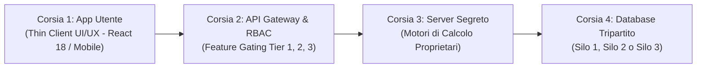

# Regola: Standard Visivi Miro, Geometria ISO, Routing Ortogonale & Zero Crossing

## 1. Principio Generale Assoluto: Leggibilità Aurea & Pulizia Estetica Universale

- **Validità Universale su Tutta la Board:** Questo standard di leggibilità, pulizia geometrica e spaziatura non si applica solo a singoli flowchart pilota, ma è **OBBLIGATORIO E GENERALE per tutti i 18 flowchart e per qualsiasi elemento presente sull'intera board Miro online** (Board ID: `uXjVEbo6L2o=`).
- **Obiettivo Ergonomico:** Chiunque apra la board (sviluppatori Software House, preparatori, medici o altri agenti) non deve mai sforzarsi per comprendere gli schemi. Gli elementi non devono apparire compressi, sovrapposti o confusi: l'ordine geometrico e l'armonia visiva sono requisiti di primo livello.

---

## 2. Notazione ISO Forme & Struttura a 4 Swimlanes

Ogni flowchart operativo della Zona 4 deve essere strutturato rigidamente su 4 corsie funzionali (swimlanes):

### Forme ISO Standard
1. **Rettangolo Arrotondato (`round_rectangle`):** Start / End del flusso o Trigger / Input utente.
2. **Rettangolo Standard (`rectangle`):** Schermata UI (Corsia 1) o Elaborazione / Servizio applicativo (Corsie 2 e 3).
3. **Rombo (`diamond`):** Decisione condizionale logica (`SE / ALLORA`) con rami ed etichette esplicite (`SÌ` / `NO`).
4. **Cilindro / Database:** Entità di persistenza su disco, con esplicita indicazione del database di destinazione (Silo 1 Social, Silo 2 Bunker, Silo 3 Research).

---

## 3. Codice Colore Gap Analysis & Gestione dei 4 Stati UI

### A. Codice Colore Gap Analysis (Capitolato Software House)
Nei flowchart operativi di **Zona 4** è ammesso utilizzare la **Palette Funzionale per Swimlane** (Client `#e0f2fe`, Gateway `#ede9fe`, Server `#d1fae5`, DB `#ffe4e6`, Decisioni `#fef3c7`, Vincoli/Alert `#fee2e2`) per mantenere coerenza visiva con i flussi già deployati (Col 2 e Col 3), riportando lo stato Gap Analysis (VERDE/GIALLO/ARANCIONE/ROSSO) nei capitolati `.md` e nelle tabelle di Zona 5:
- **VERDE (`#2ecc71` - AS-IS Pronto):** Componente già implementato e funzionante nella Beta locale React/TS.
- **GIALLO (`#f1c40f` - Parziale / Refactor):** Funzionalità abbozzata o presente nel codice legacy JS, da tipizzare e migrare.
- **ARANCIONE (`#e67e22` - TO-BE Nuovo):** Modulo o logica da sviluppare ex novo da parte della Software House.
- **ROSSO / VIOLA (`#e74c3c` / `#9b59b6` - ADR / Vincolo Critico):** Requisito non negoziabile di sicurezza informatica, crittografia a tenuta stagna o vincolo di validazione biometrica ($F$ in N, $P$ in W, Carico in kg).

### B. Gestione Tassativa dei 4 Stati UI & Edge Cases
In ogni flusso di interfaccia devono essere esplicitati:
1. **Empty State:** Schermata al primo accesso, nessun dato presente o nessun atleta associato.
2. **Loading State:** Transizione visiva durante le chiamate asincrone verso il server centrale.
3. **Populated State:** Vista ordinaria a regime con dati completi, grafici e tabelle renderizzate.
4. **Error / Fallback State:** Gestione di errori di rete, credenziali errate, assenza di baseline (cold-start) e prevenzione assoluta di valori anomali (`NaN`, `undefined`).

---

## 4. Geometria delle Forme, Proporzioni & Respiro Visivo (Zero Testo Tagliato)

1. **Zero Testo Tagliato o Compresso:** All'interno di qualsiasi riquadro (rettangolo arrotondato) o rombo decisionale, il testo deve essere **visibile al 100%** senza alcuna riga troncata, sovrapposta ai bordi o collassata.
2. **Dimensionamento Rombi Decisionali:** A causa dei vertici inclinati a 45°, la superficie utile interna del rombo è limitata. I rombi devono avere:
   - Larghezza minima: $W \ge 360\text{px}$.
   - Altezza minima: $H \ge 125\text{px}$.
   - Dimensione font: $12\text{-}14\text{px}$ con testo sintetico e chiaro.
3. **Larghezza Generosa dei Riquadri:** Ispirarsi sempre allo standard ad alto respiro dei riquadri dell'Hub Centrale:
   - Larghezza standard: $W \ge 380\text{-}500\text{px}$ per consentire al testo di andare a capo con naturalezza.
4. **Spaziatura Inter-Nodo:** Mantenere uno spazio minimo di $70\text{-}90\text{px}$ tra elementi collegati consecutivi per consentire alle etichette dei connettori di respirare.

### B. Standard Visivi & Geometrici dei Badge di Identificazione Flusso (#01..#18)
I 18 cartigli identificativi posizionati all'inizio di ciascun diagramma di flusso sulla board Miro devono rispettare rigidamente la seguente codifica:
1. **Forma Geometrica:** `round_rectangle` con angoli arrotondati e bordo ad alto spessore (`borderWidth: 3.0px`).
2. **Dimensioni Calibrate:**
   - Larghezza fissa: $W = 520\text{px}$ (garantisce zero troncamento del testo e spaziatura aurea).
   - Altezza: $H = 75\text{px}$ per titoli standard di Tier 1 e Tier 2; fino a $H = 125\text{px}$ per le titolazioni estese e multi-riga di Tier 3.
3. **Palette Ufficiale per Tier:**
   - **Tier 1 (Casual Consumer B2C):** Sfondo `#0f766e` / Bordo `#14b8a6` (Teal 700 / Teal 500) con testo bianco `#ffffff`.
   - **Tier 2 (Pro Coach & Fisio B2B):** Sfondo `#b45309` / Bordo `#f59e0b` (Amber 700 / Amber 500) con testo bianco `#ffffff`.
   - **Tier 3 (Elite Pro Teams & Enterprise KMS):** Sfondo `#4338ca` / Bordo `#818cf8` (Indigo 700 / Indigo 400 ad alto contrasto per Dark/Light theme) con testo bianco `#ffffff`.
4. **Contenuto Informativo Strutturato:** Ciascun badge deve indicare: Numero progressivo (`#01`..`#18`), Tier di appartenenza, Codice univoco flusso (es. `FLOW-1A`), Titolo formale e indicazione della colonna tematica.

---

## 5. Standard di Routing Ortogonale dei Connettori & Zero Crossing (FONDAMENTALE)

1. **Connettori Rigorosamente Ortogonali (`shape: 'elbowed'`):**
   - Tutti i collegamenti tra nodi devono utilizzare esclusivamente segmenti a 90° (`elbowed`). Vietati connettori curvi casuali, diagonali caotiche o rette inclinate.
2. **Etichette Orizzontali (`textOrientation: 'horizontal'`):**
   - Le didascalie posizionate sulle frecce non devono **MAI** essere scritte in verticale né sovrapporsi al bordo o al corpo delle forme.
3. **Divieto Assoluto di Attraversamento Riquadri (Zero Line-Box Crossing):**
   - Nessun connettore o freccia deve MAI tagliare, attraversare o passare sopra/sotto riquadri, rombi o testi intermedi.
   - **Gutter Routing (Instradamento nei Corridoi Liberi):** Tutte le linee di ritorno o i salti di sezione devono percorrere corridoi geometrici vuoti (*gutters*) posti lateralmente o centralmente rispetto alle colonne dei blocchi.
4. **Eliminazione di Tratti Diagonali Cross-Board (Laser Beams):**
   - È vietato collegare nodi distanti tra loro con connettori diagonali che attraversano la board o blocchi di altri diagrammi. I passaggi inter-modulo si gestiscono con:
     - Badge/card di transizione locali ben formattate (es. `-> NAVIGA ALL'HUB CENTRALE`).
     - Corridoi perimetrali dedicati privi di ostacoli.
5. **Regola della "No-Fly Zone" per i Badge di Identificazione (#01..#18):**
   - Ciascuno dei 18 badge possiede una **zona di rispetto perimetrale (No-Fly Zone) di almeno $40\text{px}$** su tutti e 4 i lati.
   - È fatto divieto assoluto a qualsiasi connettore ortogonale (`elbowed`) o freccia di attraversare l'area del badge o la sua fascia di rispetto. Tutti i connettori devono circumnavigare la No-Fly Zone transitando nei corridoi (*gutters*) perimetrali per garantire zero-crossing assoluto.

---

## 6. Pratiche Operative API REST Miro v2 & Validazione Geometrica

1. **Endpoint REST Miro v2 Corretti:**
   - Aggiornamento / lettura forme: `PATCH /v2/boards/{board_id}/shapes/{item_id}`.
   - Aggiornamento / lettura connettori: `PATCH /v2/boards/{board_id}/connectors/{item_id}`.
   - Snap points espliciti: utilizzare sempre punti di ancoraggio coerenti (`snapTo: top, bottom, left, right`).
2. **Validazione Geometrica Prima della Chiusura:**
   - Prima di considerare conclusa qualsiasi operazione sui connettori o sul riposizionamento di forme su Miro, eseguire lo script di calcolo delle intersezioni per certificare **0 crossings** (nessuna sovrapposizione linea-forma).
3. **Controllo Ingegneristico Documentale (Regola 08, Sez. 7):**
   - Prima di considerare conclusa qualsiasi modifica o estensione ai flowchart su Miro, verificare tassativamente che sia stato aggiornato il corrispondente file `.md` di capitolato tecnico in `architecture-blueprint/00-capitolato-tecnico-e-glossario/`, il Glossario Tecnico Vivente e la cascata top-down sui diagrammi sottostanti.
