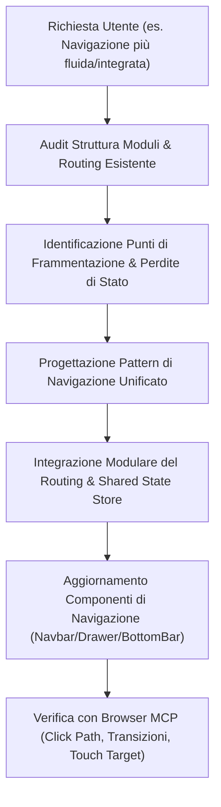

# App Navigation Integrator Skill

Questa skill fornisce linee guida, pattern architetturali e procedure operative per unificare la navigazione interna dell'applicazione T7 Workout PWA, eliminare frizioni tra i diversi moduli funzionali (allenamento, analisi biometriche, storico, carichi, periodizzazione) e garantire una user experience fluida, rapida e priva di perdite di stato.

---

## 1. Principi di Navigazione per la PWA

- **Navigazione Senza Ricaricamento (SPA Fluida):** Il cambio tra moduli non deve mai comportare il reload completo della pagina, preservando sempre cache, connessioni Bluetooth ai sensori e timer attivi.
- **Persistenza dello Stato e del Contesto:** Quando l'utente passa da una schermata all'altra (es. dall'esecuzione esercizio al grafico di potenza), lo stato della sessione attiva (ripetizioni registrate, tempo di recupero, filtri impostati) non deve mai andare perso.
- **Gerarchia Visiva Globale Coerente:**
  1. **Top Bar Unificata:** Indicatore della sezione corrente, indicatori di stato (sensori, batteria, connettività offline PWA), pulsanti di azione contestuale rapida.
  2. **Area Contenuto Dinamica:** Transizioni fluide a scorrimento o dissolvenza tra viste.
  3. **Bottom Navigation / Sidebar Adattiva:** Accesso immediato alle sezioni primarie su mobile (bottom bar con touch target >= 44x44px) o desktop (sidebar compatta espandibile).
- **Gestione del Tasto Indietro (History API & Back Button):** La navigazione interna deve integrarsi con la cronologia del browser (`history.pushState` / `popstate`) per permettere all'utente di usare il tasto Indietro dello smartphone senza uscire dall'applicazione.

---

## 2. Flusso di Lavoro Operativo

### Passo 1: Audit del Routing e dei Componenti Esistenti
1. Analizzare i moduli attuali dell'applicazione (es. in `src/`, `js/` o `index.html`):
   - Come vengono mostrate/nascoste le sezioni (classi CSS `hidden` / `active`, hash routing `#module`, router custom).
   - Quali dati sono memorizzati in variabili globali o `localStorage`.
2. Mappare i punti di attrito: sezioni isolate, bottoni indietro mancanti, incoerenze visive tra header di schermate diverse.

### Passo 2: Eliminazione delle Frammentazioni e Unificazione del Layout
1. **Design Tokens Condivisi:** Assicurarsi che tutte le barre di navigazione usino gli stessi token di spaziatura, colori, bordi e font.
2. **Pannello di Navigazione Globale:** Introdurre o consolidare una barra di navigazione unificata che rimanga visibile o facilmente richiamabile in qualsiasi vista.
3. **Scorciatoie Contestuali:** Permettere salti rapidi tra moduli correlati (es. dalla scheda di un esercizio al grafico di progressione carichi relativo con un singolo tocco).

### Passo 3: Gestione del Contesto e dello Stato Condiviso
- Implementare o verificare un gestore di stato centrale semplice e reattivo (senza librerie pesanti di terze parti, rispettando la natura vanilla del progetto).
- Assicurare che il salvataggio dei dati su disco/database locale (IndexedDB / LocalStorage) avvenga in background prima della transizione tra sezioni.

### Passo 4: Implementazione Modulare e Chirurgica (Regole 01 & 02)
- Collocare la logica di navigazione in file dedicati con responsabilità singola (es. `navigationRouter.js`, `navigationBar.js`, `viewTransitionManager.js`).
- Commentare ogni funzione descrivendo parametri di input, output e logica di routing.
- Evitare valori magici numerici: definire costanti MAIUSCOLE per soglie di swipe, durate transizioni e breakpoint (es. `const NAV_TRANSITION_DURATION_MS = 200;`, `const TOUCH_SWIPE_THRESHOLD_PX = 50;`).

### Passo 5: Verifica con Browser MCP
- Utilizzare i server MCP (`playwright` o `chrome-devtools`) per:
  1. Simulare la navigazione tra tutte le sezioni principali.
  2. Verificare che il tasto "Indietro" riporti alla vista precedente senza errori in console.
  3. Verificare che su viewport mobile (375x667, 390x844) i touch target siano ampi e non sovrapposti.
- Eseguire `py test_check.py` per confermare la piena correttezza sintattica.
