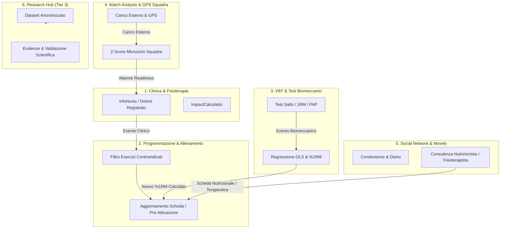

# App Navigation Integrator Skill (Global Shell & Event Storming)

Questa skill fornisce linee guida, pattern architetturali e procedure operative per unificare la navigazione interna dell'applicazione T7 Workout PWA, progettare la Global Navigation Shell con Selettore Globale Atleta/Squadra e orchestrare le catene di eventi automatici tra tutti i 10 moduli applicativi.

---

## 1. Principi della Global Navigation Shell (Stile Apple)

- **Selettore di Contesto Globale (Atleta / Squadra):**
  - Posizionato nella Top Bar unificata, accessibile con 1 singolo tocco da qualsiasi vista.
  - Il cambio di atleta o squadra propaga istantaneamente l'evento in tutti i moduli (scheda attiva, dati clinici, storico carichi, test VBT) senza ricaricare la pagina (SPA reattiva) e senza perdite di stato o dati non salvati.
- **Top Bar Unificata & Status Bar:**
  - Mostra il modulo attivo, breadcrumb di navigazione, stato sensori Bluetooth (BLE/ANT+), indicatore offline PWA e selettore atleta/squadra.
- **Bottom Navigation Bar (Mobile) / Sidebar Collassabile (Desktop):**
  - Accesso immediato alle macro-aree con touch target $\ge 44 \times 44\text{ px}$.
  - Transizioni fluide (max 200ms) conformi a CSS hardware-accelerated (`transform: translate3d`).
- **Integrazione con History API:** Gestione trasparente del tasto Indietro (`popstate`) per evitare l'uscita accidentale dalla PWA su dispositivi mobili.

---

## 2. Matrice di Interconnessione Cross-Modulo (Event Storming)

### Le 6 Catene di Eventi Automatiche Obbligatorie:
1. **Clinica -> Programmazione:** La registrazione di un infortunio o limitazione articolare attiva l'`ImpactCalculator`, che filtra in tempo reale gli esercizi controindicati nella scheda di allenamento dell'atleta selezionato e propone varianti sicure con esercizi di pre-attivazione.
2. **VBT -> Scheda Allenamento:** L'esecuzione di un test di velocità o PAP calcola il nuovo $1\text{RM}$ tramite regressione e aggiorna automaticamente i carichi target (in kg) della sessione.
3. **Match Analysis / GPS -> Microciclo & Readiness:** I dati di carico esterno (distanza ad alta intensità, accelerazioni) aggiornano lo Z-Score del microciclo della squadra, allertando lo staff medico/fisioterapico se un atleta supera la soglia critica di fatica.
4. **Doppio Ruolo Tattico:** Gestione di atleti con duplice collocazione in campo (es. terzino/ala), calcolando baseline ponderate sui minuti giocati in ciascuna posizione.
5. **Social / Movely -> Diario Cliente:** La consulenza di un professionista (nutrizionista/coach) approvata dal cliente inietta la programmazione direttamente nel diario personale Tier 1/2.
6. **Bunker Pro -> Research Hub:** Pipeline di de-identificazione automatica che estrae dati aggregati statistici privi di PII per la ricerca accademica.

---

## 3. Procedura Operativa e Verifica
- Documentare l'albero di navigazione e i diagrammi di transizione in:
  `E:\Nuove App Installate\Sports-Analytics-Platform---T7-Workout-APP\architecture-blueprint\02-miro-zones-and-swimlanes\`
- Verificare la corretta gestione dello stato con Chrome DevTools MCP e Playwright MCP.
