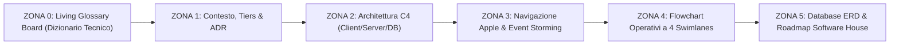

# Miro & Software House Blueprint Skill

Questa skill guida la progettazione, generazione e aggiornamento di diagrammi ingegneristici e flowchart sulla board Miro online e per il capitolato della Software House, nel pieno rispetto delle Regole:
- `08-miro-architecture-blueprint.md` (Architettura di Prodotto, Tiers ed Ereditarietà a Cascata)
- `10-miro-design-standards-and-routing.md` (Standard Visivi, Geometria ISO, Routing Ortogonale & Zero Crossing).

---

## 1. Principi e Standard Inviolabili

- **Priorità Assoluta alla Board Miro Online:** Il lavoro operativo primario si svolge **DIRETTAMENTE sulla Board Miro Online** (Board ID: `uXjVEbo6L2o=`) tramite il server MCP `miro` con l'access token configurato.
- **Sincronizzazione Secondaria su Git (Portatile $\leftrightarrow$ Fisso):** Il salvataggio del codice Mermaid (`.mmd`) e delle note Markdown in `architecture-blueprint/`, seguito dal commit e push su GitHub, è la procedura di salvataggio/backup per consentire il passaggio trasparente e allineato dei dati tra PC Portatile e PC Fisso.
- **Struttura a 4 Corsie (Swimlanes):**
  1. *Corsia 1:* App Utente (Thin Client UI/UX - React 18 / Mobile)
  2. *Corsia 2:* API Gateway & Auth/RBAC (Feature Gating Tier 1, 2, 3)
  3. *Corsia 3:* Server Centrale Segreto (Motori di Calcolo Proprietari)
  4. *Corsia 4:* Database Tripartito (Silo 1: Social/Movely, Silo 2: Bunker Club Pro, Silo 3: Research Warehouse)
- **Forme ISO Standard:**
  - Rettangolo Arrotondato: Start / End / User Trigger.
  - Rettangolo Standard: Schermata UI (Client) o Calcolo/Servizio (Server).
  - Rombo: Decisione logica condizionale con frecce esplicitamente etichettate (`SÌ` / `NO`).
  - Cilindro: Entità di persistenza Database (specificando il Silo 1, 2 o 3).
- **Codice Colore Gap Analysis:**
  - `VERDE (#2ecc71)`: AS-IS Pronto (funzionante nella Beta locale).
  - `GIALLO (#f1c40f)`: Parziale / Refactor (abbozzato o legacy JS).
  - `ARANCIONE (#e67e22)`: TO-BE Nuovo (da sviluppare ex novo per la Software House).
  - `ROSSO/VIOLA (#e74c3c / #9b59b6)`: Vincolo Critico ADR / Sicurezza / Dimensione Fisica.

- **Standard di Tipografia, Spaziatura, Routing Ortogonale & Zero Crossing (Regola 10):**
  - *Zero Testo Tagliato*: Nei riquadri e soprattutto nei rombi (decisioni), il testo deve vedersi per intero senza tagli. Dimensionare i rombi con $W \ge 360\text{px}$ e $H \ge 125\text{px}$ (font 12-14px) per garantire ampia superficie utile interna.
  - *Connettori Rigorosamente Ortogonali (`shape: 'elbowed'`) & Etichette Orizzontali*: Didascalie orizzontali (`textOrientation: 'horizontal'`), spazio minimo inter-nodo di $70\text{-}90\text{px}$.
  - *Divieto Assoluto di Linee che Attraversano Riquadri (Zero Line-Box Crossing)*: Connettori instradati esclusivamente nei corridoi vuoti (gutters). Nessuna linea deve tagliare rettangoli o rombi.
  - *Respiro e Larghezza Generosa*: Ispirarsi ai riquadri dell'Hub Centrale ($W \ge 380\text{-}500\text{px}$), favorendo ordine, simmetria e massima facilità di lettura immediata per chiunque consulti lo schema.

- **Regola di Ereditarietà a Cascata Top-Down dei 3 Livelli (Regola 08):**
  - Modifiche su Tier 1 (General User) $\to$ Propagazione obbligatoria e automatica su Tier 2 (P.IVA) e Tier 3 (Pro Teams).
  - Modifiche su Tier 2 (Partita IVA) $\to$ Propagazione automatica verso il basso solo su Tier 3 (Pro Teams).
  - Modifiche su Tier 3 (Pro Teams) $\to$ Isolate rigidamente in Tier 3 (nessuna risalita).

---

## 2. Le Zone della Board Miro & Glossario Tecnico Evolutivo



0. **ZONA 0 (Living Glossary Board):** Area dedicata enciclopedica posta a monte degli schemi. Raccoglie definizioni chiare e semplificate di ogni termine tecnico, formula o acronimo utilizzato (ingegneria software, biomeccanica, statistica, clinica). **Obbligo vincolante:** aggiornare progressivamente questa board a ogni modifica o aggiunta di schemi.
1. **ZONA 1:** Matrice permessi Tier 1 (Base/Social), Tier 2 (Pro/P.IVA), Tier 3 (Elite/Bunker/Ricerca) e schede Architecture Decision Record (ADR).
2. **ZONA 2:** Topologia C4. Thin Client + API Gateway + 5 Motori di Calcolo (VBT, Periodizzazione/Triage, Z-Score Microciclo, RAG, Export Excel/PDF) + 3 Silos DB.
3. **ZONA 3:** Global Shell stile Apple (Selettore Globale Atleta/Squadra) ed Event Storming tra i moduli (es. Fisioterapia -> aggiorna Programmazione).
4. **ZONA 4:** Flowchart dettagliati dei processi core a 4 corsie con gestione dei 4 stati UI (Empty, Loading, Populated, Error/Fallback).
5. **ZONA 5:** Schema Entità-Relazione (ERD) e Matrice di Capitolato Tecnico per la Software House.

---

## 3. Esportazione Vettoriale con Mermaid CLI
Per convalidare ed esportare i diagrammi Mermaid prima della consegna o del passaggio tra dispositivi:
```powershell
npx.cmd mmdc -i "architecture-blueprint\02-miro-zones-and-swimlanes\<diagram_name>.mmd" -o "architecture-blueprint\02-miro-zones-and-swimlanes\<diagram_name>.svg"
```
