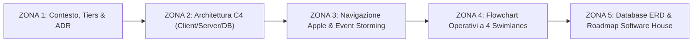

# Miro & Software House Blueprint Skill

Questa skill guida la progettazione, generazione e sincronizzazione di diagrammi ingegneristici e flowchart per la board Miro e per il capitolato della Software House, nel pieno rispetto della Regola `08-miro-architecture-blueprint.md`.

---

## 1. Principi e Standard Inviolabili

- **Rispetto della Regola 08:** Ogni schema deve conformarsi alla suddivisione in 5 Zone e alla notazione formale descritta in [08-miro-architecture-blueprint.md](file:///E:/Nuove%20App%20Installate/Sports-Analytics-Platform---T7-Workout-APP/.agents/rules/08-miro-architecture-blueprint.md).
- **Struttura a 4 Corsie (Swimlanes):**
  1. *Corsia 1:* App Utente (Thin Client UI/UX - React 18 / Mobile)
  2. *Corsia 2:* API Gateway & Auth/RBAC (Feature Gating Tier 1, 2, 3)
  3. *Corsia 3:* Server Centrale Segreto (Motori di Calcolo Proprietari)
  4. *Corsia 4:* Database Tripartito (Silo 1: Social/Movely, Silo 2: Bunker Club Pro, Silo 3: Research Warehouse)
- **Forme ISO Standard:**
  - Rettangolo Arrotondato: Start / End / User Trigger.
  - Rettangolo Standard: Schermata UI (Client) o Calcolo/Servizio (Server).
  - Rombo: Decisione logica condizionale con frecce esplicitamente etichettate (`SÌ` / `NO`).
  - Cilindro: Entità di persistenza Database (specificando il Silo 1, 2 o 3).
- **Codice Colore Gap Analysis:**
  - `VERDE (#2ecc71)`: AS-IS Pronto (funzionante nella Beta locale su E:).
  - `GIALLO (#f1c40f)`: Parziale / Refactor (abbozzato o legacy JS).
  - `ARANCIONE (#e67e22)`: TO-BE Nuovo (da sviluppare ex novo per la Software House).
  - `ROSSO/VIOLA (#e74c3c / #9b59b6)`: Vincolo Critico ADR / Sicurezza / Dimensione Fisica.
- **Doppia Sincronizzazione Obbligatoria:**
  1. Generazione/aggiornamento su Miro via server MCP `miro`.
  2. Salvataggio simultaneo del codice vettoriale Mermaid in file `.mmd` dentro:
     `E:\Nuove App Installate\Sports-Analytics-Platform---T7-Workout-APP\architecture-blueprint\02-miro-zones-and-swimlanes\`

---

## 2. Le 5 Zone della Board Miro



1. **ZONA 1:** Matrice permessi Tier 1 (Base/Social), Tier 2 (Pro/P.IVA), Tier 3 (Elite/Bunker/Ricerca) e schede Architecture Decision Record (ADR).
2. **ZONA 2:** Topologia C4. Thin Client + API Gateway + 5 Motori di Calcolo (VBT, Periodizzazione/Triage, Z-Score Microciclo, RAG, Export Excel/PDF) + 3 Silos DB.
3. **ZONA 3:** Global Shell stile Apple (Selettore Globale Atleta/Squadra) ed Event Storming tra i moduli (es. Fisioterapia -> aggiorna Programmazione).
4. **ZONA 4:** Flowchart dettagliati dei processi core a 4 corsie con gestione dei 4 stati UI (Empty, Loading, Populated, Error/Fallback).
5. **ZONA 5:** Schema Entità-Relazione (ERD) e Matrice di Capitolato Tecnico per la Software House.

---

## 3. Esportazione Vettoriale con Mermaid CLI
Per convalidare ed esportare i diagrammi Mermaid prima della consegna:
```powershell
npx.cmd mmdc -i "architecture-blueprint\02-miro-zones-and-swimlanes\<diagram_name>.mmd" -o "architecture-blueprint\02-miro-zones-and-swimlanes\<diagram_name>.svg"
```
