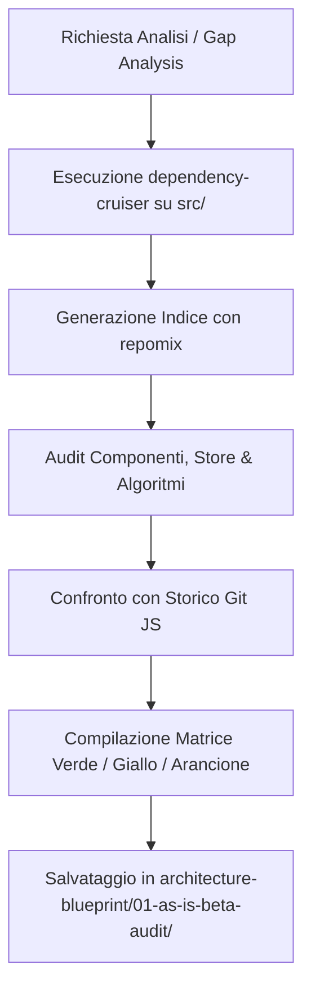

# React & TypeScript Reverse Architect Skill

Questa skill guida l'analisi ingegneristica e il reverse engineering della Beta (React 18 + TypeScript) dell'applicazione T7 Workout PWA. Permette di mappare componenti, flussi di stato, algoritmi e dipendenze per compilare il report di Gap Analysis destinato alla Software House.

---

## 1. Obiettivi e Output Richiesto

- **Mappatura Ingegneristica:** Ispezionare la cartella `src/` e tracciare la rete di dipendenze tra componenti, hook, store di stato e utility.
- **Confronto Storico Git:** Ricercare nello storico dei commit (`git log`, diff) le formule originarie in JavaScript vanilla per verificare parità di funzionalità o logiche mancanti.
- **Gap Analysis Tripartita:**
  - **VERDE (`AS-IS Pronto`):** Moduli e componenti già completamente implementati, tipizzati e funzionanti nella Beta React/TS (da migrare sul server esterno come Thin Client o Server API).
  - **GIALLO (`Parziale / Refactor`):** Funzionalità abbozzate, parzialmente tipizzate o presenti nei vecchi file JS ma non ancora integrate nella Beta.
  - **ARANCIONE (`TO-BE Nuovo`):** Moduli o funzionalità non ancora presenti nel codice, da implementare ex novo da parte della Software House.
- **Destinazione Report:** Salvare sempre i risultati dell'analisi in:
  `E:\Nuove App Installate\Sports-Analytics-Platform---T7-Workout-APP\architecture-blueprint\01-as-is-beta-audit\BETA_AUDIT_REPORT.md`

---

## 2. Strumenti CLI e Flusso Operativo



### Passo 1: Analisi Matematica delle Dipendenze
Eseguire `dependency-cruiser` tramite terminale locale con cache su disco E:
```powershell
npx.cmd depcruise --include-only "^src" --output-type json src > "architecture-blueprint\01-as-is-beta-audit\dependencies.json"
```
Mappare:
1. Hub di aggregazione (file con alto in-degree).
2. Punti di accoppiamento stretto (tight coupling).
3. Moduli isolati o non referenziati (dead code).

### Passo 2: Generazione Indice Completo con Repomix
Eseguire `repomix` per sintetizzare la struttura dei file sorgente:
```powershell
npx.cmd repomix --style xml --output "architecture-blueprint\01-as-is-beta-audit\repomix-output.xml"
```

### Passo 3: Mappatura Algoritmi e Stato
Ispezionare la logica presente nella Beta:
- **Biometria & VBT:** Calcolo velocità media propulsiva (MPV), regressione lineare OLS, stima 1RM.
- **Clinica & Patologie:** Matrice controindicazioni ed esercizi filtrati (`ImpactCalculator`).
- **Periodizzazione:** Modelli DUP, a blocchi, lineare.
- **Gestione Stato:** Store locali, Context API, hook personalizzati (`useLocalStorage`, `useAthlete`).

### Passo 4: Generazione del Documento di Audit
Compilare `BETA_AUDIT_REPORT.md` classificando ogni modulo con la notazione cromatica e le metriche di completamento per il capitolato della Software House.
