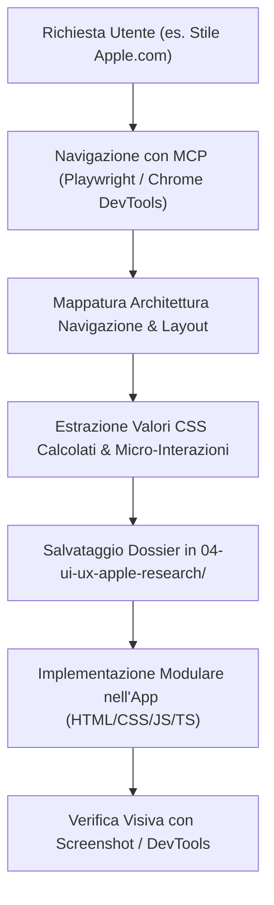

# UI/UX Pattern Extractor Skill (Apple & Modern Web Research)

Questa skill fornisce un flusso di lavoro autonomo, rigoroso e ripetibile per estrarre pattern di design, stili visivi, architetture di navigazione e micro-interazioni da siti web di riferimento (in particolare Apple.com, Garmin, Whoop, Strava, Linear) e tradurli in specifiche pronte per essere integrate nell'applicazione T7 Workout PWA.

---

## 1. Principi Guida & Vincoli di Sistema

- **Isolamento su Disco E:** Qualsiasi sessione browser, cache, profilo temporaneo o dump deve risiedere rigorosamente dentro `"E:\Nuove App Installate\Sports-Analytics-Platform---T7-Workout-APP\.browser-env\"`.
- **Nessuna Scrittura su C:** Variabili d'ambiente `TEMP`, `TMP`, `PLAYWRIGHT_BROWSERS_PATH` e `npm_config_cache` devono puntare a `.browser-env`.
- **Archiviazione Ricerca:** Prima di toccare qualsiasi riga di codice dell'app, salvare sempre il dossier di analisi in:
  `E:\Nuove App Installate\Sports-Analytics-Platform---T7-Workout-APP\architecture-blueprint\04-ui-ux-apple-research\<target_name>_spec.md`
  (mantenendo eventuale copia sincronizzata in `ui-research/`).
- **Nessun Numero Magico:** I valori estratti devono essere mappati in token CSS o costanti JavaScript con nomi espliciti (es. `--spacing-card-padding: 16px;`, `const BLUR_BACKDROP_PX = 20;`).

---

## 2. Flusso Operativo Autonomo

### Passo 1: Navigazione e Ispezione tramite Server MCP
Utilizzare autonomamente i tool di `playwright` o `chrome-devtools`:
1. **Navigazione:** Aprire l'URL target tramite `navigate_page` o `new_page`.
2. **Snapshot della Struttura:** Eseguire `take_snapshot` per analizzare l'albero DOM e la gerarchia semantica.
3. **Screenshot di Riferimento:** Se necessario per confermare proporzioni o layout, catturare uno screenshot e salvarlo nella cartella `04-ui-ux-apple-research/`.

### Passo 2: Mappatura dell'Architettura di Navigazione
Analizzare e documentare:
- **Header & Navbar:** Struttura fissa o sticky, transizioni di trasparenza/blur allo scroll, posizionamento logo e azioni rapide.
- **Menu & Cassetti:** Drawer a scomparsa, sottomenu multilivello, transizioni di apertura/chiusura (durata, curve cubic-bezier).
- **Gerarchia Visiva:** Come l'utente naviga tra macro-sezioni e dettagli; breadcrumbs, back buttons, barre inferiori (bottom bar) per mobile.
- **Adattamento Responsivo:** Breakpoint utilizzati (mobile < 768px, tablet 768-1024px, desktop > 1024px).

### Passo 3: Estrazione dei Valori CSS Calcolati Reali
Ispezionare i nodi chiave tramite `get_css_styles` o `evaluate_script` estraendo i valori calcolati effettivi (`window.getComputedStyle(el)`):
- **Tipografia:** `font-family` (SF Pro, Inter, system-ui), `font-size`, `font-weight`, `line-height`, `letter-spacing`.
- **Colori & Palette:** Colori di sfondo, testi primari/secondari, accenti semantici, opacità per modalità scura e chiara.
- **Effetti Vetro & Sfocatura:** `backdrop-filter: blur(...)`, saturazione, bordi sottili traslucidi (`rgba(255, 255, 255, 0.1)`).
- **Superfici & Ombreggiature:** `box-shadow` a più livelli, `border-radius`, bordi ad alto contrasto o sottili.
- **Spaziature & Griglie:** `gap`, `padding`, `margin`, `display: grid` / `grid-template-columns`, `display: flex`.
- **Micro-interazioni & Animazioni:** Durate delle transizioni (`transition-duration`), curve di easing (`cubic-bezier`), stati `:hover`, `:active`, `:focus-visible`.

### Passo 4: Creazione della Scheda di Sintesi (Dossier in `04-ui-ux-apple-research/`)
Generare un file Markdown ben strutturato in `architecture-blueprint\04-ui-ux-apple-research\<nome_riferimento>_spec.md` contenente:
1. **Design Tokens Estratti:** Mappa di variabili CSS (`:root`).
2. **Component Blueprint:** Esempio HTML/CSS/TS del componente o della navbar analizzata.
3. **Checklist di Integrazione:** Istruzioni puntuali per innestare i pattern nell'applicazione T7 Workout PWA senza rompere gli stili esistenti.

### Passo 5: Applicazione Chirurgica e Verifica Visiva
- Applicare i token e i pattern nei fogli di stile o nei componenti modulari dell'app.
- Verificare il risultato nell'app locale avviata tramite Chrome DevTools MCP (`take_screenshot`, `get_console_message`).
- Se sono stati modificati file JS/TS, eseguire `py test_check.py` e assicurarsi che non vi siano regressioni.
