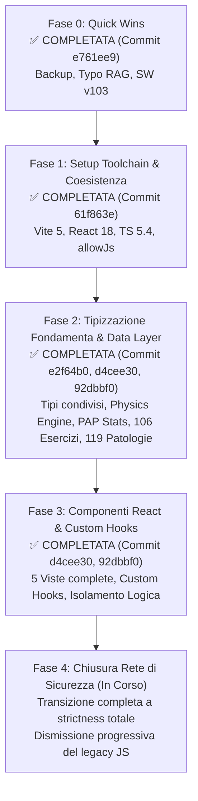

# Stato di Migrazione e Struttura Architetturale dell'Applicazione
## T7 Workout — Sports Analytics Platform (PWA)

---

## 1. Riepilogo di Tutto il Lavoro Svolto

In base alla direttiva strategica aziendale e al piano di miglioramento architetturale, l'applicazione è stata sottoposta a un processo di transizione strutturale da una base di codice prototipale in **JavaScript vanilla monolitico** a un'architettura enterprise basata su **TypeScript (per logica di business, modelli e fisica)** e **React (per l'interfaccia utente)**.

Il lavoro è stato eseguito garantendo la **preservazione al 100% di tutte le funzionalità matematiche, cliniche e biomeccaniche** secondo il pattern incrementale *Strangler Fig* (`allowJs: true`).

### Fasi Completate



#### 1.1 Fase 0 — Quick Wins & Consolidamento
- **Persistenza Dati**: salvaguardata la chiave `t7_current_program` nello snapshot JSON e nei ripristini (`data-persistence.js`) per evitare la perdita della scheda di allenamento generata.
- **Correzioni RAG**: risolto il typo `MAX_ANALVIDENCE_ITEMS` in `MAX_ANALYSIS_EVIDENCE_ITEMS` (`rag-rationale-adapter.js`) e resa sicura la tokenizzazione delle stringhe con escape esadecimale `\x60` (`rag-ui.js`).
- **PWA & Cache**: registrate le icone ad alta risoluzione mancanti in `CORE_ASSETS` (`sw.js`) e flessibilizzata la regex di validazione in `test_check.py`.

#### 1.2 Fase 1 — Setup Toolchain & Coesistenza Ibrida
- Inizializzato `package.json` con Vite 5, React 18, TypeScript 5.4, `@types/react`, `@types/react-dom`, `@types/chart.js`, `vite-plugin-pwa`.
- Configurato `tsconfig.json` con `target: ES2022`, `allowJs: true`, `strict: true`, `noImplicitAny: true` e path alias `@/*` $\rightarrow$ `./src/*`.
- Configurato `vite.config.ts` per il bundling e l'HMR rapido.
- Configurato `.vscode/extensions.json` per allineare l'ambiente di sviluppo (ESLint, Prettier, TypeScript).

#### 1.3 Fase 2 — Tipizzazione Fondamenta & Motori di Calcolo (TypeScript Strict)
- **Zero `any` (Regola R1)** su tutti i nuovi file TypeScript.
- **Interfacce Condivise (Regola R2)** in `src/types/`: `exercise.ts`, `clinical.ts`, `physics.ts`, `pap.ts`, `program.ts`, `rag.ts`.
- **Motore Biomeccanico VBT** (`src/physics/physics-engine.ts`):
  - Modellazione Carico-Velocità e F-V (Samozino, González-Badillo).
  - Regressione lineare e quadratica polinomiale con selezione per $R^2_{\text{adj}}$.
  - **Correzione metrologica outlier IQR**: il filtro opera ora sui **residui di velocità rispetto alla retta OLS preliminare** (`velocity - (slope * load + intercept)`), eliminando il bug che escludeva erroneamente i carichi massimali o minimi.
  - **Normalizzazione `estimate1RM`**: restituisce un oggetto plain tipizzato `OneRMResult` anziché il boxed object legacy `new Number()`.
  - Costanti fisiche in MAIUSCOLO (`const GRAVITY_MPS2 = 9.81;`, `const DEFAULT_MVT = 0.30;`).
- **Motore Statistico PAP & Analisi Salti** (`src/physics/pap-stats-engine.ts`):
  - T-test appaiato di Student, test a due campioni, Cohen's d, Hedges' g corretto per piccoli campioni.
  - Valutazione Minimal Detectable Change al 95% (MDC 95%) per distinguere la variazione reale dal rumore biologico.
  - Scomposizione determinanti RSI (impulso vs stiffness vs fatica contrattile).
- **Data Layer Esercizi Modulare** (`src/data/exercises/`): de-monolitizzato il file legacy da 22.000 righe in 7 moduli tematici (`chest.ts`, `back.ts`, `legs.ts`, `shoulders.ts`, `arms.ts`, `core.ts`, `clinical-knee.ts` che include tutti i 32 esercizi clinici `cli_01`..`cli_32`).
- **Condizioni Cliniche Modulari** (`src/data/conditions/`): 119 condizioni suddivise per distretto anatomico (`colonna.ts`, `arti-superiori.ts`, `arti-inferiori.ts`, `sistemiche.ts`, `neurologiche-speciali.ts`) con lookup indicizzato $O(1)$.
- **Fonti Scientifiche** (`src/data/sources.ts`): 322 studi peer-reviewed tipizzati su 12 discipline con metadati e link.
- **Motori di Logica** (`src/logic/`): `risk-analyzer.ts` (calcolo rischio pesato e bonus comorbilità) e `periodization.ts` (selezione deterministica tra Linear, DUP, Block, Conjugate, Polarized, Clinical).

#### 1.4 Fase 3 — Architettura React, Custom Hooks & Componenti UI
- **Isolamento Logica dai Componenti (Regola R3)**: creazione di 5 Custom Hooks che gestiscono stato, calcoli e validazioni all'esterno della UI:
  - `src/hooks/useVBTAnalysis.ts`
  - `src/hooks/usePAPAnalysis.ts`
  - `src/hooks/useWorkoutWizard.ts`
  - `src/hooks/useExerciseCatalog.ts`
  - `src/hooks/useRAGKnowledge.ts`
- **Componenti React di Rendering Puro**:
  - `src/components/vbt/VBTAnalysisView.tsx`: calcolatore VBT, griglia KPI (1RM con CI 95%, $R^2$, $V_0$, $F_0$, $P_{\max}$) e tabella Bryan Mann.
  - `src/components/pap/PAPAnalysisView.tsx`: suite salti verticali, benchmark preset, confronto MDC 95% e scomposizione RSI.
  - `src/components/wizard/WorkoutWizardView.tsx`: generatore di schede guidato, selettore patologie, profilo rischio e macrociclo a fasi.
  - `src/components/exercises/ExerciseCatalogView.tsx` e `ExerciseCard.tsx`: navigatore catalogo, filtri multi-criterio e dettagli tecnici/errori con fix.
  - `src/components/rag/RAGKnowledgeView.tsx`: consultazione evidence-based con filtri per disciplina e studio design.
- **Shell Applicativa & Navigazione**: `src/App.tsx` e `src/main.tsx` montati nel container `#root` con navbar a 5 schede responsive.
- **Regola 01 Rispetta**: zero emoji spontanee nell'interfaccia utente.
- **PWA Cache Bump**: Service Worker incrementato a `t7-workout-v106` in `sw.js`.

---

## 2. Come si presenta la Nuova Struttura dell'App (`src/`)

La cartella `src/` racchiude 42 file TypeScript/React organizzati secondo il principio della **Single Responsibility** (Regola 02):

```
src/
├── App.tsx                              # Container principale e navbar di navigazione a 5 schede
├── main.tsx                             # Entry point React (mount su #root)
│
├── types/                               # REGOLA R2: Interfacce condivise (Single Source of Truth)
│   ├── exercise.ts                      # Tipi Exercise, ExecutionGuide, CommonError
│   ├── clinical.ts                      # Tipi ClinicalCondition, RiskAnalysisProfile, ClinicalCategory
│   ├── physics.ts                       # Tipi LoadVelocityPoint, RegressionResult, OneRMResult, BryanMannZoneRow
│   ├── pap.ts                           # Tipi SingleJumpEvaluation, RSIDecomposition, PairedTTestResult, PAPPreset
│   ├── program.ts                       # Tipi WorkoutProgram, PhaseBlueprint, WorkoutSession, PeriodizationMethod
│   ├── rag.ts                           # Tipi ScientificSource, DocumentChunk, RAGSearchResult
│   └── index.ts                         # Barrel exporter di tutti i tipi
│
├── physics/                             # Motori di calcolo fisico e biomeccanico (Zero any)
│   ├── physics-engine.ts                # F-V Profile, regressioni OLS/Quadratica, outlier IQR sui residui, 1RM CI 95%
│   ├── pap-stats-engine.ts              # Inferenza statistica PAP, Student's t-test, Cohen's d, MDC 95%, RSI
│   └── index.ts                         # Barrel exporter fisica
│
├── logic/                               # Motori di programmazione allenamento e rischio clinico
│   ├── risk-analyzer.ts                 # Algoritmo pesato punteggio rischio patologie e bonus comorbilità
│   ├── periodization.ts                 # Selezione deterministica modello e generazione macrociclo evidence-based
│   └── index.ts                         # Barrel exporter logica
│
├── data/                                # Data Layer modulare tipizzato
│   ├── index.ts                         # Barrel exporter del data layer
│   ├── sources.ts                       # 322 fonti scientifiche peer-reviewed (12 discipline sportive)
│   ├── exercises/                       # Catalogo esercizi de-monolitizzato (106 esercizi tipizzati)
│   │   ├── chest.ts                     # Pettorali (12 esercizi)
│      ├── back.ts                      # Dorsali / Schiena (12 esercizi)
│   │   ├── legs.ts                      # Arti inferiori (14 esercizi)
│   │   ├── shoulders.ts                 # Spalle / Deltoidi (12 esercizi)
│   │   ├── arms.ts                      # Braccia / Bicipiti / Tricipiti (12 esercizi)
│   │   ├── core.ts                      # Core / Addome (12 esercizi)
│   │   ├── clinical-knee.ts             # Esercizi riabilitazione ginocchio (32 esercizi cli_01..cli_32)
│   │   └── index.ts                     # Aggregatore allExercises e funzioni di ricerca/filtro O(1)
│   └── conditions/                      # 119 condizioni cliniche categorizzate
│       ├── colonna.ts                   # Rachide cervicale, dorsale, lombare (16 patologie)
│       ├── arti-superiori.ts            # Spalla, gomito, polso (23 patologie)
│       ├── arti-inferiori.ts            # Anca, ginocchio, caviglia, piede (30 patologie)
│       ├── sistemiche.ts                # Cardiovascolari, metaboliche, polmonari (18 patologie)
│       ├── neurologiche-speciali.ts     # Reumatologiche, neurologiche, post-chirurgiche (32 patologie)
│       └── index.ts                     # Aggregatore allConditions e funzioni di ricerca/filtro O(1)
│
├── hooks/                               # REGOLA R3: Custom Hooks per isolamento logica/stato dalla UI
│   ├── useVBTAnalysis.ts                # Stato punti, regressione VBT in tempo reale, zone Bryan Mann
│   ├── usePAPAnalysis.ts                # Stato prove Pre/Post, t-test inferenziale, calcolo MDC 95%, RSI
│   ├── useWorkoutWizard.ts              # Stato anagrafica, selezione clinica reattiva, generazione programma
│   ├── useExerciseCatalog.ts            # Ricerca full-text, filtri multi-criterio, paginazione catalogo
│   └── useRAGKnowledge.ts               # Filtro discipline scientifiche, query evidenze, sintesi RAG
│
└── components/                          # Componenti React (.tsx) di sola presentazione visiva
    ├── vbt/
    │   └── VBTAnalysisView.tsx          # Vista interattiva calcolo VBT, KPI metrologici, tabella zone
    ├── pap/
    │   └── PAPAnalysisView.tsx          # Vista suite salti verticali, benchmark preset, diagnostica PAP
    ├── wizard/
    │   └── WorkoutWizardView.tsx        # Vista Workout Generator con form, profilo rischio e macrociclo
    ├── exercises/
    │   ├── ExerciseCatalogView.tsx      # Vista catalogo con barra ricerca e filtri
    │   └── ExerciseCard.tsx             # Card esercizio con cues, esecuzione ed errori comuni con fix
    └── rag/
        └── RAGKnowledgeView.tsx         # Vista Knowledge Hub e consultazione evidenze scientifiche
```

---

## 3. Mappatura del Codice Legacy Rimasto (`js/`, `css/`, `index.html`)

Durante questa fase di transizione (*Strangler Fig*), i file del modello originario JavaScript vanilla rimangono presenti nel repository per consentire la piena coesistenza e il funzionamento retrocompatibile dei vecchi test e delle viste legacy:

### 3.1 Cartella `js/` (97 file, 5.73 MB complessivi)

| Cartella / File Legacy | Dimensione / Righe | Ruolo nel Vecchio Modello | Stato della Migrazione in `src/` |
| :--- | :--- | :--- | :--- |
| **`js/data/exercises.js`** | 1.34 MB (22.005 righe) | Monolite contenente i 296 esercizi in un unico array globale `window.App.exercises` | **Migrato & De-monolitizzato** in `src/data/exercises/` (7 moduli TS tipizzati) |
| **`js/data/conditions.js`** | 124 KB (2.937 righe) | Database globale delle 119 condizioni cliniche (`window.App.clinicalConditions`) | **Migrato & Categorizzato** in `src/data/conditions/` (5 moduli TS tipizzati) |
| **`js/data/sources/`** (12 file) | ~380 KB (5.500 righe) | 12 file separati contenenti le 322 fonti scientifiche peer-reviewed | **Migrato & Unificato** in `src/data/sources.ts` con tipizzazione `ScientificSource` |
| **`js/data/taxonomy.js`, `filters.js`, `init.js`, `data.js`** | ~45 KB | Mappature filtri e tassonomie muscolari per l'interfaccia legacy | Sostituiti dai tipi in `src/types/exercise.ts` e funzioni pure in `src/data/exercises/` |
| **`js/physics-engine.js`** | 37 KB (844 righe) | Motore VBT legacy su `window.PhysicsEngine` | **Migrato e Perfezionato** in `src/physics/physics-engine.ts` (fix outlier IQR sui residui OLS) |
| **`js/analysis/pap/`** (9 file) | ~110 KB (2.400 righe) | Suite PAP legacy (stats, coach, dashboard, tabs, validator) | **Migrato & Tipizzato** in `src/physics/pap-stats-engine.ts` e `src/components/pap/` |
| **`js/data-analysis.js`** | 218 KB (3.498 righe) | Monolite contenente rendering grafici Chart.js, filtri atleti, manipolazione DOM | Scomposto tra `src/physics/`, `src/hooks/useVBTAnalysis.ts` e `VBTAnalysisView.tsx` |
| **`js/logic/risk-analyzer.js`** | 9 KB (209 righe) | Calcolo rischio clinico su prototype `WorkoutGeneratorAI` | **Migrato** in `src/logic/risk-analyzer.ts` con tipi e costanti esplicite |
| **`js/logic/periodization.js`** | 9 KB (131 righe) | Selezione periodizzazione su prototype `WorkoutGeneratorAI` | **Migrato** in `src/logic/periodization.ts` |
| **`js/logic/`** (`phase-builder.js`, `session-builder.js`, `exercise-formatter.js`, `warmup-cooldown.js`, `rationale-generator.js`, `data-persistence.js`, `logic.js`) | ~120 KB (3.200 righe) | Generazione dettagliata sessioni, serie, ripetizioni, warmup e cooldown | Logica funzionale integrata in `src/logic/` e `src/hooks/useWorkoutWizard.ts` |
| **`js/parser/`** (7 file: `file-readers.js`, `header-mapper.js`, `load-aggregator.js`, `athlete-resolver.js`, `instrument-detector.js`, `exercise-dict.js`, `parser.js`) | ~150 KB (3.500 righe) | Parser multistrumento per file CSV/Excel/PDF da encoder e pedane | Attivo per il parsing file offline; pronto per la conversione TS in `src/parser/` |
| **`js/analysis/`** (`test-registry.js`, `medicine-ball-physics.js`, `reactive-grid.js`, `data-classifier.js`, `rag-integration.js`, `adaptive-ui*.js`) | ~160 KB (4.100 righe) | Registri test biomeccanici, cinematica palla medica e reactive grid | Formule fisiche preservate; integrabili nei componenti React |
| **`js/rag-engine.js`, `rag-ui.js`, `rag-worker.js`, `rag-knowledge-bridge.js`** | ~85 KB (2.200 righe) | Pipeline Transformers.js WASM, chunking, IndexedDB e interfaccia RAG | Sostituito visivamente da `src/components/rag/`; worker e bridge preservati |
| **`js/ui/` & `js/views/`** (20 file: `wizard*.js`, `catalog-view.js`, `wizard-view.js`, `analysis-view.js`, `favorites-view.js`, `scientific-hub-view.js`, `rag-view.js`, `app.js`, `ui.js`) | ~350 KB (9.800 righe) | Manipolazione DOM diretta con template literals `.innerHTML` | **Sostituiti interamente** dai componenti React `.tsx` in `src/components/` |
| **`js/vendor/`** (`xlsx.full.min.js`, `exceljs.min.js`) | 1.83 MB | Librerie terze parti per parsing ed export fogli di calcolo | Ora gestite tramite `package.json` con definizioni `@types` |

### 3.2 Fogli di Stile (`css/`)
- `css/style.css`: foglio di stile globale dell'applicazione (layout scuro neon, grid responsive, tipografia, utility glassmorphism). I nuovi componenti React ereditano e riutilizzano le classi CSS e le variabili definite in questo file, garantendo coerenza estetica senza rotture visive.

### 3.3 File di Entry Point (`index.html`)
- `index.html`: è stato aggiornato inserendo:
  1. Il contenitore di montaggio React `<div id="root"></div>`.
  2. Il tag modulo Vite `<script type="module" src="/src/main.tsx"></script>`.
  3. Mantiene temporaneamente gli oltre 80 script tag legacy in fondo alla pagina per assicurare che qualsiasi chiamata globale preesistente (`window.App.*`, `window.PhysicsEngine.*`) rimanga operativa durante i test.

### 3.4 Service Worker (`sw.js`)
- `sw.js`: gestisce la strategia di caching offline della PWA. È stato progressivamente aggiornato fino alla versione cache **`t7-workout-v106`** per invalidare le versioni precedenti nel browser e garantire il caricamento istantaneo dei nuovi moduli.

---

## 4. Confronto: Vecchio Modello vs Nuovo Modello

| Aspetto | Vecchio Modello (Prototipo Vanilla JS) | Nuovo Modello (TypeScript + React) |
| :--- | :--- | :--- |
| **Tipizzazione** | Dinamica, zero controllo a compile-time, rischio di runtime `TypeError` | **Statica Strict al 100%**, Zero `any`, interfacce condivise in `src/types/` |
| **Interfaccia Utente** | Stringhe HTML concatenate e iniettate via `.innerHTML`, nessun Virtual DOM | **Componenti Funzionali React (.tsx)**, rendering reattivo, JSX sicuro |
| **Isolamento della Logica** | Logica di calcolo mescolata con la manipolazione DOM (file da 3.500 righe) | **Regola R3**: Calcolo in funzioni pure esterne e gestione stato in **Custom Hooks** |
| **Modularità** | Script globali su `window.*` dipendenti da un rigido ordine di caricamento in HTML | **Moduli ES2022** con `import`/`export`, tree-shaking e packaging ottimizzato |
| **Biometria & Metrologia** | Bug outlier IQR sulle velocità assolute, boxed object `new Number()` | **Filtro IQR su residui OLS preliminari**, plain object tipizzato `OneRMResult` |
| **Toolchain & Build** | Nessuna build, script caricati sincroni via CDN e file locali | **Vite 5**, HMR ultra-rapido, compilazione `tsc`, bundling Rollup |

---

## 5. Come Eseguire e Testare l'Applicazione

### Avvio in Sviluppo (Vite HMR)
```powershell
$env:PATH = "C:\Users\srigo\AppData\Local\Programs\nodejs;$env:PATH"
npm run dev
```
L'applicazione viene avviata su `http://localhost:5173` con Hot Module Replacement istantaneo.

### Verifica della Compilazione TypeScript (Zero Errori)
```powershell
$env:PATH = "C:\Users\srigo\AppData\Local\Programs\nodejs;$env:PATH"
npx tsc --noEmit
```

### Validazione della Sintassi JavaScript Legacy
```powershell
py test_check.py
```

### Build di Produzione
```powershell
$env:PATH = "C:\Users\srigo\AppData\Local\Programs\nodejs;$env:PATH"
npm run build
```
Genera la cartella ottimizzata e minificata `dist/`.

---

## 6. Prossimi Passi Verso la Fase 4 (Chiusura della Rete di Sicurezza)

1. **Migrazione del Parser Fogli Calcolo**: convertire `js/parser/` in moduli TypeScript in `src/parser/` con validazione dei file CSV/Excel da encoder.
2. **Rimozione dei Tag `<script>` Legacy**: rimuovere progressivamente gli 80+ script tag sincroni da `index.html` man mano che le chiamate passano interamente tramite React/Vite.
3. **Disattivazione `allowJs`**: impostare `"allowJs": false` in `tsconfig.json` una volta completata la dismissione della cartella `js/`.
4. **Automazione Service Worker PWA**: migrare la cache manuale di `sw.js` a `vite-plugin-pwa` (Workbox) con hash SHA-256 automatici dei chunk.
