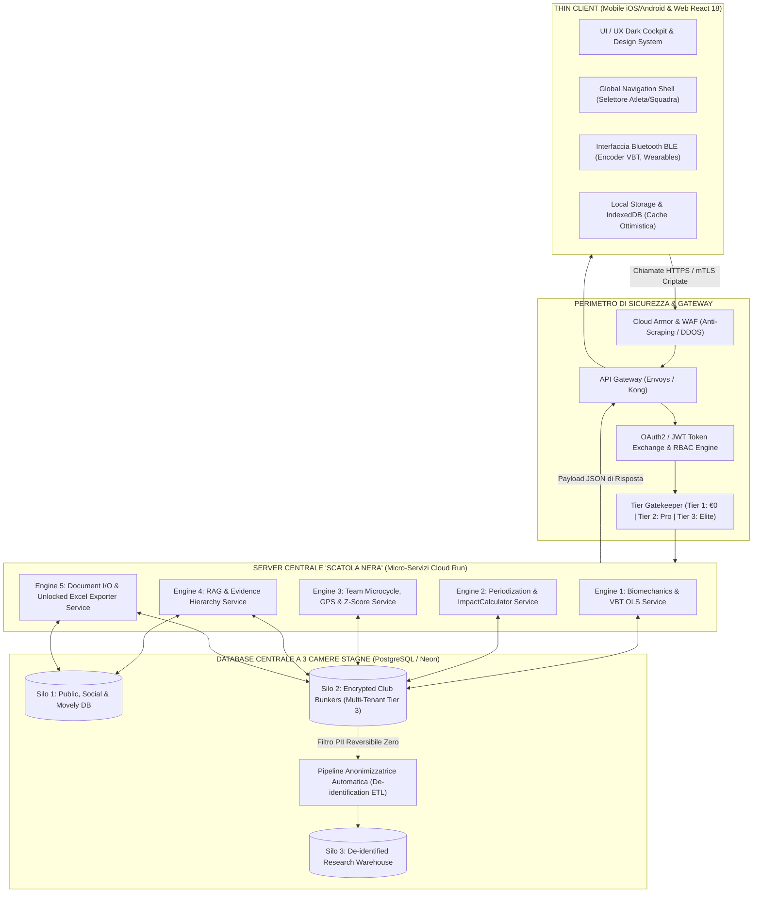
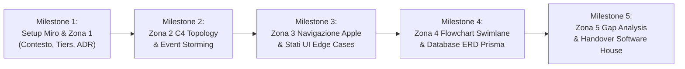

# MASTER ARCHITECTURAL EXECUTION PLAN
## T7 Workout — Sports Analytics Platform
### Specifiche di Visual Engineering per Miro Board & Capitolato Tecnico Software House Handover

---

## 1. ESITO DELL'AUDIT DI VERIFICA REALE

L'analisi preliminare di sola lettura svolta sul filesystem locale su disco `E:`, sullo storico Git e sulla documentazione preesistente ha prodotto i seguenti risultati ingegneristici verificati:

### 1.1 Radiografia del Codice React 18 + TypeScript Attuale (`src/`)
- **Stato Generale:** 108 file TypeScript suddivisi con architettura Feature-Driven in `src/features/` (`catalog`, `programming`, `analysis`, `sources`, `rag`, `favorites`), supportati da `src/physics/`, `src/logic/`, `src/data/`, `src/parser/` e `src/types/`. 100% strict TypeScript con 0 errori di delimitazione o tipizzazione (validato con `py test_check.py`).
- **Data Layer Censito:**
  - **Esercizi:** 296 esercizi codificati e suddivisi in 7 moduli distrettuali (`arms.ts`, `back.ts`, `chest.ts`, `core.ts`, `legs.ts`, `shoulders.ts`, `clinical-knee.ts` che include tutti i 32 protocolli clinici riabilitativi `cli_01`..`cli_32`).
  - **Condizioni Cliniche:** 119 patologie categorizzate in 5 distretti anatomici (`colonna.ts`, `arti-superiori.ts`, `arti-inferiori.ts`, `sistemiche.ts`, `neurologiche-speciali.ts`) con mappatura di gravità e controindicazioni articolari/ROM.
  - **Letteratura Scientifica:** 322 fonti peer-reviewed con metadati completi, DOI e PMID.
- **Motori Funzionanti nella Beta:**
  - *Physics Engine:* Modellazione Carico-Velocità, regressione lineare OLS e quadratica polinomiale, correzione metrologica outlier sui residui di velocità rispetto alla retta preliminare, stima $1\text{RM}$ con IC 95%, Zone di Bryan Mann.
  - *PAP Stats Engine:* Test di Student appaiato e non appaiato, Cohen's $d$, Hedges' $g$, Minimal Detectable Change (MDC 95%), scomposizione RSI.
  - *Risk Analyzer:* Punteggio pesato di rischio per esercizio incrociato con patologie selezionate.
  - *Periodization Wizard:* Modelli DUP, a blocchi, lineare, coniugata, progressione carichi e generatore di sessione.
  - *Knowledge RAG:* Chunker contestuale, vector store in-memory, document parser per PDF/TXT e sintesi evidence-based.
- **Gaps Rilevati nel Client Attuale:**
  - L'applicazione esegue attualmente tutti i calcoli nel browser dell'utente (IndexedDB/LocalStorage). Manca la separazione tra visualizzazione e motori di calcolo.
  - Mancano il Selettore Globale di Contesto Atleta/Squadra nella shell, la gestione dei ruoli multi-staff, il motore Z-Score di microciclo per la squadra, la video analisi biomeccanica, il modulo social Movely e la ripartizione del database nei 3 Silos.

### 1.2 Audit Storico Git Pre-Migrazione (Legacy JavaScript -> TypeScript)
- **Commit di Riferimento:** `25928fd` (*feat: complete total migration to React 18 and strict TypeScript, purge legacy js*).
- **Logiche Estratte e Verificate dal Legacy JS:**
  - `js/impact-calculator.js`: Logica di scoring patologico con penalità esponenziali su carichi assiali (discopatie L4-L5, ernie, stenosi) e cutoff binari (Escluso / Adattato / Disponibile).
  - `js/data-analysis.js`: Pipeline di elaborazione VBT con filtro MAD (Median Absolute Deviation) e fitting su equazione di Hill per la curva di potenza parabolica.
  - `js/rag-worker.js` & `js/rag-engine.js`: Pesatura delle fonti scientifiche tramite moltiplicatori gerarchici basati sull'autorevolezza della banca dati.
  - `js/parser/*`: Parser avanzato di file Excel/CSV con euristica per l'estrazione automatica di colonne disomogenee provenienti da diversi encoder lineari (Vitruve, Beast, Speed4Lifts, GymAware).

### 1.3 Stato Attuale della Board Miro ("FITNESS APP FLOWCHART")
- **Identificativo Board:** `uXjVEbo6L2o=` ([Link Board Miro](https://miro.com/app/board/uXjVEbo6L2o=)).
- **Elementi già tracciati:**
  1. *Sezione 1:* Flusso di Accesso, Onboarding & Anamnesi Utente (Welcome, Bivio Login/Registrazione a 4 step con raccolta Codice Fiscale, Privacy GDPR, screening 119 patologie).
  2. *Sezione 2:* Hub Centrale Cockpit & Navigazione Viste (le 6 viste storiche).
  3. *Sezione 3:* Architettura di Sistema & Data Repository (React 18 + PWA Offline).
  4. *Sezione 4:* I 3 Workflow Funzionali (Generatore Schede, VBT OLS, Test PAP).
- **Necessità di Espansione:** La board attuale non implementa ancora la suddivisione industriale in 5 Zone, il modello dei 3 Tier commerciali, la topologia C4 con Thin Client vs Server Scatola Nera, i 3 Silos del database e i Flowchart operativi a 4 Swimlanes.

---

## 2. ANALISI CRITICA ED ELEVAZIONE ARCHITETTURALE

Rispetto al piano base, il nostro team di Solution Architects ha introdotto le seguenti elevazioni ingegneristiche non negoziabili:



### 2.1 Principio di Tutela dell'IP: "Thin Client + Scatola Nera" (ADR-01)
- L'applicazione scaricata dall'utente non deve contenere alcuna formula di calcolo, coefficiente matematico, euristica di periodizzazione o prompt del RAG.
- Il client invia via JSON esclusivamente parametri grezzi (es. `{ loadKg: 80, rawTimes: [0.34, 0.35] }`). Il Server centrale esegue il calcolo protetto e restituisce l'output finito da renderizzare.

### 2.2 Principio di Multi-Tenant Isolation: I 3 Silos Database (ADR-02)
- **Silo 1 (Social & Movely B2B/B2C):** Raccoglie atleti amatoriali Tier 1, post del feed, marketplace per ingaggiare coach, nutrizionisti e fisioterapisti.
- **Silo 2 (Encrypted Club Bunkers - Tier 3):** Ogni società sportiva professionistica possiede una partizione isolata (Row-Level Security o Database per-tenant) con chiavi crittografiche distinte gestite via Cloud KMS. Nessun dato medico, GPS, VBT o video esce dal perimetro del club.
- **Silo 3 (De-identified Research Warehouse):** Pipeline ETL asincrona che rimuove metadati identificativi (PII) e alimenta serie temporali numeriche standardizzate per università e ricercatori accademici.

### 2.3 Rigore Dimensionale delle Grandezze Fisiche (ADR-03)
- Validazione obbligatoria delle unità di misura SI: Forza esclusivamente in Newton ($F$ in $\text{N}$), Potenza in Watt ($P$ in $\text{W}$), Carico in chilogrammi ($\text{kg}$), Velocità in $\text{m/s}$.
- Prevenzione assoluta di errori dimensionali, stringhe non gestite e valori `NaN`/`undefined`.

---

## 3. MAPPA COMPLETA DEI 10 MODULI E MATRICE DI INTERCONNESSIONE

La piattaforma si compone di 10 moduli funzionali strettamente integrati tra loro tramite una catena di eventi in tempo reale:

| N. | Modulo Applicativo | Tier Accesso | Input Ricevuti (Da chi) | Elaborazione Server Scatola Nera | Output Emessi (Verso chi) |
| :--- | :--- | :--- | :--- | :--- | :--- |
| **M01** | **Profilo, Anamnesi & Readiness** | Tier 1, 2, 3 | Dati wearable (Apple Health, Health Connect), test PVT al tocco, questionari RPE/sonno. | Calcolo Readiness Index pesato, scostamento HRV dalla baseline individuale. | $\rightarrow$ **M03** (riduzione volume se affaticato), $\rightarrow$ **M04** (alert rischio sovraccarico), $\rightarrow$ **M06** (Z-Score interno). |
| **M02** | **Catalogo Esercizi & Pre-Attivazione** | Tier 1 (Base), Tier 2/3 (Completo) | Selezione manuale, filtri anatomici, richieste di variazione da **M04**. | Mappatura pattern motori, catene cinetiche, generazione protocolli pre-attivazione con link video. | $\rightarrow$ **M03** (esercizi disponibili per la scheda), $\rightarrow$ **M04** (esercizi sostitutivi RTP). |
| **M03** | **Programmazione & Macrocicli IA** | Tier 2, 3 | Dati atleta, infortuni attivi (**M04**), $1\text{RM}$ stimato (**M05**), stile coach (**M08**). | Generatore Macrocicli DUP/Blocchi/Lineare/Polarizzata (12-16 sett.), applicazione settimane carico/scarico (-40/50%). | $\rightarrow$ **M01** (scheda nel diario), $\rightarrow$ **M09** (invio scheda cliente Movely), $\rightarrow$ **M05** (target VBT per sessione). |
| **M04** | **Clinica, Infortuni & Return-to-Play** | Tier 2, 3 | Anamnesi iniziale (**M01**), diagnosi medica staff, dolori post-allenamento. | `ImpactCalculator`: filtraggio automatico esercizi controindicati (Escluso / Adattato / Disponibile) su 119 patologie. | $\rightarrow$ **M02** & **M03** (esclusione esercizi con carico assiale/articolare a rischio), $\rightarrow$ **M06** (limitazioni ruolo). |
| **M05** | **Data Analisi & VBT** | Tier 2, 3 | Velocità da encoder, test salto verticale (CMJ, Abalakov, PAP), file Excel/CSV. | Regressione lineare OLS, curva $F$-$v$, $P_{\max}$, stima $1\text{RM}$ con IC 95%, Zone Bryan Mann, verifica MDC 95%. | $\rightarrow$ **M03** (aggiornamento dinamico carichi in kg e $\%$1RM), $\rightarrow$ **M06** (neuromuscular fatigue index). |
| **M06** | **Microciclo Squadra & Z-Score** | Tier 3 | Carico interno (**M01**), dati GPS partita/allenamento, minutaggio per ruolo. | Z-Score composito adattivo, pesatura doppio ruolo tattico, algoritmo fallback nuovi acquisti senza baseline (<6 mesi). | $\rightarrow$ **M03** (regolazione giorni scarico), $\rightarrow$ **M04** (allerta rischio infortuni staff medico/tecnico). |
| **M07** | **Video Analisi Biomeccanica & Match** | Tier 3 | Video caricati (MP4/MOV) da smartphone o telecamere tattiche. | Pose Estimation server-side (angoli articolari valgo/varo, asimmetrie), tagging eventi partita. | $\rightarrow$ **M04** (segnalazione deficit motori), $\rightarrow$ **M06** (affaticamento asimmetrico in gara). |
| **M08** | **Motore RAG & Libreria Scientifica** | Tier 2, 3 | File caricati dal coach (PDF, DOCX, XLS), archivio 322 studi scientifici. | Ingestione lessico proprietario coach + pesatura gerarchica fonti (Tier 1 $\times 1.3$, Tier 2 $\times 1.1$, Tier 3 $\times 1.0$). | $\rightarrow$ **M03** (generazione razionale scientifico della scheda con stile del coach). |
| **M09** | **Social Network & Marketplace Movely** | Tier 1, 2 | Post utenti, richieste consulenza clienti, offerte professionisti P.IVA. | Matchmaking B2B/B2C, gating visibilità tariffe e contatti, gestione feed comunitario. | $\rightarrow$ **M01** & **M03** (accettazione scheda e sincronizzazione con diario cliente). |
| **M10** | **Research Hub Accademico** | Tier 3 (Docenti / Ricercatori) | Dataset estratti da Silo 2 tramite pipeline ETL anonimizzatrice. | Calcolo statistiche descrittive/inferenziali aggregate su coorti di atleti professionisti anonimi. | $\rightarrow$ **M08** (nuovi paper e validazioni evidence-based ri-iniettate nella piattaforma). |

---

## 4. CATALOGO GRANULARE DEI DIAGRAMMI PER MIRO E CODICE MERMAID

Per garantire che la Software House riceva una documentazione esente da ambiguità, il progetto verrà organizzato sulla board Miro secondo una griglia a 5 Zone orizzontali. Ogni diagramma avrà il rispettivo file sorgente `.mmd` (Mermaid) salvato dentro `architecture-blueprint/`:

```
architecture-blueprint/
├── 00-MASTER-EXECUTION-PLAN.md
├── 01-as-is-beta-audit/
│   ├── BETA_AUDIT_REPORT.md
│   └── dependencies.json
├── 02-miro-zones-and-swimlanes/
│   ├── zona1-01-glossario-rbac.mmd
│   ├── zona1-02-system-context-c4.mmd
│   ├── zona2-03-container-architecture-c4.mmd
│   ├── zona3-04-event-storming-matrix.mmd
│   ├── zona3-05-global-navigation-shell.mmd
│   ├── zona3-06-ui-wireflow.mmd
│   ├── zona3-07-ui-states-and-edge-cases.mmd
│   ├── zona4-08a-flowchart-onboarding.mmd
│   ├── zona4-08b-flowchart-macrocycle-generation.mmd
│   ├── zona4-08c-flowchart-vbt-and-zscore.mmd
│   ├── zona4-08d-flowchart-video-biomechanics.mmd
│   └── zona4-08e-flowchart-social-and-research-etl.mmd
├── 03-database-silos-and-api-contracts/
│   ├── schema-prisma-silo1-social.prisma
│   ├── schema-prisma-silo2-bunkers.prisma
│   ├── schema-prisma-silo3-research.prisma
│   └── api-contracts-spec.json
├── 04-ui-ux-apple-research/
│   ├── apple-navigation-design-system.md
│   └── tokens-extracted.css
└── 05-software-house-handover/
    ├── CAPITOLATO_TECNICO_SOFTWARE_HOUSE.md
    └── gap-analysis-color-matrix.md
```

### Dettaglio dei 10 Schemi nelle 5 Zone Miro

#### ZONA 1: CONTESTO, MODELLO A 3 TIER & SCHEDE ADR (Coordinate X: 0..4000, Y: 0..3000)
- **Schema 1 — Glossario Ubiquitous Language & Matrice Permessi RBAC:**
  - *Scopo:* Definire formalmente ogni termine del dominio e la matrice permessi a matrice incrociata: 3 Tier $\times$ 8 Ruoli utente (Atleta Base, Coach P.IVA, Fisioterapista, Medico Sociale, Preparatore Atletico, Match Analyst, Ricercatore, Admin di Piattaforma).
  - *File locale:* `architecture-blueprint/02-miro-zones-and-swimlanes/zona1-01-glossario-rbac.mmd`.
- **Schema 2 — Mappa Ecosistema C4 Livello 1 (System Context) & Schede ADR:**
  - *Scopo:* Rappresentare l'applicazione come sistema centrale e mappare tutti i sistemi esterni (Apple Health, Health Connect, sensori encoder Bluetooth, wearable GPS, scanner video, file Excel del coach) e gli output (PDF interattivi, file Excel totalmente sbloccati). Include le 3 schede ADR formali (ADR-01, ADR-02, ADR-03).
  - *File locale:* `architecture-blueprint/02-miro-zones-and-swimlanes/zona1-02-system-context-c4.mmd`.

#### ZONA 2: ARCHITETTURA TECNICA C4 & ISOLAMENTO IP (Coordinate X: 4500..8500, Y: 0..3000)
- **Schema 3 — Architettura dei Contenitori e Componenti (C4 Livello 2 & 3):**
  - *Scopo:* Mostrare la divisione fisica e logica tra:
    1. *Frontend Thin Client:* PWA React 18 / App Mobile (UI pura, zero calcoli).
    2. *API Gateway:* Cloud Armor WAF + Envoy Gateway + Auth/RBAC Validator.
    3. *Server Centrale Scatola Nera:* I 5 microservizi (VBT Engine, Periodization/Impact Engine, Microcycle Z-Score Engine, RAG Engine, Document I/O Engine).
    4. *Database Tripartito:* Silo 1 (Social), Silo 2 (Bunkers Multi-Tenant), Silo 3 (Research Warehouse) + Pipeline Anonimizzatrice ETL.
  - *File locale:* `architecture-blueprint/02-miro-zones-and-swimlanes/zona2-03-container-architecture-c4.mmd`.

#### ZONA 3: NAVIGAZIONE STILE APPLE & EVENT STORMING (Coordinate X: 9000..13000, Y: 0..3000)
- **Schema 4 — Matrice di Interconnessione ed Event Storming Cross-Modulo:**
  - *Scopo:* Mappare con frecce parlanti bidirezionali come i dati viaggiano tra i 10 moduli in tempo reale (Clinica $\rightarrow$ Esercizi, VBT $\rightarrow$ Carichi, GPS $\rightarrow$ Z-Score, RAG $\rightarrow$ Macrociclo, Movely $\rightarrow$ Diario).
  - *File locale:* `architecture-blueprint/02-miro-zones-and-swimlanes/zona3-04-event-storming-matrix.mmd`.
- **Schema 5 — Albero di Navigazione Globale Adattivo (Global Shell):**
  - *Scopo:* Struttura visiva della shell di navigazione in stile Apple con **Selettore Globale di Contesto Atleta/Squadra** fisso in alto. Regola aurea: massimo 2 click per raggiungere qualsiasi funzione. Adattamento dell'albero in base al Tier (Base, Pro, Elite).
  - *File locale:* `architecture-blueprint/02-miro-zones-and-swimlanes/zona3-05-global-navigation-shell.mmd`.
- **Schema 6 — UI Wireflow Completo:**
  - *Scopo:* Flusso visuale schermata per schermata post-login: Dashboard Cockpit $\rightarrow$ Selettore Viste $\rightarrow$ Schede Tecniche $\rightarrow$ Drawer laterali e modali di alert.
  - *File locale:* `architecture-blueprint/02-miro-zones-and-swimlanes/zona3-06-ui-wireflow.mmd`.
- **Schema 7 — Matrice degli Stati UI e Casi Limite (Edge Cases):**
  - *Scopo:* Per ciascuna delle viste core, definire formalmente il comportamento e l'interfaccia nei 4 stati:
    1. *Empty State:* Primo avvio, assenza di dati, onboarding guidato.
    2. *Loading State:* Spinner hardware-accelerated, skeleton screens, elaborazione server in corso.
    3. *Populated State:* Vista a regime con dati completi e grafici neon.
    4. *Error/Fallback State:* Gestione di assenza baseline storica (<6 mesi), atleti con doppio ruolo tattico, file Excel malformati, prevenzione assoluta di `NaN`/`undefined`.
  - *File locale:* `architecture-blueprint/02-miro-zones-and-swimlanes/zona3-07-ui-states-and-edge-cases.mmd`.

#### ZONA 4: FLOWCHART OPERATIVI A 4 SWIMLANES (Coordinate X: 13500..18500, Y: 0..3000)
I flowchart operativi devono essere rigorosamente strutturati su **4 Corsie Orizzontali (Swimlanes)**:
1. *Corsia 1:* App Utente (Thin Client UI/UX)
2. *Corsia 2:* API Gateway & Controllo Tier/Permessi
3. *Corsia 3:* Server Scatola Nera (Motori di Calcolo Proprietari)
4. *Corsia 4:* Database Tripartito (Silo 1, Silo 2, Silo 3)

- **Schema 8A — Flowchart Onboarding, Scelta Ruolo e Feature Gating:**
  - Registrazione utente, verifica codice fiscale, anamnesi patologie, selezione piano abbonamento (Tier 1/2/3) e rilascio token JWT.
  - *File locale:* `architecture-blueprint/02-miro-zones-and-swimlanes/zona4-08a-flowchart-onboarding.mmd`.
- **Schema 8B — Flowchart Generazione Scheda Iper-Personalizzata & Pre-Attivazione:**
  - Selezione atleta $\rightarrow$ Chiamata ImpactCalculator $\rightarrow$ Filtro patologie $\rightarrow$ Generazione macrociclo con RAG $\rightarrow$ Esportazione Excel sbloccato (`protected: false`) e PDF con QR video.
  - *File locale:* `architecture-blueprint/02-miro-zones-and-swimlanes/zona4-08b-flowchart-macrocycle-generation.mmd`.
- **Schema 8C — Flowchart Pipeline VBT, Test PAP e Z-Score Microciclo:**
  - Input serie da encoder $\rightarrow$ Filtraggio outlier residui OLS $\rightarrow$ Stima 1RM con IC 95% $\rightarrow$ Incrocio carico esterno GPS e carico interno HRV $\rightarrow$ Calcolo Z-Score con ponderazione doppio ruolo e fallback nuovi acquisti.
  - *File locale:* `architecture-blueprint/02-miro-zones-and-swimlanes/zona4-08c-flowchart-vbt-and-zscore.mmd`.
- **Schema 8D — Flowchart Video Analisi Biomeccanica & Match Analysis:**
  - Upload video $\rightarrow$ Pose estimation server-side $\rightarrow$ Calcolo angoli valgo/varo ginocchio $\rightarrow$ Tagging tattico di squadra $\rightarrow$ Notifica staff multi-disciplinare.
  - *File locale:* `architecture-blueprint/02-miro-zones-and-swimlanes/zona4-08d-flowchart-video-biomechanics.mmd`.
- **Schema 8E — Flowchart Social Networking, Matchmaking Movely e Anonimizzazione Ricerca:**
  - Pubblicazione post / ingaggio professionista $\rightarrow$ Iniezione scheda nel diario cliente $\rightarrow$ Trigger notturno pipeline ETL con rimozione PII $\rightarrow$ Archiviazione nel Research Warehouse.
  - *File locale:* `architecture-blueprint/02-miro-zones-and-swimlanes/zona4-08e-flowchart-social-and-research-etl.mmd`.

#### ZONA 5: DATABASE ERD & CAPITOLATO SOFTWARE HOUSE (Coordinate X: 19000..23500, Y: 0..3000)
- **Schema 9 — Database ERD a 3 Silos & Contratti API:**
  - Rappresentazione relazionale completa (schema Prisma) delle entità divise nei 3 Silos e specifica OpenAPI dei contratti di scambio dati JSON.
  - *File locale:* `architecture-blueprint/03-database-silos-and-api-contracts/`.
- **Schema 10 — User Story Mapping & Tabella di Raccordo Software House (Gap Analysis):**
  - Matrice dettagliata per il capitolato di gara con classificazione cromatica Verde / Giallo / Arancione / Rosso.
  - *File locale:* `architecture-blueprint/05-software-house-handover/gap-analysis-color-matrix.md`.

---

## 5. SPECIFICA PRELIMINARE DEL DATABASE TRIPARTITO (ERD) E CONTRATTI API

### 5.1 Definizione dei 3 Silos Dati (Schema Prisma)

#### Silo 1: Public, Social & Movely B2B/B2C
```prisma
model User {
  id            String    @id @default(uuid())
  email         String    @unique
  passwordHash  String
  role          UserRole  // ATHLETE, COACH, PHYSIO, NUTRITIONIST, ADMIN
  tierLevel     TierLevel // TIER_1, TIER_2, TIER_3
  createdAt     DateTime  @default(now())
  profile       Profile?
  socialPosts   SocialPost[]
}

model Profile {
  id              String   @id @default(uuid())
  userId          String   @unique
  user            User     @relation(fields: [userId], references: [id])
  firstName       String
  lastName        String
  avatarUrl       String?
  bio             String?
  isProfessional  Boolean  @default(false)
  servicesOffered String[]
  hourlyRate      Decimal?
}

model SocialPost {
  id        String   @id @default(uuid())
  authorId  String
  author    User     @relation(fields: [authorId], references: [id])
  content   String
  mediaUrl  String?
  createdAt DateTime @default(now())
}
```

#### Silo 2: Encrypted Club Bunkers (Multi-Tenant Tier 3)
```prisma
model ClubTenant {
  id               String       @id @default(uuid())
  name             String
  encryptionKeyRef String       // Riferimento a Cloud KMS
  staffMembers     ClubStaff[]
  athletes         ClubAthlete[]
}

model ClubAthlete {
  id                String       @id @default(uuid())
  clubId            String
  club              ClubTenant   @relation(fields: [clubId], references: [id])
  firstName         String
  lastName          String
  dateOfBirth       DateTime
  primaryPosition   String
  secondaryPosition String?
  dualRoleWeight    Float        @default(1.0)
  marketArrivalDate DateTime
  medicalRecords    MedicalRecord[]
  vbtTests          VbtTestRecord[]
  zScoreHistory     MicrocycleZScore[]
}

model MedicalRecord {
  id               String      @id @default(uuid())
  athleteId        String
  athlete          ClubAthlete @relation(fields: [athleteId], references: [id])
  conditionIcd11   String
  severityLevel    Int         // 1-5
  contraindications String[]
  rtpPhase         String      // ACUTE, SUBACUTE, RETURN_TO_RUN, RETURN_TO_SPORT
  createdAt        DateTime    @default(now())
}
```

#### Silo 3: De-identified Research Warehouse
```prisma
model AnonymizedAthleteSeries {
  id                 String   @id @default(uuid())
  syntheticHash      String   @unique // Hash crittografico unidirezionale non reversibile
  sportDiscipline    String
  competitiveTier    String
  ageBracket         String   // es. "20-24", "25-29"
  tacticalRole       String
  anonymizedVbtData  Json     // Curve F-v, 1RM normalizzati
  anonymizedZScores  Json     // Serie storiche normalizzate
  exportedAt         DateTime @default(now())
}
```

### 5.2 Contratti API Client/Server ("Botta e Risposta" JSON)

#### Contratto 1: Calcolo Profilo VBT e Regressione OLS
- **Endpoint:** `POST /api/v1/vbt/calculate-profile`
- **Request Payload:**
```json
{
  "athleteId": "ath_7702",
  "exerciseId": "sq_back_01",
  "series": [
    { "loadKg": 60.0, "meanVelocity": 0.95, "peakVelocity": 1.25 },
    { "loadKg": 80.0, "meanVelocity": 0.78, "peakVelocity": 1.05 },
    { "loadKg": 100.0, "meanVelocity": 0.62, "peakVelocity": 0.88 },
    { "loadKg": 120.0, "meanVelocity": 0.45, "peakVelocity": 0.65 }
  ],
  "customMvt": 0.30
}
```
- **Response Payload:**
```json
{
  "rSquared": 0.992,
  "slope": -0.0083,
  "intercept": 1.448,
  "f0Newtons": 1710.5,
  "v0Mps": 1.45,
  "pMaxWatts": 620.3,
  "estimated1RMKg": 138.3,
  "confidenceInterval95": [134.1, 142.5],
  "bryanMannZone": "Strength-Speed (0.75 - 1.00 m/s)",
  "outliersDetected": 0
}
```

#### Contratto 2: Triage Clinico e Filtro Patologie
- **Endpoint:** `POST /api/v1/clinical/triage-impact`
- **Request Payload:**
```json
{
  "athleteId": "ath_7702",
  "activeConditions": ["col_01_lombalgia_acuta", "gin_04_lesione_lca_ricostruito"],
  "requestedExerciseIds": ["sq_back_01", "leg_press_01", "leg_ext_01", "bulgarian_sq_01"]
}
```
- **Response Payload:**
```json
{
  "overallRiskLevel": "HIGH",
  "auditResults": [
    {
      "exerciseId": "sq_back_01",
      "status": "EXCLUDED",
      "reason": "Carico assiale diretto vietato per discopatia lombare attiva",
      "suggestedAlternatives": ["hip_thrust_barbell_01", "belt_squat_01"]
    },
    {
      "exerciseId": "leg_ext_01",
      "status": "ADAPTED",
      "reason": "Limitare escursione articolare tra 45° e 90° per protezione neoligamento LCA",
      "romRestrictionDeg": [45, 90]
    },
    {
      "exerciseId": "bulgarian_sq_01",
      "status": "AVAILABLE",
      "reason": "Carico assiale ridotto, catena cinetica chiusa favorevole"
    }
  ],
  "preActivationRoutine": [
    { "exerciseId": "pre_glute_bridge_01", "sets": 2, "reps": 15, "videoUrl": "https://cdn.t7workout.com/video/pre_01.mp4" }
  ]
}
```

#### Contratto 3: Z-Score Microciclo con Gestione Doppio Ruolo e Fallback
- **Endpoint:** `POST /api/v1/team/z-score-microcycle`
- **Request Payload:**
```json
{
  "clubId": "club_juve_pro",
  "athleteId": "ath_7702",
  "isNewTransferWithout6MonthBaseline": true,
  "tacticalRolesMinutes": {
    "TERZINO_FLUIDIFICANTE": 75,
    "ALA_ATTACCO": 15
  },
  "currentMicrocycleMetrics": {
    "hrvRmssd": 48.5,
    "pvtReactionTimeMs": 245.0,
    "totalGpsDistanceM": 28400,
    "highSpeedRunningDistanceM": 3200,
    "sprintDistanceM": 850
  }
}
```
- **Response Payload:**
```json
{
  "compositeReadinessZ": -1.45,
  "baselineMode": "ROLE_COHORT_WEIGHTED_MEDIAN",
  "roleWeightsApplied": { "TERZINO_FLUIDIFICANTE": 0.833, "ALA_ATTACCO": 0.167 },
  "alertFlag": "HIGH_FATIGUE_RISK",
  "recommendedAction": "Riduzione 30% volume sprint ad alta intensità nel Microciclo G-3",
  "staffAlerts": [
    { "recipientRole": "HEAD_COACH", "message": "Atleta in accumulo fatica eccentrica: limitare cambi di direzione ad alto impatto" },
    { "recipientRole": "DOCTOR", "message": "Monitorare HRV pre-allenamento domani mattina" }
  ]
}
```

---

## 6. MATRICE DI RACCORDO PER LA SOFTWARE HOUSE (GAP ANALYSIS)

Il capitolato tecnico per la Software House adotta la classificazione cromatica quadripartita:

| Componente Architetturale | Stato Gap Analysis | Codice Sorgente Corrispondente su Disco `E:` | Azione Richiesta alla Software House |
| :--- | :--- | :--- | :--- |
| **Data Layer 296 Esercizi + 32 Esercizi Clinici Ginocchio** | **VERDE** (Pronto) | `src/data/exercises/*.ts` | Migrare le definizioni JSON nel database PostgreSQL (Silo 2). |
| **Tassonomia 119 Condizioni Cliniche** | **VERDE** (Pronto) | `src/data/conditions/*.ts` | Migrare nel database (Silo 2) e indicizzare per lookup $O(1)$. |
| **Archivio 322 Fonti PubMed (PMID)** | **VERDE** (Pronto) | `src/data/sources.ts` | Caricare nel vector store PostgreSQL (pgvector). |
| **Algoritmo Regressione VBT OLS & Residui IQR** | **VERDE** (Pronto) | `src/physics/physics-engine.ts` | Incapsulare nel microservizio `Engine 1` (Server Scatola Nera). |
| **Motore PAP Stats & Student's T-Test / MDC 95%** | **VERDE** (Pronto) | `src/physics/pap-stats-engine.ts` | Incapsulare nel microservizio `Engine 1` (Server Scatola Nera). |
| **Interfaccia Dark Cockpit & Design System Neon** | **VERDE** (Pronto) | `src/App.tsx`, `css/` | Mantenere come Thin Client frontend dell'applicazione web/PWA. |
| **ImpactCalculator Patologie & Rischio Ponderato** | **GIALLO** (Da refactorizzare) | `src/logic/risk-analyzer.ts` + `js/impact-calculator.js` (Git) | Integrare logica penalità assiali dal vecchio commit JS nel microservizio `Engine 2`. |
| **Generatore Macrocicli DUP / Blocchi a 12-16 Settimane** | **GIALLO** (Da completare) | `src/logic/periodization.ts` | Estendere da 4 a 16 settimane con calcolo automatico settimane di scarico (-40/50%). |
| **Export Fogli Excel Sbloccati (`protected: false`)** | **GIALLO** (Da completare) | `src/features/programming/excelExporter.ts` | Spostare generazione lato server con colonne feedback atleti sul campo. |
| **Parser Universale Encoder VBT & File Disomogenei** | **GIALLO** (Da recuperare) | `src/parser/*` + `js/parser/*` (Git) | Recuperare euristiche di detection intestazioni disomogenee (Vitruve, Beast, GymAware). |
| **Global Navigation Shell con Selettore Atleta/Squadra** | **ARANCIONE** (Nuovo TO-BE) | Nessuno (Solo specifiche in `architecture-blueprint/`) | Implementare shell reattiva con state management globale stile Apple. |
| **Motore Microciclo Squadra & Z-Score con Doppio Ruolo** | **ARANCIONE** (Nuovo TO-BE) | Nessuno | Sviluppare da zero microservizio `Engine 3` per incrocio GPS e HRV. |
| **Algoritmo Fallback Baseline Nuovi Acquisti (<6 Mesi)** | **ARANCIONE** (Nuovo TO-BE) | Nessuno | Implementare fallback su mediana di ruolo della squadra nel microservizio `Engine 3`. |
| **Video Analisi Biomeccanica (Pose Estimation) & Match** | **ARANCIONE** (Nuovo TO-BE) | Nessuno | Implementare pipeline GPU server-side per tracking angolare e tagging. |
| **Social Network & Marketplace B2B/B2C (Movely)** | **ARANCIONE** (Nuovo TO-BE) | Nessuno | Sviluppare moduli social, feed, contratti e Silo 1 DB. |
| **Pipeline Anonimizzatrice ETL per Research Hub** | **ARANCIONE** (Nuovo TO-BE) | Nessuno | Sviluppare batch di de-identificazione e portale accademico Silo 3. |
| **Architettura Multi-Tenant Silo 2 (Bunkers Crittografati)** | **ROSSO** (Vincolo ADR-02) | Nessuno | Configurazione Cloud KMS, crittografia a livello di tenant e separazione assoluta. |
| **Tutela IP: Thin Client con Zero Formule Matematiche** | **ROSSO** (Vincolo ADR-01) | Nessuno | Revisione codice client prima della build di produzione per eliminare formule proprietarie. |
| **Validazione Dimensionale Rigorosa Unità SI ($F$ in N, $P$ in W)**| **ROSSO** (Vincolo ADR-03) | `src/types/physics.ts` | Validatori runtime lato server per impedire valori adimensionali o errati. |

---

## 7. ROADMAP ESECUTIVA IN MICRO-TASK SEQUENZIALI

Il piano di disegno sulla board Miro e di generazione della documentazione tecnica si articolerà in **5 Milestone atomiche**, eseguite in sequenza rigorosa:



### MILESTONE 1: Setup Griglia Miro e ZONA 1 (Contesto, Tiers 1/2/3 & ADR)
- **Task 1.1:** Setup coordinate spaziali sulla board Miro (5 Frame principali affiancati da sinistra a destra con spacing di sicurezza di 500px).
- **Task 1.2:** Generazione file Mermaid `zona1-01-glossario-rbac.mmd` e disegno su Miro della Matrice RBAC (Tier 1 Base, Tier 2 Pro, Tier 3 Elite Club $\times$ 8 Ruoli).
- **Task 1.3:** Generazione file Mermaid `zona1-02-system-context-c4.mmd` e disegno su Miro della Mappa Ecosistema C4 Livello 1 + le 3 Schede ADR formali.
- **Criterio di Verifica:** Verifica layout visivo, assenza di sovrapposizioni e allineamento semantico con i file `.mmd`.

### MILESTONE 2: ZONA 2 (Architettura C4, Thin Client vs Server Scatola Nera & 3 Silos DB)
- **Task 2.1:** Generazione file Mermaid `zona2-03-container-architecture-c4.mmd`.
- **Task 2.2:** Disegno su Miro dell'architettura a Contenitori C4 Livello 2 & 3:
  - Thin Client (PWA/Mobile)
  - API Gateway & Tier Gatekeeper
  - I 5 Motori del Server Scatola Nera (VBT, Periodizzazione/Triage, Z-Score, RAG, Document I/O)
  - I 3 Silos Database (Social, Bunkers Club Pro, Research Warehouse).
- **Criterio di Verifica:** Validazione della rigida separazione tra client presentazionale e server algoritmico.

### MILESTONE 3: ZONA 3 (Navigazione Apple, Global Shell, Event Storming & 4 Stati UI)
- **Task 3.1:** Generazione file Mermaid `zona3-04-event-storming-matrix.mmd` con le 6 catene di eventi cross-modulo in tempo reale.
- **Task 3.2:** Generazione file Mermaid `zona3-05-global-navigation-shell.mmd` e disegno su Miro dell'Albero di Navigazione con Selettore Globale Atleta/Squadra fisso.
- **Task 3.3:** Generazione file Mermaid `zona3-06-ui-wireflow.mmd` e `zona3-07-ui-states-and-edge-cases.mmd` (Empty, Loading, Populated, Error/Fallback State).
- **Criterio di Verifica:** Rispetto della regola dei "massimo 2 click" e formalizzazione della gestione errori per doppio ruolo e nuovi acquisti.

### MILESTONE 4: ZONA 4 (Flowchart Operativi a 4 Swimlanes & Database ERD Prisma)
- **Task 4.1:** Generazione dei 5 file Mermaid per i flowchart a 4 corsie (Client $\rightarrow$ Gateway $\rightarrow$ Server $\rightarrow$ Database):
  - `zona4-08a-flowchart-onboarding.mmd`
  - `zona4-08b-flowchart-macrocycle-generation.mmd`
  - `zona4-08c-flowchart-vbt-and-zscore.mmd`
  - `zona4-08d-flowchart-video-biomechanics.mmd`
  - `zona4-08e-flowchart-social-and-research-etl.mmd`
- **Task 4.2:** Trasposizione visiva su Miro dei 5 flowchart con notazione ISO standard (Rettangolo arrotondato = Start/End, Rettangolo = Azione, Rombo = Decisione SÌ/NO, Cilindro = DB Silo).
- **Task 4.3:** Redazione degli schemi Prisma per i 3 Silos in `architecture-blueprint/03-database-silos-and-api-contracts/`.
- **Criterio di Verifica:** Verifica ortogonalità delle connessioni e corrispondenza perfetta con la notazione ISO.

### MILESTONE 5: ZONA 5 & HANDOVER SOFTWARE HOUSE (Gap Analysis e Capitolato)
- **Task 5.1:** Compilazione della Matrice di Raccordo Software House con codice colore Verde / Giallo / Arancione / Rosso.
- **Task 5.2:** Generazione del documento formale di capitolato tecnico `architecture-blueprint/05-software-house-handover/CAPITOLATO_TECNICO_SOFTWARE_HOUSE.md`.
- **Task 5.3:** Validazione complessiva finale, sincronizzazione Git e notifica utente per la chiusura del lavoro.
- **Criterio di Verifica:** Completezza di ogni singola specifica contrattuale per la Software House.
