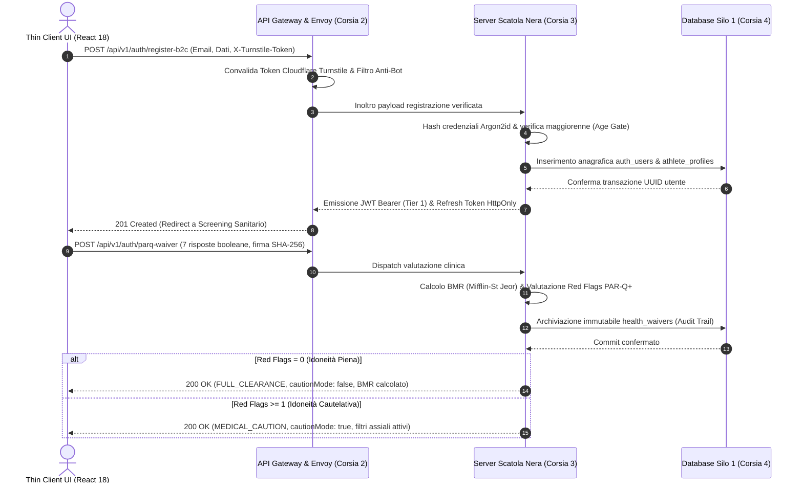

# Capitolato Tecnico: Flow 1A – Accesso, Onboarding & Anamnesi Anti-Frode (T7 Consumer)

## 1. Identificativo & Titolo Ufficiale
- **Badge Miro Board:** `#01` (Posizione: `X: -2570, Y: 260`, Miro Shape ID: `3458764688417722706`)
- **Codice Univoco:** `FLOW-1A`
- **Titolo Formale:** SOFTWARE 1 (B2C CONSUMER) - FLOW 1A: ACCESSO, ONBOARDING & ANAMNESI ANTI-FRODE (T7 CONSUMER)
- **Board Miro Online:** `uXjVEbo6L2o=` (Zona 4, Riga 1: General User / Casual, Colonna 1: Onboarding & Accesso)
- **Diagramma Sorgente:** `architecture-blueprint/02-miro-zones-and-swimlanes/18-flowcharts/software-1-consumer-b2c/flow-1a-consumer-onboarding.mmd`
- **Riferimento Glossario:** [Glossario Tecnico Vivente](00-GLOSSARIO-TERMINI-TECNICI.md) (Voci: [Thin Client](00-GLOSSARIO-TERMINI-TECNICI.md#thin-client-guscio-visivo), [WebAuthn](00-GLOSSARIO-TERMINI-TECNICI.md#webauthn-passkeys-biometria-hardware), [API Gateway](00-GLOSSARIO-TERMINI-TECNICI.md#api-gateway-feature-gating), [Cloudflare Turnstile](00-GLOSSARIO-TERMINI-TECNICI.md#cloudflare-turnstile-scudo-anti-bot-invisibile), [BMR Mifflin-St Jeor](00-GLOSSARIO-TERMINI-TECNICI.md#bmr-mifflin-st-jeor-harris-benedict-fabbisogno-metabolico), [PAR-Q+](00-GLOSSARIO-TERMINI-TECNICI.md#par-q-physical-activity-readiness-questionnaire-digital-triage)).

---


## 2. Obiettivo di Business & Target Utente

### Guida Pratica per Non Tecnici: Cos'è questo modulo per un umano?
Questo modulo rappresenta la "porta d'ingresso" accogliente ma protetta della piattaforma T7 per chiunque voglia rimettersi in forma o allenarsi da solo. Immagina di entrare in una palestra iper-moderna: alla reception non compili noiosi moduli cartacei, ma accedi in un istante appoggiando il dito o con il riconoscimento del viso. Prima di farti toccare i pesi, un assistente discreto ti fa poche domande mirate per essere sicuro al 100% che tu non abbia problemi cardiaci o dolori pregressi. Se hai un piccolo acciacco, l'applicazione lo memorizza e adatterà automaticamente gli esercizi successivi per non farti male; se sei sano come un pesce, ti calcola subito il consumo calorico a riposo e ti porta dritto al tuo diario di allenamento.

### Specifiche di Business & Metriche
- **Target Utente:** Persone comuni, amatori del fitness, frequentatori di sale pesi e atleti che si allenano in totale autonomia (Tier 1 – Free / Low-Cost B2C).
- **Problema Risolto:** Massimizzare la conversione d'iscrizione (Drop-off $< 5\%$) azzerando le frizioni di digitazione credenziali, tutelando contemporaneamente la piattaforma da tre rischi critici:
  1. *Frodi informatiche e bot:* Creazione massiva di account fantasma o bot scraping del database esercizi;
  2. *Responsabilità medico-legale:* Infortuni causati dall'esecuzione di sforzi massimali in soggetti a rischio cardiovascolare senza consenso informato;
  3. *Troll e spammer nella community:* Inquinamento del social Movely Together tramite account anonimi usa-e-getta.

---


## 3. Attori & Architettura a 4 Corsie (Swimlanes)

1. **Corsia 1: Thin Client UI/UX (Mobile React Native / PWA React 18):**
   - Interfaccia reattiva in Dark Mode, gestione del Welcome Carousel, integrazione nativa con WebAuthn per biometric login a 1-tap (Touch ID, Face ID), questionario clinico guidato PAR-Q+ a 7 quesiti e verifica telefonica SMS con step-up.
2. **Corsia 2: API Gateway & Access Control (Envoy Gateway + Cloudflare Turnstile):**
   - Barriera perimetrale anti-bot (Turnstile challenge invisibile), rate-limiting basato su reputazione IP/ASN, blocco dei domini email temporanei disposable, emissione token crittografici JWT firmati (Ruolo `R1_ATHLETE`) e generazione OTP via SMS tramite Twilio.
3. **Corsia 3: Server Scatola Nera (Consumer Engine Cloud Run):**
   - Motore computazionale isolato: calcolo dell'equazione metabolica Mifflin-St Jeor per il BMR, applicazione automatica dei filtri precauzionali (Low-Impact Shield) se emergono risposte positive al PAR-Q+, inizializzazione partizione utente e azzeramento contatori di streak.
4. **Corsia 4: Database Tripartito (Silo 1 - Consumer & Social Public Partition):**
   - Persistenza anagrafica cifrata (password hashate con Argon2id), audit trail medico-legale immutabile con timestamp e hash SHA-256 delle risposte sanitarie (`health_waivers`).

---


### Sequence Diagram Asincrono del Ciclo di Vita (FLOW-1A)



---


## 4. Flusso Operativo Passo-Passo

### Livello A: User Journey Narrativo (La Storia dell'Utente)
1. **L'Apertura:** L'utente tocca l'icona dell'app T7 sul proprio smartphone. La schermata mostra il logo animato e un messaggio chiaro: *"Accedi in 1 secondo o Inizia Subito"*.
2. **La Scelta dell'Accesso:** Chi ha già un account tocca l'icona Face ID/Google: l'app riconosce l'utente all'istante e apre direttamente la schermata di allenamento. Chi è nuovo tocca *"Crea Account"*.
3. **La Registrazione Veloce (Senza Password):** L'utente inserisce la propria email o seleziona l'accesso rapido con Apple/Google. Invisibilmente, la tecnologia Cloudflare controlla che non sia un bot automatico a premere i tasti.
4. **I Parametri Personali:** L'utente indica la sua data di nascita (deve avere almeno 18 anni), altezza, peso corporeo e sesso biologico. L'app spiega con trasparenza: *"Questi dati servono solo per calcolare con precisione quante calorie consuma il tuo corpo a riposo"*.
5. **Il Check Medico di Sicurezza (PAR-Q+):** Compaiono 7 domande molto semplici su schermo: *"Hai mai avuto dolori al petto quando fai attività fisica? Ti capita di perdere l'equilibrio per vertigini? Hai problemi a ossa o articolazioni?"*.
   - Se l'utente risponde *"No"* a tutte, l'app si illumina di verde: idoneità piena confermata!
   - Se l'utente risponde *"Sì"* ad anche una sola domanda, compare un avviso premuroso: l'app consiglia una visita medica e imposta una modalità protetta a basso impatto, escludendo esercizi a rischio.
6. **La Community (Opzionale):** L'app chiede: *"Vuoi condividere i tuoi progressi nella community e chattare con i coach?"*. Se sì, per evitare troll e profili finti, chiede di confermare il numero di cellulare con un codice SMS. Se l'utente vuole solo allenarsi in privato, salta questo passaggio e atterra dritto nel suo Cockpit personale.

---


#### Indicatori di Accettazione Operativa & Clinica (KPI)
| Metrica / Parametro | Obiettivo Target | Tolleranza Accettabile | Azione Fallback / Allerta |
| :--- | :--- | :--- | :--- |
| **Conversione Onboarding** | $> 92\%$ utenti completati | $\ge 88\%$ | Trigger A/B test form semplificato |
| **Latenza Turnstile Challenge** | $< 350\text{ ms}$ | $\le 600\text{ ms}$ | Silent retry su endpoint secondario |
| **Accuratezza Calcolo BMR** | $100\%$ deterministico | $0\%$ scostamento | Ricalcolo server-side immediato |
| **Audit Log PAR-Q+ SHA-256** | $100\%$ manleve con hash | $0\%$ omissioni | Blocco emissione token e rollback |


---


### Livello B: Trattazione Tecnica Nodi Operativi

#### Ramo A: Accesso Utente Esistente (Login 1-Tap)
1. `START` (Apertura App Consumer): Inizializzazione runtime React 18, montaggio shell e verifica cache Service Worker.
2. `SPLASH` (Welcome Screen): Presentazione asset grafici, pre-fetching config globale e verifica sessione locale.
3. `AUTH_FORK` (Decisione Account): Bivio tra utente già registrato (`LOGIN_VIEW`) e nuovo atleta (`REG_STEP1`).
4. `LOGIN_VIEW` (Schermata Login): Invio asserzione crittografica WebAuthn Passkey o token OAuth2 a Corsia 2.
5. `LOGIN_SEC` (Verifica Sicurezza): Controllo impronta dispositivo (Device Fingerprinting); se l'IP è anomalo o nuovo, trigger step-up OTP.
6. `GW_AUTH_VALIDATE` (Validazione Gateway): Verifica firma digitale della Passkey o scambio credenziali con provider esterno.
7. `GW_JWT_EMIT` (Rilascio Token): Generazione JWT Bearer token (claims: `sub: athleteId`, `tier: 1`, `role: R1_ATHLETE`, `exp: 1h`) e iniezione cookie HttpOnly `refresh_token` (validità 30 giorni con rotazione automatica).
8. `COCKPIT_READY` (Ingresso Cockpit): Caricamento dashboard personale dell'atleta.

#### Ramo B: Registrazione Nuovo Utente & Screening Sanitario
9. `REG_STEP1` (Scudo Anti-Bot): L'utente compila email/credenziali. Il widget client ottiene un token Turnstile invisibile.
10. `GW_BOT_FILTER` (Verifica Challenge Cloudflare): Chiamata server-to-server verso Cloudflare Turnstile Siteverify. Se bot $\implies$ `ERR_AGE`.
11. `GW_RATE_LIMIT` (Controllo Reputazione): Verifica blacklist IP (max 5 tentativi/minuto per subnet) e verifica MX del dominio email (blocco 10minutemail, guerrillamail, ecc.).
12. `REG_STEP2` (Parametri Fisiologici): Raccolta guidata di data di nascita, sesso biologico (maschio/femmina), altezza ($cm$), peso corporeo ($kg$).
13. `AGE_GATE` (Controllo Maggiore Età): Verifica età $\ge 18$ anni e flag consensi Privacy GDPR Art. 6 e 9. Se rifiutato $\implies$ `ERR_AGE` (blocco form).
14. `REG_STEP3` (Screening Sanitario PAR-Q+): Presentazione dei 7 quesiti del Physical Activity Readiness Questionnaire e firma clickwrap della manleva legale.
15. `GW_PARQ_AUDIT` (Audit Log Immutabile): Serializzazione delle 7 risposte booleane con timestamp UTC e firma hash SHA-256 in `health_waivers`.
16. `PARQ_GATE` (Valutazione Risposte Cliniche):
    - *Se SÌ $\ge 1$ (Red Flag rilevata):* Rendering alert `PARQ_ALERT`; il server attiva `SRV_TRIAGE_FILTER` impostando `caution_mode: true` e disabilitando nel catalogo gli esercizi ad alta intensità assiale.
    - *Se NO su tutti i 7 item:* Attivazione stato `PARQ_OK` (piena idoneità funzionale); il server calcola il BMR tramite `SRV_BMR_CALC`:
      $$\text{BMR}_{\text{uomo}} = 10 \cdot W + 6.25 \cdot H - 5 \cdot A + 5$$
      $$\text{BMR}_{\text{donna}} = 10 \cdot W + 6.25 \cdot H - 5 \cdot A - 161$$
17. `REG_STEP4` (Provisioning & Profilazione): Creazione record in `auth_users` e `athlete_profiles` (Silo 1), emissione token JWT Tier 1.
18. `SOCIAL_GATE` (Opzione Community Together):
    - Se l'atleta richiede l'accesso alle funzioni social $\implies$ `STEP_UP_SMS` (verifica numero di telefono via OTP Twilio).
    - Se l'atleta sceglie l'uso come diario privato $\implies$ Skip immediato.
19. `NAV_HUB` (Transizione Hub Centrale): Atterraggio nel Personal Cockpit.

---


## 5. Rami Decisionali & Gestione dei 4 Stati UI

| Bivio Decisionale | Condizione Logica | Ramo SÌ / Positivo | Ramo NO / Negativo |
| :--- | :--- | :--- | :--- |
| `AUTH_FORK` | Utente già censito? | Login 1-Tap (`LOGIN_VIEW`) | Nuovo Onboarding (`REG_STEP1`) |
| `AGE_GATE` | Età $\ge 18$ anni & consensi privacy accettati? | Prosegui a Step 3 (`REG_STEP3`) | Blocco registrazione (`ERR_AGE`) |
| `PARQ_GATE` | Red Flags sanitarie $= 0$? | Idoneità Piena (`PARQ_OK` + BMR) | Idoneità Cautelativa (`PARQ_ALERT`) |
| `SOCIAL_GATE` | Atleta desidera interagire nel social? | Verifica SMS OTP (`STEP_UP_SMS`) | Accesso diretto senza telefono |

### I 4 Stati di Interfaccia Utente (UI States):
1. **Empty State:** Prima apertura dell'applicazione: campi form puliti, focus automatico su primo input, suggerimento credenziali da password manager del sistema operativo.
2. **Loading State:** Skeleton screens attivi durante la validazione dell'impronta Turnstile ($< 350\text{ ms}$) e spinner compatto sul pulsante di conferma con blocco anti-doppio-click.
3. **Populated State:** Dashboard atleta attiva con contatore streak (0 giorni), peso sincronizzato, target idratazione e banner verde di piena idoneità (o ambrato di cautela).
4. **Error / Fallback State:**
   - *Rete assente durante registrazione:* Banner rosso persistente *"Impossibile contattare il server. Verifica la tua connessione e riprova"*.
   - *Numero di telefono non valido per step-up:* Evidenziazione bordo campo in rosso con messaggio *"Numero non valido per la ricezione di codici SMS"*.

---


## 6. Contratti Dati, Parametri I/O & Database Silo

### Specifiche Endpoint REST:

#### 1. Registrazione Nuovo Atleta Tier 1
- **Endpoint:** `POST /api/v1/auth/register-b2c`
- **Headers:** `Content-Type: application/json`, `X-Turnstile-Token: string`
- **Request Payload:**
```json
{
  "email": "mario.rossi@example.com",
  "password": "Argon2_SecurePassword123!",
  "birthDate": "1994-05-18",
  "biologicalSex": "MALE",
  "heightCm": 182.0,
  "weightKg": 79.5,
  "privacyConsentsAccepted": true
}
```
- **Responses:**
  - `201 Created`: `{ "status": "success", "athleteId": "ath_c0192a", "nextStep": "PARQ_SCREENING" }`
  - `400 Bad Request`: `{ "error": "ERR_INVALID_AGE", "message": "È richiesta la maggiore età per registrarsi." }`
  - `403 Forbidden`: `{ "error": "ERR_BOT_DETECTED", "message": "Verifica anti-bot fallita." }`

#### 2. Sottomissione Manleva e Questionario PAR-Q+
- **Endpoint:** `POST /api/v1/auth/parq-waiver`
- **Headers:** `Authorization: Bearer <jwt_token>`, `Content-Type: application/json`
- **Request Payload:**
```json
{
  "athleteId": "ath_c0192a",
  "answers": [false, false, false, false, false, false, false],
  "waiverSigned": true,
  "clientTimestampUtc": "2026-10-26T10:00:00Z"
}
```
- **Responses:**
  - `200 OK`: `{ "triageStatus": "FULL_CLEARANCE", "calculatedBmrKcal": 1812.5, "cautionMode": false }`
  - `200 OK (con Red Flags)`: `{ "triageStatus": "MEDICAL_CAUTION", "cautionMode": true, "restrictedCategories": ["AXIAL_HIGH_LOAD"] }`

### Schema Relazionale (Database Silo 1 - PostgreSQL):
- `auth_users`: `id UUID PK`, `email VARCHAR(255) UNIQUE`, `password_hash VARCHAR(255)`, `role VARCHAR(32) DEFAULT 'R1_ATHLETE'`, `created_at TIMESTAMPTZ`.
- `athlete_profiles`: `id UUID PK`, `user_id UUID FK -> auth_users.id`, `birth_date DATE`, `biological_sex VARCHAR(16)`, `height_cm NUMERIC(5,2)`, `weight_kg NUMERIC(5,2)`, `bmr_kcal NUMERIC(6,2)`, `caution_mode BOOLEAN DEFAULT FALSE`.
- `health_waivers`: `id UUID PK`, `athlete_id UUID FK -> athlete_profiles.id`, `parq_answers JSONB`, `signed_waiver BOOLEAN`, `ip_address INET`, `payload_sha256 VARCHAR(64)`, `created_at TIMESTAMPTZ`.

---


### Matrice Errori HTTP & Strategie di Resilienza
| HTTP Code | Codice Interno | Endpoint | Causa Scatenante | UX Feedback Visivo | Strategia di Resilienza & Fallback |
| :---: | :--- | :--- | :--- | :--- | :--- |
| **400** | `ERR_INVALID_AGE` | `POST /register-b2c` | Data di nascita con età $< 18$ anni | Modale: *"Richiesta maggiore età per iscriversi"* | Blocco form con evidenziazione campo data |
| **401** | `ERR_AUTH_EXPIRED` | `POST /parq-waiver` | Token di sessione scaduto o revocato | Banner: *"Sessione scaduta, effettua nuovo accesso"* | Rinnovo automatico via Refresh Token HttpOnly |
| **403** | `ERR_BOT_DETECTED` | `POST /register-b2c` | Fallimento challenge Cloudflare Turnstile | Alert: *"Rilevata attività anomala. Riprova più tardi"* | Rigenerazione token challenge trasparente |
| **409** | `ERR_EMAIL_EXISTS` | `POST /register-b2c` | Indirizzo email già presente a sistema | Tooltip: *"Email già registrata. Accedi o recupera"* | Proposta switch a login 1-tap con Passkey |
| **429** | `ERR_RATE_LIMIT` | `POST /register-b2c` | Più di 5 tentativi di iscrizione/min per IP | Toast: *"Troppi tentativi. Attendi 60 secondi"* | Blocco temporaneo client con countdown timer |
| **500** | `ERR_BMR_COMPUTE` | `POST /parq-waiver` | Eccezione nel calcolo metabolico server | Banner ambrato: *"Profilo creato, calcolo in corso"* | Assegnazione BMR medio e job asincrono in coda |


---


## 7. Ereditarietà di Tier & Differenziali di Fascia

- **Livello di Base (Tier 1):** Questo flusso costituisce il fondamento della piattaforma: non eredita da altri tier.
- **Propagazione a Cascata Top-Down (Verso Tier 2 e Tier 3):**  
  I meccanismi di sicurezza biometrica WebAuthn, lo scudo anti-bot Cloudflare Turnstile e l'audit immutabile delle manleve sanitarie **sono obbligatoriamente ereditati e integrati** nei flussi di onboarding dei professionisti (Tier 2 - `FLOW-1B`) e dei club societari (Tier 3 - `FLOW-1C`).
- **Differenziali di Fascia:**
  - *Tier 1 (Casual):* Autocertificazione informale clickwrap;
  - *Tier 2 (Pro P.IVA):* Richiede in più validazione fiscale Partita IVA/SDI, verifica titoli CONI/Laurea e verifica liveness 3D;
  - *Tier 3 (Elite Club):* Richiede autenticazione mTLS societaria, Single Sign-On SAML aziendale (Okta/Entra ID) e chiavi fisiche hardware FIDO2.
