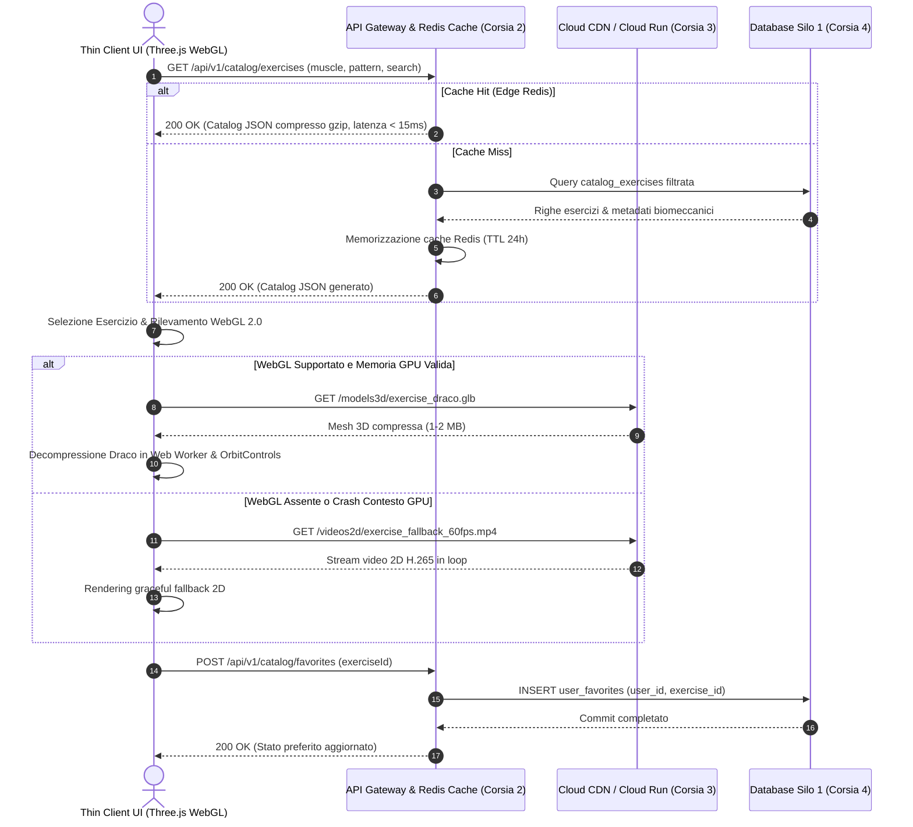

# Capitolato Tecnico: Flow 2A – Catalogo Esercizi & Avatar Biomeccanico 3D (T7 Consumer)

## 1. Identificativo & Titolo Ufficiale
- **Badge Miro Board:** `#02` (Posizione: `X: 27.35, Y: 179.87`, Miro Shape ID: `3458764688417722707`)
- **Codice Univoco:** `FLOW-2A`
- **Titolo Formale:** SOFTWARE 1 (B2C CONSUMER) - FLOW 2A: CATALOGO ESERCIZI & AVATAR BIOMECCANICO 3D
- **Board Miro Online:** `uXjVEbo6L2o=` (Zona 4, Riga 1: General User / Casual, Colonna 2: Catalogo Esercizi & 3D)
- **Diagramma Sorgente:** `architecture-blueprint/02-miro-zones-and-swimlanes/18-flowcharts/software-1-consumer-b2c/flow-2a-personal-cockpit.mmd`
- **Riferimento Glossario:** [Glossario Tecnico Vivente](00-GLOSSARIO-TERMINI-TECNICI.md) (Voci: [Thin Client](00-GLOSSARIO-TERMINI-TECNICI.md#thin-client-guscio-visivo), [WebGL 3D Avatar](00-GLOSSARIO-TERMINI-TECNICI.md#gltf-glb-compressione-google-draco-mesh), [Google Draco Compression](00-GLOSSARIO-TERMINI-TECNICI.md#draco-geometry-compression-progressive-lod), [Time Under Tension TUT](00-GLOSSARIO-TERMINI-TECNICI.md#fasi-biomeccaniche-concentrica-vs-eccentrica-tut-time-under-tension), [Graceful Degradation](00-GLOSSARIO-TERMINI-TECNICI.md#graceful-degradation-webgl-performance-fallback)).

---


## 2. Obiettivo di Business & Target Utente

### Guida Pratica per Non Tecnici: Cos'è questo modulo per un umano?
Quante volte in palestra capita di trovarsi davanti a un esercizio nuovo e chiedersi: *"Come si fa senza farsi male alla schiena? Quali muscoli devo sentire bruciare?"*. Questo modulo è l'enciclopedia visiva vivente di T7 Workout. Al posto di noiose foto o video muti e sfuocati, l'atleta ha a disposizione un **Avatar Biomeccanico 3D** che si può ruotare a 360 gradi toccando lo schermo dello smartphone:
- I muscoli che lavorano di più si colorano di **rosso acceso**;
- Quelli secondari di supporto si colorano di **giallo**;
- I muscoli che mantengono la postura stabile si illuminano di **azzurro**.
Inoltre, una speciale guida *"Why & Fix"* mostra gli errori più comuni (es. ginocchia che crollano all'interno nello squat o schiena inarcata) e spiega subito con parole semplici come correggerli per non farsi male. Se lo smartphone è un po' vecchio o non regge la grafica 3D, l'app passa automaticamente e senza scatti a un video ad alta definizione a 60 fotogrammi al secondo.

### Specifiche di Business & Metriche
- **Target Utente:** Utenti amatoriali, appassionati di fitness e chiunque voglia imparare la corretta tecnica esecutiva dei 296 esercizi codificati (Tier 1 – Casual Consumer).
- **Problema Risolto:** Ridurre drasticamente gli infortuni da errata esecuzione e aumentare il tempo di permanenza nell'app (Engagement Time $> 3\text{ minuti/sessione}$), consentendo il salvataggio istantaneo nei "Preferiti" o il caricamento diretto nella scheda del giorno con un solo tocco ("Regola dei 2 click").

---


## 3. Attori & Architettura a 4 Corsie (Swimlanes)

1. **Corsia 1: Thin Client UI/UX (React 18 + WebGL Three.js / Canvas 2D):**
   - Barra di ricerca con debounce di 250ms, griglia di schede esercizio (ExerciseCard), canvas 3D con controlli orbitali touch (OrbitControls), visualizzatore cromatico dei gruppi muscolari e scheda riassuntiva "Why & Fix".
2. **Corsia 2: API Gateway & Edge Cache (Envoy Gateway + Redis Cache Cluster):**
   - Validazione token JWT Tier 1, caching edge su CDN Cloudflare (TTL 24 ore) delle risposte JSON di catalogo con latenza di risposta $< 15\text{ ms}$, smistamento verso i bucket di asset grafici.
3. **Corsia 3: Server Scatola Nera (3D Mesh Delivery & Video Streamer Cloud Run):**
   - Distribuzione mesh tridimensionali compresse con Google Draco (`.glb` con compressione $> 80\%$), calcolo delle timeline del Time Under Tension (fase eccentrica, fermo isometrico, fase concentrica) e streaming video fallback MP4/H.265.
4. **Corsia 4: Database Tripartito (Silo 1 - PostgreSQL):**
   - Tabelle `catalog_exercises` (con metadati biomeccanici, muscoli primari, secondari e controindicazioni) e `user_favorites` per la sincronizzazione cross-device dei preferiti dell'utente.

---


### Sequence Diagram Asincrono del Ciclo di Vita (FLOW-2A)



---


## 4. Flusso Operativo Passo-Passo

### Livello A: User Journey Narrativo (La Storia dell'Utente)
1. **L'Apertura del Catalogo:** Dalla barra in basso dell'app, l'utente tocca l'icona *"Catalogo Esercizi"*. In meno di un battito di ciglia compare l'elenco organizzato per grandi categorie (Petto, Dorso, Spalle, Gambe, Braccia, Addome, Clinici).
2. **La Ricerca Semplice:** L'utente può scorrere i pulsanti (es. tocca *"Gambe"* e *"Corpo Libero"*) oppure digita semplicemente *"squat"* nella casella di testo. La lista si aggiorna in tempo reale mentre digita.
3. **La Scelta dell'Esercizio:** L'utente tocca la scheda dello *"Squat con Bilanciere"*.
4. **L'Esperienza 3D:** Si apre una vista splendida: un manichino atletico tridimensionale sta eseguendo lo squat con movimento continuo. L'utente ruota il manichino con il dito per vederlo di lato, dall'alto o da dietro:
   - I quadricipiti e i glutei brillano in **rosso**;
   - La fascia lombare e i polpacci sono colorati in **giallo**;
   - I muscoli dell'addome profondo sono evidenziati in **ciano** per mostrare come fanno da scudo alla colonna.
5. **Il Controllo della Velocità (TUT):** Una barra temporale in basso pulsa a ritmo: 3 secondi per scendere piano (fase eccentrica), 1 secondo di fermo stabile, 1 secondo per risalire veloci ed esplosivi (fase concentrica).
6. **La Sezione "Errori da Evitare":** Sotto all'avatar compaiono due schede: *"Cosa fare"* (tenere i talloni saldi a terra) e *"Cosa non fare"* (inarcare la schiena in avanti).
7. **L'Azione Finale:** Con un tocco l'utente aggiunge la stellina dei preferiti, oppure preme *"Inizia questo Esercizio"* per caricarlo istantaneamente nel Workout Player del giorno.

---


#### Indicatori di Accettazione Operativa & Clinica (KPI)
| Metrica / Parametro | Obiettivo Target | Tolleranza Accettabile | Azione Fallback / Allerta |
| :--- | :--- | :--- | :--- |
| **Framerate Rendering 3D** | $\ge 60\text{ FPS}$ stabili | $\ge 35\text{ FPS}$ | Attivazione Progressive LOD o fallback 2D |
| **Dimensione Mesh Draco** | $< 1.5\text{ MB}$ per modello | $\le 2.5\text{ MB}$ | Decimazione automatica dei poligoni |
| **Latenza Query Catalogo Edge** | $< 15\text{ ms}$ (Cache Hit) | $\le 50\text{ ms}$ | Servizio offline da Service Worker cache |
| **Reattività Debounce Ricerca** | $250\text{ ms}$ | $\pm 50\text{ ms}$ | Filtraggio istantaneo su array in-memory |


---


### Livello B: Trattazione Tecnica Nodi Operativi

1. `START` (Accesso Catalogo): Evento UI di navigazione da Navigation Shell. Montaggio componente `CatalogFeatureView`.
2. `DEC_SEARCH` (Bivio Modalità Ricerca): L'utente seleziona se filtrare tramite tassonomia motoria (`UI_FILTERS`) o digitare testo (`UI_SEARCH`).
3. `UI_FILTERS` (Filtri Multidistretto): Selezione parametri: `primaryMuscle` (7 distretti), `movementPattern` (Spinta, Tirata, Squat, Hinge), `equipment` (Bilanciere, Manubri, Cavi, Macchine, Bodyweight).
4. `UI_SEARCH` (Ricerca Full-Text): Input gestito con operatore rxjs/custom hook debounce a 250ms per limitare le chiamate al backend.
5. `GW_FETCH` (Chiamata Gateway): Emissione query HTTP `GET /api/v1/catalog/exercises` con parametri URL serializzati.
6. `GW_CACHE` (Controllo Cache Edge Redis):
   - *Hit:* Restituzione del catalogo compresso in gzip/brotli in $< 15\text{ ms}$.
   - *Miss:* Esecuzione query Postgres (`DB_QUERY`) e caching automatico con TTL 86.400s (24 ore).
7. `DEC_RESULTS` (Verifica Esito Query): Se risultati $> 0 \implies$ `GRID_POPULATED`; se 0 $\implies$ `UI_EMPTY` con suggerimento fuzzy matching dei termini.
8. `GRID_POPULATED` (Rendering Griglia): Virtualizzazione lista con `react-virtualized` o `flash-list` per garantire 60fps costanti anche su 296 schede.
9. `DEC_WEBGL` (Verifica Hardware Client): Rilevamento capabilities browser (`gl = canvas.getContext('webgl2')`).
   - *Se WebGL attivo:* Download della mesh Draco compressa via CDN (`SRV_3D_STREAM`) e trigger `VIEWER_3D`.
   - *Se WebGL fallisce o assente:* Attivazione automatica `FALLBACK_2D` (streaming video H.265 a 60fps con sprite loop).
10. `VIEWER_3D` (Rendering Avatar Biomeccanico):
    - Scene Three.js con illuminazione a 3 punti e Dark Background `#0f172a`;
    - Shader personalizzato per vertex coloring delle fasce muscolari (Rosso `#ef4444`, Giallo `#f59e0b`, Ciano `#06b6d4`);
    - Timeline cinematico Time Under Tension (TUT) con cursore sincrono sulle fasi motorie.
11. `UI_PROTOCOL` (Scheda Tecnica & Why-Fix): Presentazione dei parametri: Setup posturale, Traiettoria bilanciere/arto, Errori critici e correzioni biomeccaniche.
12. `DEC_ACTION` (Decisione Azione Utente):
    - *Azione Preferiti:* Chiamata `POST /api/v1/catalog/favorites` $\to$ scrittura Silo 1 (`DB_FAV_WRITE`);
    - *Azione Allenamento:* Iniezione dati nell'interfaccia di seduta $\to$ `NAV_PLAYER` (`FLOW-3A`).

---


## 5. Rami Decisionali & Gestione dei 4 Stati UI

| Bivio Decisionale | Condizione Logica | Ramo SÌ / Positivo | Ramo NO / Negativo |
| :--- | :--- | :--- | :--- |
| `DEC_SEARCH` | L'utente usa filtri o testo? | Filtro tassonomico (`UI_FILTERS`) | Ricerca testo (`UI_SEARCH`) |
| `DEC_RESULTS` | Risultati trovati $> 0$? | Mostra griglia schede (`GRID_POPULATED`) | Schermata vuota (`UI_EMPTY`) |
| `DEC_WEBGL` | Supporto WebGL 2.0 e GPU attivo? | Render 3D interattivo (`VIEWER_3D`) | Fallback video 2D (`FALLBACK_2D`) |
| `DEC_ACTION` | Azione post-consultazione? | Aggiungi a Preferiti (`DB_FAV_WRITE`) | Invia al Player (`FLOW-3A`) |

### I 4 Stati di Interfaccia Utente (UI States):
1. **Empty State:** Nessun risultato per la combinazione di filtri selezionata: rendering messaggio amichevole *"Nessun esercizio trovato. Prova a rimuovere un filtro o cerca per nome generico (es. 'Panca')"* con pulsante di reset rapido.
2. **Loading State:** Skeleton card con effetto shimmer durante il fetch iniziale dei dati o spinner orbitale sul canvas durante la decompressione della mesh Draco 3D.
3. **Populated State:** Griglia completa con 296 esercizi filtrabili istantaneamente, indicatori di difficoltà e card 3D fluide con comandi touch zoom e rotazione.
4. **Error / Fallback State:**
   - *Crash del contesto WebGL (dispositivo con memoria GPU esaurita):* L'app non va in crash ma esegue il fallback silenzioso caricando istantaneamente il player video 2D compresso.

---


## 6. Contratti Dati, Parametri I/O & Database Silo

### Specifiche Endpoint REST:

#### 1. Query Catalogo Esercizi Filtrato
- **Endpoint:** `GET /api/v1/catalog/exercises`
- **Headers:** `Authorization: Bearer <jwt_token>`, `Accept: application/json`
- **Query Params:** `muscle=CHEST&pattern=PUSH&equipment=BARBELL&limit=20&page=1`
- **Responses:**
  - `200 OK`:
```json
{
  "total": 1,
  "page": 1,
  "exercises": [
    {
      "id": "ch_barbell_bench_press_01",
      "nameIt": "Panca Piana con Bilanciere",
      "nameEn": "Barbell Flat Bench Press",
      "primaryMuscle": "CHEST",
      "secondaryMuscles": ["TRICEPS", "FRONT_DELTS"],
      "stabilizerMuscles": ["CORE", "ROTATOR_CUFF"],
      "movementPattern": "HORIZONTAL_PUSH",
      "model3dGlbUrl": "https://assets.t7workout.app/models3d/ch_bench_press.glb",
      "fallbackVideoMp4Url": "https://assets.t7workout.app/videos2d/ch_bench_press_60fps.mp4",
      "tutRecommended": { "eccentricSec": 3, "isometricSec": 1, "concentricSec": 1 }
    }
  ]
}
```
  - `401 Unauthorized`: Token scaduto o non valido.

#### 2. Salvataggio Esercizio nei Preferiti
- **Endpoint:** `POST /api/v1/catalog/favorites`
- **Headers:** `Authorization: Bearer <jwt_token>`, `Content-Type: application/json`
- **Request Payload:** `{ "exerciseId": "ch_barbell_bench_press_01" }`
- **Responses:**
  - `200 OK`: `{ "status": "favorited", "exerciseId": "ch_barbell_bench_press_01" }`

### Schema Relazionale (Database Silo 1 - PostgreSQL):
- `catalog_exercises`: `id VARCHAR(64) PRIMARY KEY`, `name_it VARCHAR(128)`, `name_en VARCHAR(128)`, `primary_muscle VARCHAR(32)`, `secondary_muscles JSONB`, `movement_pattern VARCHAR(32)`, `equipment VARCHAR(32)`, `model_3d_url TEXT`, `fallback_video_url TEXT`, `created_at TIMESTAMPTZ`.
- `user_favorites`: `user_id UUID FK -> auth_users.id`, `exercise_id VARCHAR(64) FK -> catalog_exercises.id`, `created_at TIMESTAMPTZ`, `PRIMARY KEY (user_id, exercise_id)`.

---


### Matrice Errori HTTP & Strategie di Resilienza
| HTTP Code | Codice Interno | Endpoint | Causa Scatenante | UX Feedback Visivo | Strategia di Resilienza & Fallback |
| :---: | :--- | :--- | :--- | :--- | :--- |
| **400** | `ERR_BAD_FILTER` | `GET /catalog/exercises` | Parametro di filtro muscolare non valido | Badge: *"Filtro non riconosciuto"* | Reset automatico ai filtri di default |
| **401** | `ERR_UNAUTHORIZED` | `GET /catalog/exercises` | Token JWT mancante o firma non valida | Redirect a schermata di login | Salvataggio stato ricerca in sessionStorage |
| **404** | `ERR_EXERCISE_404` | `GET /catalog/exercises/:id` | ID esercizio non presente nel database | Schermata: *"Esercizio rimosso dal catalogo"* | Reindirizzamento alla griglia generale |
| **429** | `ERR_CATALOG_FLOOD` | `GET /catalog/exercises` | Superamento soglia 60 chiamate/minuto | Toast: *"Rallenta le ricerche per favore"* | Applicazione debounce rinforzato client-side |
| **502** | `ERR_CDN_UNREACHABLE` | `GET /models3d/*.glb` | Asset CDN 3D momentaneamente non raggiungibile | Alert trasparente: *"Passaggio a vista 2D..."* | Fallback immediato a video MP4 compresso |
| **503** | `ERR_REDIS_DOWN` | `GET /catalog/exercises` | Cluster Redis temporaneamente offline | Nessun errore visibile all'utente | Fallback trasparente su query diretta PostgreSQL |


---


## 7. Ereditarietà di Tier & Differenziali di Fascia

- **Funzionalità Base (Tier 1):** Consultazione del catalogo completo dei 296 esercizi, visualizzatore 3D WebGL con muscoli primari/secondari e video 2D di fallback.
- **Ereditarietà verso Tier 2 (`FLOW-2B`):**  
  Il professionista eredita interamente questo visualizzatore 3D, potenziato con la possibilità di registrare e caricare video reali dell'atleta via in-app camera, confrontandoli con l'avatar 3D e interrogando il motore RAG su 322 paper scientifici per verifiche biomeccaniche avanzate.
- **Ereditarietà verso Tier 3 (`FLOW-2C`):**  
  Il club societario eredita il catalogo e integra la libreria video multi-camera a 120fps per l'analisi tattica e i protocolli Return-to-Play a tenuta stagna nel bunker Silo 2.
