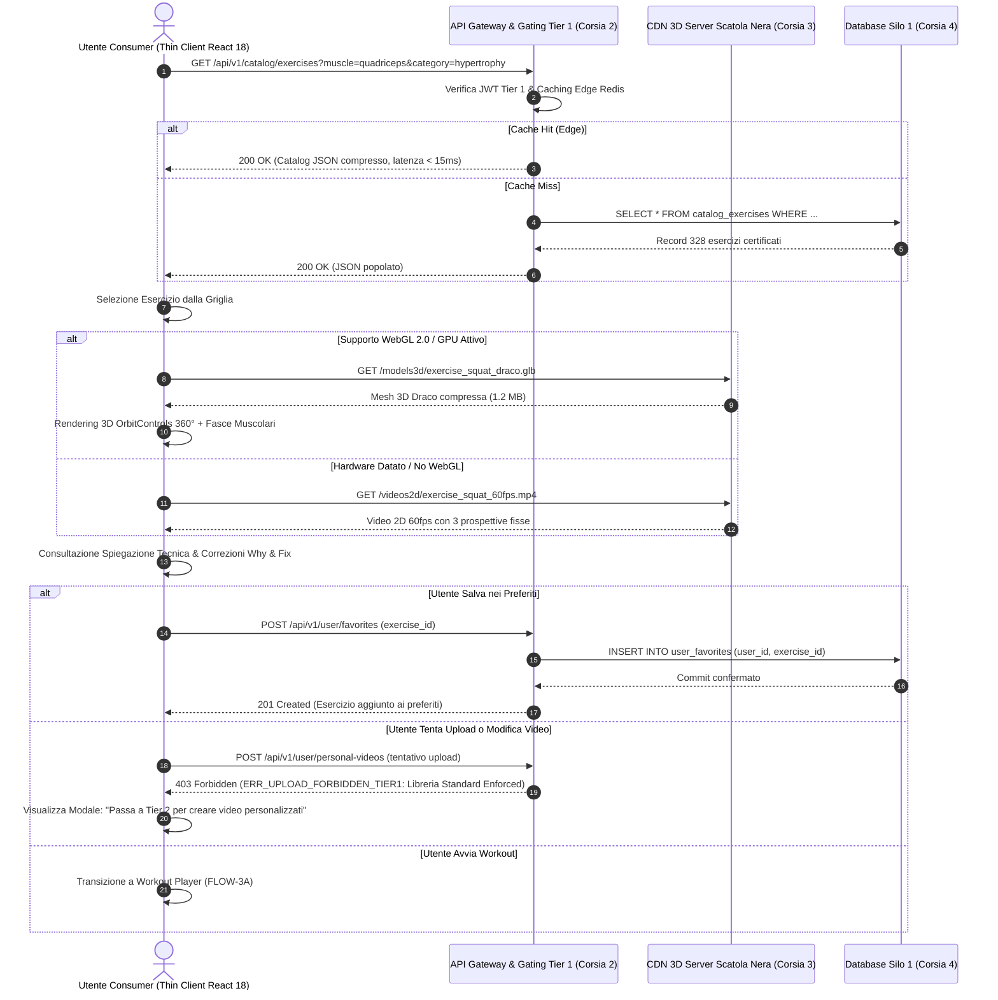

# Capitolato Tecnico: Flow 2A – Catalogo Esercizi & Avatar 3D (T7 Consumer)

## 1. Identificativo & Titolo Ufficiale
- **Badge Miro Board:** `#02` (Posizione: `X: 27.35, Y: 179.87`, Miro Shape ID: `3458764688417722707`)
- **Codice Univoco:** `FLOW-2A`
- **Titolo Formale:** SOFTWARE 1 (B2C CONSUMER) - FLOW 2A: CATALOGO ESERCIZI & AVATAR 3D
- **Board Miro Online:** `uXjVEbo6L2o=` (Zona 4, Riga 1: General User / Casual, Colonna 2: Catalogo Esercizi & 3D)
- **Diagramma Sorgente:** `architecture-blueprint/02-miro-zones-and-swimlanes/18-flowcharts/software-1-consumer-b2c/flow-2a-personal-cockpit.mmd`
- **Riferimento Glossario:** [Glossario Tecnico Vivente](00-GLOSSARIO-TERMINI-TECNICI.md) (Voci: [Thin Client](00-GLOSSARIO-TERMINI-TECNICI.md#thin-client-guscio-visivo), [WebGL 3D Avatar](00-GLOSSARIO-TERMINI-TECNICI.md#gltf-glb-compressione-google-draco-mesh), [Google Draco Compression](00-GLOSSARIO-TERMINI-TECNICI.md#draco-geometry-compression-progressive-lod), [Time Under Tension TUT](00-GLOSSARIO-TERMINI-TECNICI.md#fasi-biomeccaniche-concentrica-vs-eccentrica-tut-time-under-tension), [Graceful Degradation](00-GLOSSARIO-TERMINI-TECNICI.md#graceful-degradation-webgl-performance-fallback), [Video Ingest Tiers](00-GLOSSARIO-TERMINI-TECNICI.md#video-ingest-tiers-policy-tier-1-zero-upload-tier-2-1080p-tier-3-4k8k)).

---

## 2. Obiettivo di Business & Target Utente

### Guida Pratica per Non Tecnici: Cos'è questo modulo per un umano?
Quante volte in palestra capita di trovarsi davanti a un esercizio nuovo e chiedersi: *"Come si fa senza farsi male alla schiena? Quali muscoli devo sentire lavorare?"*. Questo modulo è l'enciclopedia visiva vivente di T7 Workout. Al posto di illustrazioni statiche o video confusi, l'atleta ha a disposizione un **Avatar Biomeccanico 3D** navigabile con controlli touch a 360 gradi:
- I muscoli che lavorano principalmente (agonisti) si colorano di **rosso acceso**;
- I muscoli secondari di supporto (sinergisti) si illuminano di **giallo**;
- I muscoli che mantengono la postura stabile (fissatori/stabilizzatori) si illuminano di **azzurro/ciano**.

Una guida interattiva *"Why & Fix"* analizza gli errori posturali più diffusi (es. cedimento del ginocchio in valgo nello squat o iperestensione lombare) e spiega chiaramente come correggerli per allenarsi in totale sicurezza. Se lo smartphone è datato o privo di supporto WebGL, il sistema commuta istantaneamente su un video 2D pre-renderizzato a 60 frame al secondo.

#### Politica Architetturale Vincolante Tier 1 ("Legge del Catalogo"):
1. **Visualizzazione 3D:** Accesso ai video dimostrativi e modelli tridimensionali dinamici con controlli orbitali touch a 360°, fasce muscolari differenziate e calcolo visivo del Time Under Tension (TUT).
2. **Contenuti Tecnici Completi:** Consultazione di schede didattiche dettagliate comprensive di setup, traiettoria articolare, respirazione e correzioni posturali "Why & Fix".
3. **Ricerca Filtrata per Sezioni:** Navigazione per sezioni specifiche con ricerca per: 1. Singolo muscolo, 2. Distretto muscolare, 3. Categoria di allenamento (forza, ipertrofia, mobilità, funzionale).
4. **Gestione Preferiti:** Possibilità di salvare gli esercizi all'interno della lista personale dei preferiti per accesso immediato offline/online.
5. **Blocco Modifiche (Read-Only Rigoroso):** Nessuna possibilità di modificare, tagliare, alterare la velocità o editare i video presenti in piattaforma. I controlli di editing sono inibiti.
6. **Libreria Standard (ZERO Video Upload):** Utilizzo esclusivo della libreria standard certificata (328 movimenti). Divieto categorico di caricare, registrare o aggiungere video propri (funzionalità riservata a Tier 2 e Tier 3).

### Specifiche di Business & Metriche
- **Target Utente:** Utenti consumer amatoriali, atleti casual e principianti (Tier 1 – B2C Casual).
- **Problema Risolto:** Apprendimento autonomo e privo di rischi lesivi della corretta tecnica esecutiva, abbattimento del sovraccarico cognitivo e zero costi di storage video utente su Silo 1.

---

## 3. Attori & Architettura a 4 Corsie (Swimlanes)

1. **Corsia 1: Thin Client UI/UX (React 18 & Three.js Draco GLB):**
   - Modulo di navigazione per sezioni tassonomiche (singolo muscolo, distretto, categoria);
   - Campo di ricerca testuale istantanea con debounce a 250ms;
   - Griglia reattiva con anteprime dinamiche e badge di classificazione;
   - Canvas 3D Three.js con decompressore Google Draco (`draco_decoder.wasm`), controlli orbitali touch 360° e mappatura cromatica fasce muscolari;
   - Modulo didattico "Why & Fix" con schede correttive;
   - Gestione preferiti locali e transizione al Workout Player (`FLOW-3A`).
2. **Corsia 2: API Gateway & Feature Gating Tier 1 (Envoy Gateway + Redis Cache Edge):**
   - Verifica autorizzativa token JWT Tier 1 con RBAC rigido: autorizzazione sola lettura per la libreria standard;
   - Intercettazione e blocco immediato (403 Forbidden) di qualsiasi richiesta di upload o modifica video;
   - Caching edge su Cloudflare/Redis (TTL 24 ore) delle risposte di catalogo con latenza $< 15\text{ ms}$.
3. **Corsia 3: Server Scatola Nera (CDN 3D Mesh & Kinematics Delivery):**
   - Distribuzione mesh tridimensionali compresse con Google Draco (`.glb` con compressione $> 80\%$, peso 1-2 MB per modello);
   - Algoritmo di Progressive Level of Detail (LOD) per fluidità a 60 FPS su qualsiasi smartphone;
   - Video streaming 2D pre-renderizzato MP4 60fps per graceful degradation.
4. **Corsia 4: Database Tripartito (Silo 1 - Consumer PostgreSQL & Public Storage):**
   - Tabella `catalog_exercises`: archivio dei 328 movimenti biomeccanici certificati con metadati muscolari e coordinate cinematiche;
   - Tabella `user_favorites`: record preferiti utente per sincronizzazione multi-device.

---

### Sequence Diagram Asincrono del Ciclo di Vita (FLOW-2A)



---

## 4. Flusso Operativo Passo-Passo

### Livello A: User Journey Narrativo (La Storia dell'Utente)
1. **L'Apertura del Catalogo:** Dalla navigation bar dell'applicazione, l'utente tocca l'icona *"Catalogo Esercizi"*.
2. **La Ricerca per Sezioni o Testuale:** L'atleta seleziona la navigazione per sezioni specifiche (es. *Quadricipiti*, *Arti Inferiori*, *Ipertrofia*) oppure digita il nome nel campo di ricerca con risposta istantanea (debounce 250ms).
3. **La Consultazione della Scheda Esercizio:** Toccando una card, il sistema verifica le capacità grafiche del dispositivo e apre il modello 3D interattivo. L'atleta ruota il modello, osserva le fasce muscolari evidenziate e consulta la guida tecnica "Why & Fix" con le correzioni dei principali errori posturali.
4. **La Gestione dei Preferiti e il Workout:** Con un tocco sull'icona a stella, l'utente salva l'esercizio nella lista personale dei preferiti o tocca *"Avvia Esercizio"* per trasferirlo direttamente nel Workout Player (`FLOW-3A`).
5. **Gating sulle Modifiche e sull'Upload:** Qualora l'utente cerchi funzioni di ritaglio, variazione velocità o caricamento video, l'interfaccia mantiene i controlli bloccati e mostra una modale informativa con invito al passaggio a Tier 2.

---

#### Indicatori di Accettazione Operativa & Clinica (KPI)
| Metrica / Parametro | Obiettivo Target | Tolleranza Accettabile | Azione Fallback / Allerta |
| :--- | :--- | :--- | :--- |
| **Risoluzione Max Video Ingest** | `N/A - Zero Upload` | Policy 100% Enforced | Blocco 403 Forbidden Gateway (`ERR_UPLOAD_FORBIDDEN_TIER1`) |
| **Capacità Modifica / Editing Video** | `Read-Only (Bloccato)` | 0 alterazioni permesse | Controlli di editing nascosti / bloccati a livello UI e backend |
| **Framerate Rendering 3D Draco** | $\ge 60\text{ FPS}$ stabili | $\ge 35\text{ FPS}$ | Attivazione automatica Progressive LOD o fallback video 2D |
| **Latenza Query Catalogo Edge** | $< 15\text{ ms}$ (Cache Hit) | $\le 50\text{ ms}$ | Servizio offline da Service Worker / IndexedDB cache |
| **Tempo Caricamento Mesh 3D** | $< 500\text{ ms}$ | $\le 1200\text{ ms}$ | Compressione Draco $> 80\%$ su CDN Cloudflare |

---

### Livello B: Trattazione Tecnica Nodi Operativi (22 Nodi ISO)

1. `T1_START` (Inizio: Home Cockpit - Accesso Catalogo Esercizi): Inizializzazione Thin Client React 18 con profilo utente consumer Tier 1.
2. `T1_UI_POLICY_CHECK` (API Gateway: Verifica Gating Tier 1 & Policy Catalogo): Controllo preventivo dei permessi nel token JWT: abilitazione esclusiva consultazione libreria standard e blocco funzioni video upload/edit.
3. `T1_DEC_SEARCH_MODE` (Modalità di Ricerca Utente?): Bivio decisionale tra navigazione per sezioni specifiche tassonomiche vs ricerca testuale istantanea full-text.
4. `T1_UI_FILTER_SECTION` (Navigazione Filtrata per Sezioni Specifiche): Filtri selezionabili: 1. Singolo Muscolo • 2. Distretto Muscolare • 3. Categoria di Allenamento (Forza, Ipertrofia, Resistenza, Mobilità).
5. `T1_UI_TEXT_SEARCH` (Ricerca Testuale Full-Text Istantanea): Input field con debounce a 250ms che esegue query istantanea sui 328 esercizi certificati.
6. `T1_GW_CATALOG_QUERY` (API Gateway: GET /api/v1/catalog/exercises): Interrogazione Edge Cache Redis Cloudflare per minimizzare il tempo di risposta ($<15\text{ms}$).
7. `T1_DB_QUERY_SILO1` (Database Silo 1: catalog_exercises PostgreSQL): Estrazione dei record biomeccanici certificati con indici muscolari e link asset 3D Draco.
8. `T1_DEC_RESULTS` (Esito Filtri & Ricerca Catalogo?): Bivio tra risultati trovati (populated) vs zero match (empty state).
9. `T1_UI_EMPTY_STATE` (Gestione Empty State & Suggerimenti): Notifica nessun esercizio corrispondente con 3 suggerimenti di distretti affini o reset filtri.
10. `T1_UI_GRID_POPULATED` (Rendering Griglia Esercizi Catalogo Base): Card esercizio con miniatura animata, muscoli primari coinvolti e badge di categoria.
11. `T1_DEC_SELECT_EXERCISE` (Supporto WebGL 2.0 & GPU 3D Attivo?): Verifica hardware client per rendering tridimensionale interattivo.
12. `T1_SRV_3D_DRACO` (Server Scatola Nera: Mesh 3D Google Draco GLB): Streaming asincrono della mesh poligonale compressa `.glb` con Progressive Level of Detail.
13. `T1_UI_FALLBACK_2D` (Graceful Degradation: Video 2D Pre-Renderizzato): Streaming video MP4 a 60fps con 3 prospettive fisse per dispositivi privi di WebGL.
14. `T1_UI_VIEWER_3D` (Visualizzazione 3D Interattiva con Modello Dinamico): Canvas WebGL interattivo con controlli touch orbitabili a 360°, fasce muscolari differenziate (Rosso Agonisti, Giallo Sinergisti, Ciano Stabilizzatori) e visualizzazione TUT.
15. `T1_UI_TECH_CONTENT` (Contenuti Tecnici & Correzioni Why & Fix): Scheda tecnica con spiegazione della corretta biomeccanica (setup, traiettoria, respirazione) ed evidenziazione visiva degli errori critici.
16. `T1_DEC_USER_ACTION` (Azione Utente Post-Consultazione?): Bivio decisionale: 1. Salva nei Preferiti • 2. Tenta Modifica o Upload • 3. Avvia Workout.
17. `T1_DEC_MOD_CHECK` (Richiesta Modifica o Upload Video Proprio?): Controllo gateway che intercetta tentativi di upload file o editing.
18. `T1_UI_POLICY_BLOCK` (Blocco Modifiche & Zero Video Upload): Modale di blocco: modifiche ed editing video inibiti per policy Tier 1, zero video upload consentito, invito all'upgrade a Tier 2.
19. `T1_GW_FAV_SAVE` (API Gateway: POST /api/v1/user/favorites): Endpoint di salvataggio preferiti utente.
20. `T1_DB_FAV_WRITE` (Database Silo 1: user_favorites PostgreSQL): Persistenza del record preferito nel database relazionale consumer.
21. `T1_TRANSITION_PLAYER` (Transizione a Workout Player FLOW-3A): Inserimento dell'esercizio appreso nella sessione attiva di allenamento.
22. `T1_END_READY` (Fine: Consultazione Esercizio Completata): Uscita con esercizio consultato in 3D, memorizzato nei preferiti o caricato nel player.

---

## 5. Rami Decisionali & Gestione dei 4 Stati UI

| Bivio Decisionale | Condizione Logica | Ramo SÌ / Positivo | Ramo NO / Negativo |
| :--- | :--- | :--- | :--- |
| `T1_DEC_SEARCH_MODE` | Navigazione per sezioni specifiche? | Filtri per muscolo, distretto, categoria (`T1_UI_FILTER_SECTION`) | Ricerca testuale istantanea debounce 250ms (`T1_UI_TEXT_SEARCH`) |
| `T1_DEC_RESULTS` | Trovati esercizi corrispondenti? | Rendering griglia esercizi base (`T1_UI_GRID_POPULATED`) | Gestione empty state con suggerimenti (`T1_UI_EMPTY_STATE`) |
| `T1_DEC_SELECT_EXERCISE` | Supporto WebGL 2.0 e accelerazione GPU attivo? | Streaming mesh 3D Draco (`T1_SRV_3D_DRACO` $\to$ `T1_UI_VIEWER_3D`) | Fallback video 2D MP4 60fps (`T1_UI_FALLBACK_2D`) |
| `T1_DEC_USER_ACTION` | Azione post-consultazione? | Salva Preferiti / Avvia Workout | Tentativo modifica o upload proprio |
| `T1_DEC_MOD_CHECK` | Richiesta modifica o video proprio? | Blocco modifiche & zero upload enforced (`T1_UI_POLICY_BLOCK`) | Procedi con navigazione standard |

### I 4 Stati di Interfaccia Utente (UI States):
1. **Empty State:** Nessun esercizio corrisponde ai criteri di filtro o ricerca impostati: card visiva *"Nessun esercizio trovato. Prova a selezionare un altro distretto muscolare"* con pulsante *"Reset Filtri"* e 3 esercizi popolari suggeriti.
2. **Loading State:** Skeleton loader pulsante sulla griglia esercizi e barra di avanzamento circolare per il download della mesh 3D Draco: *"Caricamento avatar 3D compresso (1.2 MB)..."*.
3. **Populated State:** Griglia completa dei 328 esercizi del catalogo con card interattive; canvas 3D con avatar orbitabile a 360°, evidenziazione cromatica dei muscoli attivi e sezione tecnica didattica "Why & Fix".
4. **Error / Fallback State:**
   - *WebGL non supportato o GPU crash:* Commutazione automatica e trasparente su video 2D pre-renderizzato a 60fps con 3 inquadrature fisse;
   - *Tentativo di upload o modifica video:* Comparsa immediata di modale educativa: *"L'editing e il caricamento di video personalizzati sono riservati ai professionisti Tier 2 e ai team d'élite Tier 3. Scopri le funzionalità Pro"*.

---

## 6. Contratti Dati, Parametri I/O & Database Silo

### Specifiche Endpoint REST:

#### 1. Query Catalogo Esercizi Standard (Tier 1 Enforced)
- **Endpoint:** `GET /api/v1/catalog/exercises`
- **Headers:** `Authorization: Bearer <consumer_jwt>`, `Accept: application/json`
- **Query Parameters:**
  - `muscle`: string (opzionale, es. `"quadriceps"`, `"biceps"`, `"glutes"`);
  - `district`: string (opzionale, es. `"lower_body"`, `"upper_body"`, `"core"`);
  - `category`: string (opzionale, es. `"hypertrophy"`, `"strength"`, `"mobility"`);
  - `search`: string (opzionale, es. `"squat"`, min 2 caratteri, debounce 250ms);
  - `limit`: integer (default: 20, max: 100);
  - `offset`: integer (default: 0).
- **Response `200 OK`:**
```json
{
  "totalExercises": 328,
  "count": 1,
  "data": [
    {
      "exerciseId": "ch_barbell_squat_01",
      "name": "Squat con Bilanciere Back",
      "targetDistrict": "lower_body",
      "primaryMuscle": "quadriceps",
      "synergistMuscles": ["gluteus_maximus", "adductor_magnus", "soleus"],
      "stabilizerMuscles": ["erector_spinae", "rectus_abdominis", "hamstrings"],
      "category": "strength",
      "assets": {
        "dracoMeshUrl": "https://assets.t7workout.app/models3d/ch_barbell_squat_01.glb",
        "video2dFallbackUrl": "https://assets.t7workout.app/videos2d/ch_barbell_squat_01_60fps.mp4",
        "thumbnailUrl": "https://assets.t7workout.app/thumbs/ch_barbell_squat_01.webp"
      },
      "technicalGuidance": {
        "setup": "Posiziona il bilanciere sui trapezi, piedi alla larghezza delle spalle con punte leggermente aperte a 15-30 gradi.",
        "execution": "Scendi controllando la flessione d'anca e di ginocchio mantenendo il busto solido fino a rompere il parallelo.",
        "breathing": "Inspira nella fase eccentrica creando pressione intra-addominale (manovra di Valsalva); espira superato il punto critico di risalita."
      },
      "whyAndFix": [
        {
          "errorTitle": "Collasso del Ginocchio in Valgo",
          "severity": "CRITICAL",
          "why": "Debolezza del medio gluteo o scarso controllo propriocettivo che causano sovraccarico del legamento crociato anteriore.",
          "fix": "Spingi attivamente le ginocchia verso l'esterno lungo la linea delle punte dei piedi durante tutta la risalita."
        },
        {
          "errorTitle": "Retroversione di Bacino al Fondo (Butt Wink)",
          "severity": "MODERATE",
          "why": "Perdita di tensione lombare dovuta a ridotta mobilità di caviglia o flessori d'anca corti.",
          "fix": "Fermati poco prima della perdita della fisiologica lordosi lombare e inserisci lavoro di dorsiflessione della caviglia."
        }
      ]
    }
  ]
}
```

#### 2. Gestione Lista Personale Preferiti
- **Endpoint:** `POST /api/v1/user/favorites`
- **Headers:** `Authorization: Bearer <consumer_jwt>`, `Content-Type: application/json`
- **Request Body:**
```json
{
  "exerciseId": "ch_barbell_squat_01"
}
```
- **Response `201 Created`:**
```json
{
  "status": "ADDED",
  "exerciseId": "ch_barbell_squat_01",
  "savedAt": "2026-11-03T22:45:00Z",
  "totalFavorites": 12
}
```

---

### Matrice Errori HTTP & Strategie di Resilienza
| HTTP Code | Codice Interno | Endpoint | Causa Scatenante | UX Feedback Visivo | Strategia di Resilienza & Fallback |
| :---: | :--- | :--- | :--- | :--- | :--- |
| **403** | `ERR_UPLOAD_FORBIDDEN_TIER1` | `POST /user/personal-videos` | Tentativo di upload o registrazione video proprio da account Tier 1 | Modale educativa: *"Libreria standard: il caricamento video è riservato ai piani Pro e Team"* | Blocco preventivo a livello gateway, invito upgrade |
| **403** | `ERR_EDIT_FORBIDDEN_TIER1` | `PATCH /catalog/exercises/*` | Tentativo di modifica, taglio o cambio velocità video | Notifica: *"I video del catalogo base non possono essere modificati"* | Inibizione controlli di editing nella UI |
| **404** | `ERR_EXERCISE_NOT_FOUND` | `GET /catalog/exercises/:id` | Esercizio inesistente o rimosso dalla libreria | Alert: *"Esercizio non trovato nel catalogo"* | Reindirizzamento automatico alla griglia catalogo |
| **503** | `ERR_WEBGL_FALLBACK` | Rendering WebGL 3D | Driver GPU bloccati o mancato supporto WebGL 2.0 | Banner informativo discreto: *"Visualizzazione ottimizzata in video 2D"* | Commutazione automatica su streaming video 2D MP4 60fps |

---

## 7. Ereditarietà di Tier & Differenziali di Fascia

- **Piattaforma Base (Tier 1 – Casual Consumer):**  
  Visualizzazione 3D con modelli tridimensionali dinamici Three.js Draco orbitabili a 360°, contenuti tecnici completi con correzioni "Why & Fix", ricerca filtrata per singolo muscolo, distretto muscolare e categoria di allenamento, gestione preferiti su Silo 1. Blocco assoluto di qualsiasi modifica o editing e divieto categorico di video upload (libreria standard certificata di 328 movimenti).
- **Ereditarietà verso Tier 2 (`FLOW-2B` – Professionisti P.IVA):**  
  Il professionista eredita la consultazione 3D e la ricerca, sbloccando filtri avanzati per attrezzatura e triage 119 patologie, caricamento di esercizi e video personalizzati fino a **1080p Full HD**, inserimento manuale di punti di forza e debolezza con **supporto AI per completare la spiegazione**, **editing video integrato** (taglio/trimming, rallentatore 0.25x-0.75x, velocizzazione 1.25x-2.0x), gestione preferiti Pro e **limite rigoroso di condivisione 1:1 atleta**.
- **Ereditarietà verso Tier 3 (`FLOW-2C` – Elite Teams & Enterprise):**  
  I club d'élite ereditano tutte le funzioni del Tier 2, sbloccando **condivisione globale team (broadcast)** a tutta la rosa, risoluzione video superiore fino a **4K Ultra HD**, **gruppi di lavoro dedicati** con spiegazione tecnica sottostante, **caricamento multiplo dello stesso esercizio su persone diverse con AI individuale per atleta** e **analisi 3D dello stress muscolare delle fibre** per ciascun distretto in base all'esecuzione.
