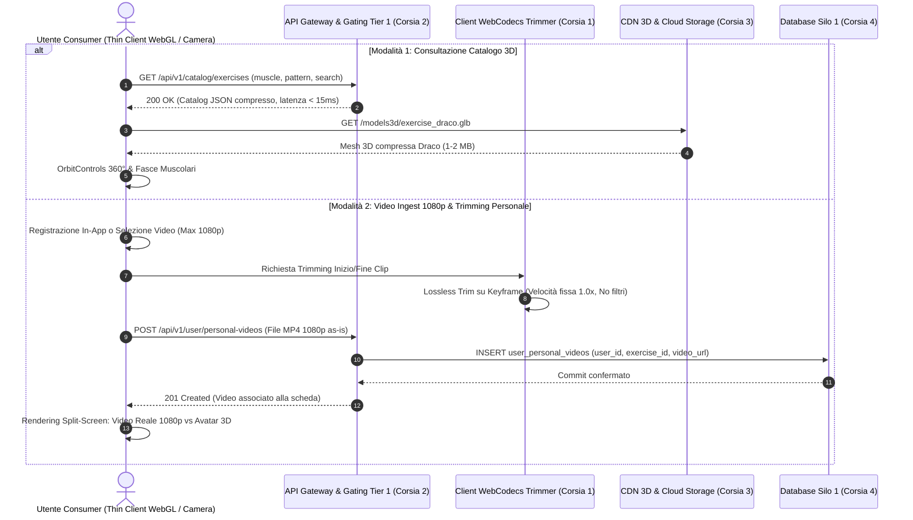

# Capitolato Tecnico: Flow 2A – Catalogo Esercizi & Avatar Biomeccanico 3D (T7 Consumer)

## 1. Identificativo & Titolo Ufficiale
- **Badge Miro Board:** `#02` (Posizione: `X: 27.35, Y: 179.87`, Miro Shape ID: `3458764688417722707`)
- **Codice Univoco:** `FLOW-2A`
- **Titolo Formale:** SOFTWARE 1 (B2C CONSUMER) - FLOW 2A: CATALOGO ESERCIZI, AVATAR BIOMECCANICO 3D & VIDEO INGEST 1080P
- **Board Miro Online:** `uXjVEbo6L2o=` (Zona 4, Riga 1: General User / Casual, Colonna 2: Catalogo Esercizi & 3D)
- **Diagramma Sorgente:** `architecture-blueprint/02-miro-zones-and-swimlanes/18-flowcharts/software-1-consumer-b2c/flow-2a-personal-cockpit.mmd`
- **Riferimento Glossario:** [Glossario Tecnico Vivente](00-GLOSSARIO-TERMINI-TECNICI.md) (Voci: [Thin Client](00-GLOSSARIO-TERMINI-TECNICI.md#thin-client-guscio-visivo), [WebGL 3D Avatar](00-GLOSSARIO-TERMINI-TECNICI.md#gltf-glb-compressione-google-draco-mesh), [Google Draco Compression](00-GLOSSARIO-TERMINI-TECNICI.md#draco-geometry-compression-progressive-lod), [Time Under Tension TUT](00-GLOSSARIO-TERMINI-TECNICI.md#fasi-biomeccaniche-concentrica-vs-eccentrica-tut-time-under-tension), [Graceful Degradation](00-GLOSSARIO-TERMINI-TECNICI.md#graceful-degradation-webgl-performance-fallback), [Video Ingest Tiers](00-GLOSSARIO-TERMINI-TECNICI.md#video-ingest-tiers-1080p-consumer-2k-pro-4k8k-enterprise), [WebCodecs Lossless Trimming](00-GLOSSARIO-TERMINI-TECNICI.md#webcodecs-api-client-side-lossless-trimming)).

---

## 2. Obiettivo di Business & Target Utente

### Guida Pratica per Non Tecnici: Cos'è questo modulo per un umano?
Quante volte in palestra capita di trovarsi davanti a un esercizio nuovo e chiedersi: *"Come si fa senza farsi male alla schiena? Quali muscoli devo sentire bruciare?"*. Questo modulo è l'enciclopedia visiva vivente di T7 Workout. Al posto di noiose foto o video muti e sfuocati, l'atleta ha a disposizione un **Avatar Biomeccanico 3D** che si può ruotare a 360 gradi toccando lo schermo dello smartphone:
- I muscoli che lavorano di più si colorano di **rosso acceso**;
- Quelli secondari di supporto si colorano di **giallo**;
- I muscoli che mantengono la postura stabile si illuminano di **azzurro**.

Inoltre, una speciale guida *"Why & Fix"* mostra gli errori più comuni (es. ginocchia che crollano all'interno nello squat o schiena inarcata) e spiega subito con parole semplici come correggerli per non farsi male. Se lo smartphone è un po' vecchio o non regge la grafica 3D, l'app passa automaticamente e senza scatti a un video ad alta definizione a 60 fotogrammi al secondo.

#### Nuova Funzionalità Video Ingest Consumer (Tier 1):
L'atleta amatoriale può registrare direttamente con lo smartphone o caricare un video della propria esecuzione per rivedersi a confronto con l'Avatar 3D di riferimento. Per questo livello di base:
1. **Risoluzione Massima 1080p (Full HD):** Qualità nitida ottimizzata per dispositivi mobili, senza sprecare traffico dati né appesantire la memoria del telefono;
2. **Caricamento Diretto "As-Is":** Il video viene salvato esattamente come registrato dall'utente: non sono presenti filtri, né disegni, né alterazioni grafiche;
3. **Velocità Fissa (1.0x bloccata):** Nessuna funzionalità di slow-motion o accelerazione (funzioni riservate ai coach di Tier 2 e ai team di Tier 3);
4. **Trimming Base di Inizio e Fine:** Possibilità esclusiva di effettuare tagli temporali semplici per rifilare i secondi iniziali e finali prima e dopo l'esecuzione, elaborati istantaneamente sul dispositivo tramite WebCodecs senza consumare banda.

### Specifiche di Business & Metriche
- **Target Utente:** Utenti amatoriali, appassionati di fitness e chiunque voglia apprendere la corretta tecnica esecutiva o archiviare la propria esecuzione (Tier 1 – Casual Consumer).
- **Problema Risolto:** Ridurre drasticamente gli infortuni da errata esecuzione, fornire feedback visivo istantaneo tra video personale e avatar 3D, e mantenere reattività immediata anche con upload mobile.

---

## 3. Attori & Architettura a 4 Corsie (Swimlanes)

1. **Corsia 1: Thin Client UI/UX (React 18 + WebGL Three.js / WebCodecs Trimmer):**
   - Modulo di ricerca ed esplorazione con debounce di 250ms;
   - Canvas 3D interattivo con controlli orbitali touch (`OrbitControls`);
   - Modulo In-App Camera Consumer con acquisizione a risoluzione vincolata max 1080p (`1920x1080`) a 30/60fps;
   - Interfaccia di trimming base per il taglio dei frame di testa e coda;
   - Visualizzatore side-by-side comparativo (Video Personale 1080p vs Avatar 3D).
2. **Corsia 2: API Gateway & Feature Gating (Envoy Gateway + Redis Cache Cluster):**
   - Validazione token JWT Tier 1 e verifica delle quote video personali (max 3 video archiviati per utente free/consumer);
   - Caching edge su CDN Cloudflare (TTL 24 ore) delle risposte JSON di catalogo con latenza $< 15\text{ ms}$.
3. **Corsia 3: Server Scatola Nera (3D Mesh Delivery & Video Streamer Cloud Run):**
   - Distribuzione mesh tridimensionali compresse con Google Draco (`.glb` con compressione $> 80\%`);
   - Calcolo delle timeline del Time Under Tension (fase eccentrica, fermo isometrico, fase concentrica);
   - Ingest video streaming su Silo 1 con compressione H.264/AAC.
4. **Corsia 4: Database Tripartito (Silo 1 - PostgreSQL & Public Storage):**
   - Tabelle `catalog_exercises` (328 record biomeccanici ufficiali), `user_favorites` e `user_personal_videos` (referenze video personali 1080p vincolate all'utente).

---

### Sequence Diagram Asincrono del Ciclo di Vita (FLOW-2A)



---

## 4. Flusso Operativo Passo-Passo

### Livello A: User Journey Narrativo (La Storia dell'Utente)
1. **L'Apertura del Catalogo:** Dalla barra in basso dell'app, l'utente tocca l'icona *"Catalogo Esercizi"*.
2. **La Scelta della Modalità:** L'utente visualizza un selettore intuitivo:
   - *"Esplora Esercizi 3D"* (Catalogo ufficiale con 328 movimenti);
   - *"Registra la Mia Esecuzione"* (Nuova funzione video personale).
3. **Il Percorso Video Personale (1080p As-Is):**
   - L'atleta inquadra il proprio movimento o seleziona un video salvato sul telefono;
   - L'app verifica automaticamente la risoluzione: se il video supera i 1080p, viene adattato a Full HD 1080p per evitare consumi di dati eccessivi;
   - Una barra di taglio permette di spostare i cursori di inizio e fine per togliere il momento in cui l'utente si è avvicinato al telefono;
   - La velocità è fissa a 1.0x: il video non può essere rallentato o modificato con grafiche (garantendo semplicità assoluta e fedeltà all'esecuzione reale);
   - L'utente tocca *"Salva nel Diario"* e vede il proprio video affiancato all'Avatar 3D che compie lo stesso esercizio.
4. **La Consultazione 3D e l'Azione Finale:** L'atleta studia i muscoli coinvolti (rosso, giallo, azzurro) e con un tocco aggiunge l'esercizio ai Preferiti o lo invia al Workout Player del giorno.

---

#### Indicatori di Accettazione Operativa & Clinica (KPI)
| Metrica / Parametro | Obiettivo Target | Tolleranza Accettabile | Azione Fallback / Allerta |
| :--- | :--- | :--- | :--- |
| **Risoluzione Max Video Ingest** | $1080\text{p}$ ($1920\times 1080$) | $\le 1080\text{p}$ | Downscaling automatico via WebCodecs su upload |
| **Tempo di Trimming Client** | $< 1.0\text{ s}$ per clip 30s | $\le 2.5\text{ s}$ | Trimming su I-Frame (Keyframe Lossless Slice) |
| **Framerate Rendering 3D** | $\ge 60\text{ FPS}$ stabili | $\ge 35\text{ FPS}$ | Attivazione Progressive LOD o fallback 2D |
| **Latenza Query Catalogo Edge** | $< 15\text{ ms}$ (Cache Hit) | $\le 50\text{ ms}$ | Servizio offline da Service Worker cache |

---

### Livello B: Trattazione Tecnica Nodi Operativi

1. `START` (Accesso Catalogo): Montaggio componente `CatalogFeatureView` con stato di sessione Tier 1.
2. `DEC_MODE_CONSUMER` (Bivio Modalità Utente):
   - *Ramo A:* Consultazione Catalogo Globale 3D $\to$ `DEC_SEARCH`;
   - *Ramo B:* Registrazione / Upload Video Personale $\to$ `UI_VIDEO_CAPTURE_1080P`.
3. `UI_VIDEO_CAPTURE_1080P` (Acquisizione Video Consumer):
   - Invoca `getUserMedia({ video: { width: { max: 1920 }, height: { max: 1080 }, frameRate: { max: 60 } } })`;
   - Blocco software per impedire stream 2K o 4K in ingresso.
4. `DEC_VIDEO_TRIM_BASE` (Decisione Taglio Clip): Se l'utente desidera rimuovere i secondi di setup $\to$ `UI_TRIM_BASE`; altrimenti upload diretto.
5. `UI_TRIM_BASE` (Lossless Client Trimming): Utilizzo di `mp4box.js` / `WebCodecs VideoDecoder` per estrarre la porzione compresa tra `startTrimMs` ed `endTrimMs`.
6. `RULE_LOCK_SPEED_AS_IS` (Vincolo di Velocità & No Edit):
   - Il motore di playback forza `playbackRate = 1.0`;
   - Disabilitati strumenti di annotazione, disegno o filtri colore.
7. `GW_UPLOAD_VIDEO` (Upload a Silo 1): Chiamata `POST /api/v1/user/personal-videos` con payload MP4 compresso.
8. `UI_COMPARE_AVATAR_1080P` (Confronto Split-Screen): Rendering del video personale 1080p affiancato al modello Draco 3D.
9. `DEC_ACTION` (Azione Finale): Salvataggio nei preferiti (`DB_FAV_SAVE`) o transizione al player (`FLOW-3A`).

---

## 5. Rami Decisionali & Gestione dei 4 Stati UI

| Bivio Decisionale | Condizione Logica | Ramo SÌ / Positivo | Ramo NO / Negativo |
| :--- | :--- | :--- | :--- |
| `DEC_MODE_CONSUMER` | Utente sceglie video personale? | Acquisizione Video 1080p (`UI_VIDEO_CAPTURE_1080P`) | Ricerca ed esplorazione 3D (`DEC_SEARCH`) |
| `DEC_VIDEO_TRIM_BASE`| Utente richiede taglio clip? | Interfaccia trim base (`UI_TRIM_BASE`) | Upload as-is diretto (`GW_UPLOAD_VIDEO`) |
| `DEC_WEBGL` | Supporto WebGL 2.0 e GPU attivo? | Render 3D interattivo (`VIEWER_3D`) | Fallback video 2D pre-renderizzato (`FALLBACK_2D`) |
| `DEC_ACTION` | Azione post-consultazione? | Aggiungi a Preferiti (`DB_FAV_WRITE`) | Invia al Player (`FLOW-3A`) |

### I 4 Stati di Interfaccia Utente (UI States):
1. **Empty State:** Nessun video personale registrato: card *"Registra la tua prima esecuzione per confrontarla con l'omino 3D"* con icona fotocamera.
2. **Loading State:** Barra di avanzamento trimming istantaneo con indicatore *"Rifilatura clip in corso sul dispositivo..."*.
3. **Populated State:** Vista a doppio pannello: Video registrato 1080p a sinistra e Avatar 3D navigabile a destra con pulsante di sincronizzazione loop.
4. **Error / Fallback State:**
   - *File video eccedente 1080p:* Compressione e downscaling automatico a 1080p prima dell'invio.

---

## 6. Contratti Dati, Parametri I/O & Database Silo

### Specifiche Endpoint REST:

#### 1. Upload Video Esecuzione Personale (Tier 1)
- **Endpoint:** `POST /api/v1/user/personal-videos`
- **Headers:** `Authorization: Bearer <consumer_jwt>`, `Content-Type: multipart/form-data`
- **Request Form Data:**
  - `videoFile`: File binario MP4 (max 50 MB, risoluzione max 1080p, 60fps);
  - `exerciseId`: "ch_barbell_bench_press_01";
  - `trimStartMs`: 1200;
  - `trimEndMs`: 24500;
  - `playbackSpeed`: 1.0 (vincolato da backend).
- **Responses:**
  - `201 Created`:
```json
{
  "videoId": "vid_usr_88291a",
  "resolution": "1080p",
  "playbackSpeedLocked": 1.0,
  "videoUrl": "https://storage.t7workout.app/silo1/personal-videos/vid_usr_88291a.mp4",
  "exerciseId": "ch_barbell_bench_press_01",
  "createdAt": "2026-11-02T22:30:00Z"
}
```

---

### Matrice Errori HTTP & Strategie di Resilienza
| HTTP Code | Codice Interno | Endpoint | Causa Scatenante | UX Feedback Visivo | Strategia di Resilienza & Fallback |
| :---: | :--- | :--- | :--- | :--- | :--- |
| **400** | `ERR_RES_EXCEEDED` | `POST /user/personal-videos` | Risoluzione $> 1080\text{p}$ | Alert: *"Risoluzione massima 1080p per account standard"* | Downscaling automatico via WebCodecs client |
| **403** | `ERR_EDIT_FORBIDDEN` | `POST /user/personal-videos` | Tentativo di inviare speed rate $\ne 1.0$ | Toast: *"Funzionalità slow-motion riservata a Tier Pro"* | Reset automatico della velocità a 1.0x |
| **413** | `ERR_VIDEO_TOO_LARGE` | `POST /user/personal-videos` | File $> 50\text{ MB}$ | Notifica: *"Video troppo pesante. Esegui il trim della clip"* | Apertura automatica del pannello di trimming base |

---

## 7. Ereditarietà di Tier & Differenziali di Fascia

- **Funzionalità Base (Tier 1):** Consultazione del catalogo 328 esercizi, visualizzatore 3D WebGL con muscoli primari/secondari, registrazione video personale max 1080p as-is, velocità fissa 1.0x e trimming base inizio/fine.
- **Ereditarietà verso Tier 2 (`FLOW-2B`):**  
  Il professionista (P.IVA) eredita il modulo di registrazione, sbloccando la risoluzione **2K (1440p)**, lo **slider di velocità (slow-motion 0.25x e accelerazione 2.0x)**, l'estrazione scheletrica 3D con MediaPipe a 33 keypoints e l'audit scientifico AI con RAG accademico.
- **Ereditarietà verso Tier 3 (`FLOW-2C`):**  
  I club d'élite ereditano la pipeline video portandola a risoluzione **4K/8K High-Speed a 120fps**, con sincronizzazione **multi-camera SMPTE**, scrubbing millimetrico frame-by-frame, suite di editing tattico con Telestrator, Forensic Watermarking anti-leak e archiviazione nel Secret Club Vault.
