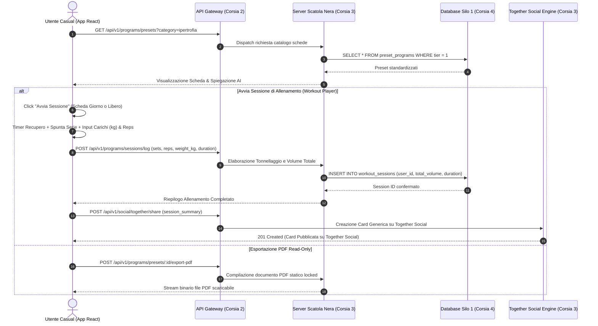
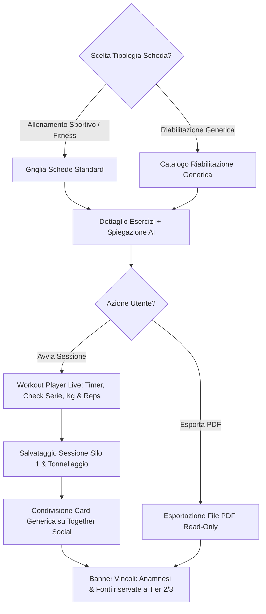

# Capitolato Tecnico: Flow 3A – Programmazione Base, Schede Pre-Confezionate, Workout Player & Condivisione Together Social (T7 Consumer)

## 1. Identificativo & Titolo Ufficiale
- **Badge Miro Board:** `#03` (Posizione: `X: 2459, Y: 465`, Miro Shape ID: `3458764688417722711`)
- **Codice Univoco:** `FLOW-3A`
- **Titolo Formale:** SOFTWARE 1 (B2C CONSUMER) - FLOW 3A: PROGRAMMAZIONE BASE, SCHEDE PRE-CONFEZIONATE, WORKOUT PLAYER & CONDIVISIONE TOGETHER SOCIAL
- **Board Miro Online:** `uXjVEbo6L2o=` (Zona 4, Riga 1: General User / Casual, Colonna 3: Programmazione degli Esercizi)
- **Diagramma Sorgente:** `architecture-blueprint/02-miro-zones-and-swimlanes/18-flowcharts/software-1-consumer-b2c/flow-3a-workout-player.mmd`
- **Riferimento Glossario:** [Glossario Tecnico Vivente](00-GLOSSARIO-TERMINI-TECNICI.md) (Voci: [Thin Client](00-GLOSSARIO-TERMINI-TECNICI.md#thin-client-guscio-visivo), [Service Worker Offline-First](00-GLOSSARIO-TERMINI-TECNICI.md#service-worker-offline-first-cache-storage-api), [Standardized Presets](00-GLOSSARIO-TERMINI-TECNICI.md), [Read-Only PDF Export](00-GLOSSARIO-TERMINI-TECNICI.md), [Spiegazioni AI Generiche](00-GLOSSARIO-TERMINI-TECNICI.md), [Together Social Workout Sharing](00-GLOSSARIO-TERMINI-TECNICI.md#together-social-workout-sharing)).

---

## 2. Obiettivo di Business & Target Utente

### Guida Pratica per Non Tecnici: Cos'è questo modulo per un umano?
Per un utente che si allena a livello ricreativo (Tier 1 Casual), creare una scheda da zero o interpretare complesse formule matematiche di carico è dispersivo e confusionario.  
Questo modulo mette a disposizione un archivio immediato di schede di allenamento pre-confezionate e una vera interfaccia da palestra per guidare e registrare l'allenamento sul campo:
- **Ricerca Intelligente & Filtri:** L'utente può cercare la propria scheda ideale tramite barra di ricerca testuale o filtrando per tipologia di allenamento (ipertrofia, tonificazione, forza base), categoria o disciplina sportiva;
- **Parametri Standardizzati:** Ogni programma offre un volume, carichi indicativi, intensità e frequenza pre-impostati e collaudati, identici per tutti gli utenti della categoria (non personalizzati individualmente);
- **Riabilitazione Generica:** Sono disponibili programmi generici di ginnastica posturale, scarico della colonna e mobilità articolare per recuperare efficienza fisica;
- **Pulsante "Avvia Sessione":** Quando l'utente apre il programma del giorno (o decide di iniziare un allenamento libero), compare il pulsante di avvio immediato;
- **Interfaccia da Palestra (Workout Session Tracker):** Si apre la modalità live con:
  - *Timer di recupero inter-serie* con allarme visivo e sonoro;
  - *Spunta delle serie completate* (checkbox per marcare il progresso);
  - *Inserimento carichi effettivi (kg)* sollevati ad ogni serie;
  - *Inserimento ripetizioni effettive* eseguite rispetto a quelle suggerite;
- **Registrazione Sessione & Tonnellaggio:** Salvataggio della cronologia e calcolo del tonnellaggio totale/volume sollevato;
- **Condivisione su Together Social:** Al termine della sessione, il sistema genera una card riepilogativa con **dati generici dell'allenamento** (durata, volume complessivo, numero di esercizi completati) per la condivisione all'interno del social network integrato **Together Social** per stimolare motivazione e community, senza esporre dati sensibili o biometrici;
- **Consultazione & PDF Read-Only:** L'utente può visualizzare gli esercizi dall'app oppure esportare la scheda in PDF non modificabile per portarla con sé in sala pesi;
- **Spiegazioni AI sull'Utilità:** L'assistente AI fornisce una spiegazione chiara e semplice sul perché quella scheda è utile e quali risultati permette di raggiungere (senza citazioni scientifiche o paper accademici complessi);
- **Zero Collegamento Data Analysis:** In questo livello di ingresso non è presente alcuna integrazione con la sezione avanzata di Data Analysis, né anamnesi personalizzata.

### Specifiche di Business & Metriche
- **Target Utente:** Appassionati di fitness, utenti della palestra e atleti amatoriali (Tier 1 – Casual Consumer).
- **Problema Risolto:** Permettere all'utente medio di iniziare subito ad allenarsi con schede sicure, tracciare serie per serie i pesi reali sollevati e condividere la propria costanza su Together Social.

---

## 3. Attori & Architettura a 4 Corsie (Swimlanes)

1. **Corsia 1: Thin Client UI/UX (React 18 + Service Worker PWA):**
   - Interfaccia catalogo programmi con filtri e ricerca debounce 250ms;
   - Modale scheda con spiegazione AI generica;
   - Tasto "Avvia Sessione" (scheda giorno o workout libero);
   - Workout Session Player da palestra (timer recupero inter-serie, checklist serie, input carichi kg e reps reali);
   - Card generica di condivisione su Together Social;
   - Pulsante di export PDF read-only.
2. **Corsia 2: API Gateway & RBAC Feature Gating (Envoy Gateway):**
   - Verifica permessi utente Tier 1 B2C. Gating restrittivo: blocco chiamate a microservizi di Data Analysis;
   - Endpoint: `GET /api/v1/programs/presets`, `POST /api/v1/programs/sessions/log`, `POST /api/v1/social/together/share`, `POST /api/v1/programs/presets/:id/export-pdf`.
3. **Corsia 3: Server Scatola Nera (Preset Engine, Workout Logger & PDF Renderer):**
   - *Preset Program Selector:* Filtraggio catalogo schede per target ed esperienza;
   - *AI Generic Summarizer:* Modello compatto per spiegazioni divulgative dell'utilità;
   - *Workout Logger Engine:* Calcolo metriche di sessione (durata totale, tonnellaggio sollevato, volume, percentuale completamento);
   - *Together Social Card Generator:* Generazione payload compatto di condivisione generica;
   - *PDF Renderer (PDFKit):* Compilazione foglio PDF locked in sola lettura.
4. **Corsia 4: Database Tripartito (Silo 1 - PostgreSQL):**
   - Tabelle `preset_programs`, `preset_exercises`, `generic_rehab_programs` e `workout_sessions` (storico carichi e serie).

---

### Sequence Diagram Asincrono del Ciclo di Vita (FLOW-3A)



---

## 4. Flusso Passo-Passo (Livello A Narrativo + KPI e Livello B Deep-Dive)

### Livello A: Flusso Operativo Utente & Tabella KPI
1. **Accesso Sezione Programmi:** L'utente apre l'app e accede all'area "Programmazione Schede";
2. **Scelta Categoria & Ricerca:** Naviga tra le categorie (Forza, Ipertrofia, Riabilitazione);
3. **Visualizzazione Scheda & AI:** Consulta gli esercizi con serie/reps prefissate e legge la spiegazione AI;
4. **Avvio Sessione (Workout Player):** Clicca su "Avvia Sessione", gestisce i timer di recupero, spunta le serie e inserisce kg e ripetizioni reali;
5. **Completamento & Condivisione Together Social:** Salva l'allenamento e pubblica i dati generici su Together Social;
6. **Alternativa PDF:** Esporta la scheda in PDF locked per consultazione cartacea.

| Step | Nome Operazione | Tempo Target (KPI) | Descrizione Tecnica |
| :---: | :--- | :---: | :--- |
| **01** | Apertura Catalogo Schede | $< 180	ext{ ms}$ | Fetch preset da Edge Cache e IndexedDB |
| **02** | Avvio Workout Player | $< 60	ext{ ms}$ | Inizializzazione state-machine locale e timer Web Worker |
| **03** | Log Serie & Timer Recupero | $< 30	ext{ ms}$ | Aggiornamento reattivo serie completate e trigger timer |
| **04** | Chiusura Sessione & Tonnellaggio | $< 250	ext{ ms}$ | Calcolo volume totale su server e commit su Silo 1 |
| **05** | Condivisione Together Social | $< 350	ext{ ms}$ | Creazione card social con dati generici (no metriche sensibili) |
| **06** | Rendering & Download PDF | $< 1.2	ext{ s}$ | Generazione PDF compatto read-only con layout protetto |

### Livello B: Deep-Dive Ingegneristico sui Microservizi
- **State Machine del Workout Player:** Gestita interamente tramite un Web Worker isolato per garantire l'accuratezza del timer al millisecondo anche ad app in background;
- **Autonomia Offline del Player:** Tutte le serie, i carichi (kg) e le ripetizioni inserite vengono scritte istantaneamente su IndexedDB (`offline_workout_buffer`). Al ripristino della connettività, il Service Worker esegue il flush asincrono verso l'API Gateway;
- **Sanitizzazione Dati per Together Social:** La card generata contiene esclusivamente metriche aggregate (es. "Durata: 54 min | Volume: 4.820 kg | Esercizi: 6"). Non vengono esportati dati biometrici, video o annotazioni cliniche.

---

## 5. Rami Decisionali & 4 Stati UI



### Gestione dei 4 Stati UI (Obbligatoria)
1. **Empty State:** Nessuna scheda trovata per i filtri selezionati. Messaggio esplicativo con invito al reset filtri.
2. **Loading State:** Skeleton screen durante il fetch dei preset o la generazione del riepilogo di sessione.
3. **Populated State (Workout Player):** Interfaccia a contrasto elevato, tasti grandi ottimizzati per uso con una sola mano, timer ben visibile e campi numerici reattivi per carichi e reps.
4. **Error / Fallback State:** Caduta di linea durante l'allenamento: il workout player continua a operare al 100% in locale su IndexedDB con badge "Salvataggio locale attivo; sincronizzazione al ritorno online".

---

## 6. Contratti Dati & Error Matrix

### Schema JSON Registrazione Sessione (`workout_session_logs`)
```json
{
  "sessionId": "sess_casual_8921",
  "userId": "usr_99120",
  "tier": 1,
  "programId": "preset_hyp_01",
  "isFreeWorkout": false,
  "startedAt": "2026-11-15T18:00:00Z",
  "completedAt": "2026-11-15T18:52:30Z",
  "durationSeconds": 3150,
  "totalVolumeKg": 5420.5,
  "completedSetsCount": 16,
  "exercises": [
    {
      "exerciseId": "ex_bench_press_01",
      "exerciseName": "Panca Piana Bilanciere",
      "sets": [
        { "setNumber": 1, "targetReps": 10, "actualReps": 10, "weightKg": 60.0, "isCompleted": true, "restSeconds": 90 },
        { "setNumber": 2, "targetReps": 10, "actualReps": 9, "weightKg": 60.0, "isCompleted": true, "restSeconds": 90 }
      ]
    }
  ]
}
```

### Schema JSON Condivisione su Together Social (`together_social_shares`)
```json
{
  "shareId": "tsh_77312",
  "userId": "usr_99120",
  "sessionId": "sess_casual_8921",
  "socialNetwork": "Together Social",
  "shareType": "generic_workout_summary",
  "publicCardData": {
    "title": "Allenamento Ipertrofia Completato",
    "workoutType": "Scheda Standard Preset",
    "durationMinutes": 52,
    "totalVolumeTons": 5.42,
    "completedExercisesCount": 4,
    "badgeEarned": "Costanza Settimanale"
  },
  "privacyLevel": "community_public"
}
```

### Matrice Errori HTTP a 6 Colonne
| HTTP Code | Codice Interno | Endpoint | Causa Scatenante | UX Feedback Visivo | Strategia di Resilienza |
| :---: | :---: | :--- | :--- | :--- | :--- |
| `403` | `ERR_T1_DATA_ANALYSIS_GATED` | `/api/v1/analytics/sync` | Utente Tier 1 tenta integrazione con Data Analysis | Modal: "Data Analysis disponibile dal Tier 3 Elite" | Redirect a catalogo preset |
| `403` | `ERR_T1_PARAM_EDIT_BLOCKED` | `/api/v1/programs/presets/:id` | Tentativo di modifica parametri scheda standard | Tooltip: "Parametri standardizzati non modificabili in Tier 1" | Rollback UI immediato |
| `400` | `ERR_T1_INVALID_SESSION_DATA` | `/api/v1/programs/sessions/log` | Carichi o ripetizioni negative o malformate | Evidenziazione rossa sul campo errato | Blocco invio fino a correzione client |
| `502` | `ERR_T1_SOCIAL_SHARE_TIMEOUT` | `/api/v1/social/together/share` | Timeout pubblicazione card su Together Social | Toast: "Sessione salvata! Condivisione su Together Social riprovata a breve" | Coda retry asincrona in background |
| `500` | `ERR_T1_PDF_GEN_FAILED` | `/api/v1/programs/presets/:id/export-pdf` | Timeout motore di rendering PDF | Banner: "Impossibile generare il PDF. Consulta la scheda in-app" | Consultazione in-app abilitata |

---

## 7. Ereditarietà di Tier & Vincoli

- **Ereditarietà da Livelli Inferiori:** Entry level della piattaforma; nessun livello inferiore.
- **Funzionalità Esclusive Tier 1:**
  - Accesso gratuito/consumer a libreria schede pre-confezionate per tutti gli sport e categorie;
  - Schede generiche di riabilitazione e postura;
  - **Pulsante "Avvia Sessione"** e interfaccia Workout Player con timer recupero, checklist serie, registrazione carichi (kg) e ripetizioni effettive;
  - **Condivisione su Together Social** dei dati generici di allenamento per creare community;
  - Spiegazione AI sintetica sull'obiettivo e utilità della scheda;
  - Esportazione esclusivamente in formato PDF Read-Only senza possibilità di modifica.
- **Vincoli e Limitazioni di Fascia (Gating Negativo):**
  - **Zero integrazione con Data Analysis:** Nessun caricamento dati o storico performance biomeccaniche;
  - **Zero personalizzazione parametri scheda:** Frequenza e target prefissati;
  - **Zero video nelle schede:** Nessun media streaming incorporato nel documento di allenamento;
  - **Zero chatbot e zero RAG:** Nessun tutor interattivo o addestramento custom.
