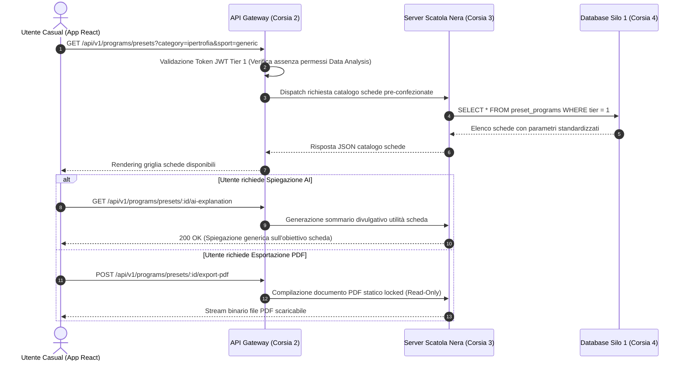
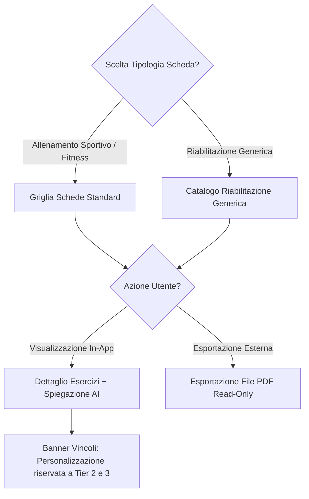

# Capitolato Tecnico: Flow 3A – Programmazione Base, Schede Pre-Confezionate & Export PDF (T7 Consumer)

## 1. Identificativo & Titolo Ufficiale
- **Badge Miro Board:** `#03` (Posizione: `X: 2459, Y: 465`, Miro Shape ID: `3458764688417722711`)
- **Codice Univoco:** `FLOW-3A`
- **Titolo Formale:** SOFTWARE 1 (B2C CONSUMER) - FLOW 3A: PROGRAMMAZIONE BASE, SCHEDE PRE-CONFEZIONATE, RIABILITAZIONE GENERICA & EXPORT PDF
- **Board Miro Online:** `uXjVEbo6L2o=` (Zona 4, Riga 1: General User / Casual, Colonna 3: Programmazione degli Esercizi)
- **Diagramma Sorgente:** `architecture-blueprint/02-miro-zones-and-swimlanes/18-flowcharts/software-1-consumer-b2c/flow-3a-workout-player.mmd`
- **Riferimento Glossario:** [Glossario Tecnico Vivente](00-GLOSSARIO-TERMINI-TECNICI.md) (Voci: [Thin Client](00-GLOSSARIO-TERMINI-TECNICI.md#thin-client-guscio-visivo), [Service Worker Offline-First](00-GLOSSARIO-TERMINI-TECNICI.md#service-worker-offline-first-cache-storage-api), [Standardized Presets](00-GLOSSARIO-TERMINI-TECNICI.md), [Read-Only PDF Export](00-GLOSSARIO-TERMINI-TECNICI.md), [Spiegazioni AI Generiche](00-GLOSSARIO-TERMINI-TECNICI.md)).

---

## 2. Obiettivo di Business & Target Utente

### Guida Pratica per Non Tecnici: Cos'è questo modulo per un umano?
Per un utente che si allena a livello ricreativo (Tier 1 Casual), creare una scheda da zero o interpretare complesse formule matematiche di carico è dispersivo e confusionario.  
Questo modulo mette a disposizione un archivio immediato di schede di allenamento pre-confezionate e pronte all'uso:
- **Ricerca Intelligente & Filtri:** L'utente può cercare la propria scheda ideale tramite barra di ricerca testuale o filtrando per tipologia di allenamento (ipertrofia, tonificazione, forza base), categoria o disciplina sportiva;
- **Parametri Standardizzati:** Ogni programma offre un volume, carichi, intensità e frequenza pre-impostati e collaudati, identici per tutti gli utenti della categoria (non personalizzati individualmente);
- **Riabilitazione Generica:** Sono disponibili programmi generici di ginnastica posturale, scarico della colonna e mobilità articolare per recuperare efficienza fisica;
- **Consultazione & PDF Read-Only:** L'utente può visualizzare gli esercizi dall'app oppure esportare la scheda in PDF non modificabile per portarla con sé in sala pesi;
- **Spiegazioni AI sull'Utilità:** L'assistente AI fornisce una spiegazione chiara e semplice sul perché quella scheda è utile e quali risultati permette di raggiungere (senza citazioni scientifiche o paper accademici complessi);
- **Zero Collegamento Data Analysis:** In questo livello di ingresso non è presente alcuna integrazione con la sezione avanzata di Data Analysis, né anamnesi personalizzata.

### Specifiche di Business & Metriche
- **Target Utente:** Appassionati di fitness, utenti della palestra e atleti amatoriali (Tier 1 – Casual Consumer).
- **Problema Risolto:** Permettere all'utente medio di iniziare subito ad allenarsi con schede sicure, bilanciate e certificate, azzerando i tempi di configurazione ed eliminando il rischio di errori nel settaggio dei carichi.

---

## 3. Attori & Architettura a 4 Corsie (Swimlanes)

1. **Corsia 1: Thin Client UI/UX (React 18 + Service Worker PWA):**
   - Interfaccia catalogo programmi con selettori a schede (Fitness, Sport, Riabilitazione), barra di ricerca debounce 250ms, griglia schede pre-confezionate, modale di consultazione con spiegazione AI e pulsante di export PDF read-only.
2. **Corsia 2: API Gateway & RBAC Feature Gating (Envoy Gateway):**
   - Verifica permessi utente Tier 1 B2C. Gating restrittivo: blocco chiamate a microservizi di Data Analysis, inibizione endpoint di anamnesi clinica personalizzata e blocco modifiche parametri (`read_only: true`).
3. **Corsia 3: Server Scatola Nera (Preset Engine & PDF Renderer Cloud Run):**
   - *Preset Program Selector:* Filtraggio catalogo schede per target, sesso ed esperienza;
   - *AI Generic Summarizer:* Modello LLM compatto per generazione spiegazioni divulgative (focus utilità/obiettivi senza referenze accademiche);
   - *PDF Renderer (Puppeteer / PDFKit):* Compilazione foglio PDF locked in sola lettura.
4. **Corsia 4: Database Tripartito (Silo 1 - PostgreSQL):**
   - Tabelle `preset_programs` (schede standardizzate per sport e livello), `preset_exercises` (esercizi associati con serie/reps fisse) e `generic_rehab_programs`.

---

### Sequence Diagram Asincrono del Ciclo di Vita (FLOW-3A)



---

## 4. Flusso Passo-Passo (Livello A Narrativo + KPI e Livello B Deep-Dive)

### Livello A: Flusso Operativo Utente & Tabella KPI
1. **Accesso Sezione Programmi:** L'utente apre l'app e accede all'area "Programmazione Schede";
2. **Scelta Categoria & Ricerca:** Naviga tra le categorie di allenamento (Forza, Ipertrofia, Cardio) oppure accede alla sezione "Riabilitazione Generica";
3. **Visualizzazione Parametri Standard:** Consulta la scheda selezionata, con serie, ripetizioni, tempi di recupero e frequenza standardizzati (non modificabili);
4. **Lettura Spiegazione AI:** Legge il riquadro AI che sintetizza lo scopo del programma (es. "Questa scheda è ideale per tonificare la parte superiore in 3 sedute settimanali");
5. **Esportazione PDF:** Scarica la versione cartacea/digitale PDF locked non modificabile per la sala pesi.

| Step | Nome Operazione | Tempo Target (KPI) | Descrizione Tecnica |
| :---: | :--- | :---: | :--- |
| **01** | Apertura Catalogo Schede | $< 180\text{ ms}$ | Caricamento cache IndexedDB e fetch preset da Edge Cache |
| **02** | Filtraggio & Ricerca | $< 50\text{ ms}$ | Filtraggio client-side in-memory su array JSON tipizzato |
| **03** | Generazione Spiegazione AI | $< 600\text{ ms}$ | Inferenza micro-LLM su template statico per utilità scheda |
| **04** | Rendering & Download PDF | $< 1.2\text{ s}$ | Generazione PDF compatto read-only con layout protetto |

### Livello B: Deep-Dive Ingegneristico sui Microservizi
- **Standardizzazione dei Parametri:** I programmi per Tier 1 contengono costanti non editabili:
  - Frequenza: 2 o 3 sedute settimanali prefissate;
  - Intensità: basata su sforzo generico (RPE standard 7-8);
  - Carichi: percentuali $1\text{RM}$ standardizzate o carichi guida indicativi;
- **Isolamento da Data Analysis:** L'API Gateway intercetta qualsiasi richiesta verso `/api/v1/analytics/*` proveniente da client con claim `tier: 1`, restituendo `403 Forbidden` con codice `FEATURE_GATED_TIER2_REQUIRED`.

---

## 5. Rami Decisionali & 4 Stati UI



### Gestione dei 4 Stati UI (Obbligatoria)
1. **Empty State:** Nessuna scheda corrisponde ai filtri selezionati. L'interfaccia mostra un messaggio chiaro: "Nessun programma trovato per questa categoria. Prova a selezionare un'altra tipologia o resetta i filtri".
2. **Loading State:** Skeleton screen pulsante durante il recupero dei dati preset dal server.
3. **Populated State:** Schede informative visualizzate in card ad alto contrasto con badge di frequenza settimanale (es. "3 gg/sett").
4. **Error / Fallback State:** Connessione assente durante la generazione del PDF. L'app offre la consultazione offline della scheda direttamente su IndexedDB senza blocco operativo.

---

## 6. Contratti Dati & Error Matrix

### Schema JSON Richiesta & Risposta Catalogo Preset
```json
{
  "programId": "preset_hyp_01",
  "tier": 1,
  "category": "hypertrophy",
  "sport": "fitness_standard",
  "readOnly": true,
  "isPersonalized": false,
  "parameters": {
    "weeklyFrequency": 3,
    "splitType": "Upper / Lower / FullBody",
    "targetRpe": 7.5,
    "volumeSetsPerWeek": 12
  },
  "aiExplanation": {
    "objective": "Sviluppo armonico della massa muscolare e della resistenza alla fatica",
    "utility": "Ideale per consolidare la tecnica esecutiva mantenendo un volume sostenibile",
    "hasScientificCitations": false
  },
  "exportCapabilities": ["pdf_readonly"]
}
```

### Matrice Errori HTTP a 6 Colonne
| HTTP Code | Codice Interno | Endpoint | Causa Scatenante | UX Feedback Visivo | Strategia di Resilienza |
| :---: | :---: | :--- | :--- | :--- | :--- |
| `403` | `ERR_T1_DATA_ANALYSIS_GATED` | `/api/v1/analytics/sync` | Utente Tier 1 tenta integrazione con Data Analysis | Modal informativo: "L'integrazione con Data Analysis è disponibile a partire dal Tier 3 Elite" | Nessun crash; redirect a catalogo preset |
| `403` | `ERR_T1_PARAM_EDIT_BLOCKED` | `/api/v1/programs/presets/:id` | Tentativo di modifica parametri scheda standard | Tooltip su campi bloccati: "Parametri standardizzati non modificabili in Tier 1" | Rollback UI immediato su valori preset |
| `404` | `ERR_T1_PRESET_NOT_FOUND` | `/api/v1/programs/presets/:id` | ID scheda pre-confezionata non esistente | Avviso: "Programma non trovato nel catalogo base" | Fallback automatico alla lista generale |
| `500` | `ERR_T1_PDF_GEN_FAILED` | `/api/v1/programs/presets/:id/export-pdf` | Timeout motore di rendering PDF | Banner: "Impossibile generare il PDF. Puoi consultare la scheda direttamente dall'app" | Consultazione in-app abilitata |

---

## 7. Ereditarietà di Tier & Vincoli

- **Ereditarietà da Livelli Inferiori:** Entry level della piattaforma; nessun livello inferiore.
- **Funzionalità Esclusive Tier 1:**
  - Accesso gratuito/consumer a libreria schede pre-confezionate per tutti gli sport e categorie;
  - Schede generiche di riabilitazione e postura;
  - Spiegazione AI sintetica sull'obiettivo e utilità della scheda;
  - Esportazione esclusivamente in formato PDF Read-Only senza possibilità di modifica.
- **Vincoli e Limitazioni di Fascia (Gating Negativo):**
  - **Zero integrazione con Data Analysis:** Nessun caricamento dati o storico performance;
  - **Zero personalizzazione:** Frequenza, carichi, intensità e volume fissi e standardizzati;
  - **Zero video nelle schede:** Nessun media streaming incorporato nel documento di allenamento;
  - **Zero chatbot e zero RAG:** Nessun tutor interattivo o addestramento custom.
