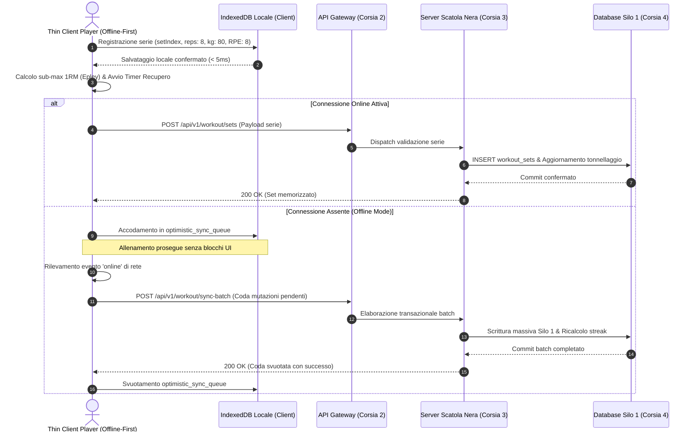

# Capitolato Tecnico: Flow 3A – Architettura Thin Client & Interactive Workout Player (T7 Consumer)

## 1. Identificativo & Titolo Ufficiale
- **Badge Miro Board:** `#03` (Posizione: `X: 2459, Y: 465`, Miro Shape ID: `3458764688417722711`)
- **Codice Univoco:** `FLOW-3A`
- **Titolo Formale:** SOFTWARE 1 (B2C CONSUMER) - FLOW 3A: ARCHITETTURA DI SISTEMA, THIN CLIENT & INTERACTIVE WORKOUT PLAYER
- **Board Miro Online:** `uXjVEbo6L2o=` (Zona 4, Riga 1: General User / Casual, Colonna 3: Architettura di Sistema & Workout Player)
- **Diagramma Sorgente:** `architecture-blueprint/02-miro-zones-and-swimlanes/18-flowcharts/software-1-consumer-b2c/flow-3a-workout-player.mmd`
- **Riferimento Glossario:** [Glossario Tecnico Vivente](00-GLOSSARIO-TERMINI-TECNICI.md) (Voci: [Thin Client](00-GLOSSARIO-TERMINI-TECNICI.md#thin-client-guscio-visivo), [Service Worker Offline-First](00-GLOSSARIO-TERMINI-TECNICI.md#service-worker-offline-first-cache-storage-api), [IndexedDB](00-GLOSSARIO-TERMINI-TECNICI.md#indexeddb-optimistic-transaction-queue), [Tonnellaggio & Volume](00-GLOSSARIO-TERMINI-TECNICI.md#tonnellaggio-volume-di-carico-sets-x-reps-x-kg), [Epley 1RM Formula](00-GLOSSARIO-TERMINI-TECNICI.md#epley-1rm-formula-stima-sub-massimale), [Rate of Perceived Exertion RPE](00-GLOSSARIO-TERMINI-TECNICI.md#scale-rpe-rir-borg-cr10-reps-in-reserve)).

---


## 2. Obiettivo di Business & Target Utente

### Guida Pratica per Non Tecnici: Cos'è questo modulo per un umano?
Mentre ti alleni in palestra, non hai tempo da perdere a combattere con il telefono o a scrivere appunti su foglietti volanti. Spesso, inoltre, le palestre si trovano in scantinati o capannoni dove **la connessione internet scompare del tutto**.  
Questo modulo è il tuo compagno di allenamento digitale infallibile:
- Funziona al 100% **anche senza un briciolo di campo internet** grazie alla sua memoria locale (Service Worker e IndexedDB);
- Ti mostra la scheda del giorno con un player a schermo intero: serie, ripetizioni e video guida;
- Appena finisci una serie, digiti i kg sollevati e con un tocco avvii il timer di recupero (es. 90 secondi): puoi appoggiare il telefono perché emetterà un suono chiaro e una vibrazione non appena è il momento di ripartire;
- Se stabilisci un nuovo Record Personale (PR), l'app festeggia subito sullo schermo calcolando quanto volume hai sollevato in totale;
- Appena torni sotto copertura Wi-Fi, tutti i dati vengono sincronizzati automaticamente nel cloud senza perdere una singola ripetizione.

### Specifiche di Business & Metriche
- **Target Utente:** Atleti e persone comuni che eseguono una sessione di allenamento attiva (Tier 1 – Casual Consumer).
- **Problema Risolto:** Azzerare le interruzioni dovute a blackout di rete (Zero Data Loss) e mantenere il focus psicofisico dell'atleta tra le serie, automatizzando la registrazione metrologica del carico e la stima del massimale teorico ($1\text{RM}$) senza mai esporre gli algoritmi nel codice client (ADR-01).

---


## 3. Attori & Architettura a 4 Corsie (Swimlanes)

1. **Corsia 1: Thin Client UI/UX (React 18 + Service Worker PWA):**
   - Interfaccia Dark Theme ad altissima visibilità con tastierino numerico maggiorato per dita sudate, video in loop compatto, countdown timer sonoro/aptico flottante, form per la scala di sforzo percepito (RPE Foster 1-10) e cache offline su IndexedDB.
2. **Corsia 2: API Gateway & Offline Queue Synchronization (Envoy + Background Sync API):**
   - Rilevamento dello stato di connettività (`navigator.onLine`). Gestione delle chiamate asincrone di fine serie (`/set-done`) e completamento seduta (`/complete`). In caso di rete assente, il Service Worker accoda le richieste e le trasmette in modo atomico al ripristino della connessione.
3. **Corsia 3: Server Scatola Nera (Volume & PR Calculation Engine Cloud Run):**
   - Calcolo del tonnellaggio totale ($\sum \text{Carico} \times \text{Ripetizioni}$), stima del massimale $1\text{RM}$ tramite formula di Epley:
     $$1\text{RM}_{\text{Epley}} = \text{Carico} \cdot \left(1 + \frac{\text{Reps}}{30}\right)$$
   - Rilevamento automatico superamento soglie storiche per rilascio badge celebrativo.
4. **Corsia 4: Database Tripartito (Silo 1 - PostgreSQL):**
   - Tabelle `completed_workouts` per l'intestazione della seduta, `workout_sets` per i dettagli puntuali di ciascuna serie e `athlete_records` per lo storico dei record personali per esercizio.

---


### Sequence Diagram Asincrono del Ciclo di Vita (FLOW-3A)



---


## 4. Flusso Operativo Passo-Passo

### Livello A: User Journey Narrativo (La Storia dell'Utente)
1. **L'Avvio della Seduta:** L'atleta apre la schermata principale e tocca *"Inizia Allenamento di Oggi"*. L'app apre il Player focalizzato sul primo esercizio (es. Panca Piana: 4 serie da 8 ripetizioni con 80 kg).
2. **La Prima Serie:** L'atleta solleva il bilanciere. Terminata la serie, inserisce i chili effettivi (es. 80 kg per 8 ripetizioni) e preme il grande pulsante verde *"Serie Completata"*.
3. **Il Timer di Recupero:** All'istante parte un cronometro circolare da 90 secondi. L'atleta mette il telefono nella tasca o sulla panca. Allo scadere dei 90 secondi, il telefono vibra ed emette un doppio beep acustico: è ora di iniziare la seconda serie!
4. **L'Allenamento Continua:** Serie dopo serie, l'app passa automaticamente all'esercizio successivo (Croci ai cavi, French Press, Addome). Se la palestra non ha rete, una piccola icona rassicurante segnala: *"Dati salvati sul dispositivo. Verranno inviati appena c'è campo"*.
5. **Il Termine della Sessione & L'RPE:** All'ultimo esercizio l'utente preme *"Termina Allenamento"*. Compare una semplice domanda: *"Da 1 a 10, quanta fatica hai fatto oggi?"*. L'atleta seleziona ad esempio 7 (Sforzo Intenso).
6. **La Schermata della Vittoria (Summary Card):** L'app calcola tutto e mostra un riepilogo entusiasmante:
   - *"Grande lavoro! Hai sollevato 4.820 kg in totale in 52 minuti!"*
   - *"Nuovo Record Personale sbloccato sulla Panca Piana: stima 1RM pari a 101 kg!"*
   I dati sono memorizzati in modo permanente.

---


#### Indicatori di Accettazione Operativa & Clinica (KPI)
| Metrica / Parametro | Obiettivo Target | Tolleranza Accettabile | Azione Fallback / Allerta |
| :--- | :--- | :--- | :--- |
| **Disponibilità Offline-First** | $100\%$ sessioni offline | $\ge 99.9\%$ | Persistenza garantita su IndexedDB |
| **Latenza Salvataggio Locale** | $< 5\text{ ms}$ | $\le 20\text{ ms}$ | Aggiornamento ottimistico dello stato UI |
| **Tempo Svuotamento Coda Sync** | $< 2\text{ s}$ dal ritorno online | $\le 5\text{ s}$ | Riprova con backoff esponenziale ($1, 2, 4, 8\text{s}$) |
| **Accuratezza Tonnellaggio** | $100\%$ deterministico | $0\%$ errore | Audit trail e ricalcolo asincrono server |


---


### Livello B: Trattazione Tecnica Nodi Operativi

1. `START` (Avvio Sessione Player): Caricamento della scheda attiva dallo store di memoria locale (Zustand/Context) e montaggio del container `WorkoutPlayerView`.
2. `PLAYER_VIEW` (Rendering Interfaccia Esercizio): Visualizzazione dati di sessione: esercizio attivo, numero serie corrente su totale ($3/4$), target preimpostato, video miniatura 60fps in loop e cronometro generale di seduta.
3. `SET_LOG` (Input Serie Effettuata): Inserimento dei parametri effettivi: Carico in chilogrammi ($\text{loadKg}$) e Ripetizioni eseguite ($\text{repsCompleted}$).
4. `BTN_DONE_SET` (Pulsante Conferma): Trigger evento di registrazione serie nel buffer locale e avvio automatico del timer di recupero.
5. `REST_TIMER` (Timer di Recupero con Feedback):
   - Timer progressivo con animazione SVG a 60fps;
   - Al raggiungimento di $t = 0$: emissione Web Audio API frequenza $880\text{ Hz}$ (beep bitonale) e attivazione `navigator.vibrate([200, 100, 200])`.
6. `LOOP_SETS` (Avanzamento Serie/Esercizio): Se rimangono serie $\implies$ ritorno a `PLAYER_VIEW` con incremento contatore; se l'esercizio è completato $\implies$ transizione al successivo.
7. `SESSION_FINISH` (Chiusura Allenamento): L'atleta tocca "Termina Sessione". Visualizzazione modal di rilevamento sforzo percepito: scala RPE di Foster (1-10).
8. `GW_ONLINE` (Controllo Rete & Sync Engine):
   - *Se offline:* Serializzazione payload in IndexedDB store `pending_workouts` e registrazione task in Background Sync API (`OFFLINE_BADGE`).
   - *Se online:* Invio payload atomico all'API Gateway (`GW_LOG_FINISH`).
9. `SRV_VOLUME & SRV_FATIGUE` (Elaborazione Server Scatola Nera): Il microservizio Cloud Run calcola il tonnellaggio complessivo, il carico di lavoro per distretto muscolare e l'indice di fatica neuromuscolare della seduta.
10. `SRV_PR_DETECT` (Rilevamento Record Personali):
    - Il server confronta il carico e l'$1\text{RM}$ stimato con i valori storici registrati in `athlete_records`;
    - Se superato $\implies$ generazione badge PR (`SRV_BADGE`) e aggiornamento record;
    - Se invariato $\implies$ archiviazione standard.
11. `SUMMARY_CARD` (Rendering Card Riassuntiva Finale): Presentazione metrica di fine allenamento: Tonnellaggio complessivo ($kg$), Durata ($min$), Serie totali, Badge PR festeggiati e salvataggio definitivo.
12. `END_LOGGED` (Fine Flusso): Chiusura sessione e ritorno alla Dashboard dell'Hub Centrale.

---


## 5. Rami Decisionali & Gestione dei 4 Stati UI

| Bivio Decisionale | Condizione Logica | Ramo SÌ / Positivo | Ramo NO / Negativo |
| :--- | :--- | :--- | :--- |
| `GW_ONLINE` | Dispositivo connesso a Internet? | Invio immediato all'API Gateway | Salvataggio offline in IndexedDB |
| `SRV_PR_DETECT` | Carico o 1RM stimato $>$ Record Storico? | Genera Badge PR celebrativo | Archiviazione ordinaria senza badge |
| `LOOP_SETS` | Rimangono serie da completare? | Riapri Player per serie successiva | Prosegui a chiusura allenamento |

### I 4 Stati di Interfaccia Utente (UI States):
1. **Empty State:** Nessuna scheda di allenamento programmata per oggi: la schermata offre un pulsante per iniziare un *"Allenamento Libero"* o sfogliare il catalogo.
2. **Loading State:** Transizione a skeleton screen durante il salvataggio finale e il calcolo del tonnellaggio (latenza server $< 180\text{ ms}$).
3. **Populated State:** Schermata Player viva: cronometro attivo, tastierino numerico reattivo, cronologia delle serie precedenti visibile con un piccolo swipe verso il basso.
4. **Error / Fallback State:**
   - *Blackout di rete in sala pesi:* Comparsa di un indicatore giallo discreto in alto a destra: *"Modalità Offline attiva. I tuoi dati sono al sicuro sul dispositivo"*. Nessun blocco dell'interfaccia.

---


## 6. Contratti Dati, Parametri I/O & Database Silo

### Specifiche Endpoint REST:

#### 1. Invio Fine Allenamento & Calcolo Metriche
- **Endpoint:** `POST /api/v1/workouts/complete`
- **Headers:** `Authorization: Bearer <jwt_token>`, `Content-Type: application/json`
- **Request Payload:**
```json
{
  "workoutId": "w_plan_7701",
  "athleteId": "ath_c0192a",
  "durationSeconds": 3120,
  "rpeFosterScore": 7.5,
  "completedAtUtc": "2026-10-26T11:45:00Z",
  "sets": [
    { "exerciseId": "ch_barbell_bench_press_01", "setNumber": 1, "loadKg": 80.0, "reps": 8 },
    { "exerciseId": "ch_barbell_bench_press_01", "setNumber": 2, "loadKg": 80.0, "reps": 8 },
    { "exerciseId": "ch_barbell_bench_press_01", "setNumber": 3, "loadKg": 80.0, "reps": 8 },
    { "exerciseId": "ch_barbell_bench_press_01", "setNumber": 4, "loadKg": 85.0, "reps": 7 }
  ]
}
```
- **Responses:**
  - `200 OK`:
```json
{
  "status": "success",
  "totalVolumeKg": 2515.0,
  "durationMinutes": 52,
  "newRecords": [
    {
      "exerciseId": "ch_barbell_bench_press_01",
      "metric": "ESTIMATED_1RM",
      "oldValue": 98.0,
      "newValue": 104.8,
      "badgeUnlocked": "PR_GOLD_BENCH"
    }
  ]
}
```
  - `400 Bad Request`: Payload malformato o serie mancanti.
  - `401 Unauthorized`: Sessione scaduta.

### Schema Relazionale (Database Silo 1 - PostgreSQL):
- `completed_workouts`: `id UUID PK`, `athlete_id UUID FK -> athlete_profiles.id`, `duration_seconds INT`, `rpe_score NUMERIC(3,1)`, `total_volume_kg NUMERIC(8,2)`, `completed_at TIMESTAMPTZ`.
- `workout_sets`: `id UUID PK`, `workout_id UUID FK -> completed_workouts.id`, `exercise_id VARCHAR(64)`, `set_index INT`, `load_kg NUMERIC(5,2)`, `reps INT`, `created_at TIMESTAMPTZ`.
- `athlete_records`: `athlete_id UUID`, `exercise_id VARCHAR(64)`, `max_load_kg NUMERIC(5,2)`, `estimated_1rm_kg NUMERIC(5,2)`, `achieved_at TIMESTAMPTZ`, `PRIMARY KEY (athlete_id, exercise_id)`.

---


### Matrice Errori HTTP & Strategie di Resilienza
| HTTP Code | Codice Interno | Endpoint | Causa Scatenante | UX Feedback Visivo | Strategia di Resilienza & Fallback |
| :---: | :--- | :--- | :--- | :--- | :--- |
| **400** | `ERR_NEGATIVE_VALUES` | `POST /workout/sets` | Ripetizioni o carico negativi/nulli | Bordo rosso: *"Inserisci valori validi"* | Validazione client preventiva prima dell'invio |
| **401** | `ERR_SESSION_INVALID` | `POST /workout/sync-batch` | Token scaduto durante allenamento offline | Banner non intrusivo: *"Offline"* | Mantenimento dati in IndexedDB fino a re-login |
| **409** | `ERR_TIMESTAMP_CONFLICT` | `POST /workout/sync-batch` | Serie già registrata con timestamp identico | Nessun blocco visibile all'utente | Risoluzione conflitti via Last-Write-Wins (LWW) |
| **422** | `ERR_MALFORMED_SET` | `POST /workout/sets` | Formato JSON non conforme alla tipizzazione | Notifica: *"Errore di registrazione serie"* | Ripristino copia locale da IndexedDB |
| **500** | `ERR_STREAK_FAILURE` | `POST /workout/finish` | Errore calcolo giorni consecutivi | Icona ambrata: *"Streak in elaborazione"* | Job server differito e allineamento successivo |
| **503** | `ERR_SYNC_UNAVAILABLE` | `POST /workout/sync-batch` | Server temporaneamente sovraccarico | Icona nuvola arancione (coda pendente) | Accodamento per riprova automatica differita |


---


## 7. Ereditarietà di Tier & Differenziali di Fascia

- **Funzionalità Base (Tier 1):** Registrazione serie manuale, timer di recupero con beep/vibrazione, tonnellaggio totale, stima $1\text{RM}$ con equazione di Epley e funzionamento offline-first al 100%.
- **Propagazione a Tier 2 (`FLOW-3B` & `FLOW-4B`):**  
  Il coach non registra solo i kg manuali, ma aggancia i trasduttori lineari di velocità via Bluetooth BLE (VBT) calcolando la velocità di spostamento media e di picco in tempo reale su ogni ripetizione.
- **Propagazione a Tier 3 (`FLOW-3C` & `FLOW-4C`):**  
  Nei club professionistici, la seduta del singolo atleta si integra con la telemetria GPS da campo, calcolando il carico acuto su cronico (ACWR EWMA) e lo Z-Score di fatica di squadra nel microciclo.
