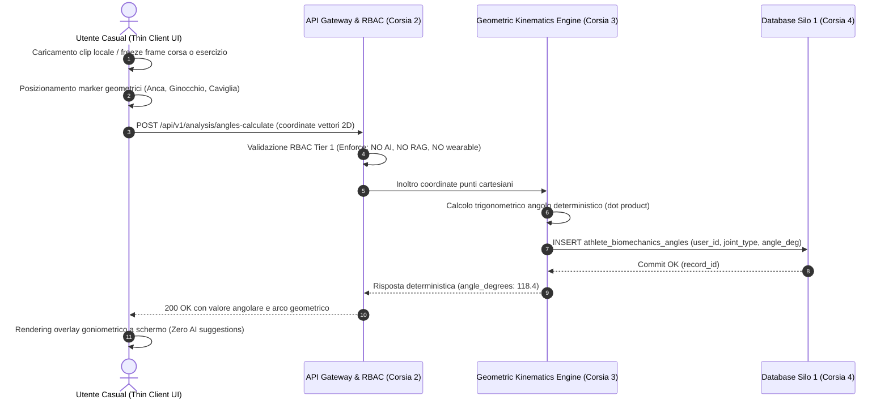

# Capitolato Tecnico: Flow 4A – Data Analisi: Revisione Biomeccanica Angoli Principali (T7 Consumer)

## 1. Identificativo & Titolo Ufficiale
- **Badge Miro Board:** `#04` (Posizione: `X: 4171, Y: 465`, Miro Shape ID: `3458764688417722715`)
- **Codice Univoco:** `FLOW-4A`
- **Titolo Formale:** SOFTWARE 1 (B2C CONSUMER) - FLOW 4A: DATA ANALISI - REVISIONE BIOMECCANICA ANGOLI PRINCIPALI (NO AI, NO RAG)
- **Board Miro Online:** `uXjVEbo6L2o=` (Zona 4, Riga 1: General User / Casual, Colonna 4: Data Analisi)
- **Diagramma Sorgente:** `architecture-blueprint/02-miro-zones-and-swimlanes/18-flowcharts/software-1-consumer-b2c/flow-4a-wearable-sync.mmd`
- **Riferimento Glossario:** [Glossario Tecnico Vivente](00-GLOSSARIO-TERMINI-TECNICI.md) (Voci: [Revisione Biomeccanica Deterministica](00-GLOSSARIO-TERMINI-TECNICI.md#revisione-biomeccanica-deterministica-calcolo-angoli-principali-no-ai), [Trigonometria Deterministica 2D](00-GLOSSARIO-TERMINI-TECNICI.md#trigonometria-deterministica-2d-goniometro-digitale), [Zero AI Biomeccanica](00-GLOSSARIO-TERMINI-TECNICI.md#zero-ai-biomeccanica), [Isolamento Data Analisi Tier 1](00-GLOSSARIO-TERMINI-TECNICI.md#isolamento-data-analisi-tier-1)).

---

## 2. Obiettivo di Business & Target Utente

### Guida Pratica per Non Tecnici: Cos'e questo modulo per un umano?
Quando una persona corre su un tapis roulant o esegue uno squat a casa, spesso desidera sapere se sta piegando le ginocchia a sufficienza o se la schiena e troppo inclinata in avanti.  
Il modulo di **Data Analisi Tier 1** offre un goniometro digitale geometrico:
- L'utente carica una clip o un singolo fermo immagine (frame) della propria corsa o di un esercizio;
- Posiziona manualmente o seleziona i marker geometrici sulle articolazioni chiave (es. anca, ginocchio, caviglia);
- Il sistema calcola all'istante l'angolo articolare esatto espresso in gradi attraverso pure formule geometriche e trigonometriche;
- **Zero AI:** Nessun modello di intelligenza artificiale formula giudizi o correzioni automatiche;
- **Zero RAG:** Nessun documento esterno viene interrogato;
- **Zero Correlazione con la Programmazione:** I valori misurati rimangono una semplice misurazione geometrica istantanea consultabile dall'utente, senza modificare schede di allenamento, senza sincronizzazioni con smartwatch o dispositivi indossabili e senza influire sul catalogo esercizi.

### Specifiche di Business & Metriche
- **Target Utente:** Utenti consumer, corridori amatoriali e appassionati di fitness che desiderano una misurazione geometrica rapida e autonoma del proprio movimento (Tier 1 – Casual Consumer).
- **Problema Risolto:** Fornire uno strumento di misurazione angolare trasparente, immediato e deterministico senza costi di inferenza cloud e senza complessita algoritmiche, tutelando la privacy e l'autonomia di giudizio dell'atleta amatoriale.

---

## 3. Attori & Architettura a 4 Corsie (Swimlanes)

1. **Corsia 1: Thin Client UI/UX (React 18 / HTML5 Canvas Goniometro):**
   - Interfaccia visuale goniometrica con mirino per il tracciamento manuale dei punti anatomici (marker A-B-C), slider temporale per freeze-frame del video locale e visualizzazione dell'arco angolare in gradi su canvas 2D.
2. **Corsia 2: API Gateway & RBAC (Envoy Gateway):**
   - Ricezione della richiesta di calcolo geometrico (`POST /api/v1/analysis/angles-calculate`), verifica del token JWT Tier 1 e applicazione rigorosa delle policy di isolamento (blocco chiamate verso motori AI, RAG o moduli di Programmazione).
3. **Corsia 3: Server Scatola Nera (Geometric Kinematics Engine):**
   - Microservizio deterministico puro: calcolo dell'angolo compreso tra due segmenti corporei tramite prodotto scalare tra vettori cartesiani:
     $$\theta = \arccos\left(\frac{\vec{u} \cdot \vec{v}}{\|\vec{u}\| \|\vec{v}\|}\right) \times \frac{180^\circ}{\pi}$$
   - Zero inferenza neurale, zero generazione di testo o raccomandazioni.
4. **Corsia 4: Database Tripartito (Silo 1 Consumer - PostgreSQL):**
   - Salvataggio opzionale delle coordinate dei marker e dei gradi calcolati nella tabella `athlete_biomechanics_angles` per la consultazione dello storico personale. Nessuna tabella relazionale collegata a schede di allenamento o wearable.

---

### Sequence Diagram Asincrono del Ciclo di Vita (FLOW-4A)



---

## 4. Flusso Operativo Passo-Passo

### Livello A: User Journey Narrativo (La Storia dell'Utente)
1. **Selezione Esercizio o Corsa:** L'utente apre la sezione Data Analisi e tocca "Verifica Angoli di Movimento".
2. **Caricamento Frame:** Seleziona un video presente sul proprio smartphone o registra un breve passaggio di corsa o uno squat con la fotocamera del dispositivo.
3. **Posizionamento dei Marker:** L'interfaccia mostra il frame fermo. L'utente trascina 3 mirini sullo schermo: uno sul gran trocantere (anca), uno sul condilo femorale (ginocchio) e uno sul malleolo (caviglia).
4. **Calcolo Istantaneo:** Tocca il pulsante "Calcola Angolo". In meno di 30 millisecondi, l'app traccia un arco colorato e mostra il numero esatto: **118.4 gradi**.
5. **Nessun Consiglio Automatico:** L'app non esprime opinioni (non dice "scendi di piu" o "ottimo squat"), ma lascia all'utente la visualizzazione oggettiva del dato numerico.
6. **Archiviazione Personale:** L'utente puo salvare la foto con l'arco sovraimpresso nel proprio archivio personale Data Analisi per confrontarla in autonomia con i propri video futuri.

---

#### Indicatori di Accettazione Operativa & Biomeccanica (KPI)
| Metrica / Parametro | Obiettivo Target | Tolleranza Accettabile | Azione Fallback / Allerta |
| :--- | :--- | :--- | :--- |
| **Tempo Risposta Calcolo** | $< 50\text{ ms}$ | $\le 120\text{ ms}$ | Esecuzione fallback lato client WebAssembly |
| **Precisione Trigonometrica** | $100\%$ deterministica | $100\%$ | Errore matematico scartato immediatamente |
| **Chiamate Modelli AI** | $0$ (zero chiamate) | $0$ | Blocco gateway con HTTP 403 se richiesta AI |
| **Connessione Wearable** | $0$ dispositivi | $0$ | Nessun driver BLE caricato in memoria |
| **Isolamento da Programmazione** | $0$ correlazioni | $0$ | Nessun record inviato a moduli di pianificazione |

---

### Livello B: Trattazione Tecnica Nodi Operativi

1. `START` (Inizio Flusso): L'utente seleziona la funzionalita "Revisione Biomeccanica Angoli Principali" nel cockpit Tier 1.
2. `MEDIA_LOAD` (Caricamento Frame o Clip Locale): Importazione del file video/immagine locale nel buffer HTML5 Video/Canvas.
3. `POINT_SELECT` (Posizionamento Marker Geometrici): Tracciamento coordinate 2D relative $P_1(x_1, y_1)$, $P_2(x_2, y_2)$, $P_3(x_3, y_3)$ su piano sagittale o frontale.
4. `GW_INGEST_CHECK` (Validazione Gateway & Policy Gating):
   - Controllo token di sessione Tier 1;
   - Blocco rigoroso di qualsiasi parametro di inferenza AI o prompt testuale;
   - Verifica conformita formato coordinate normalizzate $[0.0, 1.0]$.
5. `GEO_DOT_PRODUCT` (Calcolo Angolare Deterministico): Computazione dei vettori $\vec{u} = P_1 - P_2$ e $\vec{v} = P_3 - P_2$, calcolo della norma vettoriale e arccos deterministico.
6. `DEC_VALID_GEOMETRY` (Controllo Validita Geometrica): Verifica che i punti non siano coincidenti ($\|\vec{u}\| > 0$ e $\|\vec{v}\| > 0$). Se coincidenti, ritorno errore di posizionamento.
7. `DB_LOCAL_SAVE` (Persistenza Silo 1): Scrittura opzionale in `athlete_biomechanics_angles` (user_id, joint_name, angle_deg, timestamp).
8. `RENDER_GONIOMETER` (Visualizzazione Goniometrica Thin Client): Disegno dell'arco goniometrico e della quota in gradi sopra il frame visualizzato.
9. `END` (Termine Flusso): Schermata di visualizzazione statica con opzione di esportazione screenshot locale.

---

## 5. Rami Decisionali & Gestione dei 4 Stati UI

| Bivio Decisionale | Condizione Logica | Ramo SI / Positivo | Ramo NO / Negativo |
| :--- | :--- | :--- | :--- |
| `MEDIA_LOAD_CHECK` | File video o frame valido e decodificabile? | Passa al piazzamento marker | Mostra alert formato non supportato |
| `DEC_VALID_GEOMETRY` | Marker non sovrapposti e vettori validi? | Esegue calcolo trigonometrico | Richiede riposizionamento mirini |
| `DB_SAVE_TOGGLE` | Utente ha richiesto salvataggio nello storico? | Registra su Silo 1 | Mantiene il dato solo volatile a schermo |

### I 4 Stati di Interfaccia Utente (UI States):
1. **Empty State:** Nessun file multimediale caricato. Compare il pannello con istruzioni: "Carica un video o una foto per misurare gli angoli articolari della tua corsa o del tuo esercizio".
2. **Loading State:** Elaborazione geometrica istantanea ($< 50\text{ ms}$), con indicatore discreto di calcolo matematico.
3. **Populated State:** Frame visualizzato con i 3 marker posizionati, linee vettoriali di congiunzione, arco colorato evidenziato e cartiglio numerico con i gradi calcolati (es. "Flessione Ginocchio: 118°").
4. **Error / Fallback State:** Punti marker sovrapposti o troppo vicini tra loro. Messaggio chiaro: "Impossibile calcolare l'angolo: distanzia i marker per definire i segmenti corporei".

---

## 6. Contratti Dati, Parametri I/O & Database Silo

### Specifiche Endpoint REST:

#### Calcolo Angolare Deterministico 2D
- **Endpoint:** `POST /api/v1/analysis/angles-calculate`
- **Headers:** `Authorization: Bearer <jwt_tier1_token>`, `Content-Type: application/json`
- **Request Payload:**
```json
{
  "movementType": "RUNNING_STRIDE",
  "jointTarget": "KNEE_FLEXION",
  "points": {
    "proximal": { "x": 0.452, "y": 0.510, "label": "HIP" },
    "vertex": { "x": 0.468, "y": 0.680, "label": "KNEE" },
    "distal": { "x": 0.430, "y": 0.850, "label": "ANKLE" }
  },
  "saveToHistory": true
}
```
- **Responses:**
  - `200 OK`:
```json
{
  "status": "success",
  "jointTarget": "KNEE_FLEXION",
  "angleDegrees": 118.42,
  "recordId": "ang_99a8b1c2",
  "computedAt": "2026-11-10T22:50:00Z"
}
```
  - `400 Bad Request`: Punti sovrapposti o coordinate fuori range $[0, 1]$.
  - `403 Forbidden`: Tentativo di invocare parametri AI, RAG o wearable non consentiti nel Tier 1.

### Schema Relazionale (Database Silo 1 - PostgreSQL):
- `athlete_biomechanics_angles`: `id UUID PK`, `user_id UUID NOT NULL`, `movement_type VARCHAR(64) NOT NULL`, `joint_target VARCHAR(64) NOT NULL`, `angle_degrees NUMERIC(5,2) NOT NULL`, `points_json JSONB NOT NULL`, `created_at TIMESTAMPTZ NOT NULL DEFAULT NOW()`.

---

### Matrice Errori HTTP & Strategie di Resilienza
| HTTP Code | Codice Interno | Endpoint | Causa Scatenante | UX Feedback Visivo | Strategia di Resilienza & Fallback |
| :---: | :--- | :--- | :--- | :--- | :--- |
| **400** | `ERR_DEGENERATE_POINTS` | `POST /angles-calculate` | Due o tre marker posizionati sulle stesse coordinate | Banner: "Riposiziona i punti sulle articolazioni" | Ripristino posizione marker ai valori predefiniti del frame |
| **401** | `ERR_AUTH_EXPIRED` | `POST /angles-calculate` | Token di sessione scaduto | Dialog: "Sessione scaduta, effettua nuovamente l'accesso" | Mantenimento frame in memoria locale durante re-login |
| **403** | `ERR_AI_NOT_PERMITTED` | `POST /angles-calculate` | Richiesta di analisi AI o RAG non autorizzata in Tier 1 | Alert informativo: "Funzionalita AI riservata ai Tier superiori" | Esecuzione limitata al solo calcolo geometrico deterministico |
| **413** | `ERR_PAYLOAD_TOO_LARGE` | `POST /angles-calculate` | File multimediale eccedente i limiti consentiti dal client | Toast: "Risoluzione video troppo elevata per l'analisi locale" | Downscaling automatico del frame a 720p prima del processing |
| **422** | `ERR_INVALID_PLANE` | `POST /angles-calculate` | Piano di proiezione non identificabile | Avviso: "Verifica che il movimento sia visibile lateralmente o frontalmente" | Modalita libera di disegno angolare senza vincoli anatomici |
| **500** | `ERR_MATH_EXCEPTION` | `POST /angles-calculate` | Errore inatteso nella libreria matematica del server | Notifica: "Calcolo temporaneamente non disponibile" | Fallback istantaneo su motore goniometrico JavaScript client-side |

---

## 7. Ereditarieta di Tier & Differenziali di Fascia

- **Capacita Esclusive di Tier 1 (`FLOW-4A`):**  
  Calcolo deterministico degli angoli principali (anca, ginocchio, caviglia, tronco, spalla, gomito) durante la corsa o un esercizio, basato su trigonometria pura. Zero AI, Zero RAG, Zero connessione a wearable, Zero correlazione con la sezione programmazione o altre sezioni dell'app.
- **Sblocco e Potenziamento in Tier 2 (`FLOW-4B`):**  
  In Tier 2 vengono introdotti il calcolo degli **angoli specifici** (micro-angolazioni segmentali e asimmetrie dinamiche), le **considerazioni generate da modelli AI integrati a potenza ridotta (70%)**, la **videocamera live con correzioni in tempo reale**, il salvataggio dei video con correzioni trascritte nel DB Data Analisi separato dal Catalogo, la condivisione 1:1 con atleti e la connessione esclusiva ai **wearable proprietari T7** per l'estrazione sommaria delle metriche chiave (es. soglie di lattato).
- **Sblocco Totale in Tier 3 (`FLOW-4C`):**  
  In Tier 3 decadono tutti i limiti: **modelli AI interni alla massima potenza (100%)** con analisi illimitate e approfondite, connessione a **qualsiasi wearable o strumento esterno**, salvataggio video/correzioni nel Catalogo Esercizi, integrazione a 360 gradi con Programmazione, PVT e Baseline atleta, e architettura esclusiva **Role-Based RAG 100% Private**.
