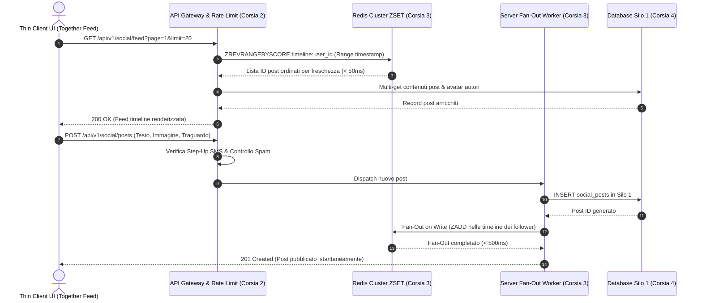

# Capitolato Tecnico: Flow 5A – Together Social Community & Coach Marketplace (T7 Consumer)

## 1. Identificativo & Titolo Ufficiale
- **Badge Miro Board:** `#05` (Posizione: `X: 6048, Y: 465`, Miro Shape ID: `3458764688417722718`)
- **Codice Univoco:** `FLOW-5A`
- **Titolo Formale:** SOFTWARE 1 (B2C CONSUMER) - FLOW 5A: TOGETHER SOCIAL COMMUNITY & COACH MARKETPLACE
- **Board Miro Online:** `uXjVEbo6L2o=` (Zona 4, Riga 1: General User / Casual, Colonna 5: Social Platform & Community B2C)
- **Diagramma Sorgente:** `architecture-blueprint/02-miro-zones-and-swimlanes/18-flowcharts/software-1-consumer-b2c/flow-5a-together-social-b2c.mmd`
- **Riferimento Glossario:** [Glossario Tecnico Vivente](00-GLOSSARIO-TERMINI-TECNICI.md) (Voci: [Together Social Network](00-GLOSSARIO-TERMINI-TECNICI.md#together-social-network-movely-marketplace), [Fan-Out on Write](00-GLOSSARIO-TERMINI-TECNICI.md#fan-out-on-write-redis-cluster-zset-timeline-social), [Redis Cluster ZSET](00-GLOSSARIO-TERMINI-TECNICI.md#fan-out-on-write-redis-cluster-zset-timeline-social), [Marketplace B2C](00-GLOSSARIO-TERMINI-TECNICI.md#together-social-network-movely-marketplace), [Step-Up SMS Anti-Troll](00-GLOSSARIO-TERMINI-TECNICI.md#step-up-verification-verifica-telefono-anti-troll-per-community)).

---


## 2. Obiettivo di Business & Target Utente

### Guida Pratica per Non Tecnici: Cos'è questo modulo per un umano?
Allenarsi da soli richiede grande forza di volontà, e spesso mancano gli stimoli o una guida fidata. I social network tradizionali sono però invasi da modelli irrealistici, commenti sgradevoli e profili finti.  
**Together** è la piazza digitale pulita e stimolante di T7 Workout:
- Al termine del tuo allenamento, l'app crea una bellissima **"Card Risultato"** con la grafica al neon: mostra i kg che hai sollevato, i minuti trascorsi e i tuoi record, pronta per essere condivisa con un click;
- I tuoi amici possono lasciarti applausi ("Kudos") e commenti di incoraggiamento costruttivi;
- Sei tu a decidere chi può vedere i tuoi post: tutti, solo i tuoi amici o solo tu;
- Se senti il bisogno di fare un salto di qualità, nel **Marketplace** puoi sfogliare i profili di veri Coach, Fisioterapisti e Nutrizionisti verificati, vedere i loro prezzi, prenotare una consulenza o farti scrivere una scheda su misura direttamente nell'app.

### Specifiche di Business & Metriche
- **Target Utente:** Utenti amatoriali che desiderano condividere traguardi sportivi e trovare professionisti certificati (Tier 1 – Casual Consumer).
- **Problema Risolto:** Aumentare la fidelizzazione mensile (Monthly Active Users Retention $+35\%$) creando una community positiva basata sui fatti e sulle evidenze motorie anziché sull'apparenza estetica, offrendo un canale di monetizzazione etica per i coach di Tier 2.

---


## 3. Attori & Architettura a 4 Corsie (Swimlanes)

1. **Corsia 1: Thin Client UI/UX (Social Feed React 18 / Mobile PWA):**
   - Feed a scorrimento infinito a 60fps con video compatti, card workout con grafici interattivi Chart.js neon, sistema di reazioni sportive (Kudos), marketplace con schede profilo dei coach e chat cifrata 1-a-1.
2. **Corsia 2: API Gateway & Content Moderation Shield (Envoy + Cloudflare AI Gateway):**
   - Controllo credenziali (verifica che l'utente abbia eseguito lo step-up telefonico anti-spam per postare), rate-limiting sulle pubblicazioni (max 5 post/giorno) e filtro preventivo NLP sul testo dei commenti per bloccare insulti o spam commerciale.
3. **Corsia 3: Server Scatola Nera (Social Engine Cloud Run & Redis Cluster):**
   - Algoritmo di distribuzione dei post *Fan-Out on Write* verso la timeline dei follower, ranking dinamico delle classifiche di costanza e tonnellaggio tramite Redis Sorted Sets (`ZSET`), e motore di matchmaking per i professionisti del marketplace.
4. **Corsia 4: Database Tripartito (Silo 1 - Social & Public PostgreSQL):**
   - Tabelle `social_posts`, `social_interactions` (kudos e commenti), `marketplace_pros` (profili dei professionisti P.IVA con listini e recensioni certificate) e `coach_hires`.

---


### Sequence Diagram Asincrono del Ciclo di Vita (FLOW-5A)



---


## 4. Flusso Operativo Passo-Passo

### Livello A: User Journey Narrativo (La Storia dell'Utente)
1. **La Condivisione Spontanea:** L'allenamento è terminato. L'app mostra la schermata del tonnellaggio e chiede: *"Vuoi condividere questo successo con i tuoi compagni su Together?"*. L'atleta tocca *"Condividi"*.
2. **La Personalizzazione del Post:** Compare l'anteprima della Card Workout al neon. L'utente aggiunge un breve messaggio: *"Nuovo personale sullo Squat dopo 4 settimane di lavoro duro!"* e sceglie la privacy: *"Visibile a tutti i membri di T7"*.
3. **La Pubblicazione Istantanea:** L'app pubblica il post nel feed. In pochi minuti arrivano le prime notifiche: gli amici della palestra lasciano un "Kudo" (applauso) e un compagno commenta: *"Complimenti per la costanza!"*.
4. **L'Esplorazione del Marketplace:** Il giorno dopo, l'atleta desidera migliorare la tecnica della panca piana. Entra nella sezione *"Trova un Coach"*:
   - Vede i profili dei preparatori atletici della sua città, con le lauree in scienze motorie verificate e le recensioni reali;
   - Guarda i video di presentazione e i pacchetti di allenamento disponibili (es. *"Consulenza Tecnica Video + Scheda Personalizzata a 60€"*);
5. **L'Ingaggio del Professionista:** L'atleta seleziona il pacchetto e completa il pagamento sicuro con Apple Pay / Google Pay. Automaticamente, il coach selezionato riceve la richiesta nel suo Hub (Tier 2) e può iniettare la scheda personalizzata direttamente nell'app dell'atleta.

---


#### Indicatori di Accettazione Operativa & Clinica (KPI)
| Metrica / Parametro | Obiettivo Target | Tolleranza Accettabile | Azione Fallback / Allerta |
| :--- | :--- | :--- | :--- |
| **Latenza Rendering Feed** | $< 50\text{ ms}$ (Redis ZSET) | $\le 100\text{ ms}$ | Query paginata diretta su PostgreSQL Silo 1 |
| **Velocità Fan-Out on Write** | $< 500\text{ ms}$ per 1.000 follower | $\le 1.5\text{ s}$ | Accodamento asincrono su Cloud Tasks |
| **Tasso Blocco Account Troll** | $> 99.5\%$ profili fake fermati | $\ge 98\%$ | Attivazione shadowban su analisi del testo |
| **Affidabilità Checkout Coach** | $> 97\%$ conversioni Stripe | $\ge 94\%$ | Notifica recupero carrello e webhook retry |


---


### Livello B: Trattazione Tecnica Nodi Operativi

1. `START` (Trigger Pubblicazione Post): L'atleta avvia la condivisione da fine seduta (`FLOW-3A`) o tocca il pulsante "Nuovo Post" nel tab Social.
2. `AUTH_STEPUP_CHECK` (Controllo Scudo Anti-Troll):
   - Verifica che l'account possegga il claim JWT `phone_verified: true`;
   - Se assente $\implies$ trigger immediato modale `STEP_UP_SMS` con OTP via Twilio per blindare l'identità dell'autore;
   - Se presente $\implies$ apertura compositore.
3. `POST_COMPOSE` (Composizione Contenuto): Creazione payload con allegato: Card grafica SVG/Canvas del workout, testo opzionale (max 500 caratteri) e livello visibilità (`PUBLIC`, `FOLLOWERS_ONLY`, `PRIVATE`).
4. `GW_NLP_FILTER` (Filtro Preventivo Linguistico): L'API Gateway invia il testo al microservizio di moderazione. Se contiene linguaggio tossico, insulti o link a spam $\implies$ `422 Unprocessable Entity` con blocco pubblicazione.
5. `SRV_FANOUT_WRITE` (Motore Fan-Out Cloud Run):
   - Scrittura del post master nel database Silo 1 (`DB_POST_WRITE`);
   - Iniezione asincrona dell'ID del post nelle liste timeline Redis dei follower (Pipeline Redis `LPUSH` con limite a 800 elementi recenti).
6. `REALTIME_FEED` (Visualizzazione Feed Client): I follower ricevono il nuovo post via WebSocket Gateway o al primo polling ottimistico.
7. `MARKETPLACE_NAV` (Navigazione Sezione Professionisti): L'atleta esplora il tab "Trova Coach & Fisio":
   - Query geolocalizzata su Postgres con estensione PostGIS per trovare professionisti nel raggio di $25\text{ km}$;
   - Visualizzazione badge verificato (Partita IVA e titolo accademico certificati da Tier 2).
8. `BOOKING_PAYMENT` (Ingaggio & Checkout): Transazione su Stripe Connect Marketplace:
   - Pagamento con split automatico (commissione piattaforma + accredito diretto al professionista);
   - Creazione associazione contrattuale in `coach_hires`.
9. `DATA_INJECTION` (Iniezione Scheda nel Diario): Il coach ottiene i permessi di scrittura per inserire programmi di allenamento nel calendario del cliente.

---


## 5. Rami Decisionali & Gestione dei 4 Stati UI

| Bivio Decisionale | Condizione Logica | Ramo SÌ / Positivo | Ramo NO / Negativo |
| :--- | :--- | :--- | :--- |
| `AUTH_STEPUP_CHECK` | Numero di telefono verificato con SMS? | Permetti pubblicazione | Richiedi verifica OTP Twilio |
| `GW_NLP_FILTER` | Testo privo di tossicità e spam? | Procedi a Fan-Out | Blocca con notifica di violazione |
| `MARKETPLACE_GEO` | Professionisti disponibili in zona? | Mostra lista ordinata per distanza | Mostra specialisti con consulenza online |

### I 4 Stati di Interfaccia Utente (UI States):
1. **Empty State:** Feed senza post (nessun atleta seguito): rendering di una bacheca di benvenuto con i post più votati della settimana e il pulsante *"Trova persone che si allenano vicino a te"*.
2. **Loading State:** Shimmer animato ad alto contrasto per i post in arrivo e transizione fluida dello spinner durante l'invio dei messaggi in chat.
3. **Populated State:** Feed dinamico con video a riproduzione automatica muta al passaggio dello scroll, card workout neon e contatori Kudos reattivi in tempo reale.
4. **Error / Fallback State:**
   - *Errore di pagamento nel marketplace:* Messaggio chiaro *"Transazione non riuscita. La tua carta non è stata addebitata. Verifica il saldo o prova un altro metodo"*.

---


## 6. Contratti Dati, Parametri I/O & Database Silo

### Specifiche Endpoint REST:

#### 1. Pubblicazione Post di Fine Workout
- **Endpoint:** `POST /api/v1/social/posts`
- **Headers:** `Authorization: Bearer <jwt_token>`, `Content-Type: application/json`
- **Request Payload:**
```json
{
  "workoutId": "w_plan_7701",
  "caption": "Grande sessione oggi! Nuovo record personale sullo squat a 120kg.",
  "visibility": "PUBLIC",
  "attachedMetrics": {
    "tonnageKg": 4820,
    "durationMinutes": 52,
    "highlightPr": "Squat 120kg x 5"
  }
}
```
- **Responses:**
  - `201 Created`: `{ "postId": "post_99214", "publishedAt": "2026-10-26T12:00:00Z", "fanoutCount": 142 }`
  - `403 Forbidden`: Utente senza step-up telefonico validato.
  - `422 Unprocessable Entity`: Violazione filtri di moderazione testo.

#### 2. Query Marketplace Professionisti
- **Endpoint:** `GET /api/v1/marketplace/coaches?lat=45.4642&lng=9.1900&radiusKm=25&specialty=VBT`
- **Responses:**
  - `200 OK`:
```json
{
  "coaches": [
    {
      "proId": "pro_8812b",
      "fullName": "Dott. Marco Bianchi",
      "credentials": ["Laurea LM-67", "Specialista VBT & Forza"],
      "verifiedBadge": true,
      "hourlyRateEur": 50.0,
      "distanceKm": 4.2,
      "ratingScore": 4.95,
      "reviewsCount": 38
    }
  ]
}
```

### Schema Relazionale (Database Silo 1 - PostgreSQL):
- `social_posts`: `id UUID PK`, `author_id UUID FK -> auth_users.id`, `caption TEXT`, `workout_data JSONB`, `visibility VARCHAR(16)`, `created_at TIMESTAMPTZ`.
- `social_interactions`: `id UUID PK`, `post_id UUID FK -> social_posts.id`, `user_id UUID FK -> auth_users.id`, `interaction_type VARCHAR(16)`, `created_at TIMESTAMPTZ`, `UNIQUE (post_id, user_id, interaction_type)`.
- `marketplace_pros`: `pro_id UUID PK`, `user_id UUID FK -> auth_users.id`, `vat_number VARCHAR(16)`, `specialties TEXT[]`, `hourly_rate NUMERIC(6,2)`, `verified_badge BOOLEAN DEFAULT FALSE`.

---


### Matrice Errori HTTP & Strategie di Resilienza
| HTTP Code | Codice Interno | Endpoint | Causa Scatenante | UX Feedback Visivo | Strategia di Resilienza & Fallback |
| :---: | :--- | :--- | :--- | :--- | :--- |
| **400** | `ERR_EMPTY_POST` | `POST /social/posts` | Contenuto post privo di testo e media | Bordo arancione: *"Scrivi un messaggio"* | Blocco pulsante di invio client-side |
| **401** | `ERR_LOGIN_REQUIRED` | `POST /social/posts` | Tentativo di interazione da utente anonimo | Modale: *"Accedi per commentare o postare"* | Reindirizzamento a login preservando bozza |
| **403** | `ERR_STEPUP_NEEDED` | `POST /social/posts` | Numero cellulare non verificato via SMS | Dialog: *"Verifica il telefono per tutelare la community"* | Avvio flusso modale Twilio SMS OTP |
| **429** | `ERR_SPAM_FLOOD` | `POST /social/posts` | Più di 3 post pubblicati in 60 secondi | Banner rosso: *"Stai postando troppo velocemente"* | Attivazione cooldown timer di 3 minuti |
| **500** | `ERR_FANOUT_FAILED` | `POST /social/posts` | Eccezione cluster Redis durante fan-out | Nessun errore bloccante per l'autore | Fallback su fan-out on read per i follower |
| **503** | `ERR_STRIPE_UNAVAIL` | `POST /marketplace/book`| Servizio pagamenti temporaneamente non raggiungibile| Avviso: *"Servizio cassa momentaneamente occupato"* | Salvataggio prenotazione in stato pendente |


---


## 7. Ereditarietà di Tier & Differenziali di Fascia

- **Interazione Consumer (Tier 1):** L'utente comune può pubblicare post, interagire con la community, visualizzare classifiche pubbliche e ingaggiare professionisti dal marketplace.
- **Integrazione con Tier 2 (`FLOW-5B`):**  
  I professionisti con Partita IVA (Tier 2) utilizzano Together come vetrina di lead generation per acquisire atleti da seguire a distanza, inviare schede e ricevere video degli atleti per la correzione tecnica in-app.
- **Isolamento da Tier 3 (`FLOW-5C`):**  
  Nei club professionistici societari (Tier 3), **la sezione social è totalmente preclusa e oscurata**. I club operano nel modulo `Tactical Vision` segreto e confinato nel bunker Silo 2, con blocco hardware anti-esfiltrazione verso social network pubblici.
