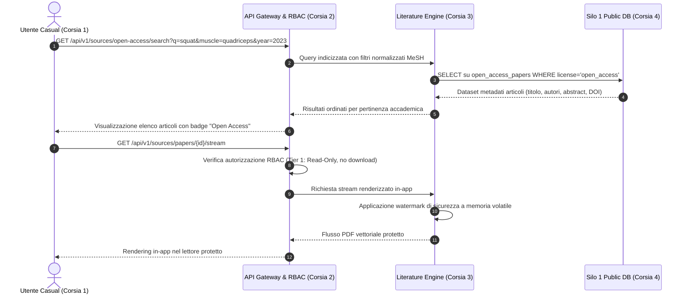

# Capitolato Tecnico: Flow 5A – Libreria Fonti: Archivio Open Access, Filtri Avanzati & Read-Only (T7 Consumer)

## 1. Identificativo & Titolo Ufficiale
- **Badge Miro Board:** `#05` (Posizione: `X: 6048, Y: 465`, Miro Shape ID: `3458764688417722718`)
- **Codice Univoco:** `FLOW-5A`
- **Titolo Formale:** SOFTWARE 1 (B2C CONSUMER) - FLOW 5A: LIBRERIA FONTI - ARCHIVIO OPEN ACCESS, FILTRI AVANZATI & READ-ONLY
- **Board Miro Online:** `uXjVEbo6L2o=` (Zona 4, Riga 1: General User / Casual, Colonna 5: Libreria Fonti)
- **Diagramma Sorgente:** [flow-5a-together-social-b2c.mmd](../02-miro-zones-and-swimlanes/18-flowcharts/software-1-consumer-b2c/flow-5a-together-social-b2c.mmd)
- **Riferimento Glossario:** [Glossario Tecnico Vivente](00-GLOSSARIO-TERMINI-TECNICI.md) (Voci: [Open Access Papers](00-GLOSSARIO-TERMINI-TECNICI.md#open-access-papers-studi-scientifici-pubblici-gratuiti), [Tassonomia MeSH Sportiva](00-GLOSSARIO-TERMINI-TECNICI.md#tassonomia-mesh-sportiva-classificazione-ricerca), [Visualizzatore PDF Protetto In-App](00-GLOSSARIO-TERMINI-TECNICI.md#visualizzatore-pdf-protetto-in-app-read-only), [Feature Gating Tier 1](00-GLOSSARIO-TERMINI-TECNICI.md#feature-gating-tier-1-consumer)).

---

## 2. Obiettivo di Business & Target Utente

### Guida Pratica per Non Tecnici: Cos'e questo modulo per un umano?
Nel mondo del fitness e dell'allenamento circolano continue "mode", falsi miti e informazioni non verificate. Gli appassionati che vogliono allenarsi con criterio hanno difficolta a trovare risposte scientifiche affidabili senza perdersi in siti accademici complessi o scontrarsi con articoli a pagamento inaccessibili.  
**La Libreria Fonti di T7 Workout** mette la vera scienza dello sport a disposizione di chiunque:
- Puoi cercare qualsiasi argomento (es. "ipertrofia pettorali", "recupero tendine rotuleo", "corsa e frequenza cardiaca") tramite una semplice **barra di ricerca**;
- Puoi filtrare gli studi in base allo **sport**, al **distretto muscolare**, a eventuali **patologie**, alla **tipologia di ricerca** e all'**anno di pubblicazione**;
- Puoi leggere gratuitamente e per intero tutti gli studi mondiali ad accesso libero (**Open Access**), visualizzandoli comodamente dentro l'app;
- **Zero distrazioni e massima trasparenza:** gli studi privati a pagamento o le tesi della community restano contrassegnati con un lucchetto (riservati ai piani superiori);
- La lettura avviene in modalita protetta **Read-Only**: puoi consultare liberamente la ricerca a schermo per approfondire la tua cultura sportiva, senza strumenti di modifica o download locale.

### Specifiche di Business & Metriche
- **Target Utente:** Atleti amatoriali, appassionati di fitness e praticanti che cercano informazioni fondate sull'evidenza scientifica (Tier 1 – Casual Consumer).
- **Problema Risolto:** Democratizzare la cultura scientifica dello sport offrendo una libreria indicizzata, contrastando le fake news e stimolando l'educazione motoria consapevole.
- **Metriche Chiave (KPI):**
  - Tempo medio di ricerca documento: $< 1.8\text{ secondi}$;
  - Query con almeno un risultato Open Access pertinente: $> 92\%$;
  - Tasso di consultazione articoli al mese: $\ge 4$ letture per utente attivo.

---

## 3. Attori & Architettura a 4 Corsie (Swimlanes)

1. **Corsia 1: Thin Client UI/UX (Portale Libreria Fonti React 18):**
   - Interfaccia catalogo con barra di ricerca semantica full-text;
   - Modulo a scomparsa (Drawer) per i filtri avanzati: 5 macro-categorie (Sport, Distretto muscolare, Patologia, Tipo studio, Anno);
   - Visualizzatore PDF in-app a schermo intero con disabilitazione nativa del download binary, del pulsante stampa e del menu contestuale;
   - Modal di avviso e badge visivo su articoli protetti ("Contenuto Premium: sintesi riservata a Tier 2 e Tier 3").
2. **Corsia 2: API Gateway & RBAC Content Shield (Envoy):**
   - Autenticazione sessione utente e verifica abbonamento Tier 1;
   - Rate limiting pubblico per prevenire attacchi di scraping sistematico ($< 60\text{ req/min}$ per IP/utente);
   - Applicazione delle regole di Content Protection: blocco degli endpoint binari diretti (`/download`) e blocco dell'accesso alle schede di sintesi private.
3. **Corsia 3: Server Scatola Nera (Literature Indexing & Streaming Engine Cloud Run):**
   - Motore di ricerca indicizzato su basi dati internazionali Open Access (PubMed Central, Directory of Open Access Journals, bioRxiv);
   - Classificatore tassonomico MeSH per matching incrociato tra distretti anatomici e tipologie di movimento;
   - Pipeline di streaming PDF protetto in-memory: applicazione dinamica di watermark utente anti-riproduzione su canvas protetto.
4. **Corsia 4: Database Tripartito (Silo 1 - Public Literature Repository):**
   - Tabelle `open_access_papers` (metadati accademici, abstract, autori, licenza Creative Commons CC-BY, link istituzionale);
   - Tabelle `research_taxonomies` (mappatura normalizzata di sport, distretti muscolari ed evidenze).

---

### Sequence Diagram Asincrono del Ciclo di Vita (FLOW-5A)



---

## 4. Flusso Passo-Passo

### Livello A: Guida Operativa per Coach e Preparatori
1. **Accesso alla Sezione:** L'utente tocca l'icona "Libreria Fonti" nel menu principale dell'applicazione.
2. **Ricerca Mirata:** Inserisce una parola chiave (es. "panca piana attivazione pettorale") o attiva i filtri per delimitare l'indagine a uno sport o muscolo specifico.
3. **Consultazione Gratuita:** Cliccando su uno studio contrassegnato con "Open Access", il documento si apre istantaneamente nel lettore interno per una lettura confortevole.
4. **Riconoscimento Limiti:** Se l'utente clicca su uno studio coperto da copyright editoriale, l'app spiega in modo trasparente che la relativa scheda di sintesi richiede il profilo professionale (Tier 2 o Tier 3), evitando acquisti involontari o frustrazioni.

### Livello B: Deep-Dive Tecnico per Sviluppatori
- **Endpoint di Ricerca:** `GET /api/v1/sources/open-access/search`
  - Parametri Query: `q` (string, max 100 char), `sport` (enum), `muscle_target` (enum MeSH), `pathology` (enum), `study_type` (enum: `meta_analysis`, `rct`, `systematic_review`, `cohort`), `year_from` / `year_to` (integer).
  - Ottimizzazione DB: Indice composito B-tree su `(license, publication_year)` e indice GIN `pg_trgm` su `title_abstract_tsv` in Silo 1.
- **Protezione del Lettore Client:**
  - Il componente React `PdfReadOnlyViewer` utilizza `react-pdf` disabilitando il canvas text-selection di sistema (`enableTextSelection={false}`) e intercettando l'evento `contextmenu` con `e.preventDefault()`.
  - Non viene mai esposta l'URL statica del file binario: l'accesso avviene mediante signed ephemeral stream chunk tokenizzato con TTL di 120 secondi.
- **Isolamento Silo 1:** Nessuna interazione con Silo 2 (Bunker societari) ne con dati sensibili personali.

---

## 5. Rami Decisionali & Gestione Errori

### Tabella dei 4 Stati UI (Ciclo di Vita del Componente)

| Stato UI | Condizione Scatenante | Elementi Visibili a Schermo | Azione Utente Permessa |
| :--- | :--- | :--- | :--- |
| **Idle** | Componente caricato, nessun termine digitato | Barra di ricerca con placeholder, categorie filtro rapide in evidenza | Digitazione testo, click sui chip di categoria |
| **Loading** | Chiamata di ricerca in corso ($t < 400\text{ms}$) | Skeleton loader delle schede articolo | Annullamento ricerca |
| **Success** | Query completata con corrispondenze trovate | Lista card studi con titolo, autori, anno, badge "Open Access" | Click su scheda per avviare la lettura in-app |
| **Empty / Error** | Nessun articolo trovato o errore di rete | Messaggio "Nessuno studio trovato con questi filtri" o alert disconnessione | Reset filtri, ricarica query |

---

## 6. Contratti Dati JSON & Matrice Errori HTTP

### Contratto Richiesta Ricerca (Query Params)
```http
GET /api/v1/sources/open-access/search?q=eccentric+hamstring&sport=calcio&muscle_target=hamstrings&study_type=rct&page=1&limit=20
Authorization: Bearer <jwt_tier1_token>
```

### Contratto Risposta Ricerca (JSON)
```json
{
  "total_records": 1,
  "page": 1,
  "limit": 20,
  "items": [
    {
      "paper_id": "oa_pmc_8923411",
      "doi": "10.1186/s13102-022-00456-1",
      "title": "Effect of Nordic Hamstring Exercise on Sprint Acceleration and Muscle Architecture in Football Players",
      "authors": ["Rossi, M.", "Bianchi, L.", "Smith, J."],
      "journal": "Journal of Sports Science & Medicine",
      "publication_year": 2022,
      "license_type": "CC_BY_4.0",
      "is_open_access": true,
      "taxonomy": {
        "sport": "calcio",
        "muscle_target": "hamstrings",
        "study_type": "rct"
      },
      "abstract_snippet": "The aim of this randomized controlled trial was to evaluate the 8-week effects of..."
    }
  ]
}
```

### Matrice Errori HTTP a 6 Colonne

| Codice HTTP | Errore Interno | Condizione Scatenante | Risposta Client | Azione Automatica Client | Ripristino Utente |
| :--- | :--- | :--- | :--- | :--- | :--- |
| `400 Bad Request` | `INVALID_QUERY_PARAMS` | Sintassi anno incoerente o caratteri non consentiti | `{"error": "Parametri di ricerca non validi"}` | Evidenzia il campo errato nei filtri | Correggere i valori dei filtri |
| `401 Unauthorized` | `SESSION_EXPIRED` | Token JWT assente o scaduto | `{"error": "Sessione scaduta"}` | Reindirizza a schermata di login | Effettuare nuovamente il login |
| `403 Forbidden` | `PREMIUM_PAPER_BLOCKED` | Tentativo di accesso a scheda di sintesi riservata a Tier 2+ | `{"error": "Questo contenuto richiede un profilo professionale"}` | Mostra modal informativa upgrade | Aggiornare il piano o consultare Open Access |
| `403 Forbidden` | `DOWNLOAD_RESTRICTED` | Tentativo di richiedere il payload binario non consentito | `{"error": "Download non consentito per questo profilo"}` | Mostra tooltip informativo | Consultare il documento a schermo |
| `404 Not Found` | `PAPER_NOT_FOUND` | ID articolo non censito o rimosso dall'archivio | `{"error": "Studio non disponibile"}` | Rimuove l'articolo dalla vista | Ripetere la ricerca |
| `429 Too Many Req` | `RATE_LIMIT_EXCEEDED` | Più di 60 richieste al minuto per singolo utente | `{"error": "Troppe richieste. Riprova tra 30 secondi"}` | Disabilita pulsante ricerca per 30s | Attendere il countdown |

---

## 7. Ereditarieta di Tier & Sblocco Funzionalita a Cascata

- **Cosa fa Tier 1:** Ricerca di base, applicazione filtri tematici, lettura a schermo degli articoli Open Access pubblici e gratuiti in modalita protetta.
- **Cosa NON fa Tier 1 (Blocchi Funzionali Rigorosi):**
  - Nessun accesso alle Schede Tecniche di Sintesi degli articoli a pagamento/privati;
  - Nessun accesso alle ricerche inedite e casi studio caricati dalla community professionale;
  - Blocco totale del download locale, dell'esportazione e degli strumenti dell'Area Studio (nessuna annotazione, disegno o mappa);
  - Nessuna funzionalita di intelligenza artificiale o RAG.
- **Passaggio a Tier 2:** Sblocca l'accesso alle Schede Tecniche di Sintesi, abilita l'Area Studio Digitale in-app locale (IndexedDB) e consente l'invio di proposte di studio e proprie tesi alla Commissione Scientifica.
