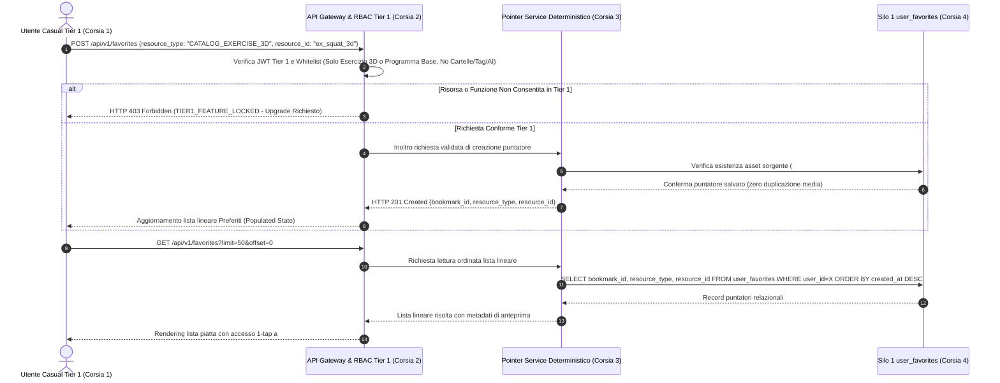

# Capitolato Tecnico: Flow 6A – Preferiti Base: Esercizi 3D, Programmi Pre-Confezionati & Lista Lineare (T7 Consumer)

## 1. Identificativo & Titolo Ufficiale
- **Badge Miro Board:** `#06` (Posizione LIVE: `X: 8960.19, Y: 602.88`, Miro Shape ID: `3458764688417722722`, Nodi ISO: `14`)
- **Codice Univoco:** `FLOW-6A`
- **Titolo Formale:** SOFTWARE 1 (B2C CONSUMER) - FLOW 6A: PREFERITI BASE - ESERCIZI 3D, PROGRAMMI PRE-CONFEZIONATI & LISTA LINEARE
- **Board Miro Online:** `uXjVEbo6L2o=` (Zona 4, Riga 1: General User / Casual, Colonna 6: Preferiti)
- **Diagramma Sorgente:** [flow-6a-movely-desk-care.mmd](../02-miro-zones-and-swimlanes/18-flowcharts/software-1-consumer-b2c/flow-6a-movely-desk-care.mmd)
- **Riferimento Glossario:** [Glossario Tecnico Vivente](00-GLOSSARIO-TERMINI-TECNICI.md) (Voci: [Puntatore Relazionale Preferiti](00-GLOSSARIO-TERMINI-TECNICI.md#puntatore-relazionale-preferiti-zero-duplication-bookmark), [Lista Lineare Preferiti](00-GLOSSARIO-TERMINI-TECNICI.md#lista-lineare-preferiti-tier-1-base), [Feature Gating Tier 1](00-GLOSSARIO-TERMINI-TECNICI.md#feature-gating-tier-1-consumer), [3 Silos Database](00-GLOSSARIO-TERMINI-TECNICI.md#3-silos-database-multi-tenant-data-isolation)).
- **Nota di Governance & Slug Storico (Parking Note):** Il modulo precedentemente assegnato allo slot `#06` (*Movely Desk-Care & Micro-Pause Ergonomiche Aziendali*) e stato parcheggiato per una futura colonna dedicata dell'ecosistema T7. Lo slug fisico del file (`06-software-1-flow-6a-movely-desk-care.md`) e il relativo sorgente `.mmd` restano invariati per preservare la continuita dei riferimenti storici Git e Miro.

---

## 2. Obiettivo di Business & Target Utente

### Guida Pratica per Non Tecnici: Cos'e questo modulo per un umano?
Quando una persona usa un'app di allenamento con centinaia di esercizi 3D e decine di programmi pronti, la cosa piu frustrante e dover cercare ogni volta da capo l'esercizio che le piace di piu o la scheda che sta seguendo questa settimana.
**La sezione Preferiti Base di T7 Workout (Tier 1)** risolve questo problema con la massima semplicita, senza funzioni complicate:
- Mentre esplori il **Catalogo Esercizi 3D** (Colonna 2, `#02`), puoi toccare l'icona di salvataggio per aggiungere un esercizio (con il suo modello 3D e le sue spiegazioni tecniche) ai tuoi Preferiti;
- Mentre consulti i **Programmi Pre-Confezionati Base** (Colonna 3, `#03`), puoi contrassegnare le schede standard che vuoi ritrovare al volo prima di andare in palestra;
- Tutti i tuoi salvataggi appaiono in una **lista semplice e lineare**, pulita e immediata da scorrere su smartphone, dove con un singolo tocco riapri subito l'esercizio o il programma originale;
- **Zero copie pesanti sul telefono:** salvare un esercizio nei Preferiti non duplica il modello 3D ne consuma memoria extra, perche l'app memorizza solo un collegamento leggero verso l'elemento originale;
- **Perimetro trasparente:** cartelle personalizzate, tag, fonti scientifiche, video propri, template riutilizzabili, Data Analisi e ricerca AI appartengono ai piani professionali superiori (Tier 2 e Tier 3) e restano chiaramente separati.

### Specifiche di Business & Metriche
- **Target Utente:** Utenti amatoriali, principianti e appassionati di fitness che utilizzano il piano base consumer (Tier 1 - B2C Casual).
- **Problema Risolto:** Ridurre l'attrito nella ripresa rapida degli esercizi 3D e dei programmi standard preferiti, aumentando la fidelizzazione quotidiana senza introdurre complessita gestionale o costi di storage duplicato.
- **Stato Gap Analysis (Regola 10):** Arancione (`#e67e22` - Nuovo modulo Hub Preferiti unificato da implementare su schema relazionale Silo 1).
- **Parking Architetturale:** Il precedente flusso *Movely Desk-Care & Micro-Pause Ergonomiche* resta archiviato nel backlog architetturale per futura riallocazione in una colonna dedicata al Corporate Wellness.
- **Metriche Chiave (KPI):**
  - Tempo di salvataggio/rimozione puntatore preferito (`POST/DELETE`): $< 150\text{ ms}$ p95;
  - Tempo di caricamento lista lineare preferiti (`GET`): $< 200\text{ ms}$ p95;
  - Duplicazione binaria asset media (modelli 3D / schede): $0\%$ (100% puntatori relazionali `bookmark_id`);
  - Intercettazione tentativi non autorizzati (cartelle, tag, fonti, video, AI): $100\%$ HTTP `403 Forbidden`.

---

## 3. Attori & Architettura a 4 Corsie (Swimlanes)

1. **Corsia 1: Thin Client UI/UX (Hub Preferiti Lineare React 18 / PWA):**
   - Vista unica a **lista semplice e lineare** ordinata cronologicamente (dal salvataggio piu recente al meno recente), priva di selettori di sottocartelle, editor tag o barre di ricerca AI;
   - **Card Locali di Passaggio (Regola 10 - Zero Laser Beams):** collegamenti rapidi contestuali verso il Catalogo 3D (`#02`) e i Programmi Base (`#03`) senza frecce diagonali cross-board su Miro;
   - Toggle deterministico salva/rimuovi preferito e gestione integrale dei **4 Stati UI** (`Empty State`, `Loading State`, `Populated State`, `Error / Fallback State`);
   - Banner informativo discreto quando l'utente tenta di accedere a funzioni bloccate di fascia superiore (sottocartelle, tag, fonti o video personalizzati).
2. **Corsia 2: API Gateway & RBAC Tier 1 Guard (Envoy):**
   - Verifica del token JWT Consumer (`tier: TIER_1_CONSUMER`) e rate limiting anti-abuso ($< 120\text{ req/min}$ per utente);
   - **Decisione RBAC Rigorosa:** accetta esclusivamente `resource_type IN ('CATALOG_EXERCISE_3D', 'BASE_PROGRAM')` e rifiuta con HTTP `403 Forbidden` qualsiasi parametro o richiesta relativa a cartelle (`folder_id`), tag (`tags`), fonti scientifiche, video custom 1080p/4K, template, Data Analisi, AI o RAG.
3. **Corsia 3: Server Scatola Nera (Deterministic Favorites Pointer Service - Cloud Run):**
   - Servizio **100% deterministico** (zero AI, zero RAG, zero inferenza probabilistica);
   - **Validatore Puntatore Relazionale:** verifica l'esistenza e la visibilita Tier 1 della risorsa sorgente (`#02` o `#03`) e genera o risolve un puntatore leggero `bookmark_id` senza mai duplicare file binari o metadati pesanti;
   - **Ordinatore Lista Lineare:** restituisce la sequenza piatta ordinata per `created_at DESC` con idrati di anteprima essenziali (titolo, tipo risorsa, riferimento rotta SPA).
4. **Corsia 4: Database Tripartito (Silo 1 - Public & Consumer Partition):**
   - Tabella `user_favorites` su PostgreSQL Silo 1, con chiave primaria `bookmark_id` (UUID), vincolo di unicita `(user_id, resource_type, resource_id)` e check constraint a livello DB sui soli due tipi ammessi in Tier 1.
   - Nessuna interazione con Silo 2 (Bunker Club) ne con Silo 3 (Research Warehouse).

---

### Sequence Diagram Asincrono del Ciclo di Vita (FLOW-6A)



---

## 4. Flusso Passo-Passo

### Livello A: Guida Operativa & User Journey Narrativo
1. **Ingresso nell'Hub Preferiti:** L'utente tocca la voce "Preferiti" nella barra di navigazione principale (Global Navigation Shell).
2. **Consultazione della Lista Lineare:** Se ha gia salvato contenuti, vede un elenco verticale essenziale con le sue card preferite (es. *"Squat Back - Modello 3D"* e *"Programma Full Body 3 Giorni - Base"*). Se e al primo accesso, visualizza una schermata guida pulita con due pulsanti diretti di passaggio verso il Catalogo 3D (`#02`) e i Programmi Base (`#03`).
3. **Salvataggio dal Catalogo o dai Programmi:** Mentre guarda un esercizio 3D nel Catalogo (`#02`) o una scheda pre-confezionata (`#03`), l'utente tocca l'icona Preferiti. In meno di un istante, l'elemento viene registrato nella lista lineare senza scaricare duplicati.
4. **Riapertura Istantanea:** Toccando una riga della lista Preferiti, l'app apre direttamente la schermata dell'esercizio 3D (con spiegazione completa) o la vista del programma base pre-confezionato.
5. **Rimozione Ordinata:** L'utente puo rimuovere qualsiasi voce dalla lista con un singolo gesto; la cancellazione elimina soltanto il puntatore `bookmark_id` lasciando intatti gli esercizi e i programmi nel catalogo originale.
6. **Perimetro Chiaro di Fascia:** Qualsiasi tentativo di creare cartelle, applicare tag o salvare contenuti non previsti in Tier 1 mostra un avviso chiaro e non invasivo sul passaggio al piano Pro (Tier 2).

#### Tabella KPI di Accettazione Operativa
| Metrica / Parametro KPI | Obiettivo Target | Tolleranza Accettabile | Azione Fallback / Allerta |
| :--- | :--- | :--- | :--- |
| **Latenza Salvataggio Puntatore (`POST`)** | $< 150\text{ ms}$ p95 | $\le 300\text{ ms}$ | Ripristino stato toggle e banner riprova |
| **Latenza Lettura Lista Lineare (`GET`)** | $< 200\text{ ms}$ p95 | $\le 400\text{ ms}$ | Rendering cache locale di sola lettura |
| **Duplicazione Asset Media (3D / PDF)** | $0\%$ (solo `bookmark_id`) | $0\%$ (invariante assoluto) | Blocco CI/CD su payload media incorporati |
| **Blocco Funzioni Non Tier 1 (RBAC)** | $100\%$ HTTP `403` | $0\%$ bypass consentiti | Audit log sicurezza su Envoy Gateway |

---

### Livello B: Deep-Dive Tecnico per Sviluppatori
- **Allineamento 1:1 ai 14 Nodi ISO (`FLOW-6A`):**
  1. `START` (Corsia 1): Inizio: Accesso Sezione Preferiti Base (Tier 1).
  2. `LINEAR_LIST` (Corsia 1): Vista lista semplice e lineare (solo Esercizi 3D & Programmi Base - NO cartelle/tag).
  3. `DEC_FAV_ACTION` (Corsia 1 - Rombo): Azione utente: aprire sorgente o salvare/rimuovere preferito.
  4. `NAV_CARD_SRC` (Corsia 1): Card di passaggio locale verso Catalogo 3D (`#02`) o Programmi Base (`#03`).
  5. `ACTION_REQ` (Corsia 1): Richiesta salva, rimuovi o apri puntatore preferito (`bookmark_id`).
  6. `ALERT_UPGRADE` (Corsia 1): Avviso blocco Tier 1 su sottocartelle, tag, fonti, video custom e AI riservati a Tier 2/3.
  7. `RENDER_UI_STATES` (Corsia 1): Rendering lista lineare con i 4 Stati UI (`Empty`, `Loading`, `Populated`, `Error / Fallback`).
  8. `GW_ENDPOINT` (Corsia 2): Ricezione richiesta `GET / POST / DELETE /api/v1/favorites`.
  9. `GW_RBAC_DEC` (Corsia 2 - Rombo): Policy Tier 1: verifica risorsa esclusivamente in `{CATALOG_EXERCISE_3D, BASE_PROGRAM}` e assenza di cartelle/tag/fonti/video/template/Data Analisi/AI/RAG.
  10. `GW_HTTP_403` (Corsia 2): Risposta bloccante HTTP `403 Forbidden` (blocco upgrade Tier 1).
  11. `SRV_VALIDATE_PTR` (Corsia 3): Validatore puntatore relazionale deterministico (NO AI, NO RAG, zero duplicazione media).
  12. `SRV_LINEAR_SORT` (Corsia 3): Ordinatore lista lineare (ordine cronologico / A-Z, struttura piatta senza sottocartelle).
  13. `DB_USER_FAV` (Corsia 4 - Cilindro): Lettura/scrittura Silo 1 su tabella `user_favorites` (solo puntatori `bookmark_id`).
  14. `END_FLOW` (Corsia 4): Fine: preferito salvato o aperto nella lista lineare senza duplicazione media.
- **Zero Logica Proprietaria sul Client (IP Isolation):** Il Thin Client non applica regole di business nascoste; ogni validazione di tier e integrita referenziale avviene esclusivamente su Corsia 2 (Envoy) e Corsia 3 (Cloud Run).
- **Idempotenza:** Un `POST /api/v1/favorites` su una coppia `(user_id, resource_type, resource_id)` gia presente restituisce `200 OK` con il `bookmark_id` esistente (nessun duplicato in tabella).
- **Schema Indici Silo 1:** Indice B-tree composito `(user_id, created_at DESC)` per paginazione lineare costante $O(\log n)$ e indice unico `(user_id, resource_type, resource_id)`.

---

## 5. Rami Decisionali & Gestione Errori

### Matrice dei Rami Decisionali
| Bivio Decisionale | Condizione Logica | Ramo SI / Positivo | Ramo NO / Negativo |
| :--- | :--- | :--- | :--- |
| `GW_RBAC_DEC` | `resource_type` e Esercizio 3D (`#02`) o Programma Base (`#03`) e payload privo di cartelle/tag/AI? | Inoltra al Validatore Puntatore Deterministico (Corsia 3) | Restituisce HTTP `403 Forbidden` e mostra avviso Upgrade Client |
| `CHECK_SOURCE_EXISTS` | L'asset referenziato (`resource_id`) esiste ed e attivo in Silo 1? | Crea/restituisce puntatore `bookmark_id` su `user_favorites` | Restituisce HTTP `404 Not Found` (`FAVORITE_TARGET_NOT_FOUND`) |
| `CHECK_LIST_EMPTY` | L'utente possiede almeno 1 puntatore salvato? | Renderizza `Populated State` con lista lineare ordinata | Renderizza `Empty State` con card di passaggio verso `#02` e `#03` |

### Gestione Obbligatoria dei 4 Stati UI
| Stato UI | Condizione Scatenante | Elementi Visibili a Schermo | Azione Utente Permessa |
| :--- | :--- | :--- | :--- |
| **Empty State** | Primo accesso o lista Preferiti con 0 elementi salvati | Illustrazione minimale neutra, testo guida *"Non hai ancora salvato esercizi o programmi"*, due card di passaggio rapido verso Catalogo 3D (`#02`) e Programmi Base (`#03`) | Navigazione 1-tap verso `#02` o `#03` |
| **Loading State** | Chiamata `GET/POST/DELETE /api/v1/favorites` in attesa risposta server | Skeleton loader lineare di 5 righe a larghezza fissa, pulsante toggle temporaneamente bloccato per evitare doppi invii | Attesa o navigazione indietro tramite History API |
| **Populated State** | Almeno 1 puntatore valido restituito da Silo 1 | Lista verticale lineare con titolo, badge tipo (`Esercizio 3D` o `Programma Base`), data salvataggio e comando rimozione rapida | Apertura immediata risorsa sorgente (`#02`/`#03`) o rimozione puntatore |
| **Error / Fallback State** | Errore rete, timeout server, risorsa sorgente rimossa o blocco `403` | Banner errore contestuale (nessun `NaN`/`undefined`), stato pulsante sincronizzato con server; per asset rimossi avviso *"Contenuto non piu disponibile"* con pulizia puntatore | Riprova manuale, rimozione puntatore orfano o apertura modale info piano Tier 2 |

---

## 6. Contratti Dati JSON & Matrice Errori HTTP

### Contratto Richiesta Salvataggio Puntatore (`POST /api/v1/favorites`)
```http
POST /api/v1/favorites
Authorization: Bearer <jwt_tier1_token>
Content-Type: application/json
```
```json
{
  "resource_type": "CATALOG_EXERCISE_3D",
  "resource_id": "ex_3d_back_squat_014"
}
```

### Contratto Risposta Lista Lineare (`GET /api/v1/favorites?limit=20&offset=0`)
```json
{
  "tier": "TIER_1_CONSUMER",
  "organization_mode": "LINEAR_LIST",
  "total_count": 2,
  "items": [
    {
      "bookmark_id": "bm_9f21c8a0-41be-4a91-b8f2-104b93e01201",
      "resource_type": "CATALOG_EXERCISE_3D",
      "resource_id": "ex_3d_back_squat_014",
      "source_flow": "FLOW-2A",
      "display_title": "Back Squat Bilanciere (Modello 3D)",
      "target_route": "/catalog/exercises/ex_3d_back_squat_014",
      "saved_at_utc": "2026-11-17T10:15:00Z"
    },
    {
      "bookmark_id": "bm_3a88e4d1-90cc-4e12-91ab-88c1a2d40992",
      "resource_type": "BASE_PROGRAM",
      "resource_id": "prog_base_fullbody_3d",
      "source_flow": "FLOW-3A",
      "display_title": "Full Body Standard 3 Giorni",
      "target_route": "/programming/base/prog_base_fullbody_3d",
      "saved_at_utc": "2026-11-16T18:40:00Z"
    }
  ]
}
```

### Schema Relazionale (Database Silo 1 - PostgreSQL)
- Tabella `user_favorites`:
  - `bookmark_id UUID PRIMARY KEY`
  - `user_id UUID NOT NULL REFERENCES auth_users(id) ON DELETE CASCADE`
  - `resource_type VARCHAR(32) NOT NULL CHECK (resource_type IN ('CATALOG_EXERCISE_3D', 'BASE_PROGRAM'))`
  - `resource_id VARCHAR(64) NOT NULL`
  - `created_at TIMESTAMPTZ NOT NULL DEFAULT NOW()`
  - `UNIQUE (user_id, resource_type, resource_id)`

### Matrice Errori HTTP a 6 Colonne

| Codice HTTP | Errore Interno | Condizione Scatenante | Risposta Client | Azione Automatica Client | Ripristino Utente |
| :--- | :--- | :--- | :--- | :--- | :--- |
| `400 Bad Request` | `INVALID_BOOKMARK_PAYLOAD` | `resource_type` o `resource_id` mancante o sintatticamente non valido | `{"error": "Parametri del preferito non validi"}` | Annulla l'aggiornamento ottimistico del toggle | Riprovare la selezione dalla scheda risorsa |
| `401 Unauthorized` | `SESSION_EXPIRED` | Token JWT Tier 1 assente, revocato o scaduto | `{"error": "Sessione scaduta, effettua nuovamente l'accesso"}` | Reindirizza alla schermata di login preservando la rotta | Rieseguire l'autenticazione |
| `403 Forbidden` | `TIER1_FEATURE_LOCKED` | Tentativo di creare cartelle, usare tag o salvare fonti, video custom, template, Data Analisi o funzioni AI | `{"error": "Funzione non inclusa nel piano Base: passa a Tier 2 Pro"}` | Mostra avviso informativo di fascia senza corrompere la lista | Continuare con lista lineare o valutare upgrade a Tier 2 |
| `404 Not Found` | `FAVORITE_TARGET_NOT_FOUND` | Esercizio 3D o programma base referenziato non presente in Silo 1 | `{"error": "Contenuto non piu presente in catalogo"}` | Contrassegna il puntatore orfano e propone pulizia | Rimuovere la voce non disponibile dalla lista |
| `429 Too Many Req` | `FAVORITES_RATE_LIMITED` | Superamento soglia di 120 richieste/minuto per singolo utente | `{"error": "Troppe operazioni ravvicinate, attendi qualche secondo"}` | Applica debounce e blocco temporaneo del pulsante | Attendere lo sblocco automatico del countdown |
| `503 Service Unav` | `SILO1_STORAGE_UNAVAILABLE` | Temporanea indisponibilita della partizione PostgreSQL Silo 1 | `{"error": "Servizio Preferiti temporaneamente non raggiungibile"}` | Attiva `Error / Fallback State` con pulsante Riprova | Premere Riprova al ripristino della connessione |

---

## 7. Ereditarieta di Tier & Sblocco Funzionalita a Cascata

- **Cosa fa Tier 1 (`FLOW-6A`):** Salvataggio deterministico tramite puntatori `bookmark_id` su Silo 1 (`user_favorites`) di esercizi 3D dal Catalogo (`#02`) e programmi pre-confezionati base (`#03`), esposti in una lista semplice e lineare senza duplicazione media.
- **Cosa NON fa Tier 1 (Blocchi Funzionali Rigorosi):**
  - **NO sottocartelle** e **NO tag personalizzati**;
  - **NO fonti scientifiche** (Libreria Fonti `#05` resta consultabile solo in Read-Only senza salvataggio in Preferiti);
  - **NO video personalizzati**, **NO template riutilizzabili** e **NO Data Analisi**;
  - **NO AI**, **NO RAG** e **NO condivisione con altri utenti o team**.
- **Propagazione verso Tier 2 (`FLOW-6B` - Pro P.IVA):** Eredita integralmente il meccanismo deterministico a puntatori per esercizi standard e programmi base, sbloccando **Cartelle Tematiche personali**, **Tag personalizzati**, salvataggio di **Video 1080p propri (`#08`)**, **Template riutilizzabili per clienti (`#09`)** e **Fonti Scientifiche + appunti locali (`#11`)**, mantenendo il blocco rigoroso verso Data Analisi, AI, RAG e condivisione di squadra.
- **Propagazione verso Tier 3 (`FLOW-6C` - Elite Teams):** Eredita l'intero impianto e sblocca l'ecosistema **All-in-One** (inclusi video 4K `#14`, programmi annuali `#15`, Data Analisi & Readiness `#16`, Libreria Fonti `#17`, documenti RAG/Match/Referti), **Doppio Livello Personale vs Team/Staff con Pinning**, **Albero Cartelle `ltree`**, **Ricerca Ibrida `tsvector` + `pgvector` AI** e **Filtro Silenzioso RBAC + PostgreSQL RLS per il Segreto Medico**.
