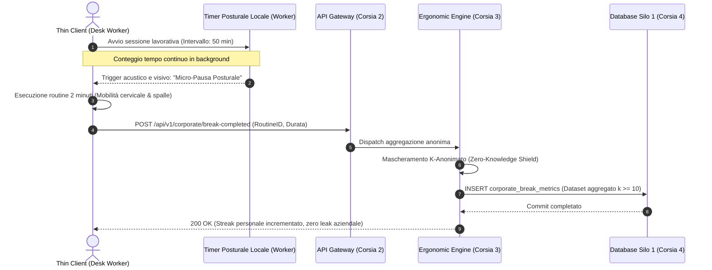

# Capitolato Tecnico: Flow 6A – Movely Desk-Care & Micro-Pause Ergonomiche (T7 Consumer)

## 1. Identificativo & Titolo Ufficiale
- **Badge Miro Board:** `#06` (Posizione: `X: 7937, Y: 465`, Miro Shape ID: `3458764688417722722`)
- **Codice Univoco:** `FLOW-6A`
- **Titolo Formale:** SOFTWARE 1 (B2C CONSUMER) - FLOW 6A: MOVELY DESK-CARE & MICRO-PAUSE ERGONOMICHE AZIENDALI
- **Board Miro Online:** `uXjVEbo6L2o=` (Zona 4, Riga 1: General User / Casual, Colonna 6: Movely Corporate Wellness & Ergonomia)
- **Diagramma Sorgente:** `architecture-blueprint/02-miro-zones-and-swimlanes/18-flowcharts/software-1-consumer-b2c/flow-6a-movely-desk-care.mmd`
- **Riferimento Glossario:** [Glossario Tecnico Vivente](file:///e:/Nuove%20App%20Installate/Sports-Analytics-Platform---T7-Workout-APP/architecture-blueprint/00-capitolato-tecnico-e-glossario/00-GLOSSARIO-TERMINI-TECNICI.md) (Voci: *Movely Corporate Wellness, Zero-Knowledge Privacy Shield, Micro-Pause Attive, Ergonomic Engine, K-Anonymity*).

---


## 2. Obiettivo di Business & Target Utente

### Guida Pratica per Non Tecnici: Cos'è questo modulo per un umano?
Chi lavora molte ore seduto davanti al computer (in ufficio o in smart working) conosce bene il dolore al collo, le spalle rigide e il fastidio alla zona lombare. Spesso le persone vorrebbero fare qualcosa, ma non possono cambiarsi per andare in palestra durante l'orario di lavoro o non sanno quali movimenti fare senza apparire ridicoli davanti ai colleghi.  
**Movely** è il personal trainer dell'ufficio:
- Ogni 90 minuti di sedia ti invia una notifica discreta: *"È ora di 3 minuti di respiro e mobilità per le tue spalle"*;
- Ti guida attraverso **3 esercizi facilissimi da fare direttamente alla scrivania o in piedi**, in abiti da lavoro e senza sudare;
- Un video compatto ti mostra esattamente come muovere il collo e aprire il torace;
- **Privacy assoluta garantita per legge:** se il tuo datore di lavoro o le Risorse Umane pagano l'abbonamento Movely per i dipendenti, **NON vedranno MAI i tuoi dati personali o la tua salute**. L'azienda riceve solo statistiche generali e anonime (es. *"L'85% dei dipendenti ha fatto le pause attive questa settimana, migliorando il benessere aziendale"*).

### Specifiche di Business & Metriche
- **Target Utente:** Lavoratori sedentari, impiegati d'ufficio e lavoratori da remoto (Tier 1 – B2C / B2B2C Corporate Wellness).
- **Problema Risolto:** Abbattere le giornate di malattia dovute a disturbi muscolo-scheletrici cronici (Neck pain e Low Back Pain $-40\%$) e generare abitudini di vita attive anche per chi non frequenta la palestra, con totale tutela della privacy del dipendente (GDPR Sanitario Art. 9).

---


## 3. Attori & Architettura a 4 Corsie (Swimlanes)

1. **Corsia 1: Thin Client UI/UX (Movely Widget Web & Mobile PWA):**
   - Mini-player ergonomico a scomparsa con timer a campana tibetana discreta, guida video animata per esercizi di decompressione cervicale/toracica, e questionario rapido sul dolore (scala VAS semplificata a 3 faccine).
2. **Corsia 2: API Gateway & Privacy Shield (Envoy + Zero-Knowledge Aggregator):**
   - Ricezione degli eventi di completamento pausa, validazione JWT Tier 1, anonimizzazione immediata delle risposte cliniche e blocco di qualsiasi associazione tra l'identità del lavoratore e i report aziendali.
3. **Corsia 3: Server Scatola Nera (Ergonomic Routine Engine Cloud Run):**
   - Algoritmo intelligente di selezione degli esercizi in base al profilo di postura (ore di sedia continuative) e rotazione delle 12 micro-routine posturali scientificamente validate.
4. **Corsia 4: Database Tripartito (Silo 1 - Corporate Welfare Partition):**
   - Tabelle `movely_routines`, `employee_sessions` (memorizzate solo a fini di gamification personale) e `company_reports` (metriche aggregate con soglia minima di $k \ge 10$ dipendenti per reparto per impedire l'identificazione individuale).

---


### Sequence Diagram Asincrono del Ciclo di Vita (FLOW-6A)



---


## 4. Flusso Operativo Passo-Passo

### Livello A: User Journey Narrativo (La Storia dell'Utente)
1. **Il Promemoria Gentile:** L'impiegato è concentrato al computer dalle 9:00 del mattino. Alle 10:45 compare una notifica discreta nell'angolo dello schermo: *"3 minuti per liberare il collo e le spalle. Facciamo una pausa insieme?"*.
2. **L'Avvio della Micro-Pausa:** L'utente tocca la notifica. Si apre una finestrella pulita con un messaggio rassicurante: *"Niente sudore, nessun attrezzo. Puoi farlo comodamente sulla tua sedia"*.
3. **I 3 Esercizi Guidati:**
   - *Esercizio 1 (45 secondi):* Retrazione del mento ed estensione dolce del collo per annullare la gobba da schermo;
   - *Esercizio 2 (60 secondi):* Apertura delle braccia a candelabro con respirazione diaframmatica per aprire il petto chiuso;
   - *Esercizio 3 (45 secondi):* Torsione lenta del busto a destra e sinistra per sciogliere la colonna vertebrale.
4. **Il Suono Discreto:** Un delicato rintocco sonoro scandisce il cambio esercizio senza disturbare i vicini di scrivania.
5. **Il Feedback Immediato:** Al termine compare un pollice alzato: *"Fantastico! Ti senti più leggero?"*. L'utente preme la faccina sorridente.
6. **I Punti Salute:** L'app assegna 50 "Punti Movely" che contribuiscono alla sfida del benessere aziendale (es. buoni acquisto o premi salute messi a disposizione dall'azienda).

---


#### Indicatori di Accettazione Operativa & Clinica (KPI)
| Metrica / Parametro | Obiettivo Target | Tolleranza Accettabile | Azione Fallback / Allerta |
| :--- | :--- | :--- | :--- |
| **Precisione Timer Sedentarietà** | $< 1\text{ s}$ deviazione per ora | $\le 5\text{ s}$ | Risincronizzazione continua su clock di sistema |
| **Garanzia K-Anonimato** | $k \ge 10$ lavoratori per cluster | $k \ge 5$ | Soppressione visualizzazione report al datore |
| **Avvio Routine Micro-Pausa** | $< 100\text{ ms}$ | $\le 250\text{ ms}$ | Pre-caching asset grafici nello storage locale |
| **Aderenza Pause Ergonomiche** | $> 60\%$ routine completate | $\ge 40\%$ | Posticipo automatico gentile (+15 min) |


---


### Livello B: Trattazione Tecnica Nodi Operativi

1. `START` (Trigger Micro-Pausa): Trigger automatico impostato su timer circolare (default: ogni 90 minuti di attività) o avvio manuale su richiesta del lavoratore.
2. `POSTURE_CHECK` (Rilevazione Rapida Fastidi): Visualizzazione rapida di 3 pulsanti anatomici: *"Collo/Spalle"*, *"Schiena/Lombare"*, *"Occhi/Respiro"*.
3. `SRV_ROUTINE_SELECT` (Selezione Algoritmica Routine): Il microservizio Cloud Run estrae una combinazione di 3 esercizi mirati dal catalogo riabilitativo `clinical-knee.ts` / distrettuali adatti all'ambiente ufficio.
4. `DESK_PLAYER_VIEW` (Rendering Player alla Scrivania):
   - Video loop compatto compresso in WebM/MP4 (peso $< 1.5\text{ MB}$ per non rallentare la rete aziendale);
   - Timer acustico realizzato con Web Audio API (suono morbido a $432\text{ Hz}$);
   - Testo sintetico con cue biomeccanico: *"Inspira espandendo la pancia, espira allungando la nuca verso il soffitto"*.
5. `COMPLETION_LOG` (Registrazione Sessione): L'utente completa i 3 minuti di pausa.
6. `GW_PRIVACY_SHIELD` (Scudo Privacy & Zero-Knowledge):
   - L'API Gateway riceve il ping di completamento;
   - I dati sanitari puntuali rimangono segregati sul profilo personale dell'utente;
   - Verso il datore di lavoro viene inviato esclusivamente un contatore numerico aggregato.
7. `DB_WRITE_AGGREGATE` (Scrittura Silo 1 Corporate): Inserimento nella tabella `company_department_stats`.
8. `DEC_K_ANONYMITY` (Controllo K-Anonimato):
   - Se il reparto aziendale conta $< 10$ dipendenti $\implies$ i dati vengono accorpati all'intera sede per impedire che l'ufficio HR deduca chi ha fatto o saltato le pause;
   - Se il reparto conta $\ge 10$ dipendenti $\implies$ rilascio indice aggregato di adesione.
9. `GAMIFICATION_REWARD` (Assegnazione Punti & Badge): Accredito punti welfare convertibili in premi benessere aziendali.

---


## 5. Rami Decisionali & Gestione dei 4 Stati UI

| Bivio Decisionale | Condizione Logica | Ramo SÌ / Positivo | Ramo NO / Negativo |
| :--- | :--- | :--- | :--- |
| `POSTURE_CHECK` | L'utente segnala un distretto indolenzito? | Genera routine specifica per quel distretto | Genera routine standard Total-Body |
| `DEC_K_ANONYMITY` | Dimensione reparto aziendale $\ge 10$ persone? | Report aggregato per reparto | Accorpamento a livello aziendale globale |
| `REMINDER_SNOOZE` | L'utente è in riunione o impegnato? | Posticipa promemoria di 20 minuti | Avvia micro-pausa istantanea |

### I 4 Stati di Interfaccia Utente (UI States):
1. **Empty State:** Prima installazione: tutorial rapido di 2 schermate *"Come fare micro-pause di qualità senza alzarsi dalla scrivania"*.
2. **Loading State:** Avvio istantaneo in $< 100\text{ ms}$ con precaricamento della clip video nella cache del browser.
3. **Populated State:** Widget compatto con barra di progresso circolare, video animato fluido e timer sonoro calibrato.
4. **Error / Fallback State:**
   - *Altoparlanti disattivati o muti:* Sostituzione dei segnali acustici con una delicata pulsazione visiva del bordo dello schermo (Visual Bell).

---


## 6. Contratti Dati, Parametri I/O & Database Silo

### Specifiche Endpoint REST:

#### 1. Ingestion Completamento Micro-Pausa
- **Endpoint:** `POST /api/v1/movely/sessions/complete`
- **Headers:** `Authorization: Bearer <jwt_token>`, `Content-Type: application/json`
- **Request Payload:**
```json
{
  "routineId": "mov_neck_release_03",
  "targetArea": "CERVICAL",
  "durationSeconds": 180,
  "subjectiveReliefScore": "BETTER",
  "companyTenantId": "corp_acme_it"
}
```
- **Responses:**
  - `200 OK`:
```json
{
  "status": "success",
  "wellnessPointsEarned": 50,
  "dailyStreakDays": 4,
  "nextPauseScheduledUtc": "2026-10-26T12:30:00Z"
}
```

#### 2. Query Report Welfare Aggregato per Portale HR
- **Endpoint:** `GET /api/v1/movely/corporate/reports?companyId=corp_acme_it&period=2026-W43`
- **Headers:** `Authorization: Bearer <hr_admin_jwt>`, `Accept: application/json`
- **Responses:**
  - `200 OK`:
```json
{
  "companyId": "corp_acme_it",
  "kAnonymityGuaranteed": true,
  "activeEmployeesCount": 142,
  "overallAdherencePercent": 78.4,
  "totalActiveMinutes": 18450,
  "reportedReliefRatePercent": 89.2
}
```

### Schema Relazionale (Database Silo 1 - PostgreSQL):
- `movely_routines`: `id VARCHAR(64) PK`, `title VARCHAR(128)`, `target_area VARCHAR(32)`, `duration_sec INT`, `video_asset_url TEXT`.
- `employee_sessions`: `id UUID PK`, `user_id UUID FK -> auth_users.id`, `routine_id VARCHAR(64)`, `points_earned INT`, `created_at TIMESTAMPTZ`.
- `company_reports`: `id UUID PK`, `company_tenant_id VARCHAR(64)`, `reporting_week VARCHAR(16)`, `aggregated_sessions_count INT`, `adherence_rate NUMERIC(5,2)`, `UNIQUE (company_tenant_id, reporting_week)`.

---


### Matrice Errori HTTP & Strategie di Resilienza
| HTTP Code | Codice Interno | Endpoint | Causa Scatenante | UX Feedback Visivo | Strategia di Resilienza & Fallback |
| :---: | :--- | :--- | :--- | :--- | :--- |
| **400** | `ERR_BAD_INTERVAL` | `POST /corporate/config` | Intervallo postura impostato $< 15\text{ min}$ | Notifica: *"Intervallo minimo raccomandato: 20 min"* | Correzione automatica al valore soglia clinico |
| **401** | `ERR_CORP_TOKEN` | `POST /corporate/metrics`| Token convenzione aziendale scaduto | Banner neutro: *"Modalità personale attiva"* | Passaggio a salvataggio privato non aggregato |
| **403** | `ERR_PRIVACY_BREACH` | `GET /corporate/analytics`| Tentativo di visualizzare report con $k < 10$ | Schermata: *"Dati aggregati insufficienti (Privacy)"*| Blocco visualizzazione report al datore di lavoro |
| **404** | `ERR_ROUTINE_404` | `GET /corporate/routine` | ID routine ergonomica non trovato | Schermata: *"Caricamento routine standard..."* | Fallback su sequenza standard di stretching collo |
| **429** | `ERR_PING_LIMIT` | `POST /corporate/ping` | Troppi ping di presenza da browser aperti | Nessun disturbo all'utente | Silenziamento ping e throttle temporale |
| **500** | `ERR_KANONYMITY_FAIL`| `POST /corporate/metrics`| Errore nel job di anonimizzazione batch | Icona ambrata di sincronizzazione | Riprova asincrona su cluster di elaborazione |


---


## 7. Ereditarietà di Tier & Differenziali di Fascia

- **Funzionalità Consumer (Tier 1):** Micro-pause ergonomiche per la persona comune e il lavoratore d'ufficio con report aggregato privacy-shield.
- **Evoluzione verso Tier 2 (`FLOW-6B` - Physio Rehab):**  
  Nel Tier 2, la semplice mobilità d'ufficio si trasforma in **Fisioterapia Clinica Avanzata**: il fisioterapista esegue il test del Range of Motion (ROM) tramite goniometro video AI, monitora la scala del dolore VAS e prescrive i 32 protocolli riabilitativi specifici per ginocchio e spalla.
- **Evoluzione verso Tier 3 (`FLOW-6C` - Medical Room):**  
  Nei club sportivi professionistici, il modulo evolve nella **Cartella Clinica EMR societaria**, con gestione degli infortuni da campo, protocolli Return-to-Play a 6 stadi e pipeline ETL de-identificata verso il Silo 3 per la ricerca scientifica accademica.
