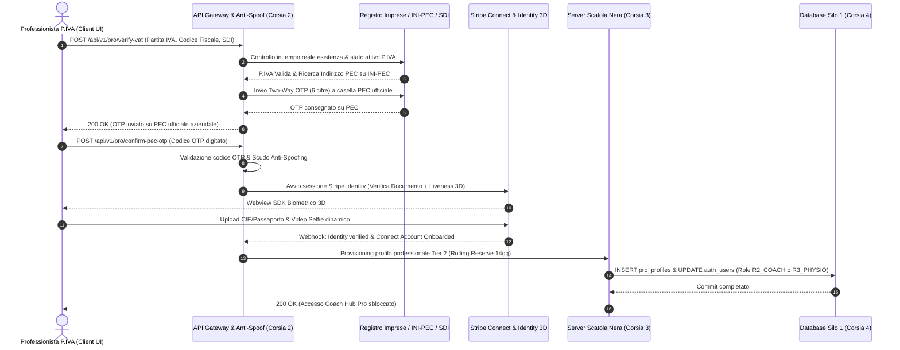

# Capitolato Tecnico: Flow 1B – Onboarding & Setup Fiscale Anti-Frode (T7 Pro Partita IVA)

## 1. Identificativo & Titolo Ufficiale
- **Badge Miro Board:** `#07` (Posizione: `X: -2448, Y: 3090`, Miro Shape ID: `3458764688417722731`)
- **Codice Univoco:** `FLOW-1B`
- **Titolo Formale:** SOFTWARE 2 (B2B PRO P.IVA) - FLOW 1B: ONBOARDING PROFESSIONALE & SETUP FISCALE P.IVA ANTI-FRODE (T7 PRO)
- **Board Miro Online:** `uXjVEbo6L2o=` (Zona 4, Riga 2: Partita IVA / Coaches & Fisioterapisti, Colonna 1: Onboarding Professionale)
- **Diagramma Sorgente:** `architecture-blueprint/02-miro-zones-and-swimlanes/18-flowcharts/software-2-pro-b2b/flow-1b-pro-onboarding.mmd`
- **Riferimento Glossario:** [Glossario Tecnico Vivente](00-GLOSSARIO-TERMINI-TECNICI.md) (Voci: [RBAC Role-Based Access Control](00-GLOSSARIO-TERMINI-TECNICI.md#rbac-role-based-access-control-a-3-tiers-x-8-ruoli), [Sistema di Interscambio SDI](00-GLOSSARIO-TERMINI-TECNICI.md#vies-sistema-di-interscambio-sdi), [Know Your Customer KYC](00-GLOSSARIO-TERMINI-TECNICI.md#kyb-know-your-business-ubo-ultimate-beneficial-owner), [3D Liveness Check](00-GLOSSARIO-TERMINI-TECNICI.md#stripe-identity-biometric-liveness-3d), [Stripe Connect Custom](00-GLOSSARIO-TERMINI-TECNICI.md#rolling-reserve-escrow-anti-chargeback)).

---


## 2. Obiettivo di Business & Target Utente

### Guida Pratica per Non Tecnici: Cos'è questo modulo per un umano?
Chi lavora come personal trainer, preparatore atletico o fisioterapista con Partita IVA ha una responsabilità enorme sulla salute delle persone e deve gestire la propria attività economica in regola con il fisco. Nel mondo del fitness online ci sono purtroppo tanti finti "guru" o persone non qualificate che spacciano schede pericolose senza avere titoli di studio.  
**L'Onboarding Pro di T7** è il passaporto di eccellenza per i veri professionisti:
- Permette al coach o fisioterapista di registrarsi e inserire la propria **Partita IVA** e il **Codice Univoco SDI** per emettere fatture elettroniche automatiche;
- Chiede di allegare la Laurea in Scienze Motorie (L-22/LM-67) o il Diploma Tecnico CONI e l'assicurazione professionale;
- Esegue un rapido controllo del viso in 3D con la fotocamera dello smartphone (Liveness Check) per verificare che la persona reale corrisponda al documento caricato, bloccando furti d'identità;
- Una volta convalidato, il professionista riceve il **Badge Blu di Studio Verificato**, sblocca il portafoglio clienti illimitato e può iniziare a incassare i compensi dagli atleti tramite bonifico o carta.

### Specifiche di Business & Metriche
- **Target Utente:** Chinesiologi, personal trainer certificati, preparatori atletici e fisioterapisti con Partita IVA (Tier 2 – B2B Freelance).
- **Problema Risolto:** Blindare la qualità della piattaforma garantendo che solo professionisti abilitati possano prescrivere carichi ed emettere referti (Zero Fake Trainers), automatizzando la fatturazione elettronica e l'onboarding bancario antiriciclaggio (KYC/AML).

---


## 3. Attori & Architettura a 4 Corsie (Swimlanes)

1. **Corsia 1: Thin Client UI/UX (Pro Cockpit Web / Tablet PWA React 18):**
   - Form dinamico di registrazione studio professionale a 4 step, acquisizione video liveness 3D tramite WebRTC, upload drag-and-drop certificati PDF/immagini e dashboard di avanzamento pratica KYC.
2. **Corsia 2: API Gateway & Identity Verification Gateway (Envoy + VIES / SDI Validator):**
   - Verifica automatica del formato e della validità della Partita IVA sul database dell'Agenzia delle Entrate e VIES comunitario, rate limiting rigoroso su chiamate fiscali e gestione token sessione Tier 2.
3. **Corsia 3: Server Scatola Nera (Pro Provisioning & Compliance Engine Cloud Run):**
   - Interfacciamento con provider KYC (Onfido/Sumsub) per l'analisi biometrica del volto e la verifica documentale (OCR su patente/carta identità), orchestrazione dell'onboarding bancario su Stripe Connect Custom e generazione token JWT con Ruoli `R2_COACH` o `R3_PHYSIO`.
4. **Corsia 4: Database Tripartito (Silo 1 - Pro Tenant Database PostgreSQL):**
   - Tabelle `pro_profiles` (dati fiscali cifrati a riposo con AES-256), `compliance_dossiers` (documenti caricati e log degli esiti KYC) e `billing_subaccounts` (account Stripe collegato).

---


### Sequence Diagram Asincrono del Ciclo di Vita (FLOW-1B)



---


## 4. Flusso Operativo Passo-Passo

### Livello A: User Journey Narrativo (La Storia dell'Utente)
1. **L'Ingresso Professionale:** Il trainer o fisioterapista seleziona *"Sei un Professionista? Accedi a T7 Pro"*.
2. **I Dati dello Studio:** Inserisce nome dello studio, Partita IVA a 11 cifre, Codice Fiscale e Codice Destinatario SDI (o PEC) per la fatturazione elettronica. L'app verifica in 2 secondi che la Partita IVA sia attiva all'Agenzia delle Entrate.
3. **La Scelta dell'Albo o Categoria:**
   - Se è un Chinesiologo/Coach: seleziona il percorso sportivo e allega la Laurea in Scienze Motorie o il brevetto CONI;
   - Se è un Fisioterapista: seleziona l'iscrizione all'Albo TSRM-PSTRP e la polizza RC professionale.
4. **La Verifica Facciale di Sicurezza (Liveness Check):** L'app apre la fotocamera e chiede: *"Guarda verso lo schermo, gira lentamente la testa a destra e sorridi"*. Questo serve per essere certi che nessuno stia usando documenti rubati.
5. **Il Conto Incassi (Stripe Connect):** Il coach collega il proprio IBAN bancario dove vorrà ricevere i pagamenti dei propri allievi.
6. **L'Accesso Immediato in Sandbox:** Mentre i documenti vengono verificati dal team di compliance, il coach può già esplorare liberamente il sistema: provare a costruire schede con l'Intelligenza Artificiale, testare la velocità VBT e caricare i propri atleti di prova.
7. **L'Approvazione Finale:** Appena approvato, il profilo riceve il **Badge Blu**, gli inviti agli allievi diventano attivi e lo studio è ufficialmente operativo al 100%!

---


#### Indicatori di Accettazione Operativa & Clinica (KPI)
| Metrica / Parametro | Obiettivo Target | Tolleranza Accettabile | Azione Fallback / Allerta |
| :--- | :--- | :--- | :--- |
| **Tempo Validazione P.IVA** | $< 1.5\text{ s}$ (VIES / SDI) | $\le 3.5\text{ s}$ | Accreditamento provvisorio con audit differito |
| **Recapito OTP su INI-PEC** | $< 45\text{ s}$ | $\le 120\text{ s}$ | Re-invio manuale con limite 3 tentativi/ora |
| **Precisione Liveness Check 3D** | $> 99.8\%$ rilevamento spoof | $\ge 99.0\%$ | Invio a revisione manuale con operatore (24h) |
| **Tasso Frodi / False P.IVA** | $0\%$ tolleranza frode | $0\%$ | Blocco immediato del profilo e segnalazione |

---


### Livello B: Trattazione Tecnica Nodi Operativi

1. `START` (Avvio Registrazione Pro): Montaggio del flusso `ProOnboardingWizard` nella shell client React 18.
2. `AUTH_2FA_CHECK` (Autenticazione Forte & 2FA): Registrazione credenziali con obbligo di autenticazione a due fattori (TOTP via Google Authenticator o Passkey hardware FIDO2).
3. `STEP1_TAX_DATA` (Dati Fiscali & Fatturazione Elettronica): Raccolta Partita IVA (11 cifre numeriche), Codice Fiscale, Ragione Sociale, Indirizzo Sede Legale e Codice Destinatario SDI a 7 caratteri (o PEC).
4. `GW_TAX_VALIDATE` (Validazione Gateway Agenzia Entrate):
   - Chiamata sincrona verso API VIES / SDI Gateway;
   - Se Partita IVA cessata o inesistente $\implies$ `ERR_TAX_INVALID` (blocco con evidenziazione errore);
   - Se attiva $\implies$ passaggio a Step 2.
5. `STEP2_SPECIALTY_FORK` (Bivio Ramo Professionale):
   - *Ramo Coach / Chinesiologo (Ruolo `R2_COACH`):* Upload titolo CONI / Laurea L-22/LM-67 $\to$ `STEP3A_COACH_DOCS`;
   - *Ramo Sanitario / Fisioterapista (Ruolo `R3_PHYSIO`):* Upload iscrizione Ordine TSRM Fisioterapisti + Polizza RC $\to$ `STEP3B_PHYSIO_DOCS`.
6. `STEP4_LIVENESS_KYC` (Analisi Biometrica 3D del Volto):
   - Acquisizione flusso video WebRTC dal client;
   - Calcolo mappa di profondità 3D (Face Mesh) e rilevamento passivo di micro-movimenti per scongiurare attacchi deepfake o foto statiche.
7. `GW_STRIPE_ONBOARD` (Provisioning Conto Incassi Stripe Connect):
   - Creazione `Custom Account` su Stripe API con capabilities `transfers` e `card_payments`;
   - Configurazione split commissionale per la piattaforma.
8. `DEC_KYC_STATUS` (Bivio Validazione Compliance):
   - *Esito Immediato Positivo:* Rilascio istantaneo del **Badge Blu di Studio Verificato** (`BADGE_VERIFIED`);
   - *Esito in Revisione Manuale:* Concessione accesso in modalità **Sandbox Protetto** (`PRO_SANDBOX`: il coach può creare schede e testare il VBT ma gli inviti e gli incassi rimangono congelati fino a delibera).
9. `PRO_COCKPIT_ENTRY` (Ingresso Hub Professionale): Emissione token JWT Tier 2 e atterraggio nella dashboard `Coach Hub`.

---


## 5. Rami Decisionali & Gestione dei 4 Stati UI

| Bivio Decisionale | Condizione Logica | Ramo SÌ / Positivo | Ramo NO / Negativo |
| :--- | :--- | :--- | :--- |
| `GW_TAX_VALIDATE` | Partita IVA attiva e valida su VIES/SDI? | Procedi a caricamento documenti | Blocco con notifica fiscale errata |
| `SPECIALTY_FORK` | Titolo dichiarato è di tipo Medico/Fisio? | Ramo Sanitario (`R3_PHYSIO`) | Ramo Tecnico Chinesiologo (`R2_COACH`) |
| `DEC_KYC_STATUS` | Liveness check e documenti convalidati? | Badge Blu e operatività piena | Accesso Sandbox in sola lettura |

### I 4 Stati di Interfaccia Utente (UI States):
1. **Empty State:** Primo avvio del wizard: campi di fatturazione precompilati se rilevati da autofill aziendale, indicatore a step in alto (*1. Dati Fiscali -> 2. Titoli -> 3. Verifica Viso -> 4. Conto Incassi*).
2. **Loading State:** Elaborazione dell'impronta biometrica liveness su server sicuro con spinner circolare e messaggio *"Verifica dell'autenticità del documento in corso (circa 15 secondi)..."*.
3. **Populated State:** Dashboard del Coach Hub sbloccata con il bollino blu *"Studio Professionale Certificato"*, grafico degli incassi a zero e pulsante verde *"Invita il tuo primo Atleta"*.
4. **Error / Fallback State:**
   - *Documento sfocato o illeggibile:* Notifica immediata: *"La foto del documento è mossa o presenta riflessi. Scatta nuovamente la foto con buona luce"*.

---


## 6. Contratti Dati, Parametri I/O & Database Silo

### Specifiche Endpoint REST:

#### 1. Validazione Fiscale Partita IVA
- **Endpoint:** `POST /api/v1/pro/onboarding/validate-tax`
- **Headers:** `Authorization: Bearer <temp_reg_jwt>`, `Content-Type: application/json`
- **Request Payload:**
```json
{
  "vatNumber": "IT12345678901",
  "fiscalCode": "RSSMRA85M01H501Z",
  "businessName": "Studio Chinesiologico Dott. Mario Rossi",
  "sdiRecipientCode": "M5UXCR1",
  "certifiedEmail": "studio.rossi@pec.it"
}
```
- **Responses:**
  - `200 OK`: `{ "valid": true, "vatStatus": "ACTIVE", "companyNameMatch": true }`
  - `400 Bad Request`: `{ "valid": false, "error": "ERR_VAT_INACTIVE", "message": "La Partita IVA risulta cessata." }`

#### 2. Sottomissione Dossier Documentale & KYC
- **Endpoint:** `POST /api/v1/pro/onboarding/submit-kyc`
- **Headers:** `Authorization: Bearer <temp_reg_jwt>`, `Content-Type: application/json`
- **Request Payload:**
```json
{
  "professionalRole": "COACH",
  "degreeCertificateStorageRef": "gs://t7-compliance-vault/docs/deg_8812b.pdf",
  "livenessSessionToken": "live_sess_99a81c2",
  "insurancePolicyNumber": "POL-ALLIANZ-2026-99"
}
```
- **Responses:**
  - `201 Created`: `{ "kycStatus": "APPROVED", "tierAssigned": "TIER_2_PRO", "verifiedBadge": true }`
  - `202 Accepted`: `{ "kycStatus": "MANUAL_REVIEW_PENDING", "sandboxMode": true }`

### Schema Relazionale (Database Silo 1 - PostgreSQL):
- `pro_profiles`: `id UUID PK`, `user_id UUID FK -> auth_users.id`, `vat_number VARCHAR(16) NOT NULL`, `business_name VARCHAR(128)`, `sdi_code VARCHAR(7)`, `professional_title VARCHAR(64)`, `verified_badge BOOLEAN DEFAULT FALSE`, `created_at TIMESTAMPTZ`.
- `compliance_dossiers`: `id UUID PK`, `pro_id UUID FK -> pro_profiles.id`, `liveness_score NUMERIC(4,3)`, `id_document_type VARCHAR(32)`, `document_vault_ref TEXT`, `status VARCHAR(32)`, `verified_at TIMESTAMPTZ`.

---


### Matrice Errori HTTP & Strategie di Resilienza
| HTTP Code | Codice Interno | Endpoint | Causa Scatenante | UX Feedback Visivo | Strategia di Resilienza & Fallback |
| :---: | :--- | :--- | :--- | :--- | :--- |
| **400** | `ERR_INVALID_VAT` | `POST /pro/verify-vat` | Formato Partita IVA o Codice Destinatario SDI errato | Bordo rosso: *"Partita IVA o Codice SDI non validi"* | Validazione regex client-side preventiva |
| **401** | `ERR_PEC_OTP_WRONG` | `POST /pro/confirm-pec-otp`| Codice OTP digitato errato o scaduto (10 min) | Alert: *"Codice PEC non valido o scaduto"* | Possibilità di generare nuovo codice OTP |
| **403** | `ERR_VAT_INACTIVE` | `POST /pro/verify-vat` | Partita IVA cessata, sospesa o fallita | Modale: *"Partita IVA non attiva all'Agenzia Entrate"*| Blocco dell'onboarding professionale |
| **422** | `ERR_LIVENESS_FAIL` | `POST /pro/stripe-webhook`| Mancata corrispondenza selfie 3D e documento | Schermata: *"Verifica identità non superata"* | Richiesta nuovo documento in alta risoluzione |
| **429** | `ERR_OTP_FLOOD` | `POST /pro/verify-vat` | Più di 3 richieste di OTP all'ora sullo stesso CF | Toast: *"Limite richieste OTP raggiunto. Attendi"* | Throttle temporale con timer visibile |
| **502** | `ERR_VIES_OFFLINE` | `POST /pro/verify-vat` | Registro europeo VIES momentaneamente offline | Banner ambrato: *"Verifica differita in corso..."* | Accodamento verifica in background |

---


## 7. Ereditarietà di Tier & Differenziali di Fascia

- **Ereditarietà da Tier 1 (`FLOW-1A`):**  
  Il professionista eredita tutti i moduli di sicurezza base (Turnstile, crittografia delle credenziali Argon2id e navigazione reattiva).
- **Esclusività di Tier 2:**  
  La validazione fiscale Partita IVA/SDI, il liveness check 3D facciale, la custodia dei titoli CONI/Laurea e l'aggancio a Stripe Connect per gli incassi professionali **sono funzionalità esclusive di Tier 2 precluse al General User**.
- **Propagazione verso Tier 3 (`FLOW-1C`):**  
  Nei club professionistici societari (Tier 3), la verifica fiscale del singolo professionista viene sostituita dal rigoroso controllo camerale KYB dell'azienda sportiva (visura camerale, attestazione mTLS e federazione SSO).
