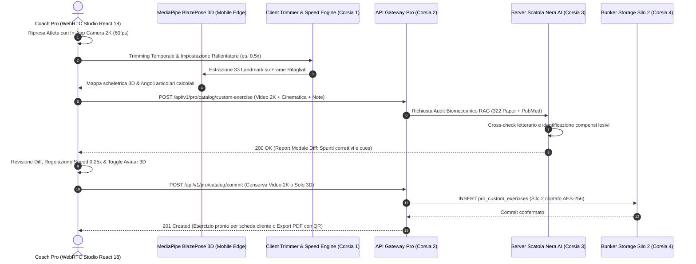

# Capitolato Tecnico: Flow 2B – Catalogo 3D, Video In-App 2K & Revisione AI (T7 Pro Coach & Fisio)

## 1. Identificativo & Titolo Ufficiale
- **Badge Miro Board:** `#08` (Posizione: `X: 251.36, Y: 2940`, Miro Shape ID: `3458764688417722736`)
- **Codice Univoco:** `FLOW-2B`
- **Titolo Formale:** SOFTWARE 2 (B2B PRO P.IVA) - FLOW 2B: CATALOGO 3D, VIDEO IN-APP 2K, SPEED CONTROL & REVISIONE BIOMECCANICA AI (T7 PRO)
- **Board Miro Online:** `uXjVEbo6L2o=` (Zona 4, Riga 2: Partita IVA / Coaches & Fisioterapisti, Colonna 2: Catalogo Professionale & Video AI)
- **Diagramma Sorgente:** `architecture-blueprint/02-miro-zones-and-swimlanes/18-flowcharts/software-2-pro-b2b/flow-2b-coach-hub.mmd`
- **Riferimento Glossario:** [Glossario Tecnico Vivente](00-GLOSSARIO-TERMINI-TECNICI.md) (Voci: [Multimodal RAG](00-GLOSSARIO-TERMINI-TECNICI.md#revisione-coerente-ai-multimodal-rag-web-biomechanical-audit), [Pose Estimation](00-GLOSSARIO-TERMINI-TECNICI.md#mediapipe-blazepose-3d-edge-pose-estimation-su-video-mobile), [WebRTC MediaStream](00-GLOSSARIO-TERMINI-TECNICI.md#webrtc-mediastream-secure-video-recording), [Digital Twin 3D](00-GLOSSARIO-TERMINI-TECNICI.md#digital-twin-biomeccanico-dellatleta), [Video Ingest Tiers](00-GLOSSARIO-TERMINI-TECNICI.md#video-ingest-tiers-1080p-consumer-2k-pro-4k8k-enterprise), [Variable Playback Rate](00-GLOSSARIO-TERMINI-TECNICI.md#variable-playback-rate-frame-by-frame-scrubbing-120fps), [WebCodecs Lossless Trimming](00-GLOSSARIO-TERMINI-TECNICI.md#webcodecs-api-client-side-lossless-trimming)).

---

## 2. Obiettivo di Business & Target Utente

### Guida Pratica per Non Tecnici: Cos'è questo modulo per un umano?
I preparatori atletici e i fisioterapisti insegnano spesso movimenti speciali o varianti personalizzate che non esistono nei manuali standard. Fino ad oggi, i coach registravano i video dei loro allievi con WhatsApp, disperdendo file sul telefono e rischiando sanzioni sulla privacy se un video finiva nelle mani sbagliate.  
**Il Catalogo Pro di T7** è lo studio cinematografico e scientifico del coach:
- **Risoluzione Max 2K (1440p QHD a 60fps):** Risoluzione sensibilmente superiore a quella consumer (1080p), calibrata specificamente per tablet professionali (iPad Pro, Galaxy Tab) e schermi desktop da studio per cogliere ogni minima imperfezione posturale;
- **Controllo Totale della Velocità (Slow-Motion & Fast-Forward):** Il professionista può rallentare l'esecuzione a **0.25x, 0.5x, 0.75x** per analizzare nel dettaglio il punto di inversione tra discesa e risalita, oppure velocizzare a **1.25x, 1.5x, 2.0x** per valutare la cadenza ritmica complessiva;
- **Trimming Temporale di Precisione:** Strumento di taglio integrato con timeline a scorrimento per isolare la sola serie allenante escludendo preparativi o pause;
- **Confronto a Specchio (Split-Screen):** Da una parte c'è il video reale dell'atleta in 2K, dall'altra l'Avatar 3D perfetto generato dai 33 punti MediaPipe;
- **Audit Scientifico AI (322 Paper Medici):** Un'Intelligenza Artificiale Scientifica analizza il gesto in 3 secondi e segnala eventuali rischi articolari: *"Attenzione: il ginocchio destro collassa all'interno di 8 gradi nella fase di spinta"*;
- **Tutela Privacy GDPR:** Interruttore a doppio binario per conservare il video reale in cassaforte criptata Silo 2 oppure anonimizzarlo in un avatar scheletrico privo di dati biometrici facciali.

### Specifiche di Business & Metriche
- **Target Utente:** Coach, chinesiologi, personal trainer e fisioterapisti dello sport (Tier 2 – Pro P.IVA).
- **Problema Risolto:** Creare librerie di esercizi personalizzate ad altissima autorevolezza scientifica, consentendo analisi rallentata al millimetro e tutelando la privacy dei clienti con crittografia dedicata (GDPR Art. 9).

---

## 3. Attori & Architettura a 4 Corsie (Swimlanes)

1. **Corsia 1: Thin Client UI/UX (React 18 Pro + WebRTC 2K Camera Studio & Trimmer):**
   - Modulo di acquisizione video 2K (`2560x1440` a 60fps) tramite `MediaStreamRecorder`;
   - Slider di regolazione velocità di riproduzione dinamica (`playbackRate = 0.25 | 0.5 | 0.75 | 1.0 | 1.25 | 1.5 | 2.0`);
   - Barra di trimming temporale con anteprima frame WebCodecs;
   - Modale comparativa Diff per approvare, modificare o scartare le revisioni biomeccaniche AI;
   - Toggle istantaneo "Video 2K Reale vs Avatar 3D".
2. **Corsia 2: API Gateway & Upload Gateway Pro (Envoy + Resumable Chunking):**
   - Endpoint protetto con token JWT Tier 2 e quota storage dedicata (fino a 20 GB per studio);
   - Upload resumable a blocchi da 5 MB con hash MD5 per garantire affidabilità in palestra.
3. **Corsia 3: Server Scatola Nera (Multimodal RAG & Pose Estimation Engine Cloud Run GPU):**
   - Riconoscimento scheletrico a 33 keypoints (MediaPipe BlazePose / YOLOv8-Pose);
   - Calcolo istantaneo degli angoli articolari (valgo ginocchio, tilt pelvico, angolo caviglia);
   - Interrogazione RAG gerarchica sui 322 paper scientifici indicizzati su pgvector;
   - Generazione mesh Avatar 3D personalizzata compressa con Google Draco.
4. **Corsia 4: Database Tripartito (Silo 2 Vault - PostgreSQL & Cloud Storage Criptato):**
   - Tabelle `pro_custom_exercises`, `pro_client_prescriptions` e bucket Cloud Storage criptato AES-256 isolato per studio professionale.

---

### Sequence Diagram Asincrono del Ciclo di Vita (FLOW-2B)



---

## 4. Flusso Operativo Passo-Passo

### Livello A: User Journey Narrativo (La Storia dell'Utente)
1. **L'Accesso al Catalogo Coach:** Il professionista entra nella sezione *"Catalogo Esercizi"* dal tablet in palestra.
2. **La Scelta Operativa:** Sceglie tra consultare la libreria con triage 119 patologie, filmare un atleta in 2K o creare una scheda solo-testo.
3. **La Registrazione in 2K e il Trimming:**
   - Inquadra l'allievo mentre compie uno stacco da terra in alta risoluzione 2K a 60fps;
   - Agisce sulla timeline per tagliare i 3 secondi iniziali prima della presa e il rilascio finale;
   - Attiva il **Rallentatore a 0.5x**: la discesa dell'atleta scorre fluida e nitida, permettendo di notare una leggera flessione del tratto lombare nell'ultimo terzo di movimento.
4. **L'Audit Scientifico AI:** In 3 secondi l'AI analizza il video ritagliato e incrocia i dati con 322 paper scientifici, aprendo una modale "Diff":
   - Propone di aggiungere un cue propriocettivo: *"Mantieni il petto fiero e attiva il gran dorsale prima di staccare"*;
   - Il coach tocca *"Approva"* per integrare la nota scientifica nella scheda dell'esercizio.
5. **Privacy & Toggle 3D:** Il coach sceglie se conservare il video 2K reale nella cartella cliente o convertirlo in Avatar 3D anonimo.
6. **L'Assegnazione Finale:** L'esercizio viene inserito nel programma di allenamento del cliente o esportato in PDF interattivo con QR Code 3D.

---

#### Indicatori di Accettazione Operativa & Clinica (KPI)
| Metrica / Parametro | Obiettivo Target | Tolleranza Accettabile | Azione Fallback / Allerta |
| :--- | :--- | :--- | :--- |
| **Risoluzione Max Video Ingest** | $2\text{K}$ ($2560\times 1440$) a 60fps | $\ge 1080\text{p}$ | Adattamento bitrate dinamico client-side |
| **Precisione Trimming Temporale** | $< 100\text{ ms}$ (frame-accurate) | $\le 250\text{ ms}$ | Allineamento al keyframe più vicino |
| **Latenza Variazione Velocità (Speed)** | Istantanea ($< 16\text{ ms}$) | $\le 50\text{ ms}$ | Cambio dinamico `HTMLMediaElement.playbackRate` |
| **Framerate BlazePose Edge** | $\ge 30\text{ FPS}$ in tempo reale | $\ge 20\text{ FPS}$ | Campionamento a 15 FPS su hardware datato |
| **Tempo Risposta RAG Multimodale** | $< 2.5\text{ s}$ per revisione | $\le 5.0\text{ s}$ | Restituzione checklist biomeccanica statica |

---

### Livello B: Trattazione Tecnica Nodi Operativi

1. `START` (Coach Cockpit Access): Inizializzazione shell Pro con verifica JWT Tier 2.
2. `DEC_MODE` (Bivio Operativo): Ramo 1 (Consulta & Triage), Ramo 2 (In-App Camera 2K & AI), Ramo 3 (Solo-Testo).
3. `UI_CAM_RECORD_2K` (Acquisizione Video 2K):
   - Richiesta stream `getUserMedia({ video: { width: { ideal: 2560, max: 2560 }, height: { ideal: 1440, max: 1440 }, frameRate: 60 } })`;
   - Registrazione buffer WebM/MP4 codec H.264 High Profile Level 5.1.
4. `UI_VIDEO_TRIM_SPEED` (Trimming & Speed Control):
   - Canvas di ritaglio con slider bidirezionale `[startTime, endTime]`;
   - Controlli di velocità `playbackRate` preimpostati: `0.25x`, `0.5x`, `0.75x`, `1.0x`, `1.25x`, `1.5x`, `2.0x`.
5. `UI_EDGE_POSE` (Edge Computer Vision): Estrazione 33 landmark BlazePose 3D con calcolo angoli articolari istantanei.
6. `DEC_AI_AUDIT` (Richiesta Revisione AI): Se SÌ $\to$ Chiamata RAG Scatola Nera (`SRV_RAG_AUDIT`); se NO $\to$ procedi con bozza coach.
7. `UI_DIFF_MODAL` (Modale Diff): Interfaccia side-by-side con merge selettivo delle note scientifiche.
8. `DEC_KEEP_VIDEO` (Bivio Privacy GDPR): Scelta tra conservazione video 2K criptato in Silo 2 o sola sintesi Avatar 3D Draco.
9. `VIEWER_TOGGLE` (Toggle Switch): Componente di visualizzazione che alterna il video 2K registrato (con controlli di velocità attivi) e l'omino 3D stilizzato.
10. `DEC_DEST` (Salvataggio & Prescrizione): Assegnazione a scheda cliente (`SAVE_CLIENT`) o Export PDF/Excel con QR 3D (`SAVE_EXPORT`).

---

## 5. Rami Decisionali & Gestione dei 4 Stati UI

| Bivio Decisionale | Condizione Logica | Ramo SÌ / Positivo | Ramo NO / Negativo |
| :--- | :--- | :--- | :--- |
| `DEC_MODE` | Modalità scelta dal coach? | Registrazione Video In-App 2K | Consultazione ordinaria catalogo |
| `DEC_AI_AUDIT` | Richiesta revisione scientifica AI? | RAG multimodale 322 paper | Mantieni bozza originaria coach |
| `DEC_KEEP_VIDEO` | Consenso conservazione video raw? | Salva video 2K in Cloud Silo 2 | Converti in solo Avatar 3D anonimo |
| `DEC_DEST` | Destinazione esercizio custom? | Assegna a cliente attivo (Silo 2) | Esporta report PDF/Excel con QR |

### I 4 Stati di Interfaccia Utente (UI States):
1. **Empty State:** Nessun esercizio personalizzato: card *"Crea il tuo primo esercizio filmando un atleta in 2K o descrivendolo via testo"*.
2. **Loading State:** Barra di avanzamento per trimming ed estrazione cinematica: *"Elaborazione frame 2K e calcolo angoli MediaPipe..."*.
3. **Populated State:** Scheda esercizio con video 2K fluido, selettore velocità (0.25x - 2.0x), mappa angolare e badge di conformità scientifica.
4. **Error / Fallback State:**
   - *Device non supporta encoding 2K:* Fallback automatico a 1080p a 60fps con notifica trasparente per l'utente.

---

## 6. Contratti Dati, Parametri I/O & Database Silo

### Specifiche Endpoint REST:

#### 1. Upload Video 2K & Parametri Trimming / Speed
- **Endpoint:** `POST /api/v1/pro/catalog/custom-video-exercise`
- **Headers:** `Authorization: Bearer <pro_jwt>`, `Content-Type: multipart/form-data`
- **Request Form Data:**
  - `videoBlob`: File binario MP4/WebM (risoluzione max 2K, fino a 150 MB);
  - `exerciseName`: "Stacco Rumeno con Bilanciere su Pedana";
  - `trimRange`: `{ "startMs": 850, "endMs": 18200 }`;
  - `analysisSpeed`: 0.5;
  - `targetMuscles`: `["HAMSTRINGS", "GLUTES", "ERECTOR_SPINAE"]`;
  - `retainRawVideo`: true;
  - `athleteConsentId`: "waiver_pro_9941a".
- **Responses:**
  - `201 Created`:
```json
{
  "customExerciseId": "cust_ex_2k_5512b",
  "resolution": "2K_1440p",
  "framerate": 60,
  "ragAuditScore": 94.2,
  "detectedKinematics": {
    "peakHipFlexionDeg": 84.1,
    "kneeValgusDeg": 2.8,
    "lumbarNeutrality": "SAFE"
  },
  "speedRatesAvailable": [0.25, 0.5, 0.75, 1.0, 1.25, 1.5, 2.0],
  "videoVaultUrl": "https://storage.t7workout.app/silo2/pro-vault/cust_ex_2k_5512b.mp4",
  "twinGlbUrl": "https://assets.t7workout.app/twins/cust_5512b.glb"
}
```

---

### Matrice Errori HTTP & Strategie di Resilienza
| HTTP Code | Codice Interno | Endpoint | Causa Scatenante | UX Feedback Visivo | Strategia di Resilienza & Fallback |
| :---: | :--- | :--- | :--- | :--- | :--- |
| **400** | `ERR_SPEED_INVALID` | `POST /custom-video-exercise` | Valore di velocità non consentito | Alert: *"Velocità supportata tra 0.25x e 2.0x"* | Reset automatico a 1.0x |
| **401** | `ERR_TIER2_REQUIRED` | `POST /custom-video-exercise` | Tentativo accesso feature 2K da Tier 1 | Modale: *"Risoluzione 2K e speed control riservati a Pro"* | Proposta upgrade con trial Pro |
| **413** | `ERR_VIDEO_TOO_LARGE` | `POST /custom-video-exercise` | Dimensione file $> 150\text{ MB}$ | Alert: *"Clip troppo lunga. Esegui il trim temporale"* | Apertura automatica timeline di trimming |
| **422** | `ERR_POSE_FAILED` | `POST /custom-video-exercise` | Atleta fuori dall'inquadratura | Overlay: *"Centra l'intero corpo nell'inquadratura 2K"* | Silhouette guida a schermo intero |

---

## 7. Ereditarietà di Tier & Differenziali di Fascia

- **Ereditarietà da Tier 1 (`FLOW-2A`):**  
  Il coach eredita l'intero catalogo dei 328 movimenti, l'avatar 3D WebGL con muscoli primari/secondari e la funzione di trimming di base.
- **Differenziali Esclusivi di Tier 2:**  
  Risoluzione potenziata a **2K (1440p)**, controlli di velocità bidirezionali **(slow-motion da 0.25x e accelerazione fino a 2.0x)**, audit scientifico AI con RAG accademico (322 paper) e prescrizione su scheda cliente Silo 2.
- **Propagazione a Tier 3 (`FLOW-2C`):**  
  Nei club professionistici, il modulo video evolve verso risoluzioni **4K e fino a 8K**, con **sincronizzazione multi-camera SMPTE**, rallentatore estremo frame-by-frame a 120fps, suite di editing tattico con Telestrator, Dynamic Watermarking e firma congiunta con il Medico Sociale.
