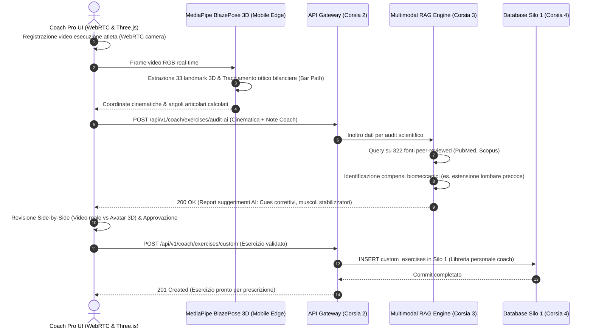

# Capitolato Tecnico: Flow 2B – Catalogo 3D, Video In-App & Revisione AI (T7 Pro Coach & Fisio)

## 1. Identificativo & Titolo Ufficiale
- **Badge Miro Board:** `#08` (Posizione: `X: 251.36, Y: 2940`, Miro Shape ID: `3458764688417722736`)
- **Codice Univoco:** `FLOW-2B`
- **Titolo Formale:** SOFTWARE 2 (B2B PRO P.IVA) - FLOW 2B: CATALOGO 3D, VIDEO IN-APP & REVISIONE BIOMECCANICA AI (T7 PRO)
- **Board Miro Online:** `uXjVEbo6L2o=` (Zona 4, Riga 2: Partita IVA / Coaches & Fisioterapisti, Colonna 2: Catalogo Professionale & Video AI)
- **Diagramma Sorgente:** `architecture-blueprint/02-miro-zones-and-swimlanes/18-flowcharts/software-2-pro-b2b/flow-2b-coach-hub.mmd`
- **Riferimento Glossario:** [Glossario Tecnico Vivente](file:///e:/Nuove%20App%20Installate/Sports-Analytics-Platform---T7-Workout-APP/architecture-blueprint/00-capitolato-tecnico-e-glossario/00-GLOSSARIO-TERMINI-TECNICI.md) (Voci: *Multimodal RAG, Pose Estimation, WebRTC MediaStream, Digital Twin 3D, GDPR Video Cryptography*).

---


## 2. Obiettivo di Business & Target Utente

### Guida Pratica per Non Tecnici: Cos'è questo modulo per un umano?
I preparatori atletici e i fisioterapisti insegnano spesso movimenti speciali o varianti personalizzate che non esistono nei manuali standard. Fino ad oggi, i coach registravano i video dei loro allievi con WhatsApp, disperdendo file sul telefono e rischiando sanzioni sulla privacy se un video finiva nelle mani sbagliate.  
**Il Catalogo Pro di T7** è lo studio cinematografico e scientifico del coach:
- Il coach può aprire la fotocamera direttamente dentro l'app e filmare il proprio atleta mentre esegue un esercizio speciale;
- L'app posiziona sullo schermo un **confronto a specchio (Split-Screen)**: da una parte c'è il video reale dell'atleta, dall'altra c'è l'Avatar 3D perfetto;
- Un'Intelligenza Artificiale Scientifica (addestrata su **322 paper medici e sportivi**) analizza il gesto in 5 secondi e segnala eventuali rischi: *"Attenzione: il ginocchio destro collassa all'interno di 8 gradi nella fase di spinta"*;
- **Tutela della Privacy:** Il coach può decidere con un solo interruttore se salvare il video reale in una cassaforte criptata oppure trasformarlo in un avatar scheletrico anonimo che tutela al 100% l'identità del cliente.

### Specifiche di Business & Metriche
- **Target Utente:** Coach, chinesiologi, personal trainer e fisioterapisti dello sport (Tier 2 – Pro P.IVA).
- **Problema Risolto:** Permettere la creazione di librerie di esercizi personalizzate ad altissima autorevolezza scientifica, eliminando i contenziosi medico-legali e tutelando la privacy dei clienti con crittografia dedicata (GDPR Art. 9).

---


## 3. Attori & Architettura a 4 Corsie (Swimlanes)

1. **Corsia 1: Thin Client UI/UX (React 18 Pro + WebRTC Camera Studio):**
   - Modulo di acquisizione video HD/4K tramite browser WebRTC `MediaStreamRecorder`, toggle istantaneo "Video Reale vs Avatar 3D", pannello comparativo side-by-side con slider goniometrico e form tassonomico per l'aggiunta di cues verbali.
2. **Corsia 2: API Gateway & Video Upload Gateway (Envoy + Chunked Resumable Upload):**
   - Endpoint protetto con JWT Tier 2, gestione upload a blocchi (chunking) per prevenire fallimenti su file pesanti, verifica permessi di quota storage per studio (max 20 GB inclusi nel piano Pro).
3. **Corsia 3: Server Scatola Nera (Multimodal RAG & Pose Estimation Engine Cloud Run GPU):**
   - Riconoscimento scheletrico a 33 keypoints (MediaPipe / YOLOv8-Pose), calcolo angoli articolari istantanei (valgo ginocchio, tilt pelvico, flessione d'anca) e interrogazione RAG gerarchica sui 322 paper scientifici del corpus T7 per validare la congruità del gesto.
4. **Corsia 4: Database Tripartito (Silo 1 / Silo 2 Vault - PostgreSQL & Cloud Storage Criptato):**
   - Tabella `custom_exercises` con binding al professionista creatore e bucket Google Cloud Storage criptato con chiavi AES-256 gestite per singolo studio.

---


### Sequence Diagram Asincrono del Ciclo di Vita (FLOW-2B)



---


## 4. Flusso Operativo Passo-Passo

### Livello A: User Journey Narrativo (La Storia dell'Utente)
1. **L'Accesso al Catalogo Coach:** Il professionista entra nella sezione *"Catalogo Esercizi"* dal suo tablet o computer portatile.
2. **La Decisione Operativa:** Il coach può scegliere tra 3 strade:
   - *Consulta e Prescrivi:* Cerca tra i 296 esercizi ufficiali con il filtro delle 119 patologie;
   - *Registra Nuovo Esercizio Video:* Filma un allievo sul campo per codificare un esercizio nuovo;
   - *Crea Esercizio Solo-Testo:* Scrive rapidamente una descrizione tecnica senza registrare video.
3. **La Registrazione sul Campo:** Il coach tocca *"Registra Esercizio"*, inquadra l'allievo mentre fa uno stacco da terra e preme Registra. Dopo 3 ripetizioni preme Stop.
4. **L'Analisi Istantanea dell'Intelligenza Artificiale:** In meno di 4 secondi, il server Scatola Nera esamina la clip:
   - Traccia i punti di ginocchia, anche e colonna vertebrale;
   - Consulta i testi scientifici di biomeccanica e fa apparire un referto: *"Esecuzione valida. Curvatura lombare mantenuta in zona di sicurezza fisiologica (sotto i 15° di flessione)"*.
5. **La Scelta della Privacy (GDPR):** Il coach tocca l'interruttore:
   - *"Conserva Video Reale":* Il filmato viene custodito nella cassaforte digitale dello studio;
   - *"Converti in Avatar 3D":* Il video del viso e del corpo scompare, sostituito da un manichino tridimensionale neutro che compie gli stessi identici movimenti.
6. **L'Assegnazione Immediata:** L'esercizio personalizzato compare subito nell'elenco del coach con l'etichetta *"Personalizzato per Mario Rossi"*, pronto per essere inserito nella scheda con un tocco.

---


#### Indicatori di Accettazione Operativa & Clinica (KPI)
| Metrica / Parametro | Obiettivo Target | Tolleranza Accettabile | Azione Fallback / Allerta |
| :--- | :--- | :--- | :--- |
| **Framerate BlazePose Edge** | $\ge 30\text{ FPS}$ in tempo reale | $\ge 20\text{ FPS}$ | Campionamento a 15 FPS su hardware datato |
| **Precisione Tracciamento Bar Path** | $\pm 5\text{ mm}$ errore spaziale | $\pm 12\text{ mm}$ | Calibrazione manuale diametro disco bilanciere |
| **Tempo Risposta RAG Multimodale** | $< 2.5\text{ s}$ per revisione | $\le 5.0\text{ s}$ | Restituzione checklist biomeccanica statica |
| **Accuratezza Angoli Articolari** | $\pm 2^\circ$ vs goniometro ottico | $\pm 5^\circ$ | Prompt di riposizionamento inquadratura video |

---


### Livello B: Trattazione Tecnica Nodi Operativi

1. `START` (Coach Cockpit Access): Inizializzazione della shell Pro e verifica token JWT con claim `role: R2_COACH` o `role: R3_PHYSIO`.
2. `DEC_MODE` (Bivio Modalità Operativa nel Catalogo):
   - *Ramo 1: Consultazione & Triage Clinico* $\to$ `DEC_SEARCH`;
   - *Ramo 2: In-App Video Recording Atleta* $\to$ `UI_CAMERA_RECORD`;
   - *Ramo 3: Creazione Solo-Testo* $\to$ `UI_FORM_MANUAL`.
3. `UI_CAMERA_RECORD` (Acquisizione Video In-App):
   - Accesso a `navigator.mediaDevices.getUserMedia({ video: { width: 1920, height: 1080, frameRate: 60 } })`;
   - Registrazione buffer WebM/MP4 con codec H.264/AAC.
4. `GW_CHUNKED_UPLOAD` (Upload Resumable verso Cloud Run): Trasferimento a blocchi di $5\text{ MB}$ con hash di controllo MD5 per evitare corruzioni da Wi-Fi instabile in palestra.
5. `SRV_MULTIMODAL_RAG` (Elaborazione Server Scatola Nera):
   - *Pose Estimation:* Estrazione traiettorie vettoriali delle articolazioni;
   - *Vector Search:* Confronto del vettore cinematico con il database di 322 paper scientifici indicizzati su pgvector;
   - *Audit Referto:* Generazione report con punteggio di congruità biomeccanica $[0, 100]$.
6. `DEC_PRIVACY_TOGGLE` (Bivio Custodia GDPR):
   - *Scelta Video Reale:* Archiviazione file raw in Cloud Storage con crittografia a riposo Customer-Managed;
   - *Scelta Solo 3D:* Estrazione delle sole coordinate scheletriche BVH/GLTF e cancellazione irreversibile del file video grezzo.
7. `UI_CUSTOM_TOGGLE` (Rendering Switch Client): Generazione card con toggle visuale *"Video Reale vs Avatar 3D"* e pulsante di assegnazione.
8. `DB_ASSIGN_WORKOUT` (Assegnazione a Scheda Atleta): Iniezione del movimento nel programma cliente (`FLOW-3B`).

---


## 5. Rami Decisionali & Gestione dei 4 Stati UI

| Bivio Decisionale | Condizione Logica | Ramo SÌ / Positivo | Ramo NO / Negativo |
| :--- | :--- | :--- | :--- |
| `DEC_MODE` | Modalità scelta dal coach? | Registrazione Video In-App | Consultazione ordinaria catalogo |
| `SRV_RAG_AUDIT` | Gesto biomeccanico privo di controindicazioni? | Piena idoneità all'assegnazione | Alert clinico con suggerimento varianti |
| `DEC_PRIVACY` | Cliente ha firmato consenso per conservazione video? | Archivia video reale cifrato | Converte in Digital Twin 3D anonimo |

### I 4 Stati di Interfaccia Utente (UI States):
1. **Empty State:** Nessun esercizio personalizzato creato: banner *"Crea il tuo primo esercizio filmando un atleta in palestra o descrivendolo via testo"*.
2. **Loading State:** Barra di avanzamento dell'upload del video con stima del tempo residuo e indicatore *"Estrazione cinematica AI in corso..."*.
3. **Populated State:** Scheda esercizio arricchita con miniatura video ad alto contrasto, diagramma angolare delle articolazioni e badge di conformità scientifica.
4. **Error / Fallback State:**
   - *Upload interrotto per disconnessione:* Ripristino automatico dell'upload dal blocco interrotto grazie al protocollo TUS resumable.

---


## 6. Contratti Dati, Parametri I/O & Database Silo

### Specifiche Endpoint REST:

#### 1. Upload In-App Video & Trigger Analisi Multimodale
- **Endpoint:** `POST /api/v1/pro/catalog/custom-video-exercise`
- **Headers:** `Authorization: Bearer <pro_jwt>`, `Content-Type: multipart/form-data`
- **Request Form Data:**
  - `videoBlob`: file binario MP4/WebM (max 150 MB);
  - `exerciseName`: "Stacco Rumeno con Bilanciere su Pedana";
  - `targetMuscles`: `["HAMSTRINGS", "GLUTES", "ERECTOR_SPINAE"]`;
  - `retainRawVideo`: `true`;
  - `athleteConsentId`: "w_waiver_9921".
- **Responses:**
  - `201 Created`:
```json
{
  "customExerciseId": "cust_ex_4412a",
  "ragAuditScore": 92.5,
  "detectedKinematics": {
    "peakHipFlexionDeg": 82.4,
    "kneeValgusDeg": 3.1,
    "lumbarNeutrality": "SAFE"
  },
  "scientificReferences": ["DOI: 10.1519/JSC.0000000000002163"],
  "digitalTwinGlbUrl": "https://assets.t7workout.app/twins/cust_4412a.glb"
}
```

### Schema Relazionale (Database Silo 1 / Silo 2 Pro):
- `pro_custom_exercises`: `id UUID PK`, `pro_id UUID FK -> pro_profiles.id`, `exercise_name VARCHAR(128)`, `target_muscles TEXT[]`, `kinematics_json JSONB`, `video_vault_ref TEXT`, `twin_glb_ref TEXT`, `is_raw_retained BOOLEAN`, `created_at TIMESTAMPTZ`.

---


### Matrice Errori HTTP & Strategie di Resilienza
| HTTP Code | Codice Interno | Endpoint | Causa Scatenante | UX Feedback Visivo | Strategia di Resilienza & Fallback |
| :---: | :--- | :--- | :--- | :--- | :--- |
| **400** | `ERR_BAD_VIDEO_CODEC`| `POST /audit-ai` | Codec video non supportato dal motore CV | Notifica: *"Formato video non valido. Usa MP4/WebM"*| Transcodifica automatica client-side via WebCodecs |
| **401** | `ERR_TIER2_REQUIRED` | `POST /audit-ai` | Utente con piano Tier 1 tenta uso motore RAG Pro| Modale: *"Funzione riservata ad abbonamento Pro"* | Switch a piano Tier 2 con trial 14 giorni |
| **413** | `ERR_VIDEO_TOO_LARGE`| `POST /audit-ai` | Dimensione file video $> 100\text{ MB}$ | Alert: *"Video troppo lungo. Limita la clip a 30s"* | Compressione video e trim automatico client-side |
| **422** | `ERR_POSE_FAILED` | `POST /audit-ai` | Atleta parzialmente fuori dall'inquadratura | Overlay: *"Posiziona l'intero corpo nell'inquadratura"*| Guida grafica visiva a silhouette sullo schermo |
| **500** | `ERR_RAG_TIMEOUT` | `POST /audit-ai` | Timeout del motore semantico di letteratura | Banner ambrato: *"Analisi AI differita..."* | Notifica asincrona non appena la revisione è pronta |
| **504** | `ERR_CV_TIMEOUT` | `POST /audit-ai` | Server di inferenza video sovraccarico | Toast: *"Analisi in coda. Riceverai un alert"* | Elaborazione batch differita su Cloud Run |

---


## 7. Ereditarietà di Tier & Differenziali di Fascia

- **Ereditarietà da Tier 1 (`FLOW-2A`):**  
  Il coach eredita l'intero catalogo dei 296 movimenti e l'avatar 3D WebGL con muscoli primari e secondari.
- **Differenziali Esclusivi di Tier 2:**  
  La videocamera in-app WebRTC, l'audit scientifico multimodale su 322 paper e la conversione video-to-twin **sono strumenti esclusivi per i professionisti di Tier 2**.
- **Propagazione a Tier 3 (`FLOW-2C`):**  
  Nei club professionistici, il modulo video evolve in una postazione con telecamere tattiche fisse a 120fps sincronizzate via mTLS societario per l'analisi del Return-to-Play multi-staff.
