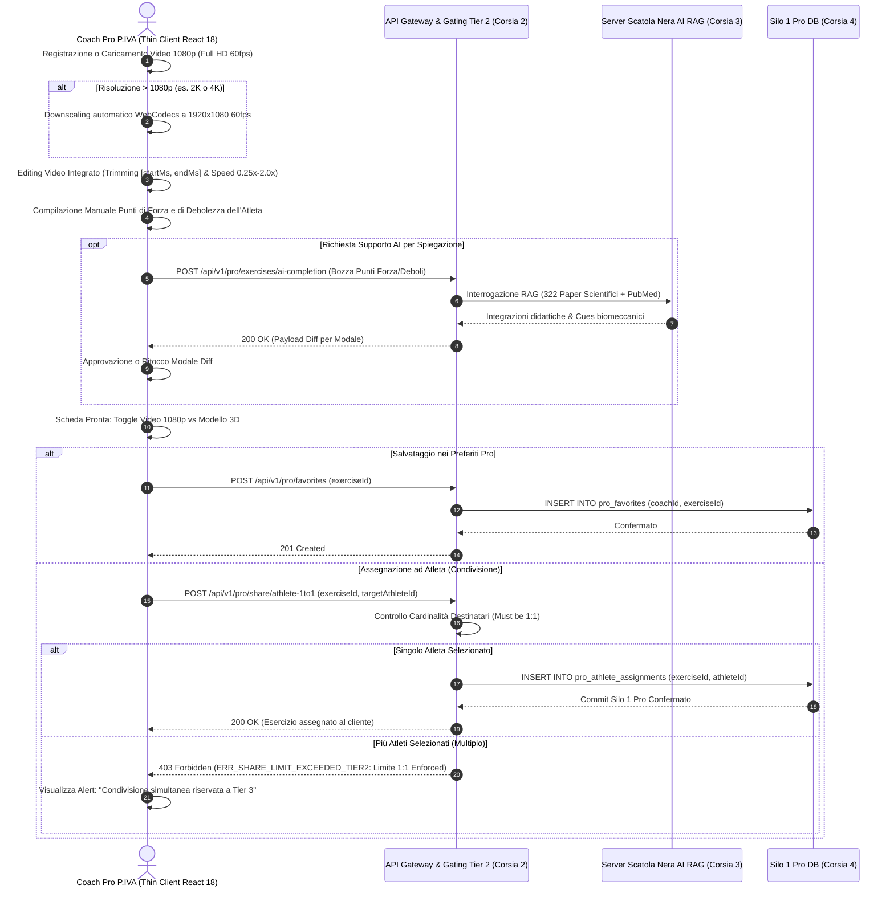

# Capitolato Tecnico: Flow 2B – Catalogo 3D, Video 1080p & Speed Control (T7 Pro Coach & Fisio)

## 1. Identificativo & Titolo Ufficiale
- **Badge Miro Board:** `#08` (Posizione: `X: 251.36, Y: 2940`, Miro Shape ID: `3458764688417722736`)
- **Codice Univoco:** `FLOW-2B`
- **Titolo Formale:** SOFTWARE 2 (B2B PRO P.IVA) - FLOW 2B: CATALOGO 3D, VIDEO 1080P, SPEED CONTROL & AI COACH
- **Board Miro Online:** `uXjVEbo6L2o=` (Zona 4, Riga 2: Partita IVA / Coaches & Fisioterapisti, Colonna 2: Catalogo Professionale & Video AI)
- **Diagramma Sorgente:** `architecture-blueprint/02-miro-zones-and-swimlanes/18-flowcharts/software-2-pro-b2b/flow-2b-coach-hub.mmd`
- **Riferimento Glossario:** [Glossario Tecnico Vivente](00-GLOSSARIO-TERMINI-TECNICI.md) (Voci: [Multimodal RAG](00-GLOSSARIO-TERMINI-TECNICI.md#revisione-coerente-ai-multimodal-rag-web-biomechanical-audit), [Pose Estimation](00-GLOSSARIO-TERMINI-TECNICI.md#mediapipe-blazepose-3d-edge-pose-estimation-su-video-mobile), [WebRTC MediaStream](00-GLOSSARIO-TERMINI-TECNICI.md#webrtc-mediastream-secure-video-recording), [Digital Twin 3D](00-GLOSSARIO-TERMINI-TECNICI.md#digital-twin-biomeccanico-dellatleta), [Video Ingest Tiers](00-GLOSSARIO-TERMINI-TECNICI.md#video-ingest-tiers-policy-tier-1-zero-upload-tier-2-1080p-tier-3-4k8k), [Variable Playback Rate](00-GLOSSARIO-TERMINI-TECNICI.md#variable-playback-rate-frame-by-frame-scrubbing-120fps), [WebCodecs Lossless Trimming](00-GLOSSARIO-TERMINI-TECNICI.md#webcodecs-api-client-side-lossless-trimming)).

---

## 2. Obiettivo di Business & Target Utente

### Guida Pratica per Non Tecnici: Cos'è questo modulo per un umano?
I personal trainer, preparatori atletici e fisioterapisti insegnano ogni giorno varianti esecutive personalizzate, progressioni didattiche o adattamenti motori che non esistono nei manuali standard. Spesso i coach registravano i video dei loro allievi con WhatsApp, disperdendo file sullo smartphone e violando la privacy.  
**Il Catalogo Pro di T7** trasforma l'app nello studio cinematografico, didattico e scientifico del professionista:
- **Visualizzazione 3D Eredita da Tier 1:** Accesso all'intero catalogo dei 328 esercizi dimostrativi con modelli tridimensionali dinamici Three.js Draco a 360°, evidenziazione fasce muscolari e blocco del ROM articolare;
- **Contenuti Tecnici Completi:** Spiegazioni tecniche esaustive, analisi "Why & Fix" e note propriocettive avanzate per guidare l'atleta;
- **Ricerca Avanzata Multidistretto:** Filtri estesi per singolo muscolo, distretto, categoria, attrezzatura (bilanciere, manubri, cavi, macchine isotoniche, corpo libero) e incrocio clinico con il Triage 119 patologie (ImpactCalculator);
- **Creazione Video e Supporto AI:** Caricamento di esercizi e video personalizzati in cui il coach redige manualmente i punti di forza e di debolezza riscontrati nell'atleta, avvalendosi dell'Intelligenza Artificiale (RAG multimodale su 322 paper scientifici indicizzati) per integrare e completare la spiegazione tecnica con cues biomeccanici;
- **Risoluzione Video Massima 1080p (Full HD a 60fps):** Standard video calibrato per tablet professionali (iPad Pro, tablet Android) e display da studio, con downscaling automatico WebCodecs qualora il file sorgente ecceda i 1080p;
- **Editing Video Integrato:** Strumenti completi per modificare i video caricati direttamente dal thin client (taglio/trimming millimetrico, rallentatore a 0.25x, 0.5x, 0.75x e velocizzazione a 1.25x, 1.5x, 2.0x);
- **Gestione Preferiti Pro:** Salvataggio rapido degli esercizi nella lista personale dei preferiti del professionista;
- **Limite Vincolante di Condivisione 1:1:** Divieto categorico di condividere contemporaneamente esercizi specifici con più di un singolo atleta (assegnazione individuale 1:1 in Silo 1 Pro). La condivisione massiva/broadcast di squadra è riservata esclusivamente al Tier 3 Enterprise.

### Specifiche di Business & Metriche
- **Target Utente:** Coach, chinesiologi, personal trainer con Partita IVA e fisioterapisti dello sport (Tier 2 – B2B Pro).
- **Problema Risolto:** Digitalizzare il know-how del professionista garantendo spiegazioni scientifiche ineccepibili grazie al supporto AI, editing video integrato a 1080p e rigorosa segregazione dei dati tra singoli clienti (GDPR Art. 9).

---

## 3. Attori & Architettura a 4 Corsie (Swimlanes)

1. **Corsia 1: Thin Client UI/UX (Coach Cockpit React 18 Pro & Video Editor):**
   - Modulo di ricerca avanzata multidistretto con filtri per attrezzatura e triage 119 patologie;
   - In-App Camera e modulo upload video con limite $1920\times 1080$ a 60fps;
   - Video editor integrato: timeline di taglio temporale (trimming), selettore di velocità variabile (0.25x, 0.5x, 0.75x, 1.0x, 1.25x, 1.5x, 2.0x);
   - Form di compilazione manuale punti di forza e di debolezza;
   - Modale comparativa "Diff" per approvare o ritoccare le integrazioni didattiche proposte dall'AI;
   - Scheda esercizio con toggle istantaneo *"Video 1080p Reale (Editing Attivo) vs Modello 3D"*;
   - Selettore di assegnazione atleta con vincolo 1:1.
2. **Corsia 2: API Gateway & RBAC Feature Gating Tier 2 (Envoy Gateway Pro):**
   - Verifica credenziali JWT Tier 2 e quota storage dedicata (Silo 1 Pro);
   - Controllo risoluzione video in ingresso: accettazione $\le 1080\text{p}$, trigger downscaling client se superiore;
   - Gatekeeper di condivisione: verifica della cardinalità del destinatario (`ARRAY_LENGTH(athlete_ids) == 1`). Qualora la selezione contenga più atleti, blocco immediato `403 Forbidden` (`ERR_SHARE_LIMIT_EXCEEDED_TIER2`).
3. **Corsia 3: Server Scatola Nera (Multimodal RAG 322 Papers & Kinematic Synthesis):**
   - Motore Multimodal RAG indicizzato su 322 paper accademici e PubMed: arricchisce la bozza manuale del coach con evidenze scientifiche e spunti correttivi;
   - Estrazione cinematica edge MediaPipe BlazePose (33 landmark 3D);
   - Sintesi mesh 3D personalizzata Draco GLB opzionale.
4. **Corsia 4: Database Tripartito (Silo 1 Pro - Pro Coach PostgreSQL AES-256):**
   - Tabelle `pro_custom_exercises`: schede tecniche personalizzate con punti di forza/debolezza ed esito revisione AI;
   - Tabella `pro_favorites`: archivio preferiti del coach;
   - Tabella `pro_athlete_assignments`: record di assegnazione univoco 1:1 atleta.

---

### Sequence Diagram Asincrono del Ciclo di Vita (FLOW-2B)



---

## 4. Flusso Operativo Passo-Passo

### Livello A: User Journey Narrativo (La Storia dell'Utente)
1. **L'Accesso al Coach Cockpit:** Il professionista entra nella sezione *"Catalogo Esercizi"* dal tablet o desktop da studio con credenziali Tier 2.
2. **La Scelta Operativa:** Sceglie se consultare la libreria avanzata con filtri per attrezzatura e triage clinico, oppure creare un esercizio personalizzato registrando o caricando un video in 1080p.
3. **La Ripresa a 1080p e l'Editing Integrato:**
   - Registra o importa la clip dell'atleta a risoluzione massima 1080p Full HD a 60fps;
   - Agisce sulla timeline integrata per ritagliare i secondi sprecati di posizionamento iniziale e fine serie;
   - Regola il rallentatore a **0.5x** o **0.25x** per esaminare con l'allievo l'inversione di carico a livello dell'articolazione coxo-femorale.
4. **La Redazione dei Punti di Forza/Debolezza & il Supporto AI:**
   - Il coach scrive le proprie osservazioni: *"Ottima verticalità del tronco (forza); tendenza a perdere aderenza con il tallone sinistro (debolezza)"*;
   - Seleziona *"Completa Spiegazione con AI"*: in 2 secondi il motore Scatola Nera (RAG 322 paper) genera un'integrazione didattica suggerendo un esercizio complementare per la mobilità della caviglia;
   - Nella modale "Diff", il coach approva la nota che viene unificata alla scheda tecnica.
5. **La Gestione dei Preferiti e il Vincolo 1:1:**
   - Il coach può salvare l'esercizio nei propri Preferiti Pro per riutilizzarlo;
   - Al momento dell'assegnazione, seleziona il singolo cliente: il sistema valida l'associazione 1:1. Se prova a selezionare contemporaneamente più atleti, il gateway inibisce l'azione spiegando che la condivisione broadcast di squadra richiede il Tier 3.

---

#### Indicatori di Accettazione Operativa & Clinica (KPI)
| Metrica / Parametro | Obiettivo Target | Tolleranza Accettabile | Azione Fallback / Allerta |
| :--- | :--- | :--- | :--- |
| **Risoluzione Max Video Ingest** | $1080\text{p}$ ($1920\times 1080$ a 60fps) | $\le 1080\text{p}$ | Downscaling client automatico WebCodecs se $>1080\text{p}$ |
| **Precisione Trimming Temporale** | $< 100\text{ ms}$ (frame-accurate) | $\le 250\text{ ms}$ | Allineamento automatico al keyframe più vicino |
| **Regolazione Velocità Playback** | $0.25\text{x} \dots 2.0\text{x}$ fluido | Istantanea ($< 16\text{ ms}$) | Reset automatico a 1.0x se valore fuori range |
| **Limite Condivisione Destinatari** | Rigorosamente 1:1 | $1$ solo atleta per volta | Blocco 403 Gateway (`ERR_SHARE_LIMIT_EXCEEDED_TIER2`) |
| **Latenza Risposta AI RAG** | $< 2.5\text{ s}$ per integrazione | $\le 5.0\text{ s}$ | Mantenimento della bozza redatta dal coach |

---

### Livello B: Trattazione Tecnica Nodi Operativi (22 Nodi ISO)

1. `T2_START` (Inizio: Coach Cockpit - Accesso Catalogo Esercizi Pro): Inizializzazione Thin Client Professionale React 18 con verifica autorizzativa Tier 2.
2. `T2_DEC_MODE` (Modalità Operativa nel Catalogo?): Bivio decisionale principale: 1. Consulta & Triage 119 • 2. Crea Video Personalizzato 1080p.
3. `T2_UI_SEARCH_ADVANCED` (Ricerca Avanzata: Muscolo, Distretto, Categoria, Attrezzatura & Triage 119): Filtri multidistretto estesi per attrezzatura (bilanciere, cavi, manubri, macchine) e triage clinico 119 patologie.
4. `T2_UI_3D_VIEWER_PRO` (Visualizzazione 3D Modelli Dinamici: Orbit 360°, Fasce & Blocco ROM): Visualizzazione del modello 3D Three.js Draco con controlli orbitali touch 360°, evidenziazione fasce muscolari e limitatore ROM per articolazioni vulnerabili.
5. `T2_UI_TECH_CONTENT_PRO` (Contenuti Tecnici Completi, Correzioni Why & Fix & Cues Coach): Schede biomeccaniche approfondite con spiegazioni tecniche, correzioni Why & Fix e cues verbali per il coach.
6. `T2_DEC_CONSULT_ACTION` (Azione Post-Consultazione Esercizio Standard?): Bivio tra salvataggio nei preferiti Pro vs assegnazione diretta al singolo atleta (1:1).
7. `T2_UI_VIDEO_CAPTURE_1080P` (Caricamento / Registrazione Video Personalizzato): In-App Camera WebRTC o caricamento file con risoluzione massima ammessa di 1080p Full HD (60fps).
8. `T2_GW_RES_CHECK` (Verifica Risoluzione Video Max 1080p?): Controllo gateway/client: se la risoluzione eccede i 1080p (es. 2K o 4K), scatta il downscaling.
9. `T2_UI_DOWNSCALE_1080P` (Downscaling Automatico Client-Side a 1080p): Modulo WebCodecs VideoDecoder/VideoEncoder che converte la clip a $1920\times 1080$ prima della trasmissione.
10. `T2_UI_VIDEO_EDITOR` (Editing Video Integrato: Taglio, Rallentatore & Velocizzazione): Strumenti di editing in-app: trimming temporale fine `[startMs, endMs]`, slow-motion (0.25x, 0.5x, 0.75x), velocizzazione (1.25x, 1.5x, 2.0x) e freeze-frame.
11. `T2_UI_MANUAL_STRENGTHS_WEAKNESSES` (Inserimento Manuale Punti di Forza e di Debolezza): Compilazione form dedicato con punti di forza osservati, compensi motori e debolezze esecutive dell'atleta.
12. `T2_DEC_AI_SUPPORT` (Richiesta Supporto AI per Completare Spiegazione?): Bivio: richiedere integrazione AI Scatola Nera vs mantenere la bozza redatta manualmente dal coach.
13. `T2_SRV_AI_COMPLETION` (Server Scatola Nera: AI Multimodale RAG 322 Paper Medici): Motore AI su GPU che analizza la cinematica e la bozza del coach, completando la spiegazione tecnica con cues scientifici.
14. `T2_UI_DIFF_APPROVAL` (Modale Diff: Approvazione / Modifica Spiegazione AI): Interfaccia comparativa in cui il professionista approva, modifica o scarta i suggerimenti didattici dell'AI.
15. `T2_UI_VIEWER_TOGGLE_PRO` (Scheda Esercizio: Toggle Video 1080p vs Modello 3D): Switch interattivo tra il video reale 1080p con velocità regolabile e la mesh 3D interattiva.
16. `T2_DEC_ACTION_DEST` (Destinazione Salvataggio / Condivisione Esercizio?): Bivio tra archiviazione nei preferiti Pro vs assegnazione/condivisione con atleta.
17. `T2_GW_FAVORITES` (API Gateway: POST /api/v1/pro/favorites): Salvataggio dell'esercizio personalizzato nei preferiti del coach in Silo 1 Pro.
18. `T2_DEC_SHARE_TARGET` (Selezione Destinatario Condivisione Esercizio?): Selezione destinatario: singolo atleta (1:1) vs selezione multipla contemporanea.
19. `T2_GW_SHARE_ENFORCEMENT` (Gateway: Controllo Limite di Condivisione 1:1?): Controllo gateway rigoroso: se destinatario singolo $\implies$ autorizza; se selezione multipla $\implies$ blocca.
20. `T2_UI_SHARE_BLOCK_ALERT` (Blocco Condivisione Multi-Atleta Limite 1:1): Modal di divieto: condivisione contemporanea con più atleti non consentita per Tier 2. Invito all'upgrade a Tier 3 per broadcast.
21. `T2_DB_SAVE_SILO1` (Database Silo 1 Pro: pro_custom_exercises & Assegnazione 1:1 Atleta): Persistenza della scheda esercizio criptata AES-256 e legame esclusivo 1:1 con l'atleta.
22: `T2_END_READY` (Fine: Esercizio Operativo nel Catalogo Pro & Condiviso 1:1): Transizione al Coach Workout Builder (`FLOW-3B`).

---

## 5. Rami Decisionali & Gestione dei 4 Stati UI

| Bivio Decisionale | Condizione Logica | Ramo SÌ / Positivo | Ramo NO / Negativo |
| :--- | :--- | :--- | :--- |
| `T2_DEC_MODE` | Modalità scelta dal coach? | Registrazione / Upload Video 1080p (`T2_UI_VIDEO_CAPTURE_1080P`) | Consultazione avanzata & triage (`T2_UI_SEARCH_ADVANCED`) |
| `T2_GW_RES_CHECK` | Risoluzione clip $\le 1080\text{p}$? | Procedi a editor video integrato (`T2_UI_VIDEO_EDITOR`) | Downscaling automatico client a 1080p (`T2_UI_DOWNSCALE_1080P`) |
| `T2_DEC_AI_SUPPORT` | Richiesta supporto AI per spiegazione? | Invocazione AI Scatola Nera RAG (`T2_SRV_AI_COMPLETION`) | Mantieni bozza manuale coach (`T2_UI_VIEWER_TOGGLE_PRO`) |
| `T2_DEC_ACTION_DEST` | Destinazione esercizio custom? | Assegna / Condividi con Atleta (`T2_DEC_SHARE_TARGET`) | Salva nella lista Preferiti Pro (`T2_GW_FAVORITES`) |
| `T2_GW_SHARE_ENFORCEMENT` | Destinatario strettamente singolo (1:1)? | Autorizza e salva in Silo 1 Pro (`T2_DB_SAVE_SILO1`) | Blocco gateway `403 Forbidden` (`T2_UI_SHARE_BLOCK_ALERT`) |

### I 4 Stati di Interfaccia Utente (UI States):
1. **Empty State:** Nessun esercizio personalizzato registrato dal coach: card *"Crea il tuo primo esercizio personalizzato filmando un allievo in 1080p o consultando la libreria con triage 119"*.
2. **Loading State:** Barra di avanzamento per downscaling WebCodecs o attesa completamento spiegazione AI: *"Integrazione didattica AI in corso su 322 paper scientifici..."*.
3. **Populated State:** Scheda esercizio con video 1080p fluido a 60fps, controlli slow-motion/fast-forward attivi, punti di forza/debolezza formattati e toggle visualizzatore 3D.
4. **Error / Fallback State:**
   - *Tentativo di selezione contemporanea di più atleti:* Comparsa immediata dell'avviso rosso: *"Divieto di condivisione contemporanea: per gli account Pro il limite è strettamente 1:1 per atleta. Passa a Tier 3 per la condivisione broadcast di squadra"*;
   - *Video sorgente 4K o 2K caricato:* Notifica discreta di avvenuto downscaling trasparente a 1080p Full HD a 60fps senza perdita di fluidità.

---

## 6. Contratti Dati, Parametri I/O & Database Silo

### Specifiche Endpoint REST:

#### 1. Creazione Esercizio Video Personalizzato (Max 1080p Full HD)
- **Endpoint:** `POST /api/v1/pro/catalog/custom-video-exercise`
- **Headers:** `Authorization: Bearer <pro_jwt>`, `Content-Type: multipart/form-data`
- **Request Form Data:**
  - `videoBlob`: File binario MP4/WebM (risoluzione massima 1080p a 60fps, max 100 MB);
  - `exerciseName`: "Stacco Rumeno su Pedana con Focus Flessori";
  - `targetMuscles`: `["HAMSTRINGS", "GLUTEUS_MAXIMUS", "ERECTOR_SPINAE"]`;
  - `trimRange`: `{ "startMs": 1200, "endMs": 16800 }`;
  - `speedSetting`: 0.5;
  - `manualStrengths`: "Ottima stabilità scapolare e mantenimento del rachide lombare neutro in discesa.";
  - `manualWeaknesses`: "Tendenza al blocco articolare anticipato del ginocchio che sposta il focus sui lombari.";
  - `aiSupportRequested`: true;
  - `assignedAthleteId`: "usr_ath_77412".
- **Response `201 Created`:**
```json
{
  "customExerciseId": "cust_ex_1080p_9941a",
  "resolution": "1080p_FullHD",
  "framerate": 60,
  "trimDurationMs": 15600,
  "speedRatesConfigured": [0.25, 0.5, 0.75, 1.0, 1.25, 1.5, 2.0],
  "videoVaultUrl": "https://storage.t7workout.app/silo1-pro/pro-vault/cust_ex_1080p_9941a.mp4",
  "technicalExplanation": {
    "coachStrengths": "Ottima stabilità scapolare e mantenimento del rachide lombare neutro in discesa.",
    "coachWeaknesses": "Tendenza al blocco articolare anticipato del ginocchio che sposta il focus sui lombari.",
    "aiEnrichedCues": "Per massimizzare l'attivazione dei bicipiti femorali e proteggere il tendine prossimale, mantieni una leggera flessione costante del ginocchio (15-20°) focalizzando il movimento esclusivamente sul tilting pelvico posteriore (Riferimento: Schoenfeld et al., 2020)."
  },
  "sharingScope": {
    "mode": "STRICT_1_TO_1",
    "assignedAthleteId": "usr_ath_77412"
  }
}
```

#### 2. Condivisione Esercizio con Singolo Atleta (Enforcement 1:1)
- **Endpoint:** `POST /api/v1/pro/share/athlete-1to1`
- **Headers:** `Authorization: Bearer <pro_jwt>`, `Content-Type: application/json`
- **Request Body:**
```json
{
  "exerciseId": "cust_ex_1080p_9941a",
  "athleteId": "usr_ath_77412"
}
```
- **Response `200 OK`:**
```json
{
  "status": "ASSIGNED_1TO1",
  "exerciseId": "cust_ex_1080p_9941a",
  "athleteId": "usr_ath_77412",
  "assignedAt": "2026-11-03T22:48:00Z"
}
```

---

### Matrice Errori HTTP & Strategie di Resilienza
| HTTP Code | Codice Interno | Endpoint | Causa Scatenante | UX Feedback Visivo | Strategia di Resilienza & Fallback |
| :---: | :--- | :--- | :--- | :--- | :--- |
| **400** | `ERR_SPEED_INVALID` | `POST /custom-video-exercise` | Velocità al di fuori del range 0.25x - 2.0x | Alert: *"Velocità supportata tra 0.25x e 2.0x"* | Reset automatico della velocità a 1.0x |
| **403** | `ERR_SHARE_LIMIT_EXCEEDED_TIER2` | `POST /share/athlete-1to1` | Tentativo di inviare l'esercizio a $\ge 2$ atleti contemporaneamente | Modale arancione: *"Limite 1:1: divieto di condivisione contemporanea. Passa a Tier 3 per la condivisione team"* | Blocco atomico della richiesta gateway |
| **413** | `ERR_VIDEO_TOO_LARGE` | `POST /custom-video-exercise` | Clip superiore a 100 MB prima del trimming | Notifica: *"File troppo pesante: taglia la clip prima dell'invio"* | Apertura automatica della timeline di trimming |
| **422** | `ERR_RES_EXCEEDED_1080P` | Pipeline Video | Flusso eccede 1080p | Toast informativo: *"Ottimizzazione a 1080p Full HD in corso..."* | Downscaling automatico via WebCodecs client-side |

---

## 7. Ereditarietà di Tier & Differenziali di Fascia

- **Ereditarietà da Tier 1 (`FLOW-2A`):**  
  Il coach eredita l'intero catalogo dei 328 movimenti biomeccanici, la visualizzazione 3D dinamica Three.js Draco orbitabile a 360°, le spiegazioni tecniche Why & Fix e la ricerca per sezioni (muscolo, distretto, categoria).
- **Differenziali Esclusivi di Tier 2 (Pro P.IVA):**  
  Ricerca avanzata con filtri attrezzatura e triage 119 patologie, caricamento ed elaborazione video fino a **1080p Full HD**, inserimento manuale di punti di forza e debolezza con **assistenza AI per completare la spiegazione** (RAG 322 paper), **editing video integrato** (taglio/trimming, slow-motion 0.25x-0.75x, velocizzazione 1.25x-2.0x), gestione preferiti Pro e **limite rigoroso di condivisione 1:1 atleta**.
- **Propagazione a Tier 3 (`FLOW-2C` – Elite Teams & Enterprise):**  
  Nei club professionistici, il modulo evolve sbloccando la **condivisione globale team (broadcast)** a tutta la rosa, supporto video ad altissima risoluzione fino a **4K Ultra HD**, **gruppi di lavoro dedicati** con spiegazione tecnica sottostante, **caricamento multiplo dello stesso esercizio su più atleti con correzioni AI individualizzate** e **analisi 3D dello stress muscolare delle fibre** per ciascun distretto in base all'esecuzione.
