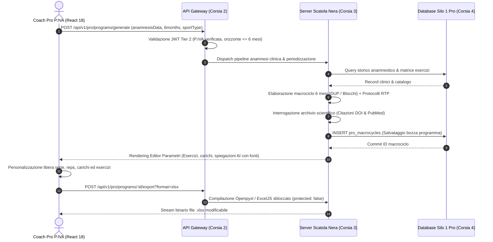
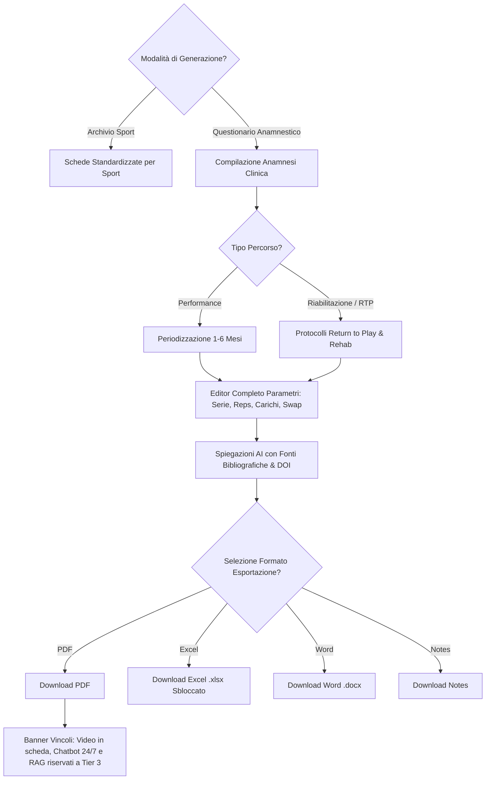

# Capitolato Tecnico: Flow 3B – Programmazione Anamnestica (6 Mesi), RTP & AI Scientifica (T7 Pro Coach)

## 1. Identificativo & Titolo Ufficiale
- **Badge Miro Board:** `#09` (Posizione: `X: 2641.02, Y: 3598.51`, Miro Shape ID: `3458764688417722743`)
- **Codice Univoco:** `FLOW-3B`
- **Titolo Formale:** SOFTWARE 2 (B2B PRO P.IVA) - FLOW 3B: PROGRAMMAZIONE ANAMNESTICA, PIANIFICAZIONE A 6 MESI, PROTOCOLLI RETURN TO PLAY, AI SCIENTIFICA CON FONTI & EXPORT MULTI-FORMATO
- **Board Miro Online:** `uXjVEbo6L2o=` (Zona 4, Riga 2: Partita IVA / Coaches & Fisioterapisti, Colonna 3: Programmazione degli Esercizi)
- **Diagramma Sorgente:** `architecture-blueprint/02-miro-zones-and-swimlanes/18-flowcharts/software-2-pro-b2b/flow-3b-macrocycle-ai-triage119.mmd`
- **Riferimento Glossario:** [Glossario Tecnico Vivente](00-GLOSSARIO-TERMINI-TECNICI.md) (Voci: [Questionario Anamnestico](00-GLOSSARIO-TERMINI-TECNICI.md), [Periodizzazione 6 Mesi](00-GLOSSARIO-TERMINI-TECNICI.md#dup-daily-undulating-periodization), [Return to Play RTP](00-GLOSSARIO-TERMINI-TECNICI.md), [AI Citazioni Scientifiche DOI](00-GLOSSARIO-TERMINI-TECNICI.md#rag-gerarchico-scientifico-retrieval-augmented-generation), [Export Multi-Formato XLSX DOCX](00-GLOSSARIO-TERMINI-TECNICI.md#excel-sbloccato-protected-false-data-interoperability)).

---

## 2. Obiettivo di Business & Target Utente

### Guida Pratica per Non Tecnici: Cos'è questo modulo per un umano?
Per un preparatore atletico o fisioterapista con Partita IVA (Tier 2 Pro), programmare l'allenamento richiede di bilanciare la storia clinica dell'atleta, i suoi traumi pregressi e una periodizzazione solida a medio termine, con la libertà di modificare ogni dettaglio e di esportare nei formati usati ogni giorno.  
Questo modulo è la centrale operativa del professionista:
- **Eredità Archivio Standardizzato:** Include l'archivio completo di schede pre-confezionate divise per specifica disciplina sportiva (calcio, basket, tennis, running, sport da combattimento);
- **Questionario Anamnestico Completo:** Permette di raccogliere la storia clinica dell'atleta, le caratteristiche individuali, le asimmetrie e i traumi pregressi per generare una programmazione adatta;
- **Pianificazione fino a 6 Mesi:** Consente di strutturare microcicli, mesocicli e macrocicli fino a un massimo di 6 mesi, con personalizzazione mirata;
- **Personalizzazione Totale dei Parametri:** Il coach può modificare liberamente esercizi, serie, ripetizioni, carichi, tempi di recupero e percentuali di sforzo;
- **Riabilitazione Specifica & Return to Play (RTP):** Include protocolli dedicati per la riatletizzazione e il ritorno in campo post-infortunio;
- **Spiegazioni AI con Fonti Scientifiche:** Ogni scelta di programmazione è motivata dall'AI con riferimenti precisi a fonti accademiche, bibliografia, DOI e link alle fonti originali, oltre a una spiegazione generica per ciascun singolo esercizio;
- **Esportazione Multi-Formato:** Esporta la scheda in 4 formati: **PDF, Excel (.xlsx sbloccato senza password), Word (.docx) e Notes**;
- **Vincoli e Limitazioni di Fascia:** Non è possibile inserire video all'interno delle schede di allenamento; assenza del chatbot interattivo, della funzione RAG e del collegamento con la sezione di Data Analysis (riservati a Tier 3).

### Specifiche di Business & Metriche
- **Target Utente:** Personal trainer, preparatori fisici e chinesiologi con Partita IVA (Tier 2 – Pro B2B).
- **Problema Risolto:** Automatizzare la stesura di programmi semestrali scientificamente inattaccabili, garantendo massima flessibilità di editing e assoluta libertà di esportazione multi-formato senza vincoli di piattaforma.

---

## 3. Attori & Architettura a 4 Corsie (Swimlanes)

1. **Corsia 1: Thin Client UI/UX (React 18 Pro Suite):**
   - Wizard anamnestico a step (anamnesi clinica, traumi, obiettivi), selettore orizzonte temporale (micro/meso/macrociclo fino a 6 mesi), editor avanzato parametri (serie, reps, kg, recuperi), pannello AI fonti scientifiche e hub di export a 4 formati (PDF, XLSX, DOCX, Notes).
2. **Corsia 2: API Gateway & RBAC Pro (Envoy Gateway):**
   - Validazione token JWT Tier 2 Pro (verifica P.IVA attiva). Controllo permessi export multi-formato, blocco richieste orizzonte temporale $> 6\text{ mesi}$, inibizione stream video nelle schede e blocco chiamate a Data Analysis o RAG cluster.
3. **Corsia 3: Server Scatola Nera (Clinical Anamnesis, Periodizer & Citation Engine Cloud Run):**
   - *Anamnesis Matrix Processor:* Incrocio tra anamnesi clinica e selezione esercizi ammessi;
   - *6-Month Periodization Engine:* Generazione progressioni di carico DUP, a blocchi e lineari fino a 24 settimane (6 mesi);
   - *Scientific Citation & Explain Engine:* Generazione referenze bibliografiche accademiche (PubMed, DOI, link a studi) e spiegazione tecnica per esercizio;
   - *Multi-Format Exporter (ExcelJS, docx, PDFKit):* Compilazione binari formattati.
4. **Corsia 4: Database Tripartito (Silo 1 Pro - PostgreSQL):**
   - Tabelle `athlete_anamnesis`, `pro_macrocycles`, `pro_mesocycles`, `rehab_rtp_protocols` e `pro_exercise_overrides`.

---

### Sequence Diagram Asincrono del Ciclo di Vita (FLOW-3B)



---

## 4. Flusso Passo-Passo (Livello A Narrativo + KPI e Livello B Deep-Dive)

### Livello A: Flusso Operativo Utente & Tabella KPI
1. **Scelta Modalità di Avvio:** Il coach sceglie se partire da una scheda pre-confezionata per sport o se compilare il Questionario Anamnestico;
2. **Compilazione Anamnesi:** Inserisce parametri clinici, traumi pregressi e caratteristiche dell'atleta;
3. **Scelta Percorso & Orizzonte Temporale:** Imposta la durata (da 1 a 6 mesi) e seleziona se includere protocolli specifici di Riabilitazione & Return to Play (RTP);
4. **Personalizzazione Totale Parametri:** Modifica liberamente esercizi, carichi, serie e ripetizioni nell'editor interattivo;
5. **Consultazione Spiegazioni AI con Fonti:** Esamina la rationale scientifica generata dall'AI per la periodizzazione con link diretti ai DOI, oltre alla spiegazione specifica di ciascun esercizio;
6. **Esportazione Multi-Formato:** Seleziona uno dei 4 formati disponibili (**PDF, Excel, Word, Notes**) e scarica il file.

| Step | Nome Operazione | Tempo Target (KPI) | Descrizione Tecnica |
| :---: | :--- | :---: | :--- |
| **01** | Caricamento Anamnesi Atleta | $< 250\text{ ms}$ | Fetch profilo clinico da Silo 1 Pro |
| **02** | Generazione Macrociclo (6 Mesi) | $< 1.8\text{ s}$ | Elaborazione progressioni di carico DUP/Blocchi su 24 settimane |
| **03** | Retrieval Fonti Scientifiche AI | $< 900\text{ ms}$ | Associazione studi peer-reviewed (DOI, PubMed link) |
| **04** | Esportazione XLSX / DOCX / PDF | $< 1.5\text{ s}$ | Compilazione dinamica file multi-formato senza protezioni |

### Livello B: Deep-Dive Ingegneristico sui Microservizi
- **Motore di Periodizzazione Semestrale:** Limite vincolante a $N \le 26$ microcicli settimanali (6 mesi). Tentativi di programmazione annuale vengono respinti dall'API Gateway con richiesta di upgrade a Tier 3;
- **Formattazione Excel Interoperabile:** L'export `.xlsx` viene generato con il flag `protected: false`, consentendo al professionista di aggiungere colonne, formule e loghi personali;
- **Gating Negativo:**
  - `POST /api/v1/pro/programs/:id/attach-video` $\rightarrow$ `403 Forbidden` (`FEATURE_RESERVED_TIER3_VIDEO_PROGRAMS`);
  - `GET /api/v1/chat/assistant` $\rightarrow$ `403 Forbidden` (`FEATURE_RESERVED_TIER3_CHATBOT_247`).

---

## 5. Rami Decisionali & 4 Stati UI



### Gestione dei 4 Stati UI (Obbligatoria)
1. **Empty State:** Nessuna scheda o anamnesi attiva per l'atleta selezionato. CTA: "Compila il primo questionario anamnestico o seleziona un programma dall'archivio sport".
2. **Loading State:** Progress bar durante l'elaborazione del macrociclo semestrale e la composizione delle referenze scientifiche.
3. **Populated State:** Dashboard di periodizzazione con timeline a 6 mesi, tabelle carichi modificabili e badge scientifici con link ai paper.
4. **Error / Fallback State:** Timeout durante l'export DOCX/XLSX: fallback automatico a visualizzazione web interattiva con possibilità di copia negli appunti.

---

## 6. Contratti Dati & Error Matrix

### Schema JSON Richiesta & Risposta Macrociclo Pro
```json
{
  "programId": "pro_macro_6m_01",
  "tier": 2,
  "athleteId": "ath_78912",
  "horizonMonths": 6,
  "isPersonalized": true,
  "anamnesisSummary": {
    "hasInjuryHistory": true,
    "reportedConditions": ["patellar_tendinopathy_right"],
    "rtpProtocolApplied": true
  },
  "periodizationModel": "DUP_DailyUndulating",
  "editableParameters": {
    "canEditSets": true,
    "canEditReps": true,
    "canEditLoads": true,
    "canSwapExercises": true
  },
  "scientificReferences": [
    {
      "topic": "Eccentric Loading in Patellar Tendinopathy",
      "authors": "Malliaras P. et al.",
      "journal": "Sports Med",
      "year": 2015,
      "doi": "10.1007/s40279-015-0339-z",
      "url": "https://doi.org/10.1007/s40279-015-0339-z"
    }
  ],
  "exportFormatsAllowed": ["pdf", "xlsx", "docx", "notes"],
  "restrictions": {
    "allowVideoEmbedding": false,
    "allowChatbotAssistant": false,
    "allowRagCustomization": false,
    "allowDataAnalysisSync": false
  }
}
```

### Matrice Errori HTTP a 6 Colonne
| HTTP Code | Codice Interno | Endpoint | Causa Scatenante | UX Feedback Visivo | Strategia di Resilienza |
| :---: | :---: | :--- | :--- | :--- | :--- |
| `400` | `ERR_T2_HORIZON_EXCEEDED` | `/api/v1/pro/programs/generate` | Richiesta durata $> 6\text{ mesi}$ | Avviso modale: "In Tier 2 la pianificazione massima consentita è di 6 mesi. Per la programmazione annuale passa a Tier 3" | Riduzione automatica a 6 mesi |
| `403` | `ERR_T2_VIDEO_EMBED_BLOCKED` | `/api/v1/pro/programs/:id/video` | Tentativo di inserire video nella scheda | Tooltip informativo: "L'invio di schede con video dimostrativi è una funzione esclusiva di Tier 3" | Blocco upload video; salvataggio testo |
| `403` | `ERR_T2_RAG_CHAT_BLOCKED` | `/api/v1/chat/query` | Tentativo di avvio chatbot interattivo RAG | Banner: "Chatbot 24/7 e RAG riservati a Tier 3 Elite" | Apertura pannello FAQ statiche |
| `502` | `ERR_T2_XLSX_BUILD_FAIL` | `/api/v1/pro/programs/:id/export` | Errore motore compilazione Excel | Toast: "Errore compilazione Excel. Download PDF alternativo disponibile" | Generazione automatica PDF di fallback |

---

## 7. Ereditarietà di Tier & Vincoli

- **Ereditarietà da Livelli Inferiori:** Eredita il catalogo completo di schede pre-confezionate per sport e i programmi di riabilitazione generica del Tier 1.
- **Differenziali Esclusivi Tier 2:**
  - Generazione personalizzata tramite Questionario Anamnestico clinico;
  - Periodizzazione a medio termine fino a 6 mesi (microcicli, mesocicli, macrocicli);
  - Modifica libera e totale di serie, ripetizioni, carichi, recuperi ed esercizi;
  - Spiegazioni AI arricchite con citazioni bibliografiche, DOI e link scientifici + spiegazione per singolo esercizio;
  - Protocolli specifici di Riabilitazione e Return to Play (RTP);
  - Esportazione multi-formato sbloccata in 4 formati: **PDF, Excel (.xlsx), Word (.docx) e Notes**.
- **Vincoli e Limitazioni di Fascia (Gating Negativo):**
  - **Divieto inserimento video:** Le schede non supportano streaming video incorporato;
  - **Assenza Chatbot 24/7:** Nessun agente conversazionale per gli atleti;
  - **Assenza RAG:** Nessun modello addestrabile sulle abitudini dell'atleta o stile metodologico del coach;
  - **Assenza Data Analysis:** Nessun collegamento con metriche di laboratorio o test da campo.
