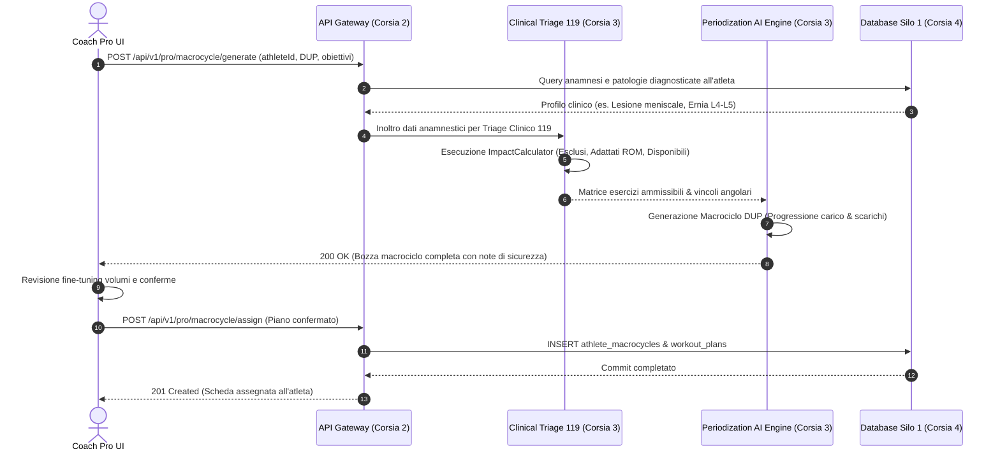

# Capitolato Tecnico: Flow 3B – Architettura Pro & Macrocicli IA con Triage 119 Patologie (T7 Pro Coach)

## 1. Identificativo & Titolo Ufficiale
- **Badge Miro Board:** `#09` (Posizione: `X: 2459, Y: 2940`, Miro Shape ID: `3458764688417722743`)
- **Codice Univoco:** `FLOW-3B`
- **Titolo Formale:** SOFTWARE 2 (B2B PRO P.IVA) - FLOW 3B: ARCHITETTURA PRO, GENERATORE MACROCICLI IA & CLINICAL TRIAGE 119
- **Board Miro Online:** `uXjVEbo6L2o=` (Zona 4, Riga 2: Partita IVA / Coaches & Fisioterapisti, Colonna 3: Architettura Pro & Periodizzazione)
- **Diagramma Sorgente:** `architecture-blueprint/02-miro-zones-and-swimlanes/18-flowcharts/software-2-pro-b2b/flow-3b-macrocycle-ai-triage119.mmd`
- **Riferimento Glossario:** [Glossario Tecnico Vivente](file:///e:/Nuove%20App%20Installate/Sports-Analytics-Platform---T7-Workout-APP/architecture-blueprint/00-capitolato-tecnico-e-glossario/00-GLOSSARIO-TERMINI-TECNICI.md) (Voci: *ImpactCalculator Triage 119, Periodizzazione DUP, Periodizzazione a Blocchi, Coniugata Westside, Excel Sbloccato protected:false, RAG Scientifico con Gerarchia Fonti*).

---


## 2. Obiettivo di Business & Target Utente

### Guida Pratica per Non Tecnici: Cos'è questo modulo per un umano?
Scrivere una scheda di allenamento di 6 mesi (un macrociclo) per un cliente è un lavoro lungo, complesso e rischioso. Se il cliente ha un'ernia discale L4-L5 o una spalla operata, basta inserire un esercizio sbagliato per causargli dolori acuti o infortuni. Inoltre, i professionisti amano personalizzare i propri fogli di lavoro e non sopportano i software chiusi che impediscono di modificare le formule su Excel.  
**Il Generatore Pro di T7** è l'assistente scientifico definitivo del preparatore:
- Inserisci gli obiettivi del cliente e le sue eventuali problematiche fisiche scegliendo tra **119 patologie codificate** (dalle discopatie alla tendinopatia rotulea, fino alle patologie sistemiche);
- Un algoritmo medico-sportivo (`ImpactCalculator`) setaccia all'istante l'intero catalogo degli esercizi: **elimina o adatta in automatico** tutti i movimenti che caricano pericolosamente la zona lesa;
- Un'Intelligenza Artificiale esperta di periodizzazione (che conosce i modelli DUP ondulate, a Blocchi, Coniugata o Lineare) genera un piano perfetto di 12-24 settimane;
- **Esportazione Excel Totalmente Sbloccata:** Il coach può scaricare il file `.xlsx` senza alcuna password o protezione (`protected: false`), potendo modificare liberamente ogni cella o formula secondo le proprie abitudini.

### Specifiche di Business & Metriche
- **Target Utente:** Preparatori atletici, chinesiologi e personal trainer con atleti che presentano esigenze complesse o quadri clinici specifici (Tier 2 – Pro P.IVA).
- **Problema Risolto:** Ridurre da 3 ore a 5 minuti il tempo necessario per progettare una periodizzazione scientifica avanzata, eliminando al 100% il rischio di prescrivere esercizi controindicati per le 119 patologie censite.

---


## 3. Attori & Architettura a 4 Corsie (Swimlanes)

1. **Corsia 1: Thin Client UI/UX (Periodization Wizard React 18):**
   - Selettore del modello di periodizzazione (DUP, Blocchi, Coniugata, Lineare), checklist multi-distretto delle 119 condizioni cliniche con gradi di severità (1-5), anteprima del calendario dei microcicli e pulsante di export immediato Excel/PDF.
2. **Corsia 2: API Gateway & Quota Manager (Envoy Gateway):**
   - Validazione token JWT Tier 2, controllo delle quote di generazione AI e instradamento delle chiamate verso il motore di calcolo protetto.
3. **Corsia 3: Server Scatola Nera (ImpactCalculator & AI Periodization Engine Cloud Run):**
   - *ImpactCalculator:* Algoritmo proprietario che incrocia i carichi assiali e i gradi ROM con la matrice di severità delle patologie;
   - *Periodization Engine:* Calcolo dei volumi settimanali (numero di serie per gruppo muscolare) e delle progressioni di intensità in percentuale del massimale ($% 1\text{RM}$);
   - *Excel Generator (ExcelJS):* Compilazione del file binario `.xlsx` privo di protezioni con formule matematiche native (`SUM`, `AVERAGE`).
4. **Corsia 4: Database Tripartito (Silo 1 Pro - PostgreSQL):**
   - Tabelle `clinical_conditions` (119 patologie con relative controindicazioni assiali), `macrocycles` (programmi generati) e `client_assignments`.

---


### Sequence Diagram Asincrono del Ciclo di Vita (FLOW-3B)



---


## 4. Flusso Operativo Passo-Passo

### Livello A: User Journey Narrativo (La Storia dell'Utente)
1. **La Selezione dell'Atleta:** Il coach apre il suo portafoglio clienti e seleziona ad esempio *"Luca, 34 anni, impiegato con lombalgia ricorrente"*.
2. **La Scelta dell'Obiettivo & del Modello:** Il coach sceglie l'obiettivo: *"Forza e Ipertrofia con modello DUP (Ondulata Giornaliera) su 16 settimane"*.
3. **Il Triage Clinico delle 119 Patologie:** Nella sezione clinica, il coach seleziona *"Colonna - Ernia discale L4-L5 (Severità Media)"*.
4. **L'Azione Istantanea dell'ImpactCalculator:** In un millisecondo l'app risponde a video:
   - *Esercizi Esclusi (Bollino Rosso):* Squat con bilanciere sopra le spalle e stacco da terra pesante (perché comprimono le vertebre);
   - *Esercizi Adattati (Bollino Giallo):* Leg Press a schienale inclinato a 45° o Squat alla cintura (Belt Squat);
   - *Esercizi di Pre-Attivazione Obbligatori (Bollino Verde):* 5 minuti di riscaldamento del core (Bird-Dog e Plancia) prima di ogni seduta.
5. **La Creazione del Piano:** Il coach preme *"Genera Macrociclo"*. In 3 secondi compare il calendario completo delle 16 settimane, con i volumi e i pesi suggeriti per ogni seduta.
6. **L'Esportazione Libera:** Il coach tocca *"Scarica Foglio Excel"*. Il file si apre su Microsoft Excel o Google Fogli: non ci sono blocchi o celle bloccate, il coach può personalizzare i colori, aggiungere note o cambiare un esercizio con totale libertà.

---


#### Indicatori di Accettazione Operativa & Clinica (KPI)
| Metrica / Parametro | Obiettivo Target | Tolleranza Accettabile | Azione Fallback / Allerta |
| :--- | :--- | :--- | :--- |
| **Zero Violazioni Cliniche** | $100\%$ rispetto vincoli patologia | $0\%$ eccezioni | Blocco perentorio generazione scheda |
| **Tempo Generazione DUP** | $< 800\text{ ms}$ per macrociclo 12 sett. | $\le 2.0\text{ s}$ | Caricamento template standard pre-validato |
| **Aderenza Fasi Ondulate** | $100\%$ conformità carichi DUP | $\pm 2.5\%$ | Normalizzazione pesi automatica server-side |
| **Copertura Clinica 119** | 119 condizioni mediche mappate | 119 condizioni attive | Rinvio a parere medico specialistico |

---


### Livello B: Trattazione Tecnica Nodi Operativi

1. `START` (Avvio Wizard Periodizzazione): Montaggio del componente `MacrocycleWizard` con recupero profilo atleta dal client state.
2. `MODEL_SELECTION` (Scelta Modello Matematico):
   - *DUP (Daily Undulating Periodization):* Variazione carichi all'interno del microciclo (es. Lun: Forza 85%, Mer: Ipertrofia 70%, Ven: Potenza 60%);
   - *Block Periodization:* Blocchi sequenziali (Accumulo $\to$ Trasformazione $\to$ Realizzazione);
   - *Conjugate Method:* Separazione sforzo massimale (Max Effort) e sforzo dinamico (Dynamic Effort);
   - *Linear Periodization:* Incremento progressivo del carico con decremento del volume.
3. `CLINICAL_TRIAGE_CHECK` (Incrocio su 119 Condizioni Cliniche):
   - Input patologie selezionate con gravità $[1, 5]$;
   - Chiamata interna al modulo `ImpactCalculator`:
     $$\text{PenaltyScore} = \sum_{p \in \text{Patologie}} \text{AxialLoadCoeff}_p \times \text{Severity}_p$$
   - Cutoff binario: se il punteggio supera la soglia critica per un esercizio $\implies$ stato `EXCLUDED`.
4. `PRE_ACTIVATION_INJECTION` (Iniezione Protocolli di Pre-Attivazione): Inserimento automatico dei 32 protocolli clinici riabilitativi (`clinical-knee.ts` / spalla / rachide) all'inizio di ogni seduta come riscaldamento obbligatorio.
5. `SRV_PERIODIZATION_GEN` (Computazione Algoritmica Cloud Run):
   - Generazione della matrice $W \times S$ (Settimane $\times$ Sessioni);
   - Assegnazione dei parametri di intensità nominale e Reps in Reserve (RIR 1-3).
6. `EXCEL_COMPILER` (Compilazione Foglio Excel Sbloccato):
   - Utilizzo libreria server-side `exceljs`;
   - Configurazione esplicita foglio di calcolo con `worksheet.protect = false` e formattazione celle professionale;
   - Inserimento di collegamenti ipertestuali ai video dimostrativi del catalogo.
7. `DB_MACRO_WRITE` (Archiviazione Silo 1): Persistenza del piano in `pro_macrocycles`.
8. `DOWNLOAD_HANDOFF` (Consegna al Client): Invio stream binario `.xlsx` e PDF interattivo per stampa o invio via email all'atleta.

---


## 5. Rami Decisionali & Gestione dei 4 Stati UI

| Bivio Decisionale | Condizione Logica | Ramo SÌ / Positivo | Ramo NO / Negativo |
| :--- | :--- | :--- | :--- |
| `CLINICAL_CHECK` | Atleta presenta condizioni cliniche attive? | Attiva filtro ImpactCalculator | Generazione libera standard |
| `IMPACT_SCORE` | Esercizio supera soglia di sicurezza assiale? | Escludi o sostituisci con variante | Mantieni esercizio originale |
| `PRE_ACTIVATION` | Patologia richiede warm-up protettivo? | Inietta scheda di pre-attivazione | Warm-up aspecifico standard |

### I 4 Stati di Interfaccia Utente (UI States):
1. **Empty State:** Nessun macrociclo creato per l'atleta: schermata di setup *"Configura il primo piano di allenamento a lungo termine in 3 semplici passaggi"*.
2. **Loading State:** Barra di calcolo progressiva con messaggi di stato *"Analisi delle 119 patologie..."*, *"Ottimizzazione curve di carico DUP..."*, *"Generazione foglio Excel..."* ($< 1.8\text{ secondi}$).
3. **Populated State:** Vista a griglia interattiva con tabella di marcia delle settimane, grafici a linee dell'ondulazione del volume e pulsanti di download immediato.
4. **Error / Fallback State:**
   - *Conflitto insolubile tra patologie ed esercizi:* Alert guidato *"I filtri selezionati escludono tutti gli esercizi di spinta verticale. Si consiglia una consultazione fisioterapica prima di proseguire"*.

---


## 6. Contratti Dati, Parametri I/O & Database Silo

### Specifiche Endpoint REST:

#### 1. Generazione Macrociclo con Triage Clinico
- **Endpoint:** `POST /api/v1/pro/periodization/generate-macrocycle`
- **Headers:** `Authorization: Bearer <pro_jwt>`, `Content-Type: application/json`
- **Request Payload:**
```json
{
  "athleteId": "ath_c0192a",
  "programName": "DUP Forza & Ipertrofia Avanzata",
  "periodizationModel": "DUP",
  "durationWeeks": 16,
  "weeklySessions": 4,
  "clinicalConditions": [
    { "conditionId": "col_discopatia_l4_l5", "severity": 3 }
  ],
  "unlockedExcelExportRequired": true
}
```
- **Responses:**
  - `201 Created`:
```json
{
  "macrocycleId": "macro_8819a",
  "weeksCount": 16,
  "totalSessions": 64,
  "triageApplied": {
    "excludedExercisesCount": 14,
    "adaptedExercisesCount": 8,
    "injectedPreActivations": ["pre_act_core_stability_02"]
  },
  "excelDownloadUrl": "https://vault.t7workout.app/exports/macro_8819a_unlocked.xlsx",
  "pdfDownloadUrl": "https://vault.t7workout.app/exports/macro_8819a_report.pdf"
}
```

### Schema Relazionale (Database Silo 1 - PostgreSQL):
- `pro_macrocycles`: `id UUID PK`, `pro_id UUID FK -> pro_profiles.id`, `athlete_id UUID FK -> athlete_profiles.id`, `model_type VARCHAR(32)`, `weeks_count INT`, `plan_matrix JSONB`, `created_at TIMESTAMPTZ`.
- `clinical_conditions_catalog`: `id VARCHAR(64) PK`, `district VARCHAR(32)`, `name_it VARCHAR(128)`, `axial_load_penalty NUMERIC(3,2)`, `rom_contraindications TEXT[]`.

---


### Matrice Errori HTTP & Strategie di Resilienza
| HTTP Code | Codice Interno | Endpoint | Causa Scatenante | UX Feedback Visivo | Strategia di Resilienza & Fallback |
| :---: | :--- | :--- | :--- | :--- | :--- |
| **400** | `ERR_BAD_PERIOD_PARAM`| `POST /macrocycle/generate`| Settimane non congrue ($< 4$ o $> 52$) | Alert: *"Durata macrociclo consentita: 4-52 settimane"*| Correzione automatica della durata a 8 settimane |
| **401** | `ERR_UNAUTHORIZED` | `POST /macrocycle/generate`| Sessione coach scaduta durante la configurazione | Modale: *"Riconnetti per salvare il macrociclo"* | Salvataggio bozza in localStorage per non perdere dati |
| **403** | `ERR_CLINICAL_LOCK` | `POST /macrocycle/assign` | Coach tenta di forzare esercizio con Red Flag | Dialog rosso: *"Esercizio controindicato per patologia"*| Sostituzione forzata con variante clinica sicura |
| **404** | `ERR_ATHLETE_NOT_FOUND`| `POST /macrocycle/generate`| Atleta non presente o non associato al coach | Toast: *"Seleziona un atleta attivo dal tuo roster"* | Ritorno all'elenco atleti assegnati |
| **422** | `ERR_TRIAGE_CONFLICT` | `POST /macrocycle/generate`| Conflitto tra patologie multiple incompatibili | Avviso: *"Troppe restrizioni. Richiesto consulto medico"*| Limitazione a soli protocolli di mobilità protetta |
| **500** | `ERR_SOLVER_CRASH` | `POST /macrocycle/generate`| Timeout del risolutore di ottimizzazione carichi | Banner: *"Generazione standard in corso..."* | Assegnazione schema lineare classico di backup |

---


## 7. Ereditarietà di Tier & Differenziali di Fascia

- **Differenziali rispetto al Tier 1:**  
  Nel Tier 1 l'utente riceve solo schede singole di base senza programmazione plurimensile. Il **Generatore di Macrocicli DUP/Blocchi, l'ImpactCalculator su 119 patologie e l'export Excel sbloccato sono esclusivi di Tier 2**.
- **Propagazione verso Tier 3 (`FLOW-3C`):**  
  Nei club professionistici, il macrociclo individuale del singolo cliente si trasforma nel **Microciclo di Squadra (MD-X)**, in cui il carico viene modulato in base ai giorni che mancano alla partita (MD-4, MD-3, MD-1, MD+1) differenziando titolari e panchinari.
