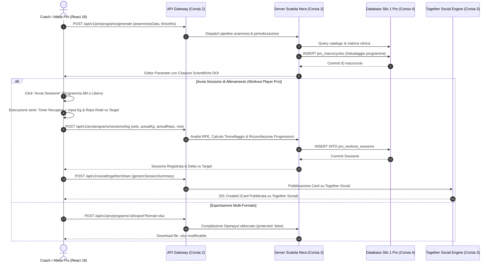
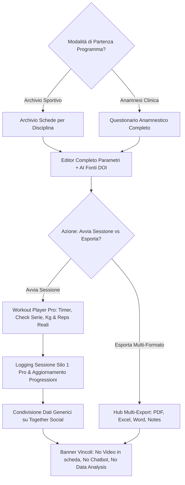

# Capitolato Tecnico: Flow 3B – Programmazione Anamnestica (6 Mesi), RTP, Workout Player & Condivisione Together Social (T7 Pro Coach)

## 1. Identificativo & Titolo Ufficiale
- **Badge Miro Board:** `#09` (Posizione: `X: 2641.02, Y: 3598.51`, Miro Shape ID: `3458764688417722743`)
- **Codice Univoco:** `FLOW-3B`
- **Titolo Formale:** SOFTWARE 2 (B2B PRO P.IVA) - FLOW 3B: PROGRAMMAZIONE ANAMNESTICA 6M, RTP, WORKOUT PLAYER, AI FONTI & CONDIVISIONE TOGETHER SOCIAL
- **Board Miro Online:** `uXjVEbo6L2o=` (Zona 4, Riga 2: Partita IVA / Coaches & Fisioterapisti, Colonna 3: Programmazione degli Esercizi)
- **Diagramma Sorgente:** `architecture-blueprint/02-miro-zones-and-swimlanes/18-flowcharts/software-2-pro-b2b/flow-3b-macrocycle-ai-triage119.mmd`
- **Riferimento Glossario:** [Glossario Tecnico Vivente](00-GLOSSARIO-TERMINI-TECNICI.md) (Voci: [Questionario Anamnestico](00-GLOSSARIO-TERMINI-TECNICI.md), [Periodizzazione 6 Mesi](00-GLOSSARIO-TERMINI-TECNICI.md#dup-daily-undulating-periodization), [Return to Play RTP](00-GLOSSARIO-TERMINI-TECNICI.md), [AI Citazioni Scientifiche DOI](00-GLOSSARIO-TERMINI-TECNICI.md#rag-gerarchico-scientifico-retrieval-augmented-generation), [Export Multi-Formato XLSX DOCX](00-GLOSSARIO-TERMINI-TECNICI.md#excel-sbloccato-protected-false-data-interoperability), [Together Social Workout Sharing](00-GLOSSARIO-TERMINI-TECNICI.md#together-social-workout-sharing)).

---

## 2. Obiettivo di Business & Target Utente

### Guida Pratica per Non Tecnici: Cos'è questo modulo per un umano?
Per un preparatore atletico o fisioterapista con Partita IVA (Tier 2 Pro), programmare l'allenamento richiede di bilanciare la storia clinica dell'atleta, i suoi traumi pregressi e una periodizzazione solida a medio termine, con la libertà di modificare ogni dettaglio, seguire l'esecuzione live sul campo ed esportare liberamente:
- **Eredità Funzionale Tier 1:** Include l'archivio completo di schede pre-confezionate per sport e la modalità live **Workout Player** con timer di recupero, check delle serie e inserimento dei carichi reali;
- **Questionario Anamnestico Completo:** Permette di raccogliere la storia clinica dell'atleta, le caratteristiche individuali, le asimmetrie e i traumi pregressi per generare una programmazione adatta;
- **Pianificazione fino a 6 Mesi:** Consente di strutturare microcicli, mesocicli e macrocicli fino a un massimo di 6 mesi;
- **Personalizzazione Totale dei Parametri:** Il coach può modificare liberamente esercizi, serie, ripetizioni, carichi, tempi di recupero e percentuali di sforzo;
- **Riabilitazione Specifica & Return to Play (RTP):** Include protocolli dedicati per la riatletizzazione e il ritorno in campo post-infortunio;
- **Workout Player Pro con Confronto Target vs Reale:** Quando l'atleta o il coach avviano la sessione, l'interfaccia da palestra mostra il target prescritto dal coach (es. 4x8 @ 80kg) e registra in tempo reale carichi effettivi sollevati e ripetizioni completate;
- **Condivisione su Together Social:** Al termine della sessione registrata, genera la card con **dati generici dell'allenamento** (durata, volume sollevato, esercizi completati) per la condivisione su **Together Social** per valorizzare i progressi dell'atleta all'interno della community;
- **Spiegazioni AI con Fonti Scientifiche:** Ogni scelta di programmazione è motivata dall'AI con riferimenti precisi a fonti accademiche, bibliografia, DOI e link alle fonti originali, oltre a una spiegazione per ciascun singolo esercizio;
- **Esportazione Multi-Formato:** Esporta la scheda in 4 formati: **PDF, Excel (.xlsx sbloccato senza password), Word (.docx) e Notes**;
- **Vincoli e Limitazioni di Fascia:** Non è possibile inserire video all'interno delle schede di allenamento; assenza del chatbot interattivo, della funzione RAG e del collegamento con la sezione di Data Analysis (riservati a Tier 3).

### Specifiche di Business & Metriche
- **Target Utente:** Personal trainer, preparatori fisici e chinesiologi con Partita IVA (Tier 2 – Pro B2B).
- **Problema Risolto:** Automatizzare la stesura di programmi semestrali scientificamente inattaccabili, consentire il tracciamento rigoroso serie per serie in palestra e valorizzare l'attività con la condivisione social comunitaria.

---

## 3. Attori & Architettura a 4 Corsie (Swimlanes)

1. **Corsia 1: Thin Client UI/UX (React 18 Pro Suite):**
   - Wizard anamnestico a step;
   - Selettore orizzonte temporale (fino a 6 mesi);
   - Editor parametri avanzato (swap esercizi, carichi, serie, reps, rest);
   - Modalità Workout Player Pro (timer recupero, spunta serie, carichi kg e reps effettivi vs target coach);
   - Pannello AI fonti scientifiche (DOI, PubMed link);
   - Hub di export a 4 formati (PDF, XLSX, DOCX, Notes);
   - Card generica di condivisione su Together Social.
2. **Corsia 2: API Gateway & RBAC Pro (Envoy Gateway):**
   - Validazione token JWT Tier 2 Pro (verifica P.IVA attiva);
   - Controllo permessi export multi-formato, blocco orizzonte temporale $> 6	ext{ mesi}$, inibizione stream video nelle schede e blocco chiamate a Data Analysis;
   - Endpoint: `POST /api/v1/pro/programs/generate`, `POST /api/v1/pro/programs/sessions/log`, `POST /api/v1/social/together/share`, `POST /api/v1/pro/programs/:id/export`.
3. **Corsia 3: Server Scatola Nera (Anamnesis, Periodizer, Pro Workout Logger & Multi-Exporter):**
   - *Anamnesis Matrix Processor:* Filtraggio esercizi e asimmetrie cliniche;
   - *6-Month Periodization Engine:* Generazione progressioni DUP, blocchi, lineare;
   - *Scientific Citation Engine:* Retrieval citazioni accademiche (DOI/PubMed);
   - *Pro Workout Logger:* Calcolo volume totale, confronto target coach vs effettivo atleta e aggiornamento progressioni di carico;
   - *Together Social Card Generator:* Generazione card generica di allenamento;
   - *Multi-Format Exporter (ExcelJS, docx, PDFKit):* Compilazione binari formattati.
4. **Corsia 4: Database Tripartito (Silo 1 Pro - PostgreSQL):**
   - Tabelle `athlete_anamnesis`, `pro_macrocycles`, `pro_mesocycles`, `rehab_rtp_protocols`, `pro_workout_sessions` e `pro_exercise_overrides`.

---

### Sequence Diagram Asincrono del Ciclo di Vita (FLOW-3B)



---

## 4. Flusso Passo-Passo (Livello A Narrativo + KPI e Livello B Deep-Dive)

### Livello A: Flusso Operativo Utente & Tabella KPI
1. **Compilazione Anamnesi:** Il coach inserisce i dati clinici e le asimmetrie dell'atleta;
2. **Generazione & Periodizzazione 6M:** Il sistema elabora il piano semestrale con modelli DUP o a blocchi;
3. **Revisione Parametri & Fonti DOI:** Il coach personalizza serie, carichi ed esercizi, supportato dalle evidenze scientifiche AI;
4. **Avvio Sessione Live (Workout Player):** L'atleta o il coach avviano la sessione, cronometrano i recuperi e registrano i carichi effettivi;
5. **Condivisione su Together Social:** Pubblicazione della card riepilogativa con dati generici di volume e durata su Together Social;
6. **Esportazione Multi-Formato:** Download del piano in PDF, Excel sbloccato, Word o Notes.

| Step | Nome Operazione | Tempo Target (KPI) | Descrizione Tecnica |
| :---: | :--- | :---: | :--- |
| **01** | Elaborazione Anamnesi & 6M | $< 1.2	ext{ s}$ | Pipeline di calcolo periodizzazione e filtro esercizi |
| **02** | Fetch Citazioni Scientifiche DOI | $< 450	ext{ ms}$ | Interrogazione archivio bibliografico su DB Silo 1 |
| **03** | Avvio Workout Player Pro | $< 60	ext{ ms}$ | Caricamento target coach e inizializzazione timer |
| **04** | Logging Sessione & Delta Target | $< 280	ext{ ms}$ | Calcolo scostamento carico prescritto vs effettivo |
| **05** | Condivisione Together Social | $< 350	ext{ ms}$ | Generazione e pubblicazione card generica |
| **06** | Export Excel Sbloccato (.xlsx) | $< 950	ext{ ms}$ | Generazione Openpyxl con formule attive e zero password |

### Livello B: Deep-Dive Ingegneristico sui Microservizi
- **Motore di Periodizzazione Semestrale:** Calcolo automatico dei microcicli con progressione del volume e dell'intensita basato su modelli DUP e blocchi fino a 24 settimane;
- **Sincronizzazione Workout Player Pro:** La state machine traccia in parallelo il carico prescritto dal coach (prescribedTarget) e il carico effettivo registrato dall'atleta (actualPerformance), calcolando in real-time il tasso di conformita;
- **Integrazione Together Social:** All'atto del salvataggio sessione, il microservizio estrae solo metriche aggregate (durata, tonnellaggio, esercizi completati), tutelando note sanitarie o diagnosi RTP.

---

## 5. Rami Decisionali & 4 Stati UI



---

## 6. Contratti Dati & Error Matrix

### Schema JSON Registrazione Sessione Pro (`pro_workout_session_logs`)
```json
{
  "sessionId": "sess_pro_4412",
  "coachId": "usr_coach_021",
  "athleteId": "usr_ath_881",
  "tier": 2,
  "macrocycleId": "macro_6m_009",
  "mesocycleWeek": 4,
  "sessionDate": "2026-11-15T10:00:00Z",
  "durationSeconds": 4200,
  "totalVolumeKg": 8940.0,
  "complianceRatio": 0.98,
  "exercises": [
    {
      "exerciseId": "ex_back_squat_02",
      "prescribedTarget": { "sets": 4, "reps": 6, "weightKg": 120.0 },
      "actualPerformance": [
        { "set": 1, "reps": 6, "weightKg": 120.0, "rpe": 8.0, "restSeconds": 180 },
        { "set": 2, "reps": 6, "weightKg": 120.0, "rpe": 8.5, "restSeconds": 180 },
        { "set": 3, "reps": 6, "weightKg": 120.0, "rpe": 8.5, "restSeconds": 180 },
        { "set": 4, "reps": 5, "weightKg": 120.0, "rpe": 9.5, "restSeconds": 180 }
      ]
    }
  ]
}
```

### Schema JSON Condivisione su Together Social (`together_social_shares`)
```json
{
  "shareId": "tsh_88201",
  "userId": "usr_ath_881",
  "sessionId": "sess_pro_4412",
  "socialNetwork": "Together Social",
  "shareType": "generic_workout_summary",
  "publicCardData": {
    "title": "Sessione Gambe & Potenza Completata",
    "workoutType": "Programma Personalizzato Pro",
    "durationMinutes": 70,
    "totalVolumeTons": 8.94,
    "completedExercisesCount": 5
  },
  "privacyLevel": "community_public"
}
```

### Matrice Errori HTTP a 6 Colonne
| HTTP Code | Codice Interno | Endpoint | Causa Scatenante | UX Feedback Visivo | Strategia di Resilienza |
| :---: | :---: | :--- | :--- | :--- | :--- |
| `403` | `ERR_T2_DATA_ANALYSIS_GATED` | `/api/v1/analytics/*` | Chiamata non autorizzata a Data Analysis | Modal: "Data Analysis avanzata riservata a Tier 3 Elite" | Blocco gateway |
| `400` | `ERR_T2_HORIZON_EXCEEDED` | `/api/v1/pro/programs/generate` | Richiesta programmazione $> 6	ext{ mesi}$ | Alert: "Il limite massimo di pianificazione per Tier 2 è 6 mesi" | Cap automatico a 24 settimane |
| `422` | `ERR_T2_LOG_PAYLOAD_INVALID` | `/api/v1/pro/programs/sessions/log` | Valori di serie o carichi non conformi | Segnalazione puntuale dell'esercizio errato | Correzione assistita in-app |
| `502` | `ERR_T2_SOCIAL_TIMEOUT` | `/api/v1/social/together/share` | Timeout pubblicazione su Together Social | Toast: "Sessione salvata; riprovo condivisione su Together Social" | Coda di retry asincrona |
| `500` | `ERR_T2_EXPORT_FAILED` | `/api/v1/pro/programs/:id/export` | Errore rendering del file .xlsx/.docx | Messaggio di errore con pulsante di retry | Generazione PDF fallback |

---

## 7. Ereditarietà di Tier & Vincoli

- **Ereditarietà da Livelli Inferiori:** Eredita l'archivio schede per sport, la modalità Workout Player con timer e registrazione serie/carichi/reps, e la condivisione generica su Together Social.
- **Funzionalità Esclusive Tier 2:**
  - Questionario anamnestico completo per personalizzazione clinica e prevenzione asimmetrie;
  - Programmazione semestrale (fino a 6 mesi);
  - Modifica completa di ogni parametro di allenamento;
  - Workout Player Pro con monitoraggio real-time del target coach vs effettivo;
  - Spiegazioni AI scientifiche con referenze bibliografiche, DOI e link accademici;
  - Esportazione multi-formato sbloccata in 4 formati: **PDF, Excel (.xlsx modificabile), Word (.docx) e Notes**.
- **Vincoli e Limitazioni di Fascia (Gating Negativo):**
  - **Zero video nelle schede di allenamento:** Nessun media streaming incorporato nel documento;
  - **Zero chatbot e zero RAG:** Nessun tutor real-time h24 o cluster documentale custom;
  - **Zero collegamento con Data Analysis:** Nessun cross-over con telemetria di squadra.
