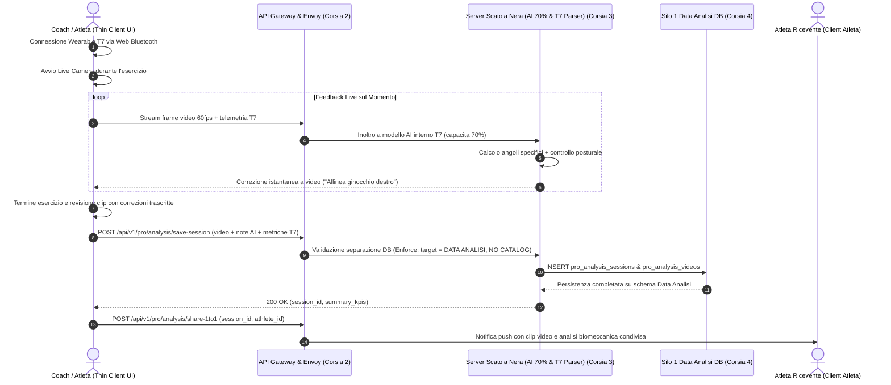

# Capitolato Tecnico: Flow 4B – Data Analisi: Biomeccanica AI 70%, Live Camera & Wearable T7 (T7 Pro Coach & Fisio)

## 1. Identificativo & Titolo Ufficiale
- **Badge Miro Board:** `#10` (Posizione: `X: 4353.02, Y: 3598.51`, Miro Shape ID: `3458764688417722745`)
- **Codice Univoco:** `FLOW-4B`
- **Titolo Formale:** SOFTWARE 2 (B2B PRO P.IVA) - FLOW 4B: DATA ANALISI - BIOMECCANICA AI 70%, LIVE CAMERA & WEARABLE T7
- **Board Miro Online:** `uXjVEbo6L2o=` (Zona 4, Riga 2: Partita IVA / Coaches & Fisioterapisti, Colonna 4: Data Analisi)
- **Diagramma Sorgente:** `architecture-blueprint/02-miro-zones-and-swimlanes/18-flowcharts/software-2-pro-b2b/flow-4b-vbt-pap-biomechanics.mmd`
- **Riferimento Glossario:** [Glossario Tecnico Vivente](00-GLOSSARIO-TERMINI-TECNICI.md) (Voci: [Angoli Specifici Biomeccanici](00-GLOSSARIO-TERMINI-TECNICI.md#angoli-specifici-biomeccanici), [Modelli AI Interni T7 70%](00-GLOSSARIO-TERMINI-TECNICI.md#modelli-ai-interni-t7-inferenza-dedicata-70-vs-100), [Live Camera AI Real-Time Correction](00-GLOSSARIO-TERMINI-TECNICI.md#live-camera-ai-real-time-correction-feedback-esecutivo-sul-momento), [Separazione Database Data Analisi vs Catalogo](00-GLOSSARIO-TERMINI-TECNICI.md#separazione-database-data-analisi-vs-catalogo-isolamento-tier-2), [Wearable T7 Ecosistema Proprietario](00-GLOSSARIO-TERMINI-TECNICI.md#wearable-t7-ecosistema-hardware-proprietario-t7), [Analisi Sommaria Metriche Lattato](00-GLOSSARIO-TERMINI-TECNICI.md#analisi-sommaria-metriche-lattato)).

---

## 2. Obiettivo di Business & Target Utente

### Guida Pratica per Non Tecnici: Cos'e questo modulo per un umano?
Per un preparatore atletico o un fisioterapista, osservare un atleta a occhio nudo non basta per cogliere asimmetrie millimetriche o correggere la postura al momento esatto in cui il gesto si sporca per la fatica.  
Il modulo di **Data Analisi Tier 2** trasforma lo smartphone o tablet del coach in un assistente biomeccanico intelligente:
- **Calcolo Angoli Principali e Specifici:** Oltre agli angoli base (ginocchio, anca), misura le asimmetrie tra lato destro e sinistro, le inclinazioni pelviche e i compensi articolari fini durante la corsa o gli esercizi;
- **Considerazioni AI Integrate:** I modelli AI interni T7 generano note sintetiche e commenti biomeccanici a supporto della valutazione del professionista;
- **Videocamera Live & Correzioni sul Momento:** L'atleta o il coach accende la fotocamera e si filma in tempo reale. L'intelligenza artificiale monitora il movimento fotogramma per fotogramma e proietta sullo schermo suggerimenti correttivi istantanei (es. "Ginocchio destro in dentro: mantieni allineamento");
- **Salvataggio Esclusivo in Data Analisi:** Il video registrato, arricchito con le correzioni trascritte e i grafici angolari, puo essere archiviato nella sezione Data Analisi. **Non viene salvato nel Catalogo Esercizi**, poiche risiede su un database separato dedicato all'analisi prestazionale del coach;
- **Condivisione 1:1 con l'Atleta:** Il coach puo inviare il video e il report di analisi direttamente al singolo atleta seguito, facilitando la comprensione degli errori tecnici;
- **Potenza AI Calibrata (70%):** Utilizza modelli AI interni dedicati con potenza di calcolo contenuta al 70%, garantendo elevata velocita di esecuzione e costi operativi sostenibili per i professionisti a Partita IVA;
- **Solo Wearable Proprietari T7:** Connessione esclusiva ai dispositivi indossabili a marchio T7 (es. fascia cardiaca e biosensori T7). Il sistema esegue un'analisi sommaria delle metriche chiave, ad esempio individuando la soglia aerobica e anaerobica durante un test del lattato;
- **Zero RAG:** Nessun motore RAG attivo in questa fascia.

### Specifiche di Business & Metriche
- **Target Utente:** Personal trainer con Partita IVA, preparatori atletici di atleti individuali e fisioterapisti dello sport (Tier 2 – Pro P.IVA).
- **Problema Risolto:** Permettere al professionista di offrire feedback video in tempo reale e analisi telemetriche oggettive senza costosi laboratori di biomeccanica, mantenendo separati i dati di analisi dal catalogo standard ed escludendo dispersioni su dispositivi terzi.

---

## 3. Attori & Architettura a 4 Corsie (Swimlanes)

1. **Corsia 1: Thin Client UI/UX (React 18 / WebRTC Video Canvas):**
   - Interfaccia videocamera a 60fps con pose tracking scheletrico bidimensionale, badge di alert visivo real-time (correzioni istantanee durante l'esecuzione), modulo di connessione Bluetooth Web Bluetooth API abilitato esclusivamente ai wearable a marchio T7, player video con trascrizione correzioni e selettore per condivisione individuale 1:1 con l'atleta.
2. **Corsia 2: API Gateway & Streaming Gateway (Envoy):**
   - Streaming a bassa latenza dei frame video (`/stream/analysis-live`), verifica crittografica dell'ID hardware dei dispositivi T7 (`POST /telemetry/t7-device-handshake`), validazione JWT Tier 2 e instradamento forzato al database isolato di Data Analisi (blocco routing verso lo storage del Catalogo).
3. **Corsia 3: Server Scatola Nera (T7 AI Kinematics Engine 70% & Wearable Parser):**
   - *Modelli AI Interni T7 (Inferenza 70%):* Elaborazione computer vision dei frame per il calcolo congiunto di angoli principali e specifici (valgismo dinamico, tilt tibiale, asimmetrie L/R) e formulazione di considerazioni sintetiche;
   - *Live Feedback Generator:* Regole cinematiche a soglia per produrre messaggi di correzione istantanea a schermo;
   - *T7 Wearable Telemetry Parser:* Ricezione pacchetti proprietari T7, estrazione curva concentrazione/frequenza nel test del lattato e calcolo sommario delle soglie di transizione metabolica (soglia 2 mmol/L e 4 mmol/L).
4. **Corsia 4: Database Tripartito (Silo 1 Pro - PostgreSQL / Object Storage Separato):**
   - Schemi e bucket isolati per la sezione Data Analisi: tabelle `pro_analysis_sessions`, `pro_analysis_corrections` e archivio video `t7_analysis_vault`. Separazione logica e fisica assoluta rispetto allo schema del Catalogo Esercizi (`catalog_exercises`).

---

### Sequence Diagram Asincrono del Ciclo di Vita (FLOW-4B)



---

## 4. Flusso Operativo Passo-Passo

### Livello A: User Journey Narrativo (La Storia dell'Utente)
1. **Accensione della Videocamera:** Il preparatore posiziona lo smartphone su treppiede o impugna il dispositivo, inquadrando l'atleta che si appresta a eseguire una serie di affondi o una prova sul tapis roulant.
2. **Connessione Wearable T7:** L'app rileva automaticamente la fascia/biosensore T7 indossato dall'atleta. Se fosse presente un sensore di marca terza, l'app avvisa con trasparenza che in questa fascia sono supportati esclusivamente i dispositivi T7.
3. **Correzione in Tempo Reale sul Momento:** Non appena l'atleta comincia a muoversi, una griglia scheletrica trasparente traccia il corpo a video. Se durante il terzo affondo il bacino ruota o il ginocchio cede verso l'interno, compare istantaneamente un riquadro visivo con testo nitido: *"Compensazione anca sinistra rilevata: mantieni il bacino neutrale"*.
4. **Analisi Sommaria del Test:** Se l'atleta sta completando un test incrementale del lattato con il sensore T7, al termine della prova il modello AI interno (70%) genera un riassunto immediato: *"Soglia aerobica individuata a circa 142 bpm, soglia anaerobica a 168 bpm con accumulo rapido"*.
5. **Salvataggio Sicuro nel DB Data Analisi:** Il coach tocca "Salva Video e Analisi". Il file video, comprensivo delle annotazioni e delle trascrizioni dei consigli correttivi, viene archiviato nella sezione Data Analisi. Un'etichetta di sistema conferma: *"Archiviato nel database Data Analisi (Isolato dal Catalogo)"*.
6. **Condivisione 1:1 con l'Atleta:** Il professionista seleziona il profilo dell'atleta dalla propria rubrica e invia il report con un tocco. L'atleta riceve sul proprio smartphone il video con le correzioni visibili senza possibilita di modifiche.

---

#### Indicatori di Accettazione Operativa & Biomeccanica (KPI)
| Metrica / Parametro | Obiettivo Target | Tolleranza Accettabile | Azione Fallback / Allerta |
| :--- | :--- | :--- | :--- |
| **Latenza Inferenza Live AI** | $< 45\text{ ms}$ | $\le 80\text{ ms}$ | Riduzione temporanea campionamento a 30fps |
| **Potenza Modello AI Interno** | Profilo 70% T7 | $70\%$ allocazione | Throttling dinamico per prevenire surriscaldamento |
| **Separazione DB Catalogo** | $100\%$ isolamento | $100\%$ | Errore transazione se chiamata tenta scrittura Catalogo |
| **Accuratezza Soglie Lattato T7** | $\ge 90\%$ concordanza | $\ge 85\%$ | Segnalazione stima sommaria su report |
| **Restrizione Condivisione** | Esclusiva 1:1 | $1:1$ | Blocco invio broadcast o liste multiple |

---

### Livello B: Trattazione Tecnica Nodi Operativi

1. `START` (Inizializzazione Sessione): Selezione ambiente "Data Analisi Pro" e setup parametri prova.
2. `T7_DEVICE_SCAN` (Rilevamento Wearable T7): Scansione Bluetooth GATT service UUID proprietario T7. Rifiuto dispositivi BLE terzi non certificati.
3. `LIVE_CAMERA_INIT` (Avvio WebRTC Video Stream): Inizializzazione stream video a 1080p con elaborazione a 60fps sul client.
4. `AI_FRAME_PROCESS` (Inferenza AI 70%): Invio buffer al modello interno T7 per l'estrazione contemporanea di:
   - Angoli principali (estensione ginocchio, flessione femore, inclinazione busto);
   - Angoli specifici (valgismo dinamico al ginocchio, tilt pelvico sagittale/frontale, deviazione asimmetrica L/R);
   - Note e considerazioni tecniche generate dall'algoritmo.
5. `DEC_POSTURE_ERROR` (Rilevamento Deviazione): Se un angolo articolare oltrepassa la finestra di tolleranza fisiologica, generazione dell'evento di correzione real-time.
6. `LIVE_FEEDBACK_RENDER` (Proiezione Correzione a Schermo): Visualizzazione dell'indicazione testuale sul display per guidare l'atleta sul momento.
7. `T7_LACTATE_SUMMARY` (Sintesi Metriche Lattato): Rielaborazione della telemetria dal sensore T7 e computazione sommaria delle soglie metaboliche.
8. `DEC_SAVE_DESTINATION` (Verifica Destinazione Salvataggio): Enforcement architetturale: scrittura permessa esclusivamente nello schema `data_analysis_records` del Silo 1 Pro. Blocco assoluto verso `catalog_exercises`.
9. `SHARE_1TO1` (Condivisione Atleta Singolo): Invio notifica e grant di lettura al profilo dell'atleta selezionato (singolo destinatario).
10. `END` (Chiusura Sessione): Video e trascrizioni consolidati nell'archivio storico Data Analisi del coach.

---

## 5. Rami Decisionali & Gestione dei 4 Stati UI

| Bivio Decisionale | Condizione Logica | Ramo SI / Positivo | Ramo NO / Negativo |
| :--- | :--- | :--- | :--- |
| `CHECK_T7_HARDWARE` | Il dispositivo BLE e un wearable proprietario T7? | Connessione e streaming metriche | Dispositivo bloccato con avviso di incompatibilita |
| `DEC_POSTURE_ERROR` | Rilevata anomalia angolare o asimmetria nell'esercizio? | Proiezione alert correzione sul video | Mantenimento tracciamento scheletrico neutro |
| `DEC_SAVE_DESTINATION` | Destinazione richiesta e lo schema Data Analisi? | Persistenza in Silo 1 Data Analisi DB | Errore architetturale se indirizzato al Catalogo |
| `CHECK_SHARE_RECIPIENT` | Destinatario condivisione e un singolo atleta (1:1)? | Inoltro notifica e autorizzazione | Errore validazione invio cumulativo |

### I 4 Stati di Interfaccia Utente (UI States):
1. **Empty State:** Nessun video registrato ne sensore connesso. Schermata di setup con pulsante per accendere la fotocamera e icona di ricerca per i soli wearable T7.
2. **Loading State:** Aggancio dello stream video e calibrazione dello scheletro 2D in sovrimpressione con indicatore "Modello AI T7 (70%) attivo".
3. **Populated State:** Vista video fluida a pieno schermo con angoli principali e specifici visualizzati ai bordi, trascrizione live dei suggerimenti correttivi e grafico della frequenza cardiaca/lattato T7 in basso.
4. **Error / Fallback State:** Illuminazione insufficiente o atleta parzialmente fuori dall'inquadratura. Banner in alto: "Atleta non completamente visibile: inquadra l'intero corpo per il tracciamento degli angoli specifici".

---

## 6. Contratti Dati, Parametri I/O & Database Silo

### Specifiche Endpoint REST:

#### 1. Ingestion Sessione Live Camera e Correzioni AI
- **Endpoint:** `POST /api/v1/pro/analysis/live-session`
- **Headers:** `Authorization: Bearer <jwt_pro_token>`, `Content-Type: application/json`
- **Request Payload:**
```json
{
  "coachId": "coa_55f2d1e0",
  "athleteId": "ath_77c12b9a",
  "exerciseName": "FORWARD_LUNGE",
  "t7DeviceSerial": "T7-WEAR-8841-X",
  "videoMetadata": {
    "durationSec": 45,
    "resolution": "1080p",
    "fps": 60
  },
  "anglesRecorded": {
    "primary": { "kneeFlexionMaxDeg": 92.5, "hipAngleDeg": 105.1 },
    "specific": { "kneeValgusDeg": 8.4, "pelvicTiltDeg": 4.1, "asymmetryLeftRightPct": 6.2 }
  },
  "realtimeCorrections": [
    { "timestampSec": 12.4, "note": "Ginocchio destro in dentro: allineare con la caviglia" },
    { "timestampSec": 28.1, "note": "Tronco troppo flesso: mantenere petto aperto" }
  ]
}
```
- **Responses:**
  - `200 OK`:
```json
{
  "status": "success",
  "analysisSessionId": "an_sess_10a29f8c",
  "storageDestination": "DATA_ANALYSIS_VAULT",
  "catalogSyncPermitted": false,
  "summaryConsiderations": "Buona ampiezza di affondo; presente lieve valgismo dinamico a destra sotto fatica.",
  "createdAt": "2026-11-10T22:55:00Z"
}
```

#### 2. Ingestion Metriche Sommarie Lattato Wearable T7
- **Endpoint:** `POST /api/v1/pro/analysis/wearable-t7/lactate`
- **Headers:** `Authorization: Bearer <jwt_pro_token>`, `Content-Type: application/json`
- **Request Payload:**
```json
{
  "t7DeviceSerial": "T7-BIO-4410",
  "testType": "INCREMENTAL_LACTATE_STEP",
  "samples": [
    { "step": 1, "speedKmh": 9.0, "hrBpm": 135, "lactateMmol": 1.6 },
    { "step": 2, "speedKmh": 11.0, "hrBpm": 152, "lactateMmol": 2.2 },
    { "step": 3, "speedKmh": 13.0, "hrBpm": 172, "lactateMmol": 4.1 }
  ]
}
```
- **Responses:**
  - `200 OK`:
```json
{
  "status": "success",
  "summaryAnalysis": {
    "aerobicThresholdEstHr": 145,
    "anaerobicThresholdEstHr": 170,
    "inferenceTier": "T7_MODEL_70PCT"
  }
}
```

### Schema Relazionale (Database Silo 1 Pro - PostgreSQL):
- `pro_analysis_sessions`: `id UUID PK`, `coach_id UUID NOT NULL`, `athlete_id UUID NOT NULL`, `t7_device_serial VARCHAR(64)`, `primary_angles JSONB NOT NULL`, `specific_angles JSONB NOT NULL`, `ai_considerations TEXT`, `video_s3_path VARCHAR(255)`, `shared_with_athlete BOOLEAN DEFAULT FALSE`, `created_at TIMESTAMPTZ NOT NULL DEFAULT NOW()`.
- **Vincolo Architetturale:** Nessuna chiave esterna ne tabella di giunzione con `catalog_exercises`.

---

### Matrice Errori HTTP & Strategie di Resilienza
| HTTP Code | Codice Interno | Endpoint | Causa Scatenante | UX Feedback Visivo | Strategia di Resilienza & Fallback |
| :---: | :--- | :--- | :--- | :--- | :--- |
| **400** | `ERR_NON_T7_WEARABLE` | `POST /wearable-t7/lactate` | Tentativo di sincronizzare un dispositivo BLE non a marchio T7 | Alert: "Dispositivo non supportato. Connetti un sensore ufficiale T7" | Disattivazione modulo telemetrico e mantenimento sola video analisi |
| **401** | `ERR_UNAUTHORIZED_PRO` | `POST /live-session` | Token professionista non valido o licenza P.IVA scaduta | Modale: "Rinnova la tua sottoscrizione Pro per proseguire" | Salvataggio bozza locale non cifrata nel browser |
| **403** | `ERR_CATALOG_CROSS_WRITE`| `POST /live-session` | Richiesta illecita di salvataggio del video nel Catalogo Esercizi | Dialog: "Salvataggio consentito solo nella sezione Data Analisi" | Reindirizzamento forzato su storage Data Analisi dedicato |
| **403** | `ERR_BROADCAST_FORBIDDEN`| `POST /share-1to1` | Tentativo di inviare l'analisi a piu atleti contemporaneamente | Toast: "In Tier 2 la condivisione e consentita verso 1 solo atleta alla volta" | Selezione forzata del primo atleta della lista |
| **429** | `ERR_AI_CAP_REACHED` | `POST /live-session` | Superamento quota di calcolo allocata al profilo 70% | Notifica: "Capacita di calcolo AI temporaneamente satura" | Esecuzione con latenza aumentata a 15fps senza drop della sessione |
| **500** | `ERR_AI_CV_INFERENCE` | `POST /live-session` | Errore interno nel modello di pose tracking T7 | Toast: "Analisi AI non disponibile, mantenimento registrazione video pura" | Registrazione del solo flusso video con goniometro deterministico |

---

## 7. Ereditarieta di Tier & Differenziali di Fascia

- **Capacita Ereditate da Tier 1:**  
  Calcolo deterministico degli angoli principali durante corsa o esercizi.
- **Funzionalita Esclusive di Tier 2 (`FLOW-4B`):**  
  Calcolo esteso agli **angoli specifici** e asimmetrie complesse; aggiunta di **considerazioni da parte dei modelli AI interni T7 a potenza calibrata (70%)**; **videocamera live** con suggerimento correzioni fotogramma per fotogramma sul momento; salvataggio del video e correzioni trascritte **esclusivamente nel database di Data Analisi (isolato dal Catalogo)**; condivisione 1:1 con l'atleta; connessione riservata ai **wearable proprietari T7** con analisi sommaria delle metriche chiave (es. test del lattato). Divieto assoluto di motori RAG.
- **Sblocco Totale nel Livello Superiore (Tier 3 `FLOW-4C`):**  
  In Tier 3 decadono tutti i limiti: i modelli AI interni operano al **100% della potenza** con analisi illimitate e approfondite; il video con correzioni puo essere salvato **direttamente anche nel Catalogo Esercizi**; connessione aperta a **qualsiasi dispositivo indossabile o strumento esterno**; condivisione aperta a tutto il team e multi-staff; esportazione di report, grafici e presentazioni in **qualsiasi formato**; interconnessione totale con la Programmazione e la Baseline dell'atleta; e integrazione dell'architettura esclusiva **Role-Based RAG 100% Private**.
