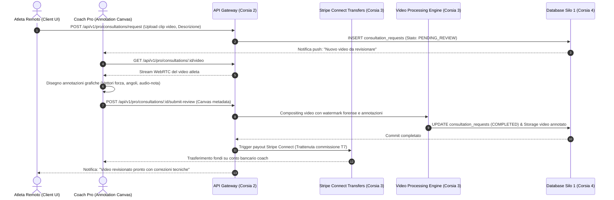

# Capitolato Tecnico: Flow 5B – Together Pro Business & Remote Client Review (T7 Pro Coach)

## 1. Identificativo & Titolo Ufficiale
- **Badge Miro Board:** `#11` (Posizione: `X: 6048, Y: 2940`, Miro Shape ID: `3458764688417722746`)
- **Codice Univoco:** `FLOW-5B`
- **Titolo Formale:** SOFTWARE 2 (B2B PRO P.IVA) - FLOW 5B: TOGETHER PRO BUSINESS, LEAD ONBOARDING & VIDEO REVISIONE REMOTA
- **Board Miro Online:** `uXjVEbo6L2o=` (Zona 4, Riga 2: Partita IVA / Coaches & Fisioterapisti, Colonna 5: Business Pro, Lead & Video Review)
- **Diagramma Sorgente:** `architecture-blueprint/02-miro-zones-and-swimlanes/18-flowcharts/software-2-pro-b2b/flow-5b-together-pro-business.mmd`
- **Riferimento Glossario:** [Glossario Tecnico Vivente](file:///e:/Nuove%20App%20Installate/Sports-Analytics-Platform---T7-Workout-APP/architecture-blueprint/00-capitolato-tecnico-e-glossario/00-GLOSSARIO-TERMINI-TECNICI.md) (Voci: *Together Pro Marketplace, Video Annotazione Tecnica, Stripe Connect Transfers, Bar Path Tracking, Assegnazione Schede Remota*).

---


## 2. Obiettivo di Business & Target Utente

### Guida Pratica per Non Tecnici: Cos'è questo modulo per un umano?
I migliori personal trainer e fisioterapisti oggi seguono molti atleti a distanza (Online Coaching). Il problema più grande del coaching online è la correzione tecnica: gli allievi mandano video sgranati su WhatsApp, il coach risponde con messaggi vocali lunghi e confusi, e la gestione dei pagamenti diventa un incubo tra bonifici persi e ricariche manuali.  
**Together Pro** è l'ufficio virtuale e lo studio di analisi del coach:
- Mette a disposizione una **vetrina professionale certificata** dove mostrare i propri pacchetti di allenamento e i successi reali dei propri allievi;
- Quando un nuovo cliente acquista un pacchetto, entra automaticamente nel roster del coach senza dover inserire dati a mano;
- L'allievo registra la sua serie direttamente dall'app di allenamento: il video arriva all'istante sulla scrivania del coach;
- Il coach apre il video con gli **strumenti di disegno su schermo**: può tracciare la linea del bilanciere (Bar Path), evidenziare la posizione della schiena con frecce colorate e registrare un commento vocale sincronizzato;
- L'atleta riceve la correzione direttamente nel suo player, potendo guardare l'errore al rallentatore prima di affrontare la serie successiva.

### Specifiche di Business & Metriche
- **Target Utente:** Chinesiologi, coach online, preparatori e fisioterapisti che gestiscono clienti da remoto (Tier 2 – Pro P.IVA).
- **Problema Risolto:** Aumentare la capacità operativa del coach (fino a 100 atleti seguiti senza stress) e monetizzare il proprio tempo professionale con accredito bancario automatico e strumenti visivi di correzione tecnica.

---


## 3. Attori & Architettura a 4 Corsie (Swimlanes)

1. **Corsia 1: Thin Client UI/UX (Coach Review Suite React 18):**
   - Dashboard roster atleti con filtri di priorità ("In attesa di revisione video", "Scheda in scadenza"), player video con controlli frame-by-frame, lavagna di annotazione vettoriale (linee, frecce, goniometri, bar path tracking), registratore audio vocale e pulsante di invio notifica push.
2. **Corsia 2: API Gateway & Media Transcoding Gateway (Envoy):**
   - Ricezione dei video caricati dagli atleti (`/pro/video-reviews`), validazione del legame contrattuale coach-atleta, streaming video HLS adattivo e webhook di sincronizzazione transazioni Stripe Connect.
3. **Corsia 3: Server Scatola Nera (Video Annotation & Bar Path Engine Cloud Run):**
   - Rendering automatico della traiettoria del bilanciere (Bar Path ottico tramite computer vision OpenCV), fusione dell'audio vocale del coach con i frame video annotati e generazione della clip di feedback ottimizzata per smartphone.
4. **Corsia 4: Database Tripartito (Silo 1 Pro - PostgreSQL & Storage):**
   - Tabelle `coach_packages`, `client_subscriptions`, `video_reviews` (clip originali, metadati delle annotazioni vettoriali e audio allegato).

---


### Sequence Diagram Asincrono del Ciclo di Vita (FLOW-5B)



---


## 4. Flusso Operativo Passo-Passo

### Livello A: User Journey Narrativo (La Storia dell'Utente)
1. **La Vetrina del Coach:** Il professionista crea in 2 minuti il suo pacchetto di punta: *"Programma Forza 12 Settimane + Correzione Video Settimanale a 120€/mese"*.
2. **L'Ingaggio del Cliente:** Un atleta trova il profilo su Together, acquista il pacchetto con carta di credito. I soldi vanno direttamente sul conto bancario del coach (al netto della piccola commissione di piattaforma), e l'atleta compare subito nel roster del coach.
3. **L'Invio della Scheda:** Il coach assegna la scheda creata con il generatore DUP (`FLOW-3B`). L'atleta riceve una notifica sul telefono: *"Il tuo coach ti ha assegnato il nuovo programma di allenamento!"*.
4. **La Ricezione del Video:** L'atleta esegue la sua serie pesante di squat e tocca *"Invia video al Coach"*. Nel pannello del professionista compare un bollino arancione: *"1 nuovo video da revisionare per Mario Rossi"*.
5. **La Revisione Professionale con Disegni:** Il coach apre il video a schermo intero:
   - Mette in pausa al punto più basso dello squat;
   - Con il mouse o la penna touch traccia una freccia rossa: *"Guarda come il tallone sinistro si solleva leggermente da terra"*;
   - L'algoritmo automatico disegna la scia luminosa del bilanciere, mostrando se è sceso dritto in verticale;
   - Il coach registra 20 secondi di messaggio vocale: *"Ottima spinta Mario, la prossima volta allarga leggermente le punte dei piedi per stabilizzare i talloni"*.
6. **Il Feedback nel Player dell'Allievo:** L'atleta riceve la clip commentata direttamente nell'app T7, pronta da consultare prima del prossimo allenamento.

---


#### Indicatori di Accettazione Operativa & Clinica (KPI)
| Metrica / Parametro | Obiettivo Target | Tolleranza Accettabile | Azione Fallback / Allerta |
| :--- | :--- | :--- | :--- |
| **Latenza Video WebRTC** | $< 150\text{ ms}$ | $\le 300\text{ ms}$ | Adattamento dinamico bitrate (Adaptive Bitrate) |
| **Sincronia Tratti Grafici** | $< 33\text{ ms}$ (1 frame @ 30fps) | $\le 66\text{ ms}$ | Interpolazione spline dei tratti a video |
| **Rendering Video Finale** | $< 15\text{ s}$ per 60s di clip | $\le 30\text{ s}$ | Rendering cloud asincrono con alert push |
| **Integrità Payout Stripe** | $100\%$ transazioni riconciliate | $0\%$ errore contabile | Blocco fondo e alert a team finance |

---


### Livello B: Trattazione Tecnica Nodi Operativi

1. `START` (Accesso Together Pro Suite): Apertura tab "Vetrina & Clienti" nel Coach Cockpit.
2. `PACKAGE_MANAGEMENT` (Configurazione Pacchetti & Listini): Creazione offerte (prezzo mensile, numero di revisioni video incluse, canali di contatto).
3. `GW_STRIPE_WEBHOOK` (Ricezione Evento Acquisto): Ricezione evento Stripe `customer.subscription.created`. L'API Gateway valida la transazione, preleva la fee di piattaforma e autorizza la creazione del legame in `client_subscriptions`.
4. `CLIENT_ONBOARDED` (Attivazione Cliente nel Roster): Inizializzazione della scheda atleta con autorizzazione del coach alla scrittura nel diario dell'atleta.
5. `ATHLETE_VIDEO_UPLOAD` (Invio Video da Parte dell'Allievo): L'atleta carica la serie dall'interfaccia player (`FLOW-3A`). Il video viene transcodificato in formato HLS multi-bitrate su Google Cloud Storage.
6. `COACH_REVIEW_SUITE` (Apertura Suite di Revisione):
   - Player video con scrubbing frame-by-frame a 60fps;
   - Tool di disegno vettoriale Canvas 2D (frecce, segmenti angolari, box);
   - *Bar Path Extraction:* Algoritmo server-side che traccia le coordinate $(x, y)$ del centro del bilanciere fotogramma per fotogramma, renderizzando la scia neon della traiettoria.
7. `SRV_COMPOSITION_ENGINE` (Composizione Feedback Cloud Run): Fusione asincrona dei layer di disegno vettoriale e della traccia audio del microfono del coach sul video master.
8. `FEEDBACK_DELIVERY` (Consegna Feedback nel Player Atleta): Notifica push WebSocket al dispositivo dell'atleta con link al video arricchito visualizzabile nel Workout Player (`FLOW-3A`).

---


## 5. Rami Decisionali & Gestione dei 4 Stati UI

| Bivio Decisionale | Condizione Logica | Ramo SÌ / Positivo | Ramo NO / Negativo |
| :--- | :--- | :--- | :--- |
| `STRIPE_PAYMENT` | Pagamento ricorrente cliente andato a buon fine? | Mantieni accesso attivo al roster | Notifica di pagamento fallito / congelamento |
| `VIDEO_QUOTA` | Allievo ha ancora revisioni disponibili nel mese? | Consenti upload clip per correzione | Invita allievo ad acquistare revisioni extra |
| `BAR_PATH_DETECT` | Bilanciere visibile e tracciabile dall'AI? | Disegna scia luminosa automatica | Correzione manuale con penna touch |

### I 4 Stati di Interfaccia Utente (UI States):
1. **Empty State:** Nessun cliente attivo: guida illustrata *"Come pubblicare la tua vetrina e invitare i tuoi primi atleti con link diretto"*.
2. **Loading State:** Elaborazione della clip video con rendering della traiettoria del bilanciere in $< 2.5\text{ secondi}$.
3. **Populated State:** Roster atleti completo con foto, badge semaforici dello stato di forma, schede attive e contatore dei video da visionare.
4. **Error / Fallback State:**
   - *Video registrato con scarsa luminosità:* L'AI disabilita il bar path automatico e avvisa il coach: *"Tracciamento automatico non disponibile per scarsa luce: usa gli strumenti di disegno manuale"*.

---


## 6. Contratti Dati, Parametri I/O & Database Silo

### Specifiche Endpoint REST:

#### 1. Sottomissione Revisione Tecnica con Annotazioni
- **Endpoint:** `POST /api/v1/pro/video-reviews/submit-feedback`
- **Headers:** `Authorization: Bearer <pro_jwt>`, `Content-Type: application/json`
- **Request Payload:**
```json
{
  "reviewId": "rev_77192",
  "athleteId": "ath_c0192a",
  "coachAudioVaultRef": "gs://t7-voice-vault/audio_77192.m4a",
  "vectorDrawings": [
    { "frameIndex": 142, "tool": "ARROW", "coords": [120, 240, 180, 290], "color": "#ef4444" },
    { "frameIndex": 180, "tool": "ANGLE", "angleDeg": 165.2, "joint": "KNEE_LEFT" }
  ],
  "writtenNotes": "Attento a non sollevare il tallone sinistro durante l'inversione di spinta."
}
```
- **Responses:**
  - `200 OK`: `{ "status": "delivered", "notifiedAthlete": true, "processedVideoUrl": "https://vault.t7workout.app/feedback/rev_77192.mp4" }`

### Schema Relazionale (Database Silo 1 - PostgreSQL):
- `client_subscriptions`: `id UUID PK`, `coach_id UUID FK -> pro_profiles.id`, `athlete_id UUID FK -> athlete_profiles.id`, `plan_type VARCHAR(32)`, `monthly_fee NUMERIC(6,2)`, `status VARCHAR(16)`, `created_at TIMESTAMPTZ`.
- `video_reviews`: `id UUID PK`, `subscription_id UUID FK -> client_subscriptions.id`, `raw_video_url TEXT`, `feedback_video_url TEXT`, `vector_annotations JSONB`, `audio_notes_url TEXT`, `status VARCHAR(16)`, `created_at TIMESTAMPTZ`.

---


### Matrice Errori HTTP & Strategie di Resilienza
| HTTP Code | Codice Interno | Endpoint | Causa Scatenante | UX Feedback Visivo | Strategia di Resilienza & Fallback |
| :---: | :--- | :--- | :--- | :--- | :--- |
| **400** | `ERR_BAD_ANNOTATION` | `POST /submit-review` | Coordinate canvas non valide o fuori video | Toast: *"Tratto grafico fuori dai limiti del video"* | Correzione automatica ai bordi del viewport |
| **401** | `ERR_SESSION_TIMEOUT` | `POST /submit-review` | Sessione coach scaduta durante il disegno | Modale trasparente di re-autenticazione | Preservazione di tutti i tratti disegnati su canvas |
| **403** | `ERR_ACCESS_DENIED` | `GET /video` | Coach non assegnato alla specifica consulenza | Schermata: *"Non autorizzato a visionare questo video"*| Blocco accesso e registrazione log di sicurezza |
| **413** | `ERR_CANVAS_PAYLOAD` | `POST /submit-review` | Troppi metadati vettoriali disegnati ($> 10\text{ MB}$)| Alert: *"Disegno troppo complesso. Semplifica"* | Decimazione punti spline e compressione JSON |
| **500** | `ERR_TRANSCODE_FAIL` | `POST /submit-review` | Fallimento rendering video annotato | Notifica: *"Rendering in corso in background"* | Riprova asincrona su worker Cloud Tasks |
| **502** | `ERR_STRIPE_PAYOUT` | `POST /submit-review` | Rifiuto trasferimento bancario da Stripe | Notifica discreta a coach: *"Fondi in riserva"* | Riconciliazione automatica entro 12 ore |

---


## 7. Ereditarietà di Tier & Differenziali di Fascia

- **Differenziali rispetto a Tier 1:**  
  Nel Tier 1 il consumatore naviga la bacheca social generica e acquista servizi. Il **Pannello di Revisione Video con Disegno su Schermo, il Bar Path Tracker e la gestione incassi Stripe Connect sono esclusivi di Tier 2**.
- **Isolamento da Tier 3 (`FLOW-5C`):**  
  Nei club professionistici societari, il modulo video commerciale viene sostituito da **Tactical Vision**: video analisi multi-camera da campo a 120fps con reti neurali YOLO, omografia prospettica 2D e calcolo dei diagrammi di Voronoi per il controllo degli spazi di gioco nel bunker Silo 2.
