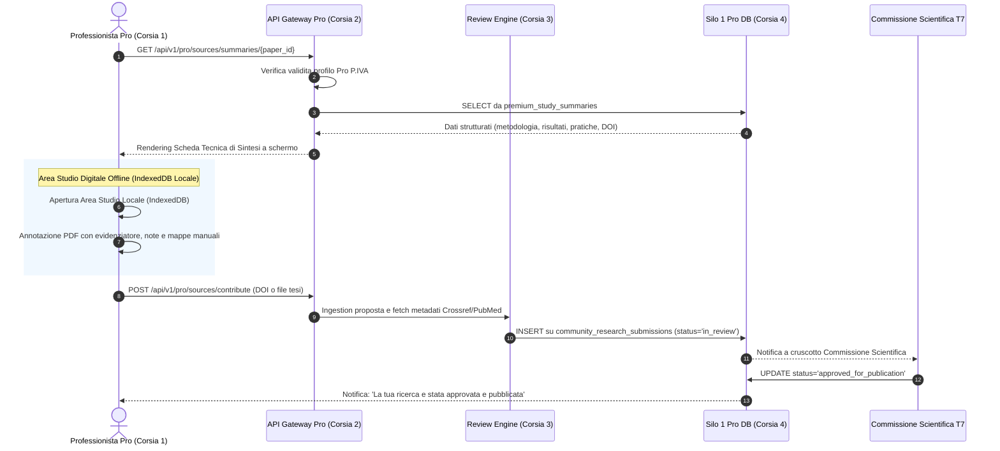

# Capitolato Tecnico: Flow 5B – Libreria Fonti: Sintesi Premium, Area Studio Locale & Commissione Scientifica (T7 Pro Coach)

## 1. Identificativo & Titolo Ufficiale
- **Badge Miro Board:** `#11` (Posizione: `X: 6230.02, Y: 3598.51`, Miro Shape ID: `3458764688417722746`)
- **Codice Univoco:** `FLOW-5B`
- **Titolo Formale:** SOFTWARE 2 (B2B PRO P.IVA) - FLOW 5B: LIBRERIA FONTI - SINTESI PREMIUM, AREA STUDIO LOCALE & COMMISSIONE SCIENTIFICA
- **Board Miro Online:** `uXjVEbo6L2o=` (Zona 4, Riga 2: Partita IVA / Coaches & Fisioterapisti, Colonna 5: Libreria Fonti)
- **Diagramma Sorgente:** [flow-5b-together-pro-business.mmd](../02-miro-zones-and-swimlanes/18-flowcharts/software-2-pro-b2b/flow-5b-together-pro-business.mmd)
- **Riferimento Glossario:** [Glossario Tecnico Vivente](00-GLOSSARIO-TERMINI-TECNICI.md) (Voci: [Schede Tecniche di Sintesi](00-GLOSSARIO-TERMINI-TECNICI.md#schede-tecniche-di-sintesi-studi-premium-copyright-safe), [Area Studio Digitale Locale](00-GLOSSARIO-TERMINI-TECNICI.md#area-studio-digitale-in-app-offline-indexeddb), [Commissione Scientifica T7](00-GLOSSARIO-TERMINI-TECNICI.md#commissione-scientifica-t7-peer-review-community), [Gestione Preferiti Studi](00-GLOSSARIO-TERMINI-TECNICI.md#gestione-preferiti-studi-scientifici)).

---

## 2. Obiettivo di Business & Target Utente

### Guida Pratica per Non Tecnici: Cos'e questo modulo per un umano?
I coach professionisti, i chinesiologi e i fisioterapisti devono aggiornarsi costantemente per offrire la massima qualita ai propri atleti. Tuttavia, abbonarsi a decine di riviste scientifiche internazionali costa migliaia di euro all'anno, e leggere paper accademici di 30 pagine in inglese richiede ore di tempo che un professionista indaffarato non ha. Inoltre, quando si studia, si ha bisogno di sottolineare, prendere appunti e fare schemi.  
**La Libreria Fonti Pro di T7** e l'alleato accademico e lo studio virtuale del professionista:
- Oltre a tutti gli studi Open Access, hai accesso gratuito alle **Schede Tecniche di Sintesi** di studi internazionali altrimenti a pagamento: riassumono con precisione la metodologia, i risultati numerici, i risvolti pratici da applicare sul campo e il link al DOI ufficiale, nel pieno rispetto del diritto d'autore;
- Puoi salvare qualsiasi articolo interessante nei tuoi **Preferiti** per ritrovarlo in un istante;
- Se noti che nel nostro archivio manca uno studio fondamentale, puoi **segnalare il codice DOI o PMID** con un click per farlo aggiungere;
- Se hai scritto una **tesi di laurea, un caso studio o una ricerca inedita**, puoi inviarla all'app: la nostra **Commissione Scientifica** la revisionera e, se approvata, verra pubblicata con il tuo nome nella libreria, facendoti ottenere grande autorevolezza professionale;
- Puoi aprire l'**Area Studio Digitale**: uno spazio di lavoro locale in-app dove salvare gli studi (o caricare tuoi PDF personali) e usare strumenti digitali come **evidenziatore, matita, gomma e note**, creando schemi e mappe concettuali per consolidare la tua preparazione senza consumare spazio o dati cloud.

### Specifiche di Business & Metriche
- **Target Utente:** Preparatori atletici, chinesiologi, personal trainer con P.IVA e fisioterapisti (Tier 2 – Pro P.IVA).
- **Problema Risolto:** Abbattere i costi di aggiornamento professionale e ridurre dell'80% il tempo necessario per estrarre indicazioni pratiche dagli studi internazionali, offrendo un tavolo di studio integrato.
- **Metriche Chiave (KPI):**
  - Tempo medio di consultazione Scheda di Sintesi: $< 3\text{ minuti}$ per comprendere l'applicazione pratica;
  - Utilizzo dell'Area Studio Locale: $\ge 65\%$ degli utenti Pro attivi almeno una volta a settimana;
  - Tempo di risposta della Commissione Scientifica su proposte: $\le 5\text{ giorni lavorativi}$.

---

## 3. Attori & Architettura a 4 Corsie (Swimlanes)

1. **Corsia 1: Thin Client UI/UX (Pro Study Suite & Area Studio Locale React 18):**
   - Interfaccia con barra di ricerca avanzata, filtri multi-parametro e toggle rapido per salvare/rimuovere articoli dai Preferiti;
   - Visualizzatore delle Schede Tecniche di Sintesi con tab standardizzate: *Obiettivo dello studio, Campione & Metodologia, Risultati chiave, Applicazioni pratiche per il trainer, DOI e riferimenti bibliografici*;
   - Form di segnalazione rapida (input codice DOI/PMID) e form di invio contributi inediti (upload file tesi/caso studio con abstract e dichiarazione di paternita intellettuale);
   - Modulo "Area Studio Digitale": implementato con `HTML5 Canvas` / vettori SVG persistiti interamente in `IndexedDB` locale dell'utente. Comprende strumenti: penna a tratto libero, evidenziatore semitrasparente a norma contrasto WCAG, gomma selettiva, note adesive e canvas per schemi concettuali a nodi manuali.
2. **Corsia 2: API Gateway & Pro Validation Gate (Envoy):**
   - Validazione token JWT e verifica dello stato attivo di Partita IVA/abbonamento Tier 2;
   - Dispatcher di routing verso il catalogo schede o verso il servizio di accoglienza contributi;
   - Quota check e anti-spam sulle proposte alla Commissione Scientifica (max 10 segnalazioni/giorno per utente Pro).
3. **Corsia 3: Server Scatola Nera (Study Ingestion & Scientific Committee Pipeline Cloud Run):**
   - Pipeline di validazione DOI/PMID: query automatica verso le API ufficiali di Crossref e PubMed per scaricare metadati verificati (titolo, autori, rivista, data, abstract);
   - Workflow per la Commissione Scientifica T7: coda di assegnazione ai revisori accademici, controllo anti-plagio automatizzato del testo e interfaccia di approvazione/rigetto con note motivazionali;
   - Servizio di distribuzione delle Schede Tecniche di Sintesi redatte dal comitato nel rispetto del Fair Use e delle normative internazionali sul copyright.
4. **Corsia 4: Database Tripartito (Silo 1 Pro - Premium Repository & Peer Review):**
   - Tabella `premium_study_summaries` (schede strutturate in formato JSON, redatte e certificate dalla commissione);
   - Tabella `community_research_submissions` (stato di avanzamento delle proposte inviate, bozze, storico revisioni);
   - Tabella `user_study_favorites` (relazione $N:M$ tra professionisti e articoli preferiti salvati sul server).
   - *Nota Architetturale:* I disegni e le annotazioni dell'Area Studio restano archiviati nel database `IndexedDB` locale del client per rispettare la privacy del professionista e azzerare i costi di storage cloud.

---

### Sequence Diagram Asincrono del Ciclo di Vita (FLOW-5B)



---

## 4. Flusso Passo-Passo

### Livello A: Guida Operativa per Coach e Preparatori
1. **Ricerca Avanzata & Preferiti:** Il coach entra nella libreria e applica filtri mirati (es. "Forza e Potenza", "Rugby", "2024"). Cliccando sulla stella salva gli studi strategici nella propria lista Preferiti.
2. **Consultazione Schede di Sintesi:** Trovando uno studio prestigioso pubblicato su riviste ad alto impatto (es. JSCR), apre la Scheda di Sintesi: in pochi secondi legge cosa hanno fatto i ricercatori, quali percentuali di carico hanno testato e quali accorgimenti adottare lunedi in sala pesi.
3. **Lavoro nell'Area Studio:** Per preparare una lezione o approfondire un caso clinico, il coach apre l'Area Studio: puo evidenziare i passaggi chiave, inserire note adesive a bordo pagina o abbozzare una mappa concettuale a matita. Tutto resta memorizzato sul suo dispositivo anche offline.
4. **Proposta e Pubblicazione:** Se il coach scopre un articolo recente o desidera pubblicare la tesi del proprio master, compila il form integrato: la Commissione Scientifica di T7 esamina la proposta e, se conforme, la pubblica nel catalogo riconoscendone la paternita intellettuale.

### Livello B: Deep-Dive Tecnico per Sviluppatori
- **Contratto API Scheda di Sintesi:** `GET /api/v1/pro/sources/summaries/{id}`
  - Restituisce payload JSON con schema rigido a 5 sezioni: `study_objective`, `methodology_details`, `key_findings`, `practical_takeaways`, `official_doi_url`.
- **Implementazione Area Studio Locale (IndexedDB):**
  - Database IndexedDB: `T7_StudyArea_DB`, store `user_study_canvases` e `user_uploaded_documents`.
  - Struttura Canvas Vector: array di oggetti con coordinate poligonali `points: [{x, y}]`, `tool: 'highlighter' | 'pencil' | 'eraser' | 'sticky_note'`, `stroke_color`, `stroke_width`, `opacity` (0.35 per evidenziatore, 1.0 per matita).
  - Nessuna chiamata REST verso il server per il salvataggio dei disegni (zero overhead di banda e conformita privacy).
- **Pipeline Commissione Scientifica:**
  - Endpoint: `POST /api/v1/pro/sources/contribute` (form multipart per upload abstract/tesi fino a 25MB, oppure payload JSON con `doi_string`).
  - Worker asincrono: trigger di validazione Crossref API `https://api.crossref.org/works/{doi}` e verifica status anti-plagio su `Silo 1 Pro`.

---

## 5. Rami Decisionali & Gestione Errori

### Tabella dei 4 Stati UI (Ciclo di Vita del Componente)

| Stato UI | Condizione Scatenante | Elementi Visibili a Schermo | Azione Utente Permessa |
| :--- | :--- | :--- | :--- |
| **Idle** | Schermata aperta, visualizzazione feed schede e preferiti | Lista articoli con badge "Scheda Sintesi", pulsante Area Studio in vista | Ricerca, filtro, click su articolo, apertura Area Studio |
| **Loading** | Recupero scheda o validazione DOI in corso | Spinner di caricamento e skeleton strutturato a 5 sezioni | Attesa o annullamento operazione |
| **Success** | Scheda renderizzata o canvas Area Studio attivo | Visualizzatore scheda o lavagna grafica con toolbar disegno attiva | Lettura, disegno, evidenziazione, salvataggio note |
| **Error / Quota** | Fallimento validazione DOI o quota invii superata | Alert rosso "Codice DOI non valido" o "Limite giornaliero raggiunto" | Verifica del codice DOI, riprova dopo countdown |

---

## 6. Contratti Dati JSON & Matrice Errori HTTP

### Contratto Risposta Scheda Tecnica di Sintesi (JSON)
```json
{
  "summary_id": "syn_90214",
  "paper_id": "ext_jscr_2023_881",
  "official_doi": "10.1519/JSC.0000000000004512",
  "official_doi_url": "https://doi.org/10.1519/JSC.0000000000004512",
  "title": "Velocity Loss Thresholds During Squat Training in Professional Athletes",
  "journal": "Journal of Strength and Conditioning Research",
  "publication_year": 2023,
  "structured_content": {
    "study_objective": "Confrontare gli adattamenti neuromuscolari tra soglie di perdita di velocita del 10% vs 20% durante 8 settimane di back squat.",
    "sample_and_methodology": "24 atleti agonisti suddivisi in 2 gruppi omogenei per 1RM relativo. Rilevamento tramite encoder lineare.",
    "key_findings": "Il gruppo 10% ha mostrato incrementi superiori nella velocita a carichi bassi (+8.4% vs +3.1%), con minore fatica percepita.",
    "practical_takeaways": "Nelle fasi competitive, limitare la perdita di velocita al 10% per preservare la freschezza neurale e massimizzare la potenza.",
    "verified_by_committee": true,
    "review_date": "2024-01-15"
  }
}
```

### Matrice Errori HTTP a 6 Colonne

| Codice HTTP | Errore Interno | Condizione Scatenante | Risposta Client | Azione Automatica Client | Ripristino Utente |
| :--- | :--- | :--- | :--- | :--- | :--- |
| `400 Bad Request` | `INVALID_DOI_FORMAT` | Stringa DOI non conforme allo standard ISO 26324 | `{"error": "Formato DOI non valido"}` | Evidenzia campo di input in rosso | Verificare e reinserire il codice DOI |
| `401 Unauthorized` | `SESSION_EXPIRED` | Sessione utente scaduta | `{"error": "Sessione terminata"}` | Reindirizza al login | Rieseguire il login |
| `403 Forbidden` | `NON_PRO_USER` | Utente con piano Tier 1 tenta di accedere a schede sintesi | `{"error": "Funzione riservata al piano Pro"}` | Mostra modal di upgrade | Passare al piano Tier 2 |
| `413 Payload Too Large` | `SUBMISSION_FILE_OVERSIZE` | File tesi caricato superiore a 25 MB | `{"error": "Il file caricato supera il limite di 25MB"}` | Blocca upload | Comprimere il PDF prima dell'invio |
| `422 Unprocessable` | `DOI_ALREADY_EXISTS` | Segnalazione di un DOI gia presente in archivio | `{"error": "Questo studio e gia presente nella Libreria Fonti"}` | Apre la scheda esistente | Nessun ripristino necessario |
| `429 Too Many Req` | `SUBMISSION_LIMIT_EXCEEDED`| Piu di 10 proposte inviate nelle ultime 24 ore | `{"error": "Limite giornaliero invio proposte raggiunto"}` | Disabilita pulsante invio | Riprovare nelle 24 ore successive |

---

## 7. Ereditarieta di Tier & Sblocco Funzionalita a Cascata

- **Cosa fa Tier 2:** Eredita tutte le capacita di ricerca e filtro di Tier 1, sblocca la consultazione completa delle Schede Tecniche di Sintesi degli studi internazionali a pagamento (copyright-safe), abilita i Preferiti personali, apre l'Area Studio Digitale in-app locale (IndexedDB) con strumenti manuali e consente di proporre DOI e proprie ricerche alla Commissione Scientifica.
- **Cosa NON fa Tier 2 (Limiti Rigorosi di Fascia):**
  - **NO AI:** Nessun modello di intelligenza artificiale per sintesi automatica, traduzioni o spiegazioni semplificate;
  - **NO Chatbot:** Nessun assistente conversazionale sul testo dello studio;
  - **NO Bollettino:** Nessun servizio di newsletter settimanale accademica automatica;
  - **NO RAG:** Nessuna integrazione con database vettoriali di squadra ne sincronizzazione verso Programmazione o Data Analisi;
  - Le annotazioni dell'Area Studio rimangono solo in locale (non sincronizzate su database cloud di squadra).
- **Passaggio a Tier 3:** Sblocca l'AI al 100% per sintesi e traduzioni, introduce il Chatbot scientifico 24/7, il Bollettino Settimanale e la sincronizzazione 1-Click con il database RAG del team (Bunker Silo 2).
