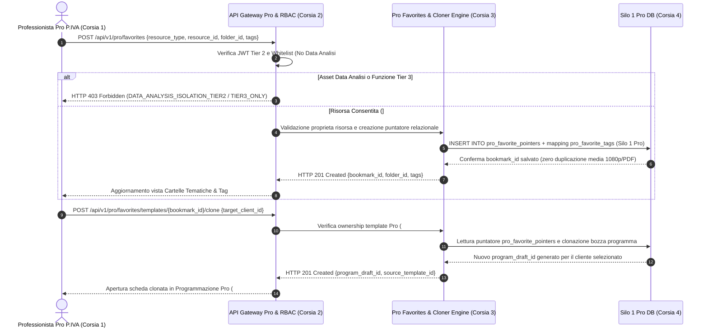

# Capitolato Tecnico: Flow 6B – Preferiti Pro: Cartelle Tematiche, Tag, Template Riutilizzabili & Fonti (T7 Pro P.IVA)

## 1. Identificativo & Titolo Ufficiale
- **Badge Miro Board:** `#12` (Posizione LIVE: `X: 9108.26, Y: 3815.00`, Miro Shape ID: `3458764688417722770`, Nodi ISO: `16`)
- **Codice Univoco:** `FLOW-6B`
- **Titolo Formale:** SOFTWARE 2 (B2B PRO P.IVA) - FLOW 6B: PREFERITI PRO - CARTELLE TEMATICHE, TAG, VIDEO 1080P, TEMPLATE & FONTI SCIENTIFICHE
- **Board Miro Online:** `uXjVEbo6L2o=` (Zona 4, Riga 2: Partita IVA / Coaches & Fisioterapisti, Colonna 6: Preferiti)
- **Diagramma Sorgente:** [flow-6b-physio-rehab-rom.mmd](../02-miro-zones-and-swimlanes/18-flowcharts/software-2-pro-b2b/flow-6b-physio-rehab-rom.mmd)
- **Riferimento Glossario:** [Glossario Tecnico Vivente](00-GLOSSARIO-TERMINI-TECNICI.md) (Voci: [Puntatore Relazionale Preferiti](00-GLOSSARIO-TERMINI-TECNICI.md#puntatore-relazionale-preferiti-zero-duplication-bookmark), [Cartelle Tematiche & Tag Personalizzati](00-GLOSSARIO-TERMINI-TECNICI.md#cartelle-tematiche-tag-personalizzati-preferiti-pro), [Template Riutilizzabili Preferiti](00-GLOSSARIO-TERMINI-TECNICI.md#template-riutilizzabili-preferiti-clonazione-modelli-pro), [Separazione Database Data Analisi vs Catalogo](00-GLOSSARIO-TERMINI-TECNICI.md#separazione-database-data-analisi-vs-catalogo-isolamento-tier-2), [Gestione Preferiti Studi Scientifici](00-GLOSSARIO-TERMINI-TECNICI.md#gestione-preferiti-studi-scientifici)).
- **Nota di Governance & Slug Storico (Parking Note):** Il modulo precedentemente assegnato allo slot `#12` (*Physio Rehab Protocols, Goniometro ROM & Scala VAS*) e stato parcheggiato per una futura colonna dedicata alla Fisioterapia Clinica nell'ecosistema T7. Lo slug fisico del file (`12-software-2-flow-6b-physio-rehab-rom.md`) e il relativo sorgente `.mmd` restano invariati per preservare la continuita dei riferimenti storici Git e Miro.

---

## 2. Obiettivo di Business & Target Utente

### Guida Pratica per Non Tecnici: Cos'e questo modulo per un umano?
Un personal trainer con Partita IVA, un preparatore atletico o un fisioterapista accumula ogni mese decine di esercizi chiave, video personalizzati girati con i propri clienti, schede riusabili e articoli scientifici di riferimento. Una semplice lista piatta non basta piu: servono ordine, rapidita di recupero e riutilizzo immediato dei modelli di lavoro.
**La sezione Preferiti Pro di T7 (Tier 2)** trasforma i segnalibri in un vero archivio personale da studio professionale:
- Oltre agli esercizi standard 3D, puoi salvare nei Preferiti i tuoi **Video Personalizzati 1080p** creati nel Catalogo Pro (`#08`);
- Puoi salvare i tuoi **Programmi e Template riutilizzabili** dalla Programmazione (`#09`) per clonarli con un clic come modello di partenza per nuovi clienti, risparmiando ore di lavoro ripetitivo;
- Puoi salvare le **Fonti Scientifiche** (studi Open Access e Schede Tecniche di Sintesi) e collegare i tuoi **appunti digitali locali** creati nell'Area Studio della Libreria Fonti (`#11`);
- Puoi organizzare tutto in **Cartelle Tematiche personali** e applicare **Tag personalizzati** (es. *"Protocolli Ipertrofia"*, *"Articoli Nutrizione"*, *"Riatletizzazione Spalla"*) per filtrare istantaneamente cio che ti serve;
- **Separazione trasparente di fascia:** i video e i dati della sezione **Data Analisi (`#10`)** restano rigorosamente separati su un database dedicato e non possono essere salvati nei Preferiti Tier 2; inoltre l'archivio resta 100% personale (nessuna condivisione multi-staff, nessuna AI e nessun RAG in questa fascia).

### Specifiche di Business & Metriche
- **Target Utente:** Coach professionisti, personal trainer con P.IVA, chinesiologi e fisioterapisti autonomi (Tier 2 - B2B Pro P.IVA).
- **Problema Risolto:** Velocizzare la creazione di nuovi programmi tramite clonazione di template preferiti e centralizzare in un'unica tassonomia personale (cartelle + tag) esercizi, video 1080p e fonti scientifiche senza duplicare file multimediali.
- **Stato Gap Analysis (Regola 10):** Arancione (`#e67e22` - Nuovo modulo Hub Preferiti Pro su Silo 1 Pro con bridge IndexedDB locale per riferimenti Area Studio).
- **Parking Architetturale:** Il precedente flusso *Physio Rehab Protocols, Goniometro ROM & Scala VAS* resta archiviato nel backlog architetturale per futura riallocazione in una colonna dedicata alla Riabilitazione Clinica.
- **Metriche Chiave (KPI):**
  - Tempo di filtro deterministico per Cartella Tematica + Tag multipli: $< 180\text{ ms}$ p95;
  - Tempo di clonazione di un Template preferito verso un nuovo cliente: $< 350\text{ ms}$ p95;
  - Duplicazione binaria video 1080p / schede / PDF: $0\%$ (100% puntatori relazionali su `Silo 1 Pro`);
  - Blocco cross-DB su tentativi di salvataggio asset Data Analisi (`#10`), AI, RAG o Team Share: $100\%$ HTTP `403 Forbidden`.

---

## 3. Attori & Architettura a 4 Corsie (Swimlanes)

1. **Corsia 1: Thin Client UI/UX (Hub Preferiti Pro React 18 / PWA + Bridge IndexedDB):**
   - Vista strutturata con barra laterale **Cartelle Tematiche personali** (singolo livello tematico), barra filtro **Tag personalizzati** e selettore operativo (*Esplora Cartelle/Tag*, *Salva Puntatore*, *Clona Template per Cliente*);
   - **Card Locali di Passaggio (Regola 10 - Zero Laser Beams):** transizioni rapide contestuali verso Catalogo & Video 1080p (`#08`), Programmazione & Template (`#09`) e Libreria Fonti & Area Studio (`#11`);
   - Risoluzione client-side dei soli riferimenti agli appunti digitali locali salvati in `IndexedDB` (`T7_StudyArea_DB` di `#11`), senza caricare annotazioni locali sul cloud;
   - Gestione completa dei **4 Stati UI** (`Empty State`, `Loading State`, `Populated State`, `Error / Fallback State`).
2. **Corsia 2: API Gateway & Pro RBAC Isolation Shield (Envoy):**
   - Autenticazione JWT Pro P.IVA (`tier: TIER_2_PRO`) con verifica stato attivo abbonamento professionale;
   - **Decisione RBAC Pro & Separazione DB Tier 2:** ammette esclusivamente puntatori verso `CATALOG_EXERCISE_3D`, `PRO_CUSTOM_VIDEO_1080P`, `PRO_PROGRAM_TEMPLATE`, `SCIENTIFIC_SOURCE_OA`, `SCIENTIFIC_SOURCE_SUMMARY` e `LOCAL_STUDY_NOTE_REF`;
   - **Blocco Rigoroso (HTTP 403):** respinge categoricamente qualsiasi puntatore originato da **Data Analisi (`#10`)**, qualsiasi richiesta di condivisione Team/Staff, qualsiasi query di ricerca AI/semantica e qualsiasi sync RAG.
3. **Corsia 3: Server Scatola Nera (Deterministic Pro Favorites & Template Cloner - Cloud Run):**
   - **100% deterministico** (zero AI, zero embedding, zero RAG);
   - **Gestore Puntatori Relazionali Pro:** verifica integrita referenziale e proprieta del professionista sulle risorse sorgenti (`#08`, `#09`, `#11`) e registra il puntatore senza duplicare video 1080p ne documenti;
   - **Motore Filtro Cartelle & Tag:** esegue query relazionali deterministiche per `folder_id` e intersezione di `tag_slug` con ordinamento per aggiornamento o titolo;
   - **Clonatore Template Cliente:** a partire da un puntatore di tipo `PRO_PROGRAM_TEMPLATE`, invoca in modo transazionale il servizio di Programmazione Pro (`#09`) per creare una nuova bozza di scheda personalizzabile assegnata a un singolo cliente 1:1.
4. **Corsia 4: Database Tripartito (Silo 1 Pro - Partition Professionisti P.IVA):**
   - Tabelle dedicate su `Silo 1 Pro` (PostgreSQL, rigorosamente separate dal database Data Analisi Tier 2 e da Silo 2 Club Bunker):
     - `pro_favorite_folders` (cartelle tematiche personali del professionista);
     - `pro_favorite_tags` (catalogo tag personali e tabella di join `pro_favorite_pointer_tags`);
     - `pro_favorite_pointers` (puntatori relazionali leggeri con check constraint che esclude i tipi `DATA_ANALYSIS_*`).

---

### Sequence Diagram Asincrono del Ciclo di Vita (FLOW-6B)



---

## 4. Flusso Passo-Passo

### Livello A: Guida Operativa & User Journey Narrativo
1. **Accesso all'Hub Preferiti Pro:** Il professionista apre la sezione "Preferiti" e visualizza le proprie **Cartelle Tematiche** (es. *"Protocolli Ipertrofia"*, *"Articoli Nutrizione"*, *"Video Tecnica 1080p"*) insieme ai filtri rapidi per **Tag**.
2. **Salvataggio Multicanale:**
   - Dal **Catalogo Pro (`#08`)** salva sia esercizi 3D standard sia i propri video dimostrativi 1080p personalizzati;
   - Dalla **Programmazione Pro (`#09`)** salva programmi completi contrassegnandoli come **Template riutilizzabili**;
   - Dalla **Libreria Fonti (`#11`)** salva articoli Open Access, Schede Tecniche di Sintesi e il collegamento rapido ai propri appunti digitali locali dell'Area Studio.
3. **Organizzazione per Cartelle e Tag:** Durante o dopo il salvataggio, il coach assegna il puntatore a una cartella tematica e aggiunge uno o piu tag descrittivi per ritrovare all'istante il materiale in studio o in palestra.
4. **Clonazione Template su Nuovo Cliente:** Quando arriva un nuovo cliente, il coach apre la cartella *"Protocolli Ipertrofia"*, tocca *"Usa come modello"* su un template salvato e genera subito una bozza personalizzabile su misura per quel singolo cliente in `#09` senza intaccare il modello originale.
5. **Garanzia di Isolamento DB Tier 2:** Se il professionista tenta di salvare nei Preferiti un video o un report proveniente da **Data Analisi (`#10`)** o di condividere una cartella con uno staff di squadra, il sistema applica il blocco di fascia con messaggio chiaro e trasparente sull'evoluzione a Tier 3.

#### Tabella KPI di Accettazione Operativa
| Metrica / Parametro KPI | Obiettivo Target | Tolleranza Accettabile | Azione Fallback / Allerta |
| :--- | :--- | :--- | :--- |
| **Latenza Filtro Cartelle + Tag (`GET`)** | $< 180\text{ ms}$ p95 | $\le 350\text{ ms}$ | Paginazione incrementale e reset filtri |
| **Latenza Clonazione Template (`POST`)** | $< 350\text{ ms}$ p95 | $\le 700\text{ ms}$ | Transazione atomica rollback su errore |
| **Integrita Separazione DB Data Analisi** | $100\%$ blocchi `403` su `#10` | $0\%$ contaminazione cross-DB | Alert sicurezza su Gateway + DB constraint |
| **Duplicazione Media Video 1080p / PDF** | $0\%$ (solo puntatori) | $0\%$ (invariante assoluto) | Verifica schema payload in CI/CD |

---

### Livello B: Deep-Dive Tecnico per Sviluppatori
- **Allineamento 1:1 ai 16 Nodi ISO (`FLOW-6B`):**
  1. `START` (Corsia 1): Inizio: Accesso Hub Preferiti Pro (Tier 2 P.IVA).
  2. `PRO_HUB_VIEW` (Corsia 1): Workspace Preferiti Pro con cartelle tematiche, tag personalizzati e barra filtri deterministici.
  3. `DEC_PRO_ACTION` (Corsia 1 - Rombo): Scelta operativa del professionista (apri sorgente, organizza cartelle/tag, clona template cliente).
  4. `NAV_CARD_PRO_SRC` (Corsia 1): Card di passaggio locale verso Catalogo & Video 1080p (`#08`), Programmi & Template (`#09`), Fonti & Appunti Locali (`#11`).
  5. `UI_FOLDER_TAG_MGR` (Corsia 1): Gestione cartelle tematiche & tag (es. *"Protocolli Ipertrofia"*, *"Articoli Nutrizione"*) o clonazione template cliente + bridge riferimenti `IndexedDB` locali (`T7_StudyArea_DB`).
  6. `ALERT_PRO_BLOCK` (Corsia 1): Avviso separazione DB & Tier 2 (Data Analisi `#10`, AI, RAG e condivisione team non ammessi in Tier 2).
  7. `RENDER_PRO_VIEW` (Corsia 1): Rendering vista Pro filtrata per cartella/tag con i 4 Stati UI (`Empty`, `Loading`, `Populated`, `Error / Fallback`).
  8. `GW_PRO_API` (Corsia 2): Ricezione richiesta autenticata P.IVA `/api/v1/pro/favorites` (Folders, Tags, Pointers, Clone).
  9. `GW_PRO_RBAC` (Corsia 2 - Rombo): Policy Tier 2: verifica tipo consentito e blocco categorico verso Data Analisi (`#10`), AI, RAG e condivisione Team.
  10. `GW_PRO_403` (Corsia 2): Risposta bloccante HTTP `403 Forbidden` (separazione DB Tier 2 o funzione riservata a Tier 3).
  11. `SRV_PRO_POINTERS` (Corsia 3): Gestore puntatori relazionali Pro (100% deterministico, NO AI, NO RAG, zero duplicazione media).
  12. `SRV_FOLDER_FILTER` (Corsia 3): Motore filtro cartelle tematiche & tag personalizzati (query relazionale deterministica).
  13. `SRV_TEMPLATE_CLONE` (Corsia 3): Clonatore template programma (genera copia modello base per altro cliente 1:1 su `#09`).
  14. `DB_PRO_FOLDERS_TAGS` (Corsia 4 - Cilindro): Silo 1 Pro tabelle `pro_favorite_folders` & `pro_favorite_tags` (proprieta esclusiva P.IVA).
  15. `DB_PRO_POINTERS` (Corsia 4 - Cilindro): Silo 1 Pro tabella `pro_favorite_pointers` (riferimenti `#08`/`#09`/`#11`, separata dal DB Data Analisi `#10`).
  16. `END_FLOW` (Corsia 4): Fine: Preferiti Pro organizzati, filtrati o template clonato per nuovo cliente.
- **Gestione Appunti Digitali Locali (`#11`):** Quando il professionista salva un riferimento ai propri appunti locali dell'Area Studio, `pro_favorite_pointers` memorizza solo l'identificativo opaco `local_study_note_id` e il `paper_id` associato; i tratti SVG/Canvas e le note testuali restano confinati in `IndexedDB` sul dispositivo (coerentemente con `FLOW-5B`). Se l'utente apre il puntatore da un altro browser privo del record `IndexedDB`, la UI degrada in modo pulito aprendo la Scheda di Sintesi cloud e segnalando che gli appunti locali risiedono sul dispositivo di origine.
- **Indici PostgreSQL (`Silo 1 Pro`):** Indice B-tree `(pro_user_id, folder_id, updated_at DESC)`, indice unico `(pro_user_id, resource_type, resource_id)` e indice composito `(tag_id, bookmark_id)` per filtri multi-tag senza scansioni sequenziali.

---

## 5. Rami Decisionali & Gestione Errori

### Matrice dei Rami Decisionali
| Bivio Decisionale | Condizione Logica | Ramo SI / Positivo | Ramo NO / Negativo |
| :--- | :--- | :--- | :--- |
| `GW_PRO_RBAC` | Asset proveniente da `#08`, `#09` o `#11`, scope strettamente personale, zero AI/RAG e zero Data Analisi `#10`? | Inoltra a Corsia 3 (`SRV_PRO_POINTERS` / `SRV_FOLDER_FILTER`) | Blocca con HTTP `403 Forbidden` (`DATA_ANALYSIS_ISOLATION_TIER2` o `TIER3_FEATURE_LOCKED`) |
| `DEC_TEMPLATE_CLONE` | Il puntatore selezionato ha `resource_type = 'PRO_PROGRAM_TEMPLATE'` e cliente 1:1 valido? | Clona bozza scheda in `#09` preservando il template originale | Rifiuta clonazione con HTTP `400` / `403` (blocco broadcast multi-atleta) |
| `CHECK_LOCAL_NOTE_SYNC` | Il puntatore `LOCAL_STUDY_NOTE_REF` trova la chiave corrispondente in `IndexedDB` locale? | Apre Area Studio Locale con annotazioni ripristinate | Apre Scheda di Sintesi cloud con nota informativa su storage locale |

### Gestione Obbligatoria dei 4 Stati UI
| Stato UI | Condizione Scatenante | Elementi Visibili a Schermo | Azione Utente Permessa |
| :--- | :--- | :--- | :--- |
| **Empty State** | Professionista senza preferiti o cartella tematica vuota | Vista guidata con pulsante *"Crea la tua prima Cartella Tematica"* e 3 card di passaggio rapido verso Catalogo 1080p (`#08`), Programmazione (`#09`) e Libreria Fonti (`#11`) | Creazione cartella, navigazione verso `#08`, `#09` o `#11` |
| **Loading State** | Caricamento cartelle/tag o clonazione template in corso | Skeleton strutturato per sidebar cartelle, chip tag e griglia card preferiti; spinner su pulsante *"Clona Template"* | Attesa o annullamento filtro |
| **Populated State** | Almeno 1 puntatore Pro corrispondente ai filtri attivi | Elenco filtrato con badge sorgente (`Esercizio 3D`, `Video 1080p`, `Template`, `Fonte / Appunti`), chip tag, cartella assegnata e azioni rapide (*Apri*, *Clona*, *Sposta*, *Rimuovi*) | Apertura risorsa, clonazione 1:1, gestione cartelle/tag |
| **Error / Fallback State** | Errore rete, blocco `403` su Data Analisi (`#10`), limite cartelle/tag superato o nota `IndexedDB` assente su altro device | Alert contestuale chiaro senza `NaN`/`undefined`; nel caso `403` spiegazione della separazione DB Tier 2 e del perimetro Tier 3; fallback su apertura scheda cloud se nota locale non trovata | Reset filtri, riprova operazione, rimozione puntatore orfano o apertura modale info Tier 3 |

---

## 6. Contratti Dati JSON & Matrice Errori HTTP

### Contratto Richiesta Salvataggio Preferito Pro (`POST /api/v1/pro/favorites`)
```http
POST /api/v1/pro/favorites
Authorization: Bearer <jwt_tier2_pro_token>
Content-Type: application/json
```
```json
{
  "resource_type": "PRO_PROGRAM_TEMPLATE",
  "resource_id": "prog_pro_hypertrophy_12w",
  "folder_id": "fld_pro_88412",
  "tags": ["protocolli-ipertrofia", "upper-lower", "intermedio"],
  "is_reusable_template": true
}
```

### Contratto Risposta Query Filtrata Cartelle & Tag (`GET /api/v1/pro/favorites?folder_id=fld_pro_88412&tags=protocolli-ipertrofia`)
```json
{
  "tier": "TIER_2_PRO",
  "scope": "PERSONAL_ONLY",
  "data_analysis_isolated": true,
  "folder": {
    "folder_id": "fld_pro_88412",
    "name": "Protocolli Ipertrofia"
  },
  "total_count": 3,
  "items": [
    {
      "bookmark_id": "pbm_71a92c10-14cc-4982-9a11-31f0a1220041",
      "resource_type": "PRO_CUSTOM_VIDEO_1080P",
      "resource_id": "vid_1080p_rdl_coach_09",
      "source_flow": "FLOW-2B",
      "display_title": "Romanian Deadlift - Cue Bacino (1080p)",
      "tags": ["protocolli-ipertrofia", "catena-posteriore"],
      "saved_at_utc": "2026-11-17T09:10:00Z"
    },
    {
      "bookmark_id": "pbm_90b34f55-61de-4019-b4d0-77c2e1998210",
      "resource_type": "PRO_PROGRAM_TEMPLATE",
      "resource_id": "prog_pro_hypertrophy_12w",
      "source_flow": "FLOW-3B",
      "display_title": "Template Ipertrofia 12 Settimane (Riutilizzabile)",
      "is_reusable_template": true,
      "tags": ["protocolli-ipertrofia", "upper-lower"],
      "saved_at_utc": "2026-11-16T16:20:00Z"
    },
    {
      "bookmark_id": "pbm_44e11d82-73ba-4c22-8f19-09a7d3110884",
      "resource_type": "SCIENTIFIC_SOURCE_SUMMARY",
      "resource_id": "syn_90214",
      "local_study_note_ref": "idb_note_syn_90214",
      "source_flow": "FLOW-5B",
      "display_title": "Scheda Sintesi: Velocity Loss Thresholds Squat + Appunti Locali",
      "tags": ["protocolli-ipertrofia", "articoli-nutrizione"],
      "saved_at_utc": "2026-11-15T14:05:00Z"
    }
  ]
}
```

### Schema Relazionale (Database Silo 1 Pro - PostgreSQL)
- `pro_favorite_folders`: `folder_id UUID PK`, `pro_user_id UUID NOT NULL`, `folder_name VARCHAR(80) NOT NULL`, `created_at TIMESTAMPTZ`, `UNIQUE (pro_user_id, folder_name)`.
- `pro_favorite_tags`: `tag_id UUID PK`, `pro_user_id UUID NOT NULL`, `tag_slug VARCHAR(48) NOT NULL`, `tag_label VARCHAR(48) NOT NULL`, `UNIQUE (pro_user_id, tag_slug)`.
- `pro_favorite_pointers`: `bookmark_id UUID PK`, `pro_user_id UUID NOT NULL`, `folder_id UUID REFERENCES pro_favorite_folders(folder_id) ON DELETE SET NULL`, `resource_type VARCHAR(40) NOT NULL CHECK (resource_type IN ('CATALOG_EXERCISE_3D','BASE_PROGRAM','PRO_CUSTOM_VIDEO_1080P','PRO_PROGRAM_TEMPLATE','SCIENTIFIC_SOURCE_OA','SCIENTIFIC_SOURCE_SUMMARY','LOCAL_STUDY_NOTE_REF'))`, `resource_id VARCHAR(64) NOT NULL`, `local_study_note_ref VARCHAR(64) NULL`, `is_reusable_template BOOLEAN DEFAULT FALSE`, `created_at TIMESTAMPTZ`, `UNIQUE (pro_user_id, resource_type, resource_id)`.
- `pro_favorite_pointer_tags`: `bookmark_id UUID REFERENCES pro_favorite_pointers(bookmark_id) ON DELETE CASCADE`, `tag_id UUID REFERENCES pro_favorite_tags(tag_id) ON DELETE CASCADE`, `PRIMARY KEY (bookmark_id, tag_id)`.

### Matrice Errori HTTP a 6 Colonne

| Codice HTTP | Errore Interno | Condizione Scatenante | Risposta Client | Azione Automatica Client | Ripristino Utente |
| :--- | :--- | :--- | :--- | :--- | :--- |
| `400 Bad Request` | `INVALID_FOLDER_OR_TAG` | Nome cartella vuoto, tag > 48 caratteri o caratteri non validi | `{"error": "Nome cartella o tag non valido"}` | Evidenzia il campo del form in rosso | Correggere nome cartella o tag e risalvare |
| `401 Unauthorized` | `PRO_SESSION_EXPIRED` | Token JWT Tier 2 scaduto o profilo P.IVA sospeso | `{"error": "Sessione Pro scaduta, riesegui l'accesso"}` | Reindirizza al login Pro mantenendo lo stato filtri | Rieseguire l'autenticazione professionale |
| `403 Forbidden` | `DATA_ANALYSIS_ISOLATION_TIER2` | Tentativo di salvare nei Preferiti un video o report di Data Analisi (`#10`) | `{"error": "In Tier 2 i dati di Data Analisi restano isolati e non sono salvabili nei Preferiti"}` | Blocca l'azione e mostra banner informativo sulla separazione DB | Consultare Data Analisi nella propria sezione o passare a Tier 3 |
| `403 Forbidden` | `TIER3_FEATURE_LOCKED` | Tentativo di usare ricerca semantica AI, RAG, albero annidato o condivisione Team/Staff | `{"error": "Condivisione Team, AI semantica e RAG sono riservati al piano Tier 3 Elite"}` | Mostra modale informativa comparativa Tier 2 vs Tier 3 | Usare cartelle e tag personali o richiedere upgrade Enterprise |
| `409 Conflict` | `DUPLICATE_FOLDER_NAME` | Creazione di una cartella tematica con nome gia esistente per lo stesso utente Pro | `{"error": "Esiste gia una cartella con questo nome"}` | Mantiene aperto il modale evidenziando il conflitto | Scegliere un nome distinto per la cartella |
| `503 Service Unav` | `SILO1_PRO_UNAVAILABLE` | Indisponibilita temporanea dello shard Silo 1 Pro o timeout clonazione `#09` | `{"error": "Archivio Preferiti Pro temporaneamente non disponibile"}` | Attiva `Error / Fallback State` preservando eventuali filtri | Ripetere l'operazione al ripristino del servizio |

---

## 7. Ereditarieta di Tier & Sblocco Funzionalita a Cascata

- **Cosa eredita da Tier 1 (`FLOW-6A`):** Architettura 100% deterministica a puntatori relazionali (`zero duplicazione media`), salvataggio di esercizi standard 3D dal Catalogo (`#02`) e programmi base (`#03`).
- **Cosa sblocca Tier 2 (`FLOW-6B`):**
  - Salvataggio dei propri **Video Personalizzati 1080p (`#08`)**;
  - Salvataggio di **Programmi e Template riutilizzabili (`#09`)** con clonazione 1:1 per nuovi clienti;
  - Salvataggio di **Fonti Scientifiche** (Open Access e Schede di Sintesi) e collegamenti ai propri **appunti digitali locali (`IndexedDB`)** dalla Libreria Fonti (`#11`);
  - Organizzazione tramite **Cartelle Tematiche personali** e **Tag personalizzati**.
- **Cosa NON fa Tier 2 (Vincoli Invalicabili di Fascia):**
  - **Data Analisi (`#10`) NON salvabile nei Preferiti Tier 2** (separazione database obbligatoria);
  - **NO AI** e **NO RAG** (ricerca e filtri 100% deterministici);
  - **NO condivisione Team/Staff** e **NO pinning condiviso** (archivio strettamente personale del professionista P.IVA);
  - **NO alberi gerarchici complessi `ltree` multi-livello** e **NO referti clinici multi-ruolo**.
- **Passaggio a Tier 3 (`FLOW-6C` - Elite Teams):** Sblocca l'integrazione totale All-in-One (Video 4K `#14`, Programmi stagionali `#15`, Data Analisi & Readiness `#16`, Fonti `#17`, documenti RAG/Match/Referti), il **Doppio Livello Personale vs Team/Staff con Pinning**, l'**Albero Cartelle `ltree`**, la **Ricerca Ibrida Full-Text `tsvector` + AI Semantica `pgvector`** con Gemini SDK (`@google/genai`) e il **Filtro Silenzioso RBAC + PostgreSQL RLS** a tutela del Segreto Medico (GDPR Art. 9).
