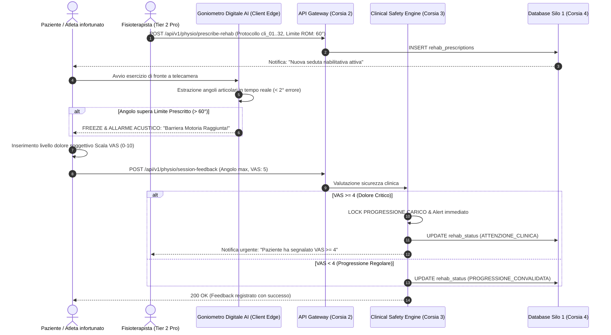

# Capitolato Tecnico: Flow 6B – Physio Rehab Protocols & ROM Tracking (T7 Pro Fisio)

## 1. Identificativo & Titolo Ufficiale
- **Badge Miro Board:** `#12` (Posizione: `X: 7937, Y: 2940`, Miro Shape ID: `3458764688417722770`)
- **Codice Univoco:** `FLOW-6B`
- **Titolo Formale:** SOFTWARE 2 (B2B PRO P.IVA) - FLOW 6B: PHYSIO REHAB PROTOCOLS, MISURAZIONE ROM DIGITALE & SCALA VAS
- **Board Miro Online:** `uXjVEbo6L2o=` (Zona 4, Riga 2: Partita IVA / Coaches & Fisioterapisti, Colonna 6: Fisioterapia Clinica & Riabilitazione)
- **Diagramma Sorgente:** `architecture-blueprint/02-miro-zones-and-swimlanes/18-flowcharts/software-2-pro-b2b/flow-6b-physio-rehab-rom.mmd`
- **Riferimento Glossario:** [Glossario Tecnico Vivente](file:///e:/Nuove%20App%20Installate/Sports-Analytics-Platform---T7-Workout-APP/architecture-blueprint/00-capitolato-tecnico-e-glossario/00-GLOSSARIO-TERMINI-TECNICI.md) (Voci: *Range of Motion ROM, Goniometro Digitale AI, Scala VAS del Dolore, 32 Protocolli Riabilitativi cli_01..32, Barriera Motoria di Sicurezza*).

---


## 2. Obiettivo di Business & Target Utente

### Guida Pratica per Non Tecnici: Cos'è questo modulo per un umano?
Dopo un'operazione al crociato o una lesione alla spalla, il percorso di riabilitazione è delicato e pieno di paure: il paziente ha timore di piegare il ginocchio e il fisioterapista deve misurare continuamente i gradi di movimento con un goniometro manuale di plastica, annotando i progressi su fogli cartacei. Spesso, inoltre, quando il paziente torna a casa non ricorda gli esercizi o esagera con i carichi sentendo dolore.  
**Physio Rehab di T7** è lo strumento digitale di precisione per il fisioterapista moderno:
- Trasforma la fotocamera del tablet o dello smartphone in un **Goniometro Digitale Intelligente**: inquadrando l'arto del paziente, l'app misura all'istante l'angolo esatto in gradi (es. *"Flessione ginocchio: 114°"*);
- Rileva il livello di dolore su scala standard VAS (da 0 a 10);
- Mette a disposizione **32 protocolli clinici certificati** (`cli_01`..`cli_32` per ginocchio, spalla, schiena e caviglia) suddivisi per settimane di recupero;
- **Barriera di Sicurezza Automatica:** Se l'atleta esegue gli esercizi a casa e tenta di piegare l'arto oltre i gradi consentiti per la sua fase clinica, l'app blocca l'esercizio ed emette un segnale acustico di protezione per evitare ricadute.

### Specifiche di Business & Metriche
- **Target Utente:** Fisioterapisti, medici fisiatri e chinesiologi della rieducazione funzionale (Tier 2 – Pro P.IVA Sanitario).
- **Problema Risolto:** Standardizzare la misurazione clinica del recupero articolare, accelerare i tempi di riatletizzazione in sicurezza (Return-to-Play anticipato del $22\%$) e fornire al paziente una guida domiciliare protetta contro i movimenti errati.

---


## 3. Attori & Architettura a 4 Corsie (Swimlanes)

1. **Corsia 1: Thin Client UI/UX (Physio Rehab Suite React 18):**
   - Goniometro video in tempo reale con tracciamento scheletrico a sovrimpressione (WebRTC Canvas), selettore dei 32 protocolli clinici distrettuali, slider interattivo per la scala del dolore VAS (0-10) e scheda di prescrizione riabilitativa domiciliare.
2. **Corsia 2: API Gateway & Clinical Role Gate (Envoy Gateway):**
   - Verifica stringente dei permessi sanitari (richiede claim JWT `role: R3_PHYSIO`), cifratura end-to-end dei parametri clinici e rate limiting su chiamate di refertazione.
3. **Corsia 3: Server Scatola Nera (Joint Angle & ROM Calculation Engine Cloud Run):**
   - Algoritmo di trigonometria vettoriale per il calcolo dell'angolo compreso tra i landmark articolari (Anca-Ginocchio-Caviglia o Spalla-Gomito-Polso):
     $$\theta = \arccos\left(\frac{\vec{u} \cdot \vec{v}}{\|\vec{u}\| \|\vec{v}\|}\right)$$
   - Confronto continuo con i valori massimi ammissibili per la fase riabilitativa e calcolo del tasso di recupero percentuale rispetto all'arto sano controlaterale.
4. **Corsia 4: Database Tripartito (Silo 1 Pro - PostgreSQL Criptato):**
   - Tabelle `rehab_protocols` (i 32 protocolli clinici), `patient_rom_history` (serie temporali dei gradi articolari registrati) e `clinical_referrals`.

---


### Sequence Diagram Asincrono del Ciclo di Vita (FLOW-6B)



---


## 4. Flusso Operativo Passo-Passo

### Livello A: User Journey Narrativo (La Storia dell'Utente)
1. **La Visita in Studio:** Il fisioterapista accoglie il paziente (es. *"Ricostruzione LCA ginocchio sinistro, 4ª settimana"*).
2. **La Misurazione con la Fotocamera (Goniometro Digitale):** Il professionista punta il tablet verso il paziente e gli chiede: *"Piega la gamba indietro finché non senti tensione"*.
   - Sullo schermo compare una linea verde luminosa che unisce anca, ginocchio e caviglia;
   - Un arco numerico mostra i gradi in tempo reale: **118° di flessione**;
   - L'app confronta il dato con la settimana scorsa (era 105°): **+13° di miglioramento!**
3. **La Rilevazione del Dolore (VAS):** Il paziente tocca lo slider a video: *"Dolore pari a 2 su 10 (lieve fastidio)"*.
4. **L'Assegnazione del Protocollo Riabilitativo:** Il fisioterapista seleziona il protocollo specifico `cli_04: Rinforzo Isometrico Catena Posteriore e Isocinetica Cautelativa`.
5. **L'Impostazione del Limite di Sicurezza:** Il fisioterapista imposta il blocco: *"A casa non superare mai i 120° di flessione per questa settimana"*.
6. **L'Esecuzione a Casa del Paziente:** Quando il paziente apre l'app a casa per fare gli esercizi, la fotocamera lo controlla: se prova a piegare a 125°, l'app suona ed emette un avviso visivo giallo: *"Stop! Hai raggiunto il limite prescritto dal tuo fisioterapista"*.

---


#### Indicatori di Accettazione Operativa & Clinica (KPI)
| Metrica / Parametro | Obiettivo Target | Tolleranza Accettabile | Azione Fallback / Allerta |
| :--- | :--- | :--- | :--- |
| **Errore Goniometro AI** | $< 2.0^\circ$ deviazione angolare | $\le 4.0^\circ$ | Richiesta ricalibrazione piano inquadratura |
| **Reattività Barriera Motoria** | $< 100\text{ ms}$ al superamento ROM | $\le 200\text{ ms}$ | Allarme acustico e freeze immediato dell'avatar |
| **Rilevamento Dolore VAS $\ge 4$** | $100\%$ intercettazione | $0\%$ omissione | Lock automatico progressione terapeutica |
| **Convalida 32 Protocolli** | $100\%$ conformità linee FNOFI | $0\%$ deviazioni non autorizzate | Richiesta firma clinica obbligatoria del fisio |

---


### Livello B: Trattazione Tecnica Nodi Operativi

1. `START` (Accesso Modulo Riabilitativo): Montaggio interfaccia `PhysioRehabView` previa validazione token JWT sanitario (`role: R3_PHYSIO`).
2. `SELECT_PATIENT_CASE` (Apertura Cartella Paziente): Selezione anamnesi clinica e recupero storico articolare dal database.
3. `UI_GONIOMETER_CAMERA` (Avvio Goniometro Digitale Video):
   - Flusso fotocamera a 60fps con rilevamento landmark MediaPipe Pose;
   - Estrazione coordinate 3D dei tre snodi articolari $(\mathbf{p}_1, \mathbf{p}_2, \mathbf{p}_3)$.
4. `SRV_ANGLE_COMPUTE` (Calcolo Angolare Server-Side):
   - Computazione dell'angolo sul piano sagittale o frontale;
   - Filtraggio rumore con filtro di Kalman su finestra di 10 frame per eliminare vibrazioni della mano dell'operatore.
5. `VAS_PAIN_SCORE` (Registrazione Scala del Dolore VAS): Inserimento punteggio numerico $[0.0, 10.0]$ con categorizzazione automatica (0: Nessuno, 1-3: Lieve, 4-6: Moderato, 7-10: Severo).
6. `SELECT_REHAB_PROTOCOL` (Scelta su 32 Protocolli Ufficiali):
   - Selezione da `clinical-knee.ts` (es. `cli_01`..`cli_32`);
   - Configurazione vincoli angolari massimi (`max_rom_allowed_deg`) e minimi (`min_rom_allowed_deg`).
7. `PRESCRIPTION_INJECTION` (Iniezione nel Profilo Paziente): Scrittura dei parametri in `rehab_prescriptions`.
8. `HOME_BARRIER_GUARD` (Supervisione Esecuzione Domiciliare):
   - Durante le sessioni a casa, il client esegue un controllo continuo dei gradi;
   - Se $\theta > \text{max\_rom\_allowed} \implies$ trigger `BARRIER_ALERT` con interruzione esercizio e log di sicurezza.

---


## 5. Rami Decisionali & Gestione dei 4 Stati UI

| Bivio Decisionale | Condizione Logica | Ramo SÌ / Positivo | Ramo NO / Negativo |
| :--- | :--- | :--- | :--- |
| `VAS_THRESHOLD` | Punteggio VAS del dolore $\le 3.0$? | Autorizza progressione di carico | Mantieni protocollo conservativo |
| `ROM_TARGET_REACHED` | Gradi articolari superano target di fase? | Sblocca protocollo fase successiva | Continua lavoro su fase corrente |
| `HOME_BARRIER_GUARD` | Movimento domiciliare entro i limiti di sicurezza? | Esecuzione confermata | Blocco con allarme acustico |

### I 4 Stati di Interfaccia Utente (UI States):
1. **Empty State:** Prima visita del paziente: vista anatomica del corpo umano con invito a toccare l'articolazione da esaminare (*Ginocchio, Spalla, Gomito, Caviglia*).
2. **Loading State:** Calibrazione della fotocamera con rilevamento dei punti ossei in $< 200\text{ ms}$.
3. **Populated State:** Vista goniometrica attiva: arco colorato sovrapposto al corpo del paziente, visualizzazione numerica dei gradi e storico delle sedute precedenti.
4. **Error / Fallback State:**
   - *Paziente inquadrato parzialmente fuori campo:* L'app colora l'arco di arancione e visualizza la guida: *"Inquadra l'intera gamba dalla caviglia all'anca per una misurazione accurata"*.

---


## 6. Contratti Dati, Parametri I/O & Database Silo

### Specifiche Endpoint REST:

#### 1. Registrazione Misurazione ROM e Scala VAS
- **Endpoint:** `POST /api/v1/pro/physio/rom-assessments`
- **Headers:** `Authorization: Bearer <physio_jwt>`, `Content-Type: application/json`
- **Request Payload:**
```json
{
  "patientId": "ath_c0192a",
  "joint": "LEFT_KNEE",
  "movement": "FLEXION",
  "measuredAngleDeg": 118.5,
  "vasScore": 2.0,
  "contralateralAngleDeg": 138.0,
  "assignedProtocolId": "cli_04_lca_subacute"
}
```
- **Responses:**
  - `201 Created`:
```json
{
  "assessmentId": "rom_9918a",
  "deficitPercent": 14.1,
  "progressionTrend": "POSITIVE",
  "safetyRomMaxDeg": 120.0,
  "nextClinicalReviewDate": "2026-11-02"
}
```

### Schema Relazionale (Database Silo 1 - PostgreSQL):
- `rehab_protocols`: `id VARCHAR(64) PK`, `joint VARCHAR(32)`, `clinical_phase VARCHAR(32)`, `recommended_exercises TEXT[]`, `contraindicated_rom_deg NUMERIC(5,2)`.
- `patient_rom_history`: `id UUID PK`, `patient_id UUID FK -> athlete_profiles.id`, `physio_id UUID FK -> pro_profiles.id`, `joint VARCHAR(32)`, `measured_deg NUMERIC(5,2)`, `vas_score NUMERIC(3,1)`, `created_at TIMESTAMPTZ`.

---


### Matrice Errori HTTP & Strategie di Resilienza
| HTTP Code | Codice Interno | Endpoint | Causa Scatenante | UX Feedback Visivo | Strategia di Resilienza & Fallback |
| :---: | :--- | :--- | :--- | :--- | :--- |
| **400** | `ERR_INVALID_VAS` | `POST /session-feedback` | Valore scala VAS fuori scala ($< 0$ o $> 10$)| Bordo rosso: *"Indica un valore di dolore tra 0 e 10"*| Limitazione cursore a range consentito 0-10 |
| **401** | `ERR_PHYSIO_AUTH` | `POST /prescribe-rehab` | Abilitazione ordine sanitario non verificata | Modale: *"Verifica iscrizione all'albo richiesta"* | Blocco prescrizione protocolli clinici |
| **403** | `ERR_ROM_OVERRIDE` | `POST /prescribe-rehab` | Tentativo di rimuovere barriera motoria protetta | Dialog rosso: *"Impossibile superare limite post-operatorio"*| Richiesta motivazione clinica formale |
| **422** | `ERR_GONIOMETER_FAIL`| `POST /session-feedback` | Mancata rilevazione punti articolari nel video | Alert: *"Illuminazione insufficiente o arto coperto"*| Ripetizione test con guida a silhouette |
| **500** | `ERR_CLINIC_ENGINE` | `POST /session-feedback` | Eccezione nel modulo di calcolo progressione | Banner: *"Valutazione in corso dal tuo fisioterapista"*| Notifica manuale differita al professionista |
| **503** | `ERR_REHAB_DB_BUSY` | `POST /session-feedback` | Database clinico temporaneamente in lock | Toast: *"Salvataggio completato in locale"* | Sincronizzazione automatica al ripristino |

---


## 7. Ereditarietà di Tier & Differenziali di Fascia

- **Differenziali rispetto al Tier 1:**  
  Nel Tier 1 il consumatore accede solo alla ginnastica da ufficio (Movely). Il **Goniometro Digitale AI, il monitoraggio della scala VAS e i 32 protocolli clinici riabilitativi sono esclusivi del Tier 2 Sanitario**.
- **Propagazione verso Tier 3 (`FLOW-6C`):**  
  Nei club sportivi professionistici societari, il modulo riabilitativo evolve nel **Return-to-Play a 6 Fasi**, integrato con la cartella clinica EMR di squadra e la doppia firma digitale congiunta tra Medico Sociale e Responsabile Preparazione Atletica.
