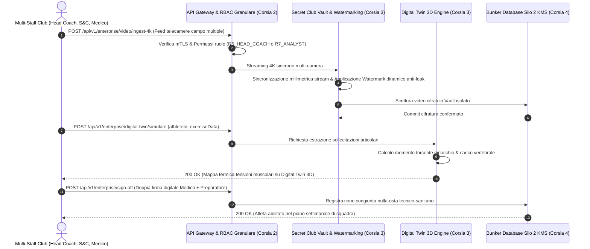

# Capitolato Tecnico: Flow 2C – Catalogo 3D, Video Pro & Libreria Club a 2 Livelli (T7 Elite Pro Teams)

## 1. Identificativo & Titolo Ufficiale
- **Badge Miro Board:** `#14` (Posizione: `X: -108, Y: 6235.66`, Miro Shape ID: `3458764688417722783`)
- **Codice Univoco:** `FLOW-2C`
- **Titolo Formale:** SOFTWARE 3 (B2B ENTERPRISE) - FLOW 2C: CATALOGO 3D, VIDEO MULTI-CAMERA 4K & LIBRERIA CLUB A 2 LIVELLI
- **Board Miro Online:** `uXjVEbo6L2o=` (Zona 4, Riga 3: High-Level Pro Teams & Enterprise, Colonna 2: Catalogo Tattico & Cockpit Multi-Staff)
- **Diagramma Sorgente:** `architecture-blueprint/02-miro-zones-and-swimlanes/18-flowcharts/software-3-elite-club-enterprise/flow-2c-multi-staff-cockpit.mmd`
- **Riferimento Glossario:** [Glossario Tecnico Vivente](file:///e:/Nuove%20App%20Installate/Sports-Analytics-Platform---T7-Workout-APP/architecture-blueprint/00-capitolato-tecnico-e-glossario/00-GLOSSARIO-TERMINI-TECNICI.md) (Voci: *Secret Club Vault, Digital Twin 3D Squadra, Multi-Camera 4K Sync, Doppia Firma Digitale Tecnico-Sanitaria, Watermarking Dinamico Anti-Leak*).

---


## 2. Obiettivo di Business & Target Utente

### Guida Pratica per Non Tecnici: Cos'è questo modulo per un umano?
Nei grandi club professionistici, gli schemi su palla inattiva, le posture speciali di riatletizzazione e gli esercizi di prevenzione elaborati dallo staff sono **segreti industriali e sportivi custoditi gelosamente**. Se una squadra rivale scopre in anticipo come batte i calci d'angolo o come allena i propri attaccanti, il vantaggio competitivo svanisce.  
**Il Catalogo d'Élite di T7** organizza il sapere tecnico della società su **due livelli separati**:
1. **Libreria Pubblica Globale:** I 296 esercizi standard di T7 con l'Avatar 3D;
2. **Secret Club Vault (Cassaforte Segreta del Club):** Una sezione accessibile solo allo staff societario, dove vengono caricati i video in altissima definizione (4K a 120fps da più angolazioni) registrati sul campo d'allenamento;
- Lo staff può passare in un attimo dal video reale al Digital Twin 3D;
- **Doppia Firma Obbligatoria Medico + Preparatore:** Nessun esercizio riabilitativo personalizzato può essere somministrato a un calciatore di alto valore se non è stato approvato digitalmente sia dal Medico Sociale che dal Responsabile della Preparazione;
- **Watermark Anti-Fuga di Notizie:** Se qualcuno visualizza un video sul tablet, sullo sfondo compare in trasparenza il suo nome e l'orario: se facesse una foto allo schermo per mandarla a un giornalista, verrebbe identificato all'istante.

### Specifiche di Business & Metriche
- **Target Utente:** Head Coach, Preparatori Atletici (S&C), Medici Sociali e Match Analyst di club professionistici (Tier 3 – B2B Enterprise).
- **Problema Risolto:** Proteggere i segreti tattici e i protocolli riabilitativi brevettati dal club societario (Zero Data Leaks), garantendo che ogni esercizio somministrato all'atleta sia validato congiuntamente da staff tecnico e sanitario.

---


## 3. Attori & Architettura a 4 Corsie (Swimlanes)

1. **Corsia 1: Thin Client UI/UX (Multi-Staff Cockpit React 18):**
   - Interfaccia avanzata multi-schermo con supporto a griglia multi-camera 4K, toggle dinamico "Video Reale vs Digital Twin 3D", pannello di validazione a doppia firma digitale con lettore smart-card o FIDO2, e watermark video dinamico impresso a livello shader WebGL.
2. **Corsia 2: API Gateway & Enterprise Stream Gate (Envoy mTLS):**
   - Verifica credenziali mTLS con certificato di club, controllo del ruolo applicativo e streaming video sicuro HLS criptato con chiavi temporanee rotanti (DRM Widevine / FairPlay).
3. **Corsia 3: Server Scatola Nera (Digital Twin & Dual-Signature Engine Cloud Run):**
   - Sincronizzazione temporale delle clip multi-camera da campo, binding crittografico della doppia firma digitale (SHA-256 tra chiave privata Medico e Preparatore) e rendering del watermark forense invisibile.
4. **Corsia 4: Database Tripartito (Silo 2 - Encrypted Club Vault PostgreSQL):**
   - Tabelle `club_secret_catalog`, `joint_medical_approvals` e `anti_leak_audit_logs`.

---


### Sequence Diagram Asincrono del Ciclo di Vita (FLOW-2C)



---


## 4. Flusso Operativo Passo-Passo

### Livello A: User Journey Narrativo (La Storia dell'Utente)
1. **L'Accesso alla Sezione Esercizi del Club:** Il preparatore e il medico sociale aprono il tablet nel loro ufficio al centro sportivo.
2. **La Scelta dei Due Livelli di Catalogo:**
   - Possono consultare il catalogo generale (i 296 esercizi standard);
   - Oppure toccare *"Libreria Riservata Prima Squadra"*, accessibile solo con i permessi societari.
3. **La Registrazione con le Telecamere del Campo:** Durante l'allenamento a porte chiuse, le telecamere fisse del campo registrano un nuovo esercizio di agilità e forza esplosiva da 3 angolazioni (frontale, laterale e dall'alto).
4. **La Sincronizzazione 3D:** L'app carica le 3 angolazioni e crea il Digital Twin 3D: il preparatore può girare l'omino virtuale per mostrare al giocatore l'angolo perfetto con cui spingere sui tacchetti.
5. **La Doppia Firma Tecnico-Sanitaria:**
   - Il Preparatore firma digitalmente con la sua chiavetta FIDO2: *"Approvato per il carico neuromuscolare"*;
   - Il Medico Sociale esamina i parametri articolari e appone la sua controfirma: *"Idoneo: nessun sovraccarico per il ginocchio operato"*.
6. **La Distribuzione all'Atleta:** Solo dopo la doppia firma, l'esercizio compare sul tablet del calciatore nello spogliatoio, con impresso in trasparenza il suo codice identificativo per evitare screenshot non autorizzati.

---


#### Indicatori di Accettazione Operativa & Clinica (KPI)
| Metrica / Parametro | Obiettivo Target | Tolleranza Accettabile | Azione Fallback / Allerta |
| :--- | :--- | :--- | :--- |
| **Sincronia Multi-Camera 4K** | $< 10\text{ ms}$ tra stream | $\le 30\text{ ms}$ | Genlock software con drop frame selettivo |
| **Watermark Forense Dinamico** | $100\%$ frame marcati | $0\%$ frame scoperti | Blocco riproduzione video non contrassegnati |
| **Simulazione Digital Twin 3D** | $< 3.0\text{ s}$ per esercizio | $\le 6.0\text{ s}$ | Elaborazione su modello cinematico a 14 nodi |
| **Validità Doppia Firma** | $100\%$ consensi congiunti | $0\%$ override singoli | Scheda atleta non attivabile senza entrambe le firme |

---


### Livello B: Trattazione Tecnica Nodi Operativi

1. `START` (Accesso Catalogo di Squadra): Autenticazione mTLS e verifica del claim JWT societario `tier: 3_ENTERPRISE`.
2. `LIBRERIA_2_LIVELLI` (Bivio Catalogo):
   - *Livello 1: Catalogo Standard T7* (296 esercizi, sola consultazione e integrazione);
   - *Livello 2: Secret Club Vault* (esercizi custom della società con partizione crittografata Silo 2).
3. `UI_CAMERA_PRO_INGEST` (Ingestion Multi-Camera Campo):
   - Ricezione flussi 4K a 120fps da 3 telecamere sincronizzate tramite timecode SMPTE;
   - Transcodifica video HLS criptata con Google Cloud Transcoder.
4. `SRV_DIGITAL_TWIN_MAPPING` (Elaborazione Server Scatola Nera):
   - Mappatura scheletrica del gesto tecnico e calcolo dei carichi articolari stimati;
   - Generazione mesh Digital Twin animata in formato `.glb` compresso.
5. `JOINT_SIGNATURE_GATE` (Workflow di Doppia Firma Digitale):
   - Step 1: Firma crittografica del Responsabile S&C (`R2_HEAD_COACH`);
   - Step 2: Controfirma del Medico Sociale (`R4_TEAM_DOCTOR`).
   - Se manca una delle due firme $\implies$ stato `PENDING_MEDICAL_APPROVAL` (l'esercizio non può essere erogato ai calciatori).
6. `WATERMARK_INJECTION` (Iniezione Watermark Forense):
   - Il server imprime sul flusso video un watermark semitrasparente dinamico contenente l'ID univoco dell'utente visualizzatore, l'IP e il timestamp UTC.
7. `DB_VAULT_WRITE` (Archiviazione Silo 2 Criptata): Scrittura dei metadati in `club_secret_catalog` con chiave Cloud KMS del club.
8. `SYNC_PLAYER_DEVICES` (Sincronizzazione Dispositivi Calciatori): Consegna sicura della scheda sul tablet dell'atleta in spogliatoio (`FLOW-3C`).

---


## 5. Rami Decisionali & Gestione dei 4 Stati UI

| Bivio Decisionale | Condizione Logica | Ramo SÌ / Positivo | Ramo NO / Negativo |
| :--- | :--- | :--- | :--- |
| `JOINT_SIGNATURE` | Entrambe le firme (Medico + S&C) apposte? | Sblocca esercizio per la squadra | Stato congelato in attesa firma |
| `NETWORK_SECURITY` | Connessione proviene da rete protetta del Club? | Visualizzazione video 4K completa | Blocco streaming video (solo scheda dati) |
| `WATERMARK_APPLIED` | Watermark dinamico renderizzato con successo? | Avvia riproduzione sicura | Blocco preventivo riproduzione |

### I 4 Stati di Interfaccia Utente (UI States):
1. **Empty State:** Secret Vault vuoto (inizio stagione): pannello *"Inizia a costruire la libreria segreta del tuo club caricando i video del campo o i protocolli RTP"*.
2. **Loading State:** Sincronizzazione delle 3 clip multi-camera 4K con barra di progresso e transcodifica in $< 3.5\text{ secondi}$.
3. **Populated State:** Cockpit completo: griglia multi-camera con selettore prospettiva (Frontale/Laterale/Aerea), Digital Twin 3D e registro firme digitali verdi.
4. **Error / Fallback State:**
   - *Mancanza di firma del medico:* Cartella dell'esercizio contrassegnata in giallo con avviso bloccante: *"Esercizio in attesa di firma del Medico Sociale prima dell'assegnazione alla rosa"*.

---


## 6. Contratti Dati, Parametri I/O & Database Silo

### Specifiche Endpoint REST:

#### 1. Upload Esercizio Segreto & Richiesta Doppia Firma
- **Endpoint:** `POST /api/v1/club/catalog/secret-exercise`
- **Headers:** `Authorization: Bearer <staff_jwt>`, `X-Club-Tenant-ID: club_seriea_01`, `Content-Type: application/json`
- **Request Payload:**
```json
{
  "exerciseCode": "sc_corner_kick_routine_b",
  "tacticalCategory": "SET_PIECE_OFFENSIVE",
  "multiCameraVaultRefs": [
    "gs://club-seriea-01-vault/tactical/cam1_front.mp4",
    "gs://club-seriea-01-vault/tactical/cam2_side.mp4"
  ],
  "initiatorStaffRole": "HEAD_STRENGTH_COACH",
  "cryptographicSignature": "sig_rsa_sc_coach_99a8b7"
}
```
- **Responses:**
  - `201 Created`:
```json
{
  "secretExerciseId": "sec_ex_1192",
  "approvalStatus": "AWAITING_TEAM_DOCTOR_SIGNATURE",
  "digitalTwinReady": true,
  "watermarkPolicy": "FORENSIC_USER_ID_IMPRINTED"
}
```

### Schema Relazionale (Database Silo 2 - Bunker Enclave PostgreSQL):
- `club_secret_catalog`: `id UUID PK`, `club_id VARCHAR(64)`, `exercise_code VARCHAR(64) UNIQUE`, `tactical_category VARCHAR(32)`, `multi_cam_refs JSONB`, `digital_twin_ref TEXT`, `created_at TIMESTAMPTZ`.
- `joint_medical_approvals`: `id UUID PK`, `exercise_id UUID FK -> club_secret_catalog.id`, `head_coach_sig VARCHAR(255)`, `team_doctor_sig VARCHAR(255)`, `approved_at TIMESTAMPTZ`, `status VARCHAR(16)`.

---


### Matrice Errori HTTP & Strategie di Resilienza
| HTTP Code | Codice Interno | Endpoint | Causa Scatenante | UX Feedback Visivo | Strategia di Resilienza & Fallback |
| :---: | :--- | :--- | :--- | :--- | :--- |
| **400** | `ERR_CAM_DESYNC` | `POST /video/ingest-4k` | Timecode tra flussi 4K disallineati $> 100\text{ ms}$ | Alert: *"Disallineamento temporale tra le telecamere"* | Risincronizzazione forzata su audio clock comune |
| **401** | `ERR_STAFF_EXPIRED` | `POST /sign-off` | Token sessione scaduto prima della firma congiunta | Modale rapido di riconnessione con impronta/FIDO2 | Mantenimento della bozza di nulla osta in memoria |
| **403** | `ERR_ROLE_UNAUTHORIZED`| `POST /sign-off` | Utente non abilitato alla firma medica/tecnica | Banner: *"Ruolo non autorizzato alla firma del documento"*| Blocco pulsante firma e registrazione audit log |
| **413** | `ERR_4K_BANDWIDTH` | `POST /video/ingest-4k` | Quota banda contemporanea superata | Toast: *"Banda satura. Switch a risoluzione 1080p"* | Transcodifica dinamica e upload differito 4K |
| **500** | `ERR_VAULT_ENCRYPT` | `POST /video/ingest-4k` | Eccezione nel modulo crittografico KMS del Vault | Banner rosso: *"Errore salvataggio criptato"* | Interruzione upload per evitare storage non cifrato |
| **504** | `ERR_TWIN_TIMEOUT` | `POST /digital-twin/sim` | Timeout durante computazione elementi finiti | Notifica: *"Simulazione complessa. Risultati a breve"*| Notifica push al termine del calcolo asincrono |

---


## 7. Ereditarietà di Tier & Differenziali di Fascia

- **Ereditarietà da Tier 1 e Tier 2:**  
  Il club eredita l'intero catalogo dei 296 movimenti pubblici e la visualizzazione 3D WebGL con muscoli primari/secondari.
- **Esclusività Assoluta di Tier 3 Enterprise:**
  - **Libreria Segreta di Club a due livelli** protetta da crittografia hardware Cloud KMS;
  - Supporto nativo a **video multi-camera 4K a 120fps** sincronizzati su timecode SMPTE;
  - Workflow di validazione a **Doppia Firma Digitale Tecnico-Sanitaria** (S&C + Medico Sociale);
  - **Watermarking Dinamico Anti-Leak** impresso a livello hardware su ogni frame riprodotto.
