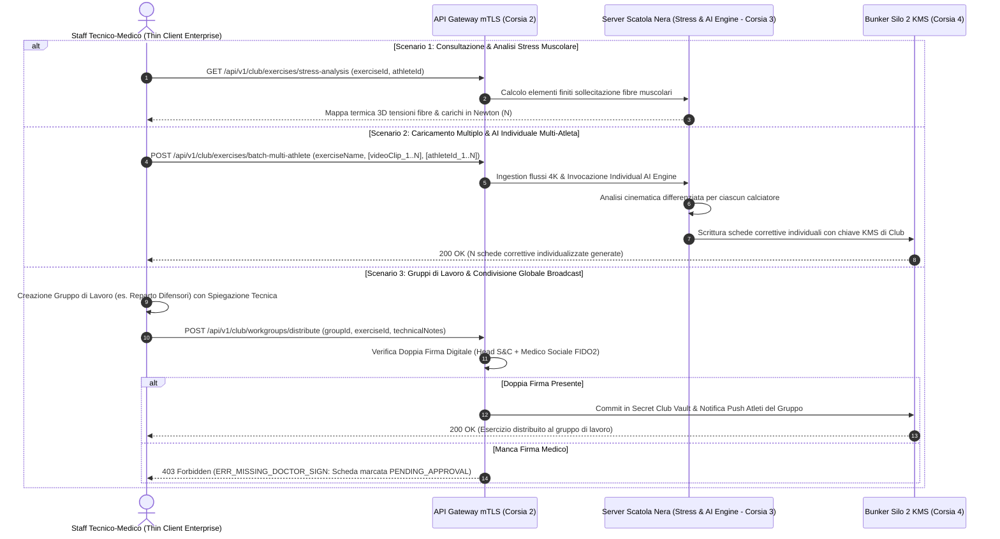

# Capitolato Tecnico: Flow 2C – Catalogo 3D, Multi-Camera 4K & Suite Tattica (T7 Elite Pro Teams)

## 1. Identificativo & Titolo Ufficiale
- **Badge Miro Board:** `#14` (Posizione: `X: -108, Y: 6235.66`, Miro Shape ID: `3458764688417722783`)
- **Codice Univoco:** `FLOW-2C`
- **Titolo Formale:** SOFTWARE 3 (B2B ENTERPRISE) - FLOW 2C: CATALOGO 3D, MULTI-CAMERA 4K, SUITE TATTICA & STRESS MUSCOLARE
- **Board Miro Online:** `uXjVEbo6L2o=` (Zona 4, Riga 3: High-Level Pro Teams & Enterprise, Colonna 2: Catalogo Tattico & Cockpit Multi-Staff)
- **Diagramma Sorgente:** `architecture-blueprint/02-miro-zones-and-swimlanes/18-flowcharts/software-3-elite-club-enterprise/flow-2c-multi-staff-cockpit.mmd`
- **Riferimento Glossario:** [Glossario Tecnico Vivente](00-GLOSSARIO-TERMINI-TECNICI.md) (Voci: [Secret Club Vault](00-GLOSSARIO-TERMINI-TECNICI.md#secret-club-vault-multi-camera-4k-sync), [Digital Twin 3D Squadra](00-GLOSSARIO-TERMINI-TECNICI.md#digital-twin-biomeccanico-dellatleta), [Video Ingest Tiers](00-GLOSSARIO-TERMINI-TECNICI.md#video-ingest-tiers-policy-tier-1-zero-upload-tier-2-1080p-tier-3-4k8k), [SMPTE Timecode Sync](00-GLOSSARIO-TERMINI-TECNICI.md#smpte-timecode-multi-camera-synchronization), [Telestrator & Tactical Annotations](00-GLOSSARIO-TERMINI-TECNICI.md#telestrator-tactical-video-annotations), [Variable Playback Rate & Scrubbing 120fps](00-GLOSSARIO-TERMINI-TECNICI.md#variable-playback-rate-frame-by-frame-scrubbing-120fps), [Doppia Firma Digitale Tecnico-Sanitaria](00-GLOSSARIO-TERMINI-TECNICI.md#electronic-medical-record-emr-segreto-medico), [Watermarking Dinamico Anti-Leak](00-GLOSSARIO-TERMINI-TECNICI.md#dynamic-forensic-watermarking-anti-leak)).

---

## 2. Obiettivo di Business & Target Utente

### Guida Pratica per Non Tecnici: Cos'è questo modulo per un umano?
Nelle massime organizzazioni sportive (club di Serie A, Premier League, NBA, franchigie d'élite), il patrimonio tecnico, i dettagli esecutivi di forza esplosiva e i protocolli di Return to Play sono **segreti industriali e sportivi custoditi gelosamente**.  
**Il Catalogo d'Élite Tier 3 di T7** rappresenta il vertice tecnologico della piattaforma:
1. **Visualizzazione 3D ad Altissima Fedeltà con Digital Twin:** Consultazione dei movimenti tramite modelli 3D avanzati Three.js Draco sincronizzati con i parametri biometrici della rosa della prima squadra;
2. **Contenuti Tecnici Completi per lo Staff:** Spiegazioni tecniche multi-disciplinari, protocolli preventivi e note congiunte preparatore-medico;
3. **Ricerca Avanzata Club & Tattica:** Filtri specifici per singolo muscolo, distretto, categoria, attrezzatura, ruolo tattico (es. difensori centrali, terzini, centrocampisti, attaccanti) e fase clinica Return to Play (RTP 6 fasi);
4. **Creazione Video e Supporto AI con Cartella EMR:** Redazione di punti di forza e debolezza da parte dello staff tecnico, con il supporto dell'AI multimodale enterprise che incrocia le cartelle cliniche EMR (Silo 2 Bunker) per perfezionare le spiegazioni;
5. **Risoluzione Video Superiore Fino a 4K:** Qualità di acquisizione, caricamento e riproduzione supportata fino a un massimo di **4K Ultra HD** ($3840\times 2160$ a 60/120fps) per cogliere ogni minima contrazione e deformazione tendinea;
6. **Editing Video Integrato Avanzato & Telestrator:** Strumenti professionali di modifica video (taglio multi-traccia, slow-motion estremo con scrubbing frame-by-frame a 120fps, accelerazione e suite Telestrator vettoriale con vettori di forza articolare in Newton e Barbell Path);
7. **Gestione Preferiti Club:** Salvataggio centralizzato degli esercizi nei preferiti ufficiali del club (`club_secret_vault_favorites`);
8. **Condivisione Globale Team (Broadcast):** Possibilità di condividere simultaneamente i video con tutti gli atleti della prima squadra in un solo tocco, con impresso il **Dynamic Forensic Watermark** anti-leak;
9. **Gruppi di Lavoro Dedicati:** Creazione e gestione di gruppi dedicati (es. reparto difensori, reparto attaccanti, gruppo RTP, gruppo velocisti) in cui distribuire l'esercizio accompagnato dalla specifica spiegazione tecnica sottostante;
10. **Caricamento Multiplo e AI Personalizzata per Atleta:** Possibilità di caricare contemporaneamente più clip video dello stesso esercizio eseguito da diversi atleti, ottenendo correzioni tramite AI specifiche e su misura per ciascun individuo;
11. **Analisi dello Stress Muscolare 3D:** Visualizzazione interattiva ad elementi finiti (FEA) di come le fibre muscolari dei vari distretti vengono sollecitate, tese e stressate in base alla specifica cinematica di esecuzione dell'atleta.

### Specifiche di Business & Metriche
- **Target Utente:** Head Coach, Preparatori Atletici (Head S&C), Medici Sociali, Fisioterapisti e Match Analyst di club professionistici (Tier 3 – B2B Enterprise).
- **Problema Risolto:** Standardizzare l'insegnamento tecnico dell'intera rosa, azzerare le fughe di notizie (Zero Data Leaks), consentire analisi biomeccanica individualizzata su larga scala e monitorare lo stress reale delle fibre muscolari per prevenire recidive muscolari.

---

## 3. Attori & Architettura a 4 Corsie (Swimlanes)

1. **Corsia 1: Thin Client UI/UX (Team Cockpit React 18 Enterprise & Suite Tattica):**
   - Modulo di ricerca avanzata club con filtri tattici e RTP;
   - Visualizzatore 3D con Digital Twin della rosa e controlli 360°;
   - Visualizzatore 3D per l'Analisi dello Stress Muscolare delle fibre (tensione in Newton, forze di taglio, momenti articolari);
   - Ingest video fino a 4K Ultra HD (60/120fps);
   - Suite di video editing avanzato con scrubbing 120fps, trimming multi-traccia e Telestrator vettoriale WebGL;
   - Modulo di Caricamento Multiplo batch per lo stesso esercizio su più atleti;
   - Modulo di Creazione Gruppi di Lavoro dedicati con spiegazione tecnica sottostante;
   - Modulo di Condivisione Globale Broadcast con rendering dinamico del Forensic Watermark.
2. **Corsia 2: API Gateway & RBAC Enterprise Tier 3 (Envoy mTLS + FIDO2 Gatekeeper):**
   - Autenticazione mTLS con certificato hardware societario e firma biometrica FIDO2;
   - Flussi di validazione congiunta: verifica obbligatoria della doppia firma digitale (Head S&C + Medico Sociale);
   - Protezione dello streaming video HLS 4K con DRM FairPlay/Widevine e rotazione chiavi KMS.
3. **Corsia 3: Server Scatola Nera (Stress Engine, HPC Kinematics & Individual AI):**
   - **Muscle Fiber Stress Engine:** Modello a elementi finiti per il calcolo delle sollecitazioni sulle fibre muscolari dei singoli distretti durante il gesto;
   - **Multimodal AI Integration:** Motore RAG accademico che incrocia 322 paper scientifici con le cartelle cliniche EMR per integrare la spiegazione tecnica dello staff;
   - **Individualized Multi-Athlete AI Engine:** Pipeline asincrona di computer vision che analizza N video dello stesso esercizio, generando correzioni posturali e biomeccaniche personalizzate per ciascun atleta.
4. **Corsia 4: Database Tripartito (Silo 2 - Bunker Club KMS Enclave):**
   - Tabella `club_secret_vault`: archivio blindato AES-256 degli esercizi di club;
   - Tabella `athlete_individual_corrections`: feedback biomeccanico specifico memorizzato nella cartella clinica del singolo calciatore;
   - Tabella `club_workgroups`: gruppi di lavoro societari (difesa, centrocampo, RTP);
   - Tabella `anti_leak_audit_logs`: registro crittografico per tracciare ogni accesso broadcast.

---

### Sequence Diagram Asincrono del Ciclo di Vita (FLOW-2C)



---

## 4. Flusso Operativo Passo-Passo

### Livello A: User Journey Narrativo (La Storia dell'Utente)
1. **L'Accesso del Cockpit Societario:** L'Head Coach e il Medico Sociale eseguono l'accesso con autenticazione a due fattori mTLS + token hardware FIDO2.
2. **La Scelta Operativa Multi-Staff:**
   - *Ramo 1: Consultazione & Stress Muscolare:* Consultano un esercizio tattico aprendo il visualizzatore 3D dello stress muscolare. Osservano la mappa termica che mostra come le fibre corte del bicipite femorale subiscano un picco di trazione di $2200\text{ N}$ nella fase di frenata eccentrica;
   - *Ramo 2: Video 4K, Editing & Caricamento Multiplo:* Registrano o importano flussi fino a 4K Ultra HD. Attivano l'editing avanzato con scrubbing a 120fps e Telestrator per annotare le linee di spinta. Con la funzione *Caricamento Multiplo*, caricano 12 video dello stesso cambio di direzione eseguito da 12 giocatori diversi: l'AI elabora correzioni specifiche per ciascun individuo;
   - *Ramo 3: Gruppi di Lavoro & Condivisione Globale:* Creano il gruppo *"Reparto Difensori"* assegnando l'esercizio con la spiegazione tecnica allegata, oppure attivano la *Condivisione Globale Team (Broadcast)* con Forensic Watermark anti-leak per tutta la rosa.
3. **La Validazione a Doppia Firma:** L'Head S&C appone la firma per l'idoneità prestativa e il Medico Sociale controfirma per l'assenza di rischi articolari.
4. **La Promozione a Patrimonio di Club:** L'esercizio viene integrato nel Secret Club Vault e programmato nel microciclo gara di squadra (`FLOW-3C`).

---

#### Indicatori di Accettazione Operativa & Clinica (KPI)
| Metrica / Parametro | Obiettivo Target | Tolleranza Accettabile | Azione Fallback / Allerta |
| :--- | :--- | :--- | :--- |
| **Risoluzione Max Supportata** | $4\text{K}$ Ultra HD ($3840\times 2160$ a 60/120fps) | $\ge 4\text{K}$ standard | Downsampling dinamico su connessioni mobili di campo |
| **Accuratezza Analisi Stress Fibre** | Correlazione FEA $\ge 95\%$ | $\ge 88\%$ | Segnalazione intervallo di confidenza biomeccanico |
| **Caricamento Multiplo Concorrente** | Fino a $30$ atleti in parallelo | $\ge 15$ atleti | Accodamento asincrono con notifica di completamento |
| **Copertura Watermark Forense** | $100\%$ frame marchiati | $0\%$ frame scoperti | Blocco riproduzione video privi di watermark |
| **Validità Doppia Firma Digitale** | $100\%$ consensi congiunti | $0\%$ override singoli | Scheda esercizio non attivabile senza entrambe le firme |

---

### Livello B: Trattazione Tecnica Nodi Operativi (23 Nodi ISO)

1. `T3_START` (Inizio: Team Cockpit - Catalogo Esercizi & Suite Tattica): Inizializzazione Cockpit Enterprise con validazione certificato mTLS e permessi multi-staff (Head Coach, Medico, Analyst).
2. `T3_DEC_MODE` (Modalità Operativa Staff Societario?): Bivio operativo: 1. Consulta & Stress Muscolare • 2. Crea Video 4K & Caricamento Multi-Atleta • 3. Gruppi di Lavoro & Broadcast.
3. `T3_UI_SEARCH_ADVANCED` (Ricerca Avanzata Club: Muscolo, Distretto, Categoria, Attrezzatura, Ruolo & RTP): Filtri avanzati incrociati con ruoli tattici e stadio Return to Play.
4. `T3_UI_3D_VIEWER_ELITE` (Visualizzazione 3D Modelli Dinamici con Digital Twin della Rosa): Rendering 3D Three.js Draco ad altissima definizione con Digital Twin dei calciatori della prima squadra.
5. `T3_UI_TECH_EXPLANATION` (Contenuti Tecnici & Correzioni Biomeccaniche Avanzate per lo Staff): Schede tecniche complete comprensive di spiegazioni, protocolli di prevenzione e correzioni posturali.
6. `T3_SRV_MUSCLE_STRESS_ENGINE` (Server Scatola Nera: Motore Analisi Sollecitazione Fibre Muscolari): Calcolo a elementi finiti (FEA) dello stress e delle tensioni tensive/eccentriche sulle fibre muscolari dei vari distretti.
7. `T3_UI_MUSCLE_STRESS_VIEWER` (Visualizzatore 3D Analisi Stress Muscolare): Mappa termica interattiva con visualizzazione delle fibre muscolari sollecitate, momenti di torsione articolare e carichi in Newton (N).
8. `T3_UI_VIDEO_CAPTURE_4K` (Caricamento Video Esercizi Risoluzione Superiore Fino a 4K): Ingest flussi video fino a 4K Ultra HD a 60/120fps da telecamere fisse di campo o file master.
9. `T3_UI_VIDEO_EDITOR_ADVANCED` (Editing Video Integrato Avanzato: Taglio Multi-Traccia, Scrub 120fps & Telestrator): Suite di montaggio: trimming multi-traccia, rallentatore millimetrico a 120fps, accelerazione e Telestrator vettoriale.
10. `T3_UI_STAFF_STRENGTHS_WEAKNESSES` (Redazione Punti di Forza e Debolezza da parte dello Staff): Compilazione tecnica congiunta: punti di forza, asimmetrie bilaterali e rischi di sovraccarico.
11. `T3_SRV_AI_INTEGRATION` (Server Scatola Nera: Supporto AI per Integrare la Spiegazione Tecnica): AI Multimodale Enterprise: integra la spiegazione dello staff incrociando i dati di stress muscolare e le cartelle EMR.
12. `T3_UI_DIFF_STAFF_MODAL` (Modale Revisione Diff Spiegazione Tecnica Integrata dall'AI): Approvazione congiunta da parte dell'Head Coach e del Medico delle note didattiche generate dall'AI.
13. `T3_DEC_MULTI_ATHLETE_UPLOAD` (Caricamento Multiplo Stesso Esercizio su Più Persone?): Bivio decisionale: caricamento batch di clip per più atleti vs singolo gesto tecnico.
14. `T3_UI_MULTI_UPLOAD_INGEST` (Caricamento Multiplo: Stesso Esercizio Eseguito da Atleti Diversi): Ingestion simultanea di N file video associati ai profili dei singoli atleti della rosa.
15. `T3_SRV_INDIVIDUAL_AI_ENGINE` (Server Scatola Nera: Correzioni AI Specifiche per Ciascun Individuo): Pipeline AI individualizzata che elabora la cinematica specifica di ogni calciatore producendo correzioni e feedback su misura.
16. `T3_DB_SAVE_INDIVIDUAL_CORRECTIONS` (Database Silo 2: Schede Individuali Atleta & Correzioni AI Personalizzate): Persistenza delle correzioni AI personalizzate nella cartella clinica/tecnica criptata KMS di ciascun atleta.
17. `T3_DEC_DISTRIBUTION` (Destinazione Distribuzione & Condivisione Esercizio?): Bivio: 1. Salva nei Preferiti Club • 2. Gruppo di Lavoro Dedicato • 3. Condivisione Globale Team (Broadcast).
18. `T3_GW_FAVORITES_CLUB` (API Gateway: POST /api/v1/club/favorites): Archiviazione nei preferiti ufficiali dello staff societario in Silo 2.
19. `T3_UI_WORKGROUPS_CREATION` (Creazione Gruppi di Lavoro Dedicati con Spiegazione Tecnica Sottostante): Gestione e creazione di gruppi dedicati (es. Reparto Difesa, Centrocampo, RTP) con assegnazione esercizio e spiegazione didattica.
20. `T3_UI_GLOBAL_TEAM_SHARE` (Condivisione Globale: Broadcast a Tutti gli Atleti del Team): Invio 1-to-All a tutta la rosa con Dynamic Forensic Watermark impresso a livello GPU per prevenire leak.
21. `T3_DEC_DUAL_SIGNATURE` (Validazione Congiunta: Doppia Firma Digitale Head S&C + Medico Sociale?): Controllo crittografico: entrambe le firme FIDO2 presenti $\implies$ approvato; firma mancante $\implies$ blocco PENDING_APPROVAL.
22. `T3_DB_VAULT_PERSISTENCE` (Database Silo 2: Secret Club Vault & Microciclo MD-X): Scrittura definitiva nel caveau societario e assegnazione al microciclo gara.
23. `T3_END_READY` (Fine: Esercizio 4K Integrato nel Secret Club Vault & Condiviso con la Squadra): Conclusione e navigazione a `FLOW-3C`.

---

## 5. Rami Decisionali & Gestione dei 4 Stati UI

| Bivio Decisionale | Condizione Logica | Ramo SÌ / Positivo | Ramo NO / Negativo |
| :--- | :--- | :--- | :--- |
| `T3_DEC_MODE` | Modalità scelta dallo staff? | Video 4K & Caricamento Multi-Atleta | Consultazione & Analisi Stress Muscolare |
| `T3_DEC_MULTI_ATHLETE_UPLOAD`| Caricamento multiplo per più atleti? | Batch ingest & Individual AI Engine (`T3_UI_MULTI_UPLOAD_INGEST`) | Singolo gesto tecnico di squadra |
| `T3_DEC_DISTRIBUTION` | Canale di distribuzione prescelto? | Gruppo di Lavoro / Broadcast Squadra | Preferiti ufficiali del club |
| `T3_DEC_DUAL_SIGNATURE` | Presenti entrambe le firme (S&C + Medico)? | Autorizzato: commit nel Secret Club Vault (`T3_DB_VAULT_PERSISTENCE`) | Blocco: stato PENDING_APPROVAL |

### I 4 Stati di Interfaccia Utente (UI States):
1. **Empty State:** Nessun esercizio registrato nel Secret Club Vault: schermata di accoglienza con opzioni di ingest video 4K o avvio analisi dello stress muscolare.
2. **Loading State:** Elaborazione del motore a elementi finiti dello stress muscolare o elaborazione batch AI individuale: *"Calcolo tensioni fibre muscolari ed elaborazione correzioni su 15 atleti..."*.
3. **Populated State:** Griglia multi-schermo con video 4K a 120fps, mappa dello stress muscolare 3D attiva con carichi in Newton, note didattiche dello staff e selettore gruppi di lavoro.
4. **Error / Fallback State:**
   - *Mancanza della firma del Medico Sociale:* Badge arancione evidente *"Esercizio salvato in bozza: in attesa della firma digitale del Medico Sociale per la distribuzione agli atleti"*;
   - *Occlusione parziale di un atleta nel batch upload:* Isolamento dell'errore per quel singolo atleta senza bloccare il completamento delle schede degli altri atleti.

---

## 6. Contratti Dati, Parametri I/O & Database Silo

### Specifiche Endpoint REST:

#### 1. Ingest Video 4K & Analisi Stress Muscolare
- **Endpoint:** `POST /api/v1/club/catalog/multicamera-4k-exercise`
- **Headers:** `Authorization: Bearer <club_jwt>`, `X-Club-Cert: <mtls_fingerprint>`
- **Request Form Data:**
  - `videoMaster`: File binario 4K Ultra HD ($3840\times 2160$ a 60/120fps);
  - `exerciseName`: "Decelerazione Eccentrica a 90° con Spinta Posteriore";
  - `targetDistricts`: `["HAMSTRINGS", "QUADRICEPS", "GLUTEUS_MEDIUS"]`;
  - `staffStrengths`: "Elevata capacità di assorbimento del carico sul ginocchio dominante.";
  - `staffWeaknesses`: "Asimmetria di frenata con rotazione pelvica compensatoria di 6 gradi.";
  - `enableFiberStressAnalysis`: true.
- **Response `201 Created`:**
```json
{
  "exerciseId": "club_ex_4k_8812c",
  "resolution": "4K_UltraHD_2160p",
  "framerate": 120,
  "fiberStressMetrics": {
    "peakTensionBicepsFemorisN": 2180.5,
    "shearForceKneeN": 420.2,
    "eccentricStrainPct": 18.4,
    "riskLevel": "ELEVATED_STRESS_DISTRICT_HAMSTRINGS"
  },
  "watermarkMetadata": {
    "enabled": true,
    "algorithm": "GPU_SHADER_DYNAMIC_FORENSIC"
  }
}
```

#### 2. Caricamento Multiplo con Correzioni AI Individuali
- **Endpoint:** `POST /api/v1/club/exercises/batch-multi-athlete`
- **Headers:** `Authorization: Bearer <club_jwt>`, `Content-Type: multipart/form-data`
- **Request Parameters:**
  - `exerciseId`: "club_ex_4k_8812c";
  - `batchPayload`: Array di `{ athleteId: string, videoClip: binary }`.
- **Response `200 OK`:**
```json
{
  "exerciseId": "club_ex_4k_8812c",
  "processedAthletesCount": 15,
  "individualResults": [
    {
      "athleteId": "ath_player_09",
      "athleteName": "Mario Rossi",
      "aiCorrection": "Flessione del ginocchio insufficiente in fase di arresto (32° rilevati vs 45° ottimali). Incrementare la dorsiflessione della caviglia destra.",
      "fiberStressRisk": "MODERATE",
      "individualCardSaved": true
    }
  ]
}
```

#### 3. Distribuzione a Gruppi di Lavoro o Broadcast di Squadra
- **Endpoint:** `POST /api/v1/club/workgroups/distribute`
- **Headers:** `Authorization: Bearer <club_jwt>`, `Content-Type: application/json`
- **Request Body:**
```json
{
  "exerciseId": "club_ex_4k_8812c",
  "distributionMode": "WORKGROUP",
  "workgroupId": "grp_defenders_first_team",
  "technicalExplanation": "Focus specifico per i difensori centrali sui cambi di direzione difensivi negli ultimi 16 metri.",
  "dualSignatures": {
    "headScSignature": "SIG_SC_99211a_FIDO2",
    "teamDoctorSignature": "SIG_DOC_33104b_FIDO2"
  }
}
```
- **Response `200 OK`:**
```json
{
  "status": "DISTRIBUTED_TO_WORKGROUP",
  "workgroupId": "grp_defenders_first_team",
  "athletesNotified": 6,
  "secretVaultStatus": "COMMITTED_APPROVED"
}
```

---

### Matrice Errori HTTP & Strategie di Resilienza
| HTTP Code | Codice Interno | Endpoint | Causa Scatenante | UX Feedback Visivo | Strategia di Resilienza & Fallback |
| :---: | :--- | :--- | :--- | :--- | :--- |
| **401** | `ERR_MTLS_FAILED` | Qualsiasi endpoint Tier 3 | Certificato mTLS mancante o non autorizzato | Banner bloccante: *"Accesso negato al Secret Club Vault"* | Blocco immediato del traffico |
| **403** | `ERR_MISSING_DOCTOR_SIGN` | `POST /workgroups/distribute` | Manca controfirma del Medico Sociale | Badge arancione: *"In attesa di firma medica per attivare la scheda"* | Scheda congelata in stato di bozza |
| **409** | `ERR_POSE_OCCLUSION_SINGLE` | `POST /batch-multi-athlete` | Uno degli atleti del batch è fuori inquadratura | Warning mirato: *"Atleta 07 occluso: ricaricare la clip per questo atleta"* | Completamento regolare degli altri atleti del batch |
| **413** | `ERR_BANDWIDTH_LIMIT_4K` | Pipeline Video 4K | Connessione di campo instabile su upload 4K | Toast informativo: *"Compressione adattiva a 4K 60fps in corso"* | Adattamento bitrate trasparente |

---

## 7. Ereditarietà di Tier & Differenziali di Fascia

- **Ereditarietà da Tier 1 e Tier 2 (`FLOW-2A`, `FLOW-2B`):**  
  Il club eredita l'intero catalogo dei 328 movimenti biomeccanici, la visualizzazione 3D dinamica Three.js Draco orbitabile a 360°, le spiegazioni tecniche Why & Fix, la ricerca avanzata e gli strumenti di editing video integrato.
- **Differenziali Esclusivi di Tier 3 (Elite Teams & Enterprise):**  
  Risoluzione video superiore fino a **4K Ultra HD** a 60/120fps, **condivisione globale team (broadcast)** a tutta la rosa con **Dynamic Forensic Watermark** anti-leak, creazione di **gruppi di lavoro dedicati** con spiegazione tecnica sottostante, **caricamento multiplo dello stesso esercizio su più persone con AI individuale specifica per atleta**, **analisi 3D dello stress muscolare delle fibre** per ciascun distretto in base all'esecuzione e **obbligo di doppia firma digitale congiunta (Head S&C + Medico Sociale)** per la promozione nel Secret Club Vault.
