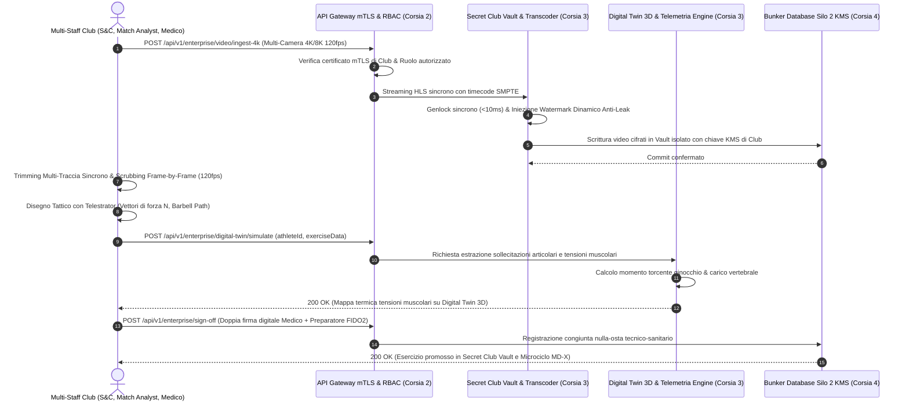

# Capitolato Tecnico: Flow 2C – Catalogo 3D, Video Multi-Camera 4K/8K & Libreria Club a 2 Livelli (T7 Elite Pro Teams)

## 1. Identificativo & Titolo Ufficiale
- **Badge Miro Board:** `#14` (Posizione: `X: -108, Y: 6235.66`, Miro Shape ID: `3458764688417722783`)
- **Codice Univoco:** `FLOW-2C`
- **Titolo Formale:** SOFTWARE 3 (B2B ENTERPRISE) - FLOW 2C: CATALOGO 3D, VIDEO MULTI-CAMERA 4K/8K, SUITE EDITING TATTICA & LIBRERIA CLUB A 2 LIVELLI
- **Board Miro Online:** `uXjVEbo6L2o=` (Zona 4, Riga 3: High-Level Pro Teams & Enterprise, Colonna 2: Catalogo Tattico & Cockpit Multi-Staff)
- **Diagramma Sorgente:** `architecture-blueprint/02-miro-zones-and-swimlanes/18-flowcharts/software-3-elite-club-enterprise/flow-2c-multi-staff-cockpit.mmd`
- **Riferimento Glossario:** [Glossario Tecnico Vivente](00-GLOSSARIO-TERMINI-TECNICI.md) (Voci: [Secret Club Vault](00-GLOSSARIO-TERMINI-TECNICI.md#secret-club-vault-multi-camera-4k-sync), [Digital Twin 3D Squadra](00-GLOSSARIO-TERMINI-TECNICI.md#digital-twin-biomeccanico-dellatleta), [Video Ingest Tiers](00-GLOSSARIO-TERMINI-TECNICI.md#video-ingest-tiers-1080p-consumer-2k-pro-4k8k-enterprise), [SMPTE Timecode Sync](00-GLOSSARIO-TERMINI-TECNICI.md#smpte-timecode-multi-camera-synchronization), [Telestrator & Tactical Annotations](00-GLOSSARIO-TERMINI-TECNICI.md#telestrator-tactical-video-annotations), [Variable Playback Rate & Scrubbing 120fps](00-GLOSSARIO-TERMINI-TECNICI.md#variable-playback-rate-frame-by-frame-scrubbing-120fps), [Doppia Firma Digitale Tecnico-Sanitaria](00-GLOSSARIO-TERMINI-TECNICI.md#electronic-medical-record-emr-segreto-medico), [Watermarking Dinamico Anti-Leak](00-GLOSSARIO-TERMINI-TECNICI.md#dynamic-forensic-watermarking-anti-leak)).

---

## 2. Obiettivo di Business & Target Utente

### Guida Pratica per Non Tecnici: Cos'è questo modulo per un umano?
Nei grandi club professionistici (Serie A, Premier League, NBA), gli schemi su palla inattiva, i gesti esplosivi di forza e le posture speciali di riatletizzazione elaborate dallo staff sono **segreti industriali e sportivi custoditi gelosamente**. Se una squadra rivale scopre in anticipo come batte i calci d'angolo o come allena i propri attaccanti, il vantaggio competitivo svanisce.  
**Il Catalogo d'Élite di T7** organizza il sapere tecnico della società con standard broadcast ad altissima definizione:
1. **Risoluzione Broadcast 4K (2160p) e fino a 8K (4320p):** Supporto a flussi video ultra-dettagliati registrati da telecamere fisse da campo a 120fps/240fps, per catturare ogni contrazione muscolare e impatto al suolo;
2. **Sincronizzazione Multi-Camera SMPTE (< 10ms):** Fino a 3-4 telecamere posizionate sul campo (frontale, laterale, zenitale/dall'alto) sincronizzate al millisecondo;
3. **Trimming Sincrono Multi-Traccia:** Con un solo movimento di taglio, il preparatore ritaglia simultaneamente tutte le angolazioni della clip;
4. **Controllo Velocità Estremo (Frame-by-Frame Scrubbing a 120fps):** Rallentatore millimetrico e avanzamento fotogramma per fotogramma per analizzare gli angoli di atterraggio dopo un salto o l'inversione di carico del tendine d'Achille;
5. **Suite di Editing Avanzato (Telestrator & Biomeccanica Tattica):**
   - Disegno vettoriale interattivo direttamente sui frame (frecce di corsa, cerchi di pressione, linee di postura);
   - Tracciamento della traiettoria del bilanciere (`Bar Path`);
   - Mappe vettoriali delle forze di taglio articolari in Newton (N);
6. **Libreria Club su Due Livelli:**
   - *Livello 1: Bozza Individuale Atleta* (vincolata al singolo calciatore nella cartella EMR criptata Silo 2);
   - *Livello 2: Secret Club Vault* (promozione a patrimonio tecnico ufficiale condiviso con tutto lo staff societario);
7. **Doppia Firma Digitale Obbligatoria (Medico Sociale + Head S&C):** Nessun protocollo o esercizio custom può essere assegnato a un calciatore di alto valore economico se non è validato congiuntamente dal Responsabile Tecnico e dal Responsabile Sanitario;
8. **Dynamic Forensic Watermarking Anti-Leak:** Se qualcuno visualizza un video sul tablet, sullo sfondo compare in trasparenza impercettibile il suo nome, ruolo e timestamp: qualsiasi foto allo schermo porterebbe all'identificazione immediata del responsabile.

### Specifiche di Business & Metriche
- **Target Utente:** Head Coach, Preparatori Atletici (S&C), Medici Sociali e Match Analyst di club professionistici (Tier 3 – B2B Enterprise).
- **Problema Risolto:** Proteggere i segreti tattici e i protocolli riabilitativi brevettati dal club (Zero Data Leaks), garantire video editing professionale multi-angolo a 120fps e vincolare l'assegnazione alla doppia firma digitale.

---

## 3. Attori & Architettura a 4 Corsie (Swimlanes)

1. **Corsia 1: Thin Client UI/UX (Multi-Staff Cockpit React 18 & Suite Tattica):**
   - Interfaccia multi-schermo con griglia multi-camera 4K/8K sincrona;
   - Trimmer multi-traccia basato su timecode SMPTE;
   - Slider di scrubbing frame-by-frame a 120fps e controllo velocità variabile (`0.1x - 2.0x`);
   - Canvas Telestrator WebGL per disegno vettoriale tattico e vettori di forza articolare (N);
   - Pannello di validazione a doppia firma digitale (FIDO2 Hardware token);
   - Watermark video dinamico impresso a livello shader GPU.
2. **Corsia 2: API Gateway & Enterprise Stream Gate (Envoy mTLS):**
   - Verifica credenziali mTLS con certificato societario, RBAC Tier 3 (`R5_HEAD_COACH`, `R6_MEDICO`, `R7_ANALYST`);
   - Streaming video criptato HLS con DRM Widevine / FairPlay e chiavi di rotazione AES-128.
3. **Corsia 3: Server Scatola Nera (Digital Twin, SMPTE Genlock & Dual-Signature Cloud Run):**
   - Sincronizzazione millimetrica dei flussi multi-camera (Genlock software $< 10\text{ ms}$);
   - Motore biomeccanico per calcolo momento torcente e forze vertebrali su mesh Digital Twin;
   - Binding crittografico della doppia firma digitale (SHA-256 tra chiave privata Medico e Preparatore);
   - Applicazione del watermark forense dinamico invisibile.
4. **Corsia 4: Database Tripartito (Silo 2 Bunker - PostgreSQL & Cloud KMS Dedicated):**
   - Tabelle `club_secret_catalog`, `joint_medical_approvals`, `multi_camera_recordings` e `anti_leak_audit_logs`.

---

### Sequence Diagram Asincrono del Ciclo di Vita (FLOW-2C)



---

## 4. Flusso Operativo Passo-Passo

### Livello A: User Journey Narrativo (La Storia dell'Utente)
1. **L'Accesso alla Sezione Esercizi del Club:** Il preparatore e il medico sociale aprono il tablet nel loro ufficio al centro sportivo con autenticazione biometrica FIDO2.
2. **La Scelta dei Due Livelli di Catalogo:**
   - Consultano il catalogo generale (328 esercizi standard);
   - Oppure aprono *"Secret Club Vault"*, la cassaforte riservata della prima squadra.
3. **La Registrazione sul Campo con Telecamere 4K/8K:**
   - Durante la rifinitura a porte chiuse, 3 telecamere fisse 4K a 120fps registrano da diverse prospettive un nuovo esercizio di agilità e forza eccentrica;
   - I 3 flussi video arrivano sincronizzati al millisecondo grazie al timecode SMPTE.
4. **Trimming Sincrono & Frame-by-Frame a 120fps:**
   - Con un solo tocco sulla timeline, il preparatore taglia l'inizio e la fine contemporaneamente su tutte e 3 le telecamere;
   - Fa scorrere il dito a rallentatore estremo (120fps): vede il momento esatto in cui l'avampiede del calciatore tocca il terreno, cogliendo l'angolo di flessione della caviglia con accuratezza chirurgica.
5. **Editing con Telestrator Tattico:**
   - Traccia una linea gialla per evidenziare la retta di spinta del bacino e una freccia rossa che indica il vettore di forza di reazione al suolo ($1850\text{ N}$ stimati);
   - L'app crea istantaneamente il Digital Twin 3D sincronizzato con il video reale.
6. **La Doppia Firma Tecnico-Sanitaria:**
   - L'Head S&C appone la sua firma digitale: *"Carico neuromuscolare idoneo"*;
   - Il Medico Sociale controfirma: *"Nessun sovraccarico per il menisco operato: via libera"*.
7. **La Distribuzione all'Atleta:** L'esercizio compare sul tablet del calciatore nello spogliatoio, con impresso in trasparenza il suo nome per evitare qualsiasi fuga di notizie o screenshot non autorizzati.

---

#### Indicatori di Accettazione Operativa & Clinica (KPI)
| Metrica / Parametro | Obiettivo Target | Tolleranza Accettabile | Azione Fallback / Allerta |
| :--- | :--- | :--- | :--- |
| **Risoluzione Max Supportata** | $4\text{K} / 8\text{K}$ a $120\text{ FPS}$ | $\ge 4\text{K}$ a $60\text{ FPS}$ | Downsampling adattivo su stream secondari |
| **Sincronia Multi-Camera SMPTE** | $< 10\text{ ms}$ tra stream | $\le 25\text{ ms}$ | Genlock software con drop frame selettivo |
| **Watermark Forense Dinamico** | $100\%$ frame marcati | $0\%$ frame scoperti | Blocco riproduzione video non contrassegnati |
| **Latenza Telestrator Overlay** | $< 16\text{ ms}$ (60fps canvas) | $\le 33\text{ ms}$ | Riduzione layer vettoriali WebGL |
| **Validità Doppia Firma** | $100\%$ consensi congiunti | $0\%$ override singoli | Scheda atleta non attivabile senza entrambe le firme |

---

### Livello B: Trattazione Tecnica Nodi Operativi

1. `START` (Accesso Catalogo di Squadra): Autenticazione mTLS e verifica claim JWT societario `tier: 3_ENTERPRISE`.
2. `DEC_MODE` (Bivio Modalità Staff): Ramo 1 (Rosa & Telemetria RTP), Ramo 2 (Video Pro 4K/8K & Libreria Club), Ramo 3 (Solo-Testo Pro).
3. `UI_CAM_CAPTURE_4K_8K` (Ingestion 4K/8K Multi-Camera):
   - Ricezione flussi 4K/8K a 120fps da 3 telecamere sincronizzate con SMPTE;
   - Transcodifica video HLS criptata con Google Cloud Transcoder.
4. `UI_TRIM_SYNC_SMPTE` (Trimming Multi-Traccia Sincrono): Taglio sincronizzato multi-camera con jitter temporale $< 10\text{ ms}$.
5. `UI_SPEED_FRAME_BY_FRAME` (Scrubbing Frame-by-Frame): Gestione avanzata del playback a 120fps con scrubbing millimetrico per analisi impatti e cambi di direzione.
6. `UI_ADVANCED_SPORTS_EDITING` (Suite Editing Tattico/Biomeccanico): Telestrator vettoriale, Barbell Path tracking, vettori di forza articolare (N) e Dynamic Forensic Watermarking.
7. `DEC_LIBRARY_TIER` (Bivio a Due Livelli di Salvataggio):
   - *Livello 1: Bozza Individuale Atleta* $\to$ vincolo al calciatore nella cartella EMR Silo 2;
   - *Livello 2: Secret Club Vault* $\to$ promozione a patrimonio societario condiviso.
8. `DEC_ACTION` (Workflow di Doppia Firma Digitale):
   - Step 1: Firma crittografica Responsabile S&C (`R5_HEAD_COACH`);
   - Step 2: Controfirma del Medico Sociale (`R6_TEAM_DOCTOR`).
   - Se manca una delle due firme $\implies$ stato `PENDING_MEDICAL_APPROVAL`.
9. `SAVE_SQUAD` (Persistenza Silo 2): Assegnazione diretta al Microciclo Gara di Squadra (`MD-X`) e navigazione a `FLOW-3C`.

---

## 5. Rami Decisionali & Gestione dei 4 Stati UI

| Bivio Decisionale | Condizione Logica | Ramo SÌ / Positivo | Ramo NO / Negativo |
| :--- | :--- | :--- | :--- |
| `DEC_MODE` | Modalità scelta dallo staff? | Video Multi-Camera 4K/8K | Consultazione rosa / telemetria |
| `DEC_LIBRARY_TIER` | Livello di destinazione? | Secret Club Vault (Livello 2) | Bozza Singolo Atleta (Livello 1) |
| `DEC_ACTION` | Presenti entrambe le firme (S&C + Medico)? | Approvato: Assegna a Microciclo MD-X | Blocco: Stato PENDING_APPROVAL |

### I 4 Stati di Interfaccia Utente (UI States):
1. **Empty State:** Nessun esercizio registrato nel Club Vault: interfaccia con schermata telecamere di campo pronte per la registrazione.
2. **Loading State:** Sincronizzazione SMPTE dei 3 flussi con barra Genlock: *"Allineamento millimetrico stream 4K..."*.
3. **Populated State:** Griglia multi-schermo a 3 angolazioni con Telestrator attivo, scrubbing 120fps e watermarking anti-leak visibile in trasparenza.
4. **Error / Fallback State:**
   - *Disallineamento telecamere $> 30\text{ ms}$:* Drop automatico dei frame asincroni e segnalazione visiva al match analyst.

---

## 6. Contratti Dati, Parametri I/O & Database Silo

### Specifiche Endpoint REST:

#### 1. Ingest Multi-Camera 4K/8K & Editing Tattico
- **Endpoint:** `POST /api/v1/enterprise/catalog/multicamera-exercise`
- **Headers:** `Authorization: Bearer <club_jwt>`, `X-Club-Cert: <mtls_fingerprint>`
- **Request JSON:**
```json
{
  "exerciseName": "Cambio di Direzione a 90° con Frenata Eccentrica",
  "resolution": "4K_2160p",
  "framerate": 120,
  "cameraAngles": ["FRONTAL", "LATERAL", "ZENITHAL"],
  "smpteTimecodeSync": { "jitterMs": 4.2, "synced": true },
  "trimRange": { "startSmpte": "00:01:14:08", "endSmpte": "00:01:22:15" },
  "telestratorAnnotations": [
    { "type": "FORCE_VECTOR", "magnitudeN": 1850, "origin": "RIGHT_ANKLE" },
    { "type": "TACTICAL_ARROW", "color": "#ef4444", "label": "Linea di Spinta" }
  ],
  "forensicWatermark": { "operatorId": "OP_HEAD_SC_01", "timestamp": "2026-11-02T22:35:00Z" },
  "libraryTier": "CLUB_SECRET_VAULT",
  "dualSignatures": {
    "scDirectorSign": "SIG_SC_88319f",
    "teamDoctorSign": "SIG_DOC_44120a"
  }
}
```

---

### Matrice Errori HTTP & Strategie di Resilienza
| HTTP Code | Codice Interno | Endpoint | Causa Scatenante | UX Feedback Visivo | Strategia di Resilienza & Fallback |
| :---: | :--- | :--- | :--- | :--- | :--- |
| **401** | `ERR_MTLS_FAILED` | `POST /multicamera-exercise` | Certificato mTLS di club non valido | Alert rosso: *"Accesso negato al bunker di club"* | Blocco immediato del traffico |
| **403** | `ERR_MISSING_DOCTOR_SIGN` | `POST /multicamera-exercise` | Manca controfirma del Medico Sociale | Badge arancione: *"In attesa di firma medica"* | Esercizio salvato in bozza, non attivabile |
| **409** | `ERR_GENLOCK_DESYNC` | `POST /multicamera-exercise` | Disallineamento timecode $> 30\text{ ms}$ | Toast: *"Flussi multi-camera non sincronizzati"* | Allineamento software al primo I-frame comune |
| **413** | `ERR_4K_BUFFER_OVERFLOW` | `POST /multicamera-exercise` | Bitrate 8K satura la banda in campo | Notifica: *"Passaggio automatico a 4K 60fps"* | Transcodifica dinamica cloud-edge |

---

## 7. Ereditarietà di Tier & Differenziali di Fascia

- **Ereditarietà da Tier 1 e Tier 2 (`FLOW-2A`, `FLOW-2B`):**  
  Il club eredita l'intero catalogo dei 328 movimenti, l'avatar 3D WebGL, il trimming temporale e i controlli di velocità.
- **Differenziali Esclusivi di Tier 3 (Enterprise):**  
  Risoluzione ultra-alta **4K/8K High-Speed a 120fps**, sincronizzazione **multi-camera SMPTE**, **trimming multi-traccia**, scrubbing frame-by-frame, **suite Telestrator con vettori di forza articolare (N)**, **Dynamic Forensic Watermarking**, gestione della **libreria a 2 livelli (Secret Club Vault)** e obbligo di **doppia firma digitale congiunta Medico Sociale + Head S&C**.
