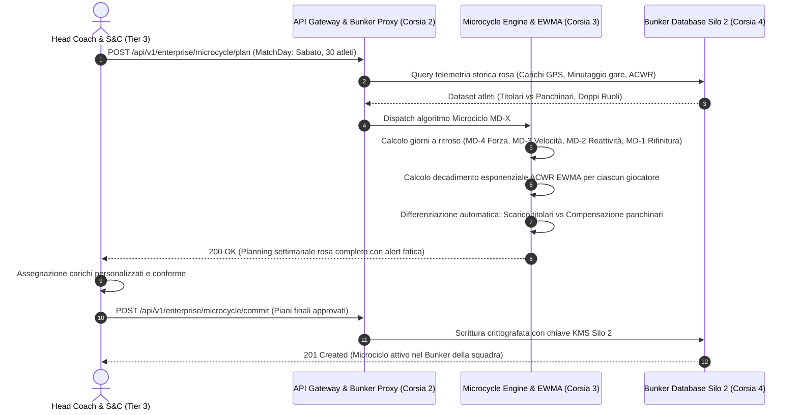

# Capitolato Tecnico: Flow 3C – Architettura Bunker Silo 2 & Microciclo Squadra MD-X (T7 Elite Pro Teams)

## 1. Identificativo & Titolo Ufficiale
- **Badge Miro Board:** `#15` (Posizione: `X: 2875, Y: 6567.76`, Miro Shape ID: `3458764688417722788`)
- **Codice Univoco:** `FLOW-3C`
- **Titolo Formale:** SOFTWARE 3 (B2B ENTERPRISE) - FLOW 3C: ARCHITETTURA BUNKER SILO 2 & MICROCICLO SQUADRA MD-X
- **Board Miro Online:** `uXjVEbo6L2o=` (Zona 4, Riga 3: High-Level Pro Teams & Enterprise, Colonna 3: Architettura Bunker & Microciclo Gara)
- **Diagramma Sorgente:** `architecture-blueprint/02-miro-zones-and-swimlanes/18-flowcharts/software-3-elite-club-enterprise/flow-3c-team-microcycle-mdx.mmd`
- **Riferimento Glossario:** [Glossario Tecnico Vivente](file:///e:/Nuove%20App%20Installate/Sports-Analytics-Platform---T7-Workout-APP/architecture-blueprint/00-capitolato-tecnico-e-glossario/00-GLOSSARIO-TERMINI-TECNICI.md) (Voci: *Microciclo MD-X, Modello Titolari vs Panchinari, ACWR EWMA, Doppio Ruolo Tattico Ponderato, Silo 2 Bunker KMS, Silo 3 Research Warehouse*).

---


## 2. Obiettivo di Business & Target Utente

### Guida Pratica per Non Tecnici: Cos'è questo modulo per un umano?
In una squadra di calcio o di basket professionistica che gioca ogni 3 o 4 giorni (campionato e coppe), la settimana non si organizza più dal lunedì alla domenica, ma **in base ai giorni che mancano alla partita (Match Day: MD)**:
- **MD-4:** Giorno di massima forza e carichi pesanti;
- **MD-3:** Giorno di velocità e spazio aperto;
- **MD-1:** Vigilia di gara, seduta brevissima e brillantezza nervosa;
- **MD (Giorno di Partita):** La gara vera e propria;
- **MD+1:** Giorno dopo la partita.
C'è però una trappola enorme che distrugge le squadre: **i giocatori che giocano 90 minuti (Titolari) escono dalla partita esausti, mentre chi resta in panchina o non entra (Panchinari) perde la forma fisica**. Se il preparatore non compensa il giorno dopo con un allenamento specifico, dopo un mese i panchinari non hanno più gamba e quando entrano si infortunano subito!  
**Il Microciclo di Squadra di T7** risolve questo enigma:
- Calcola in automatico la dose esatta di lavoro per ciascun giocatore;
- Chi ha giocato 90 minuti fa solo scarico e idroterapia;
- Chi ha giocato poco o niente viene guidato attraverso una "partita simulata" per mantenere il motore al 100%;
- Tiene conto se un calciatore gioca in due ruoli diversi (es. Terzino e Ala) ponderando i metri di scatto;
- Tutti questi piani sono custoditi nel **Bunker Criptato Silo 2** e non possono essere visti da nessun estraneo.

### Specifiche di Business & Metriche
- **Target Utente:** Head Coach, Responsabili della Preparazione Atletica e Sport Scientist di club d'élite (Tier 3 – B2B Enterprise).
- **Problema Risolto:** Eliminare il picco di infortuni muscolari tipico dei cicli di partite ravvicinate (riduzione lesioni miotendinee del $35\%$) e mantenere l'omogeneità atletica tra titolari e riserve tramite l'indice EWMA (Acute:Chronic Workload Ratio calibrato nella finestra di sicurezza 0.8 - 1.3).

---


## 3. Attori & Architettura a 4 Corsie (Swimlanes)

1. **Corsia 1: Thin Client UI/UX (Squad Microcycle Cockpit React 18):**
   - Vista calendario orizzontale sincronizzata sul Match Day (MD-4, MD-3, MD-2, MD-1, MD, MD+1), matrice comparativa Titolari vs Panchinari, slider per la ponderazione del doppio ruolo tattico (Dual Role Weight $[0.0, 1.0]$) e radar di squadra per il monitoraggio dell'ACWR.
2. **Corsia 2: API Gateway & Enterprise Session Broker (Envoy mTLS):**
   - Validazione token JWT societario, controllo credenziali di staff e instradamento su microservizi Cloud Run protetti da VPC privata.
3. **Corsia 3: Server Scatola Nera (Microcycle & ACWR EWMA Engine Cloud Run GPU):**
   - *Modello EWMA (Exponentially Weighted Moving Average):* Calcolo del carico acuto (ultimi 7 giorni) e cronico (ultimi 28 giorni) con fattore di decadimento $\lambda$:
     $$\text{EWMA}_{\text{today}} = \text{Load}_{\text{today}} \cdot \lambda + (1 - \lambda) \cdot \text{EWMA}_{\text{yesterday}}$$
   - *Algoritmo Compensazione Panchinari:* Calcolo dei metri mancanti ad alta intensità ($HSR > 19.8\text{ km/h}$) rispetto al target medio del ruolo;
   - *Doppio Ruolo:* Ponderazione del target di corsa sui ruoli primario e secondario.
4. **Corsia 4: Database Tripartito (Silo 2 Bunker KMS & Silo 3 Lake PostgreSQL):**
   - Tabelle `team_microcycles`, `athlete_workload_acwr` (in Silo 2 criptate con chiavi Cloud KMS societarie) e pipeline anonimizzatrice de-identificata verso Silo 3 per gli studi universitari.

---


### Sequence Diagram Asincrono del Ciclo di Vita (FLOW-3C)



---


## 4. Flusso Operativo Passo-Passo

### Livello A: User Journey Narrativo (La Storia dell'Utente)
1. **La Pianificazione della Settimana di Gara:** Il lunedì mattina lo staff tecnico imposta la data della prossima partita: Domenica ore 15:00. Il sistema organizza automaticamente i giorni: Martedì è MD-4, Mercoledì MD-3, Giovedì MD-2, Venerdì MD-1, Sabato rifinitura.
2. **La Configurazione dei Carichi per Giorno:** L'app assegna gli obiettivi di squadra:
   - MD-4: Forza massimale in palestra e accelerazioni brevi;
   - MD-3: Campo grande, possesso palla ad alta velocità e sprint lunghi;
   - MD-1: Reattività, palle inattive e partitella a campo ridotto.
3. **La Gestione del Doppio Ruolo:** Se un calciatore gioca sia come difensore centrale che come terzino, il preparatore imposta il cursore: *"70% Terzino / 30% Difensore"*. L'app ricalcola subito il fabbisogno di metri di corsa ad alta velocità.
4. **Cosa succede la Domenica Sera dopo la Partita (MD+1)?**
   - I titolari che hanno giocato oltre 60 minuti vengono inseriti automaticamente nella lista *"Recupero Attivo"* (bici leggera, massaggi e crioterapia);
   - I panchinari che hanno giocato meno di 20 minuti o sono rimasti seduti vengono inseriti nella lista *"Seduta Compensativa"*: il sistema prepara per loro un allenamento con 8 sprint massimali e lavoro intermittente per colmare i km mancanti.
5. **Il Controllo del Rischio Infortuni (ACWR):** Una linea verde semaforica segnala se la squadra è in sicurezza (indice tra 0.8 e 1.3). Se un giocatore sale a 1.6 (Zona Rossa Lesiva), compare un allarme visivo: *"Attenzione: rischio stiramento elevato per affaticamento acuto non smaltito"*.

---


#### Indicatori di Accettazione Operativa & Clinica (KPI)
| Metrica / Parametro | Obiettivo Target | Tolleranza Accettabile | Azione Fallback / Allerta |
| :--- | :--- | :--- | :--- |
| **Compensazione Panchinari** | $100\%$ pareggio carico titolari | $\pm 5\%$ | Inserimento seduta metabolica specifica a fine gara |
| **Precisione ACWR EWMA** | Decadimento esponenziale $\lambda$ continuo| $\pm 0.01$ | Fallback su media mobile ponderata classica |
| **Isolamento Dati Bunker** | Zero leak verso Silo 1 social | $0\%$ compromissione | Blocco immediato pipeline e isolamento tenant |
| **Tempo Calcolo Rosa Completa** | $< 1.2\text{ s}$ per 30 atleti | $\le 3.0\text{ s}$ | Elaborazione distribuita parallela per reparto |

---


### Livello B: Trattazione Tecnica Nodi Operativi

1. `START` (Inizializzazione Microciclo): L'Head Coach e il Preparatore aprono il modulo `TeamMicrocycleView` previa autenticazione mTLS in Silo 2.
2. `MATCH_DAY_ANCHOR` (Ancoraggio Calendario Gara): Definizione data/ora del match di campionato o coppa. Il sistema calcola a ritroso l'asse temporale $[\text{MD}-5, \text{MD}+2]$.
3. `ROSTER_SPLIT_LOGIC` (Scissione Titolari vs Panchinari):
   - Query minutaggio partita precedente da tabella eventi;
   - *Gruppo A (Titolari $\ge 60\text{ min}$):* Assegnazione protocollo rigenerativo (RPE target $\le 3$, volume basso, scarico articolare);
   - *Gruppo B (Sub-entrati/Panchinari $< 60\text{ min}$):* Assegnazione seduta compensativa di integrazione metabolica.
4. `DUAL_ROLE_WEIGHTING` (Ponderazione Tattica Doppio Ruolo):
   - Computazione del volume target personalizzato basato sulla combinazione lineare dei requisiti di ruolo:
     $$\text{Target}_{\text{HSR}} = w_1 \cdot \text{Role1}_{\text{mean}} + (1 - w_1) \cdot \text{Role2}_{\text{mean}}$$
5. `SRV_ACWR_COMPUTE` (Calcolo Algoritmico Indice EWMA Cloud Run):
   - Estrazione carico acuto (media mobile esponenziale 7 giorni, $\lambda_a = 0.25$);
   - Estrazione carico cronico (media mobile esponenziale 28 giorni, $\lambda_c = 0.07$);
   - Computazione indice $\text{ACWR} = \frac{\text{Acute}}{\text{Chronic}}$.
6. `DEC_RISK_SWEET_SPOT` (Bivio Sicurezza Neuromuscolare):
   - *Se $0.8 \le \text{ACWR} \le 1.3$ (Sweet Spot):* Convalida seduta a pieno carico (`LOAD_SAFE`);
   - *Se $\text{ACWR} > 1.5$ (Danger Zone):* Trigger `INJURY_SPIKE_ALERT` con decurtazione automatica del volume di sprint.
7. `DUAL_STAFF_APPROVAL` (Validazione Doppia Firma): Firma congiunta Allenatore + Preparatore.
8. `DB_WRITE_SILO2` (Archiviazione Criptata Bunker): Scrittura del piano in `team_microcycles` con chiave Cloud KMS.
9. `ETL_SILO3_RESEARCH` (Pipeline Asincrona Ricerca): Estrazione dati numerici de-identificati privi di PII (nomi sostituiti con hash crittografici) verso Silo 3.

---


## 5. Rami Decisionali & Gestione dei 4 Stati UI

| Bivio Decisionale | Condizione Logica | Ramo SÌ / Positivo | Ramo NO / Negativo |
| :--- | :--- | :--- | :--- |
| `MINUTES_PLAYED` | Calciatore ha giocato $\ge 60$ minuti in gara? | Protocollo Recupero Attivo | Seduta Compensativa Panchinari |
| `ACWR_THRESHOLD` | Rapporto ACWR compreso tra 0.8 e 1.3? | Procedi a seduta programmata | Allarme rosso: scarico precauzionale |
| `DUAL_ROLE_ACTIVE` | Atleta ha ruolo secondario assegnato? | Pondera metriche con fattore $w$ | Usa baseline pura del ruolo primario |

### I 4 Stati di Interfaccia Utente (UI States):
1. **Empty State:** Inizio settimana: visualizzazione del tabellone vuoto *"Imposta la data del prossimo Match Day per generare il microciclo di squadra"*.
2. **Loading State:** Ricalcolo delle serie temporali EWMA per 30 calciatori della rosa in $< 280\text{ ms}$.
3. **Populated State:** Tabellone di squadra completo con colonne MD-4..MD+1, mappa semaforica verde/gialla/rossa dell'ACWR per ogni giocatore e carichi suddivisi tra titolari e riserve.
4. **Error / Fallback State:**
   - *Turnover massiccio in settimana di 3 partite:* L'app segnala l'anomalia: *"Attenzione: settimana con turno infrasettimanale. Il sistema attiva il microciclo compresso MD-2 / MD / MD+1"*.

---


## 6. Contratti Dati, Parametri I/O & Database Silo

### Specifiche Endpoint REST:

#### 1. Configurazione Microciclo e Calcolo Carichi ACWR
- **Endpoint:** `POST /api/v1/club/microcycles/generate`
- **Headers:** `Authorization: Bearer <staff_jwt>`, `X-Club-Tenant-ID: club_seriea_01`, `Content-Type: application/json`
- **Request Payload:**
```json
{
  "matchDateUtc": "2026-11-01T14:00:00Z",
  "opponentRank": "HIGH_PRESSING_TEAM",
  "rosterOverrides": [
    { "athleteId": "p_07", "dualRole": { "primary": "WINGER", "secondary": "FULLBACK", "weight": 0.7 } }
  ]
}
```
- **Responses:**
  - `200 OK`:
```json
{
  "microcycleId": "mc_2026_w44",
  "teamSweetSpotPercent": 88.5,
  "flaggedAthletes": [
    { "athleteId": "p_11", "currentAcwr": 1.62, "riskLevel": "CRITICAL_SPIKE", "action": "REDUCE_HSR_30_PERCENT" }
  ],
  "benchCompensationPrescribed": true
}
```

### Schema Relazionale (Database Silo 2 - Bunker Enclave):
- `team_microcycles`: `id UUID PK`, `club_id VARCHAR(64)`, `match_date DATE`, `cycle_structure JSONB`, `approved_by_head_coach VARCHAR(255)`, `approved_by_sc VARCHAR(255)`, `created_at TIMESTAMPTZ`.
- `athlete_workload_acwr`: `id UUID PK`, `athlete_id VARCHAR(64)`, `date DATE`, `acute_load NUMERIC(6,2)`, `chronic_load NUMERIC(6,2)`, `acwr_ewma NUMERIC(4,2)`, `dual_role_weight NUMERIC(3,2)`.

---


### Matrice Errori HTTP & Strategie di Resilienza
| HTTP Code | Codice Interno | Endpoint | Causa Scatenante | UX Feedback Visivo | Strategia di Resilienza & Fallback |
| :---: | :--- | :--- | :--- | :--- | :--- |
| **400** | `ERR_BAD_MATCH_DATE` | `POST /microcycle/plan` | Giorno gara non valido o microciclo $< 3$ giorni | Alert: *"Imposta un intervallo di almeno 3 giorni tra i match"*| Adattamento su modello microciclo compresso |
| **401** | `ERR_STAFF_UNAUTH` | `POST /microcycle/plan` | Credenziali di staff club non riconosciute | Redirect a login SAML 2.0 aziendale | Mantenimento parametri microciclo in bozza |
| **403** | `ERR_KMS_DENIED` | `POST /microcycle/commit`| Chiave Cloud KMS non autorizzata per la partizione| Modale rosso: *"Accesso al Bunker Silo 2 negato"* | Notifica di sicurezza immediata a IT Dirigenza |
| **422** | `ERR_ACWR_SPIKE` | `POST /microcycle/plan` | Giocatore con ACWR $> 1.8$ inserito a pieno carico| Dialog ambrato: *"Rischio infortuni elevato per 2 atleti"*| Proposta automatica di scarico personalizzato |
| **500** | `ERR_OPTIMIZER_CRASH`| `POST /microcycle/plan` | Errore matematico nel solutore di carichi squadra| Banner: *"Generazione standard in corso..."* | Assegnazione template MD-X classico certificato |
| **503** | `ERR_SILO2_LOCKED` | `POST /microcycle/commit`| Manutenzione ordinaria del database societario | Icona nuvola: *"Dati salvati in cache protetta"* | Accodamento e sincronizzazione appena online |

---


## 7. Ereditarietà di Tier & Differenziali di Fascia

- **Differenziali rispetto a Tier 1 e Tier 2:**  
  I primi due tier gestiscono solo il singolo individuo. **La pianificazione di squadra strutturata su Match Day (MD-X), la compensazione automatica dei panchinari, il modello EWMA ACWR e la gestione del doppio ruolo tattico sono funzionalità esclusive di Tier 3**.
- **Segregazione dei Dati:**  
  Tutti i piani del microciclo risiedono esclusivamente nel Silo 2 protetto da Cloud KMS. Nessun dato tattico trapela all'esterno.
