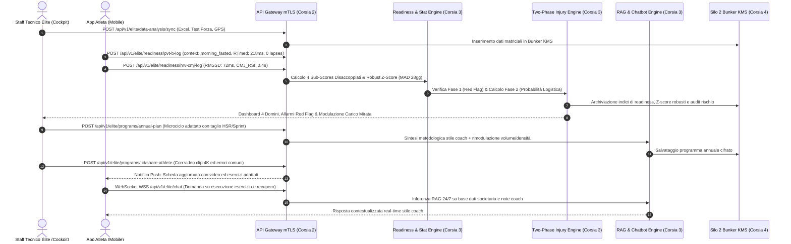
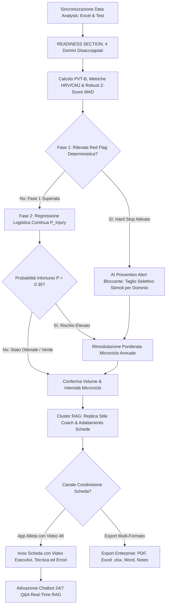

# Capitolato Tecnico: Flow 3C – Programmazione Annuale RAG, Chatbot 24/7 & Readiness Section (T7 Elite Pro Teams)

## 1. Identificativo & Titolo Ufficiale
- **Badge Miro Board:** `#15` (Posizione: `X: 2641.02, Y: 8166.68`, Miro Shape ID: `3458764688417722788`)
- **Codice Univoco:** `FLOW-3C`
- **Titolo Formale:** SOFTWARE 3 (B2B ENTERPRISE) - FLOW 3C: INTEGRAZIONE DATA ANALYSIS, PROGRAMMAZIONE ANNUALE, CONDIVISIONE SCHEDE CON VIDEO, RAG PER ATLETA & COACH, CHATBOT 24/7 E READINESS SECTION (PVT-B 3-MIN, 4 DOMINI DISACCOPPIATI, ROBUST Z-SCORE MAD & TWO-PHASE INJURY MODEL)
- **Board Miro Online:** `uXjVEbo6L2o=` (Zona 4, Riga 3: High-Level Pro Teams & Enterprise, Colonna 3: Programmazione degli Esercizi)
- **Diagramma Sorgente:** `architecture-blueprint/02-miro-zones-and-swimlanes/18-flowcharts/software-3-elite-club-enterprise/flow-3c-team-microcycle-mdx.mmd`
- **Riferimento Glossario:** [Glossario Tecnico Vivente](00-GLOSSARIO-TERMINI-TECNICI.md) (Voci: [PVT-B 3-min](00-GLOSSARIO-TERMINI-TECNICI.md#pvt-b-brief-psychomotor-vigilance-task-3-min), [Robust Z-Score MAD](00-GLOSSARIO-TERMINI-TECNICI.md#robust-z-score-mad-median-absolute-deviation), [Decoupled Readiness Sub-Scores](00-GLOSSARIO-TERMINI-TECNICI.md#decoupled-readiness-sub-scores-4-domini-indipendenti), [Two-Phase Injury Model](00-GLOSSARIO-TERMINI-TECNICI.md#two-phase-injury-risk-architecture-architettura-rischio-infortuni), [Cross-Module Baseline Bridge](00-GLOSSARIO-TERMINI-TECNICI.md#cross-module-baseline-bridge-data-analisi-verso-programmazione-e-catalogo), [Style-Cloning Coach](00-GLOSSARIO-TERMINI-TECNICI.md#clonazione-dello-stile-e-lessico-del-coach-style-cloning), [ACWR EWMA](00-GLOSSARIO-TERMINI-TECNICI.md#acwr-ewma-exponentially-weighted-moving-average), [Silo 2 Bunker KMS](00-GLOSSARIO-TERMINI-TECNICI.md#cloud-kms-key-management-service)).

---

## 2. Obiettivo di Business & Target Utente

### Guida Pratica per Non Tecnici: Cos'è questo modulo per un umano?
Nello sport professionistico d'élite (Tier 3 – Nazionali Olimpiche, Club di Serie A, Premier League, NBA, Eurolega), la programmazione dell'allenamento non è un'attività statica o isolata: è un processo dinamico e predittivo che fonde i riscontri oggettivi del campo (Data Analysis), l'esperienza metodologica del capo allenatore e lo stato neuro-fisiologico in tempo reale dell'atleta (Readiness).  
Questo modulo rappresenta l'apice tecnologico e scientifico della piattaforma T7 Workout:
- **Eredità Funzionale Integrale Tier 1 e Tier 2:** Include l'archivio schede per sport, il questionario anamnestico avanzato, la modifica fine dei parametri allenanti, l'AI scientifica validata da DOI e l'esportazione multi-formato sbloccata in 4 formati (PDF, Excel `.xlsx`, Word `.docx`, Notes);
- **Integrazione Diretta con Data Analysis:** Connette in tempo reale lo storico prestativo dell'atleta, fogli Excel societari, riassunti di partita, rilevazioni antropometriche e test massimali di forza e velocità;
- **Pianificazione Annuale Completa:** Gestione di microcicli, mesocicli e macrocicli estesi fino a 52 settimane (intera stagione agonistica o quadriennio olimpico);
- **Condivisione Schede con Video Dimostrativi:** Invio diretto all'app dell'atleta di programmi multimediali arricchiti da clip video esecutive in alta definizione, indicazioni di tecnica biomeccanica ed errori posturali da evitare;
- **Cluster RAG e Clonazione Stile Coach:** L'assistente cognitivo modella le abitudini quotidiane del singolo atleta e replica fedelmente la filosofia comunicativa e metodologica del coach societario;
- **Chatbot Integrato 24/7 Addestrato via RAG:** Assistente virtuale attivo h24 capace di spiegare gli esercizi, guidare il riscaldamento e rispondere a qualsiasi dubbio operativo dell'atleta;
- **Riabilitazione Élite e Return to Play (RTP):** Percorsi specialistici di riatletizzazione sincronizzati con la cartella clinica dello staff medico;
- **READINESS SECTION (ESCLUSIVA TIER 3):**
  1. *Protocollo PVT-B (Brief Psychomotor Vigilance Task a 3 Minuti):* Misurazione ad alta frequenza della vigilanza comportamentale e dell'attenzione sostenuta tramite stimoli visivi casuali. Calcolo di tempo di reazione mediano ($RT_{\text{med}}$), velocità di risposta ($1/RT$), variabilità intra-individuale ($IQR_{RT}$), partenze anticipate (false starts $< 100\text{ ms}$) e lapsus calibrati su baseline individuale (e.g. $RT > 355\text{ ms}$ o $2\times\text{baseline}$), superando la soglia generica dei 500 ms inadatta a campioni brevi;
  2. *Segregazione Contestuale (Dual Testing Protocol):* Distinzione rigorosa tra somministrazione **Mattutina a Digiuno** (indice di recupero omeostatico, debito di sonno e prontezza sistemica del SNC) e somministrazione **Pre-Sessione Acuta** (misurazione dell'arousal neuromuscolare e attivazione acuta pre-allenamento);
  3. *Decoupled Readiness Sub-Scores (4 Domini Indipendenti):* Scomposizione della prontezza in 4 sotto-punteggi autonomi (Fisiologico, Neurocognitivo, Neuromuscolare, Tolleranza al Carico) presentati singolarmente prima di qualsiasi indice composito, impedendo che un valore cardiaco ottimale mascheri un grave deficit neurale o contrattile;
  4. *Normalizzazione Statistica Robust Z-Score (MAD):* Standardizzazione $Z_{\text{robust}} = \frac{x - \text{mediana}}{1.4826 \times \text{MAD}}$ calcolata su rolling window di 28 giorni, totalmente immune da asimmetrie ed outlier estremi tipici delle popolazioni atletiche;
  5. *Architettura Rischio Infortuni a Due Fasi (Two-Phase Model):* Sistema a cascata con Fase 1 basata su matrice deterministica di Red Flags (hard-stop immediati su asimmetrie contrattili $> 15\%$, spike acuti $\text{ACWR} > 1.50$, caduta marcata della vigilanza) e Fase 2 basata su regressione logistica multivariata calibrata su serie storiche longitudinali del club;
  6. *Supporto Preventivo AI con Modulazione Mirata del Carico:* Prescrizione selettiva dello stimolo in funzione del dominio compromesso (calo PVT $\rightarrow$ taglio High-Speed Running, sprint massimali e decision-making tattico; calo HRV $\rightarrow$ taglio volume complessivo e densità; calo CMJ $\rightarrow$ sospensione pliometria ed eccentrici pesanti).

### Specifiche di Business & Metriche
- **Target Utente:** Performance Director, Head Coach, Preparatori Fisici (S&C), Fisioterapisti e Medici di Club Professionistici (Tier 3 – Enterprise).
- **Problema Risolto:** Riduzione drastica degli infortuni non da contatto da sovraccarico ($> 42\%$) grazie all'intercettazione precoce della fatica neurocognitiva e neuromuscolare disaccoppiata prima che si manifesti il danno muscolo-tendineo.

---

## 3. Attori & Architettura a 4 Corsie (Swimlanes)

1. **Corsia 1: Thin Client UI/UX (Staff Cockpit & Athlete Companion App React 18):**
   - Cockpit annuale per lo staff con timeline microciclica a 52 settimane, modulo di test PVT-B millisecond-precision con campionamento touch ultra-rapido, cruscotto a 4 domini disaccoppiati (Verde/Giallo/Rosso), player schede interattivo con video dimostrativi 4K e drawer laterale chatbot RAG 24/7.
2. **Corsia 2: API Gateway & Enterprise Session Broker (Envoy mTLS + Cloud KMS):**
   - Autenticazione mTLS su Club Bunker Silo 2, rate limiting biometrico, validazione schemi JSON payload PVT/HRV/CMJ, streaming tokenizzato video HLS ed endpoint WebSocket (WSS) per chat real-time.
3. **Corsia 3: Server Scatola Nera (Readiness Engine, Stat Engine MAD, Two-Phase Injury Model & RAG Core):**
   - *Data Analysis Ingestion Engine:* Parser ad alte prestazioni per file Excel, GPS Catapult/Wimu e dinamometri isocinetici;
   - *PVT-B Cognitive Engine:* Calcolo $RT_{\text{med}}$, metriche reciproche $1/RT$, classificazione lapsus calibrati e partenze anticipate;
   - *Robust Z-Score Normalizer:* Motore statistico basato su Mediana e Median Absolute Deviation (MAD) su serie storiche a 28 giorni;
   - *Two-Phase Injury Predictor:* Motore a cascata con filtro deterministico Red Flag (Fase 1) e scoring probabilistico logistico continuo (Fase 2);
   - *Prescriptive Load Modulation AI:* Motore di raccomandazione per il taglio selettivo degli stimoli allenanti per dominio;
   - *Annual Periodization Engine & RAG Cluster:* Generatore di microcicli annuali vincolati alla metodologia del capo allenatore.
4. **Corsia 4: Database Tripartito (Silo 2 Bunker KMS & Silo 3 Research Warehouse):**
   - Storage cifrato a livello di colonna: tabelle `annual_programs`, `pvt_b_sessions`, `hrv_spectral_logs`, `neuromuscular_cmj_logs`, `readiness_subscores`, `two_phase_risk_audit` e vector store `coach_methodology_embeddings`.

---

### Sequence Diagram Asincrono del Ciclo di Vita (FLOW-3C)



---

## 4. Flusso Operativo Passo-Passo (Livello A Narrativo + KPI e Livello B Deep-Dive)

### Livello A: User Journey Narrativo
1. **Sincronizzazione Dati da Campo:** All'avvio del microciclo, lo staff atletico sincronizza i dati da Data Analysis (file Excel societari, tracciati GPS e test di forza isocinetica/dinamometrica);
2. **Esecuzione Protocollo Duale PVT-B & Metriche Fisiologiche:**
   - *Fase Mattutina a Digiuno:* L'atleta esegue il test PVT-B di 3 minuti appena sveglio per misurare il recupero sistemico del SNC e registra il dato HRV/RMSSD a riposo;
   - *Fase Pre-Sessione:* Prima dell'allenamento sul campo, l'atleta effettua un check rapido di attivazione acuta (arousal) e salti CMJ su pedana di forza o app validata;
3. **Elaborazione 4 Domini Disaccoppiati & Robust Z-Score:** Il server calcola i 4 punteggi indipendenti (Fisiologico, Neurocognitivo, Neuromuscolare, Tolleranza Carico) e normalizza ciascun parametro con la formula Robust Z-Score MAD rispetto alla baseline personale di 28 giorni;
4. **Valutazione Two-Phase del Rischio Infortuni:**
   - *Fase 1 (Red Flag):* Verifica deterministica di hard-stop (se un dominio presenta $Z_{\text{robust}} < -2.0$ o asimmetria contrattile $> 15\%$, scatta l'allarme bloccante);
   - *Fase 2 (Modello Statistico):* Se non vi sono Red Flag assolute, calcolo della probabilità continua di sovraccarico per l'intera seduta;
5. **Modulazione Mirata del Carico AI & Adattamento Microciclo:** L'AI suggerisce modifiche puntuali: se il calo risiede nel PVT-B, il sistema raccomanda di abbattere i metri ad alta velocità (HSR $> 19.8\text{ km/h}$) e gli sprint, preservando il volume a bassa intensità; se il calo è nell'HRV, riduce volume e densità; se il deficit è nel CMJ, elimina la pliometria;
6. **Condivisione Scheda con Video 4K & Supporto Chatbot 24/7:** Il programma modificato viene inviato all'atleta con video esplicativi e note tecniche; durante l'intera giornata l'atleta interagisce con il chatbot 24/7 per chiarimenti sull'esecuzione e sul recupero.

### Indicatori di Accettazione Operativa & Clinica (KPI)
| Step | Nome Operazione | Tempo Target (KPI) | Descrizione Tecnica |
| :---: | :--- | :---: | :--- |
| **01** | Ingestione File Excel Data Analysis | $< 1.5\text{ s}$ | Parsing di 1000+ righe metriche atletiche e validazione schemi con rollback atomico |
| **02** | Acquisizione Test PVT-B a Bassa Latenza | $< 20\text{ ms}$ | Timing hardware ultra-preciso su evento tocco touch, durata test 180s |
| **03** | Calcolo 4 Sub-Scores & Robust Z-Score MAD | $< 200\text{ ms}$ | Risoluzione non parametrica Mediana e MAD su rolling window a 28 giorni |
| **04** | Risoluzione Two-Phase Injury Model | $< 350\text{ ms}$ | Triage Red Flag Fase 1 + regressione logistica multivariata Fase 2 su 30 atleti |
| **05** | Prescrizione Modulazione Carico Mirata AI | $< 400\text{ ms}$ | Generazione raccomandazioni selettive stimoli in base al dominio compromesso |
| **06** | Inferenza Chatbot RAG 24/7 | $< 800\text{ ms}$ | Retrieval da vector store Silo 2 e streaming tokenizzato risposta stile coach |

---

### Livello B: Trattazione Tecnica Nodi Operativi

#### 1. Metriche Matematiche del Protocollo PVT-B (3 Minuti)
Il test PVT-B riduce la durata classica da 10 a 3 minuti, preservando un'altissima sensibilità alla fatica del SNC ($r > 0.88$ rispetto al test decaminutale) grazie all'analisi delle seguenti variabili:
- **Tempo di Reazione Mediano ($RT_{\text{med}}$):** Indicatore centrale di velocità psicomotoria, preferito alla media per insensibilità agli outlier:
  $$RT_{\text{med}} = \text{mediana}(RT_1, RT_2, \dots, RT_n)$$
- **Velocità di Risposta Reciproca ($1/RT$ Mean Speed):**
  $$\text{Mean Speed} = \frac{1}{n} \sum_{i=1}^n \frac{1000}{RT_i} \quad [\text{sec}^{-1}]$$
- **Lapsus di Attenzione Calibrati su 3 Minuti:** Nei test brevi da 3 minuti la soglia classica fissa di $500\text{ ms}$ è eccessivamente permissiva. Il sistema adotta una soglia adattata calibrata sulla baseline individuale:
  $$\text{Lapse}_{\text{PVT-B}} = \left\{ RT_i \mid RT_i > \max(355\text{ ms}, \, 2 \cdot RT_{\text{baseline\_med}}) \right\}$$
- **False Starts (Partenze Anticipate / Errori di Commissione):** Risposte registrate prima della comparsa dello stimolo o con latenza fisiologicamente impossibile:
  $$\text{False Start} = \left\{ RT_i \mid RT_i < 100\text{ ms} \right\}$$

#### 2. Segregazione Contestuale: Mattutino vs Pre-Sessione
- **Test Mattutino a Digiuno:** Cattura la baseline neurale a riposo e l'effetto cumulativo del debito di sonno o dello stress sistemico. Determina la capacità di carico globale della giornata;
- **Test Pre-Sessione Acuta:** Misura l'arousal transitorio e il potenziamento post-attivazione (PAP). Rileva blocchi psicologici acuti, affaticamento da viaggio o ipoglicemia imminente.

#### 3. Standardizzazione Statistica: Robust Z-Score (MAD)
Per evitare che picchi prestativi o giornate atipiche distorcano media e deviazione standard, la piattaforma implementa il Robust Z-Score basato sulla Median Absolute Deviation su rolling window di 28 giorni:
$$\text{MAD} = \text{mediana}\left(|x_i - \text{mediana}(X)|\right)$$
$$Z_{\text{robust}} = \frac{x_i - \text{mediana}(X)}{1.4826 \times \text{MAD}}$$
Il fattore costante $1.4826$ assicura la convergenza asintotica alla deviazione standard per distribuzioni normali, mantenendo piena robustezza contro asimmetrie ed outlier estremi.

#### 4. I 4 Domini Disaccoppiati della Readiness
Ciascun dominio genera un indice indipendente normalizzato $S_d \in [0, 100]$:
1. **Dominio Fisiologico ($S_{\text{Phys}}$):** HRV (lnRMSSD), SDNN, Frequenza Cardiaca a Riposo (RHR), rapporto LF/HF;
2. **Dominio Neurocognitivo ($S_{\text{Neuro}}$):** PVT-B $RT_{\text{med}}$, $1/RT$, tasso di lapsus calibrati, false starts;
3. **Dominio Neuromuscolare ($S_{\text{NMusc}}$):** Altezza salto CMJ, RSI-mod (Reactive Strength Index Modified), tasso di sviluppo della forza eccentrica ($RFD_{\text{ecc}}$);
4. **Dominio Tolleranza al Carico ($S_{\text{Load}}$):** Indice sRPE acuto, EWMA ACWR (decadimento esponenziale $\lambda$), indice DOMS/dolore muscolare riferito.

#### 5. Architettura Rischio Infortuni a Due Fasi (Two-Phase Model)
- **Fase 1 (Filtro Deterministico Red Flags):** Se una delle seguenti condizioni si verifica, scatta il blocco preventivo assoluto:
  $$\text{Trigger}_{\text{RedFlag}} = \left( Z_{\text{NMusc}} < -2.0 \right) \lor \left( \Delta_{\text{Asimmetria CMJ}} > 15\% \right) \lor \left( \text{Lapses}_{\text{PVT-B}} \ge 3 \right) \lor \left( \text{ACWR}_{\text{EWMA}} > 1.50 \right)$$
- **Fase 2 (Stima Probabilistica Logistica Continua):** Se la Fase 1 è superata, viene calcolato l'indice di rischio continuo:
  $$P(\text{Injury}) = \frac{1}{1 + \exp\left( - \left[ \beta_0 + \beta_1 Z_{\text{Phys}} + \beta_2 Z_{\text{Neuro}} + \beta_3 Z_{\text{NMusc}} + \beta_4 Z_{\text{Load}} \right] \right)}$$
  con coefficienti $\{\beta_k\}$ calibrati sul registro infortuni longitudinale del club cifrato in Silo 2.

#### 6. Matrice Prescrittiva di Modulazione del Carico Mirata per Dominio
| Dominio Compromesso ($Z < -1.5$) | Meccanismo Fisiologico | Intervento Prescrittivo AI |
| :--- | :--- | :--- |
| **Neurocognitivo (PVT-B)** | Fatica centrale del SNC, calo vigilanza, rallentamento decisionale | Taglio $\ge 50\%$ metri High-Speed Running (HSR $> 19.8\text{ km/h}$), divieto sprint massimali $> 25.2\text{ km/h}$, rimozione esercitazioni tattiche ad alto carico decisionale/reattivo |
| **Fisiologico (HRV / RHR)** | Iperattivazione simpatica o saturazione parasimpatica da sovraccarico | Taglio del $30\text{-}40\%$ del volume totale (durata seduta e tonnellaggio), incremento pause tra le serie, divieto di lavoro metabolico lattacido ad alta densità |
| **Neuromuscolare (CMJ)** | Fatica eccentrica periferica, perdita di stiffness tendinea | Sospensione totale pliometria ad alto impatto (depth jumps), stop lavoro eccentrico pesante sovraccarico, sostituzione squat pesante con leg press guidata concentrica |
| **Tolleranza Carico (ACWR)** | Picco di carico acuto non supportato da adeguata capacità cronica | Riduzione intensità percepita target (RPE target max 5/10), introduzione sessione attiva di recupero idroterapico |

---

## 5. Rami Decisionali & Gestione dei 4 Stati UI



### Gestione dei 4 Stati UI
1. **Empty State:** All'inizio del ritiro precampionato o all'ingresso di un nuovo atleta: nessun log PVT-B o HRV presente. La UI visualizza la dashboard di baseline: "Inizializzazione Baseline 28 Giorni: esegui il primo test PVT-B mattutino (3 min) e registra la frequenza cardiaca a riposo per calibrare i 4 domini";
2. **Loading State:** Elaborazione della matrice di squadra: animazione radiale con barra di avanzamento e indicatore di stato: "Calcolo Robust Z-Score MAD su rolling window di 28 giorni e risoluzione modello Two-Phase per la rosa...";
3. **Populated State:** Cockpit completo con griglia atleti multicolore: 4 badge indipendenti per ciascun dominio (Verde = Ottimale, Giallo = Attenzione, Rosso = Deficit), indicatore sintetico di rischio infortuni a due fasi, suggerimenti operativi di modulazione del carico e player video 4K dimostrativo per ciascun esercizio;
4. **Error / Fallback State:** Assenza di connettività internet sul campo d'allenamento: fallback offline automatico con registrazione cifrata dei tocchi PVT-B su IndexedDB protetto locale e calcolo temporaneo dello Z-score basato sull'ultima baseline sincronizzata, con retry esponenziale asincrono su mTLS.

---

## 6. Contratti Dati, Parametri I/O & Error Matrix

### Schema JSON Contratto di Ingestione Readiness & Microciclo Tier 3
```json
{
  "programId": "annual_elite_season_2026_mdx",
  "tier": 3,
  "clubId": "club_bunker_it_01",
  "athleteId": "ath_elite_99",
  "horizonWeeks": 52,
  "dataAnalysisIntegration": {
    "excelImportValidated": true,
    "lastVelocityTestMps": 1.45,
    "oneRepMaxEstimateKg": 210.0,
    "gpsChronicLoadAuv": 2450.0
  },
  "readinessSection": {
    "pvtBMetrics": {
      "testContext": "morning_fasted",
      "durationSeconds": 180,
      "medianReactionTimeMs": 218.4,
      "responseSpeedInvSec": 4.58,
      "intraIndividualVariabilityIqrMs": 24.1,
      "calibratedLapsesCount": 0,
      "calibratedLapseCutoffMs": 355.0,
      "falseStartsCount": 0,
      "behavioralVigilanceState": "optimal"
    },
    "hrvMetrics": {
      "rmssdMs": 72.4,
      "sdnnMs": 86.1,
      "rhrBpm": 49.0,
      "lfHfRatio": 0.98,
      "spectralAutonomicBalance": "normo_parasympathetic"
    },
    "neuromuscularMetrics": {
      "cmjJumpHeightCm": 46.2,
      "rsiModScore": 0.49,
      "eccentricRfdNps": 3450.0,
      "bilateralAsymmetryPercent": 3.8
    },
    "loadToleranceMetrics": {
      "srpeAcute": 420.0,
      "acwrEwma": 1.12,
      "domsMuscularSorenessScore": 2
    },
    "decoupledSubScores": {
      "physiological": 88.5,
      "neurocognitive": 92.0,
      "neuromuscular": 86.4,
      "loadTolerance": 91.0
    },
    "robustZScores28Days": {
      "zRobustPvt": 0.32,
      "zRobustHrv": 0.45,
      "zRobustCmj": 0.28,
      "zRobustLoad": -0.15
    },
    "twoPhaseInjuryModel": {
      "phase1RedFlagTriggered": false,
      "phase1ActiveAlerts": [],
      "phase2ContinuousProbability": 0.078,
      "injuryRiskCategory": "low_risk"
    },
    "targetedLoadModulation": {
      "cutHighSpeedRunningPercent": 0,
      "cutMaxSprintPercent": 0,
      "cutTotalVolumePercent": 0,
      "cutPlyometricsEccentric": false,
      "aiPrescriptiveAdvice": "Tutti i 4 domini in zona ottimale. Nessuna restrizione per la seduta ad alta intensità MD-3."
    }
  },
  "ragCoachAssistant": {
    "methodologyModelId": "rag_coach_style_v3",
    "personalizedHabitsTips": "Recupero idrosalino ottimale. Mantenere routine pre-gara.",
    "chatbotActive247": true
  },
  "deliveryChannels": {
    "sentToAthleteApp": true,
    "includesDemonstrationVideos": true,
    "videoResolution": "4K_60FPS",
    "exportFormatsAllowed": ["pdf", "xlsx", "docx", "notes"]
  }
}
```

### Matrice Errori HTTP & Strategie di Resilienza
| HTTP Code | Codice Interno | Endpoint | Causa Scatenante | UX Feedback Visivo | Strategia di Resilienza & Fallback |
| :---: | :---: | :--- | :--- | :--- | :--- |
| `422` | `ERR_T3_PVT_SENSOR_NOISE` | `/api/v1/elite/readiness/pvt-b` | Falsi tocchi touch ($> 5$ false starts $< 100\text{ ms}$) o frequenza polling instabile | Alert: "Test PVT-B non valido: rilevate troppe partenze anticipate. Ripetere la prova da 3 minuti" | Annullamento sessione corrotta e restart guidato del test |
| `503` | `ERR_T3_RAG_CLUSTER_BUSY` | `/api/v1/elite/chat/query` | Congestione cluster GPU del club durante interrogazione contemporanea | Badge di caricamento: "L'assistente sta analizzando lo stile del coach..." | Accodamento asincrono con risposta entro 2 secondi |
| `400` | `ERR_T3_EXCEL_SCHEMA_INVALID` | `/api/v1/elite/data-analysis/upload` | File Excel societario privo delle intestazioni richieste o con celle corrotte | Modal di mapping: "Campi mancanti nel file Excel. Associa manualmente le colonne" | Mapper visuale interattivo delle colonne mancanti |
| `500` | `ERR_T3_INJURY_CALC_FAILED` | `/api/v1/elite/readiness/calculate` | Dati insufficienti per il calcolo Robust Z-Score ($N < 7\text{ giorni}$) | Banner informativo: "Baseline MAD in costruzione (giorno 3 di 7). Mostrati valori grezzi" | Fallback a percentili normativi di popolazione atletica |

---

## 7. Ereditarietà di Tier & Differenziali di Fascia

- **Ereditarietà Totale dai Livelli Inferiori:** Include al 100% tutte le funzionalità di Tier 1 e Tier 2:
  - *Da Tier 1 (FLOW-3A):* Archivio schede per sport, suddivisione per gruppi muscolari, player interattivo per la visualizzazione della scheda, esportazione in formato PDF;
  - *Da Tier 2 (FLOW-3B):* Questionario anamnestico approfondito, riabilitazione clinica 119 patologie, periodizzazione fino a 6 mesi, personalizzazione libera di parametri (serie, ripetizioni, RPE, tempi di recupero), spiegazioni scientifiche dell'AI supportate da DOI e link a PubMed, esportazione sbloccata nei 4 formati (PDF, Excel `.xlsx`, Word `.docx`, Notes);
- **Differenziali Funzionali Esclusivi Tier 3 (FLOW-3C):**
  - Integrazione bidirezionale diretta con la sezione **Data Analysis** (import Excel, riassunti prestativi, test isocinetici, fotocellule e GPS);
  - Pianificazione annuale completa estesa all'intera stagione agonistica (fino a 52 settimane / quadriennio);
  - Condivisione delle schede all'app dell'atleta corredate da video dimostrativi in alta definizione con consigli tecnici ed errori da evitare;
  - Consigli personalizzati AI sulle abitudini quotidiane dell'atleta e modulazione del recupero addestrati tramite RAG;
  - Chatbot interattivo integrato 24/7 addestrato via RAG per Q&A istantaneo e guida operativa;
  - Replica fedele dello stile metodologico e del lessico del capo allenatore (Style-Cloning via RAG);
  - **READINESS SECTION (ESCLUSIVA TIER 3):**
    - Protocollo PVT-B a 3 minuti (latenza mediana, velocità $1/RT$, variabilità intra-individuale, lapsus calibrati su baseline individuale, false starts);
    - Segregazione contestuale duale: Mattutino a Digiuno (SNC baseline/recovery) vs Pre-Sessione Acuta (arousal neuromuscolare);
    - 4 Sotto-Punteggi Disaccoppiati (Fisiologico, Neurocognitivo, Neuromuscolare, Tolleranza Carico) esposti autonomamente per evitare il masking di cali critici;
    - Standardizzazione statistica Robust Z-Score basata su Mediana e MAD su rolling window a 28 giorni;
    - Modello Rischio Infortuni a Due Fasi (Fase 1: Matrice deterministica Red Flag $\rightarrow$ Fase 2: Regressione logistica multivariata);
    - Supporto preventivo AI con modulazione prescrittiva del carico mirata per specifico dominio biologico in deficit;
- **Vincoli e Limitazioni di Fascia:**
  - Nessuna restrizione: livello Enterprise a massima capacità computazionale e isolamento crittografico dedicato (Silo 2 Bunker KMS).
