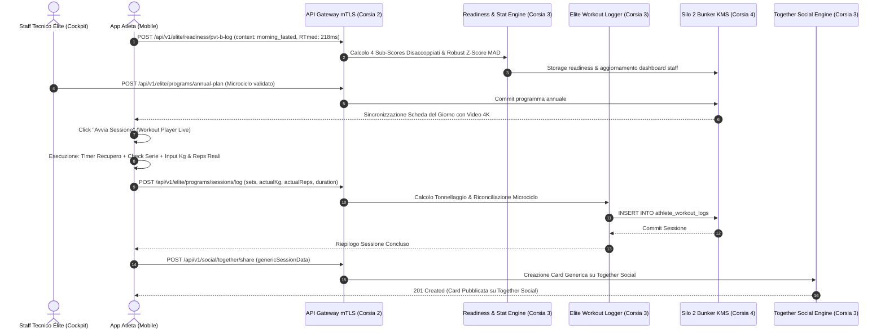
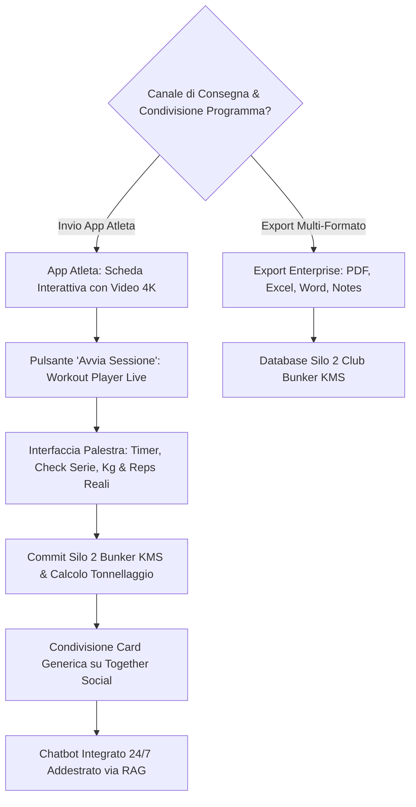

# Capitolato Tecnico: Flow 3C – Programmazione Annuale RAG, Chatbot 24/7, Workout Player & Readiness Section (T7 Elite Pro Teams)

## 1. Identificativo & Titolo Ufficiale
- **Badge Miro Board:** `#15` (Posizione: `X: 2641.02, Y: 8166.68`, Miro Shape ID: `3458764688417722788`)
- **Codice Univoco:** `FLOW-3C`
- **Titolo Formale:** SOFTWARE 3 (B2B ENTERPRISE) - FLOW 3C: INTEGRAZIONE DATA ANALYSIS, PROGRAMMAZIONE ANNUALE, WORKOUT PLAYER & VIDEO, RAG PER ATLETA & COACH, READINESS SECTION (PVT-B 3-MIN, 4 DOMINI DISACCOPPIATI, ROBUST Z-SCORE MAD & TWO-PHASE INJURY MODEL) & CONDIVISIONE TOGETHER SOCIAL
- **Board Miro Online:** `uXjVEbo6L2o=` (Zona 4, Riga 3: High-Level Pro Teams & Enterprise, Colonna 3: Programmazione degli Esercizi)
- **Diagramma Sorgente:** `architecture-blueprint/02-miro-zones-and-swimlanes/18-flowcharts/software-3-elite-club-enterprise/flow-3c-team-microcycle-mdx.mmd`
- **Riferimento Glossario:** [Glossario Tecnico Vivente](00-GLOSSARIO-TERMINI-TECNICI.md) (Voci: [PVT-B 3-min](00-GLOSSARIO-TERMINI-TECNICI.md#pvt-b-brief-psychomotor-vigilance-task-3-min), [Robust Z-Score MAD](00-GLOSSARIO-TERMINI-TECNICI.md#robust-z-score-mad-median-absolute-deviation), [Decoupled Readiness Sub-Scores](00-GLOSSARIO-TERMINI-TECNICI.md#decoupled-readiness-sub-scores-4-domini-indipendenti), [Two-Phase Injury Model](00-GLOSSARIO-TERMINI-TECNICI.md#two-phase-injury-risk-architecture-architettura-rischio-infortuni), [Cross-Module Baseline Bridge](00-GLOSSARIO-TERMINI-TECNICI.md#cross-module-baseline-bridge-data-analisi-verso-programmazione-e-catalogo), [Style-Cloning Coach](00-GLOSSARIO-TERMINI-TECNICI.md#clonazione-dello-stile-e-lessico-del-coach-style-cloning), [ACWR EWMA](00-GLOSSARIO-TERMINI-TECNICI.md#acwr-ewma-exponentially-weighted-moving-average), [Silo 2 Bunker KMS](00-GLOSSARIO-TERMINI-TECNICI.md#cloud-kms-key-management-service), [Together Social Workout Sharing](00-GLOSSARIO-TERMINI-TECNICI.md#together-social-workout-sharing)).

---

## 2. Obiettivo di Business & Target Utente

### Guida Pratica per Non Tecnici: Cos'è questo modulo per un umano?
Nello sport professionistico d'élite (Tier 3 – Nazionali Olimpiche, Club di Serie A, Premier League, NBA, Eurolega), la programmazione dell'allenamento fonde i riscontri oggettivi del campo (Data Analysis), l'esperienza metodologica dello staff, lo stato neuro-fisiologico in tempo reale dell'atleta (Readiness) e la guida operativa sul campo con il Workout Player da palestra:
- **Eredità Funzionale Integrale Tier 1 e Tier 2:** Include l'archivio schede per sport, il questionario anamnestico avanzato, la modifica fine dei parametri, l'esportazione multi-formato in 4 formati (PDF, Excel `.xlsx`, Word `.docx`, Notes) e la condivisione comunitaria su Together Social;
- **Integrazione Diretta con Data Analysis:** Connette in tempo reale lo storico prestativo dell'atleta, fogli Excel societari, riassunti di partita, rilevazioni antropometriche e test massimali di forza e velocità;
- **READINESS SECTION (ESCLUSIVA TIER 3):**
  1. *Protocollo PVT-B (Brief Psychomotor Vigilance Task a 3 Minuti):* Misurazione ad alta frequenza della vigilanza comportamentale e dell'attenzione sostenuta del SNC. Calcolo di tempo di reazione mediano ($RT_{	ext{med}}$), velocità di risposta ($1/RT$), variabilità intra-individuale ($IQR_{RT}$), partenze anticipate (false starts $< 100	ext{ ms}$) e lapsus calibrati su baseline individuale;
  2. *Segregazione Contestuale (Dual Testing Protocol):* Distinzione rigorosa tra somministrazione **Mattutina a Digiuno** (recupero sistemico, debito di sonno e prontezza del SNC) e **Pre-Sessione Acuta** (arousal neuromuscolare e attivazione acuta pre-allenamento);
  3. *Decoupled Readiness Sub-Scores (4 Domini Indipendenti):* Scomposizione della prontezza in 4 sotto-punteggi autonomi (Fisiologico, Neurocognitivo, Neuromuscolare, Tolleranza al Carico) presentati singolarmente per evitare il masking di deficit critici;
  4. *Normalizzazione Statistica Robust Z-Score (MAD):* Standardizzazione $Z_{	ext{robust}} = rac{x - 	ext{mediana}}{1.4826 	imes 	ext{MAD}}$ calcolata su rolling window di 28 giorni, totalmente immune da asimmetrie ed outlier estremi;
  5. *Architettura Rischio Infortuni a Due Fasi (Two-Phase Model):* Fase 1 Matrice Deterministica Red Flag (hard-stop su asimmetrie contrattili $> 15\%$, spike $	ext{ACWR} > 1.50$, caduta vigilanza) e Fase 2 Regressione logistica multivariata calibrata su serie storiche longitudinali;
  6. *Supporto Preventivo AI con Modulazione Mirata del Carico:* Prescrizione selettiva dello stimolo (calo PVT $
ightarrow$ taglio HSR/sprint/carico cognitivo; calo HRV $
ightarrow$ taglio volume/densità; calo CMJ $
ightarrow$ stop pliometria ed eccentrici pesanti);
- **Pianificazione Annuale Completa (fino a 52 Settimane):** Gestione di microcicli, mesocicli e macrocicli estesi all'intera stagione;
- **Condivisione Schede con Video Dimostrativi 4K:** Invio diretto all'app dell'atleta di programmi multimediali arricchiti da clip video esecutive in alta definizione, indicazioni di tecnica biomeccanica ed errori da evitare;
- **Workout Player Élite per l'Atleta:** Quando l'atleta apre il programma del giorno (o avvia un workout libero), compare il pulsante **"Avvia Sessione"**:
  - Interfaccia da palestra full-screen con timer di recupero sonoro e aptico;
  - Spunta delle serie completate;
  - Inserimento dei carichi reali sollevati (kg) e delle ripetizioni effettive eseguite;
  - Sincronizzazione automatica con il database blindato Bunker Silo 2;
- **Condivisione su Together Social:** Al termine della sessione, generazione automatica di una card con **dati generici dell'allenamento** (durata, volume sollevato, esercizi eseguiti) condivisa su **Together Social** per la motivazione del gruppo, con assoluta tutela del segreto industriale e dei dati sanitari;
- **Cluster RAG e Chatbot 24/7:** Replica fedele dello stile metodologico del capo allenatore (Style-Cloning) e assistenza real-time attiva h24 per guidare l'atleta nell'esecuzione degli esercizi.

---

## 3. Attori & Architettura a 4 Corsie (Swimlanes)

1. **Corsia 1: Thin Client UI/UX (Staff Cockpit & Athlete Companion App React 18):**
   - Cockpit annuale a 52 settimane;
   - Modulo test PVT-B millisecond-precision;
   - Cruscotto 4 domini disaccoppiati (Verde/Giallo/Rosso);
   - Player schede interattivo con video dimostrativi 4K;
   - Pulsante "Avvia Sessione" (programma giorno o workout libero);
   - Workout Player da palestra (timer recupero, spunta serie, carichi kg e reps reali);
   - Card generica di condivisione su Together Social;
   - Drawer laterale Chatbot RAG 24/7.
2. **Corsia 2: API Gateway & Enterprise Session Broker (Envoy mTLS + Cloud KMS):**
   - Autenticazione mTLS su Club Bunker Silo 2;
   - Streaming video tokenizzato HLS;
   - Endpoint: `/api/v1/elite/data-analysis/sync`, `/api/v1/elite/readiness/pvt-b-log`, `/api/v1/elite/programs/sessions/log`, `/api/v1/social/together/share`, `/api/v1/elite/programs/annual-plan`.
3. **Corsia 3: Server Scatola Nera (Readiness Engine, Two-Phase Model, Elite Workout Logger & RAG Core):**
   - *PVT-B Cognitive Engine:* Analisi $RT_{	ext{med}}$, $1/RT$ e lapsus calibrati;
   - *Robust Z-Score Normalizer:* Motore statistico basato su MAD su serie a 28 giorni;
   - *Two-Phase Injury Predictor:* Filtro deterministico Red Flag + scoring probabilistico logistico;
   - *Elite Workout Logger:* Calcolo tonnellaggio, riconciliazione serie/reps reali con la periodizzazione annuale e generazione card social;
   - *Together Social Engine:* Pubblicazione card riepilogativa;
   - *Annual Periodization & Style-Cloning RAG Cluster:* Generatore di microcicli e chatbot 24/7.
4. **Corsia 4: Database Tripartito (Silo 2 Bunker KMS & Silo 3 Research Warehouse):**
   - Tabelle `annual_programs`, `pvt_b_sessions`, `hrv_spectral_logs`, `athlete_workout_logs`, `readiness_subscores` e vector store `coach_methodology_embeddings`.

---

### Sequence Diagram Asincrono del Ciclo di Vita (FLOW-3C)



---

## 4. Flusso Passo-Passo (Livello A Narrativo + KPI e Livello B Deep-Dive)

### Livello A: Flusso Operativo Utente & Tabella KPI
1. **Rilevazione Readiness Mattutina:** L'atleta esegue il PVT-B a digiuno (3 min) e il test HRV;
2. **Consultazione Staff & Modulazione Carichi:** Lo staff valuta i 4 domini disaccoppiati ed eventuali tagli selettivi al carico;
3. **Ricezione Scheda del Giorno:** L'atleta apre la scheda arricchita da video 4K e spiegazioni tecniche;
4. **Esecuzione in Palestra (Workout Player):** Clicca su "Avvia Sessione", sfrutta il timer di recupero, spunta le serie e inserisce carichi (kg) e ripetizioni effettive;
5. **Salvataggio su Bunker Silo 2:** I dati confluiscono nel database blindato cifrato KMS;
6. **Condivisione su Together Social:** Viene pubblicata la card con metriche generiche (durata, volume, esercizi) su Together Social;
7. **Assistenza Chatbot 24/7:** L'atleta riceve supporto continuo h24 tramite il chatbot addestrato sullo stile del coach.

| Step | Nome Operazione | Tempo Target (KPI) | Descrizione Tecnica |
| :---: | :--- | :---: | :--- |
| **01** | Esecuzione PVT-B (3 min) | $180	ext{ s}$ | Test psicomotorio millisecond-precision su touch screen |
| **02** | Calcolo Robust Z-Score (MAD) | $< 40	ext{ ms}$ | Calcolo statistico non parametrico su 28 giorni |
| **03** | Avvio Workout Player Élite | $< 50	ext{ ms}$ | Apertura player con buffer locale offline-ready |
| **04** | Log Serie, Kg e Reps Reali | $< 25	ext{ ms}$ | Scrubbing e commit locale su IndexedDB con timer Web Worker |
| **05** | Commit su Bunker KMS Silo 2 | $< 220	ext{ ms}$ | Scrittura cifrata mTLS con chiave Cloud KMS dedicata |
| **06** | Condivisione Together Social | $< 350	ext{ ms}$ | Generazione card aggregata e pubblicazione su Together Social |

### Livello B: Deep-Dive Ingegneristico sui Microservizi
- **Architettura Reattiva PVT-B (3 minuti):** Campionamento degli intervalli inter-stimolo (ISI da 1 a 4 secondi) tramite Web Worker dedicato con timestamp ad altissima precisione (performance.now());
- **Normalizzazione MAD su 28 giorni:** Standardizzazione robusta non parametrica immune da outlier e asimmetrie, calcolata su finestra mobile di 28 giorni;
- **Workout Player Elite & Sincronizzazione Bunker Silo 2:** Ogni serie completata viene cifrata tramite chiamata RPC verso Cloud KMS e scritta nella partizione blindata della societa;
- **Generazione Card Together Social:** Filtraggio e sanitizzazione stretta: vengono generate unicamente metriche macroscopiche (durata, volume, badge), garantendo il riserbo su carichi specifici e dati fisiologici sensibili.

---

## 5. Rami Decisionali & 4 Stati UI



---

## 6. Contratti Dati & Error Matrix

### Schema JSON Registrazione Sessione Élite (`athlete_workout_logs`)
```json
{
  "sessionId": "sess_elite_19283",
  "clubId": "club_serie_a_01",
  "athleteId": "ath_elite_99",
  "tier": 3,
  "microcycleId": "mc_w12_mdminus2",
  "sessionType": "strength_power",
  "startedAt": "2026-11-15T09:30:00Z",
  "completedAt": "2026-11-15T10:45:00Z",
  "durationSeconds": 4500,
  "totalVolumeKg": 12450.0,
  "kmsKeyVersion": "projects/t7/locations/eu/keyRings/club/cryptoKeys/silo2/cryptoKeyVersions/1",
  "exercises": [
    {
      "exerciseId": "ex_trap_bar_dl_01",
      "exerciseName": "Trap Bar Deadlift",
      "sets": [
        { "set": 1, "targetReps": 5, "actualReps": 5, "weightKg": 160.0, "restSeconds": 150, "isCompleted": true },
        { "set": 2, "targetReps": 5, "actualReps": 5, "weightKg": 165.0, "restSeconds": 150, "isCompleted": true },
        { "set": 3, "targetReps": 5, "actualReps": 4, "weightKg": 170.0, "restSeconds": 180, "isCompleted": true }
      ]
    }
  ]
}
```

### Schema JSON Condivisione su Together Social (`together_social_shares`)
```json
{
  "shareId": "tsh_elite_90112",
  "athleteId": "ath_elite_99",
  "sessionId": "sess_elite_19283",
  "socialNetwork": "Together Social",
  "shareType": "generic_workout_summary",
  "publicCardData": {
    "title": "Seduta di Forza Élite Completata",
    "workoutType": "Microciclo Gara MD-2",
    "durationMinutes": 75,
    "totalVolumeTons": 12.45,
    "completedExercisesCount": 6
  },
  "privacyLevel": "community_public"
}
```

### Matrice Errori HTTP a 6 Colonne
| HTTP Code | Codice Interno | Endpoint | Causa Scatenante | UX Feedback Visivo | Strategia di Resilienza |
| :---: | :---: | :--- | :--- | :--- | :--- |
| `401` | `ERR_T3_MTLS_CERT_EXPIRED` | `/api/v1/elite/*` | Certificato client mTLS club scaduto | Schermata blocco sicurezza Bunker | Richiesta rinnovo credenziali allo staff |
| `429` | `ERR_T3_BIOMETRIC_RATE_LIMIT` | `/api/v1/elite/readiness/*` | Richieste di sampling touch anomalmente elevate | Avviso: "Rilevata frequenza anomala nel campionamento touch" | Backoff esponenziale su worker |
| `400` | `ERR_T3_LOG_DATA_CORRUPT` | `/api/v1/elite/programs/sessions/log` | Dati serie o carichi corrotti | Evidenziazione serie non validate | Buffer locale mantenuto intatto |
| `502` | `ERR_T3_SOCIAL_TIMEOUT` | `/api/v1/social/together/share` | Timeout pubblicazione Together Social | Toast: "Sessione salvata in Bunker KMS; retry Together Social in corso" | Coda di retry resiliente in background |
| `500` | `ERR_T3_KMS_ENCRYPTION_FAIL` | `/api/v1/elite/programs/sessions/log` | Mancata risposta Cloud KMS | Alert: "Errore crittografico hardware Bunker KMS" | Conservazione in memoria sicura temporanea |

---

## 7. Ereditarietà di Tier & Vincoli

- **Ereditarietà da Livelli Inferiori:** Eredita l'archivio schede per sport, l'anamnesi clinica, la modifica completa dei parametri, la modalità Workout Player con timer e registrazione carichi/reps, la condivisione su Together Social e l'export multi-formato in 4 formati.
- **Funzionalità Esclusive Tier 3:**
  - **READINESS SECTION (PVT-B 3 minuti, 4 Domini Disaccoppiati, Robust Z-Score MAD e Two-Phase Injury Model);**
  - Integrazione diretta e bidirezionale con la sezione di Data Analysis;
  - Programmazione annuale a 52 settimane;
  - Schede multimediali arricchite da video dimostrativi 4K;
  - Workout Player Élite per l'atleta sincronizzato con il database blindato Bunker Silo 2;
  - Chatbot integrato 24/7 addestrato via RAG sullo stile metodologico del coach (Style-Cloning);
  - Condivisione dati generici su Together Social tutelando il segreto industriale del club;
  - Crittografia end-to-end con Cloud KMS CMEK dedicato.
