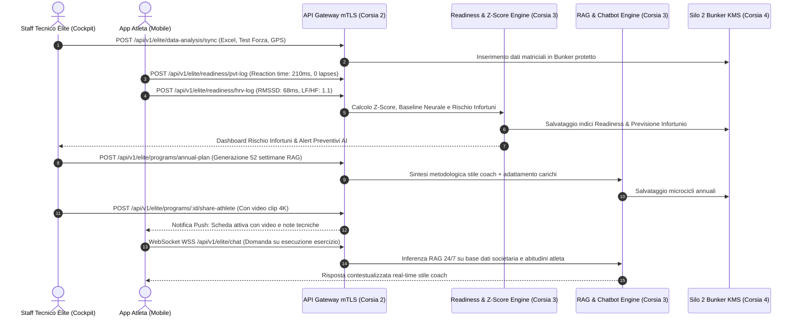
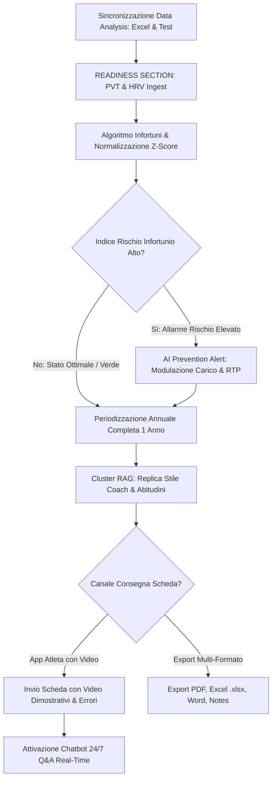

# Capitolato Tecnico: Flow 3C – Programmazione Annuale RAG, Chatbot 24/7 & Readiness Section (T7 Elite Pro Teams)

## 1. Identificativo & Titolo Ufficiale
- **Badge Miro Board:** `#15` (Posizione: `X: 3056.26, Y: 8034.66`, Miro Shape ID: `3458764688417722788`)
- **Codice Univoco:** `FLOW-3C`
- **Titolo Formale:** SOFTWARE 3 (B2B ENTERPRISE) - FLOW 3C: INTEGRAZIONE DATA ANALYSIS, PROGRAMMAZIONE ANNUALE, CONDIVISIONE SCHEDE CON VIDEO, RAG PER ATLETA & COACH, CHATBOT 24/7 E READINESS SECTION (PVT, HRV, Z-SCORE & RISCHIO INFORTUNI)
- **Board Miro Online:** `uXjVEbo6L2o=` (Zona 4, Riga 3: High-Level Pro Teams & Enterprise, Colonna 3: Programmazione degli Esercizi)
- **Diagramma Sorgente:** `architecture-blueprint/02-miro-zones-and-swimlanes/18-flowcharts/software-3-elite-club-enterprise/flow-3c-team-microcycle-mdx.mmd`
- **Riferimento Glossario:** [Glossario Tecnico Vivente](00-GLOSSARIO-TERMINI-TECNICI.md) (Voci: [Data Analysis Integration](00-GLOSSARIO-TERMINI-TECNICI.md), [RAG Stile Coach & Atleta](00-GLOSSARIO-TERMINI-TECNICI.md#rag-gerarchico-scientifico-retrieval-augmented-generation), [Chatbot 24/7 Real-Time](00-GLOSSARIO-TERMINI-TECNICI.md), [Programmazione Annuale](00-GLOSSARIO-TERMINI-TECNICI.md), [Video in Scheda](00-GLOSSARIO-TERMINI-TECNICI.md), [Readiness Section](00-GLOSSARIO-TERMINI-TECNICI.md), [PVT Psychomotor Vigilance Task](00-GLOSSARIO-TERMINI-TECNICI.md), [HRV & RMSSD Time/Frequency Domain](00-GLOSSARIO-TERMINI-TECNICI.md), [Algoritmo Calcolo Rischio Infortuni](00-GLOSSARIO-TERMINI-TECNICI.md), [Z-Score Normalization](00-GLOSSARIO-TERMINI-TECNICI.md#z-weighting-gestione-doppio-ruolo-tattico), [Silo 2 Bunker KMS](00-GLOSSARIO-TERMINI-TECNICI.md#cloud-kms-key-management-service)).

---

## 2. Obiettivo di Business & Target Utente

### Guida Pratica per Non Tecnici: Cos'è questo modulo per un umano?
Nello sport di alto livello (Tier 3 – Squadre Nazionali, Club Professionistici di Serie A/Eurolega/Premier League), programmare l'allenamento non è più un compito isolato: richiede la perfetta fusione tra i dati scientifici da campo (Data Analysis), l'esperienza metodologica del coach e lo stato fisiologico e neurale dell'atleta in tempo reale (Readiness).  
Questo modulo rappresenta il top di gamma ingegneristico della piattaforma T7:
- **Tutte le Funzioni Tier 1 e Tier 2 Ereditate:** Include l'archivio schede per sport, il questionario anamnestico completo, la personalizzazione totale dei parametri, l'AI scientifica con fonti e l'esportazione multi-formato (PDF, Excel, Word, Notes);
- **Integrazione Diretta con Data Analysis:** Importa e sincronizza lo storico dell'atleta, fogli Excel societari, riassunti prestativi, dati antropometrici e test massimali di forza e velocità;
- **Pianificazione Annuale Completa:** Creazione di microcicli, mesocicli e macrocicli estesi fino a 1 intero anno (intera stagione agonistica);
- **Condivisione Schede con Video Dimostrativi:** Invio diretto delle schede all'app dell'atleta corredate da video dimostrativi che mostrano la corretta esecuzione, consigli tecnici ed errori da evitare;
- **Consigli AI e RAG per Atleta & Replica Stile Coach:** L'assistente AI modella le abitudini quotidiane del singolo atleta tramite RAG e replica fedelmente la filosofia metodologica del capo allenatore;
- **Chatbot Integrato 24/7:** Assistente virtuale attivo 24 ore su 24, addestrato tramite RAG, capace di spiegare gli esercizi in tempo reale e rispondere a ogni quesito dell'atleta;
- **Riabilitazione Élite e Return to Play (RTP):** Protocolli avanzati coordinati con lo staff medico;
- **READINESS SECTION (TIER 3 ONLY):**
  - *Test cognitivi e di vigilanza:* Sezione dedicata ai test PVT (Psychomotor Vigilance Task) per misurare la fatica del sistema nervoso centrale (CNS);
  - *Metriche HRV nel dominio del tempo e frequenza:* Ingestione test HRV, RMSSD, SDNN (time domain) e rapporti LF/HF (frequency domain);
  - *Algoritmo Rischio Infortuni:* Formula matematica proprietaria che calcola la probabilità di infortunio incrociando fatica, carichi e parametri fisiologici;
  - *Supporto Preventivo AI:* Suggerimenti operativi per staff e singoli atleti su come modulare i carichi per prevenire traumi;
  - *Baseline Prestativa:* Costruzione della baseline neurale e fisica individuale e di squadra;
  - *Reportistica & Standardizzazione Z-Score:* Generazione automatica di report sanitari e bilanciamento carico interno/esterno normalizzato su base Z-score.

### Specifiche di Business & Metriche
- **Target Utente:** Performance Director, Head Coach, Preparatori Atletici e Staff Medico di Club Professionistici (Tier 3 – Enterprise).
- **Problema Risolto:** Abbattere il tasso di infortuni da sovraccarico ($> 40\%$) grazie alla previsione matematica basata su HRV, PVT e carico interno/esterno Z-score, sincronizzando l'intero staff su piani annuali condivisi con gli atleti.

---

## 3. Attori & Architettura a 4 Corsie (Swimlanes)

1. **Corsia 1: Thin Client UI/UX (Staff Cockpit & Athlete Companion App React 18):**
   - Cockpit annuale staff con viste Gantt/Timeline a 52 settimane, modulo esecuzione test cognitivi PVT a millisecondo, interfaccia upload test HRV/RMSSD, cruscotto probabilità infortunio con allarmi semaforici, player schede con video multi-angolo per atleta e chatbot interattivo 24/7 integrato in drawer laterale.
2. **Corsia 2: API Gateway & Enterprise Session Broker (Envoy mTLS + Cloud KMS):**
   - Autenticazione Club Bunker Silo 2, routing sicuro su microservizi isolati VPC, streaming video HLS autorizzato con token a scadenza e brokeraggio WebSocket per sessioni chatbot RAG 24/7.
3. **Corsia 3: Server Scatola Nera (Annual Engine, RAG Cognitive Core & Readiness Engine Cloud Run):**
   - *Annual Periodization Engine:* Generazione microcicli su 52 settimane;
   - *Data Analysis Ingestion Engine:* Parser fogli Excel societari, storico test forza/velocità e antropometria;
   - *RAG Cognitive Core:* Cluster LLM specializzato su prompt societari, stile del coach e Q&A 24/7;
   - *Readiness Section Algorithm:* Motore matematico per calcolo probabilità infortuni:
     $$P(\text{Injury}) = \sigma\left(\beta_0 + \beta_1 \cdot Z_{\text{Internal}} + \beta_2 \cdot Z_{\text{External}} + \beta_3 \cdot \Delta_{\text{HRV}} + \beta_4 \cdot \text{Lapse}_{\text{PVT}}\right)$$
   - *Z-Score Normalizer:* Calcolo scostamenti statistici $Z = \frac{X - \mu}{\sigma}$ su rolling window 28 giorni.
4. **Corsia 4: Database Tripartito (Silo 2 Bunker KMS & Silo 3 Data Lake PostgreSQL):**
   - Tabelle cifrate `annual_schedules`, `pvt_cognitive_logs`, `hrv_spectral_data`, `injury_risk_forecasts`, `rag_coach_embeddings` e storage sicuro video.

---

### Sequence Diagram Asincrono del Ciclo di Vita (FLOW-3C)



---

## 4. Flusso Passo-Passo (Livello A Narrativo + KPI e Livello B Deep-Dive)

### Livello A: Flusso Operativo Utente & Tabella KPI
1. **Sincronizzazione Dati da Campo:** Lo staff carica i dati da Data Analysis (Excel, test di forza isocinetica, velocità fotocellule, antropometria);
2. **Esecuzione Readiness Quotidiana:** L'atleta completa al mattino il test cognitivo PVT e trasmette i dati HRV/RMSSD;
3. **Analisi Algoritmo Infortuni & Z-Score:** Il sistema calcola la deviazione standard Z-score tra carico interno ed esterno e genera la probabilità di infortunio con alert preventivi;
4. **Pianificazione Annuale RAG:** Il coach genera o adatta la programmazione annuale (fino a 1 anno), integrando lo stile metodologico societario;
5. **Invio Scheda con Video all'Atleta:** Il programma viene consegnato sull'app dell'atleta completo di video clip ad alta risoluzione, suggerimenti posturali ed errori da evitare;
6. **Supporto Continuo Chatbot 24/7:** Durante la seduta o a riposo, l'atleta dialoga con il chatbot RAG per chiarimenti su esercizi o gestione del recupero.

| Step | Nome Operazione | Tempo Target (KPI) | Descrizione Tecnica |
| :---: | :--- | :---: | :--- |
| **01** | Ingestione File Excel Data Analysis | $< 1.5\text{ s}$ | Parsing 1000+ righe metriche atletiche e validazione schemi |
| **02** | Acquisizione Test PVT a Bassa Latenza | $< 20\text{ ms}$ | Timing hardware ad altissima precisione su evento tocco |
| **03** | Calcolo Algoritmo Infortuni & Z-Score | $< 350\text{ ms}$ | Risoluzione formula logistica su serie storiche 28 giorni |
| **04** | Inferenza Chatbot RAG 24/7 | $< 800\text{ ms}$ | Retrieval da vector store Silo 2 e generazione token streaming |

### Livello B: Deep-Dive Ingegneristico sui Microservizi
- **Specifiche della READINESS SECTION:**
  - *PVT (Psychomotor Vigilance Task):* Test standard di 3-5 minuti con stimoli visivi casuali (inter-stimulus interval 2-10s). Misura latenza media ($RT$), lapsus ($RT > 500\text{ ms}$) e indice di fatica centrale del SNC;
  - *HRV (Heart Rate Variability):* Elaborazione spettrale Fast Fourier Transform (FFT) per estrarre bande VLF ($0.0033\text{-}0.04\text{ Hz}$), LF ($0.04\text{-}0.15\text{ Hz}$) e HF ($0.15\text{-}0.4\text{ Hz}$), oltre a RMSSD e SDNN;
  - *Normalizzazione Z-Score:* Calcolo degli Z-score giornalieri per carico acuto e cronico, evidenziando valori critici $|Z| > 1.96$ ($p < 0.05$);
- **Cluster RAG e Chatbot 24/7:** Motore vettoriale alimentato dai documenti metodologici societari, dalle registrazioni del coach e dai diari delle abitudini degli atleti, isolato crittograficamente per club.

---

## 5. Rami Decisionali & 4 Stati UI



### Gestione dei 4 Stati UI (Obbligatoria)
1. **Empty State:** Inizio stagione o nuovo atleta: nessun dato PVT/HRV caricato. La UI visualizza la procedura guidata per la baseline: "Esegui il test PVT di calibrazione e indossa la fascia cardiaca per stabilire la baseline iniziale".
2. **Loading State:** Elaborazione della matrice di rischio infortuni di squadra con visualizzazione interattiva dei progressi di sincronizzazione.
3. **Populated State:** Cockpit completo con griglia atleti a colori (Verde = Pronto, Giallo = Attenzione, Rosso = Alto Rischio), radar Z-score e player video 4K per ogni esercizio.
4. **Error / Fallback State:** Fallback offline con memorizzazione locale cifrata delle risposte ai test PVT su SQLite protetto e sincronizzazione non appena ristabilito il canale mTLS.

---

## 6. Contratti Dati & Error Matrix

### Schema JSON Readiness Section & Scheda Tier 3
```json
{
  "programId": "annual_elite_season_2026",
  "tier": 3,
  "clubId": "club_bunker_it_01",
  "athleteId": "ath_elite_99",
  "horizonMonths": 12,
  "dataAnalysisIntegration": {
    "excelSourceImported": true,
    "hasAnthropometricData": true,
    "lastVelocityTestMps": 1.45,
    "oneRepMaxEstimateKg": 210.0
  },
  "readinessSection": {
    "pvtMetrics": {
      "meanReactionTimeMs": 204.5,
      "lapseCount": 0,
      "performanceState": "optimal"
    },
    "hrvMetrics": {
      "rmssdMs": 74.2,
      "sdnnMs": 88.0,
      "lfHfRatio": 0.95,
      "spectralDomain": "balanced_parasympathetic"
    },
    "injuryRiskProbability": 0.08,
    "zScoreInternalLoad": 0.35,
    "zScoreExternalLoad": 0.42,
    "aiPreventionAdvice": "Carico ottimale. Mantenere volume programmato per la seduta MD-3"
  },
  "ragCoachAssistant": {
    "methodologyModelId": "rag_coach_style_v3",
    "personalizedHabitsTips": "Consigliata idratazione supplementare pre-seduta",
    "chatbotActive247": true
  },
  "deliveryChannels": {
    "sentToAthleteApp": true,
    "includesDemonstrationVideos": true,
    "videoResolution": "4K_60FPS",
    "exportFormatsAllowed": ["pdf", "xlsx", "docx", "notes"]
  }
}
```

### Matrice Errori HTTP a 6 Colonne
| HTTP Code | Codice Interno | Endpoint | Causa Scatenante | UX Feedback Visivo | Strategia di Resilienza |
| :---: | :---: | :--- | :--- | :--- | :--- |
| `422` | `ERR_T3_PVT_SENSOR_NOISE` | `/api/v1/elite/readiness/pvt` | Falsi tocchi o frequenza campionamento non conforme | Alert: "Test PVT non valido: rilevati troppi tocchi anticipati. Ripetere la prova" | Annullamento sessione e restart test |
| `503` | `ERR_T3_RAG_CLUSTER_BUSY` | `/api/v1/elite/chat/query` | Congestione cluster GPU del club durante sessione simultanea | Badge di caricamento: "L'assistente sta analizzando lo stile del coach..." | Accodamento asincrono con risposta entro 2 secondi |
| `400` | `ERR_T3_EXCEL_SCHEMA_INVALID` | `/api/v1/elite/data-analysis/upload` | Foglio Excel società privo di colonne richieste | Modal di mapping: "Campi mancanti nel file Excel. Associa manualmente le colonne" | Mapper visuale interattivo delle colonne |
| `500` | `ERR_T3_INJURY_CALC_FAILED` | `/api/v1/elite/readiness/calculate` | Dati insufficienti per il calcolo Z-score ($N < 7\text{ gg}$) | Banner: "Baseline in corso di costruzione (giorno 3 di 7). Mostrati valori grezzi" | Fallback a medie statistiche standard |

---

## 7. Ereditarietà di Tier & Vincoli

- **Ereditarietà da Livelli Inferiori:** Include al 100% tutte le funzionalità di Tier 1 e Tier 2 (archivio per sport, questionario anamnestico, personalizzazione totale, spiegazioni scientifiche con DOI, export multi-formato in 4 estensioni).
- **Differenziali Esclusivi Tier 3:**
  - Collegamento diretto con la sezione di Data Analysis (storico atleta, import fogli Excel, riassunti prestativi, test di forza e velocità);
  - Condivisione delle schede all'app dell'atleta corredate da video dimostrativi, tecnica ed errori comuni da evitare;
  - Consigli personalizzati AI sulle abitudini dell'atleta e gestione quotidiana addestrati via RAG;
  - Chatbot interattivo integrato 24/7 per Q&A ed esecuzione esercizi;
  - Replica dello stile metodologico del capo allenatore tramite RAG;
  - Pianificazione annuale completa (fino a 1 anno / intera stagione);
  - Gestione carico interno ed esterno con l'algoritmo della Readiness Section;
  - **READINESS SECTION (TIER 3 ONLY):**
    - Modulo test cognitivi e vigilanza PVT (Psychomotor Vigilance Task);
    - Caricamento test HRV/RMSSD in time domain e frequency domain;
    - Algoritmo di calcolo probabilità rischio infortuni;
    - Supporto preventivo AI per singolo atleta e squadra;
    - Costruzione baseline prestativa neurale e fisica;
    - Standardizzazione Z-score e report sanitari automatici.
- **Vincoli e Limitazioni di Fascia:**
  - Nessuna limitazione funzionale (massimo livello tecnologico ed enterprise della piattaforma).
