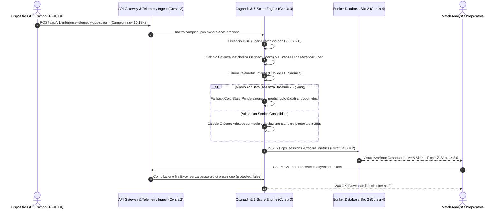

# Capitolato Tecnico: Flow 4C – GPS Telemetry & Adaptive Z-Score Fatigue Profiling (T7 Elite Pro Teams)

## 1. Identificativo & Titolo Ufficiale
- **Badge Miro Board:** `#16` (Posizione: `X: 4587, Y: 6565.57`, Miro Shape ID: `3458764688417722792`)
- **Codice Univoco:** `FLOW-4C`
- **Titolo Formale:** SOFTWARE 3 (B2B ENTERPRISE) - FLOW 4C: GPS TELEMETRY & ADAPTIVE Z-SCORE FATIGUE PROFILING
- **Board Miro Online:** `uXjVEbo6L2o=` (Zona 4, Riga 3: High-Level Pro Teams & Enterprise, Colonna 4: Telemetria GPS & Z-Score Squadra)
- **Diagramma Sorgente:** `architecture-blueprint/02-miro-zones-and-swimlanes/18-flowcharts/software-3-elite-club-enterprise/flow-4c-gps-adaptive-zscore.mmd`
- **Riferimento Glossario:** [Glossario Tecnico Vivente](file:///e:/Nuove%20App%20Installate/Sports-Analytics-Platform---T7-Workout-APP/architecture-blueprint/00-capitolato-tecnico-e-glossario/00-GLOSSARIO-TERMINI-TECNICI.md) (Voci: *Adaptive Z-Score 28gg, Telemetria GPS 10-18Hz, Potenza Metabolica Osgnach W/kg, Dilution of Precision DOP, Cold-Start Nuovi Acquisti, HRV Fusion*).

---


## 2. Obiettivo di Business & Target Utente

### Guida Pratica per Non Tecnici: Cos'è questo modulo per un umano?
Al fischio finale della partita, i calciatori tolgono la pettorina GPS e la inseriscono nella valigia di ricarica. I sensori (Catapult, Statsports, Wimu) scaricano **milioni di coordinate spaziali al secondo**. Spesso però i preparatori guardano solo i chilometri totali percorsi, commettendo un errore gravissimo:
- Se un centrocampista corre 11 km è la sua normalità;
- Se un difensore centrale corre 10.5 km ha corso quasi il 30% in più del suo solito ed è a rischio strappo muscolare!
Non si possono confrontare numeri grezzi tra atleti diversi: ognuno ha il suo motore e la sua cilindrata.  
**L'Algoritmo Z-Score Adattivo di T7** normalizza i dati su misura per ciascun atleta:
- Confronta i dati di oggi con le prestazioni personali di quel singolo giocatore negli ultimi **28 giorni**;
- Calcola lo **Z-Score Adattivo**: se il valore supera $+2.0$ deviazioni standard, significa che il giocatore ha fatto uno sforzo anomalo ed eccezionale;
- Incrocia la corsa con il battito cardiaco del mattino (HRV): se ha corso tanto e il cuore al risveglio era stanco, compare un **Allarme Rosso Sovraccarico**;
- **E se il calciatore è stato appena comprato nel calciomercato e non ha storico?** T7 usa una formula protetta di *Cold-Start*: prende la media dei calciatori dello stesso ruolo nella squadra e aggiunge un margine di prudenza del +10% finché non completa 20 allenamenti con la nuova maglia.

### Specifiche di Business & Metriche
- **Target Utente:** Sport Scientist, Preparatori Atletici, Match Analyst e Medici Sociali di club professionistici (Tier 3 – B2B Enterprise).
- **Problema Risolto:** Eliminare i falsi allarmi e identificare con precisione scientifica i calciatori realmente a rischio lesione da fatica acuta, riducendo le assenze per infortunio stagionali di oltre 120 giorni/squadra.

---


## 3. Attori & Architettura a 4 Corsie (Swimlanes)

1. **Corsia 1: Thin Client UI/UX (High-Frequency Telemetry Dashboard React 18):**
   - Pannello telemetrico live da campo o post-partita, mappa di calore 2D (Heatmap) dinamica renderizzata su canvas del campo di gioco con traiettorie dei giocatori, radar multi-assiale Z-Score (Distanza, Sprint, Potenza Metabolica, Decelerazioni, HRV) e alert semaforici lampeggianti.
2. **Corsia 2: API Gateway & High-Throughput Batch Gateway (Envoy + Kafka):**
   - Ingestion ad altissima densità di dati (`/telemetry/gps-batch`), decompressione in streaming dei tracciati binari (10Hz / 18Hz) e verifica checksum anti-corruzione.
3. **Corsia 3: Server Scatola Nera (Z-Score & Physiological Engine Cloud Run GPU):**
   - *Filtro Precisione Satellitare DOP:* Scarto dei punti con Dilution of Precision $\ge 2$ o riflessioni da coperture di stadi chiusi tramite filtro di Kalman;
   - *Potenza Metabolica di Osgnach:* Calcolo della spesa energetica istantanea in Watt per kg ($W/kg$) basata sul costo energetico della corsa accelerata;
   - *Z-Score Rolling 28gg:* Computazione individuale $Z = \frac{X - \mu_{28}}{\sigma_{28}}$;
   - *Cold-Start Engine:* Applicazione della mediana ponderata di ruolo tattico con fattore correttivo di sicurezza $+10\%$ per nuovi acquisti ($< 20\text{ sessioni}$).
4. **Corsia 4: Database Tripartito (Silo 2 - Enclave Bunker TimescaleDB / PostgreSQL):**
   - Hypertables georeferenziate ad altissime prestazioni per serie temporali `gps_raw_tracks` e archivio indici di fatica `fatigue_zscores` criptate con chiavi Cloud KMS.

---


### Sequence Diagram Asincrono del Ciclo di Vita (FLOW-4C)



---


## 4. Flusso Operativo Passo-Passo

### Livello A: User Journey Narrativo (La Storia dell'Utente)
1. **Lo Scarico delle Pettorine:** Finisce la partita. I magazzinieri ripongono le 26 pettorine nella valigia dock-station collegata a internet. I dati grezzi vengono trasmessi al cloud in 90 secondi.
2. **Il Filtraggio dei Satelliti:** L'app ripulisce subito il segnale: se un giocatore è passato nel tunnel degli spogliatoi dove il satellite non prende bene, l'app scarta quei punti senza inventare picchi di velocità impossibili.
3. **Il Calcolo della Potenza Metabolica:** Il sistema calcola che scattare partendo da fermi richiede un'energia enorme anche se non si raggiungono i 30 km/h: viene calcolata la vera potenza metabolica in Watt per chilo.
4. **Il Verdetto Individuale dello Z-Score:** L'analista apre la dashboard. Al posto di una sfilza di numeri chilometrici, compare una schermata chiarissima con la rosa divisa per colori:
   - 22 calciatori sono in **Verde** (hanno corso esattamente nei loro ritmi fisiologici abituali);
   - 3 calciatori sono in **Giallo** (leggermente sopra la media, ma sotto controllo);
   - Il terzino sinistro è evidenziato in **Rosso Lampeggiante (Z = +2.4)**: *"Ha percorso 1.150 metri ad altissima velocità (> 25 km/h), ben 400 metri oltre il suo limite massimo degli ultimi 28 giorni!"*.
5. **L'Incrocio con il Battito Cardiaco:** L'app controlla anche l'HRV registrato stamattina: il terzino aveva un cuore affaticato ($-20\%$).
6. **L'Alert allo Staff Tecnico:** Compare la prescrizione automatica: *"Allarme Sovraccarico Critico: si raccomanda di concedere 48 ore di scarico e non schierarlo nella partitella di Martedì per evitare lesioni al bicipite femorale"*.

---


#### Indicatori di Accettazione Operativa & Clinica (KPI)
| Metrica / Parametro | Obiettivo Target | Tolleranza Accettabile | Azione Fallback / Allerta |
| :--- | :--- | :--- | :--- |
| **Filtraggio Satellitare DOP** | Scarto $100\%$ campioni con DOP $> 2.0$ | DOP $\le 2.5$ | Interpolazione spline temporale |
| **Accuratezza Potenza Osgnach**| Conforme a modello di Prampero-Osgnach | $\pm 1.5\%$ deviazione | Stima basata su sole accelerazioni rettilinee |
| **Convergenza Cold-Start** | Baseline transitoria attiva da Giorno 1 | Media ruolo $\pm 10\%$ | Assegnazione baseline conservativa al 70% |
| **Frequenza GPS Supportata** | 10-18 Hz senza perdita di frame | $\ge 10\text{ Hz}$ | Ricampionamento lineare automatico a 10 Hz |

---


### Livello B: Trattazione Tecnica Nodi Operativi

1. `START` (Ricezione Batch GPS da Campo): Ingestion batch multi-dispositivo (10-18Hz) tramite stazione di scarico Wi-Fi/Ethernet.
2. `GW_INGEST_VALIDATE` (Validazione Gateway & Unpack): Ricezione archivio compresso contenente i file binari `.ubx` o `.fit`. Verifica integrità crittografica SHA-256.
3. `SRV_DOP_FILTER` (Filtro Precisione Satellitare DOP):
   - Scansione delle coordinate latitudine/longitudine;
   - Esclusione dei frame con Dilution of Precision $\text{DOP} \ge 2.0$ o perdita di costellazione satellitare GNSS ($< 8\text{ satelliti}$ agganciati);
   - Ricostruzione traiettoria tramite filtro di Kalman cinematico a 2 dimensioni.
4. `SRV_OSGNACH_METABOLIC` (Calcolo Potenza Metabolica di Osgnach):
   - Calcolo dell'accelerazione tangenziale $a_t$ e dell'inclinazione equivalente del terreno $\alpha = \arctan(a_t / g)$;
   - Computazione del costo energetico della corsa e della potenza metabolica media:
     $$P_{\text{met}} = C_{\text{inclinato}} \cdot v \quad (\text{W/kg})$$
5. `SRV_ZSCORE_CALC` (Algoritmo Z-Score Adattivo su Finestra Mobile 28gg):
   - *Estrazione Baseline:* Calcolo media $\mu_{28}$ e deviazione standard $\sigma_{28}$ per: Distanza Totale (TD), High Speed Running (HSR $> 19.8\text{ km/h}$), Distanza di Sprint ($> 25.2\text{ km/h}$), Numero Accelerazioni ($> 3\text{ m/s}^2$), Potenza Metabolica;
   - *Formula:*
     $$Z_i = \frac{X_i - \mu_{28, i}}{\sigma_{28, i}}$$
   - *Cold-Start Fallback (Nuovi Acquisti):* Se lo storico atterrato è $< 20\text{ sessioni}$, il server applica la mediana ponderata del ruolo tattico della squadra con un coefficiente di prudenza $+10\%$:
     $$Z_{\text{cold}} = \frac{X_i - \text{Median}_{\text{Ruolo}}}{\text{IQR}_{\text{Ruolo}} \cdot 0.7413} \times 1.10$$
6. `SRV_HRV_MERGE` (Fusione con Carico Interno Cardiaco): Incrocio del valore $Z$ con la variazione percentuale del logaritmo dell'$r\text{MSSD}$ mattutino ($\ln r\text{MSSD}$).
7. `DB_WRITE_SILO2` (Archiviazione Hypertable Silo 2): Scrittura dei tracciati in TimescaleDB con compressione a colonne (risparmio storage $> 90\%$).
8. `HEATMAP_RENDER` (Rendering Canvas 2D): Mappatura della densità posizionale sul terreno di gioco e radar multi-assiale a 5 parametri.
9. `DEC_FATIGUE_ALERT` (Bivio Alert Sovraccarico):
   - *Se $Z_{\text{composito}} > +2.0\sigma$:* Generazione alert rosso lampeggiante `CRITICAL_FATIGUE_ALERT` nello staff cockpit con notifica WhatsApp/Telegram riservata al Medico e al Preparatore;
   - *Se $Z_{\text{composito}} \le +2.0\sigma$:* Profilo verde fisiologico ordinario.

---


## 5. Rami Decisionali & Gestione dei 4 Stati UI

| Bivio Decisionale | Condizione Logica | Ramo SÌ / Positivo | Ramo NO / Negativo |
| :--- | :--- | :--- | :--- |
| `SATELLITE_DOP` | Precisione satellitare DOP $< 2.0$? | Frame valido per calcolo velocità | Scarta frame e interpola con Kalman |
| `COLD_START_CHECK` | Calciatore ha $\ge 20$ sessioni registrate? | Z-Score individuale puro | Fallback su mediana ponderata di ruolo |
| `FATIGUE_ALERT` | Z-Score composito $> +2.0\sigma$? | Alert sovraccarico critico (Rosso) | Carico nella norma fisiologica (Verde) |

### I 4 Stati di Interfaccia Utente (UI States):
1. **Empty State:** Nessun file GPS scaricato al termine della seduta: indicatore di stato delle antenne a bordo campo in attesa del primo batch.
2. **Loading State:** Elaborazione parallela multi-thread su Cloud Run GPU per il parsing di 26 tracciati da 90 minuti (circa 2.8 milioni di coordinate analizzate in $< 2.2\text{ secondi}$).
3. **Populated State:** Dashboard con radar Z-Score per tutti i titolari, mappa termica (Heatmap) sovrapposta al campo verde e tabella ordinabile per metri percorsi al minuto ($m/\text{min}$).
4. **Error / Fallback State:**
   - *Mancanza del dato cardiaco mattutino:* Il radar segnala l'assenza del parametro interno e calcola lo Z-Score parziale sul solo carico esterno con avviso allo staff.

---


## 6. Contratti Dati, Parametri I/O & Database Silo

### Specifiche Endpoint REST:

#### 1. Ingestion Batch Telemetria GPS da Campo
- **Endpoint:** `POST /api/v1/club/telemetry/gps-batch`
- **Headers:** `Authorization: Bearer <staff_jwt>`, `X-Club-Tenant-ID: club_seriea_01`, `Content-Type: application/json`
- **Request Payload:**
```json
{
  "clubId": "club_seriea_01",
  "sessionId": "gps_sess_20261026_match",
  "sessionType": "MATCH_SERIE_A",
  "pitchSurface": "NATURAL_GRASS",
  "samplingRateHz": 18,
  "rawBatchStorageRef": "gs://club-seriea-01-vault/gps/20261026_match.bin"
}
```
- **Responses:**
  - `200 OK`:
```json
{
  "processedAthletesCount": 26,
  "dopFilteredOutliersPercent": 1.15,
  "flaggedAlerts": [
    {
      "athleteId": "p_03_fullback",
      "compositeFatigueZ": 2.42,
      "hsrMeters": 1150,
      "sprintMeters": 380,
      "metabolicPowerAvgWkg": 11.4,
      "alertLevel": "HIGH_INJURY_RISK",
      "coldStartApplied": false
    }
  ]
}
```

### Schema Relazionale (Database Silo 2 - TimescaleDB / PostgreSQL Criptato):
- `gps_sessions`: `id UUID PK`, `club_id VARCHAR(64)`, `session_date DATE`, `session_type VARCHAR(32)`, `weather VARCHAR(32)`, `created_at TIMESTAMPTZ`.
- `athlete_gps_metrics`: `id UUID PK`, `session_id UUID FK -> gps_sessions.id`, `athlete_id VARCHAR(64)`, `total_distance_m NUMERIC(7,1)`, `hsr_m NUMERIC(6,1)`, `sprint_m NUMERIC(5,1)`, `avg_metabolic_power_wkg NUMERIC(4,2)`.
- `fatigue_zscores`: `id UUID PK`, `athlete_id VARCHAR(64)`, `session_id UUID`, `calculated_z NUMERIC(4,2)`, `rolling_mean_28 NUMERIC(7,2)`, `rolling_std_28 NUMERIC(6,2)`, `cold_start_applied BOOLEAN`, `alert_triggered BOOLEAN`.

---


### Matrice Errori HTTP & Strategie di Resilienza
| HTTP Code | Codice Interno | Endpoint | Causa Scatenante | UX Feedback Visivo | Strategia di Resilienza & Fallback |
| :---: | :--- | :--- | :--- | :--- | :--- |
| **400** | `ERR_CORRUPT_GPS` | `POST /gps-stream` | File telemetria corrotto o checksum errato | Notifica: *"File telemetria non integro"* | Richiesta nuovo upload o ri-esportazione da docking |
| **401** | `ERR_DEVICE_UNAUTH` | `POST /gps-stream` | ID ricevitore GPS non registrato nel club | Alert: *"Dispositivo GPS non censito nel Bunker"*| Assegnazione provvisoria in quarantena |
| **422** | `ERR_SATELLITE_NOISE`| `POST /gps-stream` | Oltre il 50% dei campioni con DOP $> 3.0$ (Canyoning)| Avviso: *"Segnale GPS instabile nello stadio"* | Integrazione con soli dati accelerometrici IMU |
| **429** | `ERR_INGEST_OVERLOAD`| `POST /gps-stream` | Frequenza pacchetti superiore a capacità banda | Nessun disturbo all'utente | Buffer in memoria e throttling transitorio |
| **500** | `ERR_ZSCORE_FAULT` | `POST /gps-stream` | Varianza storica nulla (divisione per zero) | Icona ambrata: *"Z-Score stimato su media ruolo"*| Assegnazione deviazione standard predefinita |
| **504** | `ERR_PIPELINE_TIMEOUT`| `POST /gps-stream` | Timeout durante calcolo potenza metabolica | Toast: *"Calcolo in corso in background"* | Notifica push a completamento elaborazione |

---


## 7. Ereditarietà di Tier & Differenziali di Fascia

- **Differenziali rispetto a Tier 1 e Tier 2:**  
  Nel Tier 1 si leggono solo i passi/HRV dell'Apple Watch; nel Tier 2 si misura il bilanciere con il VBT. **L'ingestion massiva di pettorine GPS a 18Hz, l'equazione della potenza metabolica di Osgnach e l'Adaptive Z-Score su rolling window a 28 giorni sono esclusivi del Tier 3 Enterprise**.
- **Algoritmo Cold-Start:**  
  La gestione metrologica dei nuovi acquisti privi di baseline con la mediana ponderata di ruolo è un'innovazione proprietaria custodita esclusivamente nel bunker Silo 2 protetto da Cloud KMS.
