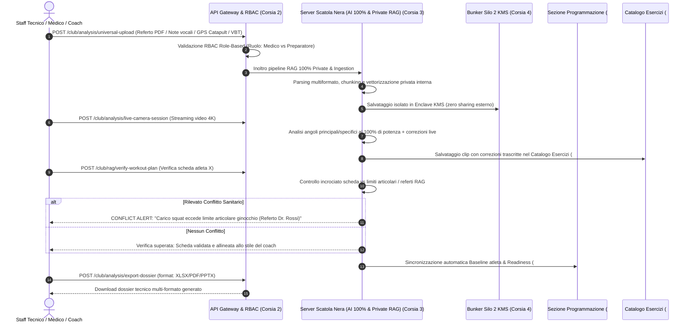

# Capitolato Tecnico: Flow 4C – Data Analisi: Biomeccanica AI 100%, Multi-Device, Full Export & Role-Based RAG (T7 Elite Pro Teams)

## 1. Identificativo & Titolo Ufficiale
- **Badge Miro Board:** `#16` (Posizione: `X: 4768.26, Y: 8032.48`, Miro Shape ID: `3458764688417722792`)
- **Codice Univoco:** `FLOW-4C`
- **Titolo Formale:** SOFTWARE 3 (B2B ENTERPRISE) - FLOW 4C: DATA ANALISI - BIOMECCANICA AI 100%, MULTI-DEVICE, FULL EXPORT & ROLE-BASED RAG
- **Board Miro Online:** `uXjVEbo6L2o=` (Zona 4, Riga 3: High-Level Pro Teams & Enterprise, Colonna 4: Data Analisi)
- **Diagramma Sorgente:** `architecture-blueprint/02-miro-zones-and-swimlanes/18-flowcharts/software-3-elite-club-enterprise/flow-4c-gps-adaptive-zscore.mmd`
- **Riferimento Glossario:** [Glossario Tecnico Vivente](00-GLOSSARIO-TERMINI-TECNICI.md) (Voci: [RAG 100% Private](00-GLOSSARIO-TERMINI-TECNICI.md#rag-100-private-isolamento-totale-dati-societari), [Role-Based RAG](00-GLOSSARIO-TERMINI-TECNICI.md#role-based-rag-controllo-accessi-gerarchico-medico--sc--atleta), [Clonazione Stile Coach](00-GLOSSARIO-TERMINI-TECNICI.md#clonazione-dello-stile-e-lessico-del-coach-style-cloning), [Conflict Alert Schede-Referti](00-GLOSSARIO-TERMINI-TECNICI.md#controllo-incrociato--avvisi-di-conflitto-conflict-alert-schede-referti), [Universal Multi-Format Export](00-GLOSSARIO-TERMINI-TECNICI.md#universal-multi-format-export-report-grafici-presentazioni), [Modelli AI Interni T7 100%](00-GLOSSARIO-TERMINI-TECNICI.md#modelli-ai-interni-t7-inferenza-dedicata-70-vs-100), [Cross-Module Baseline Bridge](00-GLOSSARIO-TERMINI-TECNICI.md#cross-module-baseline-bridge-data-analisi-verso-programmazione-e-catalogo)).

---

## 2. Obiettivo di Business & Target Utente

### Guida Pratica per Non Tecnici: Cos'e questo modulo per un umano?
Nei club professionistici d'elite, lo staff tecnico e medico e sommerso da dati eterogenei: cartelle cliniche dei medici, dati GPS ad altissima frequenza, test di forza con encoder VBT, pedane di salto, referti ortopedici e fogli di calcolo. Spesso questi dati rimangono isolati in compartimenti stagni, generando incomprensioni tra preparatori e medici o portando a schede di allenamento rischiose per un atleta reduce da un infortunio.  
Il modulo di **Data Analisi Tier 3** e la cabina di regia scientifica definitiva del club:
- **Analisi Biomeccanica Illimitata (AI 100%):** Calcolo simultaneo di tutti gli angoli principali e specifici durante corsa ed esercizi con i migliori modelli AI interni proprietari T7 a massima potenza, con analisi continue e approfondite;
- **Videocamera Live con Salvataggio nel Catalogo:** L'AI corregge l'atleta sul momento a video e consente di salvare la sessione con le correzioni trascritte direttamente nel Catalogo Esercizi del club, a beneficio di tutto lo staff;
- **Connessione a Qualsiasi Dispositivo e File:** Si collega a qualsiasi wearable o strumento del mercato (GPS Catapult, Statsports, Wimu, encoder Vitruve, GymAware, pedane ForceDecks, sensori di potenza, test del lattato) e importa qualsiasi file esterno (Excel, CSV), spiegando in dettaglio ogni singola metrica estratta;
- **Suite di Esportazione Universale:** Genera con un clic report dettagliati, grafici interattivi, presentazioni e documenti tecnici in qualsiasi formato (.pdf, .xlsx sbloccato, .docx, .pptx, .csv) pronti per la dirigenza o per l'atleta;
- **Interconnessione Completa con Programmazione e Catalogo:** I dati di Data Analisi alimentano la baseline prestativa e neurale dell'atleta, dialogano con la sezione Programmazione (FLOW-3C), con la Readiness Section (PVT, HRV, Z-Score) e con il Chatbot di supporto 24/7;
- **RAG Privato Esclusivo Tier 3 (100% Private & Role-Based):**
  1. *Caricamento Universale Multi-Formato:* Allenatori, medici, staff e atleti possono caricare qualsiasi file (PDF, Excel, Word, CSV e note vocali trascritte) per addestrare l'AI interna;
  2. *Privacy Totale (100% Private):* I dati caricati restano di proprieta esclusiva del team nel Bunker Silo 2 KMS, mai condivisi con terzi ne utilizzati per addestrare modelli esterni;
  3. *Gestione Gerarchica dei Permessi (Role-Based RAG):* Distinzione automatica dei livelli di visibilita tra Medico, Preparatore e Atleta; i dati sanitari sensibili guidano l'AI senza essere esposti a chi non ha l'autorizzazione medica;
  4. *Clonazione dello Stile e Lessico del Coach:* Su richiesta, l'AI apprende il tono di voce, il metodo e il vocabolario tecnico del capo allenatore;
  5. *Controllo Incrociato e Avvisi di Conflitto:* Rilevamento automatico di incongruenze tra le schede create e i referti medici, i limiti articolari o le linee guida presenti nel RAG;
  6. *Tracciabilita e Citazione Fonti Interne:* Ogni consiglio dell'AI cita il file interno, il test o lo studio specifico del club da cui trae origine;
  7. *Memoria Storica Multi-Stagione:* Cronistoria dell'intera carriera dell'atleta nel club per confrontare cicli di carico storici e tempi di recupero da infortuni passati;
  8. *Adattamento Multilingua e Onboarding Staff:* Traduzione automatica per atleti stranieri e formazione rapida per nuovi membri dello staff.

### Specifiche di Business & Metriche
- **Target Utente:** Sport Scientist, Performance Director, Medici Sociali, Head Coach e Preparatori di societa sportive professionistiche, federazioni olimpiche e centri di ricerca (Tier 3 – B2B Enterprise).
- **Problema Risolto:** Unificare telemetria multi-dispositivo, biomeccanica video e conoscenza clinica interna in un'unica infrastruttura intelligente protetta da crittografia bancaria, azzerando i conflitti prescrittivi e accelerando il processo decisionale ad ogni livello societario.

---

## 3. Attori & Architettura a 4 Corsie (Swimlanes)

1. **Corsia 1: Thin Client UI/UX (Elite Performance & Multimodal RAG Cockpit):**
   - Console multi-pannello con live camera 4K, overlay biomeccanico scheletrico 3D, Uploader Universale drag-and-drop multi-formato, modulo di registrazione e trascrizione note vocali, studio di export documentale (PDF, Excel, Word, PowerPoint) e visualizzatore di Conflict Alert sanitari/prescrittivi.
2. **Corsia 2: API Gateway & High-Throughput Envoy Gateway:**
   - Ingestion ad altissima intensita (`/club/telemetry/universal-ingest`), verifica permessi Role-Based RBAC (token differenziati Medico Sociale, Head S&C, Atleta), filtro anti-leak e instradamento su code streaming Kafka per telemetria GPS e video ad alta risoluzione.
3. **Corsia 3: Server Scatola Nera (T7 AI Kinematics 100%, Role-Based RAG Engine & Baseline Dispatcher):**
   - *Modelli AI Interni Top T7 (Potenza 100%):* Inferenza illimitata per tracciamento multi-articolare, asimmetrie complesse e spiegazione approfondita di tutte le metriche telemetriche;
   - *Motore RAG 100% Private:* Embeddings vettoriali interni, recupero semantico con re-ranking gerarchico basato sul ruolo dell'utente (filtro rigoroso segreto medico);
   - *Cross-Check Conflict Detector:* Analizzatore di regole formali che confronta le schede create con i limiti articolari e i referti clinici caricati nel database RAG;
   - *Style Cloning Synthesizer:* Generatore linguistico parametrato sullo stile comunicativo e sul lessico tecnico dell'allenatore;
   - *Cross-Module Dispatcher:* Inoltro automatico delle metriche aggregate verso il Catalogo Esercizi (FLOW-2C) e la Programmazione/Readiness (FLOW-3C).
4. **Corsia 4: Database Tripartito (Silo 2 - Encrypted Club Bunker KMS):**
   - Enclave PostgreSQL / pgvector / TimescaleDB con cifratura Cloud KMS per club. Tabelle `club_data_analysis_warehouse`, `club_rag_documents`, `club_conflict_logs` e partizione video Vault. Esportazione aggregata verso Silo 3 Research Warehouse consentita **esclusivamente su esplicito opt-in**.

---

### Sequence Diagram Asincrono del Ciclo di Vita (FLOW-4C)



---

## 4. Flusso Operativo Passo-Passo

### Livello A: User Journey Narrativo (La Storia dell'Utente)
1. **L'Hub Unificato del Club:** Il Performance Director apre la console di Data Analisi. Nel cruscotto convergono i dati GPS della rifinitura mattutina, i video 4K della seduta di squat, i dati degli encoder di velocita e i referti sanitari caricati dal medico sociale.
2. **Caricamento Multi-Formato nel RAG Privato:** Il medico carica un referto in formato PDF e il preparatore registra una nota vocale: *"L'atleta 10 ha una leggera infiammazione al tendine rotuleo sinistro; evitare carichi eccentrici superiori a 120 kg per 10 giorni"*. L'app trascrive la nota vocale internamente e vettorizza il documento nel database blindato del club (100% Private).
3. **Live Camera sul Campo e nel Catalogo:** Durante l'allenamento, il coach inquadra l'atleta in diretta. L'AI (a massima potenza 100%) segnala a video le asimmetrie di spinta in millisecondi. Al termine, il coach tocca un pulsante: il video con le correzioni viene salvato sia nella cronologia di Data Analisi sia come esercizio speciale nel **Catalogo del Club**, visibile a tutto lo staff.
4. **Controllo Incrociato Schede-Referti (Conflict Alert):** Quando il vice-allenatore tenta di programmare una serie pesante di squat per l'atleta 10, il sistema blocca l'azione ed emette un avviso nitido: *"Allerta Conflitto Clinico: La scheda contrasta con il limite rotuleo registrato stamattina. Fonte: Nota vocale Preparatore ore 09:15"*. Il preparatore riceve l'avviso operativo senza che vengano svelati dettagli sanitari riservati.
5. **Clonazione dello Stile del Coach:** L'allenatore richiede all'AI di preparare il discorso motivazionale e le istruzioni tecniche per la partita. L'AI scrive il documento impiegando il gergo, le metafore e il metodo proprio del coach.
6. **Esportazione Universale:** Lo staff genera in un istante una presentazione PowerPoint (.pptx) per la riunione tecnica pomeridiana e un foglio Excel (.xlsx sbloccato) completo per i fisioterapisti.

---

#### Indicatori di Accettazione Operativa & RAG (KPI)
| Metrica / Parametro | Obiettivo Target | Tolleranza Accettabile | Azione Fallback / Allerta |
| :--- | :--- | :--- | :--- |
| **Isolamento Dati RAG (Privacy)** | $100\%$ privato (Zero Leak) | $100\%$ assoluto | Blocco totale istantaneo se rilevato tentativo di export esterno |
| **Latenza Risposta RAG & Conflict** | $< 1.2\text{ s}$ | $\le 2.5\text{ s}$ | Indicatore di elaborazione semantica e consultazione asincrona |
| **Potenza Modelli AI Interni** | $100\%$ allocazione top | $100\%$ | Assegnazione dinamica di nodi GPU dedicati |
| **Supporto Wearable & File Esterni** | Universale ($100\%$) | $\ge 98\%$ formati | Parsing elastico con log di tracciamento campi non mappati |
| **Accuratezza Conflict Detection** | $\ge 99\%$ incongruenze | $\ge 95\%$ | Flagging cautelativo di revisione umana obbligatoria |
| **Tempo Generazione Export Multi-Formato**| $< 2.0\text{ s}$ | $\le 4.0\text{ s}$ | Compilazione in background con notifica di completamento |

---

### Livello B: Trattazione Tecnica Nodi Operativi (Gli 8 Pilastri del RAG e della Data Analisi Elite)

1. `START` (Inizializzazione Workspace Elite): Apertura interfaccia Tier 3 con token verificato da Cloud KMS.
2. `UNIVERSAL_INGEST` (Ingestion Multi-Formato & Any-Device): Ricezione di file PDF, Excel, Word, CSV, tracciati GPS (10-18Hz), flussi VBT, pedane di forza e file audio.
3. `AUDIO_TRANSCRIPTION_LOCAL` (Trascrizione Note Vocali): Conversione locale speech-to-text delle note vocali dello staff senza invio a server esterni di terze parti.
4. `RAG_PRIVATE_PIPELINE` (Pipeline Vettoriale 100% Private): Chunking semantico, embedding vettoriale proprietario T7 e indicizzazione nello spazio isolato del club.
5. `ROLE_BASED_RBAC_GATE` (Filtraggio Gerarchico dei Permessi):
   - Ruolo Medico: accesso e interrogazione completa dei referti clinici;
   - Ruolo Preparatore/S&C: ricezione degli alert di compatibilita e limiti operativi senza visualizzazione delle diagnosi sanitarie;
   - Ruolo Atleta: visualizzazione delle sole prescrizioni e feedback esecutivi autorizzati.
6. `AI_100_VISION_ANALYSIS` (Biomeccanica AI 100% Live): Analisi multi-articolare continua a piena risoluzione (angoli principali e specifici, micro-compensazioni, FEA tensioni muscolari).
7. `CATALOG_SYNC_DISPATCH` (Salvataggio nel Catalogo Esercizi): Scrittura della sessione video e delle trascrizioni nello schema `catalog_exercises` con watermark forense del club (FLOW-2C).
8. `CROSS_CHECK_CONFLICT_DETECTOR` (Controllo Incrociato Schede-Referti): Esecuzione algoritmo di verifica vincoli: se un esercizio in Programmazione viola un vincolo RAG, generazione immediata di `CONFLICT_ALERT`.
9. `COACH_STYLE_CLONER` (Clonazione Stile Coach): Applicazione dei pesi stilistici e lessicali dell'allenatore sul motore di generazione testuale.
10. `MULTI_SEASON_MEMORY_UPDATE` (Memoria Storica Multi-Stagione): Aggiornamento dell'archivio longitudinale della carriera dell'atleta nel database Enclave Silo 2.
11. `BASELINE_BRIDGE_DISPATCH` (Ponte Baseline Atleta & Programmazione): Trasferimento metriche a FLOW-3C (Readiness Section, PVT, HRV, Z-Score).
12. `UNIVERSAL_EXPORT_GEN` (Compilatore Documenti Multi-Formato): Esportazione coordinata in formato PDF, Excel (.xlsx), Word (.docx), PowerPoint (.pptx) e CSV.
13. `END` (Consolidamento Sessione Elite): Persistenza garantita su Enclave Bunker Silo 2 con logging di audit immutabile.

---

## 5. Rami Decisionali & Gestione dei 4 Stati UI

| Bivio Decisionale | Condizione Logica | Ramo SI / Positivo | Ramo NO / Negativo |
| :--- | :--- | :--- | :--- |
| `CHECK_RAG_PERMISSIONS` | Il ruolo dell'utente autorizza la lettura del dato sanitario? | Ritorna dettaglio clinico completo | Ritorna solo indicazione operativa mascherata |
| `DETECT_WORKOUT_CONFLICT` | La scheda di allenamento contrasta con limiti RAG? | Emette Conflict Alert e blocca scheda | Valida la scheda e procede |
| `STYLE_CLONING_TOGGLE` | L'utente ha attivato la clonazione dello stile del coach? | Genera testo con lessico e tono del coach | Genera output tecnico standard T7 |
| `OPT_IN_SILO3_CHECK` | Il club ha concesso l'opt-in esplicito per la ricerca? | Inoltra dati anonimizzati a Silo 3 | Dati rigorosamente confinati in Silo 2 |

### I 4 Stati di Interfaccia Utente (UI States):
1. **Empty State:** Nessun dataset importato ne sessione live avviata. Vista della knowledge base del club con indicatore: "Trascina qui qualsiasi file (PDF, Excel, Audio, Telemetria) per addestrare il RAG privato del tuo team".
2. **Loading State:** Elaborazione simultanea multi-modale (indicizzazione RAG in corso, embedding vettoriale e calibrazione telemetrica a schermo con barra di avanzamento crittografica).
3. **Populated State:** Dashboard analitica completa a mosaico: radar Z-Score, streaming video con angoli 3D, chat semantica RAG con citazione delle fonti del club e pulsante di export multi-formato attivo.
4. **Error / Fallback State:** Conflitto insanabile tra scheda e prescrizione medica o file corrotto. Notifica rossa di sicurezza: "Conflitto bloccante rilevato: la scheda viola il referto clinico societario. Richiesta autorizzazione congiunta Medico-S&C".

---

## 6. Contratti Dati, Parametri I/O & Database Silo

### Specifiche Endpoint REST:

#### 1. Ingestion Universale Multi-Formato nel RAG Privato
- **Endpoint:** `POST /api/v1/club/analysis/universal-upload`
- **Headers:** `Authorization: Bearer <jwt_enterprise_kms>`, `Content-Type: multipart/form-data`
- **Form Data:**
  - `clubId`: `clb_real_madrid_99`
  - `uploaderRole`: `CHIEF_MEDICAL_OFFICER`
  - `documentType`: `MEDICAL_REPORT` (oppure `VOICE_NOTE`, `GPS_CSV`, `VBT_RAW`)
  - `confidentialityLevel`: `RESTRICTED_MEDICAL` (solo personale medico autorizzato)
  - `file`: `<blob_stream>`
- **Responses:**
  - `200 OK`:
```json
{
  "status": "success",
  "documentId": "doc_rag_4418fa",
  "privacyLevel": "100_PERCENT_PRIVATE_KMS",
  "chunksCreated": 14,
  "roleAccessGranted": ["CHIEF_MEDICAL_OFFICER", "TEAM_DOCTOR"],
  "conflictRulesExtracted": [
    { "targetAthleteId": "ath_10", "jointConstraint": "KNEE_LEFT", "maxEccentricLoadKg": 120 }
  ]
}
```

#### 2. Query RAG con Controllo Conflitti e Clonazione Stile
- **Endpoint:** `POST /api/v1/club/rag/query-and-verify`
- **Headers:** `Authorization: Bearer <jwt_enterprise_kms>`, `Content-Type: application/json`
- **Request Payload:**
```json
{
  "clubId": "clb_real_madrid_99",
  "userRole": "HEAD_STRENGTH_COACH",
  "query": "Verifica se la progressione di squat prevista per l'atleta 10 rispetta i vincoli del club",
  "enableCoachStyleCloning": true,
  "targetLanguage": "it"
}
```
- **Responses:**
  - `200 OK`:
```json
{
  "status": "conflict_detected",
  "conflictAlert": {
    "hasConflict": true,
    "severity": "HIGH",
    "summary": "Attenzione mister: la progressione supera il limite eccentrico di sicurezza stabilito per l'atleta 10.",
    "sourceCitation": {
      "documentId": "doc_rag_4418fa",
      "sourceName": "Referto Medico-Funzionale Staff Dr. Rossi",
      "date": "2026-11-10"
    }
  },
  "coachStyleToneApplied": true,
  "suggestedModification": "Sostituire lo squat pesante con leg press monopodalica a range controllato."
}
```

### Schema Relazionale & Vettoriale (Database Silo 2 - Bunker KMS):
- `club_rag_documents`: `id UUID PK`, `club_id UUID NOT NULL`, `uploader_role VARCHAR(64) NOT NULL`, `confidentiality_level VARCHAR(64) NOT NULL`, `source_type VARCHAR(32)`, `file_name VARCHAR(255)`, `encrypted_s3_uri VARCHAR(512)`, `created_at TIMESTAMPTZ NOT NULL DEFAULT NOW()`.
- `club_rag_embeddings`: `id UUID PK`, `document_id UUID FK -> club_rag_documents.id`, `embedding vector(1536) NOT NULL`, `chunk_content TEXT NOT NULL`, `access_roles TEXT[] NOT NULL`.
- `club_conflict_rules`: `id UUID PK`, `athlete_id UUID NOT NULL`, `origin_document_id UUID FK`, `rule_condition JSONB NOT NULL`, `is_active BOOLEAN DEFAULT TRUE`.

---

### Matrice Errori HTTP & Strategie di Resilienza
| HTTP Code | Codice Interno | Endpoint | Causa Scatenante | UX Feedback Visivo | Strategia di Resilienza & Fallback |
| :---: | :--- | :--- | :--- | :--- | :--- |
| **400** | `ERR_UNPARSABLE_FORMAT`| `POST /universal-upload` | File danneggiato o codec audio non decodificabile | Dialog: "Formato documento o traccia audio non leggibile" | Richiesta nuovo upload o conversione automatica in testo puro |
| **401** | `ERR_KMS_AUTH_FAILED` | `POST /query-and-verify` | Firma chiave crittografica Cloud KMS del club non valida | Alert: "Errore autenticazione bunker di sicurezza" | Rinnovo handshake di sicurezza con server centrale |
| **403** | `ERR_ROLE_MASKED_DATA` | `POST /query-and-verify` | Preparatore tenta di visualizzare referto medico integrale | Avviso: "Dato protetto da segreto medico. Visualizzato solo limite operativo" | Mascheramento automatico e visualizzazione vincolo meccanico |
| **409** | `ERR_PREVENTIVE_CONFLICT`| `POST /verify-workout-plan` | La scheda contrasta direttamente con un divieto clinico | Modale rossa: "Scheda bloccata per conflitto medico societario" | Proposta di variante dell'esercizio approvata dal RAG |
| **422** | `ERR_MISSING_METRIC_MAP`| `POST /universal-upload` | File telemetrico con intestazioni colonne sconosciute | Schermata interattiva di mappatura manuale delle colonne | Autodiagnosi fuzzy matching delle metriche con conferma utente |
| **500** | `ERR_VECTOR_SEARCH_FAIL`| `POST /query-and-verify` | Timeout nel database vettoriale pgvector del Bunker | Toast: "RAG temporaneamente offline: consultazione storico manuale" | Fallback su ricerca testuale esatta su database relazionale |

---

## 7. Ereditarieta di Tier & Differenziali di Fascia

- **Capacita Ereditate da Tier 1 e Tier 2:**  
  Calcolo degli angoli principali e specifici; live camera con correzioni immediate dell'esercizio.
- **Sblocco Totale e Differenziali Esclusivi di Tier 3 (`FLOW-4C`):**  
  Tutti i vincoli e le limitazioni dei Tier inferiori vengono superati:
  1. **Modelli AI Interni Top al 100% della potenza di calcolo**, con analisi illimitate e continue;
  2. **Salvataggio Video e Correzioni nel Catalogo Esercizi del Club** (FLOW-2C) oltre che in Data Analisi;
  3. **Connessione Universale ad Ogni Wearable e Strumento** (qualsiasi marca, GPS, encoder, pedane, file esterni) con spiegazione di tutte le metriche;
  4. **Suite di Esportazione Universale Multi-Formato** (.pdf, .xlsx sbloccato, .docx, .pptx, .csv, presentazioni);
  5. **Integrazione Totale con la Sezione Programmazione (#15) e il Catalogo (#14)**, alimentando la baseline prestativa e neurale dell'atleta e integrando i test di vigilanza PVT, HRV e Z-Score;
  6. **Architettura RAG Esclusiva 100% Private & Role-Based** a 8 capacita distintive: caricamento universale multi-formato, privacy totale e isolamento dei dati nel Bunker Silo 2 KMS, controllo gerarchico degli accessi (Role-Based RAG), clonazione dello stile e del lessico del coach, rilevamento automatico conflitti schede-referti medici, tracciabilita e citazione delle fonti interne, memoria storica multi-stagione dell'atleta e supporto multilingua per atleti e staff.
