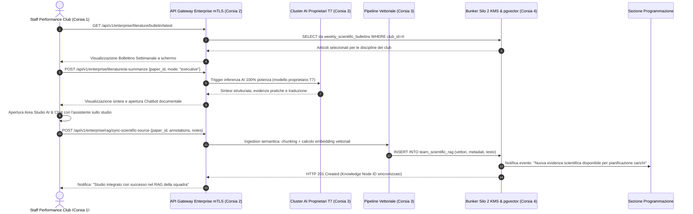

# Capitolato Tecnico: Flow 5C – Libreria Fonti: AI Studio, Chatbot Scientifico, Bollettino & RAG Sync (T7 Elite Pro Teams)

## 1. Identificativo & Titolo Ufficiale
- **Badge Miro Board:** `#17` (Posizione: `X: 6645.26, Y: 8033.79`, Miro Shape ID: `3458764688417722803`)
- **Codice Univoco:** `FLOW-5C`
- **Titolo Formale:** SOFTWARE 3 (B2B ENTERPRISE) - FLOW 5C: LIBRERIA FONTI - AI STUDIO, CHATBOT SCIENTIFICO, BOLLETTINO & RAG SYNC
- **Board Miro Online:** `uXjVEbo6L2o=` (Zona 4, Riga 3: High-Level Pro Teams & Enterprise, Colonna 5: Libreria Fonti)
- **Diagramma Sorgente:** [flow-5c-tactical-video-cv.mmd](../02-miro-zones-and-swimlanes/18-flowcharts/software-3-elite-club-enterprise/flow-5c-tactical-video-cv.mmd)
- **Riferimento Glossario:** [Glossario Tecnico Vivente](00-GLOSSARIO-TERMINI-TECNICI.md) (Voci: [Chatbot AI Studi Scientifici](00-GLOSSARIO-TERMINI-TECNICI.md#chatbot-ai-studi-scientifici-assistente-documentale-247), [Bollettino Settimanale Accademico](00-GLOSSARIO-TERMINI-TECNICI.md#bollettino-settimanale-accademico-feed-tematico-sportivo), [RAG Sync Libreria Fonti](00-GLOSSARIO-TERMINI-TECNICI.md#rag-sync-libreria-fonti-sincronizzazione-bunker-silo-2), [Indicatori Evidenza CEBM](00-GLOSSARIO-TERMINI-TECNICI.md#indicatori-di-qualita-scientifica-cebm-oxford-e-quartili-jcr), [AI Specialistica 100%](00-GLOSSARIO-TERMINI-TECNICI.md#potenza-di-calcolo-ai-100-tier-3)).

---

## 2. Obiettivo di Business & Target Utente

### Guida Pratica per Non Tecnici: Cos'e questo modulo per un umano?
Negli staff dei club di Serie A, delle franchigie olimpiche e dei centri sportivi d'elite, il tempo e la risorsa piu scarsa. Gli allenatori, i medici sociali e i responsabili della performance hanno bisogno di sapere all'istante se una nuova metodologia di allenamento o un protocollo di recupero da infortuni e realmente supportato dalla scienza piu recente, senza perdere giornate a tradurre articoli complessi o a sintetizzare testi fitti.  
**La Libreria Fonti Enterprise di T7** trasforma la scienza accademica in un vantaggio competitivo immediato:
- **Qualita Scientifica a Colpo d'Occhio:** Ogni studio riporta chiaramente il livello di evidenza scientifica (scala internazionale Oxford CEBM da I a V) e il prestigio della rivista (Quartili Q1-Q4), cosi da distinguere subito le ricerche solide da quelle deboli;
- **Cartelle Condivise del Team:** Puoi salvare gli articoli in cartelle organizzate per obiettivi dello staff (es. "Prevenzione Lesioni Bicipite Femorale", "Recupero Post-Partita", "Riatletizzazione LCA");
- **Bollettino Settimanale Tematico:** Ricevi ogni lunedi mattina una rassegna riassuntiva personalizzata che ti segnala tutte le nuove ricerche mondiali pubblicate esclusivamente negli sport praticati dalla tua societa;
- **Intelligenza Artificiale Specialistica Integrata:** Con un solo click l'AI proprietaria T7 (alla massima potenza di calcolo) crea un **riassunto immediato**, esegue una **traduzione tecnica impeccabile in italiano** e redige una **spiegazione semplificata** comprensibile anche per un atleta senza formazione scientifica;
- **Area Studio Potenziata con Chatbot 24/7:** Mentre consulti uno studio, hai a fianco un Chatbot intelligente addestrato sul documento a cui puoi chiedere qualsiasi chiarimento (es. "Qual era il tempo di recupero esatto tra le serie nel gruppo B?"), con generazione automatica di mappe mentali e schemi riassuntivi;
- **Collegamento Diretto con il RAG del Club (1-Click Sync):** Puoi inviare qualsiasi articolo scientifico o riassunto direttamente al cervello digitale della squadra (**Database RAG Bunker Silo 2**). Da quel momento, quando prepari una scheda di allenamento (nella sezione Programmazione `#15`) o analizzi i dati atletici (nella sezione Data Analisi `#16`), l'AI del team consigliera carichi ed esercizi basandosi esattamente sulla scienza che hai approvato.

### Specifiche di Business & Metriche
- **Target Utente:** Direttori della Performance, Medici di Squadra, Head Coach e Responsabili Ricerca e Sviluppo di club professionistici (Tier 3 – B2B Enterprise).
- **Problema Risolto:** Azzerare la distanza tra ricerca scientifica teorica e applicazione pratica sul campo, dotando lo staff di un'assistente AI dedicato e connettendo la letteratura al motore di pianificazione dei carichi.
- **Metriche Chiave (KPI):**
  - Tempo di estrazione indicazioni pratiche da un paper: $< 30\text{ secondi}$ tramite sintesi AI;
  - Aderenza del piano settimanale al Bollettino Scientifico: $+45\%$ nell'adozione di evidenze aggiornate;
  - Tasso di sincronizzazione RAG: $> 15$ evidenze scientifiche integrate nel Bunker del team per stagione.

---

## 3. Attori & Architettura a 4 Corsie (Swimlanes)

1. **Corsia 1: Thin Client UI/UX (Enterprise Research Hub & AI Suite React 18):**
   - Interfaccia avanzata con indicatori di qualita evidence-based (badge CEBM Level I-V e quartili ISI Web of Science Q1-Q4);
   - Pannello di gestione cartelle condivise dello staff societario con permessi basati sui ruoli (Medico, Preparatore, Match Analyst);
   - Feed integrato del "Bollettino Accademico Settimanale" con notifiche push sulle novita scientifiche;
   - Dock laterale AI Specialistica: pulsanti ad attivazione immediata (Sintesi Esecutiva, Traduzione Termini Tecnici, Versione per Atleta);
   - Area Studio AI: canvas interattivo per annotazioni digitali, finestra di conversazione con Chatbot documentale e render SVG automatico di mappe concettuali;
   - Pulsante d'azione primaria 1-Click: "Invia al RAG del Team (Bunker Silo 2)".
2. **Corsia 2: API Gateway & Secure Enterprise Router (Envoy mTLS):**
   - Autenticazione mTLS societaria e certificati crittografici dedicati per ciascun club;
   - Routing ad alta priorita verso i cluster di inferenza AI proprietari T7 (100% potenza di calcolo senza throttle);
   - Gateway di isolamento per la sincronizzazione RAG verso il database Bunker Silo 2 protetto da Cloud KMS.
3. **Corsia 3: Server Scatola Nera (Scientific AI Reasoning & RAG Pipeline Cloud Run GPU):**
   - Cluster di modelli AI proprietari T7 (Massima capacita di calcolo, inferenza a precisione completa FP16/BF16): estrazione entita biomediche, sintesi densa, traduzione contestualizzata per scienze motorie e Chatbot conversazionale;
   - Scheduler del Bollettino Settimanale: worker cron che interroga quotidianamente i feed RSS/API accademici, filtra per le discipline associate al roster del club e genera newsletter strutturate;
   - Pipeline di ingestione RAG: estrazione testo strutturato, chunking semantico a finestra scorrevole (512 token con overlap 10%), calcolo embedding vettoriali ad alta dimensionalita (1536d) e indicizzazione HNSW su PostgreSQL `pgvector`.
4. **Corsia 4: Database Tripartito (Silo 2 - Encrypted Club Bunker KMS & pgvector):**
   - Schema `team_scientific_rag` in Silo 2, isolato fisicamente o logicamente con crittografia KMS gestita con chiave del club;
   - Tabelle `weekly_scientific_bulletins` e `team_study_folders`;
   - Interconnessione diretta via event-bus con i moduli di Programmazione (#15) e Data Analisi (#16) del medesimo club.

---

### Sequence Diagram Asincrono del Ciclo di Vita (FLOW-5C)



---

## 4. Flusso Passo-Passo

### Livello A: Guida Operativa per Coach e Preparatori
1. **Consultazione del Bollettino:** Il lunedi mattina il preparatore atletico apre l'app e trova gia pronte le novita della settimana filtrate per i suoi sport (es. basket e pallavolo).
2. **Lettura con Indicatori di Qualita:** Gli studi mostrano subito il badge del livello di prova (es. "CEBM Livello I - Meta-analisi"): lo staff sa subito se fidarsi ciecamente dei dati.
3. **Sintesi e Spiegazione AI Istantanea:** Toccando "Sintesi AI", il preparatore ottiene in 10 secondi i punti chiave operativi. Se vuole spiegare l'esercizio a un giocatore straniero, tocca "Versione Atleta" per avere una sintesi chiara ed esente da gergo incomprensibile.
4. **Chatbot sul Singolo Articolo:** Nell'Area Studio, il medico pone domande dirette all'AI (es. "Quali sono state le complicanze post-operatorie registrate nel campione?"): il Chatbot risponde citando la pagina e il paragrafo esatto del documento.
5. **Integrazione RAG con 1-Click:** Con un tocco sul pulsante "Invia al RAG del Team", lo studio diventa patrimonio permanente della societa: da quel momento in poi, il Chatbot di Programmazione (`#15`) e l'AI di Data Analisi (`#16`) utilizzeranno quella ricerca per calibrare i carichi della squadra.

### Livello B: Deep-Dive Tecnico per Sviluppatori
- **Contratto di Inferenza AI Specialistica:** `POST /api/v1/enterprise/literature/ai-summarize`
  - Parametri Body: `paper_id` (string), `output_mode` (`executive_summary` | `technical_translation_it` | `athlete_simplified`), `target_sport` (string).
  - Cluster di calcolo: GPU NVIDIA H100 su tenant cloud privato T7 con latenza inferenza $< 1200\text{ms}$.
- **Architettura del Chatbot Documentale:**
  - Endpoint WebSocket protetto: `wss://api.t7.club/v1/enterprise/literature/chat-session`.
  - Context Window: 32k token con iniezione del full-text dell'articolo e delle note dell'Area Studio nel prompt di sistema del modello.
- **Pipeline RAG & Bunker Silo 2:**
  - Endpoint: `POST /api/v1/enterprise/rag/sync-scientific-source`
  - Algoritmo di Chunking: parser semantico strutturato (suddivisione per sezioni IMRAD: Introduction, Methods, Results, Discussion).
  - Vettorizzazione: modello di embedding proprietario `t7-biomedical-embed-1536`.
  - Salvataggio: tabella `team_scientific_rag` partizionata per `club_id` con indice `ivfflat` o `hnsw` su `embedding vector(1536)`.
  - Cross-Linking: emissione di evento Kafka/PubSub `scientific_knowledge_ingested` per notificare i cluster decisionali di Programmazione (#15) e Data Analisi (#16).

---

## 5. Rami Decisionali & Gestione Errori

### Tabella dei 4 Stati UI (Ciclo di Vita del Componente)

| Stato UI | Condizione Scatenante | Elementi Visibili a Schermo | Azione Utente Permessa |
| :--- | :--- | :--- | :--- |
| **Idle** | Dashboard accademica caricata | Bollettino in primo piano, cartelle team, feed con badge CEBM/JCR | Consultazione bollettino, apertura cartelle, selezione paper |
| **AI Processing** | Richiesta sintesi o interrogazione Chatbot | Visualizzatore con skeleton dinamico e indicatore di digitazione AI | Possibilita di interrompere la generazione |
| **Success / Interactive** | Output AI generato, chat attiva, Area Studio pronta | Testo strutturato, chat aperta, mappa concettuale SVG renderizzata | Domande in chat, disegno, salvataggio note, click sync RAG |
| **Syncing / Confirm** | Click su "Invia al RAG del Team" | Barra di progresso vettorizzazione e notifica verde di successo | Navigazione verso altre sezioni dell'app |

---

## 6. Contratti Dati JSON & Matrice Errori HTTP

### Contratto Richiesta Sincronizzazione RAG (Payload JSON)
```json
{
  "paper_id": "ext_pmc_9823412",
  "club_id": "club_juventus_fc",
  "authorized_by_role": "head_of_performance",
  "sync_options": {
    "include_personal_notes": true,
    "include_concept_map": true,
    "target_modules": ["programming_section_15", "data_analysis_section_16"]
  },
  "custom_tags": ["hamstring_prevention", "eccentric_loading", "nordic_curl"]
}
```

### Contratto Risposta Sincronizzazione RAG (JSON)
```json
{
  "status": "success",
  "knowledge_node_id": "kn_rag_8819234",
  "indexed_chunks_count": 18,
  "embedding_model": "t7-biomedical-embed-1536",
  "storage_target": "silo_2_bunker_kms",
  "cross_linked_modules": {
    "programming_flow_15": "active",
    "data_analysis_flow_16": "active"
  },
  "timestamp": "2026-11-12T22:25:00Z"
}
```

### Matrice Errori HTTP a 6 Colonne

| Codice HTTP | Errore Interno | Condizione Scatenante | Risposta Client | Azione Automatica Client | Ripristino Utente |
| :--- | :--- | :--- | :--- | :--- | :--- |
| `400 Bad Request` | `INVALID_SYNC_TARGET` | Modulo di destinazione non censito o non attivo per il club | `{"error": "Modulo target di sincronizzazione non valido"}` | Disabilita opzioni di sincronizzazione non supportate | Selezionare moduli validi |
| `401 Unauthorized` | `MTLS_CERT_EXPIRED` | Certificato client mTLS societario scaduto o non valido | `{"error": "Certificato di sicurezza club non valido"}` | Blocca handshake sicuro e richiede re-autenticazione | Contattare l'amministratore IT del club |
| `403 Forbidden` | `INSUFFICIENT_RAG_ROLE` | Utente con ruolo non abilitato tenta di inviare paper al RAG | `{"error": "Permesso di scrittura nel RAG societario negato"}` | Mostra alert sui privilegi richiesti | Richiedere autorizzazione all'Head of Performance |
| `429 Too Many Req` | `AI_GPU_CLUSTER_BUSY` | Saturazione temporanea del cluster di calcolo AI | `{"error": "Cluster AI momentaneamente sovraccarico. In coda..."}` | Mantiene la richiesta in buffer e riprova con backoff | Attendere qualche secondo |
| `500 Server Error` | `RAG_EMBEDDING_FAILED` | Errore nella generazione dei vettori di embedding | `{"error": "Errore durante la vettorizzazione del documento"}` | Mostra pulsante "Riprova sincronizzazione" | Cliccare su Riprova |
| `503 Service Unav` | `BUNKER_KMS_UNREACHABLE`| Chiave Cloud KMS di Silo 2 temporaneamente non accessibile | `{"error": "Servizio di crittografia Bunker non disponibile"}` | Blocca la sincronizzazione per sicurezza dati | Riprovare appena ripristinato il KMS |

---

## 7. Ereditarieta di Tier & Sblocco Funzionalita a Cascata

- **Cosa fa Tier 3:** Eredita tutte le capacita di ricerca, filtraggio e preferiti di Tier 1 e Tier 2, sblocca gli indicatori scientifici di qualita evidence-based (CEBM e quartili JCR), attiva il Bollettino Settimanale tematico su misura per il roster, integra l'AI proprietaria T7 al 100% per sintesi, traduzioni e spiegazioni, potenzia l'Area Studio con il Chatbot documentale 24/7 e la generazione automatica di schemi, e consente la sincronizzazione 1-Click nel database RAG del team in Silo 2 Bunker KMS, alimentando direttamente Programmazione (#15) e Data Analisi (#16).
- **Isolamento e Sicurezza Massima (Bunker Silo 2):** Tutte le ricerche salvate nelle cartelle del club, i riassunti annotati e i vettori di embedding restano confinati nell'enclave cifrata della societa, senza alcuna contaminazione verso Silo 1 o verso altri club.
- **Top della Cascata Top-Down:** In Tier 3 decadono tutti i limiti di fruizione presenti nei livelli inferiori (blocco download, sola lettura, assenza di AI, assenza di RAG), offrendo la suite accademica definitiva per lo sport professionistico.
