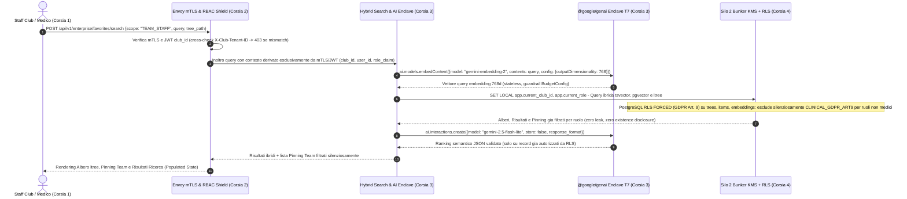

# Capitolato Tecnico: Flow 6C – Preferiti Enterprise All-in-One: Team Pinning, Albero ltree, Ricerca Ibrida AI & Segreto Medico RLS (T7 Elite Pro Teams)

## 1. Identificativo & Titolo Ufficiale
- **Badge Miro Board:** `#18` (Posizione LIVE: `X: 9225.38, Y: 8230.99`, Miro Shape ID: `3458764688417722810`, Nodi ISO: `18`)
- **Codice Univoco:** `FLOW-6C`
- **Titolo Formale:** SOFTWARE 3 (B2B ENTERPRISE) - FLOW 6C: PREFERITI ENTERPRISE ALL-IN-ONE - DOPPIO LIVELLO PERSONALE/TEAM PINNING, ALBERO LTREE, RICERCA IBRIDA AI & SEGRETO MEDICO RBAC/RLS
- **Board Miro Online:** `uXjVEbo6L2o=` (Zona 4, Riga 3: High-Level Pro Teams & Enterprise, Colonna 6: Preferiti)
- **Diagramma Sorgente:** [flow-6c-medical-room-research-silo3.mmd](../02-miro-zones-and-swimlanes/18-flowcharts/software-3-elite-club-enterprise/flow-6c-medical-room-research-silo3.mmd)
- **Riferimento Glossario:** [Glossario Tecnico Vivente](00-GLOSSARIO-TERMINI-TECNICI.md) (Voci: [Doppio Livello Preferiti](00-GLOSSARIO-TERMINI-TECNICI.md#doppio-livello-preferiti-personali-vs-team-staff-pinning), [Albero Cartelle Gerarchico ltree](00-GLOSSARIO-TERMINI-TECNICI.md#albero-cartelle-gerarchico-postgresql-ltree), [Ricerca Ibrida Preferiti](00-GLOSSARIO-TERMINI-TECNICI.md#ricerca-ibrida-preferiti-postgresql-tsvector-pgvector-ai), [Filtro Silenzioso RBAC & PostgreSQL RLS](00-GLOSSARIO-TERMINI-TECNICI.md#filtro-silenzioso-rbac-postgresql-rls-segreto-medico-preferiti), [Gemini Interactions API & Embedding-2](00-GLOSSARIO-TERMINI-TECNICI.md#gemini-interactions-api-embedding-2-guardrail-enclave-t7), [Cloud KMS](00-GLOSSARIO-TERMINI-TECNICI.md#cloud-kms-key-management-service), [Consenso Esplicito Art. 9 GDPR](00-GLOSSARIO-TERMINI-TECNICI.md#consenso-esplicito-biometrico-art-9-gdpr)).
- **Nota di Governance & Slug Storico (Parking Note):** Il modulo precedentemente assegnato allo slot `#18` (*Medical Room EMR, Return-to-Play 6 Fasi & Research Warehouse Silo 3*) e stato parcheggiato per una futura colonna dedicata alla Medicina Sportiva e Ricerca nell'ecosistema T7. Lo slug fisico del file (`18-software-3-flow-6c-medical-room-research-silo3.md`) e il relativo sorgente `.mmd` restano invariati per preservare la continuita dei riferimenti storici Git e Miro.

---

## 2. Obiettivo di Business & Target Utente

### Guida Pratica per Non Tecnici: Cos'e questo modulo per un umano?
In un club professionistico, decine di persone (allenatore, preparatore atletico, match analyst, medico sociale, fisioterapista) lavorano ogni giorno su centinaia di video 4K, programmi annuali, report di Data Analisi e Readiness, articoli scientifici, file del RAG interno e referti clinici. Senza un centro di comando unificato, lo staff perde tempo prezioso a cercare i file nei vari reparti o rischia che un documento riservato finisca sullo schermo sbagliato.
**La sezione Preferiti Enterprise All-in-One di T7 (Tier 3)** e la cabina di regia organizzativa del club:
- **Ecosistema All-in-One:** in un unico hub puoi salvare puntatori a **esercizi 4K (`#14`)**, **programmi stagionali complessi (`#15`)**, **report dettagliati di Data Analisi e Readiness Section (`#16`)**, **articoli scientifici (`#17`)** e **documenti privati di Staff/RAG** (file del modulo RAG, referti clinici, test biomeccanici, report di Match Analisi);
- **Doppio Livello (Personali vs Team/Staff):** ogni professionista dispone dei propri **Preferiti Personali** (visibili solo a lui) affiancati ai **Preferiti di Team/Staff**, uno spazio condiviso con l'intero club dove e possibile **fissare in alto (Pinning)** le routine e i documenti cruciali della settimana o del pre-partita;
- **Albero di Cartelle Complesse & Ricerca Ibrida Intelligente:** lo staff puo costruire gerarchie annidate di cartelle per stagione, reparto o avversario e cercare con una barra intelligente che combina **ricerca testuale esatta** e **comprensione semantica AI** (es. *"report sprint e prevenzione bicipite femorale pre-derby"*);
- **Segreto Medico Automatico e Silenzioso (GDPR Art. 9):** quando il medico sociale salva o fissa un referto clinico o un documento sanitario nei Preferiti di Team/Staff, il sistema filtra automaticamente i risultati in base al ruolo: **solo lo Staff Medico vede i referti clinici**; allenatori, preparatori e match analyst vedono tutti gli altri video, report e routine fissate in modo fluido, senza alcuna fuga di dati e senza nemmeno sapere che esiste un documento clinico nascosto.

### Specifiche di Business & Metriche
- **Target Utente:** Direttori della Performance, Head Coach, Preparatori Atletici, Match Analyst, Medici Sociali e Fisioterapisti di club professionistici e centri olimpici (Tier 3 - B2B Enterprise).
- **Problema Risolto:** Unificare il recupero istantaneo di ogni asset operativo e scientifico del club in un'unica tassonomia sicura, azzerando i tempi di ricerca inter-reparto e garantendo compliance legale assoluta sul Segreto Medico (GDPR Art. 9) tramite filtraggio silenzioso multi-livello.
- **Stato Gap Analysis (Regola 10):** Arancione (`#e67e22` - Nuovo Hub Preferiti Enterprise All-in-One su Silo 2 Bunker KMS con `ltree`, `tsvector`, `pgvector` HNSW, PostgreSQL RLS e SDK `@google/genai`).
- **Parking Architetturale:** Il precedente flusso *Medical Room EMR, Return-to-Play 6 Fasi & Research Warehouse Silo 3* resta archiviato nel backlog architetturale per futura riallocazione in una colonna dedicata alla Clinica Enterprise & Research Lake.
- **Metriche Chiave (KPI):**
  - Latenza ricerca ibrida (`tsvector` + `pgvector` + reranking `gemini-2.5-flash-lite`): $< 450\text{ ms}$ p95;
  - Latenza navigazione albero cartelle `ltree` e vista Pinning Team: $< 120\text{ ms}$ p95;
  - Conformita Segreto Medico GDPR Art. 9 (zero leakage & zero existence disclosure verso ruoli non medici): $100\%$ (`0` violazioni ammesse);
  - Duplicazione binaria asset 4K / RAG / report: $0\%$ (100% puntatori cifrati nel Bunker Silo 2 KMS).

---

## 3. Attori & Architettura a 4 Corsie (Swimlanes)

1. **Corsia 1: Thin Client UI/UX (Enterprise All-in-One Favorites Hub React 18 / PWA):**
   - Switcher immediato tra **Preferiti Personali** (`PERSONAL`) e **Preferiti di Team/Staff** (`TEAM_STAFF`) con fascia superiore dedicata agli elementi **Fissati in Alto (Team Pinning)**;
   - Navigatore ad **Albero di Cartelle Complesse** (esplorazione rami gerarchici `ltree`, drag-and-drop puntatori, breadcrumb Apple-style);
   - Barra di **Ricerca Interna Intelligente Ibrida** (parole chiave esatte + domande in linguaggio naturale) con filtri per dominio sorgente;
   - **Card Locali di Passaggio (Regola 10 - Zero Laser Beams):** transizioni contestuali verso Catalogo 4K (`#14`), Programmazione Stagionale (`#15`), Data Analisi & Readiness (`#16`), Libreria Fonti (`#17`) e Archivio RAG / Match / Referti, senza frecce diagonali cross-board su Miro;
   - Gestione integrale dei **4 Stati UI** (`Empty State`, `Loading State`, `Populated State`, `Error / Fallback State`), priva di qualsiasi logica AI o chiave di accesso nel codice client.
2. **Corsia 2: API Gateway, mTLS & Silent RBAC Medical Shield (Envoy mTLS):**
   - Handshake **mTLS societario** e validazione JWT Enterprise (`tier: TIER_3_ELITE`, `club_id`, `role_claim`);
   - **Derivazione Autoritativa Tenant & Contesto RLS:** `app.current_club_id`, `app.current_user_id` e `app.current_role` sono derivati **esclusivamente** dal certificato client mTLS e dai claim firmati del JWT (`club_id`, `sub`, `role_claim`), mai da header client non fidati; qualora sia presente l'header `X-Club-Tenant-ID`, Envoy ne esegue la cross-validazione contro il `club_id` del certificato mTLS/JWT e respinge qualsiasi mismatch con **HTTP `403 Forbidden` (`TENANT_CLAIM_MISMATCH`)** prima di instaurare qualsiasi sessione DB;
   - **Decisione RBAC + GDPR Art. 9:** verifica il permesso di scrittura/pinning clinico (`R4_TEAM_DOCTOR`, `R3_TEAM_PHYSIO`) e attiva il **Filtro Silenzioso di Mascheramento Clinico** per tutte le letture e ricerche effettuate da ruoli tecnici (`R2_HEAD_COACH`, `R2_SC_COACH`, `R5_MATCH_ANALYST`), garantendo assenza totale di fuga dati e nessuna rivelazione di esistenza dei referti ne delle relative cartelle cliniche.
3. **Corsia 3: Server Scatola Nera (Hybrid Search, Tree Resolver & Enclave AI Engine - Cloud Run):**
   - **Resolver Albero Cartelle & Team Pinning:** esegue operazioni gerarchiche `ltree` (spostamento rami, ordinamento pinning prioritario, validazione puntatori cross-modulo `#14`..`#17` e RAG/Match/Referti senza duplicazione binaria);
   - **Motore Ricerca Ibrida (Full-Text + AI Semantica):**
     - Canale Lessicale: query `tsvector` (`websearch_to_tsquery`) su titoli, tag e metadati indicizzati;
     - Canale Semantico (Enclave Privata T7 con SDK ufficiale `@google/genai`): genera l'embedding a 768 dimensioni della query via `ai.models.embedContent({ model: 'gemini-embedding-2', contents, config: { outputDimensionality: 768 } })` ed esegue ricerca coseno su `pgvector` `VECTOR(768)` (dopo l'applicazione obbligatoria delle policy PostgreSQL RLS!);
     - Fusione RRF (Reciprocal Rank Fusion) e reranking strutturato stateless tramite `ai.interactions.create({ model: 'gemini-2.5-flash-lite', store: false, input, response_format: { ... } })`, rigidamente governato server-side da `BudgetConfig` (tetto token/latenza per club) e `SafetyPolicy` (blocco PII leakage e prompt injection).
   - Zero conservazione remota dei payload (`store: false`), zero utilizzo dei dati del club per addestramento esterno.
4. **Corsia 4: Database Tripartito (Silo 2 - Encrypted Club Bunker KMS, ltree & pgvector con PostgreSQL RLS):**
   - Partizione isolata per `club_id` cifrata con chiave dedicata **Cloud KMS**;
   - Tabella `club_favorite_trees` (gerarchia cartelle con colonna `path ltree`, `sensitivity_class`, indice `GiST` e **PostgreSQL RLS FORCED** su SELECT/INSERT/UPDATE/DELETE cosi che eventuali sottocartelle cliniche in `TEAM_STAFF` siano completamente invisibili ai ruoli non medici senza rivelazione di esistenza);
   - Tabella `club_favorite_items` (puntatori All-in-One con `scope`, `is_pinned`, `pin_priority`, `sensitivity_class`, `search_tsv tsvector` con indice `GIN`, e **PostgreSQL Row-Level Security FORCED** su SELECT/INSERT/UPDATE/DELETE);
   - Tabella `club_favorite_embeddings` (vettori `pgvector` `VECTOR(768)` con indice `HNSW` e **PostgreSQL RLS FORCED** su SELECT/INSERT/UPDATE/DELETE allineata a `sensitivity_class` cosi che nemmeno la ricerca vettoriale possa mai leggere o alterare un referto clinico per un utente non medico).

---

### Sequence Diagram Asincrono del Ciclo di Vita (FLOW-6C)



---

## 4. Flusso Passo-Passo

### Livello A: Guida Operativa & User Journey Narrativo
1. **Accesso all'Hub All-in-One:** Il membro dello staff accede ai Preferiti Enterprise tramite sessione protetta del club e sceglie lo spazio **Preferiti Personali** oppure **Preferiti di Team/Staff**.
2. **Consultazione della Bacheca Pinning di Squadra:** Nella parte alta dei Preferiti di Team/Staff compaiono immediatamente gli elementi fissati come prioritari per la settimana (es. *"Routine Pre-Attivazione 4K Matchday-1"*, *"Report Match Analisi Avversario"*, *"Report Readiness Squadra"*).
3. **Navigazione nell'Albero di Cartelle Complesse:** Lo staff esplora rami gerarchici strutturati (es. `Stagione 2026-27 > Prima Squadra > Prevenzione Infortuni > Hamstring`) contenenti puntatori diretti a esercizi 4K (`#14`), programmi stagionali (`#15`), report Data Analisi/Readiness (`#16`), articoli scientifici (`#17`) e documenti RAG privati.
4. **Ricerca Interna Intelligente Ibrida:** Digitando una ricerca sia esatta (es. un codice test o il nome di un file) sia concettuale (es. *"protocolli eccentrici e report CMJ post-trasferta"*), il motore combina corrispondenza testuale e comprensione semantica restituendo in meno di mezzo secondo i puntatori piu pertinenti.
5. **Protezione Silenziosa del Segreto Medico:** Se il Medico Sociale fissa nei Preferiti di Team/Staff un referto diagnostico o una risonanza clinica collegata a un atleta, lo Staff Medico vede immediatamente il documento fissato in cima alla propria bacheca. Quando invece l'Head Coach o il Preparatore Atletico apre la stessa cartella o esegue una ricerca, vede tutti i video, i programmi, i report Data Analisi e le routine di squadra senza alcuna interruzione: il referto medico e completamente invisibile e non genera errori o segnali della propria esistenza.

#### Tabella KPI di Accettazione Operativa
| Metrica / Parametro KPI | Obiettivo Target | Tolleranza Accettabile | Azione Fallback / Allerta |
| :--- | :--- | :--- | :--- |
| **Latenza Ricerca Ibrida (`tsvector` + `pgvector` + AI)** | $< 450\text{ ms}$ p95 | $\le 900\text{ ms}$ | Degradazione automatica a solo Full-Text `tsvector` deterministico |
| **Latenza Navigazione Albero `ltree` & Pinning** | $< 120\text{ ms}$ p95 | $\le 250\text{ ms}$ | Cache transazionale per sessione utente/ruolo |
| **Isolamento Segreto Medico (RBAC + RLS GDPR Art. 9)** | $100\%$ mascheramento silenzioso | $0\%$ fuga dati o existence leak | Blocco transazione se contesto RLS non impostato (`FORCE ROW LEVEL SECURITY`) |
| **Conformita AI Enclave (`store: false` + BudgetConfig)** | $100\%$ stateless & within budget | $0\%$ persistenza esterna | Circuit breaker verso ricerca full-text `tsvector` |

---

### Livello B: Deep-Dive Tecnico per Sviluppatori
- **Allineamento 1:1 ai 18 Nodi ISO (`FLOW-6C`):**
  1. `START` (Corsia 1): Inizio: Accesso Hub Preferiti Enterprise All-in-One (Tier 3).
  2. `DEC_SCOPE` (Corsia 1 - Rombo): Scelta Scope: Preferiti Personali vs Preferiti di Team/Staff con Pinning.
  3. `UI_TREE_SEARCH` (Corsia 1): Albero cartelle complesse (`ltree`) & barra ricerca ibrida (Full-Text + AI Semantica).
  4. `UI_TEAM_PIN` (Corsia 1): Vista Preferiti Team/Staff con pinning in alto di documenti e routine cruciali di squadra.
  5. `NAV_CARD_ALLINONE` (Corsia 1): Card passaggio locale All-in-One: Catalogo 4K (`#14`), Programmazione (`#15`), Data Analisi & Readiness (`#16`), Fonti (`#17`), RAG / Match / Referti.
  6. `RENDER_ROLE_RESULTS` (Corsia 1): Rendering risultati filtrati per ruolo con i 4 Stati UI (`Empty`, `Loading`, `Populated`, `Error / Fallback`).
  7. `GW_MTLS_API` (Corsia 2): Ricezione chiamata mTLS + JWT Ruolo Club `/api/v1/enterprise/favorites/*`.
  8. `DEC_GDPR_MED` (Corsia 2 - Rombo): RBAC + GDPR Art. 9: asset clinico/referto in Team/Staff e richiedente appartenente allo Staff Medico (`R4_TEAM_DOCTOR` / `R3_TEAM_PHYSIO`)?
  9. `GW_SILENT_MASK` (Corsia 2): Filtro silenzioso mascheramento clinico (oscura referti a coach/preparatori con zero leakage e zero rivelazione di esistenza).
  10. `GW_ROUTE_SECURE` (Corsia 2): Inoltro sicuro con contesto ruolo sanitizzato (`role_claim` + `tenant_kms_id`) verso Enclave T7.
  11. `SRV_TREE_PIN` (Corsia 3): Resolver albero cartelle gerarchico (`ltree`) & motore pinning prioritario Team/Staff.
  12. `SRV_FULLTEXT` (Corsia 3): Motore ricerca Full-Text PostgreSQL (`tsvector` / `tsquery` su metadati e indici del club).
  13. `SRV_SEMANTIC_EMBED` (Corsia 3): AI Semantica Enclave T7 (`@google/genai`): `ai.models.embedContent({ model: 'gemini-embedding-2', contents, config: { outputDimensionality: 768 } })`.
  14. `SRV_RERANK_GUARD` (Corsia 3): Reranking ibrido `ai.interactions.create({ model: 'gemini-2.5-flash-lite', store: false, input, response_format })` + guardrail `BudgetConfig` / `SafetyPolicy`.
  15. `DB_FAV_TREES` (Corsia 4 - Cilindro): Bunker Silo 2 KMS + RLS tabella `club_favorite_trees` (alberi `ltree` Personali & Team con colonna `sensitivity_class` e RLS silenziosa GDPR Art. 9 su percorsi/etichette cliniche).
  16. `DB_FAV_ITEMS` (Corsia 4 - Cilindro): Bunker Silo 2 KMS + RLS tabella `club_favorite_items` (puntatori `#14`-`#17`, RAG, Match, Referti & Pinning).
  17. `DB_FAV_EMBED` (Corsia 4 - Cilindro): Bunker Silo 2 KMS + RLS tabella `club_favorite_embeddings` (indici `pgvector` `VECTOR(768)` HNSW con PostgreSQL RLS obbligatoria su SELECT/INSERT/UPDATE/DELETE).
  18. `END_FLOW` (Corsia 4): Fine: Hub Preferiti Enterprise sincronizzato con Segreto Medico garantito (GDPR Art. 9).
- **Contratto SDK `@google/genai` (Enclave Privata Server-Side, Corsia 3):**
  ```ts
  import { GoogleGenAI } from '@google/genai';

  const ai = new GoogleGenAI({ vertexai: true, project: T7_PRIVATE_ENCLAVE_PROJECT, location: T7_EU_REGION });

  // 1. Generazione vettore semantico 768d allineato a pgvector VECTOR(768)
  const embedRes = await ai.models.embedContent({
    model: 'gemini-embedding-2',
    contents: sanitizedQueryText,
    config: { outputDimensionality: 768 },
  });

  // 2. Reranking strutturato stateless SOLO su candidati gia filtrati da PostgreSQL RLS
  const rerankRes = await ai.interactions.create({
    model: 'gemini-2.5-flash-lite',
    store: false,
    input: buildBoundedCandidatePrompt(sanitizedQueryText, rlsFilteredCandidates, budgetConfig, safetyPolicy),
    response_format: {
      type: 'json_schema',
      json_schema: FAVORITES_RERANK_SCHEMA,
    },
  });
  ```
- **Invariante di Sicurezza Pre-AI (RLS-Before-LLM):** Il motore AI in Corsia 3 **non riceve mai** nel contesto candidati esclusi da PostgreSQL RLS. Il filtraggio per `club_id`, `scope` e `sensitivity_class = 'CLINICAL_GDPR_ART9'` avviene a livello di transazione SQL su Silo 2 (su tutte e tre le tabelle: `club_favorite_trees`, `club_favorite_items` e `club_favorite_embeddings`) *prima* che qualsiasi testo, percorso cartella o metadato entri in `ai.interactions.create(...)`.
- **Policy PostgreSQL RLS Obbligatorie — CRUD Completo (`Silo 2 Bunker KMS`):**
  Le seguenti policy `FOR SELECT`, `FOR INSERT`, `FOR UPDATE` (`USING` + `WITH CHECK` anti-downgrade di `sensitivity_class` e tutela righe `PERSONAL`) e `FOR DELETE` sono applicate con `FORCE ROW LEVEL SECURITY` in modo identico su **`club_favorite_items`**, **`club_favorite_trees`** e **`club_favorite_embeddings`**:
  ```sql
  -- Abilitazione forzata RLS su tutte e 3 le tabelle Silo 2 Preferiti
  ALTER TABLE club_favorite_items ENABLE ROW LEVEL SECURITY;
  ALTER TABLE club_favorite_items FORCE ROW LEVEL SECURITY;
  ALTER TABLE club_favorite_trees ENABLE ROW LEVEL SECURITY;
  ALTER TABLE club_favorite_trees FORCE ROW LEVEL SECURITY;
  ALTER TABLE club_favorite_embeddings ENABLE ROW LEVEL SECURITY;
  ALTER TABLE club_favorite_embeddings FORCE ROW LEVEL SECURITY;

  -- 1) Policy SELECT silenziosa (GDPR Art. 9): applicata identicamente a club_favorite_items, club_favorite_trees, club_favorite_embeddings
  CREATE POLICY rls_fav_items_select ON club_favorite_items
  FOR SELECT USING (
    club_id = current_setting('app.current_club_id', true)::uuid
    AND (
      (scope = 'PERSONAL' AND owner_user_id = current_setting('app.current_user_id', true)::uuid)
      OR (
        scope = 'TEAM_STAFF'
        AND (
          sensitivity_class <> 'CLINICAL_GDPR_ART9'
          OR current_setting('app.current_role', true) IN ('R4_TEAM_DOCTOR', 'R3_TEAM_PHYSIO')
        )
      )
    )
  );

  -- 2) Policy INSERT: impone tenant mTLS/JWT, ownership autore, ACL Team e confina CLINICAL_GDPR_ART9 al solo Staff Medico
  CREATE POLICY rls_fav_items_insert ON club_favorite_items
  FOR INSERT WITH CHECK (
    club_id = current_setting('app.current_club_id', true)::uuid
    AND owner_user_id = current_setting('app.current_user_id', true)::uuid
    AND (
      sensitivity_class <> 'CLINICAL_GDPR_ART9'
      OR current_setting('app.current_role', true) IN ('R4_TEAM_DOCTOR', 'R3_TEAM_PHYSIO')
    )
    AND (
      scope = 'PERSONAL'
      OR current_setting('app.current_role', true) IN ('R2_HEAD_COACH', 'R2_SC_COACH', 'R4_TEAM_DOCTOR', 'R3_TEAM_PHYSIO', 'R5_MATCH_ANALYST')
    )
  );

  -- 3) Policy UPDATE (USING + WITH CHECK): impedisce downgrade di sensitivity_class da ruoli non medici e protegge righe PERSONAL altrui
  CREATE POLICY rls_fav_items_update ON club_favorite_items
  FOR UPDATE
  USING (
    club_id = current_setting('app.current_club_id', true)::uuid
    AND (
      (scope = 'PERSONAL' AND owner_user_id = current_setting('app.current_user_id', true)::uuid)
      OR (
        scope = 'TEAM_STAFF'
        AND (
          sensitivity_class <> 'CLINICAL_GDPR_ART9'
          OR current_setting('app.current_role', true) IN ('R4_TEAM_DOCTOR', 'R3_TEAM_PHYSIO')
        )
        AND current_setting('app.current_role', true) IN ('R2_HEAD_COACH', 'R2_SC_COACH', 'R4_TEAM_DOCTOR', 'R3_TEAM_PHYSIO', 'R5_MATCH_ANALYST')
      )
    )
  )
  WITH CHECK (
    club_id = current_setting('app.current_club_id', true)::uuid
    AND (
      (scope = 'PERSONAL' AND owner_user_id = current_setting('app.current_user_id', true)::uuid)
      OR (
        scope = 'TEAM_STAFF'
        AND current_setting('app.current_role', true) IN ('R2_HEAD_COACH', 'R2_SC_COACH', 'R4_TEAM_DOCTOR', 'R3_TEAM_PHYSIO', 'R5_MATCH_ANALYST')
      )
    )
    AND (
      sensitivity_class <> 'CLINICAL_GDPR_ART9'
      OR current_setting('app.current_role', true) IN ('R4_TEAM_DOCTOR', 'R3_TEAM_PHYSIO')
    )
  );

  -- 4) Policy DELETE: consente rimozione solo su righe PERSONAL proprie o righe TEAM_STAFF autorizzate per ruolo/sensibilita
  CREATE POLICY rls_fav_items_delete ON club_favorite_items
  FOR DELETE USING (
    club_id = current_setting('app.current_club_id', true)::uuid
    AND (
      (scope = 'PERSONAL' AND owner_user_id = current_setting('app.current_user_id', true)::uuid)
      OR (
        scope = 'TEAM_STAFF'
        AND (
          sensitivity_class <> 'CLINICAL_GDPR_ART9'
          OR current_setting('app.current_role', true) IN ('R4_TEAM_DOCTOR', 'R3_TEAM_PHYSIO')
        )
        AND current_setting('app.current_role', true) IN ('R2_HEAD_COACH', 'R2_SC_COACH', 'R4_TEAM_DOCTOR', 'R3_TEAM_PHYSIO')
      )
    )
  );

  -- 5) Policy CRUD gemelle su club_favorite_trees (impedisce leakage di path/label clinici in TEAM_STAFF)
  CREATE POLICY rls_fav_trees_select ON club_favorite_trees FOR SELECT USING (
    club_id = current_setting('app.current_club_id', true)::uuid
    AND ((scope = 'PERSONAL' AND owner_user_id = current_setting('app.current_user_id', true)::uuid)
      OR (scope = 'TEAM_STAFF' AND (sensitivity_class <> 'CLINICAL_GDPR_ART9' OR current_setting('app.current_role', true) IN ('R4_TEAM_DOCTOR', 'R3_TEAM_PHYSIO'))))
  );
  CREATE POLICY rls_fav_trees_insert ON club_favorite_trees FOR INSERT WITH CHECK (
    club_id = current_setting('app.current_club_id', true)::uuid
    AND owner_user_id = current_setting('app.current_user_id', true)::uuid
    AND (sensitivity_class <> 'CLINICAL_GDPR_ART9' OR current_setting('app.current_role', true) IN ('R4_TEAM_DOCTOR', 'R3_TEAM_PHYSIO'))
    AND (scope = 'PERSONAL' OR current_setting('app.current_role', true) IN ('R2_HEAD_COACH', 'R2_SC_COACH', 'R4_TEAM_DOCTOR', 'R3_TEAM_PHYSIO', 'R5_MATCH_ANALYST'))
  );
  CREATE POLICY rls_fav_trees_update ON club_favorite_trees FOR UPDATE
  USING (
    club_id = current_setting('app.current_club_id', true)::uuid
    AND ((scope = 'PERSONAL' AND owner_user_id = current_setting('app.current_user_id', true)::uuid)
      OR (scope = 'TEAM_STAFF' AND (sensitivity_class <> 'CLINICAL_GDPR_ART9' OR current_setting('app.current_role', true) IN ('R4_TEAM_DOCTOR', 'R3_TEAM_PHYSIO'))
        AND current_setting('app.current_role', true) IN ('R2_HEAD_COACH', 'R2_SC_COACH', 'R4_TEAM_DOCTOR', 'R3_TEAM_PHYSIO', 'R5_MATCH_ANALYST')))
  )
  WITH CHECK (
    club_id = current_setting('app.current_club_id', true)::uuid
    AND ((scope = 'PERSONAL' AND owner_user_id = current_setting('app.current_user_id', true)::uuid)
      OR (scope = 'TEAM_STAFF' AND current_setting('app.current_role', true) IN ('R2_HEAD_COACH', 'R2_SC_COACH', 'R4_TEAM_DOCTOR', 'R3_TEAM_PHYSIO', 'R5_MATCH_ANALYST')))
    AND (sensitivity_class <> 'CLINICAL_GDPR_ART9' OR current_setting('app.current_role', true) IN ('R4_TEAM_DOCTOR', 'R3_TEAM_PHYSIO'))
  );
  CREATE POLICY rls_fav_trees_delete ON club_favorite_trees FOR DELETE USING (
    club_id = current_setting('app.current_club_id', true)::uuid
    AND ((scope = 'PERSONAL' AND owner_user_id = current_setting('app.current_user_id', true)::uuid)
      OR (scope = 'TEAM_STAFF' AND (sensitivity_class <> 'CLINICAL_GDPR_ART9' OR current_setting('app.current_role', true) IN ('R4_TEAM_DOCTOR', 'R3_TEAM_PHYSIO'))
        AND current_setting('app.current_role', true) IN ('R2_HEAD_COACH', 'R2_SC_COACH', 'R4_TEAM_DOCTOR', 'R3_TEAM_PHYSIO')))
  );

  -- 6) Policy CRUD gemelle su club_favorite_embeddings (isola ricerca e scrittura pgvector VECTOR(768) HNSW)
  CREATE POLICY rls_fav_embed_select ON club_favorite_embeddings FOR SELECT USING (
    club_id = current_setting('app.current_club_id', true)::uuid
    AND ((scope = 'PERSONAL' AND owner_user_id = current_setting('app.current_user_id', true)::uuid)
      OR (scope = 'TEAM_STAFF' AND (sensitivity_class <> 'CLINICAL_GDPR_ART9' OR current_setting('app.current_role', true) IN ('R4_TEAM_DOCTOR', 'R3_TEAM_PHYSIO'))))
  );
  CREATE POLICY rls_fav_embed_insert ON club_favorite_embeddings FOR INSERT WITH CHECK (
    club_id = current_setting('app.current_club_id', true)::uuid
    AND owner_user_id = current_setting('app.current_user_id', true)::uuid
    AND (sensitivity_class <> 'CLINICAL_GDPR_ART9' OR current_setting('app.current_role', true) IN ('R4_TEAM_DOCTOR', 'R3_TEAM_PHYSIO'))
    AND (scope = 'PERSONAL' OR current_setting('app.current_role', true) IN ('R2_HEAD_COACH', 'R2_SC_COACH', 'R4_TEAM_DOCTOR', 'R3_TEAM_PHYSIO', 'R5_MATCH_ANALYST'))
  );
  CREATE POLICY rls_fav_embed_update ON club_favorite_embeddings FOR UPDATE
  USING (
    club_id = current_setting('app.current_club_id', true)::uuid
    AND ((scope = 'PERSONAL' AND owner_user_id = current_setting('app.current_user_id', true)::uuid)
      OR (scope = 'TEAM_STAFF' AND (sensitivity_class <> 'CLINICAL_GDPR_ART9' OR current_setting('app.current_role', true) IN ('R4_TEAM_DOCTOR', 'R3_TEAM_PHYSIO'))
        AND current_setting('app.current_role', true) IN ('R2_HEAD_COACH', 'R2_SC_COACH', 'R4_TEAM_DOCTOR', 'R3_TEAM_PHYSIO', 'R5_MATCH_ANALYST')))
  )
  WITH CHECK (
    club_id = current_setting('app.current_club_id', true)::uuid
    AND ((scope = 'PERSONAL' AND owner_user_id = current_setting('app.current_user_id', true)::uuid)
      OR (scope = 'TEAM_STAFF' AND current_setting('app.current_role', true) IN ('R2_HEAD_COACH', 'R2_SC_COACH', 'R4_TEAM_DOCTOR', 'R3_TEAM_PHYSIO', 'R5_MATCH_ANALYST')))
    AND (sensitivity_class <> 'CLINICAL_GDPR_ART9' OR current_setting('app.current_role', true) IN ('R4_TEAM_DOCTOR', 'R3_TEAM_PHYSIO'))
  );
  CREATE POLICY rls_fav_embed_delete ON club_favorite_embeddings FOR DELETE USING (
    club_id = current_setting('app.current_club_id', true)::uuid
    AND ((scope = 'PERSONAL' AND owner_user_id = current_setting('app.current_user_id', true)::uuid)
      OR (scope = 'TEAM_STAFF' AND (sensitivity_class <> 'CLINICAL_GDPR_ART9' OR current_setting('app.current_role', true) IN ('R4_TEAM_DOCTOR', 'R3_TEAM_PHYSIO'))
        AND current_setting('app.current_role', true) IN ('R2_HEAD_COACH', 'R2_SC_COACH', 'R4_TEAM_DOCTOR', 'R3_TEAM_PHYSIO')))
  );
  ```

---

## 5. Rami Decisionali & Gestione Errori

### Matrice dei Rami Decisionali
| Bivio Decisionale | Condizione Logica | Ramo SI / Positivo | Ramo NO / Negativo |
| :--- | :--- | :--- | :--- |
| `DEC_GDPR_MED` | Asset con `sensitivity_class = 'CLINICAL_GDPR_ART9'` in `TEAM_STAFF` e richiedente in `{R4_TEAM_DOCTOR, R3_TEAM_PHYSIO}`? | Rende visibile e pinnabile il referto clinico al solo Staff Medico | **Esclusione silenziosa RLS:** omette la riga da alberi, pinning, conteggi e ricerca ibrida senza emettere `403` |
| `DEC_SCOPE_WRITE_ACL` | L'utente possiede permessi di scrittura/pinning sullo scope `TEAM_STAFF`? | Consente salvataggio, spostamento `ltree` o pinning in alto per il club | Restituisce HTTP `403 Forbidden` (`TEAM_PIN_PRIVILEGE_REQUIRED`) |
| `DEC_AI_GUARDRAIL_OK` | `BudgetConfig` disponibile, `SafetyPolicy` superata e enclave `@google/genai` raggiungibile? | Esegue ricerca ibrida completa (`tsvector` + `pgvector` + `gemini-2.5-flash-lite`) | Attiva fallback trasparente su ricerca deterministica Full-Text `tsvector` + filtri `ltree` |

### Gestione Obbligatoria dei 4 Stati UI
| Stato UI | Condizione Scatenante | Elementi Visibili a Schermo | Azione Utente Permessa |
| :--- | :--- | :--- | :--- |
| **Empty State** | Cartella `ltree` appena creata, nessun elemento pinnato visibile al ruolo corrente o 0 risultati ricerca | Vista ordinata con breadcrumb cartella, invito a creare sottocartelle e 5 card locali di passaggio rapido (`#14`, `#15`, `#16`, `#17`, RAG/Match/Referti) | Creazione nodo cartella, cambio scope Personale/Team o navigazione moduli |
| **Loading State** | Query ibrida AI o caricamento ramo `ltree` in corso | Skeleton strutturato per sezione Pinning Team, albero laterale cartelle e lista risultati con badge *"Ricerca ibrida in corso..."* | Annullamento query o cambio cartella |
| **Populated State** | Risultati e elementi fissati restituiti dopo filtro RBAC + RLS | Fascia superiore *Fissati dal Team*, albero gerarchico espandibile, risultati con badge modulo (`4K`, `Piano Annuale`, `Data Analisi/Readiness`, `Fonte`, `RAG/Match`, e `Referto Clinico` solo per Staff Medico) e punteggio di pertinenza | Apertura diretta asset, gestione pinning (se abilitato), spostamento in albero `ltree` |
| **Error / Fallback State** | Timeout enclave AI, superamento `BudgetConfig`, chiave KMS non raggiungibile o errore rete | In caso di timeout/budget AI: badge discreto *"Modalita ricerca testuale esatta attiva"* con risultati `tsvector` gia fruibili (zero `NaN`/`undefined`). In caso di errore KMS/rete: alert sicuro con riprova | Consultazione risultati fallback full-text, reset filtri o riprova connessione |

---

## 6. Contratti Dati JSON & Matrice Errori HTTP

### Contratto Richiesta Ricerca Ibrida Enterprise (`POST /api/v1/enterprise/favorites/search`)
```http
POST /api/v1/enterprise/favorites/search
Authorization: Bearer <enterprise_mtls_jwt>
X-Club-Tenant-ID: club_seriea_01
Content-Type: application/json
```
*(Vincolo di Autorita Tenant: `app.current_club_id` su PostgreSQL e derivato esclusivamente dal certificato mTLS e dal claim firmato `club_id` nel JWT; l'header `X-Club-Tenant-ID` viene cross-validato da Envoy contro tale claim e qualsiasi discordanza viene respinta immediatamente con `HTTP 403 Forbidden` - `TENANT_CLAIM_MISMATCH`.)*
```json
{
  "scope": "TEAM_STAFF",
  "tree_path_prefix": "stagione_26_27.prima_squadra",
  "query": "protocolli prevenzione hamstring e report readiness pre-partita",
  "source_filters": [
    "EXERCISE_4K",
    "SEASONAL_PROGRAM",
    "DATA_ANALYSIS_READINESS",
    "SCIENTIFIC_PAPER",
    "RAG_STAFF_DOCUMENT",
    "MATCH_ANALYSIS_REPORT",
    "CLINICAL_MEDICAL_REPORT"
  ],
  "include_pinned_top": true,
  "limit": 20
}
```

### Contratto Risposta Ricerca Ibrida Filtrata per Ruolo (`200 OK` - Vista Preparatore Atletico `R2_SC_COACH`)
```json
{
  "tier": "TIER_3_ELITE",
  "scope": "TEAM_STAFF",
  "search_mode": "HYBRID_TSVECTOR_PGVECTOR_GEMINI",
  "models_used": {
    "embedding": "gemini-embedding-2",
    "reranker": "gemini-2.5-flash-lite",
    "store": false
  },
  "pinned_items": [
    {
      "bookmark_id": "cbm_109f2a41-7e11-4091-a210-9910c8441201",
      "tree_path": "stagione_26_27.prima_squadra.matchday_minus_1",
      "resource_type": "EXERCISE_4K",
      "resource_id": "ex_4k_nordic_isometric_04",
      "source_flow": "FLOW-2C",
      "display_title": "Nordic Isometrico 4K - Routine Pre-Attivazione Rosa",
      "is_pinned": true,
      "pin_priority": 1
    }
  ],
  "results": [
    {
      "bookmark_id": "cbm_882c9b10-5f33-4a22-910c-4482e1209871",
      "tree_path": "stagione_26_27.prima_squadra.readiness",
      "resource_type": "DATA_ANALYSIS_READINESS",
      "resource_id": "rep_readiness_md1_2026w46",
      "source_flow": "FLOW-4C",
      "display_title": "Report Readiness & PVT-B Settimana 46 (Gruppo Squadra)",
      "hybrid_score": 0.94,
      "match_reason": "Corrispondenza semantica su readiness pre-partita e prevenzione hamstring"
    },
    {
      "bookmark_id": "cbm_771d0e54-2b19-4c88-8b42-1190a7723415",
      "tree_path": "stagione_26_27.prima_squadra.rag_evidenze",
      "resource_type": "RAG_STAFF_DOCUMENT",
      "resource_id": "rag_doc_hamstring_sop_2026",
      "source_flow": "FLOW-5C",
      "display_title": "Protocollo Interno Club - Carico Eccentrico Hamstring (RAG)",
      "hybrid_score": 0.89,
      "match_reason": "Corrispondenza lessicale e semantica sul protocollo prevenzione hamstring"
    }
  ],
  "total_visible_count": 2
}
```
*(Nota di Sicurezza: eventuali referti clinici fissati o presenti nello stesso ramo `stagione_26_27.prima_squadra` sono omessi silenziosamente da `pinned_items`, `results` e `total_visible_count` per tutti i ruoli non appartenenti allo Staff Medico.)*

### Schema Relazionale & Vettoriale (Database Silo 2 - Encrypted Club Bunker KMS)
- `club_favorite_trees`: `tree_id UUID PK`, `club_id UUID NOT NULL`, `scope VARCHAR(16) NOT NULL CHECK (scope IN ('PERSONAL','TEAM_STAFF'))`, `owner_user_id UUID NOT NULL`, `path LTREE NOT NULL`, `label VARCHAR(100) NOT NULL`, `sensitivity_class VARCHAR(32) NOT NULL DEFAULT 'STANDARD' CHECK (sensitivity_class IN ('STANDARD','CLINICAL_GDPR_ART9'))`, `created_at TIMESTAMPTZ` — indice `GiST (club_id, path)`, **RLS FORCED** (policy complete `FOR SELECT`, `FOR INSERT`, `FOR UPDATE USING+WITH CHECK`, `FOR DELETE` identiche a `club_favorite_items` per impedire qualsiasi leakage di percorsi/etichette di cartelle cliniche verso ruoli non medici).
- `club_favorite_items`: `bookmark_id UUID PK`, `club_id UUID NOT NULL`, `tree_id UUID REFERENCES club_favorite_trees(tree_id)`, `scope VARCHAR(16) NOT NULL CHECK (scope IN ('PERSONAL','TEAM_STAFF'))`, `owner_user_id UUID NOT NULL`, `resource_type VARCHAR(40) NOT NULL`, `resource_id VARCHAR(64) NOT NULL`, `sensitivity_class VARCHAR(32) NOT NULL DEFAULT 'STANDARD' CHECK (sensitivity_class IN ('STANDARD','CLINICAL_GDPR_ART9'))`, `is_pinned BOOLEAN NOT NULL DEFAULT FALSE`, `pin_priority SMALLINT DEFAULT 100`, `search_tsv TSVECTOR GENERATED ALWAYS AS (...) STORED`, `created_at TIMESTAMPTZ` — indice `GIN (search_tsv)`, **RLS FORCED** (policy CRUD complete `SELECT/INSERT/UPDATE/DELETE`).
- `club_favorite_embeddings`: `bookmark_id UUID PK REFERENCES club_favorite_items(bookmark_id) ON DELETE CASCADE`, `club_id UUID NOT NULL`, `scope VARCHAR(16) NOT NULL`, `owner_user_id UUID NOT NULL`, `sensitivity_class VARCHAR(32) NOT NULL DEFAULT 'STANDARD' CHECK (sensitivity_class IN ('STANDARD','CLINICAL_GDPR_ART9'))`, `embedding_model VARCHAR(48) NOT NULL DEFAULT 'gemini-embedding-2'`, `embedding VECTOR(768) NOT NULL` *(allineato a `config: { outputDimensionality: 768 }`)*, `updated_at TIMESTAMPTZ` — indice `HNSW (embedding vector_cosine_ops)`, **RLS FORCED** (policy CRUD complete `SELECT/INSERT/UPDATE/DELETE` identiche a `club_favorite_items`).

### Matrice Errori HTTP a 6 Colonne

| Codice HTTP | Errore Interno | Condizione Scatenante | Risposta Client | Azione Automatica Client | Ripristino Utente |
| :--- | :--- | :--- | :--- | :--- | :--- |
| `400 Bad Request` | `INVALID_LTREE_PATH` | Percorso cartella `ltree` con caratteri non conformi o profondita eccessiva | `{"error": "Nome o percorso cartella non valido"}` | Evidenzia il campo nome cartella nel modale | Inserire caratteri alfanumerici e riprovare |
| `401 Unauthorized` | `MTLS_OR_JWT_INVALID` | Certificato mTLS societario o token JWT Enterprise scaduto/revocato | `{"error": "Autenticazione Enterprise non valida o scaduta"}` | Interrompe la sessione e richiede re-handshake sicuro | Rieseguire accesso SSO / FIDO2 societario |
| `403 Forbidden` | `TENANT_CLAIM_MISMATCH` | Header `X-Club-Tenant-ID` difforme dal `club_id` del certificato mTLS o JWT firmato | `{"error": "Contesto tenant non coerente con l'identita societaria"}` | Invalida contesto client locale e registra evento sicurezza | Rieseguire login sul tenant corretto del club |
| `403 Forbidden` | `TEAM_PIN_PRIVILEGE_REQUIRED` | Tentativo di fissare/modificare un elemento in Team/Staff o classificare un referto clinico senza privilegio di ruolo | `{"error": "Permessi insufficienti per modificare i Preferiti di Team/Staff"}` | Ripristina lo stato precedente e mostra tooltip sui ruoli abilitati | Usare i Preferiti Personali o contattare lo Staff abilitato |
| `422 Unprocessable` | `SAFETY_POLICY_BLOCKED` | Query bloccata dal guardrail `SafetyPolicy` nell'enclave `@google/genai` | `{"error": "Richiesta non elaborabile dal motore semantico"}` | Esegue fallback automatico su ricerca full-text `tsvector` | Riformulare la query con termini tecnici sportivi |
| `429 Too Many Req` | `AI_BUDGET_CONFIG_EXCEEDED` | Esaurimento momentaneo quota `BudgetConfig` per reranking semantico del club | `{"error": "Quota semantica temporaneamente raggiunta: attiva ricerca testuale"}` | Commuta automaticamente su risultati `tsvector` deterministici | Continuare con ricerca testuale o attendere reset finestra |
| `503 Service Unav` | `SILO2_KMS_UNAVAILABLE` | Chiave Cloud KMS della partizione Bunker Silo 2 momentaneamente non raggiungibile | `{"error": "Bunker crittografico temporaneamente non disponibile"}` | Attiva `Error / Fallback State` bloccando operazioni di scrittura | Attendere il ripristino KMS e premere Riprova |

---

## 7. Ereditarieta di Tier & Sblocco Funzionalita a Cascata

- **Cosa eredita da Tier 1 (`FLOW-6A`) e Tier 2 (`FLOW-6B`):** Architettura zero-duplication a puntatori relazionali, salvataggio esercizi e programmi, template riutilizzabili, fonti scientifiche, organizzazione per cartelle e tag personali.
- **Cosa sblocca esclusivamente Tier 3 (`FLOW-6C` - Top della Cascata Top-Down):**
  - **Integrazione Totale All-in-One:** esercizi 4K (`#14`), programmi stagionali complessi (`#15`), report dettagliati Data Analisi & Readiness Section (`#16`), articoli scientifici (`#17`), documenti privati RAG, referti clinici, test e report Match Analisi;
  - **Doppio Livello Preferiti:** separazione tra **Preferiti Personali** e **Preferiti di Team/Staff** con **Pinning in alto** di routine e documenti cruciali per tutta la squadra;
  - **Albero di Cartelle Complesse (`ltree`)** con gerarchia multi-livello indicizzata GiST;
  - **Ricerca Interna Intelligente Ibrida** (Full-Text PostgreSQL `tsvector` + AI Semantica `pgvector` HNSW) con SDK `@google/genai` (`gemini-embedding-2` + `ai.interactions.create` su `gemini-2.5-flash-lite`, `store: false`, guardrail `BudgetConfig`/`SafetyPolicy`) nell'enclave privata T7;
  - **Segreto Medico Automatico e Silenzioso (GDPR Art. 9):** difesa in profondita Envoy RBAC + PostgreSQL RLS FORCED su Silo 2 Bunker KMS che confina i referti clinici al solo Staff Medico senza alcuna fuga di dati o rivelazione di esistenza verso allenatori e preparatori.
- **Isolamento Inviolabile:** Nessuna funzionalita Enterprise di Colonna 6 (Team Pinning, albero `ltree`, ricerca ibrida AI/pgvector, integrazione Data Analisi/RAG o Bunker Silo 2 KMS) risale mai verso Tier 2 o Tier 1.
