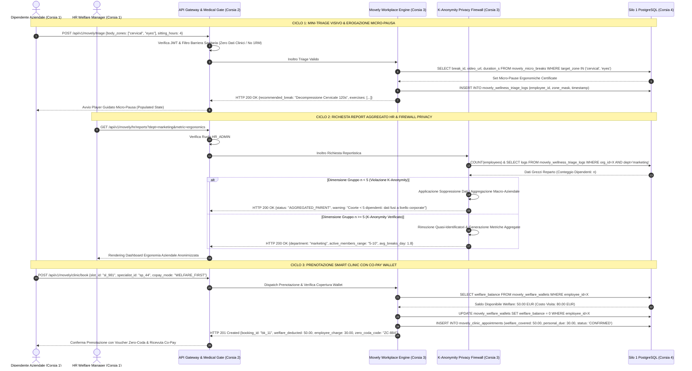

# Capitolato Tecnico: Flow M1 – Movely Workplace Companion App: Ergonomia, Mini-Triage, Smart Clinic & Privacy Firewall

## 1. Identificativo & Titolo Ufficiale
- **Badge Miro Board:** `#19` / `#M1` (Shape ID: `3458764690915095247`, Posizione LIVE: `X: 10700, Y: 650`, Nodi ISO: `18`)
- **Codice Univoco:** `FLOW-M1`
- **Titolo Formale:** COMPANION APPS (CORPORATE WELFARE & WORKPLACE WELLBEING) - FLOW M1: MOVELY WORKPLACE COMPANION APP - ERGONOMIA, MINI-TRIAGE, SMART CLINIC & PRIVACY FIREWALL
- **Board Miro Online:** `uXjVEbo6L2o=` (Zona Companion Apps: Ecosistema Movely & Welfare Aziendale)
- **Diagramma Sorgente:** [flow-m1-movely-workplace.mmd](../02-miro-zones-and-swimlanes/18-flowcharts/software-companion-movely/flow-m1-movely-workplace.mmd)
- **Riferimento Glossario:** [Glossario Tecnico Vivente](00-GLOSSARIO-TERMINI-TECNICI.md) (Voci: [Movely Companion App](00-GLOSSARIO-TERMINI-TECNICI.md#movely-companion-app), [K-Anonymity HR Privacy Firewall](00-GLOSSARIO-TERMINI-TECNICI.md#k-anonymity-hr-privacy-firewall), [Mini-Triage Visivo del Benessere](00-GLOSSARIO-TERMINI-TECNICI.md#mini-triage-visivo-del-benessere), [Family Plan Welfare](00-GLOSSARIO-TERMINI-TECNICI.md#family-plan-welfare), [Smart Clinic Zero-Coda](00-GLOSSARIO-TERMINI-TECNICI.md#smart-clinic-zero-coda), [Ambassador Educational Feed](00-GLOSSARIO-TERMINI-TECNICI.md#ambassador-educational-feed), [Co-Pay Welfare Wallet](00-GLOSSARIO-TERMINI-TECNICI.md#co-pay-welfare-wallet), [3 Silos Database](00-GLOSSARIO-TERMINI-TECNICI.md#3-silos-database-multi-tenant-data-isolation)).
- **Nota di Governance & Barriera Sanitaria (Medical Isolation Gate):** Movely Workplace e una Companion App B2B2C operante su partizione Silo 1. In conformita alle linee guida del progetto T7, e attivo un blocco rigoroso e invalicabile verso carichi atletici pesanti, programmazioni sportive massimali e referti clinici o sanitari (gestiti esclusivamente nei moduli core di T7 Workout Tiers 1-2-3 e nel Bunker Silo 2). Tutti i report generati per le risorse umane dell'azienda committente sono filtrati matematicamente dal K-Anonymity HR Privacy Firewall ($k \ge 5$).

---

## 2. Obiettivo di Business & Target Utente

### Guida Pratica per Non Tecnici: Cos'e questo modulo per un umano?
Chi lavora molte ore seduto a una scrivania o davanti a uno schermo conosce bene quella sensazione di pesantezza alle spalle, il collo bloccato a fine giornata, gli occhi affaticati e la schiena dolorante. Spesso le persone vorrebbero muoversi o fare qualcosa per stare meglio, ma non sanno quali esercizi fare senza sudare o farsi male in ufficio, non hanno tempo da perdere e temono che la propria azienda possa curiosare sulle loro condizioni di salute.
**Movely Workplace Companion App** e la risposta semplice, rassicurante e quotidiana a tutti questi problemi:
- **Micro-pause intelligenti da 1-3 minuti:** durante la giornata di lavoro, l'app suggerisce brevi sequenze di mobilità articolare, allungamento dolce e decompressione che si possono fare direttamente alla scrivania o in piedi accanto alla sedia, senza cambiarsi d'abito e senza attrezzatura;
- **Mini-Triage Visivo del Benessere in 30 secondi:** toccando una semplice sagoma umana sullo schermo, il dipendente indica dove sente tensione (es. collo rigido, zona lombare affaticata, stanchezza oculare); l'app capisce al volo e propone subito la sequenza ideale per quel preciso momento;
- **Educazione posturale certificata (Ambassador Feed):** pillole video da 30-60 secondi registrate da fisioterapisti, posturologi ed esperti accreditati, senza pubblicita ingannevole ne mode del momento;
- **Smart Clinic Zero-Coda:** quando serve un controllo professionale, il lavoratore puo prenotare con due tocchi una visita o una seduta con specialisti convenzionati, saltando code e telefonate;
- **Welfare Wallet con Co-Pay:** i servizi possono essere pagati sfruttando i crediti welfare messi a disposizione dall'azienda, integrando se necessario con la propria carta personale in modo trasparente;
- **Family Plan Welfare:** i benefici del movimento e dell'educazione posturale non si fermano in ufficio, ma possono essere estesi ai familiari a casa;
- **Privacy assoluta e protetta da un muro matematico:** il datore di lavoro e i responsabili HR **non possono mai vedere** chi ha fatto gli esercizi, chi ha mal di schiena o come ha risposto il singolo dipendente. L'azienda riceve solo statistiche aggregate e totalmente anonime per gruppi di almeno 5 persone ($k \ge 5$), garantendo serenità e fiducia totale al lavoratore.

### Specifiche di Business & Metriche
- **Target Utente:** Dipendenti aziendali, lavoratori in smart working, reparti Human Resources (HR) & Welfare Manager, familiari dei dipendenti (Family Plan) e professionisti della salute convenzionati (Smart Clinic).
- **Problema Risolto:** Contrasto efficace alla sedentarietà lavorativa, prevenzione dei disturbi muscolo-scheletrici lavoro-correlati (DMS / WMSD), riduzione dello stress psico-fisico e dell'assenteismo, con garanzia crittografica di anonimato verso la direzione aziendale.
- **Stato Gap Analysis (Regola 10):** Arancione (`#e67e22` - Nuovo modulo Companion App da orchestrare su partizione Silo 1).
- **Metriche Chiave (KPI):**
  - Latenza erogazione suggerimento micro-pausa da Mini-Triage: $< 250\text{ ms}$ p95;
  - Rispetto matematico K-Anonymity nei report HR: $k \ge 5$ ($100\%$ soppressione di coorti con $< 5$ individui);
  - Tempo di prenotazione appuntamento Smart Clinic: $< 30\text{ s}$ su 3 passaggi UI;
  - Rispetto Barriera Sanitaria: $100\%$ blocco su referti clinici e schede allenamento atletiche (zero payload sanitari transitanti in Movely);
  - Tasso di adozione micro-pause attive: $> 65\%$ dei dipendenti abilitati con almeno 1 pausa attiva completata al giorno.

---

## 3. Attori & Architettura a 4 Corsie (Swimlanes)

1. **Corsia 1: Thin Client UI/UX (Movely Companion Web App / PWA React 18):**
   - Schermata Home Benessere: riepilogo idratazione, contatore micro-pause completate e scorciatoia Mini-Triage;
   - Mini-Triage Visivo Interattivo: sagoma corporea vettoriale SVG a 6 zone (Cervicale, Spalle/Cingolo Scapolare, Rachide Lombare, Polsi/Tunnel Carpale, Arti Inferiori, Tensione Visiva/Oculare) con slider analogico di intensita (Scala 1-5);
   - Player Guidato Micro-Pausa: animazioni leggere con timer integrato a frequenza controllata (60s, 120s, 180s) e istruzioni ergonomiche;
   - Ambassador Educational Feed: feed multimediale verticale di pillole video brevi (30-60 secondi a 1080p compresso) con filtri per categoria posturale;
   - Portale Smart Clinic Zero-Coda: selettore di professionisti accreditati, agenda slot orari in tempo reale e conferma prenotazione;
   - Co-Pay Welfare Wallet UI: visualizzazione saldo crediti aziendali, split automatico importo voucher / carta personale e generazione ricevute;
   - Family Plan Management: interfaccia per invitare e collegare fino a 4 componenti del nucleo familiare.
2. **Corsia 2: API Gateway & Envoy Security Guard (Corsia 2):**
   - Autenticazione JWT multi-tenant (`sub: employee_uuid`, `org_id: org_uuid`, `role: EMPLOYEE | HR_ADMIN | FAMILY_MEMBER`);
   - **Enforcement Rigido della Barriera Sanitaria:** interceptor Gateway che esamina gli header e il body delle richieste, rigettando con HTTP `403 Forbidden` (`HEALTH_GATE_VIOLATION`) qualsiasi tentativo di invio o richiesta di referti diagnostici, cartelle cliniche, carichi 1RM, percentuali di allenamento o parametri agonistici riservati a T7 Core;
   - Rate limiting differenziato ($< 100\text{ req/min}$ per employee, $< 30\text{ req/min}$ per reportistica HR).
3. **Corsia 3: Server Scatola Nera (Movely Workplace Core Engine & K-Anonymity Aggregator - Cloud Run):**
   - **Mini-Triage Recommender Deterministico:** algoritmo a matrice pesata che correla i distretti corporei selezionati e i minuti di sedentarieta con il catalogo delle micro-pause ergonomiche, senza alcuna componente stocastica o allucinazione;
   - **K-Anonymity HR Privacy Firewall Engine:** modulo analitico che intercetta qualsiasi query o richiesta di reportistica generata dall'HR Manager. Raggruppa i dati per dipartimento o sede; se la coorte contiene $n < 5$ dipendenti attivi, sopprime automaticamente le dimensioni granulari o aggrega i dati a livello aziendale macroscopico, rendendo matematicamente impossibile risalire al singolo individuo;
   - **Smart Clinic Booking & Slot Dispatcher:** sincronizzazione asincrona delle agende degli specialisti e blocco anti-conflitto degli slot orari;
   - **Co-Pay Splitter Service:** servizio di ripartizione contabile che addebita il massimale dal borsellino welfare aziendale e crea l'eventuale transazione residua sul gateway di pagamento personale.
4. **Corsia 4: Database Tripartito (Silo 1 - Public, Social & Movely Partition - PostgreSQL):**
   - Tabelle relazionali isolate in Silo 1: `movely_organizations`, `movely_employees`, `movely_family_members`, `movely_wellness_triage_logs`, `movely_micro_breaks`, `movely_clinic_appointments`, `movely_welfare_wallets`, `movely_welfare_transactions`;
   - Isolamento totale: nessun dato di Movely tocca le partizioni crittografate Silo 2 (Bunker Club KMS) ne il Silo 3 (Research Warehouse).

---

### Sequence Diagram Asincrono del Ciclo di Vita (FLOW-M1)



---

## 4. Flusso Passo-Passo

### Livello A: Guida Operativa & User Journey Narrativo
1. **Accesso Guidato del Lavoratore:** Il dipendente accede a Movely Workplace tramite Single Sign-On (SSO) aziendale o credenziali welfare. Al primo accesso trova una schermata accogliente e chiara che riassume le tutele della privacy.
2. **Mini-Triage Visivo della Giornata:** Quando il lavoratore avverte fastidio posturale, tocca il pulsante "Check Rapido" (inferiore a 30 secondi). Sullo schermo compare una sagoma stilizzata con 6 zone chiave. Seleziona le aree in tensione (es. collo e zona lombare) e indica da quante ore e seduto.
3. **Esecuzione della Micro-Pausa alla Scrivania:** Il sistema risponde immediatamente con una routine da 2 minuti di decompressione posturale guidata. Un player lineare e pulito mostra l'animazione dell'esercizio con consigli ergonomici pratici.
4. **Esplorazione dell'Ambassador Educational Feed:** Durante una pausa caffe, il lavoratore apre il feed informativo e guarda pillole video da 45 secondi registrate da fisioterapisti accreditati su argomenti come l'altezza corretta dello schermo, la respirazione diaframmatica e la postura da seduti.
5. **Prenotazione Smart Clinic Zero-Coda:** Se il fastidio persiste, il dipendente seleziona un fisioterapista o ergonomo della rete convenzionata, sceglie data e ora tra gli slot disponibili in tempo reale e conferma con un tocco. L'app genera il voucher digitale "Zero-Coda".
6. **Pagamento Trasparente con Co-Pay Wallet:** L'app attinge automaticamente dal borsellino welfare aziendale assegnato dal datore di lavoro; se la tariffa supera il credito welfare residuo, la differenza viene regolata direttamente con la carta personale del lavoratore senza bloccare l'operazione.
7. **Condivisione Family Plan:** Il lavoratore puo invitare fino a 4 persone del proprio nucleo familiare, condividendo l'accesso ai video educativi e ai crediti welfare disponibili, promuovendo salute e movimento a casa.

#### Tabella KPI di Accettazione Operativa

| Metrica / Parametro KPI | Obiettivo Target | Tolleranza Accettabile | Azione Fallback / Allerta |
| :--- | :--- | :--- | :--- |
| **Latenza Risposta Mini-Triage (`POST`)** | $< 250\text{ ms}$ p95 | $\le 500\text{ ms}$ | Erogazione micro-pausa pre-caricata in cache locale |
| **Soglia Minima K-Anonymity Report HR** | $k \ge 5$ individui | $k \ge 5$ (invariante assoluto) | Soppressione dato o aggregazione macro-reparto |
| **Completamento Prenotazione Smart Clinic** | $< 30\text{ s}$ / 3 tap | $\le 60\text{ s}$ | Modale di assistenza rapida con blocco temporaneo slot |
| **Rispetto Barriera Sanitaria (Zero Diagnosi)** | $100\%$ conformita | $100\%$ (zero bypass) | Intercettazione immediata Gateway HTTP 403 e log audit |
| **Tempo Sincronizzazione Co-Pay Wallet** | $< 300\text{ ms}$ | $\le 800\text{ ms}$ | Rollback atomico transazione e notifica utente |

---

### Livello B: Deep-Dive Tecnico per Sviluppatori

- **Allineamento 1:1 ai 18 Nodi ISO (`FLOW-M1`):**
  1. `START_M1` (Corsia 1): Inizio: Accesso del dipendente o del familiare a Movely Workplace PWA.
  2. `DASH_WELLNESS` (Corsia 1): Visualizzazione Dashboard Benessere Quotidiano con contatori ergonomici e promemoria.
  3. `DEC_USER_ACTION` (Corsia 1 - Rombo): Selezione azione utente: Mini-Triage, Video Ambassador, Smart Clinic, Wallet o Family.
  4. `MINI_TRIAGE_UI` (Corsia 1): Sagoma vettoriale SVG interattiva a 6 distretti per check-up visivo non clinico.
  5. `MICRO_BREAK_PLAYER` (Corsia 1): Player ergonomico guidato con timer asincrono e istruzioni di decompressione posturale.
  6. `SMART_CLINIC_UI` (Corsia 1): Vetrina professionisti convenzionati e selettore orario Zero-Coda in tempo reale.
  7. `AMBASSADOR_FEED_UI` (Corsia 1): Feed multimediale verticale certificato con micro-video 1080p e filtri tematici.
  8. `COPAY_WALLET_UI` (Corsia 1): Interfaccia portafoglio digitale con visualizzazione split voucher welfare e quota personale.
  9. `FAMILY_PLAN_UI` (Corsia 1): Modulo di gestione account nucleo familiare e condivisione benefit.
  10. `RENDER_UI_STATES` (Corsia 1): Rendering reattivo dei 4 Stati UI (`Empty`, `Loading`, `Populated`, `Error / Fallback`).
  11. `GW_ENDPOINT` (Corsia 2): Ricezione richieste REST su `/api/v1/movely/*`.
  12. `GW_SECURITY_DEC` (Corsia 2 - Rombo): Verifica JWT Movely ed Enforcement Barriera Sanitaria (blocco payload clinici e schede atletiche).
  13. `GW_HTTP_403` (Corsia 2): Risposta bloccante HTTP `403 Forbidden` per violazione barriera sanitaria o tier errato.
  14. `SRV_TRIAGE_RECOMMENDER` (Corsia 3): Motore deterministico di abbinamento micro-pause da distretti e sedentarieta.
  15. `SRV_CLINIC_SCHEDULER` (Corsia 3): Gestore asincrono prenotazioni e blocco concorrente slot su PostgreSQL.
  16. `SRV_KANONYMITY_FIREWALL` (Corsia 3): Motore di anonimizzazione k-anonima ($k \ge 5$) per la reportistica aggregata HR.
  17. `DB_SILO1_MOVELY` (Corsia 4 - Cilindro): Lettura e scrittura su tabelle dedicate in Silo 1 (PostgreSQL multi-tenant).
  18. `END_M1` (Corsia 4): Fine: operazione welfare registrata con protezione della privacy e zero dati sanitari esposti.
- **Zero Logica Proprietaria sul Client (IP Isolation):** L'applicazione client riceve esclusivamente istruzioni visive ed elenchi di esercizi; le matrici di raccomandazione, le regole di partizione fiscale del co-pay e la verifica matematica di k-anonimato avvengono rigorosamente sul backend (Cloud Run).
- **Barriera Sanitaria Inviolabile:** Nessuna tabella o colonna in Silo 1 per Movely prevede campi per diagnosi, patologie, anamnesi medica, carichi massimali $1\text{RM}$ o frequenza cardiaca telemetrica.

---

## 5. Rami Decisionali & Gestione Errori

### Matrice dei Rami Decisionali

| Bivio Decisionale | Condizione Logica | Ramo SI / Positivo | Ramo NO / Negativo |
| :--- | :--- | :--- | :--- |
| `GW_SECURITY_DEC` | La richiesta proviene da token Movely valido e NON contiene carichi 1RM, referti clinici o dati diagnostici? | Inoltra la richiesta ai servizi di Corsia 3 | Risponde con HTTP `403 Forbidden` (`HEALTH_GATE_VIOLATION`) e registra audit log |
| `SRV_KANONYMITY_DEC` | Nel reparto o coorte aziendale richiesta sono presenti almeno $k \ge 5$ dipendenti attivi? | Elabora le statistiche aggregate e anonime per l'HR Manager | Sopprime i valori specifici del reparto o fonde i dati nella media macro-aziendale |
| `COPAY_WALLET_DEC` | Il saldo welfare aziendale copre il 100% dell'importo della prestazione Smart Clinic? | Addebita interamente la quota sul voucher welfare | Esegue lo split: azzera il credito welfare e predispone transazione Stripe per il residuo |
| `CLINIC_SLOT_DEC` | Lo slot orario selezionato e ancora libero e confermabile dallo specialista convenzionato? | Genera il codice appuntamento Zero-Coda e conferma | Restituisce HTTP `409 Conflict` proponendo gli slot orari contigui disponibili |

### Gestione Obbligatoria dei 4 Stati UI

| Stato UI | Condizione Scatenante | Elementi Visibili a Schermo | Azione Utente Permessa |
| :--- | :--- | :--- | :--- |
| **Empty State** | Primo login, nessuna micro-pausa ancora svolta, zero appuntamenti clinic | Banner di benvenuto con guida interattiva, sagoma corporea pronta per il primo Mini-Triage e card informative sul Family Plan | Tocco su sagoma per avviare il Mini-Triage o esplorazione dell'Ambassador Feed |
| **Loading State** | Elaborazione raccomandazione micro-pausa, calcolo transazione wallet o report HR | Skeleton loader pulsante a contrasto controllato, indicatore rotante di elaborazione e disabilitazione pulsanti di conferma | Attesa risposta server o annullamento operazione |
| **Populated State** | Routine micro-pausa attiva, feed video disponibile, appuntamento prenotato | Player visivo con timer countdown, card video con preview 1080p, voucher digitale con codice QR e riepilogo saldi wallet | Esecuzione micro-pausa, riproduzione video, download voucher o gestione familiari |
| **Error / Fallback State** | Assenza connessione, violazione barriera sanitaria, slot conteso o errore pagamento | Messaggio chiaro in linguaggio naturale (zero codici criptici), indicazione del motivo del blocco e stato coerente dei pulsanti | Riprova immediata, selezione orario alternativo o modifica metodo di pagamento co-pay |

---

## 6. Contratti Dati JSON & Matrice Errori HTTP

### Contratto Richiesta Mini-Triage (`POST /api/v1/movely/triage`)
```http
POST /api/v1/movely/triage
Authorization: Bearer <jwt_movely_employee_token>
Content-Type: application/json
```
```json
{
  "selected_zones": ["cervical_spine", "scapular_belt"],
  "perceived_tension_level": 3,
  "sitting_hours_consecutive": 3.5,
  "eye_strain": true
}
```

### Contratto Risposta Micro-Pausa Suggerita
```json
{
  "session_id": "ses_4b8f01a9-d3e2-411a-8e9a-7c8a9f012019",
  "target_program": "Decompressione Cervicale & Defaticamento Oculare",
  "total_duration_seconds": 180,
  "break_items": [
    {
      "step_order": 1,
      "exercise_title": "Rotazione e Allungamento Cervicale Dolce",
      "duration_seconds": 60,
      "posture": "DESK_SEATED",
      "animation_svg_url": "https://assets.t7workout.app/movely/anim/cervical_gentle_stretch.svg",
      "ergonomic_tip": "Mantieni le spalle basse e rilassate, respira profondamente senza forzare il fine corsa."
    },
    {
      "step_order": 2,
      "exercise_title": "Palming e Rilassamento Visivo 20-20-20",
      "duration_seconds": 60,
      "posture": "DESK_SEATED",
      "animation_svg_url": "https://assets.t7workout.app/movely/anim/eye_palming_rest.svg",
      "ergonomic_tip": "Appoggia i palmi delle mani sugli occhi chiusi senza premere ed evita fonti di luce diretta."
    },
    {
      "step_order": 3,
      "exercise_title": "Apertura Toracica e Mobilità Scapolare",
      "duration_seconds": 60,
      "posture": "DESK_STANDING",
      "animation_svg_url": "https://assets.t7workout.app/movely/anim/scapular_retraction.svg",
      "ergonomic_tip": "Alzati in piedi, apri le braccia a 90 gradi e unisci dolcemente le scapole espirando."
    }
  ]
}
```

### Contratto Prenotazione Smart Clinic con Co-Pay Wallet (`POST /api/v1/movely/clinic/book`)
```http
POST /api/v1/movely/clinic/book
Authorization: Bearer <jwt_movely_employee_token>
Content-Type: application/json
```
```json
{
  "clinic_partner_id": "cp_milano_duomo_01",
  "specialist_id": "spec_posturology_771",
  "service_type": "CHECKUP_POSTURALE_ERGONOMICO",
  "slot_datetime_utc": "2026-11-25T14:30:00Z",
  "copay_preference": "APPLY_MAX_WELFARE"
}
```
```json
{
  "booking_reference": "ZC-MOVELY-98214",
  "booking_status": "CONFIRMED",
  "total_fee_cents": 8500,
  "welfare_covered_cents": 6000,
  "employee_charge_cents": 2500,
  "payment_split": {
    "welfare_transaction_id": "wtx_998124_silo1",
    "stripe_payment_intent_id": "pi_3MtwL2KZv91_secret",
    "receipt_url": "https://movely.t7workout.app/receipts/ZC-MOVELY-98214.pdf"
  },
  "zero_coda_voucher": {
    "qr_code_token": "qrc_eyJhbGciOiJIUzI1NiIsInR5cCI6IkpXVCJ9...",
    "arrival_instructions": "Presentati 5 minuti prima presso la reception dedicata Smart Clinic con il QR Code su smartphone."
  }
}
```

### Contratto Report Aggregato HR con K-Anonymity (`GET /api/v1/movely/hr/reports/ergonomics`)
```http
GET /api/v1/movely/hr/reports/ergonomics?department=engineering&period=2026-W46
Authorization: Bearer <jwt_movely_hr_token>
```
```json
{
  "organization_id": "org_acme_corp_44",
  "period": "2026-W46",
  "department": "engineering",
  "k_anonymity_status": {
    "compliant": true,
    "threshold_k": 5,
    "cohort_size_tier": "COHORT_BETWEEN_10_AND_25"
  },
  "aggregated_metrics": {
    "active_participants_percentage": 78.4,
    "average_daily_micro_breaks": 2.1,
    "most_frequent_break_types": [
      {"focus_area": "cervical_spine", "frequency_percent": 42.0},
      {"focus_area": "lumbar_spine", "frequency_percent": 35.5},
      {"focus_area": "eye_strain", "frequency_percent": 22.5}
    ],
    "workplace_wellness_index_score": 8.4
  },
  "privacy_notice": "In osservanza del regolamento GDPR e del K-Anonymity HR Privacy Firewall (k >= 5), tutti i dati sono aggregati ed e rigorosamente omessa qualsiasi informazione individuale."
}
```

### Schema Relazionale (Database Silo 1 - PostgreSQL)

```sql
-- TABELLA ORGANIZZAZIONI AZIENDALI WELFARE
CREATE TABLE movely_organizations (
    org_id UUID PRIMARY KEY DEFAULT gen_random_uuid(),
    company_name VARCHAR(128) NOT NULL,
    vat_number VARCHAR(32) NOT NULL UNIQUE,
    welfare_contract_tier VARCHAR(32) NOT NULL CHECK (welfare_contract_tier IN ('STANDARD_WORKPLACE', 'ENTERPRISE_PREMIUM')),
    is_active BOOLEAN NOT NULL DEFAULT TRUE,
    created_at TIMESTAMPTZ NOT NULL DEFAULT NOW()
);

-- TABELLA DIPENDENTI AZIENDALI
CREATE TABLE movely_employees (
    employee_id UUID PRIMARY KEY DEFAULT gen_random_uuid(),
    org_id UUID NOT NULL REFERENCES movely_organizations(org_id) ON DELETE CASCADE,
    company_email VARCHAR(255) NOT NULL UNIQUE,
    department_code VARCHAR(64) NOT NULL,
    is_family_plan_enabled BOOLEAN NOT NULL DEFAULT TRUE,
    status VARCHAR(32) NOT NULL DEFAULT 'ACTIVE',
    created_at TIMESTAMPTZ NOT NULL DEFAULT NOW()
);

-- TABELLA COMPONENTI FAMILY PLAN
CREATE TABLE movely_family_members (
    family_member_id UUID PRIMARY KEY DEFAULT gen_random_uuid(),
    primary_employee_id UUID NOT NULL REFERENCES movely_employees(employee_id) ON DELETE CASCADE,
    full_name VARCHAR(128) NOT NULL,
    relationship_type VARCHAR(32) NOT NULL CHECK (relationship_type IN ('SPOUSE', 'CHILD', 'PARENT', 'OTHER')),
    access_token_hash VARCHAR(255) NOT NULL,
    created_at TIMESTAMPTZ NOT NULL DEFAULT NOW()
);

-- TABELLA LOG DI BENESSERE & MINI-TRIAGE (ZERO DATI DIAGNOSTICI O CLINICI)
CREATE TABLE movely_wellness_triage_logs (
    log_id UUID PRIMARY KEY DEFAULT gen_random_uuid(),
    employee_id UUID NOT NULL REFERENCES movely_employees(employee_id) ON DELETE CASCADE,
    org_id UUID NOT NULL REFERENCES movely_organizations(org_id) ON DELETE CASCADE,
    department_code VARCHAR(64) NOT NULL,
    selected_zones_mask TEXT[] NOT NULL,
    perceived_tension_score SMALLINT NOT NULL CHECK (perceived_tension_score BETWEEN 1 AND 5),
    completed_break_id VARCHAR(64),
    duration_performed_seconds INTEGER NOT NULL DEFAULT 0,
    created_at TIMESTAMPTZ NOT NULL DEFAULT NOW()
);
CREATE INDEX idx_movely_triage_hr_k ON movely_wellness_triage_logs (org_id, department_code, created_at);

-- TABELLA CATALOGO MICRO-PAUSE ERGONOMICHE
CREATE TABLE movely_micro_breaks (
    break_id VARCHAR(64) PRIMARY KEY,
    title VARCHAR(128) NOT NULL,
    target_zone VARCHAR(64) NOT NULL,
    duration_seconds INTEGER NOT NULL CHECK (duration_seconds IN (60, 120, 180)),
    posture_type VARCHAR(32) NOT NULL CHECK (posture_type IN ('DESK_SEATED', 'DESK_STANDING')),
    animation_asset_key VARCHAR(255) NOT NULL,
    ergonomic_description TEXT NOT NULL
);

-- TABELLA BORSELLINO WELFARE AZIENDALE (CO-PAY)
CREATE TABLE movely_welfare_wallets (
    wallet_id UUID PRIMARY KEY DEFAULT gen_random_uuid(),
    employee_id UUID NOT NULL UNIQUE REFERENCES movely_employees(employee_id) ON DELETE CASCADE,
    available_welfare_cents INTEGER NOT NULL DEFAULT 0 CHECK (available_welfare_cents >= 0),
    total_granted_cents INTEGER NOT NULL DEFAULT 0,
    last_updated_at TIMESTAMPTZ NOT NULL DEFAULT NOW()
);

-- TABELLA APPUNTAMENTI SMART CLINIC ZERO-CODA (LOGISTICA E CONTABILITA, ZERO REFERTI)
CREATE TABLE movely_clinic_appointments (
    appointment_id UUID PRIMARY KEY DEFAULT gen_random_uuid(),
    employee_id UUID NOT NULL REFERENCES movely_employees(employee_id) ON DELETE CASCADE,
    clinic_partner_id VARCHAR(64) NOT NULL,
    specialist_id VARCHAR(64) NOT NULL,
    service_code VARCHAR(64) NOT NULL,
    scheduled_slot_utc TIMESTAMPTZ NOT NULL,
    total_fee_cents INTEGER NOT NULL,
    welfare_deducted_cents INTEGER NOT NULL,
    personal_copay_cents INTEGER NOT NULL,
    zero_coda_qr_code VARCHAR(128) NOT NULL UNIQUE,
    booking_status VARCHAR(32) NOT NULL DEFAULT 'CONFIRMED' CHECK (booking_status IN ('CONFIRMED', 'COMPLETED', 'CANCELLED')),
    created_at TIMESTAMPTZ NOT NULL DEFAULT NOW()
);
```

### Matrice Errori HTTP a 6 Colonne

| Codice HTTP | Errore Interno | Condizione Scatenante | Risposta Client | Azione Automatica Client | Ripristino Utente |
| :--- | :--- | :--- | :--- | :--- | :--- |
| `400 Bad Request` | `INVALID_TRIAGE_PAYLOAD` | Distretti corporei non ammessi o parametri numerici di durata fuori scala | `{"error": "Dati del mini-triage non validi per la selezione posturale"}` | Resetta i toggle dei distretti corporei non validi | Selezionare nuovamente i distretti sulla sagoma visiva |
| `401 Unauthorized` | `MOVELY_SESSION_EXPIRED` | Token JWT aziendale o familiare assente, non valido o scaduto | `{"error": "Sessione scaduta, effettua nuovamente l'accesso aziendale"}` | Reindirizza al portale di autenticazione SSO | Effettuare nuovamente il login con credenziali aziendali |
| `403 Forbidden` | `HEALTH_GATE_VIOLATION` | Tentativo di inviare referti clinici, diagnosi o parametri di allenamento pesante | `{"error": "Operazione non consentita: Movely esclude dati sanitari e carichi agonistici"}` | Blocca immediatamente la trasmissione del payload | Utilizzare i moduli sanitari dedicati su T7 Pro/Elite |
| `404 Not Found` | `CLINIC_SPECIALIST_NOT_FOUND` | Specialista o clinica convenzionata rimossa o non attiva nell'area territoriale | `{"error": "Professionista o centro convenzionato non disponibile"}` | Ricarica la mappa dei centri convenzionati attivi | Selezionare un altro specialista o data differente |
| `409 Conflict` | `CLINIC_SLOT_ALREADY_BOOKED` | Concorrenza simultanea: lo slot orario scelto e stato confermato da un altro utente | `{"error": "Slot orario appena occupato: seleziona un altro orario"}` | Aggiorna istantaneamente il calendario dello specialista | Scegliere uno slot orario contiguo disponibile |
| `422 Unproc Entity` | `KANONYMITY_THRESHOLD_BREACH` | Richiesta report HR su un reparto con meno di 5 dipendenti attivi ($k < 5$) | `{"error": "Gruppo con meno di 5 dipendenti: visualizzazione aggregata macro"}` | Commuta automaticamente la visualizzazione sul livello corporate | Consultare i dati a livello aziendale complessivo |
| `429 Too Many Req` | `TRIAGE_RATE_LIMITED` | Superamento di 10 richieste di triage visivo in meno di un minuto | `{"error": "Troppe richieste consecutive: attendi qualche secondo"}` | Blocca temporaneamente il pulsante di check-up visivo | Attendere lo sblocco del timer prima di un nuovo test |
| `503 Service Unav` | `SILO1_MOVELY_UNAVAILABLE` | Manutenzione programmata o temporanea indisponibilita del cluster PostgreSQL Silo 1 | `{"error": "Servizio Movely temporaneamente non raggiungibile"}` | Mostra l'interfaccia di fallback con le micro-pause in cache locale | Premere Riprova non appena la rete torna disponibile |

---

## 7. Ereditarieta di Tier & Sblocco Funzionalita a Cascata (Integrazione Ecosistema T7)

- **Posizionamento Architetturale di Movely:** Movely Workplace opera come una **Companion App B2B2C autonoma**, focalizzata esclusivamente sul Corporate Welfare, l'ergonomia attiva, il K-Anonymity HR Privacy Firewall (k >= 5) e la prevenzione sul posto di lavoro, ospitata sulla partizione **Silo 1 (Public, Social & Movely)**.
- **Isolamento Rigido da T7 Workout Core:**
  - **Nessuna Scheda di Allenamento Agonistico:** Movely non fornisce schede con bilancieri, percentuali di carico massimale ($1\text{RM}$), buffer di ripetizioni o protocolli di ipertrofia/forza (questi risiedono esclusivamente in T7 Workout nei flussi `#03`, `#09` e `#15`);
  - **Nessun Referto Clinico o Sanitario:** Le visite effettuate tramite la Smart Clinic Zero-Coda generano la sola fatturazione/voucher in Movely. I referti clinici, le diagnosi ortopediche e le cartelle EMR risiedono nel Silo 2 (Bunker KMS protetto da RLS e segreto medico) e non transitano ne risiedono nell'app Movely aziendale;
  - **Ponte Opzionale Volontario Verso T7 B2C:** Se un dipendente desidera intraprendere un percorso di allenamento atletico personale, puo esportare volontariamente e autonomamente le sole credenziali verso T7 Workout Consumer (Tier 1), senza alcuna condivisione di dati o tracciamento verso il datore di lavoro.
- **K-Anonymity HR Privacy Firewall ($k \ge 5$):**
  - Il datore di lavoro finanzia il piano di welfare ma non puo in alcun modo trasformare l'app in uno strumento di sorveglianza individuale;
  - L'algoritmo di k-anonimato garantisce che ogni singolo punto dato mostrato all'HR sia indistinguibile all'interno di una coorte minima di 5 persone ($k \ge 5$). Se un ufficio ha 3 dipendenti, i dati sono automaticamente aggregati alla sede o all'azienda nel suo insieme.
- **Sinergia di Valore:** Questa netta separazione assicura che il lavoratore viva l'app come un alleato personale per il proprio benessere fisico, mentre l'azienda ottiene metriche concrete di ritorno sull'investimento (ROI) del welfare e riduzione dei disturbi posturali nel pieno rispetto del GDPR (Art. 9).
