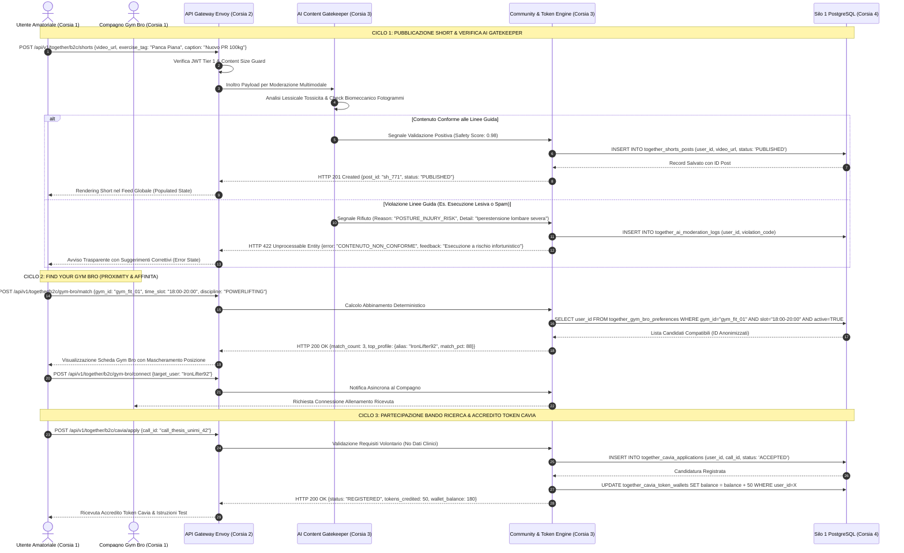

# Capitolato Tecnico: Flow TS1 – Together B2C Community: Shorts, AI Content Gatekeeper, Find Your Gym Bro & Token Cavia

## 1. Identificativo & Titolo Ufficiale
- **Badge Miro Board:** `#20` / `#TS1` (Shape ID: `3458764690918929298`, Posizione LIVE: `X: 12500, Y: 650`, Nodi ISO: `16`)
- **Codice Univoco:** `FLOW-TS1`
- **Titolo Formale:** COMPANION APPS (SOCIAL & COMMUNITY) - FLOW TS1: TOGETHER B2C COMMUNITY - SHORTS, AI CONTENT GATEKEEPER, FIND YOUR GYM BRO & TOKENOMICS CAVIA
- **Board Miro Online:** `uXjVEbo6L2o=` (Zona Companion Apps: Ecosistema Together Social B2C)
- **Diagramma Sorgente:** [flow-ts1-together-b2c-community.mmd](../02-miro-zones-and-swimlanes/18-flowcharts/software-companion-together/flow-ts1-together-b2c-community.mmd)
- **Riferimento Glossario:** [Glossario Tecnico Vivente](00-GLOSSARIO-TERMINI-TECNICI.md) (Voci: [AI Content Gatekeeper](00-GLOSSARIO-TERMINI-TECNICI.md#ai-content-gatekeeper), [Find Your Gym Bro / Gym Girl](00-GLOSSARIO-TERMINI-TECNICI.md#find-your-gym-bro-gym-girl), [Soggetto Volontario Cavia Tokenomics](00-GLOSSARIO-TERMINI-TECNICI.md#soggetto-volontario-cavia-tokenomics), [Together Social Workout Sharing](00-GLOSSARIO-TERMINI-TECNICI.md#together-social), [Workout Session Tracker (Avvia Sessione)](00-GLOSSARIO-TERMINI-TECNICI.md#workout-session-tracker), [Feature Gating Tier 1 (Consumer)](00-GLOSSARIO-TERMINI-TECNICI.md#feature-gating-tier-1-consumer), [3 Silos Database (Multi-Tenant Data Isolation)](00-GLOSSARIO-TERMINI-TECNICI.md#3-silos-database-multi-tenant-data-isolation)).
- **Nota di Governance & Separazione Database:** Together Social opera come Companion App B2C su partizione dedicata Silo 1 (Social & Community). Condivide con l'app principale T7 Workout esclusivamente i record di sintesi dei workout completati tramite il Workout Session Tracker, preservando la privacy dell'atleta amatoriale. E fatto divieto assoluto di memorizzare o elaborare in questa partizione dati clinici, referti o anamnesi riservate (presidiate nel Silo 2) e dati grezzi di ricerca avanzata (presidiati nel Silo 3).

---

## 2. Obiettivo di Business & Target Utente

### Guida Pratica per Non Tecnici: Cos'e questo modulo per un umano?
Molti appassionati di fitness e sportivi amatoriali affrontano l'allenamento in solitudine: spesso manca la motivazione per andare in palestra nei giorni faticosi, e quando si cercano stimoli sui social network tradizionali ci si ritrova sommersi da contenuti tossici, pubblicita ingannevole di integratori miracolosi, video con posture spacca-schiena e commenti sgradevoli.  
**Together B2C Community** e la Companion App che trasforma l'esperienza dell'allenamento amatoriale in una comunita sana, sicura e stimolante:
- **Shorts Sportivi Costruttivi:** una bacheca di micro-video (fino a 60 secondi) dedicati a esecuzioni corrette, record personali autentici ed entusiasmo sportivo;
- **AI Content Gatekeeper:** un custode digitale intelligente che controlla ogni testo e video prima della pubblicazione, bloccando sul nascere offese, spam commerciale, incitamenti al doping e movimenti biomeccanicamente lesivi o pericolosi;
- **Find Your Gym Bro / Gym Girl:** una funzionalita opzionale Plus a pagamento (2,99 euro/mese) con questionario e consenso esplicito (Opt-In) che ti permette di trovare compagni di allenamento compatibili nella tua citta o nella tua palestra. Il sistema confronta orari preferiti, disciplina praticata e livello di forza, mascherando la tua esatta posizione geografica per proteggere la tua riservatezza;
- **Programma Volontario Cavia Tokenomics:** la possibilita entusiasmante di partecipare a ricerche universitarie e tesi sperimentali promosse da preparatori e ricercatori accreditati. In cambio della tua disponibilita come soggetto volontario per test atletici non invasivi, accumuli token utilizzabili per sconti su abbonamenti, attrezzatura o consulenze specialistiche.

### Specifiche di Business & Metriche
- **Target Utente:** Atleti amatoriali, appassionati di fitness, studenti universitari, frequentatori di palestre e sportivi della community T7 (Tier 1 Consumer).
- **Problema Risolto:** Contrasto all'abbandono dell'attivita fisica per isolamento, azzeramento della tossicita social e connessione etica tra atleti amatoriali e scienziati del movimento.
- **Stato Gap Analysis (Regola 10):** Arancione (`#e67e22` - Nuovo modulo Companion App da orchestrare su partizione Silo 1).
- **Metriche Chiave (KPI):**
  - Latenza analisi e moderazione AI Content Gatekeeper: $< 1.2\text{ s}$ per testo, $< 4.5\text{ s}$ per video 1080p compresso;
  - Tasso di blocco contenuti tossici o pericolosi: $> 99.4\%$ prima della pubblicazione pubblica;
  - Accuratezza matching Gym Bro: $> 75\%$ di affinita dichiarata dagli utenti abbinati;
  - Tempo di accredito Token Cavia dopo validazione bando: $< 500\text{ ms}$;
  - Isolamento Silo 1: $100\%$ conformita architetturale con zero contaminazione di dati clinici.

---

## 3. Attori & Architettura a 4 Corsie (Swimlanes)

1. **Corsia 1: Thin Client UI/UX (Together Social B2C PWA React 18):**
   - Feed Shorts Verticale: player video continuo ottimizzato a 60fps con overlay dati del workout completato (esercizi, serie, volume totale);
   - Shorts Creator & Editor: strumento rapido di caricamento micro-video con selezione badge esercizio e note di esecuzione;
   - Modulo Find Your Gym Bro: schermata opt-in con selettore palestra frequentata, fasce orarie e livello di esperienza, con raggio fuzzy anti-tracciamento;
   - Bacheca Bandi Ricerca Cavia: vetrina dei protocolli scientifici attivi con descrizione dei test richiesti e conteggio token ricompensa;
   - Borsellino Token Cavia: portafoglio digitale con cronologia accrediti, livello reputazione e voucher riscattabili.
2. **Corsia 2: API Gateway & Envoy Security Guard (Corsia 2):**
   - Autenticazione JWT multi-tenant (`sub: user_uuid`, `tier: B2C_TIER1`, `community_scope: TOGETHER_B2C`);
   - Rate limiting bilanciato per evitare spam bot ($< 120\text{ req/min}$ per utente, max 5 upload video all'ora);
   - Intercettore di sicurezza che convalida il payload escludendo qualsiasi dato clinico o diagnostico prima dell'ingresso nei server applicativi.
3. **Corsia 3: Server Scatola Nera (Together B2C Community Engine & AI Moderation - Cloud Run):**
   - **AI Content Gatekeeper Service:** pipeline di analisi multimodale che valuta il testo contro matrici di hate speech/spam ed esamina i fotogrammi video per rilevare posture a grave rischio infortunistico o contenuti impropri;
   - **Proximity & Compatibility Matcher:** motore deterministico di calcolo affinita su griglia geografica discretizzata (Geohash livello 6, accuratezza ca. 1.2 km per prevenire stalking);
   - **Tokenomics Ledger Service:** registro a doppia entrata per l'emissione, il congelamento e l'accredito dei Token Cavia collegati alla partecipazione ai bandi.
4. **Corsia 4: Database Tripartito (Silo 1 - Public & Social PostgreSQL Partition):**
   - Tabelle relazionali dedicate: `together_b2c_profiles`, `together_shorts_posts`, `together_ai_moderation_logs`, `together_gym_bro_preferences`, `together_gym_bro_matches`, `together_cavia_token_wallets`, `together_cavia_applications`;
   - Isolamento totale: nessun dato sociale o di matching tocca le partizioni crittografate Silo 2 (Bunker Club KMS) ne il Silo 3 (Research Warehouse).

---

### Sequence Diagram Asincrono del Ciclo di Vita (FLOW-TS1)



---

## 4. Flusso Passo-Passo

### Livello A: Guida Operativa & User Journey Narrativo
1. **Accesso alla Community:** L'utente apre la sezione Together Social B2C dall'applicazione principale. Un messaggio iniziale rammenta le regole della comunita, fondata sull'aiuto reciproco e sullo sport pulito.
2. **Esplorazione del Feed Shorts:** Scorrendo verso l'alto con un gesto del dito, l'utente visualizza micro-video di allenamenti pubblicati da altri atleti. Ogni video include un badge discreto che indica l'esercizio svolto e il volume completato, senza pubblicita invasiva.
3. **Creazione e Condivisione di uno Short:** L'atleta seleziona un video appena registrato in palestra (massimo 60 secondi) e lo associa a un esercizio del catalogo T7 (es. Squat o Trazioni). Prima di renderlo pubblico, l'app avvia la verifica di sicurezza automatica.
4. **Verifica Trasparente dell'AI Gatekeeper:** In pochi istanti, l'intelligenza artificiale verifica che il video rispetti la dignita della persona e le norme basilari di biomeccanica; se l'esercizio presenta un arco di movimento chiaramente pericoloso, il video viene trattenuto e all'utente viene offerto un consiglio costruttivo per migliorarsi.
5. **Attivazione Find Your Gym Bro:** L'utente che desidera un partner di allenamento compila una scheda sintetica indicando la palestra o il parco dove si allena abitualmente, i giorni e gli orari preferiti e gli obiettivi. L'app mostra i profili compatibili piu vicini, tutelando la privacy tramite raggio sfumato.
6. **Candidatura a un Bando Scientifico (Programma Cavia):** Navigando nella bacheca universitaria, l'atleta scopre che un laboratorio o un preparatore cerca volontari per uno studio sui tempi di recupero muscolare. Con un solo tocco invia la propria disponibilita.
7. **Guadagno e Spesa dei Token Cavia:** Al termine della sessione di test presso il laboratorio o dopo aver inserito i dati richiesti dal ricercatore, il borsellino dell'utente riceve istantaneamente i Token Cavia pattuiti, utilizzabili per sbloccare sconti su abbonamenti T7 o benefit sportivi.

#### Tabella KPI di Accettazione Operativa

| Metrica / Parametro KPI | Obiettivo Target | Tolleranza Accettabile | Azione Fallback / Allerta |
| :--- | :--- | :--- | :--- |
| **Tempo Risposta AI Gatekeeper su Testo** | $< 1.2\text{ s}$ | $\le 2.0\text{ s}$ | Coda asincrona con stato In Revisione |
| **Tempo Risposta AI Gatekeeper su Video** | $< 4.5\text{ s}$ | $\le 8.0\text{ s}$ | Pubblicazione differita con notifica push |
| **Tasso Filtraggio Tossicita & Rischio Lesivo** | $> 99.4\%$ | $\ge 98.0\%$ | Quarantena post e revisione umana prioritaria |
| **Precisione Geografica Matching (Fuzzy Geohash)** | Raggio $1.0\dots 1.5\text{ km}$ | Raggio $\le 2.5\text{ km}$ | Soppressione coordinate esatte e fallback a livello cittadino |
| **Accredito Token Cavia su Validazione** | $< 500\text{ ms}$ | $\le 1200\text{ ms}$ | Riprova transazione con log di riconciliazione |

---

### Livello B: Deep-Dive Tecnico per Sviluppatori

- **Allineamento 1:1 ai 16 Nodi ISO (`FLOW-TS1`):**
  1. `START_TS1` (Corsia 1): Inizio: Accesso dell'utente alla Companion App Together Social B2C.
  2. `UI_FEED_BROWSE` (Corsia 1): Schermata principale: feed Shorts verticale, bacheca e notifiche token.
  3. `DEC_USER_ACTION` (Corsia 1 - Rombo): Bivio utente: Crea Short, Cerca Gym Bro, Bandi Cavia.
  4. `UI_POST_CREATE` (Corsia 1): Interfaccia upload video (H.264/WebM max 60s) con tag esercizio da catalogo.
  5. `UI_GYM_BRO` (Corsia 1): Modulo di opt-in geolocalizzato con preferenze orarie e filtri affinita.
  6. `UI_VOLUNTEER_APPLY` (Corsia 1): Vetrina bandi accademici aperti e candidatura soggetto volontario.
  7. `GW_INGRESS` (Corsia 2): Ricezione richieste REST su `/api/v1/together/b2c/*`.
  8. `DEC_AUTH_CONTENT` (Corsia 2 - Rombo): Verifica token JWT Silo 1, validita firma e rate limit.
  9. `GW_ERR_REJECT` (Corsia 2): Blocco accessi con token revocati o violazioni di sicurezza.
  10. `SRV_AI_GATEKEEPER` (Corsia 3): Modulo multimodale di moderazione etica e analisi biomeccanica dei fotogrammi.
  11. `SRV_TOPIC_FILTER` (Corsia 3): Filtro semantico tematico per categorizzazione percorsi sportivi ed esercizi.
  12. `SRV_GEO_MATCHING` (Corsia 3): Motore deterministico di proximity matching su geohash e sovrapposizione orari.
  13. `SRV_TOKENOMICS` (Corsia 3): Servizio a doppia entrata per accredito e debito token cavia cross-ecosistema.
  14. `DB_SILO1_POSTS` (Corsia 4 - Cilindro): Persistenza post e interazioni su cluster PostgreSQL Silo 1.
  15. `DB_SILO1_LEDGER` (Corsia 4 - Cilindro): Persistenza wallet e transazioni token su PostgreSQL Silo 1.
  16. `END_FLOW` (Corsia 4): Fine: operazione community conclusa con integrita dei dati e rispetto della riservatezza.
- **Zero Logica Proprietaria sul Client (IP Isolation):** L'applicazione client funge esclusivamente da player di rendering ed editor leggero; le logiche di classificazione dell'AI Gatekeeper, l'algoritmo di matching geografico e il ledger crittografico dei token risiedono interamente sui server backend (Cloud Run).
- **Separazione Rigorosa dei Database:** Silo 1 gestisce unicamente gli pseudonimi sociali, i puntatori ai video e il registro token; nessuna informazione sanitaria, referto clinico o programmazione complessa di squadra (Silo 2 Bunker KMS) e accessibile o collegata.

---

## 5. Rami Decisionali & Gestione Errori

### Matrice dei Rami Decisionali

| Bivio Decisionale | Condizione Logica | Ramo SI / Positivo | Ramo NO / Negativo |
| :--- | :--- | :--- | :--- |
| `GW_SECURITY_DEC` | Il token JWT B2C e integro, non scaduto e rispetta le quote di rate limit? | Inoltra la richiesta ai servizi applicativi di Corsia 3 | Risponde con HTTP `401 Unauthorized` o `429 Too Many Requests` |
| `DEC_GATEKEEPER` | Il video e la didascalia ottengono un punteggio di conformita etica e biomeccanica $\ge 0.90$? | Approva il post e avvia la pubblicazione nel feed Silo 1 | Rigetta il post con HTTP `422 Unprocessable Entity` ed eroga spiegazione costruttiva |
| `GYM_BRO_OPTIN_DEC` | L'utente ha fornito il consenso esplicito GDPR all'abbinamento geografico mascherato? | Abilita la scansione della griglia geohash e propone profili affini | Mostra lo stato Empty State invitando ad attivare il modulo volontario |
| `CAVIA_ELIGIBILITY_DEC`| L'utente soddisfa i requisiti anagrafici e atletici di base richiesti dal bando universitario? | Registra la candidatura e predispone l'allocazione dei token in escrow | Risponde con HTTP `400 Bad Request` indicando i requisiti mancanti |

### Gestione Obbligatoria dei 4 Stati UI

| Stato UI | Condizione Scatenante | Elementi Visibili a Schermo | Azione Utente Permessa |
| :--- | :--- | :--- | :--- |
| **Empty State** | Primo accesso, zero video pubblicati, modulo Gym Bro disattivato, zero candidature | Banner di benvenuto community, guida alle regole etiche, pulsante per attivare Gym Bro o esplorare bandi | Attivazione opt-in, esplorazione feed o caricamento del primo video |
| **Loading State** | Analisi video in corso da AI Gatekeeper, calcolo matching Gym Bro, transazione token | Skeleton loader verticale pulsante, spinner di analisi biomeccanica con messaggio rassicurante | Attesa completamento o annullamento upload |
| **Populated State** | Feed video attivo con contenuti convalidati, schede compagni visibili, saldo token aggiornato | Player video a scorrimento, contatore follower/like, card Gym Bro con percentuale affinita, card bando con token | Interazione social, invio richiesta Gym Bro, candidatura a bando, riscatto voucher |
| **Error / Fallback State** | Rifiuto post da AI Gatekeeper, assenza copertura geografica compagni, errore rete Silo 1 | Schermata con spiegazione limpida (zero gergo tecnico), suggerimento su come migliorare l'esecuzione o riprovare | Modifica del video, allargamento del raggio di ricerca oraria o riprova della richiesta |

---

## 6. Contratti Dati JSON & Matrice Errori HTTP

### Contratto Upload Short & AI Content Gatekeeper (`POST /api/v1/together/b2c/shorts`)
```http
POST /api/v1/together/b2c/shorts
Authorization: Bearer <jwt_together_b2c_token>
Content-Type: application/json
```
```json
{
  "media_asset_key": "user_videos/b2c_981a_bench_press_pr.mp4",
  "media_duration_seconds": 45,
  "exercise_catalog_id": "ex_bench_press_standard",
  "caption_text": "Massimale panca piana completato con fermo al petto di 1 secondo!",
  "workout_session_reference": "ses_core_b2c_88921a"
}
```
```json
{
  "post_id": "sh_b2c_44891024",
  "moderation_verdict": {
    "status": "APPROVED",
    "safety_score": 0.985,
    "biomechanical_compliance": "PASS",
    "toxicity_detected": false
  },
  "publication_status": "PUBLISHED",
  "published_at_utc": "2026-11-20T16:45:10Z",
  "public_feed_url": "https://together.t7workout.app/shorts/sh_b2c_44891024"
}
```

### Contratto Matching Proximity Gym Bro (`POST /api/v1/together/b2c/gym-bro/match`)
```http
POST /api/v1/together/b2c/gym-bro/match
Authorization: Bearer <jwt_together_b2c_token>
Content-Type: application/json
```
```json
{
  "gym_facility_id": "gym_milano_centrale_h24",
  "preferred_time_windows": ["18:30-20:00", "20:00-21:30"],
  "primary_discipline": "BODYBUILDING_HYPERTROPHY",
  "fitness_experience_level": "INTERMEDIATE",
  "opt_in_fuzzy_proximity": true
}
```
```json
{
  "search_session_id": "gb_match_55102",
  "candidates_found": 2,
  "top_matches": [
    {
      "masked_user_alias": "Matteo_FitLover",
      "compatibility_score_pct": 92.5,
      "common_discipline": "BODYBUILDING_HYPERTROPHY",
      "matching_time_slot": "18:30-20:00",
      "facility_affiliation": "gym_milano_centrale_h24",
      "connection_request_endpoint": "/api/v1/together/b2c/gym-bro/connect/usr_cand_992"
    }
  ]
}
```

### Contratto Candidatura Volontario Bando Ricerca (`POST /api/v1/together/b2c/cavia/apply`)
```http
POST /api/v1/together/b2c/cavia/apply
Authorization: Bearer <jwt_together_b2c_token>
Content-Type: application/json
```
```json
{
  "grant_call_id": "call_unimi_biomech_2026_w47",
  "consent_academic_volunteer_gdpr": true,
  "availability_dates": ["2026-11-28", "2026-11-29"],
  "notes_for_researcher": "Disponibile per sessione pomeridiana di test salti su pedana di forza."
}
```
```json
{
  "application_id": "cavia_app_881920",
  "grant_call_title": "Studio sul Potenziamento Post-Attivazione (PAP) nei Salti Verticali",
  "research_institution": "Universita degli Studi di Milano - Dipartimento di Scienze Motorie",
  "application_status": "CONFIRMED",
  "token_reward_escrow": 60,
  "token_balance_projected": 240,
  "instructions_pdf_url": "https://together.t7workout.app/cavia/briefs/call_unimi_biomech_2026_w47.pdf"
}
```

### Schema Relazionale (Database Silo 1 - PostgreSQL)

```sql
-- TABELLA PROFILI COMMUNITY B2C
CREATE TABLE together_b2c_profiles (
    user_id UUID PRIMARY KEY DEFAULT gen_random_uuid(),
    public_alias VARCHAR(64) NOT NULL UNIQUE,
    bio_motto VARCHAR(255),
    reputation_score INTEGER NOT NULL DEFAULT 100,
    is_gym_bro_enabled BOOLEAN NOT NULL DEFAULT FALSE,
    is_cavia_volunteer_enabled BOOLEAN NOT NULL DEFAULT FALSE,
    created_at TIMESTAMPTZ NOT NULL DEFAULT NOW()
);

-- TABELLA POST SHORTS (MICRO-VIDEO COMMUNITY)
CREATE TABLE together_shorts_posts (
    post_id UUID PRIMARY KEY DEFAULT gen_random_uuid(),
    author_user_id UUID NOT NULL REFERENCES together_b2c_profiles(user_id) ON DELETE CASCADE,
    media_asset_url VARCHAR(512) NOT NULL,
    duration_seconds SMALLINT NOT NULL CHECK (duration_seconds BETWEEN 5 AND 60),
    exercise_tag_id VARCHAR(64) NOT NULL,
    caption TEXT,
    view_count INTEGER NOT NULL DEFAULT 0,
    like_count INTEGER NOT NULL DEFAULT 0,
    publication_status VARCHAR(32) NOT NULL DEFAULT 'PENDING_MODERATION' CHECK (publication_status IN ('PENDING_MODERATION', 'PUBLISHED', 'REJECTED', 'QUARANTINED')),
    created_at TIMESTAMPTZ NOT NULL DEFAULT NOW()
);

-- TABELLA LOG MODERAZIONE AI CONTENT GATEKEEPER
CREATE TABLE together_ai_moderation_logs (
    log_id UUID PRIMARY KEY DEFAULT gen_random_uuid(),
    target_post_id UUID REFERENCES together_shorts_posts(post_id) ON DELETE CASCADE,
    scanned_text TEXT,
    toxicity_score NUMERIC(5, 4) NOT NULL,
    biomechanical_safety_score NUMERIC(5, 4) NOT NULL,
    verdict_decision VARCHAR(32) NOT NULL CHECK (verdict_decision IN ('PASS', 'REJECT', 'FLAG_HUMAN_REVIEW')),
    violation_reason VARCHAR(64),
    created_at TIMESTAMPTZ NOT NULL DEFAULT NOW()
);

-- TABELLA PREFERENZE & GEOHASH GYM BRO
CREATE TABLE together_gym_bro_preferences (
    profile_id UUID PRIMARY KEY REFERENCES together_b2c_profiles(user_id) ON DELETE CASCADE,
    gym_facility_code VARCHAR(64) NOT NULL,
    geohash_level6 VARCHAR(12) NOT NULL,
    preferred_slots_mask TEXT[] NOT NULL,
    primary_discipline VARCHAR(64) NOT NULL,
    fitness_level VARCHAR(32) NOT NULL CHECK (fitness_level IN ('BEGINNER', 'INTERMEDIATE', 'ADVANCED')),
    is_active BOOLEAN NOT NULL DEFAULT TRUE,
    updated_at TIMESTAMPTZ NOT NULL DEFAULT NOW()
);
CREATE INDEX idx_together_gym_bro_facility ON together_gym_bro_preferences (gym_facility_code, is_active);

-- TABELLA MATCH GYM BRO REGISTRATI
CREATE TABLE together_gym_bro_matches (
    match_id UUID PRIMARY KEY DEFAULT gen_random_uuid(),
    requester_user_id UUID NOT NULL REFERENCES together_b2c_profiles(user_id) ON DELETE CASCADE,
    target_user_id UUID NOT NULL REFERENCES together_b2c_profiles(user_id) ON DELETE CASCADE,
    status VARCHAR(32) NOT NULL DEFAULT 'REQUESTED' CHECK (status IN ('REQUESTED', 'ACCEPTED', 'DECLINED', 'BLOCKED')),
    compatibility_score_pct NUMERIC(5, 2) NOT NULL,
    created_at TIMESTAMPTZ NOT NULL DEFAULT NOW()
);

-- TABELLA BORSELLINO TOKEN CAVIA (TOKENOMICS SILO 1)
CREATE TABLE together_cavia_token_wallets (
    wallet_id UUID PRIMARY KEY DEFAULT gen_random_uuid(),
    user_id UUID NOT NULL UNIQUE REFERENCES together_b2c_profiles(user_id) ON DELETE CASCADE,
    available_tokens INTEGER NOT NULL DEFAULT 0 CHECK (available_tokens >= 0),
    escrow_tokens INTEGER NOT NULL DEFAULT 0 CHECK (escrow_tokens >= 0),
    total_earned_tokens INTEGER NOT NULL DEFAULT 0,
    last_transaction_at TIMESTAMPTZ NOT NULL DEFAULT NOW()
);

-- TABELLA CANDIDATURE AI BANDI DI RICERCA
CREATE TABLE together_cavia_applications (
    application_id UUID PRIMARY KEY DEFAULT gen_random_uuid(),
    user_id UUID NOT NULL REFERENCES together_b2c_profiles(user_id) ON DELETE CASCADE,
    grant_call_id VARCHAR(64) NOT NULL,
    tokens_agreed INTEGER NOT NULL CHECK (tokens_agreed > 0),
    application_status VARCHAR(32) NOT NULL DEFAULT 'SUBMITTED' CHECK (application_status IN ('SUBMITTED', 'CONFIRMED', 'COMPLETED', 'CANCELLED')),
    volunteer_gdpr_signed BOOLEAN NOT NULL DEFAULT TRUE,
    created_at TIMESTAMPTZ NOT NULL DEFAULT NOW()
);
```

### Matrice Errori HTTP a 6 Colonne

| Codice HTTP | Errore Interno | Condizione Scatenante | Risposta Client | Azione Automatica Client | Ripristino Utente |
| :--- | :--- | :--- | :--- | :--- | :--- |
| `400 Bad Request` | `INVALID_MEDIA_DURATION` | Video inviato con durata inferiore a 5 secondi o superiore a 60 secondi | `{"error": "La durata dello Short deve essere compresa tra 5 e 60 secondi"}` | Impedisce l'upload evidenziando la durata del file | Accorciare o rifilare il video tramite l'editor integrato |
| `401 Unauthorized` | `B2C_SESSION_INVALID` | Token JWT Silo 1 assente, alterato o scaduto | `{"error": "Sessione scaduta, effettua nuovamente l'accesso a Together Social"}` | Reindirizza l'utente alla schermata di login | Reinserire le proprie credenziali per riottenere il token |
| `403 Forbidden` | `FEATURE_GATING_B2C_ONLY` | Tentativo di accedere a endpoint B2B/Marketplace con credenziali Consumer | `{"error": "Funzionalità riservata a professionisti con P.IVA o account Pro"}` | Blocca la navigazione e visualizza la scheda informativa Pro | Effettuare l'upgrade a Tier 2 Pro se in possesso di requisiti |
| `404 Not Found` | `GRANT_CALL_EXPIRED` | Il bando universitario selezionato e stato completato o chiuso dal ricercatore | `{"error": "Bando di ricerca non più disponibile o posti esauriti"}` | Rimuove il bando dalla bacheca attiva e aggiorna la lista | Selezionare un altro bando accademico disponibile |
| `409 Conflict` | `ALREADY_APPLIED_FOR_CALL` | Invio di una candidatura duplicata per lo stesso bando di ricerca | `{"error": "Hai già inviato la tua candidatura per questo bando universitario"}` | Mostra lo stato attuale della candidatura registrata | Attendere l'esito della selezione da parte del ricercatore |
| `422 Unproc Entity` | `AI_GATEKEEPER_POSTURE_RISK` | Il video mostra una tecnica gravemente scorretta con elevato rischio infortunio | `{"error": "Post non pubblicato: rilevata esecuzione a rischio infortunistico"}` | Visualizza il pop-up educativo con i consigli posturali dell'AI | Registrare nuovamente l'esercizio seguendo la guida tecnica |
| `429 Too Many Req` | `SHORTS_UPLOAD_RATE_LIMITED` | Superamento del limite di 5 upload video nell'arco di un'ora | `{"error": "Limite di pubblicazione oraria raggiunto: attendi prima di un nuovo video"}` | Disabilita temporaneamente il tasto di upload con timer | Attendere il reset della finestra oraria prima di caricare |
| `503 Service Unav` | `SILO1_SOCIAL_UNREACHABLE` | Manutenzione temporanea o disconnessione del cluster PostgreSQL Silo 1 | `{"error": "Servizio Together Social momentaneamente non disponibile"}` | Mostra la vista offline con i contenuti salvati in cache | Premere Riprova non appena la connessione torna attiva |

---

## 7. Ereditarieta di Tier & Sblocco Funzionalita a Cascata (Integrazione Ecosistema T7)

- **Posizionamento Architetturale di Together B2C:** Together Social B2C opera come **Companion App amatoriale autonoma**, focalizzata sul senso di comunita, sul contrasto all'abbandono sportivo e sul volontariato scientifico, ospitata sulla partizione **Silo 1 (Public, Social & Community)**.
- **Integrazione con T7 Workout Core (Tier 1):**
  - **Sinergia con il Workout Session Tracker (`#03`):** quando l'atleta completa un allenamento nell'app T7 Core, puo decidere con un tocco di condividere il riassunto dell'attivita (volume totale in kg, numero di serie ed esercizio principale) su Together Social B2C, senza che nessun dato biometrico sensibile venga diffuso;
  - **Isolamento Sanitario Assoluto:** nessun referto ortopedico, cartella clinica o test diagnostico presente nel Silo 2 (Bunker KMS) e accessibile dall'infrastruttura di Together Social.
- **Ponte Cross-Ecosistema verso il Marketplace Pro (`#21` / `FLOW-TS2`):**
  - Il programma **Soggetto Volontario Cavia Tokenomics** costituisce il collegamento virtuoso tra atleti amatoriali e il mondo accademico/professionale;
  - I preparatori atletici e i ricercatori con account verificato Tier 2 possono pubblicare bandi etici di reclutamento; gli utenti di Together B2C vi partecipano liberamente, accumulando token spendibili nei servizi della piattaforma, creando un ecosistema circolare di valore scientifico e sportivo.
- **Garanzie di Tutela e Riservatezza:** L'AI Content Gatekeeper e il sistema di Geohash fuzzy per il Find Your Gym Bro garantiscono che l'esperienza amatoriale sia priva di molestie, comportamenti lesivi per la salute e rischi per la sicurezza personale dell'atleta.
