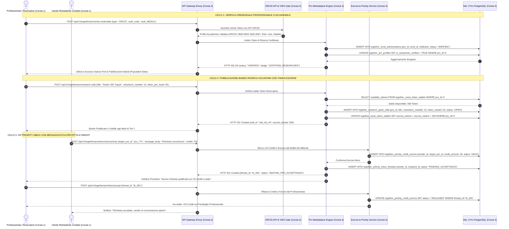

# Capitolato Tecnico: Flow TS2 – Together Pro Marketplace: Verifica P.IVA / ORCID, Stanze Networking Pari, Bandi Ricerca & VIP Priority Inbox

## 1. Identificativo & Titolo Ufficiale
- **Badge Miro Board:** `#21` / `#TS2` (Shape ID: `3458764690918929312`, Posizione LIVE: `X: 12500, Y: 3790`, Nodi ISO: `16`)
- **Codice Univoco:** `FLOW-TS2`
- **Titolo Formale:** COMPANION APPS (PRO NETWORKING & MARKETPLACE) - FLOW TS2: TOGETHER PRO MARKETPLACE - VERIFICA P.IVA / ORCID, STANZE NETWORKING PARI, BANDI RICERCA & VIP PRIORITY INBOX
- **Board Miro Online:** `uXjVEbo6L2o=` (Zona Companion Apps: Ecosistema Together Pro B2B & Ricerca)
- **Diagramma Sorgente:** [flow-ts2-together-pro-marketplace.mmd](../02-miro-zones-and-swimlanes/18-flowcharts/software-companion-together/flow-ts2-together-pro-marketplace.mmd)
- **Riferimento Glossario:** [Glossario Tecnico Vivente](00-GLOSSARIO-TERMINI-TECNICI.md) (Voci: [ORCID Researcher Verification](00-GLOSSARIO-TERMINI-TECNICI.md#orcid-researcher-verification), [VIP Priority Inbox Anti-Spam](00-GLOSSARIO-TERMINI-TECNICI.md#vip-priority-inbox-anti-spam), [Soggetto Volontario Cavia Tokenomics](00-GLOSSARIO-TERMINI-TECNICI.md#soggetto-volontario-cavia-tokenomics), [VIES & Sistema di Interscambio (SDI)](00-GLOSSARIO-TERMINI-TECNICI.md#vies-sistema-di-interscambio-sdi), [Commissione Scientifica T7 (Peer-Review Community)](00-GLOSSARIO-TERMINI-TECNICI.md#commissione-scientifica-t7-peer-review-community), [API Gateway & Feature Gating](00-GLOSSARIO-TERMINI-TECNICI.md#api-gateway-feature-gating), [3 Silos Database (Multi-Tenant Data Isolation)](00-GLOSSARIO-TERMINI-TECNICI.md#3-silos-database-multi-tenant-data-isolation)).
- **Nota di Governance & Isolamento B2B:** Together Pro Marketplace opera come Companion App B2B su partizione dedicata Silo 1 Pro. L'accesso alle stanze tra pari e la pubblicazione dei bandi di ricerca sono vincolati al controllo fiscale preventivo (Partita IVA attiva con codice ATECO sportivo/sanitario tramite VIES o Agenzia delle Entrate) o all'autenticazione accademica tramite protocollo OAuth ORCID. E tassativamente vietato il transito o l'archiviazione di cartelle cliniche EMR, anamnesi individuali o referti diagnostici (presidiati nel Silo 2 Bunker KMS).

---

## 2. Obiettivo di Business & Target Utente

### Guida Pratica per Non Tecnici: Cos'e questo modulo per un umano?
Per i preparatori atletici, i chinesiologi, i fisioterapisti e i ricercatori universitari e sempre piu difficile trovare spazi professionali autentici. Sui social generici chiunque puo definirsi "esperto" senza alcuna qualifica reale, i professionisti seri vengono inondati ogni giorno da messaggi di spam o richieste superficiali, e quando un ricercatore ha bisogno di atleti volontari per convalidare un nuovo protocollo scientifico deve affidarsi al passaparola o a bacheche cartacee universitarie.  
**Together Pro Marketplace** e l'ambiente professionale dedicato che risolve queste criticita:
- **Verifica Rigorosa all'Ingresso:** per accedere non basta un'email, ma serve una Partita IVA attiva verificata (VIES/ATECO) oppure un profilo accademico ufficiale (ORCID ID) che certifichi pubblicazioni o affiliazioni universitarie;
- **Stanze di Networking tra Pari:** tavoli di confronto orizzontali e riservati dove solo professionisti dello stesso livello possono discutere di metodologie di allenamento, prevenzione infortuni, protocolli VBT o nutrizione clinica, senza intrusioni di curiosi o venditori aggressivi;
- **Pubblicazione Bandi per Volontari di Ricerca:** professori, tesisti e preparatori possono pubblicare bandi etici per trovare soggetti volontari (atleti amatoriali di Tier 1), offrendo in cambio Token Cavia per remunerare il loro impegno e tempo;
- **VIP Priority Inbox Anti-Spam (Add-on Networking Avanzato 15,00 euro/mese):** una casella di posta professionale intelligente dove chi desidera contattare un professionista affermato per una consulenza o una proposta di collaborazione deve depositare un piccolo numero di crediti; se il professionista accetta la richiesta, i crediti vengono accreditati, altrimenti vengono rimborsati. In questo modo sparisce il disturbo inutile e resta solo il valore concreto.

### Specifiche di Business & Metriche
- **Target Utente:** Preparatori atletici con P.IVA, fisioterapisti, biologi nutrizionisti, docenti di scienze motorie, dottorandi e ricercatori universitari accreditati (Tier 2 Pro).
- **Problema Risolto:** Mancanza di qualificazione professionale nei social network, saturazione da spam nelle comunicazioni dirette e carenza di canali strutturati per il reclutamento di soggetti per la ricerca scientifica.
- **Stato Gap Analysis (Regola 10):** Arancione (`#e67e22` - Nuovo modulo Companion App da orchestrare su partizione Silo 1 Pro).
- **Metriche Chiave (KPI):**
  - Tempo di verifica automatica P.IVA / ORCID OAuth: $< 2.5\text{ s}$ p95;
  - Riduzione dello spam non qualificato nella Priority Inbox: $> 96\%$ rispetto ai canali aperti tradizionali;
  - Tasso di risposta a richieste con crediti prioritari: $> 88\%$ entro 48 ore;
  - Tempo medio di completamento quota volontari per bando accademico: $< 5\text{ giorni}$;
  - Integrita dei dati: $100\%$ separazione rispetto ai dati sanitari o di telemetria grezza.

---

## 3. Attori & Architettura a 4 Corsie (Swimlanes)

1. **Corsia 1: Thin Client UI/UX (Together Pro Marketplace PWA React 18):**
   - Dashboard Professionale: panoramica delle stanze di networking attive, bandi di ricerca pubblicati e saldo crediti inbox;
   - Modulo di Verifica Credenziali: interfaccia di inserimento P.IVA/Codice ATECO con convalida istantanea o pulsante di login federato ORCID;
   - Stanze Networking Pari: visualizzatore di tavole rotonde audio/video WebRTC e chat crittografata con moderazione peer-to-peer;
   - Portale Bandi di Ricerca: procedura guidata di creazione bando con criteri di inclusione atletica e allocazione token premio;
   - VIP Priority Inbox UI: casella messaggi con etichette di priorita, anteprima compensi e opzioni rapide Accetta/Rifiuta/Rimborsa.
2. **Corsia 2: API Gateway & Envoy Identity Verifier (Corsia 2):**
   - Autenticazione JWT multi-tenant (`sub: pro_uuid`, `tier: PRO_TIER2`, `roles: [VERIFIED_COACH | RESEARCHER]`);
   - Interceptor per la verifica delle chiamate esterne: bridge sicuro verso il registro europeo VIES SOAP e le API REST OAuth 2.0 di ORCID;
   - Enforcement del controllo di ruolo: blocco immediato (HTTP `403 Forbidden`) per utenti privi di P.IVA attiva o profilo ORCID convalidato.
3. **Corsia 3: Server Scatola Nera (Together Pro Engine & Escrow Manager - Cloud Run):**
   - **Credential Verification Service:** orchestratore asincrono di verifica partita IVA e decodifica claim accademici ORCID;
   - **Peer Room Dispatcher:** server di segnalazione e coordinamento canali WebRTC a stanze chiuse riservate a professionisti accreditati;
   - **Research Grant Dispatcher:** motore di sincronizzazione bandi che espone le opportunita sulla bacheca Cavia di Tier 1 e gestisce le candidature;
   - **Priority Escrow Service:** gestore delle micro-transazioni di crediti, custodia in escrow e liquidazione o rimborso automatico.
4. **Corsia 4: Database Tripartito (Silo 1 Pro - PostgreSQL Partition):**
   - Tabelle dedicate: `together_pro_profiles`, `together_pro_credentials`, `together_orcid_authorizations`, `together_peer_networking_rooms`, `together_peer_room_participants`, `together_research_grant_calls`, `together_priority_inbox_threads`, `together_priority_credit_escrow`;
   - Isolamento totale: nessun dato di networking o transazione tocca le partizioni riservate Silo 2 (Bunker KMS) ne il Silo 3 (Research Warehouse).

---

### Sequence Diagram Asincrono del Ciclo di Vita (FLOW-TS2)



---

## 4. Flusso Passo-Passo

### Livello A: Guida Operativa & User Journey Narrativo
1. **Accesso e Autenticazione Professionale:** L'utente entra in Together Pro Marketplace. Se non ha ancora convalidato la propria posizione, trova una schermata chiara che lo invita a collegare la Partita IVA oppure a effettuare il login con il proprio account accademico ORCID.
2. **Convalida Automatica delle Credenziali:** In meno di 3 secondi, il sistema contatta i registri ufficiali: verificata la validita della P.IVA o l'affiliazione universitaria, assegna al profilo il badge di "Professionista Verificato" o "Ricercatore Accreditato".
3. **Partecipazione alle Stanze di Networking tra Pari:** Con le credenziali convalidate, il professionista puo accedere a tavoli tematici orizzontali (es. "Fisioterapia e Ritorno allo Sport", "Periodizzazione nel Powerlifting", "Protocolli di Ipertrofia"). L'ambiente e protetto e privo di curiosi o venditori ambulanti di corsi.
4. **Creazione di un Bando di Ricerca per Volontari:** Il ricercatore o preparatore compila un modulo snello indicando l'obiettivo dello studio (es. misurazione della velocita della barra tramite VBT), i criteri di inclusione (es. atleti con almeno 2 anni di anzianita di allenamento) e il numero di Token Cavia riconosciuti a ciascun partecipante.
5. **Deposito dei Token in Garanzia (Escrow):** Per tutelare gli atleti amatoriali, il sistema trattiene temporaneamente i token previsti dal portafoglio del ricercatore; i token saranno erogati automaticamente ai volontari solo a conclusione dei test.
6. **Gestione della VIP Priority Inbox:** Il professionista visualizza i messaggi in arrivo filtrati. I messaggi inviati da utenti esterni tramite la modalita prioritaria mostrano chiaramente la ricompensa in crediti offerta per il disturbo; il professionista puo decidere di accettare aprendo la chat oppure declinare restituendo i crediti al mittente.
7. **Monetizzazione e Reputazione Professionale:** I crediti accumulati dalle risposte prioritarie e dalle consulenze possono essere reinvestiti in corsi di aggiornamento, servizi della piattaforma o convertiti in sconti su abbonamenti avanzati.

#### Tabella KPI di Accettazione Operativa

| Metrica / Parametro KPI | Obiettivo Target | Tolleranza Accettabile | Azione Fallback / Allerta |
| :--- | :--- | :--- | :--- |
| **Tempo Verifica Fiscale VIES / ATECO** | $< 2.0\text{ s}$ | $\le 4.5\text{ s}$ | Coda asincrona con stato In Lavorazione |
| **Tempo Validazione OAuth ORCID** | $< 1.5\text{ s}$ | $\le 3.0\text{ s}$ | Token di riprova con reindirizzamento manuale |
| **Abbattimento Spam in Priority Inbox** | $> 96\%$ | $\ge 90\%$ | Incremento dinamico della tariffa base crediti |
| **Latenza Notifica Richiesta Prioritaria** | $< 300\text{ ms}$ | $\le 800\text{ ms}$ | Invio tramite Web Push di riserva |
| **Rilascio Automatico Escrow a Fine Bando** | $< 1.0\text{ s}$ | $\le 2.5\text{ s}$ | Rollback transazionale con avviso all'amministratore |

---

### Livello B: Deep-Dive Tecnico per Sviluppatori

- **Allineamento 1:1 ai 16 Nodi ISO (`FLOW-TS2`):**
  1. `START_TS2` (Corsia 1): Inizio: Accesso del professionista a Together Pro Marketplace.
  2. `UI_PRO_SHOWCASE` (Corsia 1): Dashboard B2B con stato credenziali, stanze attive, bandi aperti e inbox protetta.
  3. `DEC_PRO_ACTION` (Corsia 1 - Rombo): Selezione azione: Entra in Stanza, Crea Bando, Gestisci Priority Inbox.
  4. `UI_PEER_ROOMS` (Corsia 1): Elenco stanze tematiche tra pari con contatore partecipanti ed etichette di competenza.
  5. `UI_CALL_PUBLISH` (Corsia 1): Interfaccia di composizione bandi accademici con requisiti inclusione e calcolo escrow.
  6. `UI_VIP_INBOX` (Corsia 1): Casella di posta asimmetrica a micro-crediti con anteprima compenso e filtri reputazionali.
  7. `GW_PRO_INGRESS` (Corsia 2): Ricezione richieste REST su `/api/v1/together/pro/*`.
  8. `DEC_VERIFY_GATE` (Corsia 2 - Rombo): Verifica JWT Tier 2 Pro e validita certificazione P.IVA o ORCID ID.
  9. `GW_ERR_DENIED` (Corsia 2): Risposta bloccante HTTP `403 Forbidden` per utenti privi di P.IVA attiva o profilo ORCID convalidato.
  10. `SRV_VERIFY_ENGINE` (Corsia 3): Servizio asincrono di interrogazione registri VIES / ATECO e scambio token OAuth ORCID.
  11. `SRV_PRESCREEN_ENGINE` (Corsia 3): Motore di pre-screening criteri di inclusione atleti volontari per bandi di ricerca.
  12. `SRV_INBOX_SPAM_SHIELD` (Corsia 3): Gestore micro-transazioni crediti inbox e custodia transitoria escrow anti-spam.
  13. `SRV_BRIDGE_COL5` (Corsia 3): Connettore sincrono per consultazione e indicizzazione evidenze da Libreria Fonti (#11).
  14. `DB_SILO1_PRO_REG` (Corsia 4 - Cilindro): Persistenza profili professionali e autorizzazioni su Silo 1 Pro.
  15. `DB_SILO1_RESEARCH_INBOX` (Corsia 4 - Cilindro): Persistenza bandi, candidature e thread inbox protetti su Silo 1 Pro.
  16. `END_FLOW` (Corsia 4): Fine: operazione professionale registrata con tracciamento contabile e conformita normativa.
- **Zero Logica Proprietaria sul Client (IP Isolation):** Le formule di assegnazione punteggio di affinita nelle stanze, la logica di svincolo dei crediti in escrow e i protocolli di validazione delle chiavi crittografiche risiedono interamente sul backend (Cloud Run).
- **Isolamento Rigoroso dei Database:** Silo 1 Pro gestisce esclusivamente le identita professionali, i metadati dei bandi e i crediti inbox. Nessun dato clinico, cartella sanitaria o test massimale riservato (Silo 2 Bunker KMS) viene memorizzato o scambiato in questo modulo.

---

## 5. Rami Decisionali & Gestione Errori

### Matrice dei Rami Decisionali

| Bivio Decisionale | Condizione Logica | Ramo SI / Positivo | Ramo NO / Negativo |
| :--- | :--- | :--- | :--- |
| `GW_IDENTITY_DEC` | L'utente possiede un token JWT con ruolo Tier 2 e certificazione P.IVA o ORCID valida? | Instrada la richiesta verso i servizi di Corsia 3 | Risponde con HTTP `403 Forbidden` (`PRO_CREDENTIAL_REQUIRED`) |
| `CREDENTIAL_CHECK_DEC`| La P.IVA risulta attiva nel registro VIES / ATECO o l'ORCID ID e confermato con ente accademico? | Rilascia il badge Verificato e aggiorna il profilo in Silo 1 | Rigetta con HTTP `422 Unprocessable Entity` motivando l'irregolarita fiscale |
| `PRIORITY_INBOX_DEC` | Il destinatario accetta la richiesta di contatto entro la finestra temporale di 72 ore? | Trasferisce i crediti dall'escrow al wallet del professionista e apre la chat | Rimborsa integralmente i crediti al mittente e archivia la richiesta |
| `RESEARCH_QUOTA_DEC` | Il ricercatore ha depositato l'ammontare complessivo dei Token Cavia per i volontari previsti? | Pubblica il bando nella bacheca visibile agli atleti amatoriali | Blocca la pubblicazione richiedendo la ricarica del borsellino token |

### Gestione Obbligatoria dei 4 Stati UI

| Stato UI | Condizione Scatenante | Elementi Visibili a Schermo | Azione Utente Permessa |
| :--- | :--- | :--- | :--- |
| **Empty State** | Profilo appena registrato, nessuna credenziale collegata, zero stanze seguite | Banner di orientamento professionale, pulsanti per collegare P.IVA o ORCID, guida ai vantaggi della Priority Inbox | Avvio procedura di verifica fiscale o accademica |
| **Loading State** | Interrogazione registri VIES in corso, generazione token escrow, sincronizzazione stanze | Skeleton loader con indicatore di progresso certificazione e disabilitazione tasti di conferma | Attesa risposta server o annullamento richiesta |
| **Populated State** | Credenziali convalidate, stanze attive accessibili, elenco bandi compilato, messaggi inbox visibili | Badge Verified Pro/Researcher a schermo, card stanze con colleghi online, thread inbox con crediti evidenziati | Ingresso in stanza, pubblicazione bando, risposta ai messaggi prioritari |
| **Error / Fallback State** | Partita IVA inattiva, errore comunicazione VIES/ORCID, saldo crediti insufficiente | Messaggio d'errore trasparente con indicazione della discrepanza rilevata dai registri | Correzione dei dati inseriti, riprova del collegamento OAuth o ricarica crediti |

---

## 6. Contratti Dati JSON & Matrice Errori HTTP

### Contratto Verifica Credenziali ORCID / P.IVA (`POST /api/v1/together/pro/verify-credentials`)
```http
POST /api/v1/together/pro/verify-credentials
Authorization: Bearer <jwt_together_pro_token>
Content-Type: application/json
```
```json
{
  "verification_mode": "ORCID_OAUTH",
  "orcid_authorization_code": "code_orcid_auth_882910fa",
  "stated_institution_name": "Universita degli Studi di Roma Foro Italico",
  "stated_department": "Scienze Motorie, Umane e della Salute"
}
```
```json
{
  "verification_reference": "ver_orcid_991823",
  "verification_status": "CONFIRMED",
  "orcid_profile": {
    "orcid_id": "0000-0002-1825-0097",
    "researcher_full_name": "Prof. Marco Bianchi",
    "verified_institution": "Universita degli Studi di Roma Foro Italico",
    "peer_review_count": 14,
    "last_synced_at_utc": "2026-11-20T17:10:00Z"
  },
  "assigned_badge": "CERTIFIED_RESEARCHER",
  "unlocked_features": ["PEER_ROOMS_ACCESS", "POST_RESEARCH_GRANTS", "VIP_PRIORITY_INBOX"]
}
```

### Contratto Pubblicazione Bando di Ricerca Volontari (`POST /api/v1/together/pro/research-calls`)
```http
POST /api/v1/together/pro/research-calls
Authorization: Bearer <jwt_together_pro_token>
Content-Type: application/json
```
```json
{
  "title": "Valutazione dell'Affaticamento Neuromuscolare nel Velocity-Based Training",
  "academic_context": "Tesi Magistrale in Teoria e Metodologia dell'Allenamento",
  "volunteers_requested_count": 12,
  "token_reward_per_volunteer": 75,
  "athlete_eligibility_criteria": {
    "min_training_age_years": 2,
    "primary_discipline": "RESISTANCE_TRAINING",
    "test_duration_minutes": 90,
    "testing_location": "Laboratorio Biomeccanica Foro Italico - Roma"
  }
}
```
```json
{
  "grant_call_id": "call_vbt_fatigue_2026_01",
  "status": "ACTIVE_PUBLISHED",
  "escrow_tokens_locked": 900,
  "cavia_board_url": "https://together.t7workout.app/cavia/calls/call_vbt_fatigue_2026_01",
  "candidates_count": 0,
  "created_at_utc": "2026-11-20T17:15:22Z"
}
```

### Contratto Invio Messaggio Priority Inbox con Crediti (`POST /api/v1/together/pro/inbox/send-priority`)
```http
POST /api/v1/together/pro/inbox/send-priority
Authorization: Bearer <jwt_together_sender_token>
Content-Type: application/json
```
```json
{
  "recipient_pro_id": "pro_marco_bianchi_991823",
  "priority_credits_offered": 25,
  "inquiry_subject": "Richiesta consulenza su protocollo riabilitativo ginocchio",
  "message_body": "Gentile Professore, vorrei concordare una revisione metodologica a pagamento per una scheda di rientro in campo."
}
```
```json
{
  "priority_thread_id": "th_pri_8819203",
  "escrow_hold_id": "esc_hold_25cred_441",
  "thread_status": "PENDING_RECIPIENT_DECISION",
  "auto_refund_deadline_utc": "2026-11-23T17:20:00Z",
  "notice": "I tuoi 25 crediti rimarranno bloccati in garanzia. Se il professionista non accetta entro 72 ore, saranno rimborsati al 100%."
}
```

### Schema Relazionale (Database Silo 1 Pro - PostgreSQL)

```sql
-- TABELLA PROFILI PROFESSIONALI TOGETHER PRO
CREATE TABLE together_pro_profiles (
    pro_id UUID PRIMARY KEY DEFAULT gen_random_uuid(),
    professional_title VARCHAR(128) NOT NULL,
    vat_number VARCHAR(32) UNIQUE,
    ateco_code VARCHAR(16),
    is_vat_verified BOOLEAN NOT NULL DEFAULT FALSE,
    is_researcher_verified BOOLEAN NOT NULL DEFAULT FALSE,
    priority_inbox_enabled BOOLEAN NOT NULL DEFAULT TRUE,
    base_inbox_credit_fee INTEGER NOT NULL DEFAULT 15 CHECK (base_inbox_credit_fee >= 5),
    reputation_score INTEGER NOT NULL DEFAULT 500,
    created_at TIMESTAMPTZ NOT NULL DEFAULT NOW()
);

-- TABELLA AUTORIZZAZIONI ACCADEMICHE ORCID
CREATE TABLE together_orcid_authorizations (
    auth_id UUID PRIMARY KEY DEFAULT gen_random_uuid(),
    pro_id UUID NOT NULL REFERENCES together_pro_profiles(pro_id) ON DELETE CASCADE,
    orcid_id VARCHAR(32) NOT NULL UNIQUE,
    researcher_full_name VARCHAR(128) NOT NULL,
    verified_institution VARCHAR(255) NOT NULL,
    access_token_encrypted TEXT NOT NULL,
    token_expires_at TIMESTAMPTZ NOT NULL,
    created_at TIMESTAMPTZ NOT NULL DEFAULT NOW()
);

-- TABELLA STANZE NETWORKING TRA PARI
CREATE TABLE together_peer_networking_rooms (
    room_id UUID PRIMARY KEY DEFAULT gen_random_uuid(),
    title VARCHAR(128) NOT NULL,
    thematic_category VARCHAR(64) NOT NULL,
    moderator_pro_id UUID NOT NULL REFERENCES together_pro_profiles(pro_id),
    is_active BOOLEAN NOT NULL DEFAULT TRUE,
    max_concurrent_peers INTEGER NOT NULL DEFAULT 20 CHECK (max_concurrent_peers BETWEEN 2 AND 50),
    created_at TIMESTAMPTZ NOT NULL DEFAULT NOW()
);

-- TABELLA PARTECIPANTI STANZE TRA PARI
CREATE TABLE together_peer_room_participants (
    participant_id UUID PRIMARY KEY DEFAULT gen_random_uuid(),
    room_id UUID NOT NULL REFERENCES together_peer_networking_rooms(room_id) ON DELETE CASCADE,
    pro_id UUID NOT NULL REFERENCES together_pro_profiles(pro_id) ON DELETE CASCADE,
    webrtc_peer_id VARCHAR(128) NOT NULL,
    joined_at TIMESTAMPTZ NOT NULL DEFAULT NOW(),
    left_at TIMESTAMPTZ
);
CREATE INDEX idx_peer_room_active ON together_peer_room_participants (room_id, left_at);

-- TABELLA BANDI DI RICERCA ACCADEMICA (VOLONTARI)
CREATE TABLE together_research_grant_calls (
    grant_call_id UUID PRIMARY KEY DEFAULT gen_random_uuid(),
    pro_id UUID NOT NULL REFERENCES together_pro_profiles(pro_id) ON DELETE CASCADE,
    call_title VARCHAR(255) NOT NULL,
    academic_context TEXT NOT NULL,
    volunteers_needed INTEGER NOT NULL CHECK (volunteers_needed > 0),
    volunteers_confirmed INTEGER NOT NULL DEFAULT 0,
    token_reward_per_head INTEGER NOT NULL CHECK (token_reward_per_head > 0),
    total_tokens_escrowed INTEGER NOT NULL,
    call_status VARCHAR(32) NOT NULL DEFAULT 'OPEN' CHECK (call_status IN ('OPEN', 'FULL', 'COMPLETED', 'CANCELLED')),
    created_at TIMESTAMPTZ NOT NULL DEFAULT NOW()
);

-- TABELLA THREAD VIP PRIORITY INBOX
CREATE TABLE together_priority_inbox_threads (
    thread_id UUID PRIMARY KEY DEFAULT gen_random_uuid(),
    sender_user_id UUID NOT NULL,
    recipient_pro_id UUID NOT NULL REFERENCES together_pro_profiles(pro_id) ON DELETE CASCADE,
    subject VARCHAR(255) NOT NULL,
    initial_message TEXT NOT NULL,
    status VARCHAR(32) NOT NULL DEFAULT 'PENDING' CHECK (status IN ('PENDING', 'ACCEPTED', 'DECLINED', 'EXPIRED')),
    created_at TIMESTAMPTZ NOT NULL DEFAULT NOW(),
    expires_at TIMESTAMPTZ NOT NULL DEFAULT NOW() + INTERVAL '72 hours'
);

-- TABELLA TRANSAZIONI CREDITI IN ESCROW
CREATE TABLE together_priority_credit_escrow (
    escrow_id UUID PRIMARY KEY DEFAULT gen_random_uuid(),
    thread_id UUID NOT NULL REFERENCES together_priority_inbox_threads(thread_id) ON DELETE CASCADE,
    sender_wallet_id UUID NOT NULL,
    recipient_pro_id UUID NOT NULL REFERENCES together_pro_profiles(pro_id),
    credit_amount INTEGER NOT NULL CHECK (credit_amount > 0),
    escrow_status VARCHAR(32) NOT NULL DEFAULT 'HELD' CHECK (escrow_status IN ('HELD', 'RELEASED', 'REFUNDED')),
    resolved_at TIMESTAMPTZ,
    created_at TIMESTAMPTZ NOT NULL DEFAULT NOW()
);
```

### Matrice Errori HTTP a 6 Colonne

| Codice HTTP | Errore Interno | Condizione Scatenante | Risposta Client | Azione Automatica Client | Ripristino Utente |
| :--- | :--- | :--- | :--- | :--- | :--- |
| `400 Bad Request` | `INVALID_ATECO_FORMAT` | Codice ATECO inviato non corrispondente ai formati fiscali ufficiali | `{"error": "Formato del codice ATECO non valido per la verifica fiscale"}` | Evidenzia il campo del codice ATECO in rosso | Reinserire il codice ATECO a 6 cifre corretto |
| `401 Unauthorized` | `PRO_SESSION_EXPIRED` | Token JWT Pro non valido, alterato o sessione scaduta | `{"error": "Sessione professionale scaduta, effettua nuovamente l'accesso"}` | Reindirizza al portale di autenticazione professionale | Effettuare nuovamente il login con le credenziali Pro |
| `403 Forbidden` | `PRO_CREDENTIAL_REQUIRED` | Tentativo di accesso a stanze tra pari o bandi senza P.IVA o ORCID validato | `{"error": "Funzionalità riservata a professionisti con P.IVA o ORCID certificato"}` | Blocca la navigazione e apre il modulo di verifica credenziali | Completare la verifica della Partita IVA o dell'account ORCID |
| `404 Not Found` | `PRO_PROFILE_NOT_FOUND` | Il profilo professionale selezionato per la Priority Inbox non esiste | `{"error": "Professionista non trovato o profilo disattivato"}` | Ricarica l'elenco dei professionisti accreditati | Selezionare un altro professionista attivo |
| `409 Conflict` | `ORCID_ALREADY_LINKED` | L'ID ORCID indicato e gia associato a un altro profilo registrato | `{"error": "Questo account ORCID è già collegato a un altro professionista"}` | Annulla la procedura di collegamento dell'identita | Verificare le credenziali o contattare il supporto accademico |
| `422 Unproc Entity` | `INSUFFICIENT_ESCROW_FUNDS` | Saldo token o crediti insufficiente per coprire l'escrow del bando o messaggio | `{"error": "Saldo insufficiente per garantire l'ammontare in escrow"}` | Mostra la finestra di ricarica crediti o borsellino token | Ricaricare il portafoglio prima di pubblicare il bando |
| `429 Too Many Req` | `PRIORITY_INBOX_SPAM_DETECT` | Invio di oltre 10 richieste di contatto prioritario in meno di 5 minuti | `{"error": "Frequenza di contatto troppo elevata: attendi qualche minuto"}` | Blocca temporaneamente il pulsante di invio richiesta | Attendere il ripristino della finestra temporale |
| `503 Service Unav` | `ORCID_GATEWAY_DOWN` | Temporanea indisponibilita dei server OAuth di ORCID o del registro VIES | `{"error": "Server di certificazione esterni momentaneamente non raggiungibili"}` | Mostra lo stato di attesa con retry automatico esponenziale | Riprovare la verifica tra qualche minuto |

---

## 7. Ereditarieta di Tier & Sblocco Funzionalita a Cascata (Integrazione Ecosistema T7)

- **Posizionamento Architetturale di Together Pro Marketplace:** Together Pro Marketplace opera come **Companion App professionale autonoma**, concepita per facilitare il networking qualificato tra pari, tutelare i professionisti dallo spam e coordinare la ricerca scientifica sul campo, ospitata sulla partizione **Silo 1 Pro (Public, Social & Professional Marketplace)**.
- **Integrazione con T7 Coach Hub (`#08`) e Libreria Fonti (`#11`):**
  - I professionisti che completano la verifica ORCID possono associare i propri paper accademici alla Libreria Fonti (#11), sottomettendoli direttamente alla Commissione Scientifica T7 per la convalida comunitaria;
  - I coach possono connettersi con altri colleghi per scambiare template di allenamento non vincolati a dati dei clienti, senza violare la privacy dell'atleta.
- **Isolamento Rigoroso da Silo 2 (Bunker KMS) e Silo 3 (Research Warehouse):**
  - Nessun dato transitante nel Marketplace Pro puo accedere o rivelare l'esistenza di cartelle cliniche EMR, valutazioni posturali protette da segreto medico o dati telemetrici grezzi di squadra, garantendo conformita integrale al GDPR Art. 9.
- **Sinergia Circolare con Together B2C Community (`#20` / `FLOW-TS1`):**
  - I bandi di ricerca pubblicati in questo modulo vengono proiettati istantaneamente sulla bacheca Cavia di Tier 1, consentendo la raccolta rapida e controllata di campioni statistici amatoriali e remunerando gli atleti con Token Cavia garantiti da deposito cauzionale escrow.
