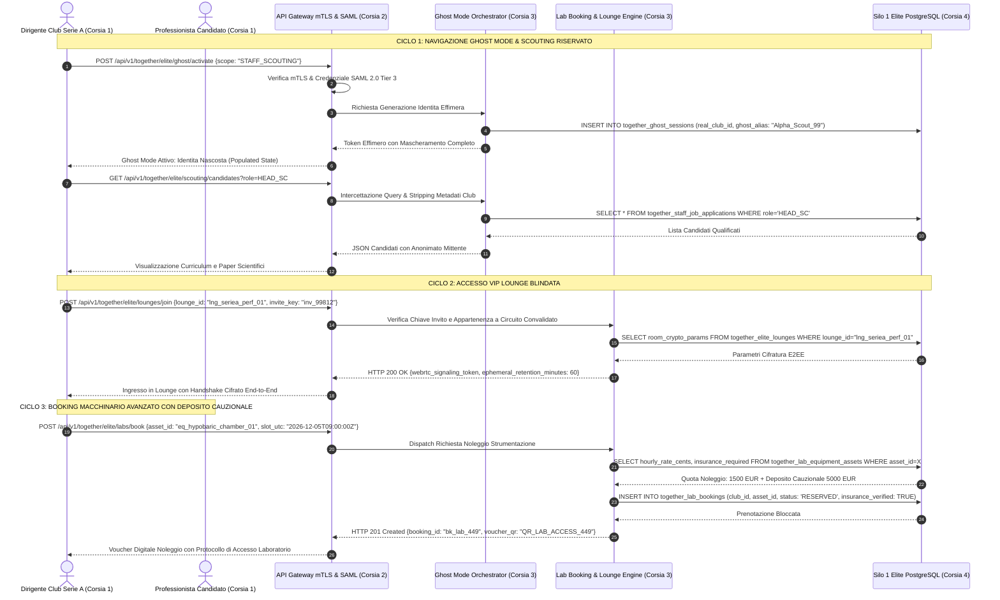

# Capitolato Tecnico: Flow TS3 – Together Elite Lounges & Labs: Lounges Blindate, Profilo Oscurato Ghost Mode, Booking Macchinari Avanzati & Staff Recruiting

## 1. Identificativo & Titolo Ufficiale
- **Badge Miro Board:** `#22` / `#TS3` (Shape ID: `3458764690918929317`, Posizione LIVE: `X: 12500, Y: 8230`, Nodi ISO: `16`)
- **Codice Univoco:** `FLOW-TS3`
- **Titolo Formale:** COMPANION APPS (ELITE & RESEARCH NETWORKING) - FLOW TS3: TOGETHER ELITE LOUNGES & LABS - LOUNGES BLINDATE, PROFILO OSCURATO GHOST MODE, BOOKING MACCHINARI AVANZATI & STAFF RECRUITING
- **Board Miro Online:** `uXjVEbo6L2o=` (Zona Companion Apps: Ecosistema Together Elite & Bunker Research)
- **Diagramma Sorgente:** [flow-ts3-together-elite-lounges-labs.mmd](../02-miro-zones-and-swimlanes/18-flowcharts/software-companion-together/flow-ts3-together-elite-lounges-labs.mmd)
- **Riferimento Glossario:** [Glossario Tecnico Vivente](00-GLOSSARIO-TERMINI-TECNICI.md) (Voci: [VIP & Elite Lounges](00-GLOSSARIO-TERMINI-TECNICI.md#vip-elite-lounges), [Booking Macchinari e Laboratori Avanzati](00-GLOSSARIO-TERMINI-TECNICI.md#booking-macchinari-e-laboratori-avanzati), [Staff Recruiting & Scouting Board](00-GLOSSARIO-TERMINI-TECNICI.md#staff-recruiting-scouting-board), [SAML 2.0 Enterprise Federation & Single Sign-On](00-GLOSSARIO-TERMINI-TECNICI.md#saml-20-enterprise-federation-single-sign-on), [API Gateway & Feature Gating](00-GLOSSARIO-TERMINI-TECNICI.md#api-gateway-feature-gating), [3 Silos Database (Multi-Tenant Data Isolation)](00-GLOSSARIO-TERMINI-TECNICI.md#3-silos-database-multi-tenant-data-isolation)).
- **Nota di Governance & Segreto Professionale:** Together Elite Lounges & Labs opera come estensione riservata a franchigie professionistiche di massima serie (Serie A, Eurolega, Champions League, Premier League, NBA) e poli universitari di eccellenza, collocata sulla partizione Silo 1 Elite. E fatto divieto categorico di collegare o esporre le cartelle cliniche EMR dei tesserati o i dati di telemetria proprietari (custoditi nell'enclave Silo 2 Bunker KMS) o il data warehouse grezzo (Silo 3). La modalita Profilo Oscurato (Ghost Mode) applica pseudonimizzazione crittografica unidirezionale per impedire fughe di notizie e speculazioni di mercato durante lo scouting del personale tecnico.

---

## 2. Obiettivo di Business & Target Utente

### Guida Pratica per Non Tecnici: Cos'e questo modulo per un umano?
Nel mondo dello sport di altissimo livello, la riservatezza e tutto. I direttori sportivi, i medici sociali e i responsabili della preparazione atletica delle grandi squadre non possono utilizzare i canali social convenzionali o i portali di lavoro pubblici per cercare nuovi collaboratori, scambiare pareri su macchinari all'avanguardia o organizzare sessioni di test: ogni loro interazione pubblica attirerebbe subito l'attenzione dei media, scatenando speculazioni di mercato o allertando le squadre rivali.  
Allo stesso tempo, molte universita e cliniche di eccellenza possiedono macchinari scientifici straordinari (come camere climatiche ipobariche, pedane di forza triassiali AMTI o dinamometri isocinetici da centinaia di migliaia di euro) che restano spesso inutilizzati, mentre i club professionistici ne avrebbero disperato bisogno per brevi periodi senza volerli acquistare.  
**Together Elite Lounges & Labs** e la bolla di massima sicurezza creata per soddisfare queste esigenze:
- **VIP & Elite Lounges Blindate:** stanze di confronto digitali ad accesso ultra-ristretto, accessibili solo tramite inviti convalidati e crittografia di livello bancario. Dirigenti e staff possono discutere di casi metodologici complessi e innovazioni in totale tranquillita;
- **Profilo Oscurato (Ghost Mode):** la possibilita per una societa di vertice di navigare tra i profili, esaminare candidature e valutare professionisti rimanendo totalmente invisibile. L'identita del club viene svelata al candidato soltanto quando la dirigenza decide formalmente di avviare il colloquio;
- **Booking di Laboratori e Macchinari Avanzati:** un servizio esclusivo di noleggio orario o giornaliero che permette ai club di prenotare strumentazioni scientifiche e laboratori universitari convenzionati, con gestione digitale dei contratti e delle coperture assicurative;
- **Bacheca Recruiting & Scouting Staff:** il punto d'incontro ufficiale tra le squadre d'élite e i migliori preparatori, fisioterapisti, video analisti e sport scientist al mondo, con verifica rigorosa dei titoli, dei paper pubblicati e dell'esperienza documentata.

### Specifiche di Business & Metriche
- **Target Utente:** Dirigenti sportivi di franchigie professionistiche (Tier 3), Head Strength & Conditioning Coach, Medici Sociali, Direttori di Centri di Ricerca e Specialisti dello sport d'élite.
- **Problema Risolto:** Fughe di notizie nelle trattative di staff, assenza di ambienti riservati per il networking tra vertici sportivi e sottoutilizzo di infrastrutture scientifiche ad altissimo costo.
- **Stato Gap Analysis (Regola 10):** Arancione (`#e67e22` - Nuovo modulo Companion App da orchestrare su partizione Silo 1 Elite).
- **Metriche Chiave (KPI):**
  - Impenetrabilita crittografica Ghost Mode: $100\%$ anonimato verso utenti esterni prima del match formale;
  - Latenza handshake crittografico nelle VIP Lounges: $< 350\text{ ms}$;
  - Tempo medio di conferma prenotazione laboratorio e blocco slot: $< 60\text{ s}$;
  - Accuratezza verifica titoli accademici/sportivi nello staff scouting: $100\%$ controllo preventivo anti-frode;
  - Isolamento Silo 2/3: $100\%$ garanzia di zero contaminazione dei dati clinici e telemetrici del club.

---

## 3. Attori & Architettura a 4 Corsie (Swimlanes)

1. **Corsia 1: Thin Client UI/UX (Together Elite PWA React 18):**
   - Toggle Ghost Mode: comando visivo rapido per attivare o disattivare la navigazione invisibile con generazione pseudonimo effimero;
   - Portale VIP Lounges: interfaccia di conference crittografata end-to-end con cancellazione automatica dei messaggi di testo (ephemeral chat);
   - Vetrina & Calendario Booking Macchinari: catalogo dettagliato delle apparecchiature avanzate con specifiche tecniche, requisiti operatori e slot orari;
   - Staff Recruiting & Scouting Board: bacheca posizioni aperte riservate con filtri per ruolo, licenza federale e h-index scientifico.
2. **Corsia 2: API Gateway & Envoy Enterprise Security Guard (Corsia 2):**
   - Autenticazione federata SAML 2.0 / Okta Enterprise (`tenant: club_franchise_uuid`, `role: ELITE_DIRECTOR | HEAD_PERFORMANCE | LAB_CHAIR`);
   - Mutual TLS (mTLS) obbligatorio con certificati hardware e supporto per verifica biometrica FIDO2 WebAuthn;
   - Ghost Mode Header Stripper: gateway proxy che rimuove qualsiasi indirizzo IP, fingerprint di dispositivo o intestazione aziendale nelle sessioni fantasma.
3. **Corsia 3: Server Scatola Nera (Together Elite Engine & Ghost Orchestrator - Cloud Run):**
   - **Ghost Identity Masker Service:** motore di de-identificazione reversibile che assegna token temporanei e sigilla i log di audit crittografici;
   - **Ephemeral Lounge Broker:** gestore stanze WebRTC blindate con chiavi di sessione negoziate direttamente tra i dispositivi dei partecipanti;
   - **Advanced Lab Booking Engine:** sincronizzatore calendari per macchinari complessi con gestione contrattuale e depositi cauzionali;
   - **Staff Talent Matcher:** algoritmo di abbinamento competenze tecniche, pubblicazioni scientifiche e referenze sportive.
4. **Corsia 4: Database Tripartito (Silo 1 Elite - PostgreSQL Partition):**
   - Tabelle dedicate: `together_elite_clubs`, `together_elite_club_staff`, `together_ghost_sessions`, `together_elite_lounges`, `together_advanced_research_labs`, `together_lab_equipment_assets`, `together_lab_bookings`, `together_staff_recruiting_postings`, `together_staff_job_applications`;
   - Isolamento totale: nessun dato di contrattazione o scouting tocca le cartelle cliniche EMR (Silo 2 Bunker KMS) o il data warehouse (Silo 3).

---

### Sequence Diagram Asincrono del Ciclo di Vita (FLOW-TS3)



---

## 4. Flusso Passo-Passo

### Livello A: Guida Operativa & User Journey Narrativo
1. **Accesso Istituzionale al Circuito Elite:** Il dirigente sportivo o il responsabile delle prestazioni accede a Together Elite tramite credenziali aziendali federate (SSO SAML 2.0) protette da verifica biometrica.
2. **Attivazione della Modalita Ghost Mode:** Prima di consultare la bacheca dei professionisti disponibili, l'utente attiva con un tocco il "Profilo Oscurato". Sullo schermo compare la conferma che ogni logo, denominazione o riferimento al proprio club e stato rimosso e sostituito da un codice provvisorio.
3. **Scouting Confidenziale dello Staff Tecnico:** Il dirigente visualizza i profili dei preparatori e analisti accreditati. Puo leggere la cronologia dei risultati sportivi, le certificazioni conseguite e l'indice di pubblicazioni scientifiche senza che i candidati sappiano quale club stia esaminando la loro scheda.
4. **Apertura del Contatto Privato:** Solo quando la dirigenza individua il profilo ideale, invia un invito formale per un colloquio riservato; in questo momento, e solo con l'autorizzazione del dirigente, la propria denominazione sociale viene svelata al candidato prescelto.
5. **Confronto Strategico nelle VIP Lounges:** Durante i periodi di pausa del campionato o in occasione di convegni di settore, i vertici dei club possono accedere a stanze virtuali private per discutere di innovazioni tecnologiche con la garanzia che i messaggi e le note scambiate vengano distrutti automaticamente al termine dell'incontro.
6. **Ricerca e Noleggio di Attrezzature Scientifiche Specialistiche:** Quando il club ha necessita di sottoporre un atleta reduce da infortunio a un test su pedana di forza o in camera ipobarica, il responsabile naviga la mappa dei laboratori universitari convenzionati e seleziona il macchinario desiderato.
7. **Conferma e Copertura Assicurativa Integrata:** Il sistema gestisce in automatico il blocco dell'orario, l'addebito della tariffa di noleggio e l'attivazione della polizza assicurativa per danni accidentali, rilasciando il voucher di accesso digitale per lo staff del club.

#### Tabella KPI di Accettazione Operativa

| Metrica / Parametro KPI | Obiettivo Target | Tolleranza Accettabile | Azione Fallback / Allerta |
| :--- | :--- | :--- | :--- |
| **Impenetrabilita Ghost Mode (Zero Leak)** | $100\%$ anonimato | $100\%$ (zero tolleranza) | Blocco immediato sessione con alert di sicurezza |
| **Latenza Handshake E2EE Lounge** | $< 350\text{ ms}$ | $\le 750\text{ ms}$ | Connessione relay TURN crittografata |
| **Tempo Risposta Booking Macchinario** | $< 60\text{ s}$ | $\le 120\text{ s}$ | Prenotazione con riserva e blocco temporaneo |
| **Verifica Titoli e Referenze Scouting** | $100\%$ conformita | $100\%$ (zero falsi positivi) | Quarantena candidatura con audit umano legale |
| **Isolamento Silo 2/3 da Silo 1 Elite** | $100\%$ separazione | $100\%$ (invariante assoluto) | Intercettazione immediata Gateway HTTP 403 |

---

### Livello B: Deep-Dive Tecnico per Sviluppatori

- **Allineamento 1:1 ai 16 Nodi ISO (`FLOW-TS3`):**
  1. `START_TS3` (Corsia 1): Inizio: Accesso della dirigenza/staff alla Companion App Together Elite.
  2. `UI_GHOST_MODE` (Corsia 1): Attivazione modalita Ghost Mode per navigazione invisibile con pseudonimo effimero.
  3. `DEC_ELITE_ACTION` (Corsia 1 - Rombo): Selezione azione: Entra in Lounge, Prenota Macchinari, Bacheca Recruiting.
  4. `UI_VIP_LOUNGES` (Corsia 1): Ambiente di conference WebRTC blindato con cancellazione automatica dei messaggi.
  5. `UI_LAB_BOOKING` (Corsia 1): Vetrina apparecchiature avanzate con calendario slot orari e parametri tecnici.
  6. `UI_STAFF_SCOUT` (Corsia 1): Bacheca annunci per posizioni di Head S&C, Sport Scientist e fisioterapisti.
  7. `GW_ELITE_INGRESS` (Corsia 2): Ricezione richieste REST su `/api/v1/together/elite/*`.
  8. `DEC_SECURITY_GATE` (Corsia 2 - Rombo): Controllo stringente: mTLS, token SAML 2.0 Tier 3 e verifica biometrica FIDO2.
  9. `GW_ERR_ELITE` (Corsia 2): Risposta bloccante HTTP `403 Forbidden` per dispositivi o credenziali non autorizzati.
  10. `SRV_PRIVACY_ENCLAVE` (Corsia 3): Servizio di stripping metadati e gestione enclavi di riservatezza per sessioni Ghost Mode.
  11. `SRV_LAB_SCHEDULER` (Corsia 3): Motore di sincronizzazione calendari e gestione depositi cauzionali per attrezzature di ricerca.
  12. `SRV_SCOUTING_MATCH` (Corsia 3): Motore di indicizzazione competenze e matching confidenziale per staff sportivo.
  13. `SRV_VAULT_ENCRYPT` (Corsia 3): Servizio di crittografia a riposo e sigillatura audit log delle transazioni di vertice.
  14. `DB_SILO1_ELITE_LOUNGES` (Corsia 4 - Cilindro): Persistenza lounge attive e scambi effimeri su Silo 1 Elite.
  15. `DB_SILO1_LABS_STAFF` (Corsia 4 - Cilindro): Persistenza contratti laboratori, asset e recruiting su Silo 1 Elite.
  16. `END_FLOW` (Corsia 4): Fine: operazione elite sigillata con audit log a prova di manomissione e zero contaminazione Silo 2/3.
- **Zero Logica Proprietaria sul Client (IP Isolation):** Tutti i contratti legali di noleggio, le matrici di compatibilita delle attrezzature e le logiche di mascheramento identitario risiedono sul cluster backend blindato.
- **Isolamento Rigoroso da Silo 2 e Silo 3:** Together Elite opera unicamente su metadati organizzativi e logistica di laboratorio; le schede atletiche del club, i test massimali, i referti sanitari (Silo 2 Bunker KMS) e i log GPS 100Hz (Silo 3) non transitano mai ne possono essere richiamati da questo modulo.

---

## 5. Rami Decisionali & Gestione Errori

### Matrice dei Rami Decisionali

| Bivio Decisionale | Condizione Logica | Ramo SI / Positivo | Ramo NO / Negativo |
| :--- | :--- | :--- | :--- |
| `GW_MUTUAL_TLS_DEC`| La connessione presenta un certificato client mTLS valido e un token SAML 2.0 di Tier 3 riconosciuto? | Consente il passaggio verso i servizi applicativi di Corsia 3 | Risponde con HTTP `403 Forbidden` (`ENTERPRISE_CERT_REQUIRED`) |
| `GHOST_MASKING_DEC`| Il Ghost Mode e abilitato dall'operatore durante la consultazione dei candidati? | Rimuove ogni intestazione identificativa e applica lo pseudonimo effimero | Mostra l'identita ufficiale del club nei registri di visualizzazione |
| `LAB_INSURANCE_DEC`| Il club committente dispone di una polizza assicurativa attiva per la copertura del macchinario? | Conferma la prenotazione dello slot ed emette il voucher digitale | Risponde con HTTP `422 Unprocessable Entity` richiedendo la stipula assicurativa |
| `LOUNGE_INVITE_DEC` | La chiave d'invito della VIP Lounge corrisponde a una sessione attiva e non revocata? | Autorizza l'handshake crittografico ed eroga il token WebRTC | Nega l'accesso alla stanza e registra il tentativo di intrusione nei log |

### Gestione Obbligatoria dei 4 Stati UI

| Stato UI | Condizione Scatenante | Elementi Visibili a Schermo | Azione Utente Permessa |
| :--- | :--- | :--- | :--- |
| **Empty State** | Nessuna lounge programmata, zero macchinari prenotati, bacheca recruiting non ancora filtrata | Banner di benvenuto istituzionale con badge di verifica del club, panoramica delle convenzioni attive | Selezione dei filtri di ricerca, attivazione Ghost Mode o consultazione catalogo laboratori |
| **Loading State** | Negoziazione chiavi WebRTC della lounge, verifica polizza assicurativa macchinario, anonimizzazione | Skeleton loader a contrasto elevato, animazione di cifratura crittografica e tasti operativi disabilitati | Attesa conclusione handshake o annullamento operazione |
| **Populated State** | Ghost Mode attivo, lounge in corso, slot macchinario confermato con voucher QR, candidati visibili | Indicatore visivo di anonimato, player conference blindata, voucher digitale con codice QR e dettagli tecnici | Partecipazione al confronto, download del voucher laboratorio, contatto confidenziale candidato |
| **Error / Fallback State** | Certificato mTLS scaduto, slot macchinario conteso, violazione della chiave della lounge | Messaggio formale chiaro e riservato, indicazione del contatto di supporto enterprise dedicato | Rinnovo del certificato istituzionale o selezione di uno slot orario differente |

---

## 6. Contratti Dati JSON & Matrice Errori HTTP

### Contratto Attivazione Ghost Mode & Anonimizzazione (`POST /api/v1/together/elite/ghost/activate`)
```http
POST /api/v1/together/elite/ghost/activate
Authorization: Bearer <jwt_together_elite_token>
Content-Type: application/json
```
```json
{
  "requested_scope": "STAFF_SCOUTING_AND_RECRUITING",
  "ghost_session_ttl_hours": 4,
  "mask_network_headers": true
}
```
```json
{
  "ghost_session_id": "gh_ses_44891024_elite",
  "assigned_ghost_alias": "Club_Delegate_Echo_7",
  "status": "ANONYMOUS_ACTIVE",
  "session_expires_at_utc": "2026-11-20T21:30:00Z",
  "audit_seal_signature": "sha256_e88b901a8824f..."
}
```

### Contratto Booking Macchinario / Laboratorio Avanzato (`POST /api/v1/together/elite/labs/book`)
```http
POST /api/v1/together/elite/labs/book
Authorization: Bearer <jwt_together_elite_token>
Content-Type: application/json
```
```json
{
  "equipment_asset_id": "asset_amti_triaxial_force_plate_04",
  "research_institution_id": "lab_poli_milano_biomech",
  "requested_slot_utc": "2026-12-10T10:00:00Z",
  "slot_duration_hours": 3,
  "certified_operator_id": "op_staff_sc_spec_112",
  "insurance_policy_number": "POL-ALLIANZ-ELITE-99218"
}
```
```json
{
  "lab_booking_reference": "BK-LAB-ELITE-77189",
  "booking_status": "CONFIRMED",
  "total_rental_fee_cents": 120000,
  "escrow_damage_deposit_cents": 500000,
  "access_protocol": {
    "zero_coda_lab_qr": "qrc_lab_access_token_77189_secure",
    "facility_access_gate": "Ingresso B - Dipartimento Ingegneria Biomeccanica",
    "operator_instructions": "Presentare tesserino federale e QR code al check-in del laboratorio."
  }
}
```

### Contratto Pubblicazione Annuncio Recruiting Staff Riservato (`POST /api/v1/together/elite/scouting/post`)
```http
POST /api/v1/together/elite/scouting/post
Authorization: Bearer <jwt_together_elite_token>
Content-Type: application/json
```
```json
{
  "target_role": "HEAD_STRENGTH_AND_CONDITIONING",
  "competitive_division": "BASKETBALL_EUROLEAGUE",
  "required_qualifications": {
    "min_experience_years_pro": 5,
    "mandatory_certifications": ["NSCA_CSCS", "MASTER_DEGREE_SPORT_SCIENCE"],
    "min_published_papers_count": 2
  },
  "is_post_anonymized_ghost": true,
  "contract_type": "FULL_TIME_SEASON_2027"
}
```
```json
{
  "scouting_posting_id": "scout_post_99214_blind",
  "public_headline": "Top Euroleague Basketball Club cerca Head S&C Coach per la prossima stagione",
  "posting_status": "LIVE_ANONYMOUS",
  "applications_endpoint": "/api/v1/together/elite/scouting/apply/scout_post_99214_blind",
  "created_at_utc": "2026-11-20T17:35:10Z"
}
```

### Schema Relazionale (Database Silo 1 Elite - PostgreSQL)

```sql
-- TABELLA CLUB ED ENTI ELITE ACCREDITATI
CREATE TABLE together_elite_clubs (
    club_id UUID PRIMARY KEY DEFAULT gen_random_uuid(),
    official_legal_name VARCHAR(255) NOT NULL UNIQUE,
    sport_discipline VARCHAR(64) NOT NULL,
    league_division VARCHAR(64) NOT NULL,
    saml_enterprise_tenant_id VARCHAR(128) NOT NULL UNIQUE,
    mtls_cert_fingerprint VARCHAR(255) NOT NULL,
    is_active BOOLEAN NOT NULL DEFAULT TRUE,
    created_at TIMESTAMPTZ NOT NULL DEFAULT NOW()
);

-- TABELLA OPERATORI ACCREDITATI DEL CLUB
CREATE TABLE together_elite_club_staff (
    staff_id UUID PRIMARY KEY DEFAULT gen_random_uuid(),
    club_id UUID NOT NULL REFERENCES together_elite_clubs(club_id) ON DELETE CASCADE,
    full_name VARCHAR(128) NOT NULL,
    institutional_role VARCHAR(64) NOT NULL CHECK (institutional_role IN ('GENERAL_MANAGER', 'SPORTS_DIRECTOR', 'HEAD_SC_COACH', 'TEAM_DOCTOR', 'HEAD_ANALYST')),
    saml_user_subject VARCHAR(255) NOT NULL UNIQUE,
    created_at TIMESTAMPTZ NOT NULL DEFAULT NOW()
);

-- TABELLA SESSIONI GHOST MODE (ANONIMIZZAZIONE CRITTOGRAFICA)
CREATE TABLE together_ghost_sessions (
    session_id UUID PRIMARY KEY DEFAULT gen_random_uuid(),
    real_club_id UUID NOT NULL REFERENCES together_elite_clubs(club_id) ON DELETE CASCADE,
    real_staff_id UUID NOT NULL REFERENCES together_elite_club_staff(staff_id) ON DELETE CASCADE,
    ephemeral_ghost_alias VARCHAR(64) NOT NULL UNIQUE,
    audit_hash_seal VARCHAR(255) NOT NULL,
    expires_at TIMESTAMPTZ NOT NULL,
    created_at TIMESTAMPTZ NOT NULL DEFAULT NOW()
);
CREATE INDEX idx_together_ghost_active ON together_ghost_sessions (ephemeral_ghost_alias, expires_at);

-- TABELLA VIP & ELITE LOUNGES
CREATE TABLE together_elite_lounges (
    lounge_id UUID PRIMARY KEY DEFAULT gen_random_uuid(),
    title VARCHAR(128) NOT NULL,
    governing_division VARCHAR(64) NOT NULL,
    e2ee_crypto_public_bundle TEXT NOT NULL,
    ephemeral_ttl_minutes INTEGER NOT NULL DEFAULT 60 CHECK (ephemeral_ttl_minutes BETWEEN 15 AND 180),
    is_active BOOLEAN NOT NULL DEFAULT TRUE,
    created_at TIMESTAMPTZ NOT NULL DEFAULT NOW()
);

-- TABELLA LABORATORI DI RICERCA CONVENZIONATI
CREATE TABLE together_advanced_research_labs (
    lab_id UUID PRIMARY KEY DEFAULT gen_random_uuid(),
    institution_name VARCHAR(255) NOT NULL,
    facility_address TEXT NOT NULL,
    safety_accreditation_code VARCHAR(64) NOT NULL,
    is_convenzionato BOOLEAN NOT NULL DEFAULT TRUE,
    created_at TIMESTAMPTZ NOT NULL DEFAULT NOW()
);

-- TABELLA MACCHINARI E STRUMENTAZIONI SPECIALISTICHE
CREATE TABLE together_lab_equipment_assets (
    asset_id UUID PRIMARY KEY DEFAULT gen_random_uuid(),
    lab_id UUID NOT NULL REFERENCES together_advanced_research_labs(lab_id) ON DELETE CASCADE,
    equipment_model VARCHAR(128) NOT NULL,
    technology_category VARCHAR(64) NOT NULL CHECK (technology_category IN ('FORCE_PLATES_3D', 'HYPOBARIC_CLIMATIC', 'ISOKINETIC_DYNAMOMETER', 'OPTICAL_MOTION_CAPTURE')),
    hourly_rental_cents INTEGER NOT NULL CHECK (hourly_rental_cents > 0),
    deposit_cents INTEGER NOT NULL CHECK (deposit_cents >= 0),
    is_available BOOLEAN NOT NULL DEFAULT TRUE,
    created_at TIMESTAMPTZ NOT NULL DEFAULT NOW()
);

-- TABELLA PRENOTAZIONI LABORATORIO & NOLEGGIO MACCHINARI
CREATE TABLE together_lab_bookings (
    booking_id UUID PRIMARY KEY DEFAULT gen_random_uuid(),
    club_id UUID NOT NULL REFERENCES together_elite_clubs(club_id) ON DELETE CASCADE,
    asset_id UUID NOT NULL REFERENCES together_lab_equipment_assets(asset_id) ON DELETE CASCADE,
    scheduled_slot_start_utc TIMESTAMPTZ NOT NULL,
    scheduled_slot_end_utc TIMESTAMPTZ NOT NULL,
    rental_fee_cents INTEGER NOT NULL,
    damage_deposit_held_cents INTEGER NOT NULL,
    insurance_policy_number VARCHAR(128) NOT NULL,
    booking_status VARCHAR(32) NOT NULL DEFAULT 'CONFIRMED' CHECK (booking_status IN ('CONFIRMED', 'IN_USE', 'COMPLETED', 'CANCELLED')),
    qr_voucher_code VARCHAR(128) NOT NULL UNIQUE,
    created_at TIMESTAMPTZ NOT NULL DEFAULT NOW()
);

-- TABELLA BACHECA RECRUITING & SCOUTING STAFF
CREATE TABLE together_staff_recruiting_postings (
    posting_id UUID PRIMARY KEY DEFAULT gen_random_uuid(),
    club_id UUID NOT NULL REFERENCES together_elite_clubs(club_id) ON DELETE CASCADE,
    target_role VARCHAR(64) NOT NULL,
    division_tier VARCHAR(64) NOT NULL,
    is_ghost_mode_blind BOOLEAN NOT NULL DEFAULT TRUE,
    job_description TEXT NOT NULL,
    posting_status VARCHAR(32) NOT NULL DEFAULT 'OPEN' CHECK (posting_status IN ('OPEN', 'SHORTLIST_ACTIVE', 'CLOSED')),
    created_at TIMESTAMPTZ NOT NULL DEFAULT NOW()
);
```

### Matrice Errori HTTP a 6 Colonne

| Codice HTTP | Errore Interno | Condizione Scatenante | Risposta Client | Azione Automatica Client | Ripristino Utente |
| :--- | :--- | :--- | :--- | :--- | :--- |
| `400 Bad Request` | `INVALID_SLOT_DURATION` | Durata di noleggio del macchinario inferiore a 1 ora o superiore al massimo consentito | `{"error": "La prenotazione del macchinario deve essere compresa tra 1 e 8 ore"}` | Reimposta il selettore di durata sul valore minimo | Selezionare una durata coerente con il regolamento |
| `401 Unauthorized` | `MTLS_CERTIFICATE_EXPIRED` | Certificato client mTLS o token SAML aziendale scaduto o non riconosciuto | `{"error": "Certificato di sicurezza enterprise non valido o scaduto"}` | Blocca la connessione e richiede rinnovo credenziali | Contattare l'amministratore IT del club per il rinnovo |
| `403 Forbidden` | `ENTERPRISE_TIER_REQUIRED` | Tentativo di accesso a Together Elite da account di livello inferiore a Tier 3 | `{"error": "Accesso riservato esclusivamente a club professionistici accreditati"}` | Reindirizza l'utente al portale standard della piattaforma | Accedere con le credenziali societarie autorizzate |
| `404 Not Found` | `LAB_ASSET_NOT_FOUND` | Il macchinario selezionato e stato dismesso o rimosso dall'inventario del laboratorio | `{"error": "Attrezzatura scientifica non disponibile o laboratorio non convenzionato"}` | Ricarica l'inventario aggiornato del polo scientifico | Selezionare un altro macchinario disponibile |
| `409 Conflict` | `LAB_SLOT_OVERLAPPING` | Conflitto di orario: lo slot orario selezionato e stato gia prenotato da un altro club | `{"error": "Lo slot orario selezionato è già stato confermato da un'altra società"}` | Mostra gli slot contigui disponibili sul calendario | Scegliere un orario o una data differente |
| `422 Unproc Entity` | `INSURANCE_POLICY_INVALID` | Numero di polizza assicurativa non convalidato per la copertura dell'attrezzatura | `{"error": "Copertura assicurativa non valida o massimale insufficiente per il bene"}` | Apre la scheda di inserimento dei dati assicurativi | Inserire gli estremi di una polizza conforme |
| `429 Too Many Req` | `GHOST_TOGGLE_RATE_LIMIT` | Superamento di 10 attivazioni/disattivazioni di Ghost Mode in meno di un minuto | `{"error": "Frequenza di cambio modalità troppo elevata: attendi qualche istante"}` | Blocca temporaneamente il toggle di stato | Attendere lo sblocco del timer prima di cambiare modalita |
| `503 Service Unav` | `LOUNGE_SIGNALING_DOWN` | Momentanea disconnessione dei nodi di segnalazione WebRTC della VIP Lounge | `{"error": "Server di conferenza blindata momentaneamente non raggiungibile"}` | Avvia la riconnessione automatica sul server di riserva | Attendere il ricollegamento o utilizzare la chat sicura |

---

## 7. Ereditarieta di Tier & Sblocco Funzionalita a Cascata (Integrazione Ecosistema T7)

- **Posizionamento Architetturale di Together Elite Lounges & Labs:** Together Elite opera come **Companion App istituzionale autonoma di vertice**, concepita per garantire massima riservatezza, tutela della reputazione dei club e valorizzazione condivisa delle infrastrutture scientifiche, ospitata sulla partizione **Silo 1 Elite (Public, Social & Enterprise Networking)**.
- **Isolamento Rigido da Silo 2 (Bunker KMS) e Silo 3 (Research Warehouse):**
  - **Zero Dati Clinici nel Modulo:** I referti ortopedici, le cartelle cliniche EMR dei giocatori e le programmazioni tattiche annuali (`#15` / `#18`) risiedono blindate nel Silo 2 protette da crittografia Cloud KMS e RLS. Together Elite non contiene ne puo visualizzare alcuno di questi dati;
  - **Noleggio Disaccoppiato dai Dati Grezzi:** Le prenotazioni delle apparecchiature avanzate (pedane di forza, camere ipobariche) gestiscono unicamente la logistica e la contrattualistica in Silo 1. I dati telemetrici grezzi generati dai test sul campo restano di esclusiva proprieta del club committente e vengono salvati direttamente nell'enclave privata della squadra (Silo 2) senza mai transitare nei database della Companion App.
- **Sinergia di Valore Strategico per i Club di Massima Serie:**
  - Consente alle societa sportive di condurre campagne di rafforzamento dello staff tecnico in totale segretezza (Ghost Mode), evitando dannose interferenze mediatiche durante la stagione agonistica;
  - Riduce drasticamente le spese in conto capitale (CAPEX) per i club, che possono noleggiare apparecchiature da centinaia di migliaia di euro "on demand" da universita e poli di ricerca convenzionati, promuovendo al contempo la sostenibilita economica e accademica.
