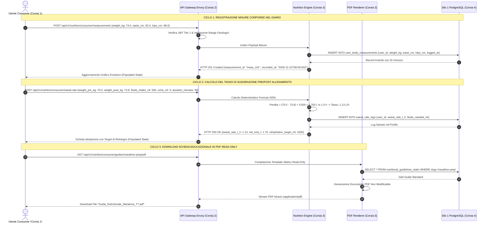

# Capitolato Tecnico: Flow NUT-1A – Diario Nutrizione, Misure & Guide Educazionali (Tier 1 Consumer)

## 1. Identificativo & Titolo Ufficiale
- **Badge Miro Board:** `#23` (Shape ID: `3458764691143273851`, Posizione LIVE: `X: 14500, Y: 650`, Nodi ISO: `16`)
- **Codice Univoco:** `FLOW-NUT-1A`
- **Titolo Formale:** COLONNA 7: DIARIO NUTRIZIONE E STILE DI VITA - FLOW NUT-1A: TIER 1 (CONSUMER) - DIARIO NUTRIZIONE, MISURE CORPOREE & GUIDE EDUCAZIONALI
- **Board Miro Online:** `uXjVEbo6L2o=` (Zona 4: Colonna 7, Riga 1 - Tier 1 Consumer B2C)
- **Diagramma Sorgente:** [flow-nut-1a-consumer-nutrition.mmd](../02-miro-zones-and-swimlanes/18-flowcharts/software-1-consumer-b2c/flow-nut-1a-consumer-nutrition.mmd)
- **Riferimento Glossario:** [Glossario Tecnico Vivente](00-GLOSSARIO-TERMINI-TECNICI.md) (Voci: [Diario Nutrizione e Stile di Vita](00-GLOSSARIO-TERMINI-TECNICI.md#diario-nutrizione-e-stile-di-vita), [Tasso di Sudorazione](00-GLOSSARIO-TERMINI-TECNICI.md#tasso-di-sudorazione-sweat-rate), [Classificazione Evidenze Integratori](00-GLOSSARIO-TERMINI-TECNICI.md#classificazione-evidenze-integratori-sportivi), [Fabbisogno Energetico Basale](00-GLOSSARIO-TERMINI-TECNICI.md#fabbisogno-energetico-basale-e-totale), [Feature Gating Tier 1 (Consumer)](00-GLOSSARIO-TERMINI-TECNICI.md#feature-gating-tier-1-consumer), [3 Silos Database (Multi-Tenant Data Isolation)](00-GLOSSARIO-TERMINI-TECNICI.md#3-silos-database-multi-tenant-data-isolation)).
- **Nota di Governance & Separazione Database:** Il modulo opera in isolamento totale su partizione dedicata **Silo 1 (Public, Consumer & Social PostgreSQL)**. In conformità alla Legge Funzionale di Tier 1, è interdetto qualsiasi collegamento automatico con la sezione Programmazione (#03), con la Data Analisi (#04) o con dispositivi wearable; nessun supporto AI o RAG è attivo. I dati biometrici registrati dall'utente (peso e circonferenze) rimangono strettamente confinati al suo spazio personale e non vengono incrociati con cartelle cliniche (Silo 2) o telemetrie aggregate (Silo 3).

---

## 2. Obiettivo di Business & Target Utente

### Guida Pratica per Non Tecnici: Cos'e questo modulo per un umano?
Per chi fa sport a livello amatoriale o desidera rimettersi in forma, orientarsi nel mondo della nutrizione e del peso corporeo è spesso frustrante: da un lato bilance smart con grafici incomprensibili, dall'altro regimi alimentari estremi trovati online e centinaia di barattoli di integratori acquistati a caso senza sapere se servano davvero.  
**Diario Nutrizione e Stile di Vita (Tier 1 Consumer)** è lo spazio essenziale e sicuro per monitorare il proprio corpo senza ansia e con basi scientifiche rigorose:
- **Diario Semplice di Peso e Circonferenze:** uno spazio personale dove annotare nel tempo il peso e le misure di vita, fianchi, braccio e coscia, per vedere se i propri sforzi stanno portando a miglioramenti reali senza ricorrere a costosi esami medici;
- **Guide e Schede Nutrizionali Pre-Confezionate:** accesso immediato a linee guida alimentari standardizzate redatte da esperti, ricercabili tramite comodi filtri per sport praticato (corsa, palestra, nuoto, ciclismo) e regime alimentare (onnivoro, vegetariano, vegano), senza diete cliniche personalizzate;
- **Calcolatori Manuali del Fabbisogno e della Sudorazione:** due strumenti pratici per capire quante calorie si consumano orientativamente in base alle attività svolte e quanti liquidi è necessario reintegrare pesandosi prima e dopo l'allenamento (test del tasso di sudorazione);
- **Guida Scientifica agli Integratori:** una mappa oggettiva e imparziale che classifica le sostanze più diffuse (creatina, proteine, caffeina, carnitina, ecc.) in base all'effettiva dimostrazione di efficacia scientifica (secondo le linee guida internazionali ISSN e AIS), proteggendo il portafoglio da spese inutili o dannose;
- **Esportazione PDF Read-Only:** consultazione immediata dall'applicazione o download di comode schede riassuntive in formato PDF non modificabile da stampare o conservare.

### Specifiche di Business & Metriche
- **Target Utente:** Praticanti amatoriali, appassionati di fitness, principianti e utenti B2C Consumer (Tier 1).
- **Problema Risolto:** Mancanza di consapevolezza nutrizionale di base, dispersione economica in integratori privi di evidenze e disidratazione nell'attività fisica.
- **Stato Gap Analysis (Regola 10):** Arancione (`#e67e22` - Nuovo modulo Colonna 7 da rilasciare su Silo 1).
- **Metriche Chiave (KPI):**
  - Tempo di risposta salvataggio misure corporee: $< 250\text{ ms}$;
  - Latenza calcolo tasso di sudorazione: $< 100\text{ ms}$;
  - Tempo di generazione PDF scheda nutrizionale read-only: $< 1.5\text{ s}$;
  - Isolamento Silo 1: $100\%$ conformità architetturale (zero chiamate verso Silo 2 Bunker o Silo 3 Lake).

---

## 3. Attori & Architettura a 4 Corsie (Swimlanes)

1. **Corsia 1: Thin Client UI/UX (React 18 PWA):**
   - Dashboard Misure Corporee: grafici a linee semplici per peso e circonferenze (vita, fianchi, braccia, cosce) con trend temporale;
   - Catalogo Guide Nutrizionali: visualizzatore schede per categoria sportiva, obiettivo (benessere, tono, resistenza) e stile alimentare;
   - Calcolatori Fabbisogno & Sudorazione: maschere di input manuale con validazione istantanea sul client per impedire valori assurdi o `NaN`;
   - Guida Integratori ISSN/AIS: elenco statico suddiviso nei 4 livelli di evidenza scientifica (Gruppo A - Efficacia provata, B - Promettenti, C - Evidenze scarse, D - Rischiosi/vietati);
   - Esportatore PDF Sola Lettura: pulsante di download per schede educative e report riassuntivo statico.
2. **Corsia 2: API Gateway & Envoy Security Guard:**
   - Terminazione TLS 1.3 con validazione JWT Tier 1 (`role: CONSUMER_TIER1`, `scope: NUTRITION_READ_LOG`);
   - Rate limiting protettivo ($< 60\text{ req/min}$ per utente amatoriale);
   - Content Validator: scarto immediato di richieste con dati anomali (es. peso $< 30\text{ kg}$ o $> 300\text{ kg}$) e blocco di qualsiasi payload che tenti di richiedere modifiche a diete cliniche.
3. **Corsia 3: Server Scatola Nera (Nutrition Engine Cloud Run):**
   - **Sweat Rate Calculator Service:** calcolo deterministico del tasso di sudorazione espresso in litri/ora:  
     $$\text{Sweat Rate (L/h)} = \frac{(\text{Peso Pre} - \text{Peso Post}) + \text{Liquidi Assunti (L)} - \text{Perdite Urinarie (L)}}{\text{Durata Allenamento (h)}}$$  
     con calcolo del volume di reidratazione consigliato ($120-150\%$ della perdita idrica netta);
   - **Basal & Activity Energy Expenditure Estimator:** stima del dispendio energetico tramite formule standard validate (Mifflin-St Jeor / Harris-Benedict) moltiplicate per i livelli di attività fisica (PAL);
   - **Supplement Evidence Engine:** servizio di consultazione del catalogo statico degli integratori senza raccomandazioni mediche individuali;
   - **PDF Rendering Service:** compilazione server-side di template PDF certificati statici con watermark anti-contraffazione Read-Only.
4. **Corsia 4: Database Tripartito (Silo 1 - Public & Consumer PostgreSQL Partition):**
   - Tabelle dedicate: `user_body_measurements`, `nutritional_guidelines_static`, `supplement_evidence_catalog`, `sweat_rate_logs`;
   - Isolamento ermetico: nessuna tabella del modulo nutrizione di Tier 1 condivide chiavi esterne con cartelle cliniche (Silo 2) o telemetria grezza (Silo 3).

---

### Sequence Diagram Asincrono del Ciclo di Vita (FLOW-NUT-1A)



---

## 4. Flusso Passo-Passo

### Livello A: Guida Operativa & User Journey Narrativo
1. **Accesso alla Sezione Nutrizione:** L'utente tocca la scheda "Nutrizione e Stile di Vita" nel menu principale della PWA T7. La dashboard accoglie l'atleta con il riepilogo dell'ultimo peso registrato e un grafico lineare dell'andamento mensile.
2. **Registrazione Peso e Circonferenze:** L'utente inserisce il peso rilevato al mattino e le misure di vita e fianchi. L'interfaccia memorizza il punto sul grafico evidenziando la variazione rispetto alle ultime quattro settimane.
3. **Esplorazione delle Linee Guida Standard:** Volendo apprendere come nutrirsi per un'uscita in bicicletta o una gara sui 10 km, l'utente usa la barra di ricerca o i filtri per disciplina sportiva e preferenza (onnivoro, vegetariano, vegano), aprendo schede di educazione alimentare chiare e senza gergo incomprensibile.
4. **Verifica della Sicurezza di un Integratore:** Prima di acquistare un prodotto pubblicizzato sui social, l'utente digita il nome del principio attivo nella guida agli integratori: scopre istantaneamente se appartiene alla classe A (efficacia scientificamente consolidata, es. creatina monoidrato), classe B (promettente ma con studi limitati), classe C (nessuna prova di efficacia dimostrata) o classe D (potenzialmente nocivo o dopante).
5. **Calcolo della Sudorazione in Allenamento:** Al rientro da una seduta impegnativa, l'utente inserisce il peso pre-allenamento, il peso post-allenamento, i millilitri d'acqua bevuti e la durata della sessione. L'app restituisce il tasso di sudorazione in litri all'ora e la quantità precisa di acqua ed elettroliti da bere nelle 2-4 ore successive per un pieno recupero.
6. **Esportazione PDF:** Con un tocco sul tasto "Esporta Scheda", l'utente scarica il vademecum in formato PDF statico non modificabile per consultarlo offline.

### Livello B: Deep-Dive Tecnico & Dettagli di Implementazione
1. **Validazione sul Thin Client (React 18):**
   - I campi numerici del diario applicano maschere restrittive con pattern regex `^\d+(\.\d{1,2})?$`;
   - Range vincolanti: Peso $\in [30.0, 300.0]\text{ kg}$, Circonferenze $\in [15.0, 200.0]\text{ cm}$, Durata sessione $\in [10, 480]\text{ minuti}$, Liquidi $\in [0, 5000]\text{ ml}$;
   - Protezione da calcoli errati: sanitizzazione totale di input che impedisce stringhe non numeriche o divisioni per zero nel calcolo del tasso di sudorazione.
2. **Transito e Validazione Gateway Envoy (Corsia 2):**
   - Header HTTP obbligatori: `Authorization: Bearer <jwt>`, `X-T7-App-Tier: TIER_1`, `Content-Type: application/json`;
   - Il gateway esegue il drop preventivo di qualsiasi header o attributo JSON correlato a diete cliniche personalizzate (`diet_plan_id`, `custom_grams`, `clinical_calories`), ritornando `403 Forbidden` per preservare il confine con Tier 2.
3. **Elaborazione Server Scatola Nera (Corsia 3):**
   - Motore Sudorazione: implementazione della formula di Murray & Armstrong (2014) con normalizzazione in litri/ora ($\text{L/h}$) e calcolo della percentuale di disidratazione:  
     $$\%\text{ Dehydration} = \frac{\text{Peso Pre} - \text{Peso Post}}{\text{Peso Pre}} \times 100$$  
     Se $\%\text{ Dehydration} \ge 2\%$, l'algoritmo attiva un warning arancione nell'UI avvisando che le capacità aerobiche e cognitive sono compromesse;
   - Disaccoppiamento Assoluto: zero comunicazioni interne verso il motore di programmazione macrocicli (#03/#09/#15) o verso i server di telemetria wearable.
4. **Persistenza su Database (Corsia 4 - Silo 1):**
   - Memorizzazione nel cluster PostgreSQL Silo 1 partizionato per `tenant_id = 'public_b2c'`;
   - Indici compositi ottimizzati per serie temporali su `(user_id, logged_at DESC)` per rendering istantaneo dei grafici lineari senza full table scan.

---

## 5. Rami Decisionali & Gestione Errori (4 Stati UI)

### Albero Decisionale
```text
[Input Utente]
  |
  +--> Log Misure Corporee (Peso, Circonferenze)?
  |      |--> Valori entro i limiti fisiologici?
  |      |      |--> SI: Persistenza Silo 1 -> Aggiornamento Grafico Trend (Populated State)
  |      |      +--> NO: Validazione fallita -> HTTP 422 -> Evidenziazione campi in rosso (Error State)
  |
  +--> Calcolatore Tasso di Sudorazione?
  |      |--> Durata allenamento > 0 e Peso Pre >= Peso Post?
  |      |      |--> SI: Calcolo L/h e reintegro 150% -> Mostra Scheda Idratazione (Populated State)
  |      |      +--> NO: Parametri incoerenti -> Errore inserimento peso post > pre (Error State)
  |
  +--> Ricerca Guide Educazionali o Integratori?
  |      |--> Risultati presenti per filtro selezionato?
  |      |      |--> SI: Rendering schede informative read-only (Populated State)
  |      |      +--> NO: Nessuna corrispondenza -> Schermata di ricerca vuota (Empty State)
  |
  +--> Esportazione Scheda PDF?
         |--> Rendering server-side riuscito?
                |--> SI: HTTP 200 con stream binario application/pdf (Populated State)
                +--> NO: Timeout generatore -> HTTP 500 con tasto Riprova (Error State)
```

### I 4 Stati dell'Interfaccia Utente (UI)
1. **Empty State:** Visualizzato al primo accesso al diario o quando l'utente non ha ancora registrato misure. Mostra un'illustrazione sobria con messaggio "Nessuna misura registrata. Inizia inserendo il tuo peso di stamattina per tracciare i tuoi progressi" e un pulsante centrale "Aggiungi Misura".
2. **Loading State:** Scheletri di caricamento pulsanti (shimmer effect grigio chiaro `#f1f5f9`) durante il salvataggio delle misure corporee o il calcolo del tasso di sudorazione sul server, con disabilitazione dei pulsanti di invio per prevenire doppi click.
3. **Populated State:** Dashboard completa con grafico a linee Chart.js reattivo, valore dell'ultimo peso registrato con delta rispetto alla pesata precedente ($\pm \Delta\text{ kg}$), tabella storico delle circonferenze ed etichette chiare con indicatori scientifici.
4. **Error / Fallback State:** Se il dispositivo è offline o il server restituisce errore (es. `503 Service Unavailable`), i dati vengono conservati temporaneamente nella cache locale `IndexedDB` e l'utente viene avvisato con un banner ambra non bloccante: "Modalità non in linea: le tue misure verranno salvate non appena tornerà la connessione".

---

## 6. Contratti Dati JSON & Matrice Errori HTTP

### Contratto Inserimento Misure Corporee (`POST /api/v1/nutrition/consumer/measurements`)
```http
POST /api/v1/nutrition/consumer/measurements
Authorization: Bearer <jwt_tier1_consumer_token>
Content-Type: application/json
```
```json
{
  "weight_kg": 73.8,
  "waist_cm": 81.5,
  "hips_cm": 97.0,
  "arm_cm": 32.5,
  "thigh_cm": 55.0,
  "notes": "Pesata a digiuno ore 07:30"
}
```
```json
{
  "measurement_id": "meas_884920",
  "user_id": "usr_9921b2c",
  "recorded_at": "2026-11-21T07:30:00Z",
  "weight_kg": 73.8,
  "bmi_estimated": 22.8,
  "status": "RECORDED"
}
```

### Contratto Calcolo Tasso di Sudorazione (`POST /api/v1/nutrition/consumer/sweat-rate`)
```http
POST /api/v1/nutrition/consumer/sweat-rate
Authorization: Bearer <jwt_tier1_consumer_token>
Content-Type: application/json
```
```json
{
  "weight_pre_kg": 74.5,
  "weight_post_kg": 73.2,
  "fluids_intake_ml": 600,
  "urine_loss_ml": 0,
  "duration_minutes": 75,
  "ambient_temp_celsius": 24.0
}
```
```json
{
  "sweat_rate_liters_per_hour": 1.52,
  "net_fluid_deficit_liters": 1.90,
  "dehydration_percentage": 1.74,
  "rehydration_plan": {
    "recommended_fluid_target_ml": 2850,
    "recovery_window_hours": 3,
    "sodium_replenishment_recommended": true,
    "warning_level": "MILD_DEHYDRATION"
  }
}
```

### Schema Relazionale (Database Silo 1 - PostgreSQL)

```sql
-- TABELLA MISURAZIONI CORPOREE CONSUMER (SILO 1)
CREATE TABLE user_body_measurements (
    measurement_id UUID PRIMARY KEY DEFAULT gen_random_uuid(),
    user_id UUID NOT NULL,
    weight_kg NUMERIC(5, 2) NOT NULL CHECK (weight_kg BETWEEN 30.0 AND 300.0),
    waist_cm NUMERIC(5, 2) CHECK (waist_cm BETWEEN 30.0 AND 200.0),
    hips_cm NUMERIC(5, 2) CHECK (hips_cm BETWEEN 30.0 AND 200.0),
    arm_cm NUMERIC(4, 2) CHECK (arm_cm BETWEEN 10.0 AND 100.0),
    thigh_cm NUMERIC(5, 2) CHECK (thigh_cm BETWEEN 20.0 AND 150.0),
    notes VARCHAR(255),
    logged_at TIMESTAMPTZ NOT NULL DEFAULT NOW()
);
CREATE INDEX idx_user_measurements_timeline ON user_body_measurements (user_id, logged_at DESC);

-- TABELLA LOG TEST SUDORAZIONE CONSUMER
CREATE TABLE sweat_rate_logs (
    log_id UUID PRIMARY KEY DEFAULT gen_random_uuid(),
    user_id UUID NOT NULL,
    weight_pre_kg NUMERIC(5, 2) NOT NULL,
    weight_post_kg NUMERIC(5, 2) NOT NULL,
    fluids_intake_ml INTEGER NOT NULL DEFAULT 0,
    duration_minutes INTEGER NOT NULL CHECK (duration_minutes > 0),
    sweat_rate_l_h NUMERIC(4, 2) NOT NULL,
    dehydration_pct NUMERIC(4, 2) NOT NULL,
    rehydration_target_ml INTEGER NOT NULL,
    logged_at TIMESTAMPTZ NOT NULL DEFAULT NOW()
);
CREATE INDEX idx_sweat_logs_user ON sweat_rate_logs (user_id, logged_at DESC);

-- TABELLA CATALOGO LINEE GUIDA STATICHE NUTRIZIONE
CREATE TABLE nutritional_guidelines_static (
    guideline_id VARCHAR(64) PRIMARY KEY,
    title VARCHAR(128) NOT NULL,
    sport_category VARCHAR(64) NOT NULL,
    dietary_regime VARCHAR(32) NOT NULL CHECK (dietary_regime IN ('OMNIVORE', 'VEGETARIAN', 'VEGAN')),
    target_goal VARCHAR(64) NOT NULL,
    content_markdown TEXT NOT NULL,
    is_active BOOLEAN NOT NULL DEFAULT TRUE,
    created_at TIMESTAMPTZ NOT NULL DEFAULT NOW()
);

-- TABELLA CLASSIFICAZIONE EVIDENZE INTEGRATORI (ISSN / AIS)
CREATE TABLE supplement_evidence_catalog (
    supplement_id VARCHAR(64) PRIMARY KEY,
    common_name VARCHAR(128) NOT NULL,
    evidence_category VARCHAR(2) NOT NULL CHECK (evidence_category IN ('A', 'B', 'C', 'D')),
    scientific_summary TEXT NOT NULL,
    safety_warnings TEXT,
    reference_authority VARCHAR(64) NOT NULL DEFAULT 'ISSN_AIS_2024'
);
```

### Matrice Errori HTTP a 6 Colonne

| Codice HTTP | Errore Interno | Condizione Scatenante | Risposta Client | Azione Automatica Client | Ripristino Utente |
| :--- | :--- | :--- | :--- | :--- | :--- |
| `400 Bad Request` | `INVALID_MEASUREMENT_RANGE` | Peso corporeo inferiore a 30kg o superiore a 300kg oppure circonferenze fuori scala | `{"error": "I valori inseriti sono fuori scala: verifica il peso o le circonferenze"}` | Evidenzia i campi anomali con bordo rosso | Correggere i valori digitati e premere di nuovo Salva |
| `401 Unauthorized` | `CONSUMER_SESSION_EXPIRED` | Token JWT Silo 1 assente, alterato o scaduto | `{"error": "Sessione scaduta: effettua nuovamente l'accesso all'app"}` | Reindirizza l'utente alla schermata di login | Inserire le credenziali di accesso per autenticarsi |
| `403 Forbidden` | `FEATURE_GATING_TIER1_BLOCKED` | Tentativo di richiedere modifiche a piani dietetici o funzioni esclusive di Tier 2 | `{"error": "La modifica dei piani nutrizionali e riservata agli account Professionisti"}` | Disabilita i controlli di editing e mostra banner informativo | Effettuare l'upgrade a Tier 2 Pro se abilitati |
| `404 Not Found` | `GUIDELINE_NOT_FOUND` | La scheda nutrizionale richiesta tramite link o ricerca non e presente nel database | `{"error": "Linee guida non trovate per la categoria selezionata"}` | Ripristina la lista completa delle guide standard | Scegliere un'altra categoria di sport o obiettivo |
| `422 Unproc Entity` | `SWEAT_RATE_INCOHERENT_INPUT` | Il peso post-allenamento risulta superiore al peso pre senza assunzione di liquidi | `{"error": "Parametri non coerenti: il peso post non puo superare il peso pre"}` | Mostra un messaggio di alert esplicativo | Verificare le pesate registrate prima e dopo la seduta |
| `429 Too Many Req` | `RATE_LIMIT_EXCEEDED` | Più di 60 richieste al minuto inviate dall'applicazione client | `{"error": "Troppe richieste inviate in rapida sequenza: attendi qualche istante"}` | Disabilita temporaneamente il tasto di invio per 30 secondi | Attendere il termine del conto alla rovescia |
| `503 Service Unav` | `SILO1_DB_DISCONNECTED` | Manutenzione temporanea o disconnessione della partizione Silo 1 | `{"error": "Servizio diario nutrizione momentaneamente non raggiungibile"}` | Salva le misure nella cache locale IndexedDB | L'app riproverà la sincronizzazione non appena online |

---

## 7. Ereditarieta di Tier & Sblocco Funzionalita a Cascata (Integrazione Ecosistema T7)

- **Posizionamento Architetturale di Tier 1:** Il modulo costituisce la **base d'ingresso essenziale per l'utente amatoriale**, strutturato su principi di estrema semplicità, autonomia d'uso e conformità scientifica, risiedendo per intero sulla partizione **Silo 1 (Public, Consumer & Social)**.
- **Cascata Discendente verso Tier 2 e Tier 3:**
  - Tutti i dati di diario (peso e circonferenze) e le schede educative definite in Tier 1 scendono automaticamente nelle gerarchie superiori;
  - Quando un atleta passa da utente amatoriale ad assistito da un nutrizionista di Tier 2, lo storico delle misure corporee registrate in Tier 1 viene importato istantaneamente come cronologia di partenza;
- **Limiti Invalicabili di Tier 1 (Blocchi Rigidi):**
  - **Zero Diete Grammate:** divieto assoluto di generare grammature o prescrizioni nutrizionali personalizzate, riservate per legge esclusivamente ai professionisti abilitati di Tier 2 (Legge 3/2018);
  - **Zero Sincronizzazione con Programmazione & Data Analisi:** nessun calcolo di macronutrienti adattivi sui volumi di allenamento o correlazione con angoli articolari;
  - **Zero Wearable Sync:** divieto di importazione automatica del dispendio da smartwatch, bracciali o cardiofrequenzimetri (funzionalità sbloccata parzialmente in Tier 2 per i soli wearable proprietari T7, e totale in Tier 3 per qualsiasi dispositivo);
  - **Zero AI & RAG:** nessuna elaborazione tramite intelligenza artificiale o recupero documentale aumentato.
- **Garanzia Legale & Scientifica:** La consultazione della guida agli integratori basata su cataloghi statici ISSN e AIS tutela l'atleta da acquisti privi di fondamento scientifico e protegge la piattaforma da responsabilità per prescrizioni non autorizzate.
