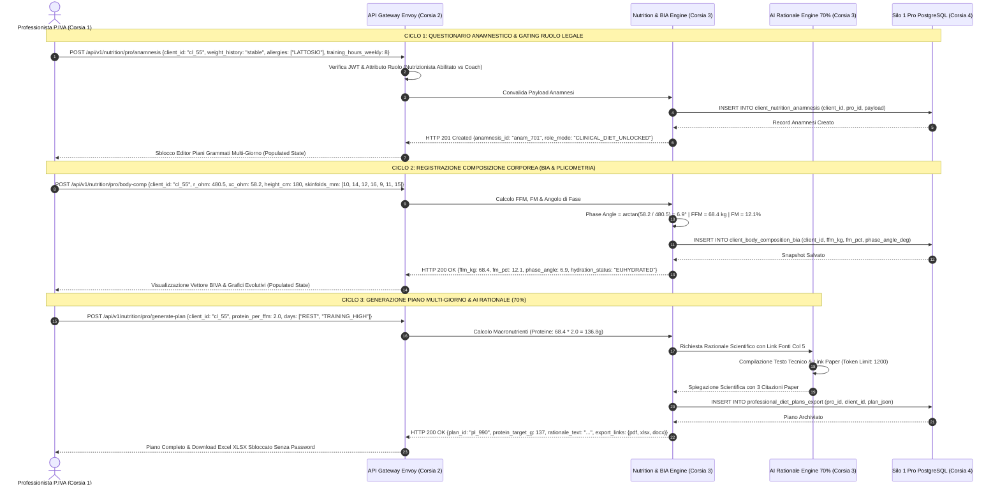

# Capitolato Tecnico: Flow NUT-2B – Nutrizione Clinica vs Coach, Composizione Corporea BIA & Export (Tier 2 Pro P.IVA)

## 1. Identificativo & Titolo Ufficiale
- **Badge Miro Board:** `#24` (Shape ID: `3458764691143273853`, Posizione LIVE: `X: 14500, Y: 3790`, Nodi ISO: `16`)
- **Codice Univoco:** `FLOW-NUT-2B`
- **Titolo Formale:** COLONNA 7: DIARIO NUTRIZIONE E STILE DI VITA - FLOW NUT-2B: TIER 2 (PRO P.IVA) - NUTRIZIONE CLINICA VS COACH, COMPOSIZIONE CORPOREA BIA & MULTI-EXPORT
- **Board Miro Online:** `uXjVEbo6L2o=` (Zona 4: Colonna 7, Riga 2 - Tier 2 Pro P.IVA B2B)
- **Diagramma Sorgente:** [flow-nut-2b-pro-nutrition.mmd](../02-miro-zones-and-swimlanes/18-flowcharts/software-2-pro-b2b/flow-nut-2b-pro-nutrition.mmd)
- **Riferimento Glossario:** [Glossario Tecnico Vivente](00-GLOSSARIO-TERMINI-TECNICI.md) (Voci: [Tutela Legale Legge 3/2018 & Art. 348 c.p.](00-GLOSSARIO-TERMINI-TECNICI.md#tutela-legale-legge-32018-e-art-348-cp), [BIA Vettoriale BIVA](00-GLOSSARIO-TERMINI-TECNICI.md#bia-vettoriale-biva), [Massa Grassa FM e Massa Magra FFM](00-GLOSSARIO-TERMINI-TECNICI.md#massa-grassa-fm-e-massa-magra-ffm), [Plicometria Jackson-Pollock](00-GLOSSARIO-TERMINI-TECNICI.md#plicometria-jackson-pollock), [Wearable Esclusivo T7](00-GLOSSARIO-TERMINI-TECNICI.md#wearable-esclusivo-t7), [Esportazione Multi-Formato Sbloccata](00-GLOSSARIO-TERMINI-TECNICI.md#esportazione-multi-formato-sbloccata), [AI Rationale Limitata 70%](00-GLOSSARIO-TERMINI-TECNICI.md#ai-rationale-limitata-70), [Feature Gating Tier 2 (Pro P.IVA)](00-GLOSSARIO-TERMINI-TECNICI.md#feature-gating-tier-2-pro-piva)).
- **Nota di Governance & Separazione Database:** Il modulo risiede sulla partizione dedicata **Silo 1 Pro (Professional & B2B PostgreSQL)**. In conformità ai vincoli architetturali a silos, non vi è alcuna comunicazione automatica con la sezione Programmazione (#09) o con la Data Analisi (#10); chatbot e RAG sono rigorosamente assenti. I piani nutrizionali e i dati antropometrici degli assistiti rimangono confinati nel database del singolo professionista, protetti da crittografia applicativa a riposo e separati dalle enclave Tier 3 (Silo 2 Bunker KMS).

---

## 2. Obiettivo di Business & Target Utente

### Guida Pratica per Non Tecnici: Cos'e questo modulo per un umano?
Nel mondo dello sport e del fitness professionale, la nutrizione rappresenta un terreno delicatissimo sia dal punto di vista scientifico che legale: preparatori atletici e personal trainer rischiano gravi sanzioni penali per esercizio abusivo della professione medica (Art. 348 c.p. e Legge 3/2018) se stilano diete grammate, mentre biologi nutrizionisti, dietisti e medici necessitano di strumenti potenti per calcolare grammature, massa magra reale e fabbisogni specifici.  
**Nutrizione Pro & Composizione Corporea (Tier 2 Pro P.IVA)** risolve questa sfida offrendo una piattaforma professionale completa, sicura e legalmente blindata:
- **Protezione Legale Intelligente in Base al Ruolo:** all'accesso con Partita IVA, il sistema riconosce la qualifica professionale. Se l'utente è un professionista sanitario o nutrizionale abilitato (Biologo Nutrizionista iscritto all'ONB, Dietista o Medico), sblocca l'editor completo di diete cliniche con grammature esatte e calcolo calorico; se invece è un Preparatore Atletico o Personal Trainer, attiva la modalità protetta di "Consigli di Educazione Alimentare e Timing Energetico", evitando qualsiasi rischio legale e suggerendo solo linee guida macro e tempistiche;
- **Hub Completo di Composizione Corporea:** uno studio antropometrico digitale autosufficiente per registrare, storicizzare e analizzare plicometria (protocollo Jackson-Pollock a 3 e 7 pliche), bioimpedenziometria (BIA convenzionale e vettoriale BIVA con ellissi di confidenza), massa grassa (FM) e massa magra (FFM). Include promemoria automatici per ripetere i test sempre nelle medesime condizioni standardizzate (orario, digiuno, stato di idratazione);
- **Questionario Anamnestico Approfondito:** raccolta guidata della storia ponderale del cliente, allergie, intolleranze diagnosticate, alvo/digestione, preferenze alimentari, ritmi circadiani e orari di allenamento prima della generazione del piano;
- **Pianificazione Multi-Giorno e Personalizzazione Totale:** elaborazione di piani alimentari flessibili articolati su giornate tipo (giorno di riposo, giorno a carico medio, giorno di gara/carico intenso), con proteine tarate sui grammi per chilo di massa magra reale ($g/\text{kg FFM}$) anziché sul peso totale;
- **Test di Sudorazione Personalizzato & Protocollo Idratazione:** test da campo condotto con il cliente (pesata pre/post seduta e volumi di fluidi ingeriti) per generare una strategia precisa di reintegro idro-elettrolitico;
- **Supporto AI (70% con limite Token) & Link alla Libreria Fonti:** generazione automatica della spiegazione scientifica del piano da consegnare al cliente, con bibliografia ed hyperlink cliccabili direttamente verso i paper della Colonna 5 (Libreria Fonti);
- **Compatibilità Esclusiva con Wearable T7:** importazione del dispendio calorico giornaliero esclusivamente tramite i dispositivi indossabili proprietari a marchio T7;
- **Esportazione Multi-Formato Sbloccata:** download del piano e delle schede in 4 formati: PDF grafico per il cliente, Excel (.xlsx sbloccato senza password per consentire modifiche e fogli di calcolo personalizzati al preparatore), Word (.docx) e Notes/TXT.

### Specifiche di Business & Metriche
- **Target Utente:** Biologi Nutrizionisti, Dietisti, Medici dello Sport, Preparatori Atletici, Personal Trainer e Fisioterapisti titolari di Partita IVA.
- **Problema Risolto:** Rischio penale di esercizio abusivo per i trainer, frammentazione tra dati di composizione corporea e piani dietetici per i nutrizionisti, ed esportazioni bloccate da password.
- **Stato Gap Analysis (Regola 10):** Arancione (`#e67e22` - Nuovo modulo Colonna 7 con split legale e composizione corporea).
- **Metriche Chiave (KPI):**
  - Tempo di riconoscimento qualifica e gating legale: $< 150\text{ ms}$;
  - Latenza calcolo massa magra BIA e pliche: $< 180\text{ ms}$;
  - Tempo di generazione spiegazione scientifica AI 70%: $< 2.2\text{ s}$;
  - Tempo di esportazione multi-formato (PDF, XLSX, DOCX): $< 1.8\text{ s}$;
  - Protezione Legale: $100\%$ conformità al divieto di prescrizione per non sanitari.

---

## 3. Attori & Architettura a 4 Corsie (Swimlanes)

1. **Corsia 1: Thin Client UI/UX (React 18 Pro Portal):**
   - Questionario Anamnesi Clinico-Sportiva: form multi-step con validazione campi su allergie (ICD-11/EFSA), abitudini e carichi;
   - Role-Gated Interface: rendering condizionale dell'interfaccia (Editor Diete Grammate per Nutrizionisti vs Educazione Macro & Timing per Coach);
   - Studio Composizione Corporea: inserimento pliche con calibro (mm), parametri BIA (Resistenza $R$ e Reattanza $Xc$ in $\Omega$, Angolo di Fase in gradi), grafici evolutivi FM/FFM;
   - Sweat Test Runner: procedura guidata per misurazione sudorazione sul campo con timer seduta e liquidi assunti;
   - Export Station: selettore di formato a 4 vie (PDF, Excel `.xlsx` sbloccato, Word `.docx`, Apple Notes).
2. **Corsia 2: API Gateway & Envoy Legal Access Guard:**
   - Validazione JWT con claim estesi (`role: PRO_TIER2`, `fiscal_code`, `vat_number`, `medical_registry_status`);
   - Intercettore Legal Role-Based Access Control (RBAC): verifica se l'utenza possiede abilitazione sanitaria per accedere alle rotte `/clinical-diet`; se negativo, instrada forzatamente sulle rotte `/education-timing`;
   - Rate limiting bilanciato ($< 180\text{ req/min}$) e quota limiter sui token dell'AI (capacità 70%).
3. **Corsia 3: Server Scatola Nera (Pro Nutrition & Body Composition Engine):**
   - **Body Composition Engine:** calcolo della densità corporea con formule Jackson-Pollock a 3 e 7 siti, conversione in percentuale grassa con formula di Siri / Brozek:  
     $$\%FM = \left(\frac{4.95}{\text{Densità}} - 4.50\right) \times 100$$  
     Analisi BIA vettoriale (BIVA) con vettori di impedenza normalizzati per altezza ($R/H$ e $Xc/H$ in $\Omega/\text{m}$) e calcolo dell'Angolo di Fase ($\text{Phase Angle} = \arctan(Xc / R) \times \frac{180}{\pi}$);
   - **FFM Calibrator & Multi-Day Planner:** dimensionamento dell'apporto proteico mirato sulla massa magra reale ($1.6 - 2.4\text{ g/kg FFM}$) e ripartizione calorica su 3 giornate tipo (Rest, Medium, High Load);
   - **AI Rationale Generator (70%):** generazione di sintesi scientifiche sul piano nutrizionale con limite token e arricchimento con citazioni bibliografiche collegate alla Libreria Fonti (#11);
   - **T7 Wearable Connector:** ingest del dispendio energetico giornaliero limitato esclusivamente ai dispositivi con vendor ID `T7_WEARABLE_V1`;
   - **Supplement Safety Filter:** controllo posologie massime, orari di somministrazione (blocco caffeina $> 200\text{ mg}$ dopo le ore 17:00) e segnalazione controindicazioni per adolescenti o patologie.
4. **Corsia 4: Database Tripartito (Silo 1 Pro - PostgreSQL Partition):**
   - Tabelle relazionali: `client_nutrition_anamnesis`, `client_body_composition_bia`, `client_body_composition_skinfold`, `professional_diet_plans_export`, `supplement_safety_logs`;
   - Isolamento a Silos: assenza di chiavi esterne verso i moduli di programmazione (#09) o data analisi (#10).

---

### Sequence Diagram Asincrono del Ciclo di Vita (FLOW-NUT-2B)



---

## 4. Flusso Passo-Passo

### Livello A: Guida Operativa & User Journey Narrativo
1. **Accesso e Riconoscimento del Ruolo:** Il professionista accede all'Hub Nutrizione di Tier 2. L'applicazione rileva i dati di iscrizione all'Albo professionale o il codice ATECO registrato. Se l'utente è un biologo o un medico, l'app presenta la dicitura "Modulo Nutrizione Clinica"; se è un personal trainer, la dicitura diventa "Educazione Alimentare & Timing Sportivo", adeguando i testi di legge nei documenti generati.
2. **Compilazione dell'Anamnesi del Cliente:** Durante il colloquio iniziale, il professionista compila il questionario anamnestico raccogliendo dati su oscillazioni di peso passate, intolleranze certificate, problemi digestivi e orari dei pasti rispetto agli allenamenti.
3. **Misurazione della Composizione Corporea:** Il professionista esegue il test di bioimpedenziometria (inserendo resistenza, reattanza e statura) e rileva le pliche con il plicometro. Il sistema calcola istantaneamente la massa magra (FFM in kg), la percentuale di massa grassa e l'angolo di fase cellulare, confrontandoli con i grafici evolutivi storici del cliente.
4. **Impostazione Promemoria Standardizzati:** Per garantire l'affidabilità scientifica dei controlli futuri, l'app imposta promemoria automatici che ricordano all'atleta di presentarsi al controllo nelle stesse condizioni della prima visita (stessa ora del mattino, a digiuno da 8 ore, senza allenamenti intensi nelle 12 ore precedenti).
5. **Costruzione del Piano Alimentare Multi-Giorno:** Il nutrizionista imposta il fabbisogno proteico calcolandolo sui chili di massa magra effettiva dell'atleta (es. 2.0 g per kg di FFM) e distribuisce i carboidrati e i grassi su tre giornate tipo (giorno di riposo, giorno di carico medio, giorno di gara o doppio allenamento). Se l'utente è un coach, l'app gli permette di impostare proporzioni macro generali e indicazioni sul timing dei pasti pre e post workout, omettendo grammature rigide di alimenti.
6. **Integrazione Wearable T7 & Filtro Sicurezza Integratori:** Il professionista importa il dispendio calorico medio rilevato dai dispositivi indossabili T7 del cliente. Seleziona gli integratori verificando che il filtro di sicurezza non rilevi incompatibilità orarie (es. caffeina assunta la sera prima del sonno) o controindicazioni.
7. **Generazione del Razionale AI & Esportazione:** L'intelligenza artificiale (configurata al 70% di potenza con limite di token) redige un documento di accompagnamento che spiega all'atleta le ragioni scientifiche del piano, includendo i collegamenti agli articoli della Libreria Fonti T7. Il professionista scarica il report in PDF per il cliente e il foglio Excel `.xlsx` sbloccato senza password per le proprie annotazioni.

### Livello B: Deep-Dive Tecnico & Dettagli di Implementazione
1. **Algoritmi di Composizione Corporea (Corsia 3):**
   - **Formula Jackson-Pollock 7 Pliche (Uomini):**  
     $$\text{BD} = 1.112 - 0.00043499(\Sigma 7) + 0.00000055(\Sigma 7)^2 - 0.00028826(\text{Età})$$  
     dove $\Sigma 7$ è la somma delle pliche in mm (pettorale, ascellare, tricipite, sottoscapolare, addominale, soprailiaca, coscia);
   - **Formula BIVA (Bioelectrical Impedance Vector Analysis):** calcolo del modulo $|Z| = \sqrt{R^2 + Xc^2}$ e standardizzazione sui percentili di Piccoli et al. (1994) per determinare disidratazione, iperidratazione o malnutrizione;
   - Calibrazione FFM: $\text{FFM (kg)} = \text{Peso Totale (kg)} \times (1 - \frac{\%FM}{100})$.
2. **Architettura Legal Gatekeeper (Corsia 2):**
   - Il middleware controlla il campo `professional_credentials.registry_type` nel JWT;
   - Se `registry_type IN ('ONB_BIOLOGO', 'FNOFI_DIETISTA', 'FNOMCEO_MEDICO')`, abilita il flag `CAN_PRESCRIBE_GRAMS = true`;
   - Se `registry_type` è privo di iscrizione sanitaria (es. `CONI_COACH`, `AICS_PT`), il gateway forza la rimozione del campo `gram_weights` dal payload di risposta e attiva il disclaimer legale: *"Linee guida nutrizionali a scopo puramente informativo e di educazione alimentare ai sensi della Legge 3/2018. Non costituisce dieta o prescrizione terapeutica"*.
3. **Generatore di Esportazione Multi-Formato:**
   - Worker Node.js asincrono che genera:
     - PDF: layout a colori via Puppeteer con vettori BIVA e tabelle nutrizionali;
     - Excel `.xlsx`: generato con la libreria `exceljs`, foglio sbloccato senza alcuna cella protetta da password, permettendo al preparatore formule personalizzate;
     - Word `.docx`: documento formattato con stili istituzionali;
     - Notes `.txt`: testo strutturato in Markdown per rapida importazione su Apple Notes o Notion.

---

## 5. Rami Decisionali & Gestione Errori (4 Stati UI)

### Albero Decisionale
```text
[Accesso Professionista P.IVA]
  |
  +--> Controllo Ruolo Professionale (Legge 3/2018)
  |      |--> Sanitario Abilitato (Nutrizionista/Dietista/Medico)?
  |      |      |--> SI: Sblocco Editor Diete Cliniche Grammate (Populated State)
  |      |      +--> NO: Attivazione Modalita Educazione & Timing (Populated State)
  |
  +--> Inserimento Dati BIA e Plicometria
  |      |--> Parametri R/Xc ed età entro range fisici validi?
  |      |      |--> SI: Calcolo FFM & Vettore BIVA -> Generazione Grafico (Populated State)
  |      |      +--> NO: Resistenza o pliche negative/assurde -> HTTP 422 (Error State)
  |
  +--> Sincronizzazione Wearable Dispendio
  |      |--> Dispositivo connesso e proprietario a marchio T7?
  |      |      |--> SI: Ingest Kcal giornaliere -> Ricalcolo fabbisogno (Populated State)
  |      |      +--> NO: Dispositivo terzo o non certificato -> Blocco Feature Gating (Error State)
  |
  +--> Richiesta Razionale AI (70%)
         |--> Quota token residua sufficiente?
                |--> SI: Generazione testo con link a Libreria Fonti Col 5 (Populated State)
                +--> NO: Quota mensile esaurita -> HTTP 429 con offerta ricarica token (Error State)
```

### I 4 Stati dell'Interfaccia Utente (UI)
1. **Empty State:** Visualizzato quando si apre la scheda di un nuovo assistito privo di misurazioni antropometriche o questionario anamnestico. Mostra due card di invito: "Avvia Anamnesi Iniziale" e "Registra Prima Plicometria/BIA".
2. **Loading State:** Skeleton loader pulsante con indicatore circolare durante l'elaborazione del vettore BIVA o la compilazione server-side del file Excel sbloccato.
3. **Populated State:** Cockpit completo con griglia comparativa delle giornate tipo (Rest, Medium, High), grafico BIVA ellissoidale con ellissi di tolleranza (50%, 75%, 95%), target proteico espresso in g/kg FFM e pulsanti di esportazione multi-formato attivi.
4. **Error / Fallback State:** Se l'AI supera la quota token o il test di sudorazione presenta valori inconsistenti, il sistema mostra una notifica arancione di avviso e propone il calcolo manuale standard dei macronutrienti senza blocco del piano operativo.

---

## 6. Contratti Dati JSON & Matrice Errori HTTP

### Contratto Calcolo Composizione Corporea (`POST /api/v1/nutrition/pro/body-comp`)
```http
POST /api/v1/nutrition/pro/body-comp
Authorization: Bearer <jwt_tier2_pro_token>
Content-Type: application/json
```
```json
{
  "client_id": "cli_88204",
  "gender": "MALE",
  "age_years": 28,
  "height_cm": 182.0,
  "weight_kg": 78.5,
  "resistance_ohm": 495.2,
  "reactance_ohm": 61.4,
  "skinfold_protocol": "JACKSON_POLLOCK_7",
  "skinfolds_mm": {
    "chest": 8.0,
    "axillary": 11.5,
    "triceps": 9.0,
    "subscapular": 12.0,
    "abdominal": 15.0,
    "suprailiac": 10.0,
    "thigh": 13.0
  }
}
```
```json
{
  "body_composition_id": "bcomp_99214",
  "computed_at": "2026-11-21T09:15:00Z",
  "body_density_g_cm3": 1.0742,
  "fat_mass_percentage": 10.85,
  "fat_mass_kg": 8.52,
  "fat_free_mass_kg": 69.98,
  "phase_angle_degrees": 7.07,
  "vector_bia_status": {
    "hydration_classification": "EUHYDRATED",
    "cell_mass_integrity": "EXCELLENT"
  },
  "recommended_standardized_retest_date": "2026-12-21T09:00:00Z"
}
```

### Contratto Generazione Piano Multi-Giorno (`POST /api/v1/nutrition/pro/diet-plans`)
```http
POST /api/v1/nutrition/pro/diet-plans
Authorization: Bearer <jwt_tier2_pro_token>
Content-Type: application/json
```
```json
{
  "client_id": "cli_88204",
  "plan_title": "Fase Ipertrofia & Forza - Mesociclo Invernale",
  "protein_target_g_per_ffm": 2.2,
  "multi_day_structure": [
    {
      "day_type": "TRAINING_HIGH",
      "target_kcal": 2850,
      "carbs_g": 380,
      "protein_g": 154,
      "fats_g": 65,
      "peri_workout_timing": "50g carbo + 25g whey 45 min post"
    },
    {
      "day_type": "REST_DAY",
      "target_kcal": 2200,
      "carbs_g": 220,
      "protein_g": 154,
      "fats_g": 75,
      "peri_workout_timing": "Nessuno"
    }
  ],
  "enable_ai_rationale_70pct": true
}
```
```json
{
  "plan_id": "diet_773910",
  "pro_role_applied": "CERTIFIED_NUTRITIONIST",
  "legal_compliance_text": "Piano nutrizionale personalizzato conforme alla Legge 3/2018.",
  "ai_rationale": {
    "summary": "Il piano adotta una quota proteica pari a 2.2 g/kg FFM per massimizzare la sintesi proteica muscolare...",
    "cited_sources": [
      { "source_id": "ISSN_PROT_2017", "title": "International Society of Sports Nutrition Position Stand: protein and exercise", "col5_link": "/library/sources/ISSN_PROT_2017" }
    ],
    "tokens_consumed": 480
  },
  "export_files": {
    "pdf_url": "https://pro.t7workout.app/exports/diet_773910.pdf",
    "xlsx_url": "https://pro.t7workout.app/exports/diet_773910_unlocked.xlsx",
    "docx_url": "https://pro.t7workout.app/exports/diet_773910.docx",
    "notes_url": "https://pro.t7workout.app/exports/diet_773910.txt"
  }
}
```

### Schema Relazionale (Database Silo 1 Pro - PostgreSQL)

```sql
-- TABELLA QUESTIONARIO ANAMNESTICO PRO (SILO 1 PRO)
CREATE TABLE client_nutrition_anamnesis (
    anamnesis_id UUID PRIMARY KEY DEFAULT gen_random_uuid(),
    pro_user_id UUID NOT NULL,
    client_id UUID NOT NULL,
    weight_history_notes TEXT,
    certified_allergies TEXT[] NOT NULL DEFAULT '{}',
    intolerances TEXT[] NOT NULL DEFAULT '{}',
    digestive_regularity_score SMALLINT CHECK (digestive_regularity_score BETWEEN 1 AND 5),
    meal_schedule_json JSONB NOT NULL,
    created_at TIMESTAMPTZ NOT NULL DEFAULT NOW()
);
CREATE INDEX idx_anamnesis_client ON client_nutrition_anamnesis (pro_user_id, client_id);

-- TABELLA COMPOSIZIONE CORPOREA (BIA & PLICOMETRIA)
CREATE TABLE client_body_composition_bia (
    comp_id UUID PRIMARY KEY DEFAULT gen_random_uuid(),
    pro_user_id UUID NOT NULL,
    client_id UUID NOT NULL,
    tested_at TIMESTAMPTZ NOT NULL DEFAULT NOW(),
    weight_kg NUMERIC(5, 2) NOT NULL,
    resistance_ohm NUMERIC(6, 2) NOT NULL,
    reactance_ohm NUMERIC(6, 2) NOT NULL,
    phase_angle_deg NUMERIC(4, 2) NOT NULL,
    body_density NUMERIC(5, 4),
    fat_mass_pct NUMERIC(4, 2) NOT NULL,
    fat_free_mass_kg NUMERIC(5, 2) NOT NULL,
    skinfold_data JSONB,
    test_conditions_standardized BOOLEAN NOT NULL DEFAULT TRUE
);
CREATE INDEX idx_body_comp_timeline ON client_body_composition_bia (client_id, tested_at DESC);

-- TABELLA PIANI NUTRIZIONALI MULTI-GIORNO & EXPORT PRO
CREATE TABLE professional_diet_plans_export (
    plan_id UUID PRIMARY KEY DEFAULT gen_random_uuid(),
    pro_user_id UUID NOT NULL,
    client_id UUID NOT NULL,
    author_role VARCHAR(64) NOT NULL,
    plan_data JSONB NOT NULL,
    protein_per_ffm_ratio NUMERIC(3, 2) NOT NULL,
    ai_rationale_text TEXT,
    ai_sources_json JSONB,
    xlsx_unlocked_s3_key VARCHAR(512),
    pdf_s3_key VARCHAR(512),
    created_at TIMESTAMPTZ NOT NULL DEFAULT NOW()
);

-- TABELLA LOG CONTROLLO SICUREZZA INTEGRATORI
CREATE TABLE supplement_safety_logs (
    log_id UUID PRIMARY KEY DEFAULT gen_random_uuid(),
    pro_user_id UUID NOT NULL,
    client_id UUID NOT NULL,
    supplement_code VARCHAR(64) NOT NULL,
    dosage_prescribed VARCHAR(64) NOT NULL,
    safety_check_result VARCHAR(32) NOT NULL CHECK (safety_check_result IN ('APPROVED', 'WARNING_TIME', 'BLOCKED_AGE', 'INTERACTION_RISK')),
    warning_reason TEXT,
    checked_at TIMESTAMPTZ NOT NULL DEFAULT NOW()
);
```

### Matrice Errori HTTP a 6 Colonne

| Codice HTTP | Errore Interno | Condizione Scatenante | Risposta Client | Azione Automatica Client | Ripristino Utente |
| :--- | :--- | :--- | :--- | :--- | :--- |
| `400 Bad Request` | `INVALID_BIA_IMPEDANCE` | Resistenza o Reattanza negative o fuori dai range biologici ($R < 200$ o $> 1200\,\Omega$) | `{"error": "Parametri BIA non validi: verificare la connessione degli elettrodi"}` | Evidenzia in rosso i campi di impedenza | Ripetere il test bioimpedenziometrico e reinserire i valori |
| `401 Unauthorized` | `PRO_SESSION_INVALID` | Token JWT Pro assente o scaduto | `{"error": "Sessione professionale scaduta: accedi nuovamente"}` | Reindirizza al login B2B con memorizzazione bozza | Reinserire le credenziali P.IVA per continuare |
| `403 Forbidden` | `LEGAL_GATEWAY_DENIAL` | Preparatore atletico non abilitato che tenta di salvare grammature cliniche | `{"error": "Funzionalità limitata ai soli nutrizionisti abilitati (Legge 3/2018)"}` | Converte automaticamente il piano in modalità Educazione & Timing | Utilizzare la modalità Educazione o caricare titolo abilitante |
| `404 Not Found` | `CLIENT_PROFILE_NOT_FOUND` | L'ID assistito indicato nella richiesta non appartiene al portfolio del professionista | `{"error": "Cliente non trovato nel portfolio del professionista"}` | Reindirizza all'elenco clienti attivo | Selezionare un cliente valido dalla rubrica assistiti |
| `409 Conflict` | `WEARABLE_VENDOR_REJECTED` | Tentativo di sincronizzare dati da un dispositivo wearable non certificato T7 | `{"error": "In Tier 2 è consentita l'integrazione esclusiva con wearable a marchio T7"}` | Mostra pop-up informativo sulle compatibilità hardware | Connettere un dispositivo T7 autorizzato o passare a Tier 3 |
| `429 Too Many Req` | `AI_TOKEN_QUOTA_EXCEEDED` | Esaurimento della quota mensile di token per la generazione del razionale AI 70% | `{"error": "Quota mensile token AI esaurita: piano generato senza razionale AI"}` | Disabilita il toggle AI mantenendo attivo il piano nutrizionale | Ricaricare il pacchetto token o compilare le note a mano |
| `503 Service Unav` | `EXPORT_WORKER_BUSY` | Coda dei renderizzatori PDF/Excel temporaneamente satura | `{"error": "Servizio di esportazione temporaneamente occupato: riprova a breve"}` | Avvia un retry con backoff esponenziale (3 tentativi) | Attendere il download automatico del file generato |

---

## 7. Ereditarieta di Tier & Sblocco Funzionalita a Cascata (Integrazione Ecosistema T7)

- **Posizionamento Architetturale di Tier 2:** Il modulo rappresenta il **cuore operativo per i professionisti della salute e dello sport titolari di Partita IVA**, ospitato sulla partizione **Silo 1 Pro (Professional & B2B)**.
- **Eredità da Tier 1:**
  - Importazione diretta di tutte le rilevazioni storiche di peso e circonferenze registrate dall'assistito quando utilizzava la versione amatoriale;
  - Utilizzo delle classificazioni scientifiche degli integratori ISSN/AIS come base informativa iniziale;
- **Sblocchi e Capacità Esclusive di Tier 2 rispetto a Tier 1:**
  - **Sblocco Piani Multi-Giorno:** gestione di schede articolate su giornate tipo ad intensità variabile (Rest, Medium, High Load);
  - **Modulo Composizione Corporea Completo:** inserimento di plicometrie (Jackson-Pollock a 3 e 7 punti) e BIA convenzionale e vettoriale (BIVA);
  - **Taratura FFM-Based:** calcolo dei fabbisogni proteici e calorici calibrati sulla massa magra reale ($g/\text{kg FFM}$) e non sul peso grezzo;
  - **Esportazione Multi-Formato Sbloccata:** download senza password in formato Excel `.xlsx`, Word `.docx`, PDF e Notes;
  - **AI Rationale Limitata (70%):** generazione di spiegazioni scientifiche dei piani con citazioni bibliografiche collegate alla Libreria Fonti (#11);
  - **Wearable Sync Monomarca:** importazione del dispendio energetico dai soli dispositivi proprietari a marchio T7;
- **Limiti Invalicabili di Tier 2 (Riservati al Tier 3):**
  - **Isolamento Modulare a Silos:** divieto assoluto di connessione automatica bidirezionale con i moduli di Programmazione (#09) e Data Analisi (#10);
  - **Assenza di Chatbot 24/7 e RAG Privato:** nessun assistente conversazionale con gli atleti o clonazione dello stile clinico;
  - **Divieto Wearable Terze Parti:** impossibilità di collegare tracker Garmin, Apple Watch, Polar, Whoop o GPS da campo (consentito solo in Tier 3);
  - **Nessun Calcolo Continuo Energy Availability (EA):** monitoraggio statico senza correlazione telemetrica in tempo reale per la prevenzione del REDs.
